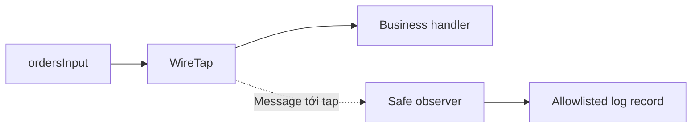
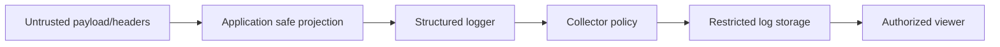
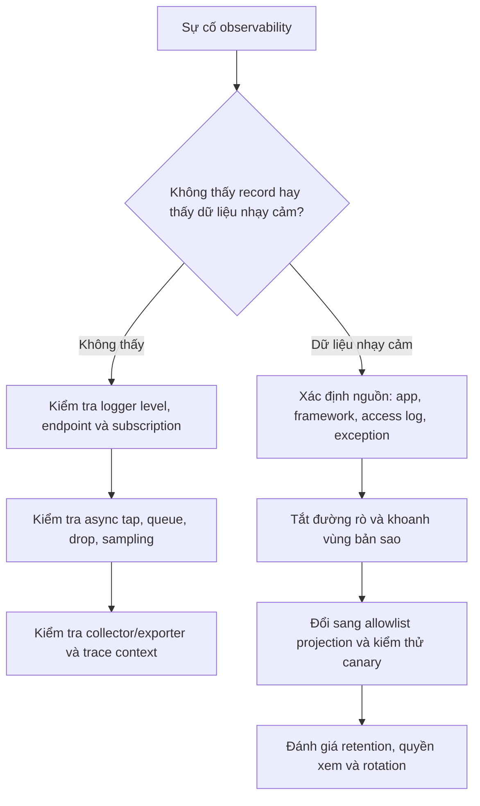

# Log payload, header và redaction

Trong **Spring Integration runtime**, một message đi qua inbound adapter, channel, endpoint, consumer, poller, executor, handler và error flow. Khi cần chẩn đoán “message đang ở đâu?”, “vì sao rollback?”, “vì sao aggregator chưa release?”, thao tác nhanh nhất thường là bật log. Tuy nhiên, **ghi nguyên payload hoặc toàn bộ headers** có thể làm lộ thông tin khách hàng, token xác thực, nội dung giao dịch, đường dẫn file, dữ liệu nội bộ và cả exception chứa message gốc.

Mục tiêu của observability không phải là giữ mọi byte đã đi qua flow. Mục tiêu là **có đủ tín hiệu để giải thích hành vi runtime, trong khi log chỉ chứa thông tin được phép**. Bài thuộc chương **Observability** của module `SPRING_INTEGRATION_RUNTIME`, tập trung vào chiến lược log payload/header, thiết kế redaction, việc dùng `LoggingHandler`/`WireTap`, đường lỗi `ErrorMessage`, correlation, threading, transaction và những phép kiểm chứng khi triển khai thực tế.

> **Nguyên tắc xuyên suốt:** coi payload và các header do nguồn bên ngoài cung cấp là dữ liệu *không đáng tin và có thể nhạy cảm*; tạo một **log projection có allowlist** thay vì tuần tự hóa nguyên `Message<?>`.

## 1. Vì sao `log.info("{}", message)` có thể nguy hiểm?

Giả sử một webhook nhận message chứa thông tin thanh toán:

```text
Message<OrderPayment>
  payload:
    orderId: ORDER-42
    customerEmail: buyer@example.test
    cardToken: tok_live_example
    amount: 1499000
  headers:
    id: 8ad2...
    correlationId: ORDER-42
    authorization: Bearer secret-example
    x-api-key: secret-api-key
    replyChannel: internalReplyChannel
```

Nếu handler gọi:

```java
// KHÔNG KHUYẾN NGHỊ trong production.
log.info("Incoming message: {}", message);
log.debug("Headers: {}", message.getHeaders());
log.info("Payload: {}", message.getPayload());
```

thì `toString()` của message hoặc DTO có thể chứa token và PII. Ngay cả khi log ở `DEBUG`, nội dung đó có thể vẫn lọt vào hệ thống lưu log do bật debug trong lúc sự cố, qua bản sao log trên đĩa hoặc qua pipeline thu thập tập trung.

**Đặt mức `DEBUG` không phải là redaction.** Một giá trị đã ghi vào log phải được xem là đã đi vào một hệ thống lưu trữ có vòng đời và quyền truy cập riêng.

## 2. Phân loại dữ liệu trước khi ghi log

Bắt đầu bằng câu hỏi: dữ liệu nào **thật sự cần** để điều tra flow?

| Loại dữ liệu | Ví dụ | Chính sách thực tế |
| --- | --- | --- |
| Metadata kỹ thuật ít nhạy cảm | Tên endpoint do ứng dụng đặt, loại sự kiện, trạng thái handler, duration, số attempt | Có thể allowlist, kiểm tra độ dài và tính hợp lệ |
| Định danh truy vết opaque | Trace ID tạo bởi hệ thống, UUID của message | Có thể log khi không mã hóa thông tin cá nhân |
| Định danh nghiệp vụ | `customerId`, `orderId`, `correlationId` chứa email/số điện thoại | Xem là dữ liệu có thể nhạy cảm; dùng pseudonym hoặc token được kiểm soát |
| Dữ liệu nội dung | JSON payload, văn bản email, nội dung file, body HTTP | Không log mặc định; chỉ trích trường đã được duyệt |
| Bí mật và credential | Bearer token, cookie, API key, password, private key, session ID | Không log; ngay cả một phần token cũng cần cân nhắc |
| Dữ liệu nhạy cảm đặc biệt | Thông tin thanh toán, sức khỏe, giấy tờ định danh | Hạn chế chặt; không đưa vào application log thông thường |
| Thông tin lỗi | Error code, loại exception, trạng thái retry | Log ở mức phù hợp, nhưng **không mặc định dùng exception message** |

Không dựa hoàn toàn vào tên trường. Một header `correlationId` có thể là UUID vô hại hoặc có thể được producer gán bằng email người dùng. Một `filename` có thể chứa tên khách hàng. Giá trị mới được coi là an toàn khi **nguồn tạo, contract, định dạng và mục đích sử dụng** đã được kiểm chứng.

### 2.1. Danh sách allowlist gợi ý

Một log record hữu ích cho flow có thể chỉ cần:

```json
{
  "event": "message_handled",
  "flow": "orders-v3",
  "endpoint": "validateOrder",
  "trace_id": "4b7a18c7a1e04ae5",
  "message_id": "8571b530-c72c-4a45-b53d-8d7eeb50f0bc",
  "business_key_ref": "hmac:bc178e1dcdb079aa",
  "message_type": "ORDER_CREATED",
  "payload_size_bytes": 824,
  "attempt": 2,
  "outcome": "success",
  "duration_ms": 37
}
```

Các số liệu ở ví dụ chỉ mang tính minh họa. `business_key_ref` là giá trị pseudonym do ứng dụng tính, **không phải** business key gốc. Log này vẫn giúp nối các lượt xử lý liên quan, phát hiện retry và đo độ trễ mà không phải ghi nội dung đơn hàng.

## 3. Payload: log cấu trúc quan sát, không log toàn bộ nội dung

Payload của Spring Integration có nhiều kiểu, không chỉ là DTO JSON:

| Kiểu payload | Bẫy khi log | Cách quan sát an toàn hơn |
| --- | --- | --- |
| Java record/DTO | `toString()` có thể chứa mọi field, kể cả secret | Tạo projection riêng theo allowlist |
| `String` / JSON | Có thể chứa PII, token, nội dung văn bản tự do | Log schema/event type từ field tin cậy, không log raw body |
| `byte[]` | Dump binary hoặc giải mã sai charset | Log byte length hoặc checksum có mục đích rõ |
| `File` / `Resource` | Đường dẫn/tên file có thể chứa thông tin cá nhân | Log source alias, loại file; pseudonym đường dẫn nếu thật sự cần |
| `InputStream` | Đọc để log có thể tiêu thụ stream, làm handler không đọc được | Không đọc stream chỉ để log; đo length từ metadata hợp lệ |
| `Flux`/`Mono`, stream phản ứng | Subscribe để log có thể gây side effect/resubscribe | Dùng operator quan sát tín hiệu, không tự tạo subscription phụ |
| `ErrorMessage` | Payload có thể chứa exception và failed message | Chỉ log error code, exception type và trace ID |

**Không được serialize một đối tượng tùy ý chỉ để tính kích thước log.** Việc serialize có thể tốn CPU, bộ nhớ, kích hoạt getter không mong muốn hoặc làm lộ dữ liệu. Với `byte[]` có thể dùng `length`; với những kiểu khác, chỉ log kích thước khi nguồn đã có metadata kích thước đáng tin.

### 3.1. Đừng biến log thành một consumer thứ hai

Nếu log một `InputStream` bằng cách đọc hết rồi chuyển lại cho handler, payload có thể bị tiêu thụ. Nếu `Message<?>` được wire tap qua nhiều channel, framework không mặc nhiên **deep-copy** payload mutable; một nhánh có thể quan sát đối tượng trước hoặc sau khi nhánh khác sửa nó. Giải pháp đúng là **không thay đổi payload để log**, chỉ tạo record quan sát đã được rút gọn từ metadata được phép.

## 4. Header: không tồn tại “log all headers trừ Authorization” an toàn tuyệt đối

Một message có thể mang các header chuẩn như `id`, `timestamp`, `correlationId`, `sequenceNumber`, `sequenceSize`, `contentType`, `replyChannel`, `errorChannel`. Adapter JMS, Kafka, AMQP, HTTP và gateway có thể thêm header riêng.

```text
Headers
  id
  timestamp
  correlationId
  replyChannel
  errorChannel
  authorization
  cookie
  x-api-key
  tracing baggage
  customTenantContext
  sourceFilePath
  ...
```

Chỉ loại bỏ ba tên `authorization`, `cookie`, `password` là **denylist dễ bị vượt qua**. Secret có thể nằm trong `X-Auth`, `proxy-authorization`, `session`, URL có query string, trường custom hoặc exception message.

| Header | Gợi ý xử lý | Điều kiện |
| --- | --- | --- |
| `MessageHeaders.ID` | Log dạng UUID | Đảm bảo chỉ phục vụ truy vết, không dùng như khóa nghiệp vụ |
| `timestamp` | Có thể log | Đừng suy ra source event time nếu chỉ là lúc dựng message |
| `sequenceNumber`, `sequenceSize` | Log số hợp lệ khi debug aggregator/resequencer | Kiểm tra đây là số trong giới hạn hợp lý |
| `correlationId` | Log opaque ID do hệ thống phát, hoặc HMAC business key | Không đưa raw email/order number lên log mặc định |
| `contentType` | Log một tập giá trị cố định được chấp nhận | Tránh in raw parameter bất kỳ |
| `replyChannel`, `errorChannel` | Thường không cần in object/toString | Có thể lộ cấu trúc nội bộ và địa chỉ endpoint |
| `Authorization`, `Cookie`, token/header custom | Không log | Không dùng trường này làm metric label hoặc trace baggage |
| `errorMessage`/exception header tùy adapter | Tách error code được duyệt | Exception string có thể chứa payload |

Không copy toàn bộ `MessageHeaders` vào MDC, OpenTelemetry baggage hoặc JSON logger. **Header forwarding là một vấn đề riêng với log redaction**: nếu bắt buộc gửi message sang dịch vụ khác, cần policy forwarding/allowlist header phù hợp, không chỉ ẩn trong log.

## 5. Redaction, masking, hashing và pseudonymization khác nhau

| Phương pháp | Kết quả | Phù hợp khi | Giới hạn |
| --- | --- | --- | --- |
| **Omit** | Không ghi field | Payload/secret không cần cho chẩn đoán | Không thể truy vấn theo giá trị đó |
| **Allowlist projection** | Chỉ giữ trường đã duyệt | Phương án mặc định cho ứng dụng | Cần quản lý thay đổi schema |
| **Masking** | Ví dụ `***` hoặc che một phần | UI, hỗ trợ vận hành với contract cho phép | Phần còn lộ vẫn có thể nhạy cảm |
| **Hash không khóa** | `SHA-256(value)` | Dữ liệu entropy cao, không dễ đoán | Email/số điện thoại dễ bị dò bằng dictionary |
| **HMAC có khóa** | Token ổn định theo secret | Tương quan cùng business key không lộ raw ID | Phải bảo vệ key, chọn rotation/retention |
| **Tokenization qua kho bảo mật** | Tham chiếu đến giá trị gốc | Quy trình hỗ trợ được cấp quyền | Cần quản lý kho token và audit tra cứu |
| **Encryption** | Dữ liệu khôi phục được với khóa | Hệ lưu trữ chuyên biệt bắt buộc giữ nội dung | Không thay thế phân quyền và data minimization |

**Hash thuần không phải ẩn danh an toàn cho tập khóa ít lựa chọn.** Nếu các giá trị có thể đoán được như email hoặc số điện thoại, người có log hash có thể thử từ điển. Với correlation phục vụ vận hành, HMAC dùng secret được quản lý bên ngoài code thường thích hợp hơn.

### 5.1. HMAC token cho business key

Ví dụ Java 17+ dưới đây pseudonymize `orderId` mà không ghi raw value. Secret phải lấy từ cơ chế quản lý bí mật, **không được hardcode**, và phải đủ mạnh.

```java
import java.nio.charset.StandardCharsets;
import java.security.GeneralSecurityException;
import java.util.Arrays;
import java.util.HexFormat;

import javax.crypto.Mac;
import javax.crypto.spec.SecretKeySpec;

public final class BusinessKeyPseudonymizer {
    private final SecretKeySpec secret;

    public BusinessKeyPseudonymizer(byte[] keyMaterial) {
        if (keyMaterial == null || keyMaterial.length < 32) {
            throw new IllegalArgumentException("HMAC key must be sufficiently strong");
        }
        this.secret = new SecretKeySpec(keyMaterial, "HmacSHA256");
    }

    public String token(String namespace, String businessKey) {
        if (namespace == null || businessKey == null) {
            return "unavailable";
        }
        try {
            Mac mac = Mac.getInstance("HmacSHA256");
            mac.init(secret);

            // Domain separation tránh trùng khóa giữa hai loại entity.
            byte[] digest = mac.doFinal(
                    (namespace + ":" + businessKey)
                            .getBytes(StandardCharsets.UTF_8));

            // Minh họa: token rút gọn 96 bit; chọn độ dài theo yêu cầu collision risk.
            return "hmac:" + HexFormat.of()
                    .formatHex(Arrays.copyOf(digest, 12));
        }
        catch (GeneralSecurityException ex) {
            throw new IllegalStateException("Cannot compute log token", ex);
        }
    }
}
```

Ví dụ tạo `Mac` mới mỗi lời gọi, tránh chia sẻ một đối tượng `Mac` không thread-safe. Trong production cần có **quy ước phiên bản key**, ví dụ `keyVersion`, để phân biệt token khi rotate secret; lưu ý rotation sẽ thay đổi kết quả pseudonym và có thể phá khả năng nối log cũ/mới nếu không có kế hoạch.

Đầu vào `namespace` và `businessKey` vẫn tồn tại trong bộ nhớ ứng dụng. Việc HMAC chỉ giúp không đưa giá trị gốc vào log, **không** tự xóa dữ liệu gốc khỏi những hệ thống khác hoặc làm mất mọi nghĩa vụ bảo vệ dữ liệu.

## 6. Tạo log projection an toàn ngay tại boundary

Một giải pháp bền vững là xây dựng **log record riêng** thay vì đưa `Message<?>` vào formatter. Ví dụ một handler nhận message với payload bất kỳ và chỉ log metadata đã được duyệt.

```java
import java.util.Set;
import java.util.UUID;

import org.slf4j.Logger;
import org.slf4j.LoggerFactory;
import org.springframework.messaging.Message;
import org.springframework.messaging.MessageHeaders;
import org.springframework.stereotype.Component;

@Component
public final class SafeMessageObserver {
    private static final Logger log =
            LoggerFactory.getLogger(SafeMessageObserver.class);

    private static final Set<String> ALLOWED_EVENTS =
            Set.of("ORDER_CREATED", "ORDER_UPDATED", "ORDER_CANCELLED");

    public void observe(Message<?> message) {
        MessageHeaders headers = message.getHeaders();

        UUID messageId = headers.getId();
        String eventType = allowedEvent(headers.get("eventType"));
        String stage = safeStage(headers.get("flowStage"));

        Object payload = message.getPayload();
        long byteCount = payload instanceof byte[] bytes
                ? bytes.length : -1L;

        // KHÔNG log raw payload, raw headers, raw correlationId,
        // exception message hoặc String.valueOf(message).
        log.info(
                "event=si_message_seen message_id={} event_type={} " +
                "stage={} payload_bytes={}",
                messageId, eventType, stage, byteCount);
    }

    private String allowedEvent(Object candidate) {
        if (!(candidate instanceof String value)) {
            return "UNKNOWN";
        }
        return ALLOWED_EVENTS.contains(value) ? value : "UNKNOWN";
    }

    private String safeStage(Object candidate) {
        if (!(candidate instanceof String value)) {
            return "UNKNOWN";
        }
        return switch (value) {
            case "RECEIVED", "VALIDATED", "PERSISTED", "PUBLISHED" -> value;
            default -> "UNKNOWN";
        };
    }
}
```

Ở đây `eventType` và `flowStage` có **allowlist hữu hạn**. Cách này không chỉ ngăn rò rỉ nội dung mà còn ngăn **log forging** qua giá trị chứa ký tự xuống dòng, control character hoặc văn bản tùy ý do client cung cấp. Thay vào đó, nếu cần log một opaque ID do client gửi, phải kiểm tra độ dài, ký tự và nguồn phát hành trước khi dùng.

**Không dùng `messageId` làm khóa idempotency nghiệp vụ** chỉ vì nó có mặt trong log. Một message được dựng lại khi retry/redelivery có thể nhận ID mới; hãy dùng `businessKey` có hợp đồng riêng để deduplication, nhưng log bằng token khi cần.

### 6.1. Projection khác với sửa message thật

```text
Original Message (business flow)
  ├── payload gốc: handler được quyền dùng theo contract
  ├── headers gốc: routing/transaction/correlation dùng khi cần
  └── observer chỉ tạo SafeLogRecord (allowlist)
           └── log pipeline
```

**Redaction cho log không nên sửa payload hoặc header của message nghiệp vụ.** Nếu dùng `MessageBuilder` tạo message mới chỉ để log rồi chuyển tiếp message đã rút gọn, handler sau có thể mất dữ liệu cần thiết; đó là bug chức năng, không phải biện pháp bảo vệ dữ liệu đúng.

## 7. LoggingHandler và Java DSL `.log()`

Spring Integration có `LoggingHandler` và operator Java DSL `.log()` để quan sát message flow. Đây là công cụ tiện cho debugging, nhưng cần hiểu **biểu thức/nội dung nào thực sự được log**.

```java
// Fragment Java DSL: log giá trị được lựa chọn, KHÔNG full message.
// API overload cụ thể cần đối chiếu phiên bản đang sử dụng.
IntegrationFlow flow = f -> f
        .log(org.springframework.integration.handler.LoggingHandler.Level.INFO,
                "orders.runtime",
                message -> "stage=accepted message_id="
                        + message.getHeaders().getId())
        .handle(orderService, "process");
```

Đoạn trên chủ động tạo chuỗi chỉ gồm stage cố định và ID của message. Không thay bằng `message.toString()`, `message.getPayload().toString()` hoặc `message.getHeaders().toString()` ở môi trường production.

Một số cấu hình logging của framework có lựa chọn hiển thị **toàn bộ message** hoặc payload/header qua expression. Khi áp dụng, phải kiểm tra cấu hình cuối cùng và kiểm thử log output theo **đúng phiên bản Spring Integration**. Không giả định chỉ vì logger có category `orders.runtime` thì nó đã tự redaction.

### 7.1. Quan sát tại đâu là có ý nghĩa?

Với flow:

```text
HTTP inbound
  -> validate
  -> transform
  -> ExecutorChannel
  -> call external service
  -> persist
  -> reply
```

Thường chỉ cần các điểm log/metric:

1. **Received:** trace ID, message ID, loại sự kiện, thời gian bắt đầu.
2. **Validated:** kết quả kiểm tra, error code nếu từ chối.
3. **Dispatched:** destination logic, flow version, chuyển thread nếu có.
4. **Attempt/Retry:** số attempt, exception type đã phân loại.
5. **Committed/Failed:** business outcome, duration, redelivery/recovery status.
6. **Replied:** mã trạng thái hoặc outcome, không dump response body.

Ghi log mỗi channel cho mọi message sẽ làm tăng tải mà chưa chắc giúp chẩn đoán hơn. Những thông tin như queue depth, send rate và handler latency thường thích hợp hơn ở **metrics**.

## 8. WireTap: tách đường quan sát nhưng không miễn trách nhiệm bảo mật

`WireTap` cho phép message trên một channel được chuyển tới một nhánh quan sát. Nhánh này có thể chứa `LoggingHandler` hoặc một handler tạo record an toàn. Mô hình:



Ví dụ fragment Java DSL (giả định `ordersInput`, `auditTap`, `orderService` và `safeMessageObserver` là bean đã khai báo):

```java
import org.springframework.integration.dsl.IntegrationFlow;

// Business flow giữ nguyên payload.
@Bean
IntegrationFlow orderFlow() {
    return IntegrationFlow.from("ordersInput")
            .wireTap("auditTap")
            .handle(orderService, "process")
            .get();
}

// Audit branch chỉ tạo log projection.
@Bean
IntegrationFlow safeAuditFlow() {
    return IntegrationFlow.from("auditTap")
            .handle(safeMessageObserver, "observe")
            .get();
}
```

Đây là ví dụ về **topology**, không phải cấu hình production đầy đủ. Nếu `auditTap` là `DirectChannel` và observer chạy đồng bộ, latency hoặc exception của observer **có thể ảnh hưởng** tới đường xử lý gốc. Nếu audit đi qua executor/queue bất đồng bộ, lại phải xác định buffer giới hạn, overflow policy và xử lý lỗi riêng.

**WireTap không tự redaction.** Nó nhận một message và gửi tới nhánh khác; nếu handler tap gọi `log.info("{}", message)`, toàn bộ dữ liệu nhạy cảm vẫn bị lộ.

### 8.1. Những điều phải quyết định với đường audit

| Câu hỏi | Phương án cần định nghĩa |
| --- | --- |
| Logging có được làm chậm business handler không? | Sync vs async, giới hạn latency |
| Nếu logging queue đầy thì sao? | Drop telemetry được phép hay phải fail closed vì audit bắt buộc? |
| Log có được giữ payload không? | Thường không; tạo projection trước khi enqueue |
| Error từ observer có ảnh hưởng source ack không? | Kiểm tra exception propagation trong từng channel |
| Log có cần ordering không? | Theo message/group key và semantics executor |
| Audit bắt buộc có khác debug log không? | Tách durable business audit và application diagnostic logs |

Nếu tổ chức cần audit pháp lý hoặc kế toán không được mất, **đừng dùng console log hoặc WireTap không bền vững làm nguồn sự thật**. Cân nhắc audit record được commit trong DB transaction/outbox, với quyền truy cập và retention rõ ràng, rồi xuất bản ra hệ thống audit bền vững.

## 9. Log trước hay sau khi transaction commit?

Giả sử handler:

```text
log "order processed successfully"
  -> DB INSERT
  -> downstream HTTP call
  -> exception
  -> DB rollback
```

Log báo “processed successfully” nhưng transaction thực tế rollback. Đây là **log sai sự thật**.

Hãy phân biệt:

| Event | Khi log | Ý nghĩa chính xác |
| --- | --- | --- |
| `message_received` | Adapter/consumer đã nhận message | Chưa chứng minh nghiệp vụ hoàn tất |
| `handler_started` | Handler bắt đầu attempt | Chưa commit |
| `business_update_attempted` | Đã gọi thao tác update | Có thể rollback |
| `transaction_committed` | Sau khi xác nhận commit tại boundary phù hợp | Thay đổi trong transaction đã commit |
| `handler_failed` | Handler thấy lỗi | Source có thể retry/redeliver hoặc recovery |
| `message_acknowledged` | Source xác nhận đã ack | Không nhất thiết toàn bộ side effect bên ngoài đã thành công |
| `recovery_recorded` | Ghi bền vững công việc lỗi | Còn tùy durability/transaction của record |

**Không dùng “success” cho một bước enqueue** vào `ExecutorChannel` hoặc `QueueChannel`. Một `send() == true` có thể chỉ có nghĩa channel đã nhận message; handler phía sau vẫn có thể thất bại.

### 9.1. Sau commit không đồng nghĩa mọi thứ hoàn tất

Nếu transaction commit DB nhưng publish event sau đó thất bại, trạng thái `db_committed` khác `event_published`. Log nên biểu đạt các milestone riêng, kết hợp outbox/retry khi cần. Việc ghi log “flow completed” ngay trong transaction không chứng minh transaction cuối cùng commit thành công.

## 10. ErrorMessage và exception: đường rò rỉ ít được chú ý

Trong Spring Integration, lỗi có thể đi qua `errorChannel` dưới dạng `ErrorMessage`; payload của `ErrorMessage` thường là một `Throwable` hoặc một exception chứa thông tin message thất bại.

Ví dụ không an toàn:

```java
// Không nên làm khi exception có thể chứa failedMessage hoặc request body.
log.error("Failure: {}", errorMessage.getPayload());
log.error("Flow failed", errorMessage.getPayload()); // Stack trace có thể lộ data.
log.warn("Exception message: {}", throwable.getMessage());
```

Một `MessagingException` có thể tham chiếu `failedMessage`. `toString()`, exception message hoặc stack trace từ thư viện bên dưới đôi khi chứa request URL với query token, SQL parameter, payload, header hoặc thông tin kết nối. Vì vậy, **redaction ở success path không đủ**.

### 10.1. Phân loại lỗi thành code an toàn

Một log record xử lý lỗi nên có:

```json
{
  "event": "message_failed",
  "flow": "orders-v3",
  "endpoint": "persistOrder",
  "message_id": "8571b530-c72c-4a45-b53d-8d7eeb50f0bc",
  "error_code": "DB_TRANSIENT",
  "exception_type": "TransientDataAccessException",
  "attempt": 3,
  "outcome": "retry_pending"
}
```

Không tự ý copy `getMessage()` vào `error_code`. Error code phải là **enum/mapping có giới hạn** do ứng dụng sở hữu. Khi cần full stack trace phục vụ điều tra chuyên sâu, phải có cơ chế kiểm soát quyền truy cập và đảm bảo sanitization cả dữ liệu của thư viện; đừng coi stack trace là mặc định an toàn.

### 10.2. Cách viết ErrorMessage observer không dump message gốc

```java
import org.slf4j.Logger;
import org.slf4j.LoggerFactory;
import org.springframework.messaging.Message;
import org.springframework.messaging.support.ErrorMessage;
import org.springframework.stereotype.Component;

@Component
public final class SafeErrorObserver {
    private static final Logger log =
            LoggerFactory.getLogger(SafeErrorObserver.class);

    public void observe(ErrorMessage errorMessage) {
        Throwable failure = errorMessage.getPayload();

        // Không log failure.toString(), getMessage() hoặc failedMessage.
        String code = classify(failure);

        log.warn("event=flow_failure error_code={} exception_type={}",
                code, safeType(failure));
    }

    private String classify(Throwable failure) {
        if (failure instanceof java.util.concurrent.TimeoutException) {
            return "TIMEOUT";
        }
        return "UNEXPECTED";
    }

    private String safeType(Throwable failure) {
        if (failure == null) {
            return "UNKNOWN";
        }
        // Trong production có thể mapping sang enum type đã duyệt.
        String name = failure.getClass().getSimpleName();
        return name.matches("[A-Za-z0-9_]{1,80}") ? name : "UNKNOWN";
    }
}
```

Đây là handler quan sát, không phải cơ chế thay thế error handling. Việc xử lý `ErrorMessage` và exception propagation phụ thuộc cấu hình endpoint, adapter và error channel. Nếu observer bắt lỗi rồi trả bình thường, transaction/source có thể coi message đã được xử lý; phải giữ đúng hợp đồng retry, recovery và redelivery.

## 11. Trace ID, correlation ID và message ID không phải một

Để nối log của một message qua nhiều channel, thường cần nhiều khóa:

| Khóa | Dùng để làm gì? | Lưu ý an toàn |
| --- | --- | --- |
| `traceId` | Nối các span của cùng request/flow | Tốt nhất được tạo ngẫu nhiên/opaque, không chứa PII |
| `spanId` | Xác định một thao tác trong trace | Không tự biểu thị business completion |
| `MessageHeaders.ID` | Xác định một đối tượng Spring message | Có thể thay khi message được dựng lại |
| `correlationId` | Liên kết các phần cùng batch/group/reply | Có thể là ID nghiệp vụ nhạy cảm |
| `business event ID` | Idempotency và phân biệt delivery cùng sự kiện | Nên log token thay raw nếu có rủi ro dữ liệu |
| `deliveryCount`/`attempt` | Phân biệt redelivery source và retry handler | Các source không cung cấp cùng một kiểu count |

Không dùng `traceId` làm khóa nhóm aggregator chỉ vì nó có mặt trong log. Một trace có thể đi qua nhiều business groups; một correlation key có thể sống dài hơn một trace. Ngược lại, không đưa một `customerEmail` vào tracing baggage rồi hy vọng exporter tự ẩn nó.

### 11.1. Một event qua ba thread

```text
[http-nio-1] event=received     trace=t123 endpoint=httpInbound
[task-exec-2] event=validated   trace=t123 endpoint=validator
[poller-3]   event=persisted    trace=t123 endpoint=jdbcHandler
```

Các giá trị chỉ minh họa. Khi flow chuyển qua `ExecutorChannel` hoặc poller khác, `ThreadLocal`/MDC không tự truyền ổn định theo mọi đường chuyển thread. Cần context propagation được hỗ trợ bởi framework hoặc cấu hình executor; không dựa vào thread name để nối cùng business event.

## 12. MDC và context propagation

`MDC` (Mapped Diagnostic Context) giúp logger tự thêm một số trường vào mọi dòng log của thread. Nó hữu ích nhưng cần hai điều kiện: **field trong MDC đã an toàn** và **được xóa khi thread dùng lại**.

```java
import org.slf4j.MDC;

void handleWithSafeTraceId(String opaqueTraceId, Runnable businessAction) {
    String traceId = opaqueTraceId != null
            && opaqueTraceId.matches("[0-9a-fA-F]{16,32}")
            ? opaqueTraceId : "unavailable";

    try (MDC.MDCCloseable ignored = MDC.putCloseable("trace_id", traceId)) {
        businessAction.run();
    }
}
```

`try-with-resources` giúp giải phóng field MDC khi hoàn tất, tránh dữ liệu của một request dính vào request tiếp theo khi executor tái sử dụng thread. Đoạn này vẫn chỉ giải quyết **một thread hiện tại**. Muốn propagate qua `TaskExecutor`, cần cơ chế capture/restore context khi submit task; với Reactor, chọn context propagation tương thích phiên bản.

**Đừng copy toàn bộ `MessageHeaders` vào MDC.** Một header có thể chứa object/secret hoặc một `toString()` không an toàn, và MDC có thể được logger tự động gửi tới nhiều sink ngoài dự kiến.

## 13. Structured logs, metric tags và tracing attributes

Structured logging thường xuất JSON hoặc key-value pairs. Lợi ích là dễ truy vấn nhưng **JSON format không tự redaction**.

```json
{
  "severity": "INFO",
  "service": "spring-integration-runtime",
  "event": "handler_completed",
  "flow_version": "orders-v3",
  "endpoint": "persistOrder",
  "trace_id": "4b7a18c7a1e04ae5",
  "outcome": "success",
  "latency_ms": 37
}
```

Một hệ thống observability thường có ba kênh:

- **Logs:** sự kiện rời rạc, lý do và trạng thái tại các boundary cụ thể.
- **Metrics:** số lượng, tỷ lệ và phân phối độ trễ; thích hợp theo dõi queue depth, handler latency, error rate, retry count.
- **Traces:** chuỗi span để tìm chỗ chậm/lỗi, hỗ trợ xuyên thread/process khi context được propagate.

### 13.1. Chống high cardinality

Không gắn `orderId`, `customerId`, `messageId` hoặc raw `correlationId` vào **metric tag**: mỗi ID khác nhau có thể tạo một time series mới, gây tốn bộ nhớ và chi phí metrics. Dùng tags có tập giá trị hữu hạn như `flow`, `endpoint`, `outcome`, `exceptionClassMapped`, `channelType`.

Trong log, ID cần truy vết có thể được ghi bằng trace ID hoặc pseudonym có kiểm soát. Trong trace, attributes cũng cần allowlist; **span attributes và baggage có thể được export ra ngoài ứng dụng**, không mặc nhiên an toàn hơn log.

## 14. Log level, sampling và chi phí hiệu năng

Một message đi qua mười endpoint. Nếu mỗi endpoint log ba dòng và throughput 5.000 message/giây, ứng dụng có thể tạo **150.000 dòng log/giây**. Điều này gây CPU, I/O, network egress và chi phí lưu trữ đáng kể, trong khi thông tin lặp lại có thể không tăng khả năng điều tra.

| Level/cơ chế | Nội dung thường nên ghi | Chính sách |
| --- | --- | --- |
| `INFO` | Milestone nghiệp vụ kỹ thuật đã phân loại, startup/cutover, outcome quan trọng | Log đủ, tránh per-hop quá nhiều |
| `DEBUG` | Flow topology/route decision, sequence metadata | Bật theo scope và thời gian có giới hạn |
| `WARN` | Retry exhausted, backlog bất thường, timeout recoverable | Có error code, không dump payload |
| `ERROR` | Thất bại chưa được recovery, nguồn không xử lý được | Có context, không in raw exception body |
| Metrics | Counter/timer/queue depth, commit/rollback, DLQ | Dùng labels hữu hạn |
| Tracing sample | Span per message/operation theo sampling | Tránh chứa payload và secret |

**Sampling không phải biện pháp redaction.** Một log chứa secret vẫn nguy hiểm dù chỉ một phần trăm message được lấy mẫu. Redaction xảy ra **trước** quyết định ghi/export; sampling chỉ giảm lưu lượng sau khi record đã an toàn.

### 14.1. Ghi log có thể gây backpressure ngược lên flow

Một `WireTap` đồng bộ với logger chậm có thể kéo dài thời gian `send()` và làm giảm throughput. Một audit queue bất đồng bộ không giới hạn có thể tích tụ bộ nhớ. Vì vậy cần:

1. Giới hạn record size và số trường.
2. Hạn chế tạo payload string/JSON không cần thiết.
3. Giám sát queue và drop/failure count của logging pipeline.
4. Tách **debug telemetry có thể lấy mẫu/bỏ** khỏi **audit bắt buộc phải bền vững**.
5. Kiểm tra logger/collector outage không vô tình làm flow nghiệp vụ mất message hoặc ack sai.

## 15. Redaction tại nhiều tầng: defense in depth

Một kế hoạch redaction tốt không chỉ đặt regex ở log collector:



**Ưu tiên redaction tại ứng dụng** vì khi dữ liệu raw đã rời process, nó có thể tồn tại trong stdout, local file, buffer, crash dump hoặc collector tạm thời trước khi filter downstream chạy.

Các tầng bổ sung:

| Tầng | Việc làm | Không thay thế được |
| --- | --- | --- |
| Application | Allowlist fields, HMAC pseudonym, error code | Các thư viện tự log request/exception nếu không cấu hình |
| Logger/appender | Structured encoder, giới hạn kích thước, filter chung | Thông tin nhạy cảm nằm trong một chuỗi không rõ cấu trúc |
| Collector | Drop field bị cấm, kiểm tra pattern, sampling | Log đã rơi vào đĩa/stdout trước collector |
| Storage | Encryption at rest, retention, quyền truy cập | Dữ liệu nhạy cảm không cần thiết đã bị lưu |
| UI/query | RBAC, audit truy cập, hạn chế export | Các đường truy cập admin/API khác |

Regex redaction vẫn có giá trị như **lưới an toàn cuối**, nhưng không bao giờ bao phủ mọi biến thể encoding, JSON lồng nhau, key tên lạ hay custom header. **Default deny + explicit allowlist** là nền tảng đáng tin cậy hơn.

## 16. Log injection và dữ liệu chưa tin cậy

Ngay cả một trường không mang PII cũng có thể bị dùng để giả mạo log:

```text
clientProvidedOrderRef =
"ORDER-42\nERROR payment_failed admin_override=true"
```

Nếu app nối chuỗi này trực tiếp vào log text, người đọc có thể thấy một dòng `ERROR` giả. Structured logging giúp giữ field boundaries nhưng vẫn phải xử lý control characters, encoding và giới hạn chiều dài. Đối với trường chỉ cần enum, tốt nhất là **mapping sang enum cố định**, không echo raw value.

Ví dụ sanitizer cho opaque identifier:

```java
final class SafeLogTokens {
    private SafeLogTokens() {}

    static String opaqueId(Object value) {
        if (!(value instanceof String text)) {
            return "unavailable";
        }
        if (text.length() > 64 || !text.matches("[A-Za-z0-9_-]+")) {
            return "invalid";
        }
        return text;
    }
}
```

Sanitizer chỉ bảo đảm **định dạng**; nó không chứng minh giá trị không phải thông tin cá nhân. Chỉ dùng nếu contract xác nhận ID là opaque và được phép xuất hiện ở log.

## 17. Đặc thù Spring Integration: quan sát đúng boundary

### 17.1. Channel send và handler duration

| Boundary | Có thể quan sát | Không nên suy ra |
| --- | --- | --- |
| `DirectChannel.send()` trở về | Một lời gọi dispatch đồng bộ đã kết thúc theo semantics của channel | Toàn bộ side effect bên ngoài đã an toàn tuyệt đối |
| `ExecutorChannel.send()` trở về | Task đã được nhận để chạy theo executor policy | Handler đã hoàn tất/commit |
| `QueueChannel.send()` trở về | Message đã được channel nhận | Consumer đã gọi `receive()` |
| Poller `receive()` | Message đã được lấy từ source | Business transaction đã commit |
| `ErrorMessage` được phát | Có một lỗi đã được đưa vào error flow | Source chắc chắn rollback/redeliver |
| Aggregator release | Một group đáp ứng release strategy | Mọi message trong business batch đều hợp lệ hoặc không trùng |
| Reactive `onNext` | Subscriber được phát một phần tử theo demand | Source đã ack hoặc handler đã commit |

Do đó log event nên có **tên phản ánh đúng milestone** như `message_accepted_by_channel`, `handler_completed`, `business_committed` chứ không ghi `success` cho mọi lần `send()`.

### 17.2. Các trường correlation hữu ích nhưng nhạy cảm

Aggregator/resequencer cần `correlationId`, `sequenceNumber`, `sequenceSize`. Để chẩn đoán group đang chờ, có thể log `group_key_ref` bằng HMAC, kích thước group, expected size, age và release decision. **Không log tất cả payload thành viên nhóm**.

Ví dụ:

```json
{
  "event": "aggregator_pending",
  "endpoint": "invoiceAggregator",
  "group_key_ref": "hmac:bc178e1dcdb079aa",
  "received_count": 2,
  "expected_count": 3,
  "group_age_ms": 4500,
  "release_decision": "WAITING_FOR_MEMBERS"
}
```

### 17.3. Dynamic flow và lifecycle

Khi `IntegrationFlowContext` đăng ký `orders-v42`, log nên chứa `operationId`, `flowVersion`, lifecycle action và trạng thái chuẩn bị/active/retiring. Không dump bean graph, môi trường cấu hình hay credential khi lỗi `register/start/stop/remove`. Lỗi cutover có thể làm lộ URL/connection string nếu log nguyên exception của driver.

## 18. Chính sách log theo nguồn adapter

| Nguồn | Trường hữu ích | Trường tránh |
| --- | --- | --- |
| HTTP inbound | Method, route name, status class, trace ID, latency | URL đầy đủ có query token, body, Authorization/Cookie |
| JMS | Destination alias, redelivery flag/count nếu có, outcome | Raw JMS properties không allowlist, message body |
| Kafka | Topic alias, partition, offset, consumer group | Raw headers, key/value có PII |
| File/SFTP | Source alias, loại file, kích thước, processed status | Đường dẫn chứa user ID, credential/remote URL |
| JDBC poller | Poll duration, rows received, transaction outcome | SQL với tham số nhạy cảm, connection string |
| Aggregator | Group HMAC key, count, age, release reason | Payload của mọi message trong group |
| Reactive flow | Demand/queue depth, in-flight, error code | Event body hoặc toàn bộ trace baggage |

Các chỉ số availability như JMS delivery count hay Kafka headers phụ thuộc adapter và cấu hình mapping. Không giả định mọi source luôn có trường `retryCount` hoặc `redelivered` đúng cùng nghĩa.

### 18.1. Source adapter có thể tự log ngoài handler

Ngay cả khi ứng dụng viết `SafeMessageObserver`, thư viện HTTP client, JDBC driver, SDK, Spring integration adapter hoặc global exception resolver **có thể tự log** dữ liệu khi bật wire/debug tracing. Khi kiểm tra chính sách, phải khảo sát mức log của các package, request/response logging filter, access logs và exporter traces tương ứng.

## 19. Data retention, quyền truy cập và incident response

Sau khi redaction, log vẫn có thể chứa dữ liệu nội bộ. Cần đặt quy tắc:

- **Retention:** thời hạn giữ dựa trên mục đích vận hành và yêu cầu của tổ chức; không “giữ mãi cho chắc”.
- **RBAC:** người có quyền debug không mặc nhiên có quyền xem mọi dữ liệu production.
- **Encryption:** bảo vệ log at rest và in transit, kể cả backup/export.
- **Separation:** môi trường dev/test, staging và production không dùng chung quyền xem log tùy tiện.
- **Audit access:** ghi lại việc truy cập log nhạy cảm hoặc dùng hệ thống giải mã/token lookup.
- **Deletion/rotation:** có kế hoạch khi HMAC secret rotate, token mapping hết hạn hoặc log bị ghi nhầm dữ liệu.
- **Incident:** nếu phát hiện lộ secret qua log, xử lý như một sự cố: khoanh vùng, vô hiệu hóa nguồn rò, cân nhắc rotate secret, giảm quyền truy cập, xử lý retention/bản sao và đánh giá tác động.

Không chia sẻ raw logs chứa PII/credentials qua chat, ticket công khai hoặc ảnh chụp màn hình. Khi cần nhờ hỗ trợ, tạo bản log đã được scrub và chỉ chứa event code/trace ID an toàn.

## 20. Kiểm thử redaction bằng unit test và integration test

**Redaction không nên chỉ được review bằng mắt.** Hãy kiểm tra chính record được phát tới appender hoặc projection trước khi log.

### 20.1. Unit test allowlist và log injection

```java
import static org.junit.jupiter.api.Assertions.assertEquals;

import org.junit.jupiter.api.Test;

class SafeLogTokensTest {
    @Test
    void rejectsControlCharactersAndUnboundedInputs() {
        assertEquals("invalid",
                SafeLogTokens.opaqueId("ORDER-42\nERROR admin=true"));
        assertEquals("invalid",
                SafeLogTokens.opaqueId("a".repeat(65)));
        assertEquals("opaque_trace_123",
                SafeLogTokens.opaqueId("opaque_trace_123"));
    }
}
```

Đây là test riêng cho **định dạng**, không phải test chứng minh rằng `opaque_trace_123` hoàn toàn không nhạy cảm. Với log projection, cần test các trường **không tồn tại** trong output, không chỉ test field đúng.

### 20.2. Test nội dung không rò rỉ qua các đường lỗi

Tạo dữ liệu kiểm thử có marker:

```text
payload.customerEmail = canary-person@example.test
headers.Authorization = Bearer secret-canary-xyz
payload.paymentToken = payment-secret-canary
exception.message = "failed for canary-person@example.test"
```

Test đầu ra quan sát phải **không chứa bất kỳ marker nào**, kể cả khi:

1. Handler thành công.
2. Handler ném `RuntimeException`.
3. Error channel nhận `ErrorMessage` có `failedMessage`.
4. Retry advice hết số lần retry.
5. WireTap đồng bộ hoặc bất đồng bộ.
6. Dynamic flow được stop/remove trong khi callback vẫn chạy.
7. Message đi qua `ExecutorChannel` hoặc reactive subscriber.
8. Payload là `byte[]`, `File` hoặc DTO có `toString()` in toàn bộ field.

Nếu dùng appender test (ví dụ Logback `ListAppender`), cần cấu hình riêng cho test, dọn appender sau test và không in marker vào console thật của CI. Ngoài log appender, kiểm tra traces, metrics tag, access log và error reporting exporter nếu chúng tồn tại trong deployment.

## 21. Chẩn đoán “không thấy log” và “log có dữ liệu nhạy cảm”



Nếu thiếu log của một message cụ thể, đừng vội bật full payload logging. Có thể message chưa đi qua endpoint log, logger bị filter, event được sampled, error xảy ra trước observer, hoặc trace context không được propagate qua thread. Đầu tiên quan sát `messageId` an toàn, counter tại channel/handler và metrics lỗi.

Nếu phát hiện secret trong log, đừng chỉ sửa regex ở collector rồi coi đã xong. Hãy xác định **đường đầu tiên raw secret được serialize**, vì dữ liệu có thể đã tồn tại ở stdout, file local, backup hoặc exporter trước bước lọc.

## 22. Bài thực hành

### Bài 1 — Tìm rò rỉ từ `Message.toString()`

Tạo message DTO chứa email giả, token giả và header Authorization giả. In `message` ở test, quan sát những field bị lộ. Thay bằng `SafeMessageObserver` và kiểm tra không còn marker; tuyệt đối không dùng credential thật.

### Bài 2 — Allowlist header

Tạo các header `id`, `timestamp`, `correlationId`, `sequenceNumber`, `authorization`, `x-api-key`, `replyChannel`. Xây projection chỉ lấy các field cần cho flow aggregator; dùng HMAC với correlation key nếu đó là business ID.

### Bài 3 — WireTap an toàn

Xây `DirectChannel → WireTap → business handler`. Nhánh tap chỉ ghi event type và message ID. Cho observer ném exception rồi so sánh tác động ở tap đồng bộ với nhánh async; xác định overflow/failure policy cho log cần bảo toàn.

### Bài 4 — ErrorMessage leakage

Cho handler ném exception có chứa một marker secret giả trong `getMessage()`. Test những biến thể `log.error("{}", exception)` và log record dùng `error_code`. Kiểm tra `failedMessage` không được serialize vào log.

### Bài 5 — Thread và MDC

Tạo flow chuyển từ `DirectChannel` sang `ExecutorChannel`. Ghi trace ID ở trước và sau chuyển thread; cấu hình propagation phù hợp và assert MDC được xóa sau xử lý để request sau không nhận trace ID cũ.

### Bài 6 — Payload dạng stream và file

Tạo handler đọc `InputStream` và một observer. Chứng minh việc observer đọc stream để log làm thay đổi dữ liệu handler nhận; sửa để observer chỉ dùng metadata được duyệt. Với `File`, kiểm tra tên file chứa thông tin cá nhân không lộ.

### Bài 7 — Commit và rollback

Trong một service transactional, log event `handler_started` trước update, rồi cố tình rollback. Kiểm tra không có record giả `business_committed`. Bổ sung hook/điểm ghi outcome phù hợp ranh giới transaction đã chọn.

### Bài 8 — Metric cardinality

So sánh metrics có label `orderId` với metrics chỉ có `endpoint` và `outcome` trên một tập ID giả lớn. Đề xuất thiết kế log/trace giữ khả năng truy vết mà không tạo time series theo từng business event.

### Bài 9 — Vòng đời dữ liệu log

Thiết kế checklist retention, access control, HMAC key rotation và cách xử lý khi vô tình lộ API key giả trong log. Chỉ rõ nơi cần can thiệp: application, collector, storage, backup và nơi export ra ngoài.

## 23. Sai lầm thường gặp

| Sai lầm | Rủi ro | Cách sửa |
| --- | --- | --- |
| Log toàn bộ `Message<?>` | Payload và headers bị lộ | Projection allowlist |
| Chỉ chặn `Authorization` | Secret ở header khác hoặc payload | Không log raw headers |
| Dùng regex để scrub mọi JSON | Bỏ sót encoding/nested fields | Structured field selection tại nguồn |
| Log `Throwable.toString()`/stack trace vô điều kiện | Exception chứa failed message hoặc token | Error code, exception type và trace ID an toàn |
| Coi `DEBUG` là môi trường an toàn | Debug có thể bật ở production | Redact trước khi ghi ở mọi level |
| Dùng `hash(email)` không khóa | Có thể dò từ điển | HMAC có secret, hoặc omit |
| Dùng raw `correlationId` làm metric tag | Cardinality cao, lộ ID | Dimension hữu hạn; token ở log khi cần |
| Redact bằng cách thay payload thật | Handler mất dữ liệu, thay đổi nghiệp vụ | Tạo log record riêng |
| WireTap sang handler log nguyên message | Rò rỉ lan sang nhánh thứ hai | Redact trước khi emit log |
| Audit không bền vững nằm trong buffer RAM | Mất audit khi restart/overflow | Durable audit record/outbox |
| Coi `send()` thành công là business success | Async downstream vẫn có thể lỗi | Gắn event với milestone chính xác |
| Quên xóa MDC khi thread tái sử dụng | Lẫn trace giữa các request | Scope MDC, finally/close |
| Chỉ scrub logs, bỏ qua traces/baggage | Dữ liệu vẫn ra exporter | Chính sách nhất quán cho mọi telemetry |
| Bật full SQL/HTTP request logging khi sự cố | Lộ credential, query/body | Cấu hình log chi tiết có giới hạn và field masking |
| Không test error path | Secret lộ khi exception xảy ra | Canary tests cho ErrorMessage/retry/recovery |

## 24. Tự kiểm tra kiến thức

1. **Vì sao không log `message.toString()`?** Vì payload/headers và exception có thể xuất hiện trong chuỗi.
2. **Allowlist khác denylist thế nào?** Allowlist chỉ cho phép những field đã duyệt; denylist cố chặn các tên nguy hiểm đã biết.
3. **`DEBUG` có làm dữ liệu nhạy cảm trở nên an toàn không?** Không.
4. **Tại sao `correlationId` chưa chắc được log raw?** Nó có thể là business ID hoặc PII do producer đặt.
5. **Hash SHA-256 của email có bảo đảm không thể truy ra email không?** Không; có thể thử từ điển.
6. **Khi nào dùng HMAC?** Khi cần token ổn định để liên hệ log mà không lộ khóa gốc và có thể bảo vệ secret.
7. **WireTap có tự redaction payload không?** Không.
8. **Tại sao `ErrorMessage` cần policy log riêng?** Exception có thể mang `failedMessage` chứa payload/header.
9. **`ExecutorChannel.send()` thành công có nghĩa DB commit không?** Không.
10. **MDC có tự truyền đầy đủ qua mọi thread/executor không?** Không; cần context propagation và cleanup.
11. **Redaction có nên sửa message business không?** Không; nên tạo projection riêng cho telemetry.
12. **Metric tag `orderId` có gì nguy hiểm?** Cardinality cao và có thể lộ business identifier.
13. **Sampling có thay thế redaction không?** Không; một log mẫu vẫn có thể chứa secret.
14. **Vì sao log collector redaction chưa đủ?** Raw data có thể đã xuất hiện ở stdout/file trước collector.
15. **Tại sao cần log `business_committed` ở đúng thời điểm?** Để không báo thành công cho thao tác sau đó rollback.
16. **Muốn quan sát aggregator còn thiếu phần nào, cần log gì?** Group key pseudonym, received/expected count, age, release decision; không cần payload cả nhóm.

## 25. Tài liệu tham khảo để đối chiếu theo phiên bản

- [Spring Integration Reference Documentation](https://docs.spring.io/spring-integration/reference/): `LoggingHandler`, Java DSL logging/wire tap, message history, error handling và channel semantics.
- [Spring Integration — Message Channels](https://docs.spring.io/spring-integration/reference/channel.html): `DirectChannel`, `ExecutorChannel`, `QueueChannel` và interceptor.
- [Spring Integration — Error Handling](https://docs.spring.io/spring-integration/reference/error-handling.html): `ErrorMessage`, `errorChannel` và lỗi bất đồng bộ.
- [Micrometer Documentation](https://docs.micrometer.io/): metrics, tracing, observation và nguyên tắc tag cardinality.
- [OWASP Logging Cheat Sheet](https://cheatsheetseries.owasp.org/cheatsheets/Logging_Cheat_Sheet.html): kiểm soát dữ liệu nhạy cảm, log injection và nguyên tắc bảo mật log.

Đối chiếu các overload DSL, log expression, cấu hình tracing và message-history instrumentation theo **phiên bản Spring Integration/Spring Boot đang dùng**. Không giả định mọi môi trường tự bật cùng bộ metrics hoặc exporter.

## 26. Tổng kết

**Log payload, header và redaction là bài toán thiết kế luồng dữ liệu observability, không chỉ là chọn mức `INFO` hay `DEBUG`.** Phải phân loại payload/header, tạo projection theo allowlist, xử lý exception và ErrorMessage riêng, giới hạn thông tin trong MDC/tracing/baggage, kiểm soát chi phí logging và xác định mức độ bền vững của audit.

Khi điều tra một message flow Spring Integration, hãy ưu tiên các tín hiệu **source → channel → endpoint → thread → handler attempt → transaction/ack → error/retry → business outcome**, nối bằng trace ID opaque và business key pseudonym khi cần. Log đủ để phân biệt message đã **nhận, enqueue, xử lý, commit hay phục hồi** — nhưng **không cần và không nên** đưa toàn bộ payload hay headers vào hệ thống log.
