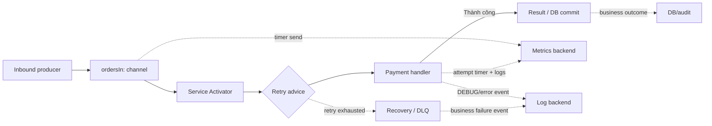
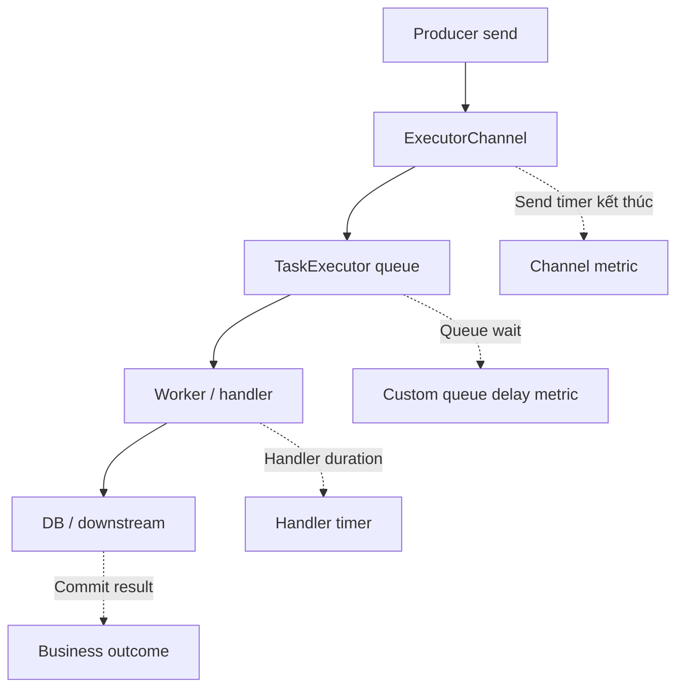
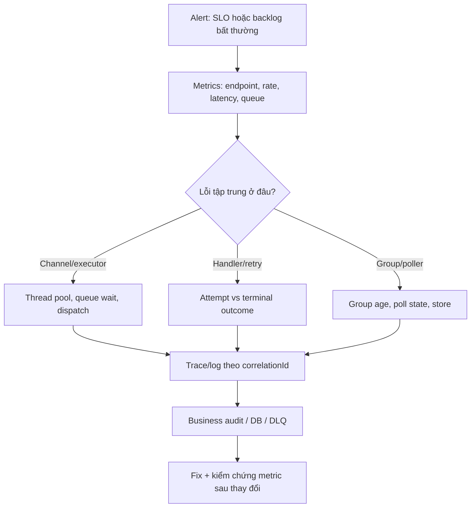

# Phân biệt metric runtime với log debug trong Spring Integration

## 1. Câu hỏi quan trọng nhất: hệ thống đang khỏe hay một message cụ thể đã đi đâu?

Trong Spring Integration, một message có thể đi qua `MessageChannel`, endpoint, consumer, poller, executor, advice chain, message store, aggregator và error flow. Khi gặp sự cố, đội phát triển thường bắt đầu bằng cách bật DEBUG cho tất cả package rồi đọc hàng nghìn dòng log. Cách này có thể giúp tìm đúng một exception, nhưng không trả lời tốt những câu hỏi vận hành rộng hơn:

- Một phút qua có bao nhiêu message vào hệ thống, bao nhiêu message **hoàn tất nghiệp vụ**?
- Độ trễ p95/p99 của handler tăng từ lúc nào? Bị chậm ở queue, executor hay downstream?
- Có message nào bị retry liên tục? Tỷ lệ lỗi tăng trên những endpoint nào?
- Queue đang tồn bao nhiêu message và message cũ nhất đã đợi bao lâu?
- Tại sao message `order-42` đi từ `ordersIn` tới `retryFailures` nhưng không thấy record trên `errorChannel`?
- Sau restart, có còn backlog trong persistent store và consumer có đang chạy không?

Hai nhóm thông tin phục vụ **hai mục đích khác nhau**:

1. **Runtime metrics**: các phép đo số lượng, thời gian, mức sử dụng, lỗi và trạng thái được tổng hợp theo những chiều ổn định. Chúng trả lời **“Bao nhiêu? Có đang xấu đi? Xấu ở đâu?”**
2. **Debug logs**: các bản ghi sự kiện có ngữ cảnh, thường gắn với một message, lần thực thi hoặc exception. Chúng trả lời **“Chuyện gì đã xảy ra với lần xử lý này?”**

Đây là bài **“Phân biệt metric runtime với log debug”** thuộc chương **Observability**, module **SPRING_INTEGRATION_RUNTIME**. Mục tiêu là vận hành và chẩn đoán được runtime của channel, endpoint, consumer, poller, executor, retry, error handling và correlation, đồng thời biết **khi nào cần metric, khi nào cần log và khi nào phải kết hợp với trace/audit**.

> **Quy tắc nền tảng:** Metric không thay thế log; log DEBUG không phải nguồn đếm nghiệp vụ đáng tin cậy. Tracing kết nối các bước xử lý của một request, còn dữ liệu nghiệp vụ có transaction/commit mới xác nhận điều gì thực sự hoàn tất.

## 2. Bốn lớp dữ liệu quan sát cần phân biệt

| Lớp | Dạng dữ liệu | Câu hỏi trả lời tốt | Hạn chế chính |
| --- | --- | --- | --- |
| **Metrics** | Counter, Timer, Gauge, LongTaskTimer, histogram | Tần suất, tốc độ, độ trễ, mức bão hòa, xu hướng và cảnh báo | Không chứa lịch sử từng message; số đo chịu tác động của phạm vi đo |
| **Logs** | Bản ghi sự kiện có thời gian, cấp độ, logger và fields | Message này đi đâu, lỗi nào, dữ liệu gì dẫn tới quyết định đó? | Có thể bị tắt, lấy mẫu, mất, trùng; chi phí cao khi log mọi message |
| **Distributed traces** | Trace/span có quan hệ cha-con, thời gian và attributes | Một yêu cầu mất thời gian ở bước nào, qua thread/service nào? | Có thể sampling; cần propagation qua async/broker |
| **Business audit/state** | Bản ghi đã commit: order status, payment ID, DLQ, outbox | Nghiệp vụ đã hoàn tất hay đang kẹt, có thể replay không? | Cần mô hình dữ liệu, transaction, idempotency và retention rõ |

Ví dụ một flow có các tầng:



Một message có thể làm **nhiều channel/handler timers tăng** nhưng chỉ có **một** business command. Một lỗi handler cũng có thể sinh **nhiều DEBUG log** khi retry, nhưng cuối cùng được recover thành công hoặc đưa vào DLQ.

### Cách phối hợp điển hình

1. Metric phát hiện `p95 processing duration` tăng và `retry exhausted rate` vượt ngưỡng.
2. Dashboard chỉ ra endpoint `paymentsHandler` và thời điểm xảy ra.
3. Trace liên kết các span từ inbound tới downstream, cho thấy 2 lần retry và queue wait.
4. Log có `correlationId`/`businessId` giúp tìm exception/attempt cụ thể.
5. Business audit xác nhận đơn đã commit, đang chờ retry hay đã cách ly.

Không có một trong bốn lớp, quá trình chẩn đoán vẫn có thể thực hiện, nhưng rủi ro suy đoán sai cao hơn.

## 3. Metrics khác log debug ở độ hạt và đơn vị đo

Một counter tên `messages_received_total` (tên ví dụ do ứng dụng tạo) đo **số message đến một boundary**. Log:

```text
DEBUG handler start: orderId=ORDER-42 attempt=1
DEBUG handler failed: orderId=ORDER-42 attempt=1
DEBUG handler start: orderId=ORDER-42 attempt=2
DEBUG handler failed: orderId=ORDER-42 attempt=2
DEBUG handler start: orderId=ORDER-42 attempt=3
INFO  order committed: orderId=ORDER-42
```

cho ta **6 sự kiện log** nhưng chỉ có **một message đầu vào** và **một business success**. Nếu viết truy vấn “đếm log chứa `handler start`” rồi xem là throughput message, kết quả sẽ bị nhân theo số retry.

| Đại lượng | Trong ví dụ ba attempt | Ý nghĩa |
| --- | ---: | --- |
| Message ingress | 1 | Một message đi qua ranh giới đầu vào |
| Handler attempts | 3 | Handler được gọi ba lần |
| Attempt failures | 2 | Hai lời gọi ném exception |
| Retry exhausted | 0 | Retry đã thành công trước khi hết lượt |
| Business commits | 1 | Một đơn thực sự được commit |
| DEBUG/INFO log records | 6 | Chỉ là số bản ghi ghi ra |
| Channel sends | Có thể nhiều hơn 1 | Flow có thể đi qua nhiều channel |

**Đơn vị đo** quan trọng hơn tên meter: `message`, `attempt`, `handler invocation`, `delivery`, `retry cycle`, `business operation` và `transaction commit` không tương đương nhau.

## 4. Các loại Micrometer meter nên biết

Spring Integration tích hợp với Micrometer. Khi thiết kế dashboard, cần chọn đúng loại meter:

| Meter | Cách hoạt động | Ví dụ runtime |
| --- | --- | --- |
| `Counter` | Tăng tích lũy theo sự kiện; thường dùng `rate()` trên backend time-series | Message vào, retry exhausted, DLQ write failures |
| `Timer` | Đếm số lần ghi thời gian và tổng thời gian; có thể bật histogram/percentiles | Handler attempt duration, end-to-end latency |
| `Gauge` | Giá trị hiện tại được lấy khi scrape/quan sát | Queue size, active workers, backlog hiện tại |
| `LongTaskTimer` | Số công việc đang chạy và thời gian chúng đã hoạt động | Gateway/handler đang in-flight lâu |
| `DistributionSummary` | Phân bố đại lượng không phải duration | Số phần tử trong một batch, payload size đã chuẩn hóa |

**Counter không phải event log.** Nó có thể reset khi JVM restart, scrape có thể bỏ lỡ dữ liệu, và sample không giữ chi tiết của từng order. **Gauge không phải tổng số message từng đi qua queue**; cùng một gauge value 10 có thể là 10 message khác nhau ở hai thời điểm.

Timer có thể cung cấp count và latency summary. Nếu muốn p95/p99 giữa nhiều instance, cấu hình **histogram phù hợp ở backend**; không lấy trung bình từ trung bình của từng instance rồi gọi đó là p95. Ngược lại, percentile client-side thường khó tổng hợp chính xác giữa các instance.

## 5. Spring Integration tự ghi những metric nào?

Điểm dễ nhầm nhất là **hai đường instrumentation** tồn tại trong các phiên bản Spring Integration hiện đại: Micrometer meters truyền thống và Micrometer Observation.

### 5.1. Micrometer integration theo MeterRegistry

Theo Spring Integration Reference, khi có `MeterRegistry` trong ApplicationContext, framework hỗ trợ các meter cho nhiều component kế thừa `AbstractMessageChannel`, `AbstractMessageHandler` và `AbstractMessageSource`.

Các tên/tags trong tài liệu:

| Meter | Type/tag tiêu biểu | Ý nghĩa |
| --- | --- | --- |
| `spring.integration.send` | `type=channel`, `name=<channel>`, `result`, `exception` | Timer thao tác gửi qua channel |
| `spring.integration.send` | `type=handler`, `name=<handler>`, `result`, `exception` | Timer thực thi handler |
| `spring.integration.receive` | `type=channel` hoặc `type=source` | Counter receive trên pollable channel/source |
| `spring.integration.channels` | Gauge | Số lượng channel được quản lý |
| `spring.integration.handlers` | Gauge | Số lượng handler được quản lý |
| `spring.integration.sources` | Gauge | Số lượng source được quản lý |
| `spring.integration.channel.queue.size` | `type=channel`, `name=<queue>` | Kích thước QueueChannel |
| `spring.integration.channel.queue.remaining.capacity` | Tags của queue | Capacity còn lại của QueueChannel nếu phù hợp |

**Phải kiểm tra bean/phiên bản và meter thực sự trong registry.** Tên/tags này được reference mô tả cho đường Micrometer integration, không nên khẳng định mọi project/adapter/version đều xuất ra đúng bộ meter đó. Với channel type, cấu hình capacity, persistent backend hoặc một implementation tùy biến, có thể có giới hạn về meter được hỗ trợ.

Khi một `DirectChannel.send()` thành công, timer `spring.integration.send{type=channel,result=success}` phản ánh **lời gọi send tại channel đó**. Nếu handler chạy trên executor, điều này có thể chỉ cho biết việc dispatch được chấp nhận, **không** chứng minh business handler đã hoàn tất.

### 5.2. Micrometer Observation (Spring Integration 6.0+)

Từ Spring Integration 6.0, `ObservationRegistry` có thể thu thập metrics **và** tracing qua `ObservationHandler`. Với `IntegrationManagement` components, reference mô tả việc bật Observation khi có bean `ObservationRegistry` và cấu hình `@EnableIntegrationManagement`, cùng `observationPatterns` phù hợp.

**Quan trọng:** `observationPatterns` mặc định không chọn component nào để instrument qua Observation; có thể đặt `"*"` để quan sát tất cả các component phù hợp, hoặc chọn patterns hẹp hơn.

Các observation/meter được tài liệu mô tả:

| Meter/Observation | Loại | Ý nghĩa |
| --- | --- | --- |
| `spring.integration.handler` | Timer | Thời gian handler nhận/xử lý message |
| `spring.integration.handler.active` | LongTaskTimer | Handler đang hoạt động |
| `spring.integration.producer` | Timer | Channel/send operation được instrument |
| `spring.integration.producer.active` | LongTaskTimer | Producer/send đang hoạt động |
| `spring.integration.gateway` | Timer | Request/reply gateway |
| `spring.integration.gateway.active` | LongTaskTimer | Gateway request/reply đang hoạt động |

Các low-cardinality key do convention khai báo có tiền tố `spring.integration.`, ví dụ `spring.integration.name`, `spring.integration.type` và, với gateway, `spring.integration.outcome`. Không tự đổi tất cả tag sang `name=...` của meter truyền thống rồi nghĩ đó là cùng một schema.

Khi dùng Observation, framework **ủy quyền việc tạo metric cho ObservationHandler tương ứng**, thay vì đồng thời tập hợp độc lập cùng meter truyền thống ở chính đường instrumentation đó. Không cộng số lần của `spring.integration.send` và `spring.integration.producer` để suy ra tổng số business messages.

### 5.3. Ví dụ bật Observation có kiểm soát

```java
import org.springframework.context.annotation.Configuration;
import org.springframework.integration.config.EnableIntegration;
import org.springframework.integration.config.EnableIntegrationManagement;

@Configuration
@EnableIntegration
@EnableIntegrationManagement(
        observationPatterns = {"orders*", "payments*"})
public class IntegrationObservabilityConfig {
}
```

Điều kiện: một `ObservationRegistry` đã được cung cấp bởi cấu hình Micrometer/Observability của ứng dụng và có các `ObservationHandler`/registry/tracing exporter tương ứng. Bản thân annotation **không tạo** máy chủ metrics, collector hoặc trace backend.

Các patterns chỉ là ví dụ; kiểm tra tên component ID thực tế (có thể do DSL tạo tự động) và quy tắc pattern matching của đúng phiên bản. Bật `"*"` cho môi trường staging có thể hữu ích, nhưng production có nhiều **dynamic IntegrationFlow** hoặc tenant có thể tạo chi phí meter/span và cardinality lớn.

## 6. Bật metric không cần bật DEBUG logs

Hai cơ chế được điều khiển khác nhau:

- **Metrics**: phụ thuộc `MeterRegistry`/`ObservationRegistry`, instrumentation và nơi scrape/export.
- **DEBUG logging**: phụ thuộc logger category, logging framework, mức log và thiết lập quản lý của Spring Integration.

Spring Integration có `@EnableIntegrationManagement(defaultLoggingEnabled = ...)`. Đặt `defaultLoggingEnabled=false` có thể tắt logging DEBUG theo luồng message của framework ngay cả khi logging framework bật DEBUG; **exception logging không bị ảnh hưởng bởi cờ này**. Ngược lại, bật `true` chỉ cho phép log theo cấp cấu hình của logger, không ép toàn bộ package phát DEBUG.

Ví dụ một ứng dụng muốn ưu tiên metric, hạn chế DEBUG đường đi message:

```java
import org.springframework.context.annotation.Configuration;
import org.springframework.integration.config.EnableIntegration;
import org.springframework.integration.config.EnableIntegrationManagement;

@Configuration
@EnableIntegration
@EnableIntegrationManagement(
        defaultLoggingEnabled = false,
        observationPatterns = {"orders*"})
public class RuntimeManagementConfig {
}
```

Không nên xem ví dụ này là cấu hình tối ưu cho mọi hệ thống: khi đang điều tra, có thể cần bật logging chi tiết có kiểm soát. Cờ `defaultLoggingEnabled` chỉ tác động một lớp logging của Spring Integration, không phải tắt toàn bộ SLF4J logs do handler ứng dụng tự viết.

### Không có DEBUG logs không có nghĩa metrics bị tắt

Một handler hoàn toàn có thể ghi `Timer` thành công dù logger của nó ở `WARN` hoặc `ERROR`. Ngược lại, nhìn thấy nhiều DEBUG logs không chứng minh một `MeterRegistry`/collector đã nhận metric.

Để kiểm tra, cần truy vấn chính xác registry/Actuator metrics endpoint hoặc một dashboard thời gian thực, rồi so sánh với sự kiện test có kiểm soát.

## 7. Debug logs cho từng message: có ích khi nào?

Log DEBUG phù hợp khi cần biết **đường đi, dữ liệu được phép quan sát và điều kiện quyết định**:

- Header `correlationId` trước khi splitter/aggregator.
- Router chọn channel nào và vì sao.
- Filter chấp nhận hay loại message.
- Retry attempt number, loại exception và recoverer được chọn.
- Poller có nhận message không, source trả `null` hay exception.
- Adapter nhận/sent ack, callback và trạng thái transaction nếu có log thích hợp.
- Endpoint đã start/stop và thread đang thực thi.

Ví dụ một log cấu trúc (minh họa, không phải format log tự động của Spring Integration):

```json
{
  "timestamp": "2026-11-22T10:18:31Z",
  "level": "DEBUG",
  "logger": "app.orders.flow",
  "event": "handler_attempt_started",
  "flow": "orders-v2",
  "endpoint": "paymentsHandler",
  "correlationId": "checkout-42",
  "businessId": "ORDER-42",
  "attempt": 2,
  "thread": "payments-exec-3"
}
```

Không đưa password, bearer token, payment card, PII hoặc full payload vào log chỉ để phục vụ DEBUG. `Message.toString()` có thể bao gồm payload/header, nên việc bật log-full-message bừa bãi có thể làm lộ dữ liệu.

### Log cấp nào dùng để làm gì?

| Level | Nội dung phù hợp | Không nên |
| --- | --- | --- |
| `TRACE` | Các chi tiết dispatch/header/low-level chỉ phục vụ debug sâu | Bật vô thời hạn trên flow lưu lượng cao |
| `DEBUG` | Quyết định route/filter, attempt, correlation, thread | Ghi toàn bộ payload hay một dòng cho từng bước không cần thiết |
| `INFO` | Các sự kiện vận hành có giá trị: start/stop, deploy, terminal outcome đã commit | Dùng làm bộ đếm throughput thay meter |
| `WARN` | Lỗi có thể phục hồi, phụ thuộc suy giảm, lag tăng theo policy | Log full stack trace cho từng attempt thất bại thông thường |
| `ERROR` | Thất bại terminal/recovery sink failure hoặc invariant bị phá | Ghi mỗi retry attempt là terminal business failure |

Đây là convention gợi ý; thực tế phụ thuộc quy ước của đội. Một exception retryable có thể xuất hiện ở WARN hoặc DEBUG, còn terminal failure nên chỉ được ghi rõ ở **một** nơi để không tạo cảnh báo trùng.

## 8. Log theo flow bằng Java DSL log() và Wire Tap

Spring Integration hỗ trợ Java DSL `.log(...)` để quan sát message. Theo reference, operator này dùng `WireTap` channel interceptor với `LoggingHandler` làm subscriber. Nó có thể ghi log mà vẫn để message đi tiếp trong flow.

```java
import org.springframework.context.annotation.Bean;
import org.springframework.integration.dsl.IntegrationFlow;
import org.springframework.integration.handler.LoggingHandler;

@Bean
IntegrationFlow tracingOrderFlow() {
    return IntegrationFlow.from("ordersInput")
            .filter((String id) -> !id.isBlank())
            .log(LoggingHandler.Level.DEBUG, "app.orders.route",
                    message -> "messageId=" +
                            message.getHeaders().getId())
            .handle(message -> orderHandler.handle(message));
}
```

`orderHandler` là bean handler do ứng dụng cung cấp, còn `ordersInput` là một channel đã được cấu hình. Điểm log nằm **sau filter**: message bị filter loại không tạo log ở vị trí đó. Vì `log()` mang tính wire tap, nó không phải thao tác đánh dấu business commit.

**Chú ý với logging ở cuối flow:** từ Spring Integration 6.0, operator `log()` cuối flow không tự làm thay đổi semantics kết thúc/reply như một số phiên bản cũ. Nếu flow một chiều không cần reply và chỉ log, có thể chỉ định `nullChannel` theo hướng dẫn framework. Không dựa vào `log()` làm consumer nghiệp vụ khi một downstream endpoint còn phải xử lý message.

### XML Wire Tap và Logging Channel Adapter

```xml
<int:channel id="ordersInput">
    <int:interceptors>
        <int:wire-tap channel="orderDebugLog"/>
    </int:interceptors>
</int:channel>

<int:logging-channel-adapter
    id="orderDebugLog"
    level="DEBUG"
    expression="headers.id"
    logger-name="app.orders.wiretap"/>
```

Đây là trích đoạn namespace XML Spring Integration. Wire tap gửi một bản sao/tham chiếu message theo cơ chế framework đến logging handler; vì vậy **một message đi vào channel vẫn là một lần ingress**, dù log được nhân bản qua nhánh quan sát.

Theo reference, `logging-channel-adapter` mặc định log payload. `log-full-message="true"` sẽ thêm headers và có thể làm lộ dữ liệu nhạy cảm; `expression` hoặc `.log(..., message -> ...)` giúp chọn đúng trường an toàn. Đừng dùng cả `expression` và `log-full-message` đồng thời.

### Wire Tap có “miễn phí” không?

Không. Định dạng message thành string, tạo object log, gửi sang appender, serialization JSON và xuất log qua mạng đều tốn CPU/RAM/I/O. Một logging channel đồng bộ có thể kéo dài latency send; một nhánh async có thể gặp queue đầy, drop logs hoặc reorder. **Không coi log tap là bằng chứng mọi event đều đã được ghi bền vững.**

Với flow có hàng triệu message, cân nhắc sampling DEBUG, giới hạn retention, chọn endpoint cần quan sát và tắt điều tra sau khi xử lý sự cố.

## 9. Message History: dấu vết đường đi không phải distributed trace

Spring Integration có `@EnableMessageHistory` để thêm header lịch sử các component đã đi qua. Theo reference, message history ghi một danh sách các entry như `name`, `type` và `timestamp` cho những component được track.

```java
import org.springframework.context.annotation.Configuration;
import org.springframework.integration.config.EnableIntegration;
import org.springframework.integration.config.EnableMessageHistory;

@Configuration
@EnableIntegration
@EnableMessageHistory({"orders*", "payments*"})
public class TrackedFlowsConfiguration {
}
```

Các patterns phải khớp **tên component thực tế**; theo tài liệu chỉ khai báo **một** `@EnableMessageHistory` trong application context. Có thể điều chỉnh phạm vi theo JMX/configurer đúng quy trình, không tự tạo nhiều `MessageHistoryConfigurer`.

Message History hữu ích để xác minh `ordersIn → router → paymentsHandler` khi chẩn đoán. Nhưng nó **không** thay thế tracing:

- Header history nằm trong message và có overhead kích thước/serialization.
- Nó không tự bao quát HTTP external call, DB query hay network spans ở service khác.
- Không cung cấp đầy đủ quan hệ parent/child span của distributed tracing.
- Nếu message bị tái tạo, chia nhánh hoặc qua executor, cần kiểm chứng propagation/hành vi clone header theo phiên bản.
- Message history không phải business audit và có thể biến mất nếu message không được lưu.

Từ Spring Integration 6.3, cơ chế message history được tối ưu theo hướng append-only và clone header khi framework fan-out; khi có custom multi-producing logic, cần bảo đảm không chia sẻ mutable history sai cách giữa các nhánh.

## 10. Correlation ID, message ID, trace ID và business key

Để dùng metrics và logs cùng nhau, phải đặt đúng loại ID vào đúng nơi:

| ID | Ý nghĩa | Dùng ở đâu? |
| --- | --- | --- |
| `MessageHeaders.ID` | Định danh một Spring `Message` cụ thể | DEBUG log, message history, điều tra một lần giao |
| `correlationId` | Liên kết các message cùng batch/flow/request theo nghiệp vụ hoặc splitter | Headers, structured logs, tracing attributes |
| `traceId` và `spanId` | Liên kết các span trong distributed trace | Tracing backend/log correlation nếu được propagate |
| `businessId`/`idempotencyKey` | Nhận diện một thao tác nghiệp vụ xuyên retry/replay | DB unique constraint, audit, logs, DLQ |
| `attempt` hoặc `deliveryCount` | Lần thử xử lý/redelivery | Logs và metric **đã chuẩn hóa**, không dùng làm unique key mới |

**Message ID có thể đổi khi xây lại message.** Một business command có thể nhận nhiều message IDs qua retry, conversion, broker redelivery hoặc replay. Nếu muốn chứng minh một đơn không được xử lý hai lần, hãy dùng business idempotency key đã commit, không dựa duy nhất vào Spring message ID.

### Trong metrics: không đặt ID riêng lẻ làm tag

Ví dụ **không nên**:

```java
// SAI về cardinality khi có nhiều businessId duy nhất.
registry.counter(
        "app.orders.attempts",
        "businessId", commandId).increment();
```

Mỗi `businessId` tạo một time series mới. Hàng trăm nghìn ID có thể làm metrics backend tốn memory/storage và tăng thời gian truy vấn.

Phù hợp hơn:

```java
registry.counter(
        "app.orders.attempts",
        "flow", "orders",
        "outcome", "failure",
        "errorCategory", "downstream_timeout")
    .increment();
```

`flow`, `outcome` và `errorCategory` là các tag **ít biến thiên** do ứng dụng kiểm soát. Business ID và correlation ID nên xuất hiện ở structured log/traces với retention và quyền truy cập phù hợp.

Đặc biệt với **dynamic IntegrationFlow** tạo mỗi tenant một component name, tag `spring.integration.name` có thể phình rất lớn. Cần chuẩn hóa tên component, giới hạn số lượng flow hoặc lọc/cấu hình meter với `MeterFilter` thay vì để số time series tăng vô hạn.

## 11. Ví dụ Java: metric và debug log đo hai điều khác nhau

Dưới đây là một `@ServiceActivator` dùng Micrometer `Timer` để đo **mỗi lần handler thực thi**, đồng thời ghi DEBUG với business key/correlation. Nếu retry advice bao quanh handler, method này có thể được gọi nhiều lần: timer sẽ có **một sample cho mỗi attempt**.

```java
import io.micrometer.core.instrument.MeterRegistry;
import io.micrometer.core.instrument.Timer;
import org.slf4j.Logger;
import org.slf4j.LoggerFactory;
import org.slf4j.MDC;
import org.springframework.integration.annotation.MessageEndpoint;
import org.springframework.integration.annotation.ServiceActivator;
import org.springframework.messaging.Message;

@MessageEndpoint
public final class ObservedOrderHandler {

    private static final Logger log =
            LoggerFactory.getLogger(ObservedOrderHandler.class);

    private final MeterRegistry registry;
    private final OrderProcessor processor;

    public ObservedOrderHandler(
            MeterRegistry registry,
            OrderProcessor processor) {
        this.registry = registry;
        this.processor = processor;
    }

    @ServiceActivator(inputChannel = "ordersIn")
    public void process(Message<OrderCommand> message) {
        OrderCommand order = message.getPayload();
        String correlationId = String.valueOf(
                message.getHeaders().get("correlationId"));

        Timer.Sample sample = Timer.start(registry);
        String outcome = "success";

        MDC.put("correlationId", correlationId);
        try {
            log.debug("Handler attempt started: orderId={}",
                    order.commandId());

            processor.process(order); // Side effect do app định nghĩa.

            log.debug("Handler attempt returned: orderId={}",
                    order.commandId());

        } catch (RuntimeException | Error ex) {
            outcome = "failure";
            log.warn("Handler attempt failed: orderId={} errorType={}",
                    order.commandId(), ex.getClass().getSimpleName());
            throw ex;

        } finally {
            sample.stop(
                    Timer.builder("app.orders.handler.attempt.duration")
                            .description("Duration of a handler attempt")
                            .tag("flow", "orders")
                            .tag("outcome", outcome)
                            .register(registry));
            MDC.remove("correlationId");
        }
    }

    public record OrderCommand(String commandId) {}

    public interface OrderProcessor {
        void process(OrderCommand order);
    }
}
```

Giả định ví dụ có một bean `MeterRegistry` và một bean `OrderProcessor`, cùng channel `ordersIn` được định nghĩa trong application context. `OrderProcessor` chỉ là interface nghiệp vụ minh họa. Cần bật logging pattern/structured logging exporter để `MDC` xuất hiện thành field trong bản ghi log; gọi `MDC.put()` không bảo đảm backend tự hiện trường đó.

**Ràng buộc quan trọng của phép đo:**

- Timer đo một lần **method process được gọi**, không đo thời gian nằm trong `QueueChannel` trước handler.
- Handler ném exception → `outcome=failure` và vẫn propagate để retry/error flow quyết định.
- Nếu `processor.process` tự nuốt lỗi rồi return, timer xem là success; đó là semantics method invocation, không phải business success.
- Nếu advice retry nằm **bên ngoài** handler, method có thể chạy nhiều lần cho một ingress; timer count lớn hơn ingress là bình thường.
- Nếu có `ExecutorChannel`, MDC trên thread producer **không tự propagate**; ví dụ này lấy correlation từ message headers và tạo MDC cục bộ cho handler.
- `MDC.remove` trong `finally` tránh rò correlation ID giữa những công việc chia sẻ worker thread.
- Với dữ liệu nhạy cảm, business key cần được đánh giá theo chính sách log; không log payload đơn hàng đầy đủ.

Một phép đo **business commit** nên đặt ở tầng kiểm chứng transaction/outcome nghiệp vụ, ví dụ sau khi DB commit thực sự hoặc từ outbox/event đã commit. Đừng chỉ tăng `business_success` ngay sau khi gọi method có thể bị rollback ở cuối transaction.

## 12. Metrics built-in vs custom business metrics: không cộng nhầm

Một flow đơn hàng đi qua ba channel và ba handler. Mỗi bước có instrumentation riêng:

```text
ordersIn.send
  → validateHandler
  → validatedChannel.send
  → enrichHandler
  → paymentsChannel.send
  → paymentsHandler
  → business DB commit
```

Một message thành công có thể tạo ít nhất ba lần `send` ở channel và ba handler executions. Do đó:

- `sum(spring.integration.send count)` qua mọi channel **không** phải tổng đơn hàng.
- `sum(handler timer count)` qua mọi handler **không** phải số message ingress.
- `spring.integration.channels` gauge là số component, **không** phải throughput.
- `QueueChannel.queue.size` gauge cho biết backlog tại thời điểm đo, **không** chứng minh backlog tồn tại qua restart.
- Custom `business_committed` ghi sau commit mới gần với số lượng giao dịch đã hoàn tất.

Tốt nhất chọn một **ingress boundary** và một **terminal business outcome** để lập SLI end-to-end. Các meter channel/handler còn lại dùng để tìm bottleneck và phân biệt nguồn lỗi.

### Ví dụ ba kịch bản

| Kịch bản | Ingress | Handler attempts | Attempt failures | Terminal failures | Business commits |
| --- | ---: | ---: | ---: | ---: | ---: |
| `order-1` thành công ngay | 1 | 1 | 0 | 0 | 1 |
| `order-2` lỗi hai lần rồi thành công | 1 | 3 | 2 | 0 | 1 |
| `order-3` hết ba attempt, ghi DLQ | 1 | 3 | 3 | 1 | 0 |
| **Tổng** | **3** | **7** | **5** | **1** | **2** |

Bảng giả định retry tối đa 3 attempts, mỗi message chỉ có một lượt delivery, không có redelivery từ broker và DLQ được ghi đúng một lần. Trong thực tế, broker redelivery/replay có thể làm số lượt delivery lớn hơn số business operations.

Nếu log DEBUG mỗi `handler attempt started`, sẽ có 7 dòng; nếu logger đang tắt DEBUG, có thể có **0** dòng đó. Metrics vẫn có thể ghi 7 samples khi registry/instrumentation hoạt động.

## 13. Advice chain làm thay đổi metrics và log error flow

Giả sử thứ tự advice:

```text
Option A: [RetryAdvice, AttemptTimingAdvice] → handler
Option B: [TotalTimingAdvice, RetryAdvice]   → handler
```

Ở **A**, retry advice gọi lại timing advice ở mỗi attempt; timer nhìn thấy nhiều failure + success/failed attempts. Ở **B**, total timing advice chỉ bao một lượt retry cycle, gồm cả backoff. Nếu retry có `RecoveryCallback` gửi `ErrorMessage` sang failure channel rồi **return bình thường**, outer timing advice có thể ghi `success` dù nghiệp vụ đã bị cách ly.

Đây không phải bug của Micrometer; đó là **sai cách diễn giải outcome**. Nên tách:

| Signal | Đo ở đâu? |
| --- | --- |
| `handler_attempt_failure` | Bên trong retry, một lần cho mỗi attempt ném exception |
| `retry_exhausted` | Retry recovery boundary khi hết lượt |
| `dlq_write_committed` | Sau khi durable failure sink xác nhận ghi |
| `business_success_committed` | Sau khi business state thực sự commit |
| `processing_total_duration` | Bao cả retry/backoff theo boundary được định nghĩa |
| `terminal_failure` | Một lần theo business operation/terminal decision |

### ErrorMessage không nhất thiết tới global errorChannel

Một lỗi có thể:

1. Ném từ handler ở `DirectChannel` và propagate về caller.
2. Bị `RequestHandlerRetryAdvice` retry, sau đó recover vào channel `retryFailures`.
3. Bị poller/worker async error publisher chuyển thành `ErrorMessage` ở một error channel.
4. Bị catch và chuyển thành kết quả nghiệp vụ bình thường ở code handler.
5. Không được log nếu logger level/sampling bỏ qua.

Vì vậy, **log trống trên global `errorChannel` không chứng minh flow không có lỗi**. Cần đo retry/recovery và tra đường lỗi thực tế: `errorChannel` header, dedicated failure channel, broker DLQ, transactional rollback hoặc subscriber `onError` nếu reactive.

## 14. Threading, executor và poller: metric nào chỉ được một nửa sự thật?

Một `ExecutorChannel` có thể làm producer gửi thành công trước khi worker chạy:



Nếu `send` mất 1 ms, queue wait 2 giây và handler chạy 40 ms, thì:

- Channel send metric có thể hiển thị latency **1 ms**.
- Handler timer có thể hiển thị latency **40 ms**.
- End-to-end latency tới commit xấp xỉ **2.041 giây** cộng overhead.
- DEBUG log ở handler có thể bắt đầu 2 giây sau log ở producer, dù cả hai timestamp đều đúng.

Do đó cần tự đo hoặc lấy từ công cụ phù hợp **queue wait time** và **end-to-end latency**, không chỉ handler duration.

### Pollable channel và poller

Với `QueueChannel → poller → ServiceActivator`:

- Counter receive tại channel phản ánh những lần nhận theo implementation, không đồng nhất với business commits.
- `fixedDelay`/`fixedRate` và `maxMessagesPerPoll` ảnh hưởng throughput và empty polling.
- Với persistent `MessageStore`, queue metrics cần được kiểm tra theo provider và bản triển khai cụ thể.
- Một message có thể rollback và được poll lại; receive count tăng dù business operation chưa commit.
- Poller đang running không chứng minh handler hoạt động khi source không có message hoặc điều kiện polling không thỏa.

Thời gian chờ queue nên đo từ **enqueue timestamp thật** đến lúc bắt đầu handler; `MessageHeaders.TIMESTAMP` có thể là thời điểm tạo message, không phải thời điểm enqueue nếu message đã đi qua các bước trước đó.

### Reactive runtime

Với `FluxMessageChannel` và `Publisher<Message<?>>`, backpressure, subscription, cancellation, `onError` và retry operator tạo những tín hiệu khác với flow imperative. Một `onError` có thể terminate subscription mà không tự động gửi `ErrorMessage` vào Spring Integration error channel. Với reactive, cần đo subscription/cancellation, concurrent inner publishers, latency và retry placement; log DEBUG “subscribe” không phải bằng chứng message đã được xử lý.

## 15. Quan sát correlation, aggregator và message group

Aggregator/resequencer là ví dụ điển hình về trường hợp **metric và log phải kết hợp**.

Metric quan trọng:

- Số **open groups** trong `MessageGroupStore`.
- Tuổi group cũ nhất và thời gian từ phần đầu tới release.
- Số group `completed`, `expired`, `partial`, `discarded`.
- Số message late arrival và duplicate business fragments.
- Lock contention/wait nếu nhiều thread hoặc instance chia sẻ group.
- Thời gian xử lý output và tỷ lệ downstream failure.

Logs cần chứa **group ID/correlation ID**, `sequenceNumber`, `sequenceSize`, release strategy decision và group outcome để truy nhóm cụ thể. Nếu metrics cho thấy một group chờ rất lâu nhưng log DEBUG không còn do retention, có thể đọc group state từ persistent store theo công cụ an toàn; **không dùng thao tác tiêu thụ/xóa group chỉ để debug**.

`correlationId` là high cardinality nên không gắn trực tiếp vào mọi meter tag. Nếu cần tìm “group nào?”, dùng log, trace hoặc báo cáo audit dựa trên group store. Nếu cần biết “bao nhiêu group đang kẹt?”, dùng Gauge/counter.

## 16. Khi nào nên dùng tracing thay cho bật toàn bộ DEBUG?

Distributed tracing phù hợp khi cần theo dõi hành trình qua:

- Inbound HTTP/Kafka/JMS → channel → handler.
- `ExecutorChannel` sang worker khác.
- Outbound HTTP/gRPC hoặc database operation.
- Chuyển message qua broker/DB persistent channel.
- Retry/async callback/reactive publisher.

Với Micrometer Observation, Spring Integration hỗ trợ tạo observation/span tại producer, handler và gateway, tùy thành phần được instrument. Muốn trace liên tục qua message channel distributed hoặc persistent, cần **propagate trace context qua headers ở producer và restore ở consumer**, cùng những instrumentation phù hợp. Reference nhấn mạnh việc bật observation ở cả phía channel/producer và consumer để liên kết spans.

### Tracing không phải correlation nghiệp vụ

Trace có thể thay đổi theo việc replay một business command sau nhiều giờ; correlation ID và business ID vẫn nên ổn định để liên kết lịch sử. Với sampling, **không phải mọi trace đều được lưu**. Vì vậy:

- Tracing giúp thấy latency breakdown.
- Logs giúp xác minh quyết định cụ thể/exception.
- Business audit cho biết trạng thái đã commit.
- Metrics giúp tìm phạm vi và thời điểm sự cố.

Đừng nhầm span duration với DB transaction commit nếu span kết thúc trước commit hoặc có async tail. Luôn xác định ranh giới đo.

## 17. Bật và tắt DEBUG có kiểm soát khi đang incident

Spring Boot Actuator có endpoint `loggers` để xem và thay đổi logging level **tại runtime**. Đây là cách thực dụng để điều tra một component mà không cần restart JVM, khi ứng dụng được cấu hình và bảo vệ endpoint.

Ví dụ (chỉ dành cho hệ thống quản trị nội bộ đã xác thực):

```bash
# Xem mức log của một package:
curl http://localhost:8080/actuator/loggers/com.example.orders

# Bật DEBUG tạm thời:
curl -X POST \
  -H "Content-Type: application/json" \
  -d '{"configuredLevel":"DEBUG"}' \
  http://localhost:8080/actuator/loggers/com.example.orders

# Trả lại việc kế thừa mức log mặc định:
curl -X POST \
  -H "Content-Type: application/json" \
  -d '{"configuredLevel":null}' \
  http://localhost:8080/actuator/loggers/com.example.orders
```

Bật logger không nhất thiết vượt qua `defaultLoggingEnabled=false` của Spring Integration dành cho một số debug log framework; xem cả hai lớp điều khiển.

**An toàn vận hành:** `POST /actuator/loggers` là endpoint mutation, phải có RBAC/network isolation/audit. Bật DEBUG theo package **hẹp**, ghi nhận thời điểm và người chịu trách nhiệm, kiểm tra log volume/PII rồi hoàn nguyên sau khi điều tra. Nếu dashboard metrics đang đủ để xác định lỗi, không nên bật log mọi message trên toàn cụm.

## 18. Metric export và cách đọc dashboard

Với một ứng dụng Spring Boot dùng Actuator, Micrometer và registry/exporter phù hợp, có thể expose những endpoint như `/actuator/metrics` và `/actuator/prometheus`. Việc cài `spring-boot-starter-actuator` **không tự cung cấp một Prometheus server** hoặc bảo đảm mọi meter đã được scrape.

Ví dụ cấu hình theo phong cách Spring Boot (giới hạn quyền truy cập ở hạ tầng):

```properties
# Ví dụ khi đã có Micrometer registry, Actuator và HTTP management.
management.endpoints.web.exposure.include=health,info,metrics,prometheus
```

Kiểm tra thực tế:

1. Bean `MeterRegistry` có trong context chưa?
2. Observation có bật theo `@EnableIntegrationManagement` và `observationPatterns` hay không?
3. Endpoint đã được gọi ít nhất một lần chưa (nhiều meter đăng ký khi sử dụng)?
4. Backend đã scrape/export thành công chưa?
5. Meter có bị `MeterFilter` deny hoặc rename không?
6. Tag/cardinality có làm backend từ chối chuỗi thời gian không?

**Không tìm thấy meter** không đồng nghĩa endpoint không hoạt động. Có thể measurement chưa bật, meter chưa được đăng ký, scrape chưa chạy hoặc tên meter bị đổi theo phiên bản/exporter.

### Ví dụ truy vấn rate/ratio

Giả sử ứng dụng tự tạo Timer `app.orders.handler.attempt.duration`, xuất sang Prometheus dưới tên và nhãn đã xác minh. Có thể dùng công thức:

```text
attempt_failure_rate =
    rate(attempt_duration_seconds_count{outcome="failure"}[5m])

attempt_error_ratio =
    failure_attempt_rate /
    (success_attempt_rate + failure_attempt_rate)
```

Đây là **ký hiệu minh họa**, không phải tên metric mặc định; backend Micrometer/Prometheus có quy tắc chuyển tên và units riêng. Trước khi tạo alert, cần kiểm tra endpoint `/actuator/prometheus` hoặc label thực tế trong Prometheus. Một ratio theo attempt khác ratio theo business operation; một message poison có thể tạo nhiều failed attempts và làm attempt error ratio cao hơn business failure ratio.

### Latency và backlog

Một dashboard tốt nên đặt gần nhau:

| Panel | Thước đo | Hành động |
| --- | --- | --- |
| Traffic | Ingress rate, business commits rate | Nhận biết tăng tải hoặc đứt nguồn |
| Errors | Retry exhausted, terminal failures, DLQ write failures | Khoanh vùng lỗi nghiệp vụ và recovery |
| Latency | Handler p95/p99, total duration p95/p99 | Xác định downstream chậm hay retry/backoff |
| Saturation | Executor active, queue depth, rejected tasks | Phát hiện thiếu capacity |
| Queue | Backlog, oldest message age, poller lag | Xác định công việc đang kẹt |
| Storage | Message store DB latency, lock wait, group count | Điều tra persistence/transaction |
| Lifecycle | Endpoint running, reconnect failures | Phát hiện consumer dừng hoặc adapter mất kết nối |

**Backlog có thể đứng yên khi ingress và processing cùng bằng 0.** Điều đó không phải luôn healthy; cần panel `oldest_message_age`, consumer running state và ingress heartbeat phù hợp.

## 19. Ngộ nhận thường gặp: “log nói thành công, metric nói thất bại”

Có thể cả hai đều đúng nếu chúng quan sát **hai bước khác nhau**.

### Ví dụ A: send success nhưng handler thất bại

```text
Producer → ExecutorChannel.send() [accepted: success]
                           |
                           v
                        Executor worker
                           |
                           v
                   Handler [throws TimeoutException]
                           |
                           v
                       error flow
```

Send timer của channel có thể success do task được executor chấp nhận. Handler timer lại failure. Log tại producer có thể ghi “Message dispatched” còn worker log lỗi sau đó. Cách diễn giải đúng: **dispatch thành công, xử lý thất bại**.

### Ví dụ B: retry failures rất nhiều nhưng business success ổn

Một handler retry 2 lần rồi thành công. Metric attempt failure tăng, DEBUG logs có các exception, nhưng business commits cũng tăng và không có terminal failure. Alert dựa duy nhất vào “số exception logs > 0” sẽ tạo false positive; cảnh báo nên dựa trên retry rate, exhausted rate và SLO latency.

### Ví dụ C: không có log DEBUG nhưng queue tăng

Logger bị đặt INFO, hoặc `defaultLoggingEnabled=false`, hoặc log bị sampling/drop. Queue gauge/age vẫn tăng nếu instrument đúng. Đó là dấu hiệu runtime cần kiểm tra poller/executor/broker; **không** bật DEBUG toàn hệ thống ngay nếu metric và actuator health đã khoanh vùng được.

### Ví dụ D: global errorChannel trống nhưng DLQ có message

Retry recoverer đã gửi `ErrorMessage` sang dedicated recovery channel và return bình thường. Không có unhandled exception để global error channel ghi nhận; terminal failure vẫn có trong DLQ. Để báo đúng, cần metric riêng cho `retry_exhausted` và `dlq_write_committed`.

### Ví dụ E: DEBUG log có message hai lần sau restart

Một broker hoặc persistent queue có at-least-once/redelivery: cùng business command được giao lại với message ID khác. Log “received” hai lần là có thật, nhưng business idempotency key có thể làm chỉ một commit. Không kết luận duplicate business side effect nếu chưa đọc audit/unique key trong DB.

## 20. Troubleshooting theo ba tầng: phát hiện, khoanh vùng, chứng minh



### Bộ câu hỏi điều tra

1. **Phạm vi:** Một flow/endpoint hay mọi flow cùng suy giảm? Bắt đầu từ lúc nào?
2. **Đơn vị đo:** Metric này đếm `send`, `receive`, `attempt` hay `business commit`?
3. **Threading:** Có `ExecutorChannel`, `QueueChannel`, reactive publisher hay async gateway không?
4. **Retry:** Handler bị gọi bao nhiêu lần? Meter nằm trước hay sau advice?
5. **Error flow:** Exception đến caller, dedicated recovery channel, `errorChannel` hay broker DLQ?
6. **Transaction:** Side effect đã commit chưa? Ack/dequeue/offset đã commit chưa?
7. **Correlation:** Dữ liệu có phải cùng business command? Message ID có thay đổi qua replay?
8. **Persistence:** Message/store/group/checkpoint còn sau restart? Có consumer đang polling không?
9. **Telemetry:** Log có bị tắt/lấy mẫu, meter có bị filter, trace có context propagation không?
10. **Xác minh:** Sau sửa lỗi, backlog age/terminal failure giảm và business commit tăng chưa?

Nếu không biết tên endpoint hoặc channel, dùng **Integration Graph**/management view để xác định runtime topology. Graph mô tả mối nối; nó không cho ta toàn bộ event history của từng message. Đừng dùng thao tác đọc/xóa queue hoặc group mang tính tiêu thụ chỉ để phục vụ quan sát.

## 21. Bài thực hành: metrics và debug log của một flow đơn giản

### Lab A: log count khác message count

1. Cấu hình `ordersIn`, handler có retry 3 attempts tối đa.
2. Gửi một message thành công ngay, một message lỗi tạm thời hai lần và một message poison thất bại hoàn toàn.
3. Đo `handler attempts` bằng Timer count hoặc custom Counter; ghi DEBUG cho từng attempt.
4. Kiểm tra tổng theo bảng ở mục 12: 3 ingress, 7 attempts, 5 failed attempts, 2 business commits, 1 terminal failure.
5. Tắt DEBUG logger, gửi lại bộ test với business IDs mới; xác nhận meter vẫn tăng nếu instrumentation hoạt động.

**Kỳ vọng:** số dòng DEBUG thay đổi theo cấu hình, metric vẫn mô tả số lần thực thi đã được đo.

### Lab B: DirectChannel vs ExecutorChannel

1. Chạy một handler chậm 200 ms sau `DirectChannel`.
2. Đo thời gian `send()`, handler duration và log timestamp.
3. Thay bằng `ExecutorChannel` với queue đủ rộng và worker xử lý chậm.
4. Gửi 50 messages cùng lúc; so sánh `send()` và handler latency.
5. Đo executor queue wait và p95 end-to-end; kiểm tra send success không đồng nghĩa business complete.

**Kỳ vọng:** latency producer và latency handler/queue wait thay đổi theo async boundary.

### Lab C: bật DEBUG theo phạm vi, theo thời gian

1. Chạy một flow nhiều message/giây ở mức logging INFO.
2. Dùng Actuator `loggers` trong môi trường kiểm thử để bật DEBUG cho `app.orders`.
3. Chỉ log `messageId`, `correlationId` và tên endpoint; không log toàn bộ payload.
4. Đo log records/second, CPU và kích thước exporter queue.
5. Tắt DEBUG, xác nhận metric không mất và log rate giảm về bình thường.

**Kỳ vọng:** mức log không quyết định semantics của meter, nhưng log volume có thể ảnh hưởng runtime.

### Lab D: Observation vs Micrometer legacy

1. Chuẩn bị app có `MeterRegistry` và bật management phù hợp.
2. Đo và liệt kê các meter thực sự được đăng ký theo version.
3. Bật `ObservationRegistry`/`@EnableIntegrationManagement(observationPatterns={"orders*"})`.
4. Xác minh observation timers/spans tương ứng và tag names thực tế.
5. Đối chiếu `spring.integration.send` với `spring.integration.handler`/`producer`; không cộng các phép đo khác đơn vị để ra throughput.

**Kỳ vọng:** nắm được đường instrumentation đang hoạt động và cách exporter đặt tên.

### Lab E: retry exhausted và error routing

1. Cho handler luôn throw, retry cạn, recoverer gửi sang `retryFailures`.
2. Quan sát failed-attempt timer và các WARN log.
3. Xác nhận dedicated recovery channel nhận lỗi; không yêu cầu global `errorChannel` cũng nhất thiết nhận.
4. Làm durable DLQ sink thất bại; kiểm tra error có propagate đúng policy, không tăng `dlq_committed`.
5. Ghi một failure record có business key và kiểm tra replay không tạo duplicate.

**Kỳ vọng:** metrics phân biệt `attempt failure`, `terminal failure` và `recovery write success`.

### Lab F: correlation, tracing và queue backlog

1. Tạo một batch 3 phần với `correlationId=BATCH-7`.
2. Cho một phần đến trễ; đo group age và số open groups.
3. Dùng `@EnableMessageHistory` có chọn lọc để xem component path.
4. Bật observation/tracing qua boundary cần thiết, xác minh trace propagation và MDC khi đổi thread.
5. Đưa vào persistent message store, restart app; so sánh metric reset trong JVM với dữ liệu business/group còn trong DB.

**Kỳ vọng:** metric phát hiện group kẹt, log/trace xác định group, còn store/audit chứng minh state thực tế sau restart.

### Lab G: tải cao và cardinality

1. Gửi nhiều business commands có ID duy nhất.
2. Cố tình tạo meter tag `businessId` ở môi trường thử nghiệm, quan sát số time series tăng.
3. Thay bằng low-cardinality `flow`, `outcome`, `errorCategory`.
4. Nếu dùng dynamic flows mỗi tenant, đánh giá số giá trị duy nhất của `spring.integration.name`.
5. Cấu hình `MeterFilter` hoặc convention phù hợp và đo lượng memory/exporter throughput.

**Kỳ vọng:** tính chi tiết của log không được chuyển nguyên thành metric labels.

## 22. Checklist thiết kế observability cho production

- **Có định nghĩa đơn vị đo:** ingress, channel send, handler attempt, terminal failure, business commit và delivery khác nhau.
- **Có metric để phát hiện:** throughput, errors, p95/p99, executor/queue saturation, backlog và oldest age.
- **Có log để điều tra:** DEBUG theo flow/endpoint/correlation, INFO/WARN/ERROR cho terminal events đúng cấp.
- **Có tracing khi cần:** propagate headers qua executor, broker hoặc persistent channel; kiểm tra sampling/context.
- **Có audit nghiệp vụ:** trạng thái đã commit, idempotency key và failure records có thể replay.
- **Có hiểu biết phiên bản:** legacy `spring.integration.send/receive` và Observation `spring.integration.handler/producer/gateway` không mặc định là cùng meter.
- **Có kiểm soát logging:** `defaultLoggingEnabled`, logger levels, wire tap/log adapter, log-full-message và PII.
- **Có kiểm soát cardinality:** không gắn message/business/correlation ID vào meter tags; đánh giá dynamic component names.
- **Có error-flow mapping:** DirectChannel/ExecutorChannel/poller/recoverer/reactive `onError`, tránh suy luận tất cả lỗi đều vào global `errorChannel`.
- **Có lifecycle và persistence:** biết data nào còn sau restart, metric nào reset, consumer nào phải start.
- **Có runbook:** metric phát hiện → log/trace khoanh vùng → DB/DLQ xác nhận → sửa → đo lại.
- **Có thử nghiệm:** retry, queue wait, terminal failure, recovery sink failure, sampling, restart và tải cao.

## 23. Kết luận

**Runtime metric** là tín hiệu tổng hợp để phát hiện, đo lường và cảnh báo tình trạng flow. **Debug log** là chi tiết từng sự kiện để tái dựng một lần xử lý. Spring Integration/Micrometer có sẵn instrumentation cho channel, handler, source và Observation khi được cấu hình, nhưng phải đọc đúng **đơn vị đo, vị trí advice, loại channel và transaction boundary**.

Một hệ thống có thể có nhiều handler failures mà business vẫn thành công sau retry; có thể có channel send success nhưng worker async xử lý thất bại; có thể không có global errorChannel logs dù recovery channel đã nhận một terminal failure. Vì vậy, **đừng dùng số dòng log làm counter hay dùng một timer send success để khẳng định nghiệp vụ commit**. Hãy kết hợp metric (bao nhiêu), log (chi tiết gì), trace (đi qua đâu) và audit/store (điều gì thật sự đã commit) để chẩn đoán runtime Spring Integration đáng tin cậy.

## Tài liệu tham khảo

- [Spring Integration Reference — Metrics and Management](https://docs.spring.io/spring-integration/reference/metrics.html)
- [Spring Integration Reference — Java DSL log() Operator](https://docs.spring.io/spring-integration/reference/dsl/java-log.html)
- [Spring Integration Reference — Logging Channel Adapter](https://docs.spring.io/spring-integration/reference/logging-adapter.html)
- [Spring Integration Reference — Wire Tap và Channel Configuration](https://docs.spring.io/spring-integration/reference/channel/configuration.html)
- [Spring Integration Reference — Message History](https://docs.spring.io/spring-integration/reference/message-history.html)
- [Spring Integration Reference — Error Handling](https://docs.spring.io/spring-integration/reference/error-handling.html)
- [Spring Integration Reference — Integration Graph](https://docs.spring.io/spring-integration/reference/graph.html)
- [Spring Boot Reference — Actuator Loggers](https://docs.spring.io/spring-boot/reference/actuator/loggers.html)
- [Spring Boot Reference — Actuator Endpoints](https://docs.spring.io/spring-boot/reference/actuator/endpoints.html)
- [Micrometer Reference — Timers, Counters, Gauges, Observation](https://docs.micrometer.io/micrometer/reference/)

