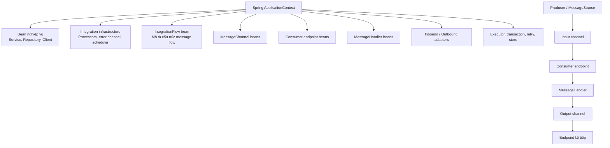
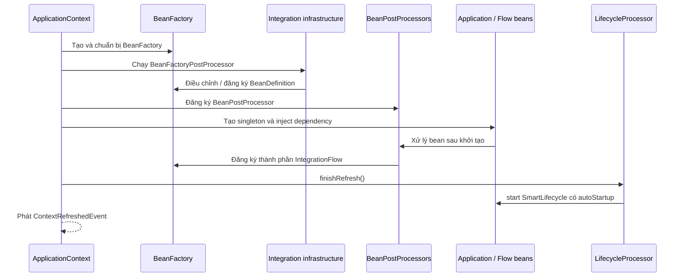
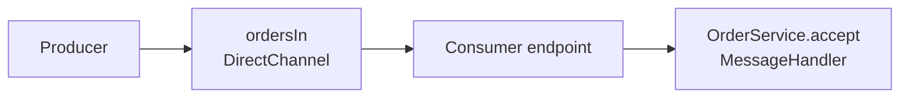

# Spring ApplicationContext khởi tạo integration bean

Spring Integration sử dụng cơ chế quản lý bean và vòng đời của Spring Framework để dựng message flow. Khi ứng dụng khởi động, `ApplicationContext` đọc cấu hình, đăng ký hạ tầng tích hợp, tạo bean nghiệp vụ, xử lý các khai báo `IntegrationFlow`, rồi khởi động endpoint có hỗ trợ lifecycle. Sau khi giai đoạn khởi tạo hoàn tất, producer mới gửi message vào các channel để consumer và handler xử lý.

Hiểu đúng thứ tự này giúp trả lời những câu hỏi thường gặp: Vì sao đã có bean `IntegrationFlow` nhưng endpoint chưa chạy? Vì sao gửi message trong `@PostConstruct` có thể thất bại? Vì sao `autoStartup=false` khiến flow không nhận message dù channel và handler đều tồn tại? Và khi context đóng, thành phần nào chịu trách nhiệm dừng poller hoặc adapter?

Bài này tập trung vào quá trình Spring khởi tạo các bean tích hợp trong phạm vi runtime của Spring Integration. Các khái niệm channel, endpoint, consumer, poller, executor, transaction, retry và error channel được đặt trong đúng giai đoạn vòng đời mà chúng tham gia.

## 1. ApplicationContext là điểm bắt đầu của runtime

`ApplicationContext` là IoC container quản lý các bean của ứng dụng. Spring Integration không tạo một container riêng để chứa message flow. Thay vào đó, các thành phần tích hợp được đăng ký vào `BeanFactory` thuộc application context đang cấu hình chúng.

Một context có thể quản lý đồng thời:

- Bean nghiệp vụ như service, repository và client kết nối hệ thống ngoài.
- Bean hạ tầng Spring Integration như error channel, scheduler, converter và các processor xử lý cấu hình.
- Bean mô tả flow như `IntegrationFlow`.
- Bean runtime được flow sử dụng như `MessageChannel`, consumer endpoint, message handler, message source và adapter.
- Bean hỗ trợ như executor, transaction manager, retry advice, message store và metadata store.

`ApplicationContext` chịu trách nhiệm tạo bean, inject dependency, quản lý lifecycle và phát application event. Nó không trực tiếp vận chuyển message. Việc chuyển message diễn ra qua channel; endpoint nhận message và gọi handler tương ứng.



Sơ đồ có hai góc nhìn khác nhau: các nhánh từ `ApplicationContext` mô tả quan hệ quản lý bean; chuỗi từ producer đến endpoint mô tả đường đi của message khi runtime hoạt động. Không nên đồng nhất hai quan hệ này.

## 2. Cấu hình nào đưa Spring Integration vào context?

### 2.1. Bật hạ tầng bằng @EnableIntegration

Trong cấu hình Java, `@EnableIntegration` là điểm vào phổ biến để đăng ký hạ tầng Spring Integration. Nó nhập các cấu hình và processor cần thiết để framework hiểu các thành phần tích hợp, hỗ trợ annotation messaging và Java DSL.

```java
@Configuration
@EnableIntegration
public class IntegrationConfiguration {
    // Khai báo MessageChannel, IntegrationFlow và các bean tích hợp.
}
```

Hạ tầng mặc định có thể bao gồm các bean dùng chung như `errorChannel` và `taskScheduler`, cùng những thành phần hỗ trợ expression, conversion và message header. Ứng dụng có thể cung cấp bean tùy chỉnh theo nhu cầu. Khi dùng scheduler riêng, executor riêng hoặc error channel riêng, cần cấu hình đúng tên và tham chiếu của endpoint sử dụng chúng.

Nếu dự án dùng Spring Boot, starter và auto-configuration có thể tự động kích hoạt một phần cấu hình. Điều đó phụ thuộc dependency và phiên bản đang sử dụng. Hãy kiểm tra dependency tree và bean thực tế trong context thay vì giả định mọi ứng dụng đều có cùng tập bean mặc định.

### 2.2. Những cách khai báo integration component

Spring Integration hỗ trợ nhiều cách khai báo, nhưng cuối cùng chúng đều dẫn đến các bean được quản lý trong context:

| Cách khai báo | Đầu vào của Spring | Kết quả runtime |
|---|---|---|
| Java DSL với `@Bean IntegrationFlow` | Bean mô tả một chuỗi thao tác | Các channel, endpoint và handler cấu thành flow |
| Annotation như `@ServiceActivator`, `@Transformer`, `@Router` | Phương thức bean được đánh dấu để xử lý message | Message handler và endpoint kết nối handler với channel |
| XML namespace | Các phần tử integration trong XML | Bean definition cho channel, endpoint, adapter và cấu hình liên quan |
| Inbound / outbound adapter | Cấu hình kết nối nguồn hoặc đích bên ngoài | Thành phần nhận dữ liệu vào hoặc gửi dữ liệu ra message flow |
| Messaging gateway | Interface hoặc bean gateway được cấu hình | Proxy nhận lời gọi Java và chuyển thành message exchange |

Java DSL thường phù hợp khi muốn đọc flow theo thứ tự các bước. Annotation thuận tiện khi handler gắn với một bean nghiệp vụ. XML hữu ích trong hệ thống có cấu hình tích hợp được quản lý bằng XML. Các hình thức này có thể cùng tồn tại trong một application context.

## 3. Spring refresh context diễn ra theo thứ tự nào?

Khởi tạo bean tích hợp nằm trong vòng đời `refresh()` của `ApplicationContext`. Trình tự dưới đây lược giản các bước nội bộ nhưng giữ đúng các mốc quan trọng đối với Spring Integration.



Các mốc quan trọng:

| Giai đoạn của Spring | Điều xảy ra | Ý nghĩa với integration bean |
|---|---|---|
| Chuẩn bị BeanFactory | Tạo bean factory mới và thiết lập môi trường, class loader, resource loader | Đây là nơi các bean tích hợp sẽ được đăng ký và tra cứu |
| Chạy BeanFactoryPostProcessor | Các processor có thể đọc hoặc thay đổi bean definition trước khi tạo bean thông thường | Hạ tầng tích hợp có thể bổ sung hoặc điều chỉnh cấu hình bean |
| Đăng ký BeanPostProcessor | Spring đăng ký các processor can thiệp vào quá trình tạo bean | Processor dành cho flow và annotation có thể xử lý các bean tương ứng |
| Tạo non-lazy singleton | Spring tạo bean thông thường, inject dependency, gọi các callback khởi tạo | Service, channel và bean khai báo flow được tạo; flow DSL được phân tích khi processor nhận diện bean |
| finishRefresh | Spring khởi tạo lifecycle processor và gọi `onRefresh()` | Các bean `SmartLifecycle` có `autoStartup` được khởi động theo phase |
| Phát ContextRefreshedEvent | Context thông báo refresh đã hoàn tất | Listener có thể quan sát trạng thái sau khi lifecycle processor đã được gọi |

Một vài chi tiết cần nhớ:

- `BeanFactoryPostProcessor` làm việc ở cấp bean definition, trước khi Spring tạo các bean nghiệp vụ thông thường.
- `BeanPostProcessor` tham gia quá trình tạo bean. Nó có thể nhận bean trước hoặc sau initialization callback và thực hiện xử lý chuyên biệt.
- Các bean khai báo lazy có thể chưa được tạo trong giai đoạn khởi tạo singleton thông thường. Không nên dựa vào chúng như thể mọi bean trong context đều đã được khởi tạo.
- `finishRefresh()` gọi lifecycle processor để khởi động các thành phần có hỗ trợ `SmartLifecycle`. Vì thế, thời điểm một bean tồn tại và thời điểm endpoint bắt đầu nhận message là hai mốc khác nhau.

## 4. IntegrationFlow được chuyển thành bean runtime như thế nào?

Với Java DSL, phương thức `@Bean` trả về một đối tượng `IntegrationFlow`. Đối tượng này mô tả cấu trúc flow: lấy message từ đâu, gọi transformer hoặc handler nào, chuyển tiếp sang channel nào.

Ví dụ:

```java
@Configuration
@EnableIntegration
public class OrderIntegrationConfiguration {

    @Bean
    public MessageChannel ordersIn() {
        return new DirectChannel();
    }

    @Bean
    public IntegrationFlow ordersFlow(OrderService orderService) {
        return IntegrationFlow.from("ordersIn")
                .handle(orderService, "accept")
                .get();
    }
}
```

Bean nghiệp vụ được inject như dependency Spring thông thường:

```java
@Component
public class OrderService {

    public void accept(Order order) {
        // Xử lý nghiệp vụ của đơn hàng.
    }
}
```

`IntegrationFlow` không phải một thread hoặc một vòng lặp tự chạy. Nó là mô tả để framework xây dựng các thành phần messaging. Trong Java DSL, `IntegrationFlowBeanPostProcessor` phát hiện bean flow và đăng ký các thành phần mà flow tạo ra vào bean factory. Các thành phần này có thể gồm channel, message handler và consumer endpoint.

Ví dụ trên tạo quan hệ logic như sau:



Khi ứng dụng chạy, producer gửi message vào `ordersIn`; consumer endpoint đã đăng ký trên channel chuyển message tới handler. Với `DirectChannel`, việc gọi subscriber diễn ra đồng bộ trong thread gửi message, trừ khi một thành phần phía sau chủ động chuyển công việc sang executor hoặc cơ chế bất đồng bộ khác.

### 4.1. Bean flow và endpoint là hai khái niệm khác nhau

Một flow có thể tạo ra nhiều thành phần runtime. Bean `IntegrationFlow` biểu diễn cấu trúc; endpoint thực hiện kết nối channel với handler hoặc message source.

| Thành phần | Vai trò trong quá trình khởi tạo |
|---|---|
| `IntegrationFlow` | Giữ cấu trúc khai báo flow |
| `IntegrationFlowBeanPostProcessor` | Nhận diện flow và đăng ký các thành phần được flow xây dựng |
| `MessageChannel` | Điểm kết nối giữa producer và consumer |
| `MessageHandler` | Xử lý payload và headers khi được endpoint gọi |
| Consumer endpoint | Kết nối channel đầu vào với handler; quản lý cách nhận message |
| `MessageSource` | Cung cấp message cho polling consumer hoặc adapter |
| Inbound adapter | Kết nối nguồn ngoài với message flow |
| Outbound adapter | Gửi message từ flow ra hệ thống ngoài |

Một endpoint có thể được tạo thành công nhưng chưa chạy. Ví dụ, bean endpoint tồn tại trong context nhưng `autoStartup` bị tắt. Khi đó, việc tra cứu thấy bean không chứng minh rằng endpoint đang nhận message.

### 4.2. Annotation-driven endpoint

Với annotation, một phương thức bean có thể trở thành message handler:

```java
@Component
public class PaymentHandler {

    @ServiceActivator(inputChannel = "paymentsIn")
    public void handle(Payment payment) {
        // Xử lý payment.
    }
}
```

Cấu hình channel:

```java
@Configuration
@EnableIntegration
public class PaymentIntegrationConfiguration {

    @Bean
    public MessageChannel paymentsIn() {
        return new DirectChannel();
    }
}
```

Các processor annotation của Spring Integration phát hiện phương thức được đánh dấu, tạo handler và endpoint cần thiết, sau đó liên kết endpoint với channel có tên `paymentsIn`. Nếu channel không tồn tại, sai tên hoặc không tương thích với kiểu consumer mong muốn, lỗi có thể xuất hiện trong quá trình tạo bean hoặc khi endpoint được khởi tạo.

## 5. Khi nào endpoint thực sự bắt đầu chạy?

Các endpoint và adapter quản lý hoạt động của mình qua cơ chế lifecycle của Spring. Nhiều thành phần tích hợp triển khai `SmartLifecycle`, cho phép Spring khởi động và dừng chúng theo vòng đời của context.

Khi context hoàn tất refresh, lifecycle processor gọi `onRefresh()`. Các thành phần `SmartLifecycle` có `autoStartup=true` được tự động khởi động. Nếu endpoint có `autoStartup=false`, bean vẫn có thể tồn tại nhưng phải được khởi động chủ động bằng API lifecycle phù hợp.

Một số thuộc tính ảnh hưởng đến thời điểm chạy:

| Thuộc tính / cơ chế | Tác dụng |
|---|---|
| `autoStartup` | Quyết định thành phần có tự khởi động khi context refresh hay không |
| `phase` | Sắp thứ tự khởi động và dừng giữa các thành phần hỗ trợ `SmartLifecycle` |
| `start()` / `stop()` | Cho phép điều khiển lifecycle chủ động khi API thành phần hỗ trợ |
| `isRunning()` | Kiểm tra thành phần có đang chạy hay không |
| `SmartLifecycle` | Cung cấp hợp đồng lifecycle có hỗ trợ auto-start và phase |
| `LifecycleProcessor` | Điều phối việc khởi động/dừng các bean lifecycle trong context |

Với các thành phần `SmartLifecycle`, phase thấp hơn được khởi động trước; khi dừng, thứ tự được đảo ngược để các thành phần ở phase cao hơn dừng trước. Cách sắp xếp này giúp ứng dụng kiểm soát thứ tự phụ thuộc, chẳng hạn consumer dừng trước khi tài nguyên nền tảng mà nó cần bị đóng.

### 5.1. Poller và executor cũng có vòng đời riêng

Một polling endpoint cần poller để định kỳ đọc message từ `MessageSource` hoặc pollable channel. Poller sử dụng scheduler để lập lịch; tùy cấu hình, công việc có thể được chuyển sang executor.

- `TaskScheduler` điều phối thời điểm poller được kích hoạt.
- `TaskExecutor` thực thi công việc trên thread được quản lý bởi executor.
- Poller chưa chạy thì nguồn polling có thể chưa được đọc, dù message source bean đã tồn tại.
- Executor chưa sẵn sàng hoặc đã bị shutdown có thể khiến công việc không được thực thi.
- Với `DirectChannel`, producer thường gọi subscriber trực tiếp trong thread gửi message; không cần poller chỉ để chuyển message trên channel này.

Không nên kết luận rằng mọi IntegrationFlow đều bất đồng bộ. Thread thực tế phụ thuộc channel, endpoint, poller, executor và adapter cụ thể.

## 6. Gửi message trong giai đoạn khởi tạo: thời điểm nào an toàn?

Một lỗi thường gặp là gửi message quá sớm, khi channel đã tồn tại nhưng endpoint chưa được khởi động.

### 6.1. Những callback chạy trước lifecycle startup

Constructor, `@PostConstruct`, `InitializingBean.afterPropertiesSet()` và nhiều callback khởi tạo bean diễn ra trong quá trình Spring tạo singleton. Ở thời điểm này, context có thể chưa đi đến `finishRefresh()`, vì vậy các endpoint `SmartLifecycle` chưa được lifecycle processor tự động khởi động.

Ví dụ cần thận trọng:

```java
@Component
public class EarlyPublisher {

    private final MessageChannel ordersIn;

    public EarlyPublisher(
            @Qualifier("ordersIn") MessageChannel ordersIn) {
        this.ordersIn = ordersIn;
    }

    @PostConstruct
    public void publish() {
        // Có thể chạy trước khi consumer endpoint được start.
        ordersIn.send(new GenericMessage<>(new Order("A-100")));
    }
}
```

Với `DirectChannel`, nếu chưa có subscriber đang hoạt động, việc gửi message có thể thất bại do không có subscriber phù hợp. Với channel có buffering, message có thể được giữ lại nhưng chưa chắc consumer đã sẵn sàng xử lý. Hành vi phụ thuộc loại channel và cấu hình cụ thể.

### 6.2. Dùng ApplicationRunner trong Spring Boot

Nếu ứng dụng dùng Spring Boot và cần gửi dữ liệu khởi tạo sau khi context refresh, có thể dùng `ApplicationRunner`. Runner được gọi sau khi application context đã refresh và các runner được thực thi trong giai đoạn startup của Spring Boot.

```java
@Component
public class InitialOrderPublisher implements ApplicationRunner {

    private final MessageChannel ordersIn;

    public InitialOrderPublisher(
            @Qualifier("ordersIn") MessageChannel ordersIn) {
        this.ordersIn = ordersIn;
    }

    @Override
    public void run(ApplicationArguments args) {
        ordersIn.send(
                new GenericMessage<>(new Order("A-100"))
        );
    }
}
```

Trong ứng dụng Spring Framework thuần, không có `ApplicationRunner`. Có thể dùng `ContextRefreshedEvent` hoặc một cơ chế điều phối lifecycle riêng nếu cần hành động sau refresh. Cần tránh thực thi lặp khi ứng dụng có nhiều context cha-con hoặc refresh nhiều lần.

Thứ tự quan trọng trong Spring Framework là lifecycle processor được gọi trong `finishRefresh()` trước khi `ContextRefreshedEvent` được phát. Trong Spring Boot, `ApplicationReadyEvent` còn muộn hơn, sau các runner; hãy chọn mốc theo đúng yêu cầu khởi động của ứng dụng.

## 7. Context cha-con và phạm vi đăng ký integration bean

Spring hỗ trợ nhiều `ApplicationContext` theo quan hệ cha-con. Bean ở context con có thể tra cứu bean từ context cha; context cha không nhìn thấy bean chỉ tồn tại ở context con.

Điều này ảnh hưởng đến integration runtime:

- Flow khai báo trong context con được tạo và quản lý trong bean factory của context con.
- Channel hoặc service ở context cha có thể được dùng từ context con nếu việc tra cứu bean và dependency cho phép.
- Một endpoint ở context con có thể tham chiếu bean hạ tầng dùng chung từ context cha.
- Flow đăng ký động qua `IntegrationFlowContext` thuộc phạm vi context mà bean `IntegrationFlowContext` đó quản lý.
- Đóng context con sẽ dừng và hủy các bean lifecycle thuộc context con; context cha vẫn có thể tiếp tục chạy.

Không nên đăng ký cùng một flow vào nhiều context nếu chưa xác định rõ quyền sở hữu channel, endpoint và tài nguyên. Việc chia sẻ bean giữa các context cần có chủ đích, nhất là khi đóng một context có thể ảnh hưởng đến các flow còn hoạt động.

## 8. Điều gì xảy ra khi context đóng?

Vòng đời tích hợp không kết thúc ở startup. Khi ứng dụng đóng context, Spring gọi lifecycle processor để dừng các thành phần hỗ trợ lifecycle, sau đó thực hiện quá trình hủy bean và giải phóng tài nguyên.

Với integration runtime, cần quan tâm:

- Endpoint và adapter phải ngừng nhận công việc mới.
- Poller cần dừng lịch polling.
- Executor và scheduler do ứng dụng quản lý phải được shutdown theo đúng quyền sở hữu.
- Connection hoặc session đến hệ thống ngoài phải được đóng bởi thành phần sở hữu chúng.
- Flow đăng ký động cần được gỡ đúng cách nếu vòng đời của nó kết thúc trước application context.
- Message đang nằm trong queue hoặc store cần được đánh giá theo chính sách durability và recovery của ứng dụng.

Không phải mọi channel đều lưu message bền vững. `QueueChannel` thông thường là bộ đệm trong bộ nhớ; nếu cần phục hồi message sau restart, phải cấu hình message store hoặc cơ chế persistence phù hợp với use case.

## 9. Chẩn đoán khi integration bean không khởi tạo hoặc không chạy

Hãy phân biệt ba trạng thái:

1. Bean definition đã được đăng ký.
2. Bean instance đã được tạo và dependency đã được inject.
3. Endpoint đã được start và đang nhận message.

Một trạng thái không tự động chứng minh hai trạng thái còn lại.

| Triệu chứng | Giai đoạn cần kiểm tra | Câu hỏi chẩn đoán |
|---|---|---|
| Không tìm thấy channel bean | Đăng ký bean definition / cấu hình | Đã khai báo channel trong đúng context chưa? Tên bean có khớp không? |
| Không tạo được IntegrationFlow bean | Tạo singleton và xử lý dependency | Có dependency nào bị thiếu, sai kiểu hoặc circular dependency không? |
| Flow bean có nhưng endpoint không xuất hiện | Xử lý IntegrationFlow | Java DSL processor có được đăng ký không? Flow có thực sự được tạo trong context này không? |
| Endpoint tồn tại nhưng không nhận message | Lifecycle startup | Endpoint có `autoStartup=false` hoặc chưa được start không? |
| Polling source không chạy | Lifecycle và scheduler | Poller có được cấu hình không? Scheduler có hoạt động không? |
| Gửi message quá sớm bị lỗi | Thứ tự startup | Producer có gửi trước khi consumer endpoint start không? |
| Handler chạy trên thread bất ngờ | Dispatch và executor | Channel là Direct, Executor hay pollable? Có executor chuyển thread không? |
| Context shutdown bị treo | Lifecycle stop và resource cleanup | Có endpoint hoặc adapter nào chờ tác vụ vô hạn không? Executor có tác vụ chưa kết thúc không? |

Có thể kiểm tra bean theo kiểu từ context:

```java
Map<String, MessageChannel> channels =
        applicationContext.getBeansOfType(MessageChannel.class);

Map<String, AbstractEndpoint> endpoints =
        applicationContext.getBeansOfType(AbstractEndpoint.class);

endpoints.forEach((name, endpoint) ->
        log.info("endpoint={}, running={}", name, endpoint.isRunning()));
```

Các import trong ví dụ được lược bỏ. Khi dùng `AbstractEndpoint`, cần đảm bảo loại endpoint trong phiên bản Spring Integration đang dùng phù hợp với kiểu tra cứu. Có thể bắt đầu bằng `getBeansOfType(AbstractEndpoint.class)` để kiểm tra các endpoint chuẩn và dùng Actuator hoặc log startup để quan sát chi tiết hơn khi ứng dụng có nhiều loại adapter.

Một trình tự debug hiệu quả:

1. Xác định application context đang chứa flow và endpoint.
2. Kiểm tra cấu hình `@EnableIntegration`, XML namespace hoặc auto-configuration tương ứng.
3. Kiểm tra bean definition và dependency của channel, service, scheduler, executor.
4. Xác nhận flow được xử lý và các endpoint được đăng ký.
5. Kiểm tra `isRunning()`, `autoStartup` và `phase`.
6. Kiểm tra thời điểm producer gửi message so với thời điểm endpoint bắt đầu.
7. Theo dõi log của poller, error channel, retry advice và adapter nếu message không đi đến handler.

## 10. Ví dụ tổng hợp: từ cấu hình đến message đầu tiên

Ví dụ dưới đây gom các thành phần cốt lõi vào một context. Khi context khởi động, Spring tạo channel, service và flow; Java DSL processor đăng ký endpoint; lifecycle processor khởi động endpoint; Spring Boot runner gửi message sau khi refresh.

```java
@Configuration
@EnableIntegration
public class OrderIntegrationConfiguration {

    @Bean
    public MessageChannel ordersIn() {
        return new DirectChannel();
    }

    @Bean
    public IntegrationFlow ordersFlow(OrderService orderService) {
        return IntegrationFlow.from("ordersIn")
                .handle(orderService, "accept")
                .get();
    }
}

@Component
class OrderService {

    public void accept(Order order) {
        System.out.println("Processing order " + order.id());
    }
}

record Order(String id) {}

@Component
class InitialOrderPublisher implements ApplicationRunner {

    private final MessageChannel ordersIn;

    InitialOrderPublisher(
            @Qualifier("ordersIn") MessageChannel ordersIn) {
        this.ordersIn = ordersIn;
    }

    @Override
    public void run(ApplicationArguments args) {
        ordersIn.send(new GenericMessage<>(new Order("A-100")));
    }
}
```

Trình tự diễn ra:

1. Spring đọc `OrderIntegrationConfiguration` và đăng ký cấu hình.
2. `@EnableIntegration` đưa hạ tầng Spring Integration vào context.
3. Spring tạo `ordersIn`, `OrderService` và bean `ordersFlow`.
4. Java DSL processor nhận diện flow và đăng ký các thành phần runtime.
5. Context hoàn tất refresh; lifecycle processor khởi động consumer endpoint.
6. Spring Boot gọi `InitialOrderPublisher.run()`.
7. Producer gửi message vào `ordersIn`; `DirectChannel` dispatch đến consumer endpoint và handler gọi `OrderService.accept()`.

Trong ví dụ này, handler chạy đồng bộ trên đường dispatch của `DirectChannel`. Nếu đổi sang channel hoặc endpoint dùng executor, thread xử lý và cách lỗi được truyền về producer có thể thay đổi.

## 11. Các nguyên tắc cần giữ khi thiết kế startup

- Đăng ký hạ tầng tích hợp trong đúng application context quản lý flow.
- Đảm bảo bean nghiệp vụ, channel, scheduler và executor sẵn sàng trước khi endpoint sử dụng chúng.
- Phân biệt bean đã tồn tại với endpoint đã chạy.
- Đặt `autoStartup` và `phase` theo quan hệ phụ thuộc giữa các endpoint.
- Không phát message quá sớm từ constructor hoặc `@PostConstruct` nếu consumer chưa được start.
- Dùng `ApplicationRunner` khi cần gửi message sau refresh trong Spring Boot; dùng lifecycle event phù hợp trong Spring Framework thuần.
- Khi context đóng, dừng endpoint và giải phóng scheduler, executor, connection theo đúng chủ sở hữu.
- Quan sát cả trạng thái bean, lifecycle và message dispatch; chỉ kiểm tra `ApplicationContext.containsBean()` là chưa đủ để kết luận flow đang hoạt động.

## Tài liệu tham khảo

- [Spring Framework — Container Extension Points](https://docs.spring.io/spring-framework/reference/core/beans/factory-extension.html)
- [Spring Framework — Lifecycle Callbacks](https://docs.spring.io/spring-framework/reference/core/beans/factory-nature.html)
- [Spring Framework — ApplicationContext](https://docs.spring.io/spring-framework/reference/core/beans/basics.html)
- [Spring Integration — Configuration and Namespace Support](https://docs.spring.io/spring-integration/reference/configuration.html)
- [Spring Integration — Java DSL](https://docs.spring.io/spring-integration/reference/dsl.html)
- [Spring Integration — Endpoint Lifecycle](https://docs.spring.io/spring-integration/reference/endpoint.html)
- [Spring Boot — Application Events and Listeners](https://docs.spring.io/spring-boot/reference/features/spring-application.html)

