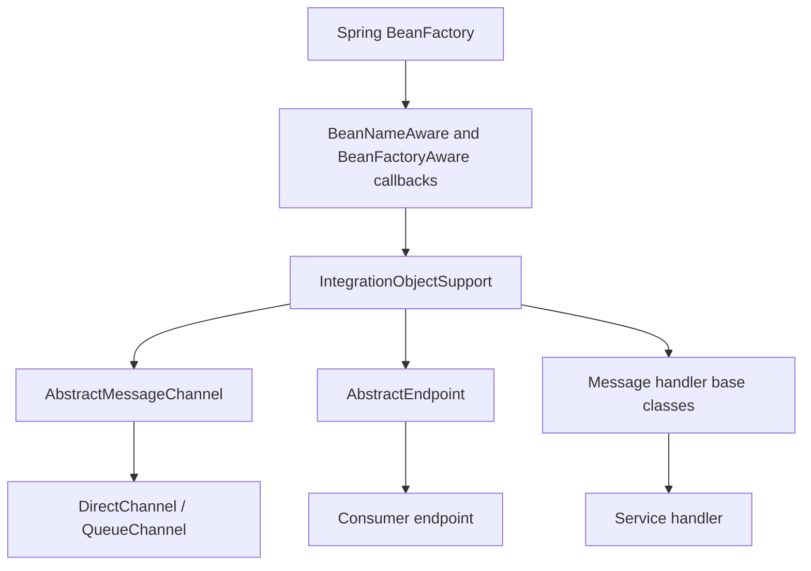
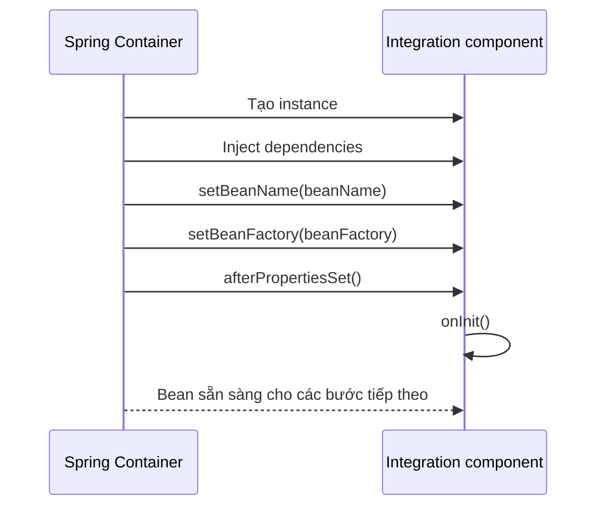
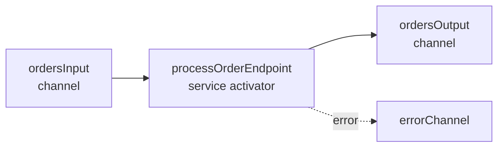

# IntegrationObjectSupport và component name

Spring Integration tạo nhiều loại đối tượng để một message flow có thể hoạt động: channel, endpoint, handler, adapter, gateway và các thành phần điều phối. Khi ứng dụng chạy, ta cần biết mỗi đối tượng thuộc flow nào, đang đảm nhiệm vai trò gì và được đăng ký dưới tên nào trong Spring container. `IntegrationObjectSupport` cung cấp một lớp nền dùng chung cho nhiều component của Spring Integration; còn **component name** là định danh giúp nhận diện component trong cấu hình và khi quan sát runtime.

Hiểu hai khái niệm này giúp đọc được tên component do framework tạo, đặt tên endpoint ổn định trong Java DSL, và lần theo log hoặc Integration Graph khi một flow có vấn đề.

## 1. IntegrationObjectSupport nằm ở đâu trong runtime?

`IntegrationObjectSupport` là lớp hỗ trợ ở tầng nền của Spring Integration. Nhiều component tích hợp kế thừa trực tiếp hoặc gián tiếp từ lớp này để dùng các khả năng chung của framework, chẳng hạn:

- Nhận `BeanFactory` từ Spring container.
- Nhận tên bean thông qua callback `BeanNameAware`.
- Có thông tin định danh component và loại component.
- Thực hiện khởi tạo sau khi Spring đã inject các dependency.
- Truy cập một số dịch vụ hạ tầng của Spring Integration mà component cần trong quá trình hoạt động.

Lớp này không phải là một channel, endpoint hay engine điều phối flow. Nó cung cấp nền tảng chung để các lớp cụ thể xây dựng những hành vi đó.

Một cách nhìn đơn giản về quan hệ kế thừa:



Sơ đồ minh họa các nhánh component thường gặp. Không phải mọi lớp cụ thể đều kế thừa trực tiếp từ `IntegrationObjectSupport`; có nhiều lớp trung gian trong hệ thống phân cấp.

Điểm quan trọng là tên và thông tin container được gắn vào component trong quá trình Spring tạo bean. Vì vậy, khi component đã được khởi tạo, framework có thể dùng cùng một metadata trong log, quản lý và quan sát topology của flow.

## 2. Spring cung cấp bean name cho component như thế nào?

Spring quản lý đối tượng thông qua `BeanFactory` hoặc `ApplicationContext`. Mỗi bean definition có một tên chính. Tên đó thường đến từ một trong các cách khai báo:

| Cách khai báo | Tên bean thường được dùng |
|---|---|
| `@Component` | Tên mặc định suy ra từ tên lớp, hoặc tên truyền vào annotation |
| `@Service("orderService")` | `orderService` |
| `@Bean` trên method `ordersInput()` | `ordersInput` |
| `@Bean(name = "orders.input")` | `orders.input` |
| Đăng ký qua BeanDefinition | Tên được cung cấp khi đăng ký definition |

Một component kế thừa `IntegrationObjectSupport` tham gia callback `BeanNameAware`. Spring gọi `setBeanName(...)` với tên bean trong quá trình khởi tạo; component lưu tên đó làm component name để các phần khác của framework có thể truy vấn.

Ví dụ:

```java
@Configuration
class OrderChannels {

    @Bean
    DirectChannel ordersInput() {
        return new DirectChannel();
    }

}
```

Ở đây, bean channel có tên `ordersInput`. `DirectChannel` là component của Spring Integration, nên tên bean được dùng làm component name của channel. Tên này cũng có thể được tham chiếu khi cấu hình một flow:

```java
@Bean
IntegrationFlow orderFlow(OrderService orderService) {
    return IntegrationFlow.from("ordersInput")
            .handle(orderService, "process")
            .get();
}
```

Khi Spring Integration resolve chuỗi `ordersInput`, nó tìm channel bean tương ứng trong container. Tên bean vì vậy vừa là định danh trong Spring, vừa là một phần của cách nối các thành phần trong cấu hình integration.

Không nên đọc component name trong constructor rồi giả định nó đã có giá trị. Constructor chạy trước callback `BeanNameAware`; hãy sử dụng tên sau khi Spring hoàn tất bước inject và khởi tạo bean.

## 3. Component name và component type

Các component tích hợp thường cung cấp hai thông tin riêng:

- **Component name** trả lời: “Đây là instance nào trong application context?”
- **Component type** trả lời: “Instance này thuộc loại component nào?”

Ví dụ minh họa:

| Component | Component name | Component type |
|---|---|---|
| Channel nhận đơn | `ordersInput` | Channel |
| Endpoint xử lý đơn | `processOrderEndpoint` | Service activator hoặc loại endpoint tương ứng |
| Channel kết quả | `ordersOutput` | Channel |
| Handler audit | `auditHandler` | Message handler |

Giá trị component type cụ thể do lớp component hoặc endpoint cung cấp; không nên suy ra nó chỉ bằng cách tách tên bean. Hai component có tên khác nhau có thể cùng type, và hai component cùng type có thể có cấu hình hoặc vai trò nghiệp vụ khác nhau.

Trong API Spring Integration, `NamedComponent` là abstraction thể hiện component có tên và type. `IntegrationObjectSupport` cung cấp nền tảng để nhiều component triển khai hợp đồng này. Các phương thức thường được dùng khi quan sát component là:

- `getComponentName()`: lấy tên định danh của component.
- `getComponentType()`: lấy loại component.

Tên và type là metadata kỹ thuật. Chúng không thay thế message ID, correlation ID hoặc khóa nghiệp vụ trong payload.

## 4. Phân biệt bean name, component name, flow ID và endpoint ID

Những tên này có liên quan nhưng không đồng nghĩa. Nhầm chúng có thể khiến việc tìm bean, đọc graph hoặc điều tra log mất thời gian.

| Khái niệm | Phạm vi | Mục đích |
|---|---|---|
| Bean name | Spring container | Đăng ký và tra cứu bean |
| Component name | Spring Integration component | Nhận diện một component trong runtime và công cụ quản lý |
| Component type | Spring Integration component | Phân loại component theo vai trò kỹ thuật |
| IntegrationFlow ID | Bean đại diện cho flow | Nhận diện flow đã khai báo hoặc đăng ký |
| Endpoint ID | Endpoint trong flow | Đặt tên endpoint, hỗ trợ quản lý và quan sát |
| Channel name | Channel bean | Định tuyến message giữa producer và consumer |
| Message ID | Một message cụ thể | Nhận diện message |
| Correlation ID | Một nhóm hoặc chuỗi message liên quan | Ghép các message thuộc cùng một xử lý nghiệp vụ |

Với các component được khai báo thành bean độc lập, bean name thường chính là nguồn của component name. Nhưng trong Java DSL, một flow có thể tạo ra nhiều endpoint và channel nội bộ. Các component nội bộ có thể được framework sinh tên dựa trên flow và vị trí component trong cấu hình.

Ví dụ, một flow có ID `orderFlow` có thể chứa channel và endpoint do DSL tạo. Không nên phụ thuộc vào chuỗi tên nội bộ được sinh tự động nếu tên đó là một phần của quy trình vận hành hoặc dashboard. Khi cần một định danh ổn định, hãy đặt ID tường minh cho endpoint hoặc khai báo channel thành bean có tên rõ ràng.

### Đặt ID tường minh cho endpoint trong Java DSL

```java
@Bean
IntegrationFlow orderFlow(OrderService orderService) {
    return IntegrationFlow.from("ordersInput")
            .handle(orderService, "process",
                    endpoint -> endpoint.id("processOrderEndpoint"))
            .get();
}
```

Trong ví dụ:

- `orderFlow` là tên bean của flow.
- `ordersInput` là tên channel được flow sử dụng làm đầu vào.
- `processOrderEndpoint` là ID tường minh của endpoint xử lý.
- `OrderService` là service nghiệp vụ được endpoint gọi.

Tên endpoint giúp nhận diện bước xử lý trong cấu hình và công cụ quản lý. Tên service bean, nếu service được đăng ký riêng, vẫn là một định danh khác.

Đặt ID tường minh đặc biệt hữu ích khi một flow dài có nhiều endpoint cùng loại. Khi log hoặc graph báo lỗi tại một endpoint, tên có ý nghĩa sẽ giúp xác định vị trí xử lý nhanh hơn tên sinh tự động như một chỉ số thứ tự.

## 5. Vòng đời khởi tạo và hook onInit()

`IntegrationObjectSupport` tham gia vòng đời khởi tạo bean của Spring. Có thể mô tả trình tự rút gọn như sau:



Thứ tự thực tế còn có các callback và BeanPostProcessor khác của Spring. Sơ đồ tập trung vào những điểm quan trọng đối với component kế thừa `IntegrationObjectSupport`.

`afterPropertiesSet()` là callback của `InitializingBean`. Lớp nền dùng giai đoạn này để hoàn tất khởi tạo và gọi hook `onInit()`. Các lớp con có thể override `onInit()` để kiểm tra cấu hình hoặc chuẩn bị tài nguyên cần thiết sau khi dependency đã được inject.

Ví dụ một component tùy chỉnh:

```java
public class AuditMessageHandler extends AbstractMessageHandler {

    private static final Logger log =
            LoggerFactory.getLogger(AuditMessageHandler.class);

    private final AuditService auditService;

    public AuditMessageHandler(AuditService auditService) {
        this.auditService = auditService;
    }

    @Override
    protected void onInit() {
        super.onInit();
        Assert.notNull(this.auditService, "auditService is required");
    }

    @Override
    protected void handleMessageInternal(Message<?> message) {
        log.debug("component={}, messageId={}",
                getComponentName(),
                message.getHeaders().getId());

        this.auditService.record(message);
    }

}
```

`AbstractMessageHandler` là lớp nền dành cho handler; nó đã cung cấp các cơ chế chung của message handler và kế thừa nền tảng hỗ trợ của Spring Integration. Ví dụ dùng `getComponentName()` trong log để chỉ ra handler instance đang xử lý message.

Đăng ký handler thành bean:

```java
@Bean
AuditMessageHandler auditHandler(AuditService auditService) {
    return new AuditMessageHandler(auditService);
}
```

Bean có tên `auditHandler`, do đó handler có thể sử dụng tên component tương ứng sau khi Spring hoàn tất callback đặt tên. Nếu đổi tên bean, các log dựa trên component name cũng đổi theo.

### onInit() nên làm gì?

Hook này phù hợp với những công việc cần chạy sau khi cấu hình và dependency đã sẵn sàng:

- Kiểm tra thuộc tính bắt buộc.
- Kiểm tra cấu hình có mâu thuẫn hay không.
- Chuẩn bị cấu trúc dữ liệu hoặc đối tượng hỗ trợ cần thiết.
- Khởi tạo tích hợp nội bộ mà component sở hữu và có thể quản lý vòng đời.

Không nên dùng `onInit()` để thực hiện một tác vụ nghiệp vụ dài, chờ vô hạn hoặc tự tạo thread không có cơ chế dừng. Khởi tạo component và start/stop endpoint là hai mối quan tâm khác nhau. Những endpoint cần start, stop theo ApplicationContext thường tham gia lifecycle riêng của Spring, chẳng hạn qua các abstraction endpoint triển khai `SmartLifecycle`.

## 6. Component name được dùng ở đâu khi vận hành?

Tên component giúp nối cấu hình với dấu vết runtime. Tùy loại component và các tính năng quản lý được bật, tên có thể xuất hiện trong:

- Log khởi tạo, log xử lý message hoặc log lỗi.
- Thông tin component và topology trong Integration Graph.
- Metadata phục vụ quản lý endpoint, channel và handler.
- Metric hoặc observation có gắn định danh component.
- Thông tin chẩn đoán khi một endpoint không start hoặc một channel không có consumer.

Không phải mọi ứng dụng đều bật tất cả các bề mặt quan sát trên. Việc tên xuất hiện ở đâu còn phụ thuộc phiên bản Spring Integration, Spring Boot, dependency quản lý và cấu hình expose endpoint.

Một Integration Graph có thể giúp hình dung quan hệ giữa channel và endpoint:



Tên component giúp người vận hành nối node trong graph với bean hoặc endpoint trong cấu hình. Khi một message không được xử lý, ta có thể lần theo:

1. Channel đầu vào có tồn tại và nhận được message không?
2. Endpoint nào đang subscribe vào channel đó?
3. Endpoint có được khởi tạo và start không?
4. Component name trong log/graph có trùng với ID mà ta đang tìm không?
5. Có channel hoặc endpoint nào bị đặt tên trùng, hoặc có nhiều flow cùng tạo component tương tự không?

Khi theo dõi một message qua nhiều endpoint, component name cho biết **nơi xử lý**, còn message ID và correlation ID cho biết **message nào và thuộc luồng nghiệp vụ nào**. Kết hợp chúng sẽ giúp log có giá trị chẩn đoán hơn.

## 7. Đặt tên component để dễ vận hành

Tên tốt cần giúp người đọc hiểu vai trò của component mà không cần mở ngay phần code triển khai. Có thể áp dụng các nguyên tắc sau:

| Nguyên tắc | Ví dụ nên dùng | Lý do |
|---|---|---|
| Nêu vai trò hoặc dữ liệu chính | `ordersInput` | Biết channel nhận loại dữ liệu nào |
| Nêu hành động của endpoint | `validateOrderEndpoint` | Biết bước xử lý làm gì |
| Phân biệt các nhánh | `persistOrderEndpoint`, `publishOrderEndpoint` | Tránh nhầm các endpoint cùng loại |
| Giữ tên ổn định | `inventoryLookupEndpoint` | Dashboard và log dễ theo dõi qua các lần deploy |
| Có phạm vi khi flow lớn | `billing.retryEndpoint` | Giảm nguy cơ trùng tên và dễ định vị |

Một số lỗi đặt tên thường gặp:

- Dùng tên chung chung như `handler1`, `channel2`, `flowA`; tên không diễn tả vai trò.
- Dùng tên phụ thuộc thứ tự khai báo như `endpoint3`; khi thêm một bước, ý nghĩa của tên trở nên sai.
- Đặt tên một component theo tên nghiệp vụ của message; component name là định danh kỹ thuật, không nên thay đổi theo từng đơn hàng.
- Cho rằng tên channel, tên endpoint và tên flow là cùng một giá trị.
- Dùng component name làm correlation key; correlation phải lấy từ dữ liệu hoặc metadata nghiệp vụ phù hợp.
- Đổi bean name mà không cập nhật các tham chiếu bằng tên, cấu hình monitor hoặc tài liệu vận hành.

Tên component nên ổn định qua các lần triển khai nếu các công cụ vận hành dựa trên tên đó. Nếu một bean có nhiều alias, alias là tên tra cứu bổ sung trong container, không tạo ra một component instance độc lập. Không nên giả định gọi bean qua alias sẽ làm component name đổi theo alias.

## 8. Đăng ký IntegrationFlow động và tên component

Với flow khai báo tĩnh, Spring tạo flow bean từ cấu hình trong ApplicationContext. Khi cần đăng ký flow trong lúc ứng dụng đang chạy, Spring Integration cung cấp `IntegrationFlowContext`.

Khi đăng ký động, ứng dụng cung cấp một ID đăng ký cho flow. ID này giúp nhận diện flow trong context đăng ký và quản lý vòng đời đăng ký. Những component do flow tạo có thể nhận tên phát sinh từ flow ID và metadata của từng endpoint.

Ví dụ minh họa cách đăng ký:

```java
IntegrationFlowRegistration registration =
        integrationFlowContext
                .registration(orderFlow)
                .id("tenantOrderFlow")
                .register();
```

Đoạn code là ví dụ rút gọn; ứng dụng cần inject `IntegrationFlowContext`, xây dựng `orderFlow` và quản lý registration theo vòng đời tenant hoặc chức năng tương ứng.

Khi gỡ flow động, hãy dừng hoặc destroy registration theo API phù hợp. Nếu chỉ bỏ tham chiếu ở code ứng dụng mà không gỡ đăng ký, endpoint và các component liên quan vẫn có thể còn trong ApplicationContext. Tên đăng ký cần ổn định và duy nhất trong phạm vi mà `IntegrationFlowContext` quản lý.

Đối với hệ thống multi-tenant, tránh dùng một tên cố định cho mọi flow động nếu chúng cần tồn tại đồng thời. Có thể đưa tenant key hoặc một định danh chức năng đã chuẩn hóa vào registration ID. Không đưa dữ liệu nhạy cảm trực tiếp vào tên vì tên component có thể xuất hiện trong log hoặc công cụ quản lý.

## 9. Những điều IntegrationObjectSupport không thay thế

Hiểu đúng phạm vi của lớp nền giúp tránh đặt trách nhiệm sai chỗ:

| Nhu cầu | Thành phần phù hợp |
|---|---|
| Lấy tên và metadata component | `IntegrationObjectSupport` / `NamedComponent` |
| Đăng ký và tra cứu bean | Spring `BeanFactory` / `ApplicationContext` |
| Nối producer với consumer | `MessageChannel` |
| Kích hoạt xử lý message | Message endpoint và consumer |
| Đọc dữ liệu theo lịch | Poller và message source hoặc pollable channel |
| Start/stop endpoint | Lifecycle của endpoint, thường tích hợp với Spring lifecycle |
| Ghép message cùng một nghiệp vụ | Correlation và aggregator/message group store |
| Nhận diện một message | Message ID |
| Truyền lỗi | Error message và error channel |

`IntegrationObjectSupport` không tự tạo transaction, không cung cấp retry policy cho mọi handler, không lưu message thay cho `MessageStore`, và không đảm bảo một endpoint đang chạy chỉ vì bean đã được khởi tạo. Các năng lực này thuộc những abstraction và cấu hình chuyên biệt khác của Spring Integration.

Đối với service nghiệp vụ thông thường, không cần kế thừa `IntegrationObjectSupport` chỉ để lấy bean name. Có thể dùng dependency injection hoặc API Spring phù hợp. Chỉ nên dùng lớp nền này khi đang xây dựng một component tích hợp tùy chỉnh cần các cơ chế chung của Spring Integration. Nếu chỉ cần tên để log, có thể dùng logger và metadata được inject theo cách đơn giản hơn, tránh phụ thuộc không cần thiết vào lớp nội bộ của framework.

## 10. Checklist chẩn đoán component name

Khi một component không xuất hiện trong log hoặc Integration Graph như mong đợi, hãy kiểm tra theo thứ tự:

- Bean có thực sự được đăng ký trong đúng ApplicationContext không?
- Bean được đăng ký dưới tên nào: tên mặc định, tên tường minh hay tên do flow DSL sinh ra?
- Component có kế thừa hoặc triển khai abstraction cung cấp `NamedComponent` không?
- Spring đã gọi callback đặt tên và hoàn tất giai đoạn khởi tạo chưa?
- Có đang đọc `getComponentName()` quá sớm trong constructor không?
- Endpoint ID có được đặt tường minh trong Java DSL không?
- Flow động đã được đăng ký thành công và còn tồn tại không?
- Công cụ quản lý hoặc endpoint Actuator tương ứng đã được bật và expose chưa?
- Log có đang dùng component name cùng message ID/correlation ID để xác định đúng nơi và đúng message không?

Khi đặt tên có chủ đích và hiểu vòng đời của `IntegrationObjectSupport`, ta có thể đọc cấu hình flow dễ hơn, nhận diện đúng endpoint đang xử lý, và liên kết thông tin trong log với topology runtime. Đây là một nền tảng nhỏ nhưng quan trọng để quản lý và chẩn đoán Spring Integration khi số lượng channel, endpoint và flow tăng lên.

