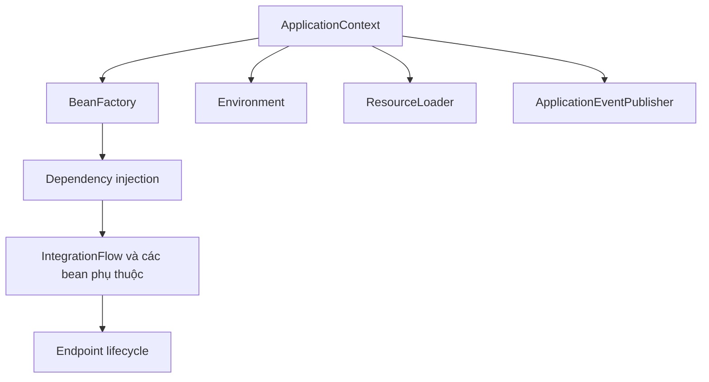
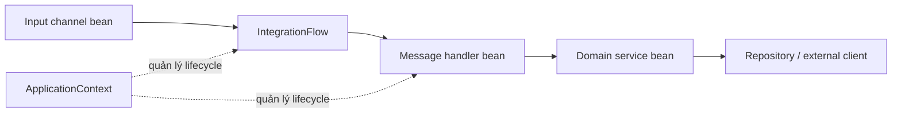

# BeanFactoryAware, ApplicationContextAware và dependency

Trong Spring Integration, một message flow chạy bên trong Spring container. Channel, endpoint, handler, poller, executor và các service mà flow gọi đều là bean hoặc được Spring quản lý thông qua bean. Vì vậy, cách một thành phần nhận dependency và thời điểm nó được container khởi tạo ảnh hưởng trực tiếp đến khả năng chạy, dừng và kiểm thử của flow.

Spring cung cấp dependency injection để đưa collaborator vào bean, cùng các callback `Aware` để một bean nhận được tham chiếu tới một phần hạ tầng container. Hai callback thường gặp là `BeanFactoryAware` và `ApplicationContextAware`. Chúng có mục đích riêng; hiểu đúng ranh giới giữa callback và dependency injection giúp tránh tạo ra service locator, phụ thuộc vòng và lỗi khởi tạo sớm.

## 1. BeanFactory và ApplicationContext trong runtime

`BeanFactory` là hợp đồng nền tảng của IoC container. Nó quản lý định nghĩa bean, tạo bean và cung cấp API tra cứu bean. `ApplicationContext` mở rộng các khả năng đó, đồng thời tích hợp thêm môi trường cấu hình, resource loading, message source, event publishing và quan hệ context cha-con.

| Khả năng | `BeanFactory` | `ApplicationContext` |
| --- | --- | --- |
| Tạo và tra cứu bean | Có | Có, kế thừa từ `BeanFactory` |
| Dependency injection và quản lý lifecycle bean | Có | Có |
| Environment và active profiles | Không phải API của `BeanFactory` | Có qua `EnvironmentCapable` |
| Đọc resource theo abstraction của Spring | Không phải API của `BeanFactory` | Có qua `ResourceLoader` |
| Phát application event | Không phải API của `BeanFactory` | Có qua `ApplicationEventPublisher` |
| Message source và phân cấp context | Không | Có |

Trong ứng dụng Spring Boot hoặc ứng dụng Spring Integration thông thường, bean được tạo trong một `ApplicationContext`. Các thành phần của Spring Integration được đăng ký trong context đó và tham gia lifecycle của container. Khi context khởi tạo, framework xử lý các `IntegrationFlow` bean, đăng ký channel/endpoint liên quan và quản lý vòng đời các endpoint theo cơ chế lifecycle của Spring.



`ApplicationContext` có thể xem là một container đầy đủ hơn, nhưng điều đó không có nghĩa mọi bean đều cần giữ tham chiếu tới toàn bộ context. Hãy yêu cầu đúng dependency mà bean cần dùng.

## 2. `Aware` callback nằm ở đâu trong bean lifecycle?

Một bean do Spring tạo thường đi qua các bước chính sau:

```mermaid
flowchart TD
    A[Đọc BeanDefinition và tạo instance] --> B[Populate properties / inject dependencies]
    B --> C[BeanNameAware, BeanClassLoaderAware, BeanFactoryAware]
    C --> D[BeanPostProcessor trước initialization<br/>bao gồm ApplicationContextAwareProcessor]
    D --> E[@PostConstruct / InitializingBean / init-method]
    E --> F[BeanPostProcessor sau initialization]
    F --> G[Bean sẵn sàng phục vụ]
    G --> H[Destroy callbacks khi context đóng]
```

Đây là thứ tự khái quát để định vị callback, không phải danh sách đầy đủ mọi hook nội bộ. Điểm quan trọng là dependency đã được populate trước các callback `Aware`, và các callback này diễn ra trước các initialization callback như `InitializingBean.afterPropertiesSet()` hoặc `init-method`.

Có hai nhóm callback cần phân biệt:

- `BeanNameAware`, `BeanClassLoaderAware` và `BeanFactoryAware` được gọi trực tiếp trong quá trình khởi tạo bean của `BeanFactory`.
- Các callback như `EnvironmentAware`, `ResourceLoaderAware`, `ApplicationEventPublisherAware`, `MessageSourceAware` và `ApplicationContextAware` được `ApplicationContextAwareProcessor` xử lý như một `BeanPostProcessor` trước initialization.

Do đó, callback `Aware` không phải nơi phù hợp để thực hiện công việc nghiệp vụ nặng, chờ message, mở kết nối tùy tiện hoặc gọi sâu sang các bean khác. Lúc đó graph bean có thể chưa hoàn tất; tra cứu bean mới trong callback còn có thể làm phát sinh khởi tạo sớm hoặc vòng phụ thuộc.

Các callback chỉ được container gọi trên object do container quản lý. Nếu ứng dụng tự viết `new MyComponent()` rồi sử dụng object đó, Spring không tự inject dependency và cũng không gọi `setBeanFactory()` hay `setApplicationContext()` cho object ấy.

## 3. `BeanFactoryAware`: khi bean cần biết BeanFactory

`BeanFactoryAware` cho phép bean nhận `BeanFactory` đang quản lý nó thông qua phương thức:

```java
public interface BeanFactoryAware extends Aware {
    void setBeanFactory(BeanFactory beanFactory) throws BeansException;
}
```

Sau callback, bean có thể dùng các API của `BeanFactory`, ví dụ `getBean()`, `containsBean()`, `isSingleton()` hoặc `getType()`. Điều này hữu ích cho một số thành phần hạ tầng cần tra cứu bean theo tên hoặc metadata ở thời điểm chạy. Tuy nhiên, nếu bean đã biết kiểu collaborator cần dùng, constructor injection rõ ràng và dễ kiểm thử hơn.

Ví dụ dưới đây minh họa một registry hạ tầng phải resolve handler theo tên cấu hình lúc chạy:

```java
@Component
final class NamedHandlerRegistry implements BeanFactoryAware {

    private BeanFactory beanFactory;

    @Override
    public void setBeanFactory(BeanFactory beanFactory) {
        this.beanFactory = beanFactory;
    }

    Handler resolve(String handlerBeanName) {
        return beanFactory.getBean(handlerBeanName, Handler.class);
    }
}
```

Đây là trường hợp đặc biệt: tên bean chỉ được biết sau khi đọc cấu hình runtime. Nếu chỉ có một hoặc một số handler đã biết trước, hãy inject trực tiếp chúng hoặc inject `Map<String, Handler>` để Spring cung cấp các bean theo tên. Việc gọi `getBean()` rải rác trong service nghiệp vụ khiến dependency bị ẩn và lỗi thiếu bean chỉ xuất hiện khi đường code đó chạy.

`BeanFactoryAware` chỉ cung cấp `BeanFactory`. Không nên ép kiểu sang `ApplicationContext` chỉ để truy cập event, resource hoặc environment; nếu thật sự cần một capability đó, hãy yêu cầu interface tương ứng.

## 4. `ApplicationContextAware`: khi bean cần truy cập context

`ApplicationContextAware` cho phép bean nhận context hiện tại:

```java
public interface ApplicationContextAware extends Aware {
    void setApplicationContext(ApplicationContext applicationContext)
            throws BeansException;
}
```

Ví dụ một thành phần chẩn đoán hạ tầng cần báo thông tin nhận diện của context:

```java
@Component
final class RuntimeContextDiagnostics implements ApplicationContextAware {

    private ApplicationContext applicationContext;

    @Override
    public void setApplicationContext(ApplicationContext applicationContext) {
        this.applicationContext = applicationContext;
    }

    RuntimeContextInfo describe() {
        return new RuntimeContextInfo(
            applicationContext.getId(),
            applicationContext.getDisplayName(),
            applicationContext.getEnvironment().getActiveProfiles()
        );
    }
}
```

Trong một ứng dụng bình thường, thành phần như trên thường có thể inject `Environment` và các giá trị cấu hình cần thiết trực tiếp. Ví dụ `ApplicationContextAware` có ý nghĩa khi một thành phần hạ tầng thực sự cần nhiều API cấp context hoặc phải tích hợp với cơ chế quản lý context.

`ApplicationContext` cung cấp nhiều khả năng cùng lúc: tra cứu bean, đọc resource, lấy environment, phát event, truy cập message source và xem context cha. Nếu một service dùng `applicationContext.getBean("paymentService")` để lấy service khác mỗi lần xử lý message, nó đang dùng context như một service locator. Dependency không còn thể hiện trong constructor và việc thay thế dependency trong unit test trở nên khó khăn.

### Ưu tiên các interface hẹp hơn

Spring cung cấp các interface `Aware` theo từng capability. Chọn interface nhỏ nhất đáp ứng công việc:

| Nhu cầu | Interface hoặc dependency nên dùng |
| --- | --- |
| Đọc cấu hình và active profile | `Environment` / `EnvironmentAware` |
| Đọc resource | `ResourceLoader` / `ResourceLoaderAware` |
| Phát application event | `ApplicationEventPublisher` / `ApplicationEventPublisherAware` |
| Đọc message đã externalize | `MessageSource` / `MessageSourceAware` |
| Tra cứu bean theo tên/metadata ở runtime | `BeanFactory` hoặc `BeanFactoryAware` |
| Cần nhiều API cấp context cho một adapter hạ tầng | `ApplicationContext` / `ApplicationContextAware` |

Với code nghiệp vụ, constructor injection của các interface này thường là đủ. Các callback `Aware` chủ yếu hữu ích khi đang xây một thành phần hạ tầng được container khởi tạo và callback là hợp đồng tích hợp phù hợp.

## 5. Dependency injection: cách mặc định để nối các bean

Dependency injection làm rõ bean cần những collaborator nào. Spring phân giải dependency khi tạo bean và đưa tham chiếu vào constructor, setter hoặc field. Với ứng dụng mới, constructor injection thường là lựa chọn tốt vì dependency bắt buộc được thể hiện ngay trong chữ ký constructor và object có thể dùng `final` field.

```java
@Service
final class OrderMessageHandler {

    private final PricingService pricingService;
    private final InventoryService inventoryService;

    OrderMessageHandler(PricingService pricingService,
                        InventoryService inventoryService) {
        this.pricingService = pricingService;
        this.inventoryService = inventoryService;
    }

    OrderResult handle(Order order) {
        Price price = pricingService.calculate(order);
        Reservation reservation = inventoryService.reserve(order);
        return new OrderResult(order.id(), price, reservation);
    }
}
```

Nếu mỗi interface chỉ có một bean phù hợp, Spring có thể tự resolve theo kiểu. Khi có nhiều implementation, dùng `@Qualifier`, `@Primary` hoặc một registry rõ ràng để xác định bean cần inject.

```java
@Service
final class PaymentRouter {

    private final Map<String, PaymentGateway> gateways;

    PaymentRouter(Map<String, PaymentGateway> gateways) {
        this.gateways = gateways;
    }

    PaymentGateway gatewayFor(String provider) {
        PaymentGateway gateway = gateways.get(provider);
        if (gateway == null) {
            throw new IllegalArgumentException("Unknown provider: " + provider);
        }
        return gateway;
    }
}
```

Spring có thể inject collection hoặc map các bean cùng kiểu. Với map, key thường là tên bean. Cách này phù hợp khi cần chọn giữa một tập implementation đã biết trong container; nó thường rõ ràng hơn việc giữ `ApplicationContext` rồi gọi `getBean()`.

### Inject dependency qua `@Bean` method

Trong Java configuration, tham số của phương thức `@Bean` cũng là dependency do Spring resolve:

```java
@Configuration
class OrderFlowConfiguration {

    @Bean
    MessageChannel ordersInput() {
        return new DirectChannel();
    }

    @Bean
    IntegrationFlow orderFlow(MessageChannel ordersInput,
                              OrderMessageHandler handler) {
        return IntegrationFlow.from(ordersInput)
            .handle(handler, "handle")
            .get();
    }
}
```

`orderFlow` nhận channel và handler qua tham số. Spring Integration sử dụng `IntegrationFlow` bean để đăng ký các thành phần flow tương ứng trong context. Cách khai báo này giúp dependency của flow nhìn thấy được, hỗ trợ thay thế channel/handler trong test và giữ toàn bộ thành phần trong lifecycle của Spring.

Nếu có nhiều `MessageChannel` cùng kiểu, hãy đặt tên bean rõ ràng và dùng `@Qualifier("ordersInput")` ở tham số cần phân biệt. Đừng dựa vào thứ tự khai báo bean để chọn channel.

## 6. Dependency optional, lazy và prototype

Không phải dependency nào cũng bắt buộc có mặt ngay lúc tạo bean. Spring có các abstraction để trì hoãn hoặc cho phép dependency vắng mặt mà không cần truy cập toàn bộ context.

### `ObjectProvider<T>`

`ObjectProvider<T>` cho phép resolve dependency khi cần:

```java
@Component
final class OptionalAuditPublisher {

    private final ObjectProvider<AuditPublisher> publisherProvider;

    OptionalAuditPublisher(ObjectProvider<AuditPublisher> publisherProvider) {
        this.publisherProvider = publisherProvider;
    }

    void publishIfConfigured(AuditRecord record) {
        AuditPublisher publisher = publisherProvider.getIfAvailable();
        if (publisher != null) {
            publisher.publish(record);
        }
    }
}
```

`getIfAvailable()` phù hợp với dependency thực sự optional. `getObject()` yêu cầu có bean phù hợp và ném lỗi nếu không resolve được. `orderedStream()` hữu ích khi cần duyệt các implementation theo thứ tự Spring đã sắp xếp. Cần định nghĩa rõ hành vi khi có nhiều bean nếu dùng các phương thức resolve một bean duy nhất.

### `@Lazy`

`@Lazy` trên dependency có thể tạo proxy để việc khởi tạo bean đích được trì hoãn đến lần đầu sử dụng. Nó hữu ích khi có chi phí khởi tạo lớn hoặc cần phá một số phụ thuộc khởi tạo sớm, nhưng không nên dùng để che một dependency cycle trong thiết kế. Nếu hai bean gọi lẫn nhau khi xử lý message, proxy chỉ trì hoãn thời điểm lỗi chứ không loại bỏ vòng phụ thuộc logic.

### Prototype được inject vào singleton

Nếu một bean scope `prototype` được inject trực tiếp vào singleton, Spring tạo một instance khi singleton được tạo. Singleton tiếp tục giữ chính instance đó; nó không tự nhận một prototype mới ở mỗi lần gọi method. Khi cần instance mới theo từng lần xử lý, dùng `ObjectProvider<PrototypeWorker>`:

```java
@Component
final class BatchCoordinator {

    private final ObjectProvider<BatchWorker> workerProvider;

    BatchCoordinator(ObjectProvider<BatchWorker> workerProvider) {
        this.workerProvider = workerProvider;
    }

    void process(Batch batch) {
        BatchWorker worker = workerProvider.getObject();
        worker.process(batch);
    }
}
```

Hãy dùng prototype chỉ khi thực sự cần instance có state riêng cho từng lần sử dụng. Với handler message stateless, singleton thường đơn giản và tiết kiệm hơn.

## 7. Circular dependency và khởi tạo sớm

Dependency graph tốt thường có hướng rõ ràng: flow phụ thuộc handler, handler phụ thuộc service, service phụ thuộc repository hoặc client. Nếu A cần B và B cũng cần A trong constructor, Spring không thể tạo xong A trước khi có B và cũng không thể tạo B trước khi có A. Constructor circular dependency sẽ thất bại khi khởi tạo context.

Các setter/field injection có thể khiến một số vòng tham chiếu được xử lý trong những trường hợp nhất định, nhưng việc dựa vào hành vi đó làm lifecycle khó hiểu và có thể bị hạn chế bởi cơ chế proxy hoặc cấu hình container. Hướng xử lý tốt hơn là tách trách nhiệm, đưa phần logic chung vào bean thứ ba hoặc đảo chiều phụ thuộc bằng event/port interface.

Một lỗi khác là gọi `beanFactory.getBean()` hoặc `applicationContext.getBean()` trong `setBeanFactory()`, `setApplicationContext()` hay initialization callback. Việc này có thể yêu cầu container tạo một bean khác khi graph chưa sẵn sàng, gây `BeanCurrentlyInCreationException`, tạo proxy sai thời điểm hoặc làm endpoint được đăng ký trước khi các dependency liên quan hoàn tất.

Nếu cần khởi tạo công việc sau khi context đã sẵn sàng, hãy chọn lifecycle/event hook đúng mục đích, ví dụ `ApplicationReadyEvent` trong ứng dụng Spring Boot cho công việc sau khi ứng dụng sẵn sàng. Không dùng callback `Aware` như một tín hiệu rằng toàn bộ ứng dụng đã chạy ổn định.

## 8. Áp dụng trong Spring Integration runtime

Một `IntegrationFlow` thường kết nối các channel, handler và service bean. Hãy inject các thành phần này vào cấu hình flow hoặc constructor của handler. Điều đó giúp flow có graph dependency rõ ràng và Spring Integration có thể quản lý endpoint theo context lifecycle.



### Khai báo flow tĩnh

Khi flow được biết lúc cấu hình ứng dụng, khai báo `IntegrationFlow` bằng `@Bean` và inject dependency qua tham số method. Các endpoint được đăng ký trong quá trình context khởi tạo và tham gia cơ chế start/stop của Spring. Không tự gọi `new` cho handler có dependency Spring rồi gắn object đó vào flow nếu object đó cần được container quản lý.

### Đăng ký flow động

Khi số flow chỉ được xác định trong runtime, ví dụ mỗi tenant có một flow riêng, Spring Integration cung cấp `IntegrationFlowContext`. Hãy inject abstraction này trực tiếp thay vì lấy `ApplicationContext` rồi tự đăng ký bean bằng `getBean()` hoặc thao tác bean factory cấp thấp.

```java
@Component
final class TenantFlowRegistry {

    private final IntegrationFlowContext flowContext;

    TenantFlowRegistry(IntegrationFlowContext flowContext) {
        this.flowContext = flowContext;
    }

    IntegrationFlowRegistration register(String tenantId,
                                         MessageChannel input,
                                         TenantMessageHandler handler) {
        return flowContext.registration(
                IntegrationFlow.from(input)
                    .handle(handler, "handle")
                    .get())
            .id("tenant-" + tenantId)
            .useFlowIdAsPrefix()
            .register();
    }
}
```

`IntegrationFlowContext` trả về `IntegrationFlowRegistration`. Đối tượng registration cho phép lấy input channel và hủy đăng ký flow bằng `destroy()` khi tenant bị gỡ hoặc cấu hình thay đổi:

```java
registration.destroy();
```

Ứng dụng cần giữ registration tương ứng với từng tenant để đóng đúng flow khi hết vòng đời. ID flow phải duy nhất; nếu đăng ký trùng ID, quá trình đăng ký có thể thất bại. Hãy xác định ai sở hữu registration, thời điểm dừng flow và cách xử lý message đang chạy trước khi hủy flow.

### Lifecycle của endpoint

Các endpoint Spring Integration thường tham gia `Lifecycle`/`SmartLifecycle` và được context điều phối khi start, stop hoặc close. Nếu cần kiểm soát thời điểm endpoint hoạt động, hãy dùng cơ chế lifecycle được framework cung cấp như auto-startup, phase hoặc `IntegrationFlowContext` registration. Đừng gọi `start()` trong `ApplicationContextAware.setApplicationContext()` vì callback này chỉ báo container đã gán context cho bean; nó không phải hook quản lý trạng thái vận hành của toàn bộ message flow.

## 9. Chọn cơ chế theo nhu cầu

| Nhu cầu | Cách nên ưu tiên | Lý do |
| --- | --- | --- |
| Handler cần gọi service cụ thể | Constructor injection | Dependency tường minh, dễ mock và kiểm thử. |
| Flow cần channel và handler | Tham số của `@Bean` method | Spring resolve bean và quản lý lifecycle. |
| Chọn một implementation từ tập bean đã biết | Inject `Map<String, T>` hoặc `List<T>` | Không cần service locator. |
| Dependency có thể không tồn tại | `ObjectProvider<T>` | Thể hiện optional dependency rõ ràng. |
| Cần instance prototype mới theo lần xử lý | `ObjectProvider<T>` | Resolve instance mới khi gọi `getObject()`. |
| Thành phần hạ tầng cần tra cứu bean theo tên runtime | `BeanFactoryAware` hoặc inject `BeanFactory` | Có API tra cứu đúng phạm vi. |
| Thành phần cần environment/resource/event | Inject interface tương ứng hoặc dùng callback `Aware` hẹp | Tránh phụ thuộc toàn bộ context. |
| Cần nhiều API cấp context cho adapter hạ tầng | `ApplicationContextAware` | Truy cập context có chủ đích. |
| Tạo và hủy IntegrationFlow trong runtime | `IntegrationFlowContext` | Quản lý đăng ký và lifecycle flow chuyên biệt. |

## 10. Các lỗi thường gặp và cách chẩn đoán

| Triệu chứng | Nguyên nhân có thể | Cách kiểm tra hoặc xử lý |
| --- | --- | --- |
| `setBeanFactory()` không được gọi | Object được tạo bằng `new`, hoặc không do BeanFactory quản lý. | Kiểm tra bean registration và nơi tạo instance. |
| `setApplicationContext()` không được gọi | Object không thuộc `ApplicationContext`, hoặc không được context quản lý. | Kiểm tra context tạo bean và quá trình đăng ký. |
| `NoSuchBeanDefinitionException` khi xử lý message | Tra cứu bean theo tên sai, thiếu profile/condition hoặc bean chưa được đăng ký. | Kiểm tra bean name, type, qualifier và active profile; ưu tiên inject tĩnh nếu dependency đã biết. |
| `NoUniqueBeanDefinitionException` | Có nhiều bean cùng kiểu nhưng dependency không chỉ rõ bean cần dùng. | Dùng `@Qualifier`, `@Primary` hoặc inject collection. |
| `BeanCurrentlyInCreationException` | Circular dependency hoặc tra cứu bean quá sớm trong callback/init. | Vẽ lại dependency graph, chuyển sang constructor injection và loại bỏ lookup trong initialization callback. |
| Prototype không tạo instance mới mỗi lần xử lý | Prototype được inject trực tiếp vào singleton. | Dùng `ObjectProvider<T>` để lấy instance theo lần gọi. |
| Flow không được start/stop đúng lúc | Endpoint được tạo ngoài context hoặc lifecycle bị điều khiển thủ công sai chỗ. | Đăng ký flow qua `@Bean`/`IntegrationFlowContext`, kiểm tra auto-startup và lifecycle phase. |
| Dynamic flow còn chạy sau khi tenant bị xóa | Registration không được lưu hoặc không gọi `destroy()`. | Quản lý registration theo tenant và hủy khi tenant kết thúc. |

Khi chẩn đoán một lỗi khởi tạo, hãy xem exception đầu tiên trong chuỗi cause, bean đang được tạo, dependency nào đang được resolve và callback nào đã chạy. Với Spring Integration, kiểm tra thêm bean `IntegrationFlow`, channel và endpoint có thực sự được đăng ký trong context mong muốn hay không.

## 11. Quy trình thiết kế dependency cho một message flow

1. Liệt kê channel, handler, service và executor mà flow cần.
2. Khai báo các thành phần tĩnh thành bean và inject qua constructor hoặc tham số `@Bean`.
3. Nếu có nhiều implementation, xác định quy tắc chọn bằng qualifier hoặc collection injection.
4. Chỉ dùng `ObjectProvider` khi dependency thực sự optional, lazy hoặc cần instance theo lần gọi.
5. Chỉ dùng `BeanFactoryAware` khi cần tra cứu bean theo metadata/tên ở runtime và không thể mô hình hóa dependency bằng injection thông thường.
6. Chỉ dùng `ApplicationContextAware` khi thành phần hạ tầng cần capability cấp context; nếu chỉ cần một capability, inject interface hẹp tương ứng.
7. Với flow động, dùng `IntegrationFlowContext` và lưu registration để quản lý `destroy()`.
8. Kiểm tra context refresh, start/stop và close trong integration test để xác nhận endpoint được quản lý đúng lifecycle.

## 12. Điểm cần nhớ

- `BeanFactoryAware` nhận `BeanFactory`; `ApplicationContextAware` nhận context có thêm environment, resource, event và message source.
- `Aware` callback chạy trong quá trình khởi tạo bean, sau khi dependency được populate và trước initialization callback. Nó không chứng minh toàn bộ ứng dụng đã sẵn sàng.
- Constructor injection là cách mặc định để thể hiện dependency. `Aware` phù hợp hơn với thành phần hạ tầng cần tích hợp trực tiếp với container.
- Dùng context như service locator làm dependency bị ẩn và tăng rủi ro khởi tạo sớm/circular dependency.
- Với Spring Integration, khai báo flow tĩnh bằng `@Bean`; quản lý flow động bằng `IntegrationFlowContext`; để Spring điều phối lifecycle endpoint.

## Tài liệu tham khảo

- [Spring Framework Reference — Container Extension Points](https://docs.spring.io/spring-framework/reference/core/beans/factory-extension.html)
- [Spring Framework Reference — Classpath Scanning and Managed Components](https://docs.spring.io/spring-framework/reference/core/beans/classpath-scanning.html)
- [Spring Framework Reference — Dependency Injection](https://docs.spring.io/spring-framework/reference/core/beans/dependencies/factory-collaborators.html)
- [Spring Integration Reference — Java DSL](https://docs.spring.io/spring-integration/reference/dsl.html)
- [Spring Integration Reference — Dynamic and Runtime Integration Flows](https://docs.spring.io/spring-integration/reference/dsl/java-runtime-flows.html)
