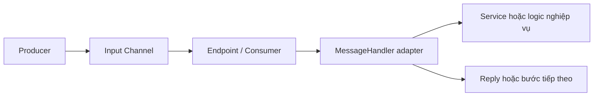
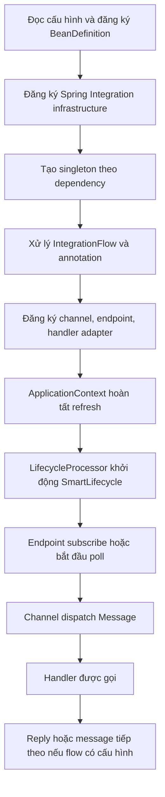

# Thứ tự khởi tạo giữa channel, endpoint và handler

Trong Spring Integration runtime, channel, endpoint và handler có trách nhiệm khác nhau. Channel vận chuyển hoặc phân phối message; endpoint kết nối channel với consumer/handler và quản lý cách consumer hoạt động; handler thực thi logic khi nhận message. Để hiểu thứ tự khởi tạo, cần tách biệt ba mốc: **tạo bean**, **đăng ký endpoint** và **khởi động endpoint**. Chúng diễn ra trong quá trình ApplicationContext khởi tạo, nhưng không tạo thành một chuỗi tuyến tính cố định trong mọi ứng dụng.

Bài học thuộc phần **Application context** của module `SPRING_INTEGRATION_RUNTIME`. Module này tập trung vào cách Spring Integration điều phối message flow qua channel, endpoint, consumer, poller và executor; đồng thời giúp người học quản lý vòng đời IntegrationFlow, transaction, retry, message store, lỗi, correlation và chẩn đoán trạng thái runtime.

## 1. Phân biệt channel, endpoint và handler

Ba thành phần phối hợp với nhau nhưng không thay thế vai trò của nhau:

| Thành phần | Trách nhiệm | Thời điểm tham gia |
|---|---|---|
| **Channel** | Nhận và chuyển message tới consumer hoặc giữ message trong queue | Được tạo như bean hoặc được DSL đăng ký trong ApplicationContext |
| **Endpoint** | Nối input channel với consumer/handler; quản lý subscribe hoặc polling và vòng đời chạy/dừng | Được đăng ký trong context, sau đó được khởi động theo lifecycle |
| **Handler** | Thực thi xử lý message: gọi service, transform, filter, route hoặc xử lý side effect | Được gọi khi endpoint nhận được message |

Một endpoint thường là implementation của `AbstractEndpoint`, chẳng hạn `EventDrivenConsumer` hoặc `PollingConsumer`. Endpoint giữ tham chiếu tới input channel và message handler. Nó quản lý việc đăng ký consumer, chứ không phải nơi chứa toàn bộ nghiệp vụ.

Handler có thể là implementation trực tiếp của `MessageHandler`, hoặc một adapter gọi phương thức trên POJO/service. Ví dụ, service activator tạo adapter kiểu `ServiceActivatingHandler` để chuyển message thành lời gọi phương thức nghiệp vụ. Transformer và filter cũng có handler adapter tương ứng.



Điểm cần nhớ: **channel không tự gọi phương thức nghiệp vụ**. Endpoint đăng ký handler với channel hoặc đọc message từ channel theo poller. Handler chỉ được gọi khi có message được dispatch tới nó.

## 2. Ba mốc khác nhau trong quá trình khởi tạo

Khi Spring tạo ApplicationContext, không nên hiểu rằng runtime luôn thực hiện chính xác chuỗi “tạo channel, rồi tạo endpoint, rồi tạo handler”. Thực tế có các giai đoạn sau.

### 2.1. Đăng ký bean definition và hạ tầng

Trước khi khởi tạo singleton, Spring đọc cấu hình Java/XML, component scan và các nguồn đăng ký bean khác để xây dựng BeanDefinition trong BeanFactory. Các `BeanFactoryPostProcessor` có thể bổ sung hoặc điều chỉnh bean definition trước khi bean được tạo.

Với Spring Integration, cấu hình hạ tầng thường được bật qua `@EnableIntegration` hoặc cơ chế auto-configuration tương ứng. Hạ tầng này cung cấp các processor và dịch vụ cần thiết để đăng ký endpoint, phân giải channel, xử lý annotation và quản lý message flow.

Ở giai đoạn này, Spring chủ yếu chuẩn bị **mô tả về bean**. Một BeanDefinition chưa phải là một instance đang chạy.

### 2.2. Tạo bean và xử lý IntegrationFlow

Khi tạo singleton, Spring giải quyết dependency theo đồ thị phụ thuộc. Nếu một endpoint cần tham chiếu tới channel hoặc handler bean, dependency đó phải được phân giải trong quá trình khởi tạo endpoint. Vì vậy, channel hoặc service có thể được tạo trước endpoint do dependency injection, nhưng thứ tự không được quyết định đơn thuần bởi thứ tự các phương thức `@Bean` được viết trong file cấu hình.

Với Java DSL, một bean `IntegrationFlow` mô tả các bước của flow. `IntegrationFlowBeanPostProcessor` xử lý bean flow và đăng ký các thành phần Spring Integration tương ứng, bao gồm channel, endpoint và handler adapter cần thiết. Flow DSL là mô hình cấu hình để xây dựng pipeline; nó không phải một thread hay một consumer tự chạy ngay khi phương thức khai báo flow được gọi.

Một flow có thể chứa channel tường minh:

```java
@Bean
MessageChannel ordersInput() {
    return new DirectChannel();
}

@Bean
MessageChannel ordersValidated() {
    return new DirectChannel();
}

@Bean
IntegrationFlow ordersFlow(OrderService orderService) {
    return IntegrationFlow.from(ordersInput())
        .handle(orderService, "validate")
        .channel(ordersValidated())
        .handle(orderService, "persist")
        .get();
}
```

Trong ví dụ này:

- `ordersInput` và `ordersValidated` là channel bean.
- `ordersFlow` mô tả chuỗi xử lý và các điểm nối giữa channel với handler.
- Các endpoint được đăng ký cho các bước xử lý trong flow.
- `OrderService` là bean nghiệp vụ được inject vào cấu hình flow; handler adapter gọi các phương thức được chỉ định khi có message.

Nếu dùng channel ngầm giữa hai endpoint, Java DSL có thể tạo channel phù hợp cho điểm nối đó. Nếu cần điều khiển rõ kiểu channel, chia sẻ channel giữa nhiều flow hoặc quan sát channel theo tên, hãy khai báo channel thành bean tường minh.

### 2.3. Khởi động endpoint theo lifecycle

Sau khi các singleton cần thiết đã được tạo và ApplicationContext hoàn tất refresh, Spring gọi LifecycleProcessor để khởi động các bean có lifecycle phù hợp. Các integration endpoint thường triển khai `SmartLifecycle`, do đó có thể được tự động start khi context refresh hoàn tất nếu `autoStartup` được bật.

Đây là lúc endpoint bắt đầu kết nối với channel:

- Với channel có cơ chế subscribe, endpoint đăng ký handler làm subscriber.
- Với channel dạng queue, polling consumer bắt đầu lịch lấy message theo cấu hình poller.
- Với channel dispatch qua executor, endpoint đăng ký consumer; việc gọi handler sau đó được dispatch qua executor.

Việc endpoint được tạo xong không đồng nghĩa nó đã nhận message. Một endpoint có thể tồn tại trong ApplicationContext nhưng chưa chạy nếu `autoStartup=false` hoặc chưa được start thủ công.

### 2.4. Handler chỉ thực thi khi có message

Sau khi endpoint hoạt động và nhận message, nó gọi handler. Với service activator, adapter chuyển message/payload/headers thành lời gọi phương thức trên service. Với transformer, handler tạo kết quả biến đổi. Với filter, handler quyết định message có được chuyển tiếp hay không.

Constructor, dependency injection hoặc `@PostConstruct` của service có thể chạy trong giai đoạn tạo bean. Tuy nhiên, phương thức nghiệp vụ được cấu hình làm handler không được gọi chỉ vì ApplicationContext khởi động; nó được gọi khi endpoint nhận message.

## 3. Sơ đồ tổng thể: từ ApplicationContext tới lần xử lý đầu tiên



Sơ đồ thể hiện thứ tự khái niệm. Trong quá trình thực tế, một số bước tạo bean và đăng ký thành phần có thể đan xen vì Spring giải quyết dependency và post-processor theo cơ chế của container. Không nên dùng sơ đồ để suy ra rằng mọi channel trong mọi ứng dụng đều được tạo trước mọi endpoint.

## 4. Endpoint kết nối với channel theo loại channel

Loại channel đầu vào ảnh hưởng tới loại consumer endpoint và cách endpoint hoạt động.

| Loại channel | Consumer endpoint thường dùng | Hành vi khi endpoint khởi động |
|---|---|---|
| `DirectChannel` | `EventDrivenConsumer` | Đăng ký handler làm subscriber; dispatch đồng bộ trên thread gửi |
| `PublishSubscribeChannel` | `EventDrivenConsumer` | Đăng ký subscriber; một message có thể được phân phối tới nhiều subscriber |
| `ExecutorChannel` | `EventDrivenConsumer` | Đăng ký subscriber; dispatch handler thông qua executor |
| `QueueChannel` | `PollingConsumer` | Bắt đầu poll theo lịch để lấy message từ queue |
| `PriorityChannel` | `PollingConsumer` | Poll message theo thứ tự ưu tiên của queue |

### 4.1. SubscribableChannel: endpoint đăng ký subscriber

Các channel như `DirectChannel`, `PublishSubscribeChannel` và `ExecutorChannel` triển khai cơ chế subscribe. Endpoint đăng ký handler với channel khi endpoint được start.

Với `DirectChannel`, handler thường được gọi ngay trên thread gửi message. Với `ExecutorChannel`, channel chuyển việc dispatch qua executor nên handler có thể chạy trên thread khác. Dù hai channel khác nhau về threading, quá trình kết nối endpoint với channel vẫn dựa trên subscriber.

Nếu message được gửi trước khi consumer endpoint đăng ký, kết quả phụ thuộc vào loại channel và cấu hình dispatch. Với `DirectChannel`, message có thể không được chuyển tới consumer mong đợi hoặc thao tác gửi có thể thất bại do chưa có subscriber phù hợp. Với `PublishSubscribeChannel`, message có thể không có subscriber nhận. Do đó, thứ tự start giữa nguồn phát và consumer có ý nghĩa.

### 4.2. PollableChannel: endpoint bắt đầu poll

`QueueChannel` và `PriorityChannel` là các ví dụ về `PollableChannel`. Endpoint không subscribe theo cách của `DirectChannel`; nó dùng `PollingConsumer` để lấy message từ queue theo lịch.

Poller xác định nhịp lấy message, ví dụ fixed delay hoặc fixed rate. TaskScheduler thực thi các lần poll. Vì vậy, endpoint có thể đã start nhưng handler chưa được gọi nếu queue đang rỗng hoặc chưa tới lượt poll.

Ví dụ cấu hình một flow đọc queue theo chu kỳ:

```java
@Bean
IntegrationFlow queuedOrders(OrderService orderService) {
    return IntegrationFlow.from("orders.queue")
        .bridge(endpoint -> endpoint.poller(
            Pollers.fixedDelay(500)))
        .handle(orderService, "process")
        .get();
}
```

Trong ví dụ này, endpoint polling bắt đầu khi lifecycle cho phép. Message được lấy ra khỏi `orders.queue` theo lịch poller rồi mới chuyển tới handler.

## 5. Ai quyết định thứ tự start của endpoint?

Các endpoint triển khai `SmartLifecycle` được Spring quản lý bởi LifecycleProcessor. Hai thuộc tính quan trọng là `autoStartup` và `phase`.

- `autoStartup`: xác định endpoint có tự động start khi ApplicationContext refresh hoàn tất hay không. Nếu tắt, ứng dụng hoặc thành phần quản lý flow phải start endpoint theo chủ đích.
- `phase`: xác định thứ tự start/stop giữa các SmartLifecycle bean. Phase thấp được start trước; khi dừng context, phase cao được stop trước.

Nếu một flow có producer endpoint gửi message vào `DirectChannel`, consumer endpoint phía sau cần sẵn sàng trước khi producer bắt đầu phát message. Có thể đặt phase của consumer thấp hơn phase của producer để consumer được start trước.

Ví dụ cấu hình phase cho hai endpoint xử lý trong flow:

```java
@Bean
IntegrationFlow orderedFlow(OrderService orderService) {
    return IntegrationFlow.from("orders.in")
        .handle(orderService, "validate",
            endpoint -> endpoint.id("validateOrders").phase(100))
        .channel("orders.validated")
        .handle(orderService, "persist",
            endpoint -> endpoint.id("persistOrders").phase(0))
        .get();
}
```

Ở đây endpoint `persistOrders` có phase thấp hơn nên được start trước endpoint `validateOrders`. Điều này giúp consumer phía sau đăng ký với `orders.validated` trước khi bước phía trước bắt đầu xử lý message. Nếu có inbound adapter làm producer cho `orders.in`, endpoint nguồn cũng cần được xem xét trong thứ tự phase để không phát message quá sớm.

Không nên đặt phase tùy tiện cho mọi endpoint. Hãy chỉ điều chỉnh khi có phụ thuộc về thời điểm start, đặc biệt với nguồn phát message chủ động trong lúc ứng dụng đang khởi động.

## 6. Phân biệt phase với depends-on

Hai cơ chế thường bị nhầm lẫn:

| Cơ chế | Kiểm soát điều gì? | Khi nên dùng |
|---|---|---|
| Dependency injection / `@DependsOn` | Quan hệ phụ thuộc và thứ tự tạo bean; bean phụ thuộc được tạo sau dependency | Khi một bean cần bean khác được khởi tạo trước để hoàn thành cấu hình |
| `SmartLifecycle.phase` | Thứ tự start/stop của các thành phần lifecycle | Khi endpoint hoặc producer cần start sau một consumer/endpoint khác |
| `autoStartup` | Có tự động start khi context refresh hay không | Khi cần chủ động trì hoãn hoặc điều khiển thời điểm kích hoạt |
| `start()` / `stop()` | Điều khiển vòng đời ở runtime | Khi ứng dụng cần bật/tắt endpoint theo trạng thái nghiệp vụ hoặc quản trị |

`@DependsOn` không nên được dùng thay cho `phase` khi vấn đề thực sự là subscriber phải được đăng ký trước producer. Bean được tạo trước không có nghĩa endpoint đã subscribe vào channel; subscription chỉ diễn ra khi endpoint start.

## 7. Khởi tạo flow tĩnh và đăng ký flow động

Với flow tĩnh, các bean `IntegrationFlow` được đăng ký trong cấu hình ứng dụng và được xử lý trong quá trình khởi tạo ApplicationContext.

Với flow động, `IntegrationFlowContext` cho phép đăng ký flow trong lúc ứng dụng đang chạy. Khi đăng ký, Spring Integration tạo các thành phần cần thiết cho flow và trả về một registration handle để ứng dụng quản lý. Tùy cấu hình, flow có thể tự động start hoặc được start qua registration.

Ví dụ minh họa:

```java
IntegrationFlowRegistration registration =
    flowContext.registration(flow)
        .id("tenantFlow")
        .autoStartup(false)
        .register();

// Khi điều kiện nghiệp vụ đã sẵn sàng:
registration.start();

// Khi không còn cần flow:
registration.stop();
registration.destroy();
```

Trong tình huống này, ApplicationContext đã chạy từ trước, nhưng endpoint thuộc flow động chỉ được đưa vào hoạt động theo lifecycle của registration. Đây là lý do cần phân biệt “bean đã được đăng ký” với “endpoint đang chạy”.

## 8. Những tình huống thường gặp khi thứ tự khởi tạo không đúng

| Triệu chứng | Nguyên nhân có thể | Cách kiểm tra |
|---|---|---|
| Message gửi vào `DirectChannel` nhưng không có consumer nhận | Endpoint chưa start, `autoStartup=false`, hoặc producer phát quá sớm | Kiểm tra trạng thái endpoint, phase và log lúc context refresh |
| Flow có bean nhưng không xử lý message | Flow chưa được xử lý/đăng ký đúng hoặc endpoint chưa hoạt động | Kiểm tra cấu hình IntegrationFlow, IntegrationFlowBeanPostProcessor và lifecycle |
| Queue có message nhưng handler chưa chạy | Polling endpoint chưa start, poller chưa được cấu hình phù hợp hoặc scheduler bị chậm | Kiểm tra poller, TaskScheduler, queue depth và trạng thái PollingConsumer |
| Handler chạy trên thread không mong đợi | Channel là `ExecutorChannel` hoặc flow dùng executor/poller | Kiểm tra channel type, executor và cấu hình poller |
| Context khởi động thất bại khi tạo endpoint | Channel không phân giải được, handler method sai chữ ký hoặc dependency bị thiếu | Đọc root cause trong log khởi tạo bean và endpoint |
| Ứng dụng gửi message ngay khi startup nhưng downstream chưa sẵn sàng | Producer endpoint start trước consumer endpoint | Điều chỉnh phase hoặc trì hoãn producer đến khi flow sẵn sàng |

Khi chẩn đoán, cần xem log ở cả ba giai đoạn: tạo bean, start endpoint và xử lý message. Một lỗi ở giai đoạn tạo bean thường xuất hiện trong quá trình refresh context; lỗi lifecycle thường xuất hiện khi endpoint start; lỗi dispatch hoặc nghiệp vụ chỉ xuất hiện khi có message.

## 9. Quy trình kiểm tra thứ tự khởi tạo trong ứng dụng

Khi một flow không hoạt động đúng sau khi ApplicationContext khởi động, hãy lần lượt kiểm tra:

1. **Xác nhận cấu hình được nạp.** Kiểm tra class cấu hình, component scan, `@EnableIntegration` hoặc auto-configuration cần thiết.
2. **Xác nhận channel tồn tại.** Với channel đặt tên, kiểm tra bean name, kiểu channel và nơi khai báo. Với channel ngầm của DSL, kiểm tra điểm nối giữa các endpoint.
3. **Xác nhận endpoint được đăng ký.** Kiểm tra flow hoặc annotation đã được xử lý và endpoint có xuất hiện trong context.
4. **Xác nhận handler adapter hợp lệ.** Kiểm tra bean nghiệp vụ, tên method, kiểu tham số, giá trị trả về và dependency được inject.
5. **Xác nhận endpoint đã start.** Kiểm tra `autoStartup`, phase và trạng thái lifecycle.
6. **Xác nhận consumer đã kết nối với channel.** Với subscribable channel, kiểm tra subscriber; với pollable channel, kiểm tra poller và scheduler.
7. **Theo dõi lần gửi message đầu tiên.** Kiểm tra thread, queue depth, thời điểm dispatch và log của handler.

Có thể bật log DEBUG cho các package Spring Integration liên quan để theo dõi quá trình đăng ký endpoint, subscribe channel, poller và dispatch. Khi cần quan sát cấu trúc runtime tổng thể, có thể dùng Integration Graph hoặc các actuator/management endpoint đã được bật trong ứng dụng.

## 10. Các nguyên tắc cần ghi nhớ

- Thứ tự khai báo `@Bean` không phải là quy tắc tổng quát quyết định thứ tự khởi tạo mọi channel, endpoint và handler.
- Dependency graph quyết định việc tạo bean; post-processor và cấu hình IntegrationFlow/annotation đăng ký các thành phần tích hợp.
- Endpoint được tạo không đồng nghĩa endpoint đã start. LifecycleProcessor khởi động các SmartLifecycle endpoint theo `autoStartup` và `phase`.
- Channel không gọi nghiệp vụ trực tiếp. Endpoint kết nối channel với handler; handler được gọi khi có message.
- Với `DirectChannel` và `ExecutorChannel`, endpoint đăng ký subscriber. Với `QueueChannel`, polling endpoint lấy message theo poller.
- Dùng dependency injection hoặc `@DependsOn` cho thứ tự tạo bean; dùng `phase` và `autoStartup` cho thời điểm kích hoạt endpoint.
- Với flow động, quản lý lifecycle qua registration của `IntegrationFlowContext`.

Khi phân tích runtime, hãy tự hỏi ba câu: **bean đã được tạo chưa, endpoint đã được start và kết nối với channel chưa, và message đã thực sự tới handler chưa?** Tách được ba mốc này sẽ giúp khoanh vùng lỗi nhanh hơn, tránh nhầm lỗi cấu hình ApplicationContext với lỗi dispatch, poller hoặc logic nghiệp vụ.

