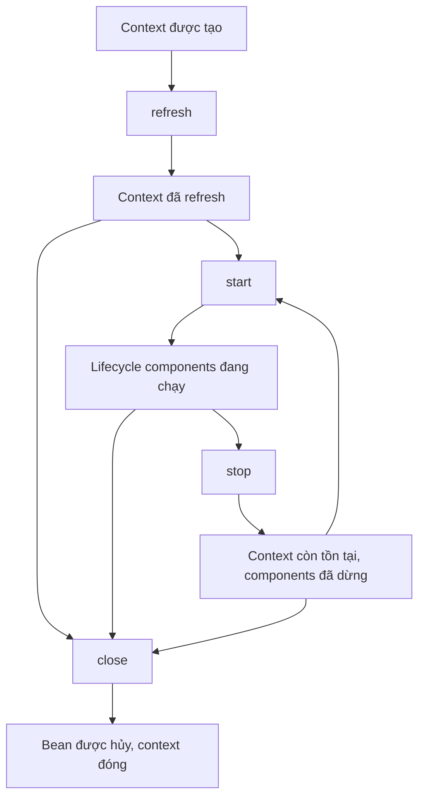
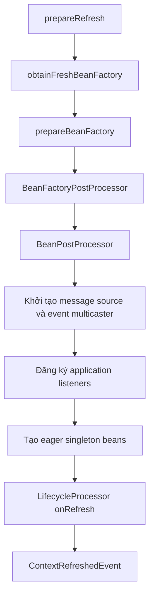

# Context refresh, start, stop và close

Spring Integration chạy bên trong Spring `ApplicationContext`. Context tạo và liên kết các bean, khởi tạo hạ tầng tích hợp, rồi quản lý vòng đời của những endpoint tham gia xử lý message. Vì vậy, muốn điều khiển một flow đúng cách, cần phân biệt bốn thao tác ở cấp context: `refresh()`, `start()`, `stop()` và `close()`.

`refresh()` xây dựng hoặc làm mới container và hoàn tất quá trình khởi tạo ứng dụng. `start()` và `stop()` điều khiển những bean tham gia lifecycle, đặc biệt là các endpoint triển khai `SmartLifecycle`. `close()` đóng context, dừng các thành phần đang chạy và hủy các singleton để giải phóng tài nguyên. Các thao tác này có mục đích và tác động khác nhau; gọi `stop()` không tương đương với `close()`, còn `refresh()` không phải cách tiếp tục một flow đang tạm dừng.

## 1. Bốn thao tác ở cấp ApplicationContext

| Thao tác | Mục đích | Tác động chính | Có hủy singleton bean không? |
|---|---|---|---|
| `refresh()` | Khởi tạo hoặc làm mới container | Tạo BeanFactory, xử lý định nghĩa bean, tạo singleton không lazy, khởi tạo lifecycle processor và hoàn tất refresh | Có thể hủy bean đã tạo nếu refresh thất bại; refresh thành công giữ bean trong context |
| `start()` | Bắt đầu các thành phần lifecycle đã đăng ký | Yêu cầu lifecycle processor khởi động các thành phần phù hợp | Không |
| `stop()` | Tạm dừng các thành phần lifecycle | Yêu cầu các thành phần dừng nhận hoặc xử lý công việc theo chính sách của chúng | Không |
| `close()` | Đóng context và giải phóng tài nguyên | Dừng lifecycle, gọi callback hủy bean, đóng BeanFactory và đánh dấu context đã đóng | Có |

Có thể hình dung quan hệ giữa các thao tác như sau:



Sau `stop()`, context vẫn còn bean và có thể được start lại nếu các thành phần hỗ trợ khởi động lại. Sau `close()`, context đã giải phóng các bean và tài nguyên; ứng dụng thường tạo một context mới nếu cần khởi động lại.

## 2. Refresh xây dựng container như thế nào?

`refresh()` là quá trình thiết lập container. Trong một `AbstractApplicationContext`, quá trình này được tổ chức thành nhiều giai đoạn. Tên phương thức nội bộ có thể khác giữa các loại context hoặc phiên bản, nhưng luồng khái quát gồm:

1. Chuẩn bị trạng thái refresh và môi trường của context.
2. Tạo hoặc lấy BeanFactory mới.
3. Đăng ký các thành phần nền tảng và chuẩn bị BeanFactory.
4. Chạy `BeanFactoryPostProcessor` để thay đổi metadata của bean trước khi tạo bean thông thường.
5. Đăng ký `BeanPostProcessor` để can thiệp quá trình khởi tạo bean.
6. Khởi tạo message source, application event multicaster và đăng ký các application listener.
7. Tạo các singleton eager và hoàn tất khởi tạo BeanFactory.
8. Khởi động các bean lifecycle tự động, sau đó phát `ContextRefreshedEvent`.



Spring Integration dựa vào container này để đăng ký các channel, endpoint và thành phần hạ tầng. Những bean `IntegrationFlow` được khai báo trong context được xử lý bởi cơ chế đăng ký flow của Spring Integration; các endpoint được tạo và liên kết với channel tương ứng. Endpoint tham gia lifecycle sẽ được lifecycle processor điều khiển khi context hoàn tất refresh.

### 2.1. Refresh không phải là start

Refresh xây dựng cấu trúc ứng dụng và hoàn tất việc khởi tạo bean. Việc tự động start khi refresh chủ yếu áp dụng cho các bean `SmartLifecycle` có `isAutoStartup()` trả về `true`. Một bean chỉ triển khai `Lifecycle` thông thường không có cùng cam kết tự khởi động trong giai đoạn refresh.

Có thể tắt tự động khởi động của endpoint bằng cấu hình thích hợp, sau đó chủ động start khi ứng dụng đã sẵn sàng. Điều này hữu ích khi cần nạp cấu hình, kiểm tra phụ thuộc, khôi phục trạng thái hoặc chờ một điều kiện bên ngoài trước khi nhận message.

Không dùng `refresh()` để thay cho `start()` sau khi gọi `stop()`. Refresh có thể tái tạo BeanFactory và bean theo semantics của loại context; nó không đơn thuần bật lại những endpoint đã dừng. Một số context chỉ hỗ trợ refresh một lần, nên cần kiểm tra loại context trước khi dự định refresh lặp lại.

### 2.2. Refresh thất bại

Nếu một bean không thể tạo, cấu hình không hợp lệ hoặc một bước khởi tạo thất bại, refresh có thể kết thúc bằng exception. Spring sẽ hủy các singleton đã tạo trong lần refresh lỗi và đóng BeanFactory tương ứng để tránh để lại một context nửa khởi tạo. Hãy đọc nguyên nhân gốc của lỗi và kiểm tra bean phụ thuộc, cấu hình endpoint, kết nối adapter và tài nguyên được tạo trong giai đoạn khởi tạo.

## 3. Bean lifecycle và context lifecycle là hai lớp khác nhau

Một bean có lifecycle riêng bên trong lifecycle của context. Spring hỗ trợ các callback khởi tạo và hủy bean, ví dụ:

| Callback | Thời điểm điển hình | Mục đích |
|---|---|---|
| `@PostConstruct` | Sau khi dependency injection hoàn tất | Kiểm tra hoặc chuẩn bị trạng thái nội bộ của bean |
| `InitializingBean.afterPropertiesSet()` | Sau khi thiết lập thuộc tính | Callback khởi tạo theo contract của Spring |
| `initMethod` | Trong giai đoạn khởi tạo bean | Gọi phương thức khởi tạo tùy chỉnh |
| `@PreDestroy` | Khi bean bị hủy | Giải phóng tài nguyên do bean sở hữu |
| `DisposableBean.destroy()` | Khi bean bị hủy | Callback hủy theo contract của Spring |
| `destroyMethod` | Khi bean bị hủy | Gọi phương thức đóng tài nguyên tùy chỉnh |

Các callback khởi tạo không thay thế `SmartLifecycle`. Ví dụ, `@PostConstruct` thích hợp để xác thực cấu hình hoặc chuẩn bị dữ liệu nội bộ; nó không phải điểm tốt để tự mở listener, bắt đầu poller hoặc triển khai một quy trình start/stop phức tạp. Những công việc cần được điều khiển theo lifecycle nên nằm trong bean triển khai `SmartLifecycle` hoặc endpoint mà Spring Integration quản lý.

Tương tự, `@PreDestroy` và `destroyMethod` phù hợp để giải phóng tài nguyên bean sở hữu. Nếu một thành phần cần ngừng nhận message, hoàn tất công việc đang chạy và báo thời điểm dừng xong, hãy dùng lifecycle contract thay vì chỉ dựa vào callback hủy.

## 4. Lifecycle và SmartLifecycle

`Lifecycle` định nghĩa ba thao tác cơ bản:

```java
public interface Lifecycle {
    void start();
    void stop();
    boolean isRunning();
}
```

`SmartLifecycle` mở rộng contract này bằng khả năng tự khởi động, sắp thứ tự qua phase và hỗ trợ callback khi dừng:

```java
public interface SmartLifecycle extends Lifecycle, Phased {
    boolean isAutoStartup();
    void stop(Runnable callback);
}
```

Các endpoint của Spring Integration thường tham gia lifecycle theo cơ chế này. `DefaultLifecycleProcessor` điều phối việc start và stop các thành phần. Ứng dụng cũng có thể triển khai `SmartLifecycle` cho một producer, listener hoặc worker tùy chỉnh cần gắn chặt với thời gian sống của context.

Ví dụ về một thành phần có thể được bật/tắt theo context:

```java
@Component
class ExternalFeedLifecycle implements SmartLifecycle {

    private volatile boolean running;

    @Override
    public void start() {
        if (!running) {
            openFeed();
            running = true;
        }
    }

    @Override
    public void stop() {
        if (running) {
            closeFeed();
            running = false;
        }
    }

    @Override
    public void stop(Runnable callback) {
        try {
            stop();
        }
        finally {
            callback.run();
        }
    }

    @Override
    public boolean isRunning() {
        return running;
    }

    @Override
    public boolean isAutoStartup() {
        return true;
    }

    @Override
    public int getPhase() {
        return 100;
    }

    private void openFeed() { /* Mở listener hoặc kết nối */ }
    private void closeFeed() { /* Ngừng listener và giải phóng kết nối */ }
}
```

Ví dụ trên minh họa cấu trúc. Nếu việc dừng thực tế là bất đồng bộ, không gọi callback ngay sau khi gửi yêu cầu dừng; chỉ gọi callback khi công việc đã dừng hoặc đã được xử lý theo chính sách shutdown.

### 4.1. Thứ tự bằng phase

`SmartLifecycle` cho phép sắp xếp thứ tự start và stop bằng phase:

- Khi start, phase thấp hơn được khởi động trước.
- Khi stop, phase cao hơn được dừng trước.

Ví dụ, nếu một inbound producer cần ngừng nhận message trước khi các consumer nội bộ dừng, producer có thể được đặt phase cao hơn consumer. Khi shutdown, producer sẽ được dừng trước; consumer có thêm thời gian xử lý phần công việc đã được nhận. Cần chọn phase theo quan hệ phụ thuộc thực tế và kiểm thử thứ tự, không dựa vào thứ tự khai báo bean.

`depends-on` và quan hệ phụ thuộc bean cũng ảnh hưởng thứ tự khởi tạo và hủy bean. Phase giải quyết thứ tự lifecycle của các thành phần `SmartLifecycle`; hai cơ chế có mục đích khác nhau và không nên dùng thay thế cho nhau.

### 4.2. Dừng đồng bộ và dừng bất đồng bộ

`stop(Runnable callback)` cho phép một thành phần báo cho lifecycle processor biết khi nào quá trình dừng đã hoàn tất. Đây là điểm quan trọng với listener container, executor hoặc producer có công việc đang chạy. Thành phần có thể ngừng nhận công việc mới, chờ công việc đang xử lý hoàn tất trong một khoảng thời gian, rồi gọi callback.

Một shutdown có giới hạn thời gian giúp tránh context bị treo vô hạn. Nếu công việc không thể hoàn tất trong thời gian cho phép, cần có chính sách rõ ràng: hủy tác vụ, để transport redeliver, ghi trạng thái phục hồi hoặc phát cảnh báo. Đừng gọi callback sớm chỉ để làm cho context đóng nhanh hơn nếu điều đó có thể làm mất message.

## 5. Start và stop: tạm dừng hoạt động nhưng giữ context

`ConfigurableApplicationContext.start()` và `stop()` ủy quyền cho lifecycle processor điều khiển các thành phần lifecycle. Chúng không tạo lại bean và không hủy BeanFactory.

Trong Spring Integration, thao tác này có thể dùng để tạm dừng các endpoint hỗ trợ lifecycle, ví dụ dừng một adapter inbound trong lúc bảo trì. Sau đó có thể start lại endpoint nếu adapter và nguồn transport hỗ trợ. Khi dừng, cần xác định rõ message đang nằm ở đâu:

- Message chưa được đọc từ nguồn có thể vẫn nằm trong broker, file system hoặc nguồn dữ liệu.
- Message đã được đưa vào channel có thể vẫn nằm trong queue channel nếu channel còn tồn tại.
- Message đang được xử lý trên executor có thể tiếp tục chạy tùy cơ chế shutdown của endpoint và executor.
- Message đang ở giữa một giao dịch có thể commit hoặc rollback theo transaction boundary và transport.

Vì vậy, `stop()` không mặc nhiên có nghĩa là mọi message đã được xử lý xong. Muốn shutdown có trật tự, cần phối hợp việc ngừng nhận message mới, drain backlog, chờ consumer và quản lý acknowledgement.

Có thể điều khiển riêng một endpoint thông qua API lifecycle của endpoint nếu ứng dụng có tham chiếu phù hợp. Tuy nhiên, khi cần điều khiển toàn bộ flow, nên dùng cơ chế lifecycle đã được context quản lý thay vì tìm và gọi thủ công từng handler.

## 6. Close: dừng và hủy context

`ConfigurableApplicationContext.close()` đóng context. Quá trình này thường gồm các bước:

1. Đánh dấu context bắt đầu đóng và phát `ContextClosedEvent`.
2. Gọi lifecycle processor để dừng các bean lifecycle đang chạy.
3. Gọi callback hủy trên các singleton bean, theo thứ tự phụ thuộc phù hợp.
4. Đóng BeanFactory và giải phóng tài nguyên liên quan.
5. Đánh dấu context không còn hoạt động.

`ContextClosedEvent` là tín hiệu context đang đóng; không nên xem nó như bằng chứng rằng mọi endpoint đã dừng xong. Việc dừng lifecycle được điều phối ở bước tiếp theo. Nếu cần kiểm soát thứ tự hoặc chờ xử lý bất đồng bộ, dùng `SmartLifecycle.stop(Runnable)`.

Trong ứng dụng Spring Boot, framework thường quản lý việc đóng context khi tiến trình dừng. Ở ứng dụng Spring thuần, có thể gọi `close()` rõ ràng hoặc đăng ký shutdown hook theo cách phù hợp. Dù cách nào, bean sở hữu tài nguyên bên ngoài vẫn cần có callback đóng tài nguyên đúng cách.

## 7. Application events và cách quan sát lifecycle

Spring phát các event liên quan đến lifecycle của context:

| Event | Khi nào được phát | Cách sử dụng phù hợp |
|---|---|---|
| `ContextRefreshedEvent` | Khi context hoàn tất refresh | Quan sát ứng dụng đã hoàn tất giai đoạn refresh |
| `ContextStartedEvent` | Sau khi context được yêu cầu start | Theo dõi thao tác start ở cấp context |
| `ContextStoppedEvent` | Sau khi context được yêu cầu stop | Theo dõi thao tác stop ở cấp context |
| `ContextClosedEvent` | Khi context bắt đầu đóng | Bắt đầu công việc quan sát hoặc thông báo shutdown |

Có thể lắng nghe event bằng `@EventListener`:

```java
@Component
class ContextLifecycleObserver {

    @EventListener
    void onRefresh(ContextRefreshedEvent event) {
        log.info("Context refreshed: {}", event.getApplicationContext().getId());
    }

    @EventListener
    void onStop(ContextStoppedEvent event) {
        log.info("Context stopped: {}", event.getApplicationContext().getId());
    }

    @EventListener
    void onClose(ContextClosedEvent event) {
        log.info("Context closing: {}", event.getApplicationContext().getId());
    }
}
```

Trong context hierarchy, event có thể được truyền lên context cha. Nếu listener chỉ quan tâm một context cụ thể, hãy so sánh `event.getApplicationContext()` với context mà listener quản lý để tránh xử lý lặp hoặc nhầm event của context con.

Event listener phù hợp cho quan sát, cập nhật trạng thái hoặc kích hoạt công việc phụ. Không nên dùng event như cơ chế duy nhất để đảm bảo thứ tự start/stop của endpoint; lifecycle processor và `SmartLifecycle` được thiết kế cho nhiệm vụ đó.

`ApplicationReadyEvent` là event của Spring Boot, biểu thị ứng dụng Boot đã sẵn sàng phục vụ theo lifecycle của Boot. Nó không phải event cốt lõi của Spring Framework và không thay thế `ContextRefreshedEvent` trong ứng dụng Spring thuần.

## 8. Spring Integration quản lý IntegrationFlow ra sao?

Khi khai báo flow bằng Java DSL hoặc XML, Spring Integration đăng ký các thành phần cần thiết trong application context. Endpoint kết nối channel với handler, source hoặc adapter. Những endpoint có lifecycle được context quản lý sẽ được start/stop theo `SmartLifecycle`.

Điều quan trọng là phân biệt định nghĩa flow và các endpoint đang chạy. Một bean `IntegrationFlow` mô tả topology. Cơ chế đăng ký flow chuyển mô tả đó thành các bean runtime như consumer endpoint, source adapter và thành phần liên quan. Lifecycle hoạt động trên những thành phần runtime này.

Ví dụ một flow khai báo trong context:

```java
@Bean
IntegrationFlow ordersFlow(OrderService orderService) {
    return IntegrationFlow
            .from("orders.input")
            .handle(orderService, "accept")
            .get();
}
```

Khi context refresh, flow được đăng ký và endpoint được tạo. Khi lifecycle processor khởi động endpoint, message có thể đi từ channel `orders.input` đến handler. Nếu endpoint không tự động start, context vẫn có thể refresh thành công nhưng flow chưa nhận message cho đến khi endpoint được start.

### 8.1. Điều khiển flow động

`IntegrationFlowContext` cho phép đăng ký flow trong lúc ứng dụng đang chạy. Điều này hữu ích khi topology cần thay đổi theo tenant hoặc cấu hình runtime:

```java
IntegrationFlowRegistration registration = flowContext
        .registration(tenantFlow)
        .id("tenant-" + tenantId)
        .register();

// Có thể điều khiển registration theo chính sách của ứng dụng.
registration.start();
registration.stop();
registration.destroy();
```

Tùy cấu hình đăng ký, flow có thể tự khởi động hoặc chờ lệnh start tường minh. `start()` và `stop()` điều khiển các thành phần của registration; `destroy()` hủy đăng ký và giải phóng các bean do registration quản lý. Cần bảo đảm ID duy nhất và gọi destroy khi flow không còn cần thiết.

Flow động không nên được tạo cho từng message. Nếu mục đích chỉ là chọn nhánh theo tenant hoặc loại dữ liệu, router thường phù hợp hơn và tránh tạo nhiều endpoint không cần thiết.

## 9. Phối hợp lifecycle với poller, executor và adapter

Một flow có thể chứa nhiều thành phần với cách thực thi khác nhau:

| Thành phần | Điều cần kiểm soát khi start/stop |
|---|---|
| Inbound event-driven adapter | Bắt đầu/ngừng listener, callback hoặc consumer; xác định acknowledgement cho message đang xử lý |
| Polling adapter | Bắt đầu/ngừng trigger, xử lý lần poll đang chạy và giới hạn số message mỗi poll |
| `TaskScheduler` | Dừng lịch mới, xử lý tác vụ đang chạy và giải phóng thread |
| `TaskExecutor` | Ngừng nhận task mới, drain hoặc hủy task đang chờ theo chính sách |
| `QueueChannel` | Xác định giữ backlog trong bộ nhớ, lưu bền vững hay chuyển giao trước khi context đóng |
| Outbound adapter | Xử lý request đang gửi, timeout và kết nối transport khi shutdown |

Một shutdown đáng tin cậy thường ngừng inbound producer trước, để các consumer có thời gian xử lý message đã nhận, rồi mới dừng các tài nguyên xử lý còn lại. Có thể dùng phase để thể hiện thứ tự này. Với queue hoặc broker, acknowledgement và redelivery phải được xem xét cùng lifecycle; chỉ dừng endpoint không đảm bảo message sẽ tự quay lại nguồn.

Nếu executor được chia sẻ giữa nhiều flow, cần xác định bean nào sở hữu executor và ai chịu trách nhiệm đóng nó. Không để một flow tự đóng tài nguyên dùng chung trong khi flow khác vẫn đang chạy.

## 10. Các tình huống thường gặp và cách chẩn đoán

| Triệu chứng | Nguyên nhân có thể | Hướng kiểm tra |
|---|---|---|
| Context refresh thành công nhưng flow không nhận message | Endpoint có `autoStartup=false`, endpoint chưa start hoặc adapter chưa kết nối | Kiểm tra trạng thái `isRunning()`, cấu hình auto startup và log lifecycle |
| Gọi `stop()` nhưng message vẫn đang được xử lý | Consumer hoặc executor đã nhận task trước thời điểm stop | Kiểm tra semantics stop, task đang chạy và chính sách drain |
| Gọi `start()` nhưng adapter không hoạt động lại | Adapter hoặc client không hỗ trợ restart sau stop, hoặc tài nguyên đã bị đóng sai cách | Kiểm tra implementation lifecycle và trạng thái connection/listener |
| Context đóng chậm | `stop(Runnable)` chưa gọi callback, worker bị block hoặc shutdown timeout dài | Kiểm tra từng phase, thread dump và tác vụ đang chờ |
| Context đóng nhưng còn thread nền | Bean tự tạo thread mà không tích hợp lifecycle hoặc destroy callback | Kiểm tra thread ownership, executor và callback hủy bean |
| Event listener chạy nhiều lần | Context refresh lặp, context hierarchy hoặc listener không lọc context | Kiểm tra event source và làm handler idempotent |
| Flow động vẫn tồn tại sau khi tenant bị xóa | Registration chưa được destroy hoặc bean liên quan còn tham chiếu | Theo dõi registration ID và quy trình unregister/destroy |

Một trình tự điều tra hữu ích:

1. Xác nhận trạng thái application context: đã refresh, đang hoạt động hay đã đóng.
2. Xác nhận trạng thái endpoint liên quan qua `isRunning()` hoặc cơ chế quan sát runtime.
3. Kiểm tra `autoStartup`, phase và quan hệ phụ thuộc của các bean lifecycle.
4. Kiểm tra poller, scheduler, executor và listener container có task hoặc message đang chờ không.
5. Đọc log start/stop, exception khi refresh và lỗi khi giải phóng tài nguyên.
6. Với flow động, xác nhận registration đã được start, stop hoặc destroy đúng lúc.

Trong môi trường có Spring Boot Actuator và các endpoint quan sát phù hợp, có thể dùng health, metrics và Integration graph để xem trạng thái ứng dụng, topology và hoạt động của message flow. Các công cụ này bổ sung cho log; chúng không thay thế việc xác định bean nào sở hữu tài nguyên và lifecycle nào đang điều khiển nó.

## 11. Nguyên tắc thiết kế lifecycle cho flow production

- **Để context quản lý endpoint:** khai báo endpoint như bean và dùng lifecycle contract có sẵn của Spring Integration.
- **Tách khởi tạo khỏi start:** dùng callback khởi tạo bean để kiểm tra cấu hình; dùng `SmartLifecycle` để bật/tắt listener, worker hoặc tài nguyên hoạt động nền.
- **Thiết kế thứ tự shutdown:** đặt phase theo quan hệ producer/consumer và kiểm tra thứ tự start/stop trong môi trường thực tế.
- **Dừng có giới hạn:** ngừng nhận việc mới, drain công việc đang xử lý và gọi callback khi dừng hoàn tất.
- **Xác định quyền sở hữu tài nguyên:** mỗi executor, scheduler, connection hoặc listener cần có chủ sở hữu và một đường giải phóng rõ ràng.
- **Phân biệt pause và destroy:** `stop()` giữ context và bean để có thể start lại; `close()` hủy bean và đóng context.
- **Làm event listener idempotent:** context hierarchy hoặc refresh lặp có thể khiến listener nhận nhiều event tương tự.
- **Quản lý flow động:** lưu registration ID, giới hạn số flow và destroy registration khi không còn sử dụng.

Khi vận hành một Spring Integration flow, hãy xác định rõ thao tác đang cần là refresh container, start/stop endpoint hay close toàn context. Chọn đúng lifecycle boundary sẽ giúp tránh khởi tạo lặp, dừng thiếu tài nguyên, mất message trong lúc shutdown và các thread nền còn tồn tại sau khi ứng dụng đóng.
