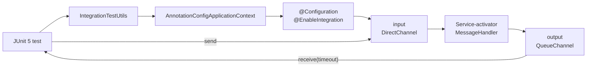
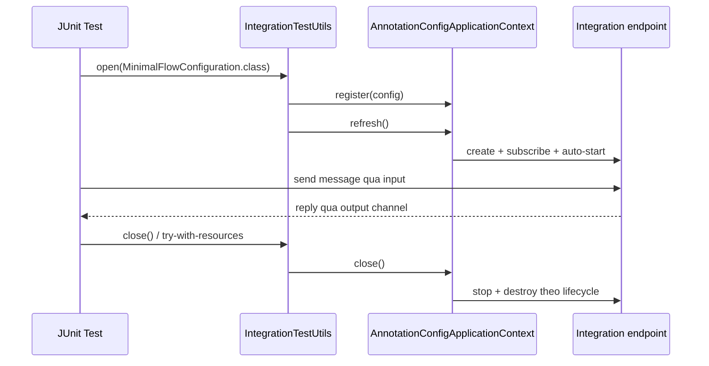

# Khởi tạo IntegrationTestUtils với context tối thiểu

## 1. Vì sao cần một context Spring Integration nhỏ khi kiểm thử runtime?

Một luồng Spring Integration không chỉ là hàm Java nhận payload rồi trả kết quả. Khi chạy thực tế, framework cần đăng ký `MessageChannel`, consumer endpoint, subscriber, poller, scheduler và các thành phần điều phối message. Một handler có thể đúng khi gọi trực tiếp nhưng lỗi khi tích hợp vào flow vì channel không có subscriber, bean endpoint chưa được start, message mất headers, hoặc kết quả không tới reply channel.

Để kiểm tra những hành vi đó, ta cần **một Spring application context đủ nhỏ nhưng vẫn có hạ tầng Spring Integration thật**. Thay vì khởi động toàn bộ ứng dụng cùng database, broker, HTTP server và mọi integration flow, bài học xây dựng một tiện ích thử nghiệm mang tên **`IntegrationTestUtils`**, giúp:

- Tạo `AnnotationConfigApplicationContext` chỉ với các class cấu hình test được chỉ định.
- Kích hoạt Spring Integration bằng `@EnableIntegration`.
- Lấy chính xác input `MessageChannel` và output `PollableChannel` từ context.
- Gửi message, nhận kết quả với timeout rõ ràng và kiểm tra exception.
- Đóng context sau test để dừng endpoint, poller và scheduler do context quản lý.
- Mở rộng dần sang transaction, retry, error channel, correlation và kiểm thử threading mà không kéo theo toàn bộ hệ thống.

Bài thuộc chương **Testing runtime** của module **SPRING_INTEGRATION_RUNTIME**: tìm hiểu và thực hành vòng đời message qua channel, endpoint, consumer, poller, executor, quản lý IntegrationFlow và quan sát trạng thái runtime.

> **Phạm vi tên gọi:** Trong bài, `IntegrationTestUtils` là **helper do chính dự án thử nghiệm tự tạo**; không giả định đó là một lớp API chuẩn có sẵn ở một package cụ thể của Spring Integration. Spring Integration cũng có bộ hỗ trợ test riêng, nhưng cần phân biệt các công cụ của framework với helper viết trong dự án.

## 2. “Context tối thiểu” gồm những thành phần nào?



Một cấu hình tối thiểu cho **test đồng bộ** thường cần:

1. Một bean `MessageChannel` đầu vào mà test có thể gọi `send()`.
2. Một handler/endpoint nhận message, được đăng ký trong `IntegrationFlow`.
3. Một `PollableChannel` đầu ra để test gọi `receive(timeout)`, không cần chạy poller riêng.
4. `@EnableIntegration` để đăng ký cơ sở hạ tầng Spring Integration.
5. Một `ApplicationContext` được `refresh()` trước khi gửi message, và `close()` sau khi test.

Không nhất thiết phải có `@SpringBootTest`, servlet container, HTTP endpoint, database hay broker cho kiểu test này. `@Configuration` cùng `@EnableIntegration` mang lại đủ hạ tầng để framework tạo và nối các endpoint của flow.

**Tối thiểu không có nghĩa là “không dùng Spring”.** Nếu chỉ gọi `new MyHandler().handle(message)` thì đó là unit test handler, chưa kiểm tra message dispatch hoặc Spring endpoint lifecycle.

### Ba cấp độ kiểm thử nên tách riêng

| Cấp | Cần gì? | Chứng minh được | Không chứng minh được |
| --- | --- | --- | --- |
| **Unit test** | Handler hoặc pure function, fake dependency | Biến đổi payload, business rule | Wiring channel, poller và lifecycle. |
| **Minimal-context integration test** | `AnnotationConfigApplicationContext` + vài bean Integration | Dispatch, reply, headers, error, trạng thái endpoint | Broker thật, transaction database thật, phục hồi sau crash. |
| **System/runtime test** | Adapter, database/broker, scheduler và hạ tầng thật khi cần | Ack, transaction, restart, cạnh tranh nhiều instance | Không nhất thiết chứng minh nguyên nhân lỗi nếu thiếu quan sát chi tiết. |

Một chương trình học tốt bắt đầu từ context nhỏ để có phản hồi nhanh, sau đó **thêm đúng một yếu tố runtime** mỗi lần kiểm thử.

## 3. Phụ thuộc và bố cục mã nguồn

Ví dụ sử dụng Java 17+, Spring Framework/Spring Integration phiên bản tương thích, JUnit Jupiter (JUnit 5). Những thành phần nền tảng:

- `spring-integration-core`: `IntegrationFlow`, DSL, `DirectChannel`, `QueueChannel`, `@EnableIntegration`.
- `spring-context` và `spring-messaging`: application context, `Message<?>`, `MessageChannel`.
- `junit-jupiter`: `@Test` và assertions.
- **Tùy chọn** `spring-integration-test`: các tiện ích test do Spring Integration cung cấp, như `@SpringIntegrationTest` hoặc cơ chế mock endpoint phù hợp với phiên bản đang dùng; helper trong bài không phụ thuộc bắt buộc vào module này.

Ví dụ khai báo Maven ở mức ý tưởng khi dự án đã quản lý phiên bản qua Spring Boot BOM hoặc dependency management khác:

```xml
<dependencies>
    <dependency>
        <groupId>org.springframework.integration</groupId>
        <artifactId>spring-integration-core</artifactId>
    </dependency>
    <dependency>
        <groupId>org.junit.jupiter</groupId>
        <artifactId>junit-jupiter</artifactId>
        <scope>test</scope>
    </dependency>
</dependencies>
```

Nếu dự án không có BOM/dependency management, phải khai báo **phiên bản tương thích** cho các dependencies. Tùy công cụ build, cần cấu hình JUnit Platform để khám phá JUnit 5 tests. Không cần thêm `spring-boot-starter-test` chỉ để thực hiện ví dụ dùng `AnnotationConfigApplicationContext`.

Tạo các file Java trong cùng một package test, chẳng hạn:

```text
src/test/java/example/runtime/testing/
    IntegrationTestUtils.java
    MinimalFlowConfiguration.java
    MinimalFlowTest.java
    PollingFlowConfiguration.java
    PollingFlowTest.java
```

Các file ví dụ dưới đây dùng chung package `example.runtime.testing`. Có thể đặt tên khác, miễn import và cấu hình nhất quán. Không đưa helper test vào API production chỉ vì test muốn truy cập bean nội bộ.

## 4. Viết `IntegrationTestUtils` tự quản lý context

Helper nên có trách nhiệm nhỏ: **tạo, cung cấp bean theo kiểu và đóng context**. Không nên nhét vào đó các quy tắc nghiệp vụ hoặc các lệnh tùy ý bật/tắt toàn bộ application.

```java
package example.runtime.testing;

import java.time.Duration;
import java.util.Objects;

import org.springframework.context.annotation.AnnotationConfigApplicationContext;
import org.springframework.messaging.Message;
import org.springframework.messaging.MessageChannel;
import org.springframework.messaging.PollableChannel;

public final class IntegrationTestUtils implements AutoCloseable {

    private final AnnotationConfigApplicationContext context;

    private IntegrationTestUtils(AnnotationConfigApplicationContext context) {
        this.context = context;
    }

    public static IntegrationTestUtils open(Class<?>... configurationTypes) {
        Objects.requireNonNull(configurationTypes, "configurationTypes");

        if (configurationTypes.length == 0) {
            throw new IllegalArgumentException(
                "Can it nhat mot @Configuration class");
        }

        AnnotationConfigApplicationContext context =
            new AnnotationConfigApplicationContext();

        try {
            context.register(configurationTypes);
            context.refresh(); // Tao beans va start endpoint auto-start.
            return new IntegrationTestUtils(context);
        } catch (RuntimeException failure) {
            context.close();
            throw failure;
        }
    }

    public MessageChannel input(String beanName) {
        return context.getBean(beanName, MessageChannel.class);
    }

    public PollableChannel output(String beanName) {
        return context.getBean(beanName, PollableChannel.class);
    }

    public Message<?> receive(String beanName, Duration timeout) {
        Objects.requireNonNull(timeout, "timeout");

        if (timeout.isNegative()) {
            throw new IllegalArgumentException(
                "Timeout khong duoc am");
        }

        return output(beanName).receive(timeout.toMillis());
    }

    public <T> T bean(String beanName, Class<T> beanType) {
        return context.getBean(beanName, beanType);
    }

    @Override
    public void close() {
        context.close();
    }
}
```

Một số điểm thiết kế có chủ đích:

- `register(configurationTypes)` chỉ đăng ký những cấu hình test đã chỉ định; **không component-scan cả ứng dụng**.
- `refresh()` hoàn thành quá trình tạo bean và khởi động các `SmartLifecycle` endpoint có `autoStartup=true`. Test không nên gửi message **trước** bước này.
- Nếu khởi tạo thất bại, `close()` trong nhánh `catch` giúp dọn resource đã tạo.
- `getBean(name, type)` kiểm tra bean đúng loại; lỗi sai tên channel/bean sẽ xuất hiện rõ, không âm thầm lấy nhầm.
- `receive(Duration)` chỉ áp dụng cho **`PollableChannel`**. Không dùng `receive()` trên `DirectChannel`.
- `AutoCloseable` cho phép `try-with-resources` để đóng context dù assertion hoặc handler ném exception.

**Không xem helper là một context singleton dùng cho mọi test** nếu các bài test cần trạng thái độc lập. Việc chia sẻ context khiến message tồn trong queue, retry state, cache hoặc các poller đang chạy rò sang bài khác. Mặc định dùng **một context cho một test case**; chỉ tối ưu tái sử dụng khi đã kiểm soát và reset state.

## 5. Xây dựng `@Configuration` tối thiểu cho một flow đồng bộ

Ta tạo một flow nhận chuỗi, bỏ khoảng trắng đầu/cuối, chuyển sang chữ hoa. Với input đặc biệt `FAIL`, handler ném exception để phục vụ bài test lỗi.

```java
package example.runtime.testing;

import java.util.Locale;

import org.springframework.context.annotation.Bean;
import org.springframework.context.annotation.Configuration;
import org.springframework.integration.channel.DirectChannel;
import org.springframework.integration.channel.QueueChannel;
import org.springframework.integration.config.EnableIntegration;
import org.springframework.integration.dsl.IntegrationFlow;
import org.springframework.messaging.MessageChannel;
import org.springframework.messaging.PollableChannel;

@Configuration
@EnableIntegration
public class MinimalFlowConfiguration {

    @Bean("sample.in")
    public MessageChannel input() {
        return new DirectChannel();
    }

    @Bean("sample.out")
    public PollableChannel output() {
        return new QueueChannel(10);
    }

    @Bean
    public IntegrationFlow sampleFlow() {
        return IntegrationFlow.from("sample.in")
            .handle(String.class, (payload, headers) -> {
                if ("FAIL".equals(payload)) {
                    throw new IllegalArgumentException(
                        "Simulated handler failure");
                }
                return payload.strip().toUpperCase(Locale.ROOT);
            })
            .channel("sample.out")
            .get();
    }
}
```

**Luồng thực thi:**

1. `context.refresh()` tạo `sample.in`, `sample.out` và subscriber/endpoint của `sampleFlow`.
2. Test gửi message vào `sample.in` bằng `MessageChannel.send`.
3. `DirectChannel` gọi consumer đồng bộ trên thread gửi trong cấu hình này.
4. Handler nhận payload kiểu `String`, tạo kết quả chữ hoa.
5. Reply được gửi vào `sample.out` — `QueueChannel` có khả năng giữ message cho test.
6. Test gọi `receive(timeout)` để lấy message kết quả và assert.

Không có poller, executor, database hay broker trong ví dụ. `QueueChannel(10)` ở đây chỉ là **output buffer trong bộ nhớ**, không mang tính bền vững. Kết quả của test là hành vi **dispatch và transformation của Spring Integration**, không phải bảo đảm message còn sau JVM restart.

### Vì sao dùng tên bean cụ thể?

Khai báo `@Bean("sample.in")`/`@Bean("sample.out")` tránh nhầm với các channel mặc định hoặc bean được tạo bởi flow khác. Sử dụng lại tên này khi gọi `input("sample.in")` và `receive("sample.out", ...)`; nếu sai tên, test nên fail với lỗi bean lookup để phát hiện wiring sai sớm.

## 6. JUnit 5: test thành công đầu tiên

```java
package example.runtime.testing;

import java.time.Duration;

import org.junit.jupiter.api.Test;
import org.springframework.messaging.Message;
import org.springframework.messaging.MessageChannel;
import org.springframework.messaging.support.MessageBuilder;

import static org.junit.jupiter.api.Assertions.*;

class MinimalFlowTest {

    @Test
    void shouldTransformPayloadThroughRealIntegrationFlow() {
        try (IntegrationTestUtils test =
                IntegrationTestUtils.open(MinimalFlowConfiguration.class)) {

            MessageChannel input = test.input("sample.in");

            Message<String> request = MessageBuilder
                .withPayload("  spring integration  ")
                .setHeader("traceId", "test-001")
                .build();

            boolean accepted = input.send(request);

            assertTrue(accepted, "DirectChannel phai dispatch message");

            Message<?> reply =
                test.receive("sample.out", Duration.ofSeconds(1));

            assertNotNull(reply, "Flow phai tao output message");
            assertEquals("SPRING INTEGRATION", reply.getPayload());
        }
    }
}
```

Các assertion kiểm tra ba điều khác nhau:

- `send()` trả về `true`: kênh **chấp nhận/dispatch** theo hợp đồng đang dùng. Không suy ra database commit hoặc broker ack khi chưa có các thành phần đó.
- `reply != null`: có message đầu ra tới `sample.out` trước timeout.
- Payload khớp: handler đã được gọi qua endpoint thật, không chỉ qua method invocation trực tiếp.

Với flow đồng bộ, message thường tới output trước khi `send()` kết thúc. Nhưng vẫn nên dùng `receive(timeout)` thay vì `receive()` chờ vô hạn; nếu wiring sai, test cần kết thúc có thông báo rõ.

**Về header:** message id và timestamp có thể được tạo khi xây dựng hoặc biến đổi message. Không được khẳng định mọi custom header tự động sống qua mọi handler/transformer. Nếu nghiệp vụ cần `traceId` hoặc `correlationId`, thêm assertion riêng ở output với cấu hình đang dùng.

## 7. Kiểm thử lỗi trên `DirectChannel` và tình trạng output rỗng

Khi handler của `MinimalFlowConfiguration` nhận `FAIL`, exception được ném ngay trong đường dispatch đồng bộ. Trong Spring Integration, exception có thể được đóng gói bởi lớp messaging/endpoint trước khi về caller; nên ưu tiên kiểm tra **root cause** hoặc thông tin lỗi mang ý nghĩa nghiệp vụ thay vì phụ thuộc một class wrapper duy nhất khi không cần.

```java
package example.runtime.testing;

import java.time.Duration;

import org.junit.jupiter.api.Test;
import org.springframework.messaging.support.GenericMessage;

import static org.junit.jupiter.api.Assertions.*;

class MinimalFlowFailureTest {

    @Test
    void shouldSurfaceHandlerFailureWithoutReply() {
        try (IntegrationTestUtils test =
                IntegrationTestUtils.open(MinimalFlowConfiguration.class)) {

            RuntimeException failure = assertThrows(
                RuntimeException.class,
                () -> test.input("sample.in")
                    .send(new GenericMessage<>("FAIL")));

            assertNotNull(failure);
            assertNull(
                test.receive("sample.out", Duration.ofMillis(50)),
                "Khong duoc gui reply khi handler that bai");
        }
    }
}
```

**Không đánh đồng exception với `ErrorMessage`:** một `DirectChannel` đồng bộ thường truyền lỗi về thread gọi; nó **không mặc định gửi một `ErrorMessage` lên `errorChannel` chỉ vì handler ném exception**. Với poller hoặc executor bất đồng bộ, cơ chế xử lý lỗi có thể phát `ErrorMessage` nếu được cấu hình. Phải test riêng hai đường xử lý đó.

Nếu yêu cầu kiểm tra class root cause hoặc failed message, dùng các API xử lý `MessagingException` tương ứng và xác minh với phiên bản thư viện đang dùng. Không làm test quá mong manh bằng cách assert toàn bộ stack trace hoặc nội dung thông báo của wrapper.

## 8. Kiểm tra lifecycle: vì sao `context.refresh()` và `close()` quan trọng?

`AnnotationConfigApplicationContext` tạo và khởi động các endpoint `SmartLifecycle` có `autoStartup` theo cấu hình. Khi `close()` được gọi, lifecycle của Spring context xử lý việc dừng và hủy các bean đã đăng ký. Đây là lý do **mỗi test có context riêng** giúp tránh poller hoặc subscriber của test trước còn hoạt động trong test sau.



### Các lỗi cần tránh

| Lỗi thiết lập | Triệu chứng | Cách sửa |
| --- | --- | --- |
| Quên `@EnableIntegration` trong cấu hình tối thiểu | Endpoint hoặc integration infrastructure không được tạo như kỳ vọng | Dùng cấu hình bật Spring Integration phù hợp. |
| Chưa gọi `refresh()` | Bean chưa được tạo, không có consumer hoạt động | Helper phải refresh trước khi trả về. |
| Gửi vào bean tên sai | `NoSuchBeanDefinitionException` hoặc gửi nhầm kênh | Dùng tên rõ, lookup theo kiểu. |
| Gửi vào `DirectChannel` chưa có subscriber | Lỗi “no subscribers” hoặc delivery failure | Kiểm tra flow bean, endpoint đã start, channel name. |
| Quên close context | Poller/executor/resource có thể sống qua test khác | `try-with-resources` và `AutoCloseable`. |
| Dùng context chung cho nhiều test | Queue còn dữ liệu, trạng thái phụ thuộc thứ tự test | Context riêng hoặc reset state rõ ràng. |
| Dùng `@SpringBootTest` cho phép thử rất nhỏ | Test chậm, nhiều external dependency không liên quan | Chọn `AnnotationConfigApplicationContext` và bean tối thiểu. |

**Lưu ý:** nhiều test có thể cùng chạy song song nếu mỗi test sử dụng context và state hoàn toàn tách biệt. Nếu dùng singleton, port, database schema hoặc broker topic dùng chung, phải kiểm soát cách ly và cleanup; context riêng **không tự làm mọi tài nguyên bên ngoài trở nên độc lập**.

## 9. Mở rộng thành test bất đồng bộ bằng poller

Sau khi test luồng đồng bộ, ta đổi topology: input trở thành `QueueChannel` và một polling consumer nhận message theo lịch. Điều này giúp kiểm tra **runtime scheduling** thay vì chỉ gọi handler trực tiếp.

```java
package example.runtime.testing;

import java.time.Duration;
import java.util.Locale;

import org.springframework.context.annotation.Bean;
import org.springframework.context.annotation.Configuration;
import org.springframework.integration.channel.QueueChannel;
import org.springframework.integration.config.EnableIntegration;
import org.springframework.integration.dsl.IntegrationFlow;
import org.springframework.integration.dsl.Pollers;
import org.springframework.messaging.PollableChannel;

@Configuration
@EnableIntegration
public class PollingFlowConfiguration {

    @Bean("poll.in")
    public PollableChannel input() {
        return new QueueChannel(10);
    }

    @Bean("poll.out")
    public PollableChannel output() {
        return new QueueChannel(10);
    }

    @Bean
    public IntegrationFlow pollingFlow() {
        return IntegrationFlow.from("poll.in",
                endpoint -> endpoint
                    .id("poll.consumer")
                    .poller(Pollers.fixedDelay(Duration.ofMillis(100))
                        .maxMessagesPerPoll(1)))
            .handle(String.class, (payload, headers) ->
                payload.toUpperCase(Locale.ROOT))
            .channel("poll.out")
            .get();
    }
}
```

Với `QueueChannel`, test có thể gọi `send()` để đưa message vào input, nhưng `send()` thường trả về **trước** khi polling endpoint xử lý. Do đó, một assertion ngay sau `send()` không nên kỳ vọng output đã có. Cần **đợi có giới hạn**.

```java
package example.runtime.testing;

import java.time.Duration;

import org.junit.jupiter.api.Test;
import org.springframework.messaging.Message;
import org.springframework.messaging.support.GenericMessage;

import static org.junit.jupiter.api.Assertions.*;

class PollingFlowTest {

    @Test
    void shouldProcessMessageOnPollingConsumer() {
        try (IntegrationTestUtils test =
                IntegrationTestUtils.open(PollingFlowConfiguration.class)) {

            assertTrue(test.input("poll.in")
                .send(new GenericMessage<>("async")));

            Message<?> reply =
                test.receive("poll.out", Duration.ofSeconds(3));

            assertNotNull(reply, "Poller phai chay va tao output");
            assertEquals("ASYNC", reply.getPayload());
        }
    }
}
```

**Vì sao dùng 3 giây?** Đây là ngân sách chờ để kiểm tra scheduling trong môi trường test, **không phải transaction timeout**, và không có nghĩa poller chạy chính xác sau 100 ms. Thời gian thực tế chịu ảnh hưởng scheduler, tải CI, executor và cấu hình bean. Không dùng một `Thread.sleep(100)` duy nhất làm bằng chứng chắc chắn.

Nếu test timeout, hãy kiểm tra endpoint `poll.consumer` có running không, input queue còn message không, handler có ném exception không và output channel có wiring đúng không. Không tự kết luận business logic sai khi chưa xem scheduling.

## 10. Test start/stop endpoint bằng `SmartLifecycle`

Một test tối thiểu cũng có thể kiểm tra lifecycle của polling endpoint đã đặt `id("poll.consumer")`:

```java
package example.runtime.testing;

import java.time.Duration;

import org.junit.jupiter.api.Test;
import org.springframework.context.SmartLifecycle;
import org.springframework.messaging.support.GenericMessage;

import static org.junit.jupiter.api.Assertions.*;

class PollingLifecycleTest {

    @Test
    void shouldHoldMessagesWhilePollerStopped() {
        try (IntegrationTestUtils test =
                IntegrationTestUtils.open(PollingFlowConfiguration.class)) {

            SmartLifecycle consumer =
                test.bean("poll.consumer", SmartLifecycle.class);

            consumer.stop();
            assertFalse(consumer.isRunning());

            // Message vẫn được nhận vào QueueChannel trong cùng JVM.
            assertTrue(test.input("poll.in")
                .send(new GenericMessage<>("paused")));

            assertNull(test.receive(
                "poll.out", Duration.ofMillis(200)));

            consumer.start();

            var reply =
                test.receive("poll.out", Duration.ofSeconds(3));

            assertNotNull(reply);
            assertEquals("PAUSED", reply.getPayload());
        }
    }
}
```

Cách kiểm chứng này có chủ đích vì **dừng poller không xóa `QueueChannel`**. Tuy nhiên:

- `stop()` không có nghĩa một message **đã được receive trước stop** sẽ tự rollback.
- Test cần gửi message **sau khi stop đã hoàn tất** để không bị poller lấy trước.
- Nếu có consumer khác cũng lấy từ `poll.in`, message có thể vẫn bị tiêu thụ; ví dụ chỉ có một polling endpoint.
- Queue ở đây là RAM, vì vậy không thể dùng test này để khẳng định message sống qua crash/restart.

Để kiểm tra stop khi handler đang chạy, nên thêm `CountDownLatch` hoặc fake service cho phép điều khiển thời điểm hoàn thành, sau đó assert **in-flight** riêng với **pending**. Đó là một bài runtime test phức tạp hơn test lifecycle đơn giản.

## 11. Phân biệt test trực tiếp với test dùng `ExecutorChannel`

`DirectChannel` và polling endpoint có mô hình thread khác nhau. Nếu thay channel trong flow bằng `ExecutorChannel`, handler có thể chạy trên worker thread, không phải thread gọi `send()`. Vì vậy:

| Điểm quan sát | `DirectChannel` | `ExecutorChannel`/poller |
| --- | --- | --- |
| Thời điểm handler chạy | Trong call stack `send()`, nếu consumer đồng bộ | Có thể diễn ra sau khi `send()` đã trả về |
| Exception từ handler | Có thể lan về caller | Thường theo đường error handling worker/poller |
| Transaction gắn với caller thread | Có thể tham gia nếu cùng thread | Không tự chuyển sang worker thread |
| Assertion đầu ra | Output có thể đã có khi `send()` trả về | Cần chờ có hạn, không giả định thứ tự |
| Cleanup | Context close dừng endpoint; kiểm soát task vẫn cần thiết | Phải chú ý executor shutdown, task in-flight và thời gian chờ |

**Không giả định** `MessageHeaders.ID`, `correlationId` hay `traceId` mang theo JDBC transaction context. Headers là dữ liệu/truy vết, còn transaction JDBC thông thường có resource binding gắn thread.

Một bài test threading tốt nên ghi `Thread.currentThread().getName()` ở producer và handler, hoặc lưu ID trong một `BlockingQueue`/`CountDownLatch` để assert. Tránh assert **chính xác chuỗi tên thread** nếu cấu hình executor có thể thay đổi; xác minh quan hệ thread và kết quả thực sự cần thiết.

## 12. Fake dependency để không kéo broker, database hay HTTP thật vào test

Context tối thiểu có thể tạo fake implementation cho **cổng nghiệp vụ**, thay vì nạp toàn bộ production configuration.

Ví dụ một interface nghiệp vụ thuần Java:

```java
package example.runtime.testing;

public interface AuditSink {
    void record(String value);
}
```

Fake ghi dữ liệu vào bộ nhớ:

```java
package example.runtime.testing;

import java.util.List;
import java.util.concurrent.CopyOnWriteArrayList;

public final class RecordingAuditSink implements AuditSink {

    private final List<String> events = new CopyOnWriteArrayList<>();

    @Override
    public void record(String value) {
        events.add(value);
    }

    public List<String> snapshot() {
        return List.copyOf(events);
    }
}
```

Một test configuration chỉ đăng ký fake:

```java
package example.runtime.testing;

import org.springframework.context.annotation.Bean;
import org.springframework.context.annotation.Configuration;
import org.springframework.integration.config.EnableIntegration;
import org.springframework.integration.dsl.IntegrationFlow;
import org.springframework.integration.channel.DirectChannel;
import org.springframework.messaging.MessageChannel;

@Configuration
@EnableIntegration
public class RecordingFlowConfiguration {

    @Bean
    public RecordingAuditSink auditSink() {
        return new RecordingAuditSink();
    }

    @Bean("audit.in")
    public MessageChannel auditInput() {
        return new DirectChannel();
    }

    @Bean
    public IntegrationFlow auditFlow(AuditSink sink) {
        return IntegrationFlow.from("audit.in")
            .handle(String.class, (payload, headers) -> {
                sink.record(payload);
                return null; // One-way handler, không gửi reply.
            })
            .get();
    }
}
```

Test gửi vào kênh và kiểm tra fake:

```java
@Test
void shouldInvokeFakeServiceThroughEndpoint() {
    try (IntegrationTestUtils test =
            IntegrationTestUtils.open(RecordingFlowConfiguration.class)) {

        test.input("audit.in").send(new GenericMessage<>("evt-42"));

        RecordingAuditSink sink =
            test.bean("auditSink", RecordingAuditSink.class);

        assertEquals(java.util.List.of("evt-42"), sink.snapshot());
    }
}
```

Đoạn test cuối là **trích đoạn**: cần các import JUnit `@Test`, `assertEquals` và `GenericMessage` tương ứng từ các phần trước. Khi chạy qua `DirectChannel` đồng bộ, fake đã nhận message trước khi `send()` trả về. Nếu chuyển sang executor hoặc poller, test cần đợi eventual result một cách có giới hạn.

**Lợi ích:** có thể kiểm tra wiring giữa channel và handler mà không gọi REST API hoặc ghi database thật. **Giới hạn:** fake không chứng minh transaction, ack hoặc khả năng tương thích của API thật.

## 13. Test error channel, retry và transaction: thêm đúng mức cần thiết

Một context nhỏ rất phù hợp để kiểm tra **wiring và chính sách**, nhưng cần bổ sung từng thành phần theo loại hành vi muốn chứng minh.

### Error channel

- Nếu đang dùng `DirectChannel` đồng bộ, kiểm tra exception tại `send()` như phần 7.
- Nếu dùng polling consumer hoặc executor, tạo error handling phù hợp với endpoint/adapter đang test, rồi đưa thông báo lỗi vào một output `PollableChannel` có tên rõ ràng.
- Khi đọc `ErrorMessage`, phân biệt `Throwable`, root cause và `MessagingException.getFailedMessage()` nếu có. Không mặc định mọi lỗi đều có failed message hoặc mọi lỗi đều đi qua `errorChannel` mặc định.
- Test cả trường hợp error handler không đăng ký subscriber để phát hiện lỗi thứ cấp, nhưng tránh để một lỗi không được xử lý làm treo cả suite.

### Retry

Muốn test số lần retry, dùng fake handler có `AtomicInteger` đếm attempts và cố ý ném exception trong các lần đầu. Gắn retry advice vào endpoint đang test; assert số attempts, output cuối cùng và nhánh exhausted. Không dựa chỉ vào số lần log được in.

Với retry bất đồng bộ, dùng timeout và đợi completion signal. Kiểm tra xem retry bao handler hay bao transaction; hai cấu hình này khác về deadline và trạng thái rollback-only. Đừng đặt backoff dài trong test nhỏ nếu không cần kiểm tra timing.

### Transaction

Context chỉ chứa `DirectChannel` và `QueueChannel` in-memory **không chứng minh rollback JDBC**. Nếu bài test nhắm transaction, phải bổ sung:

1. `DataSource` thử nghiệm và schema.
2. `PlatformTransactionManager` phù hợp với `DataSource`.
3. JDBC handler qua Spring proxy/advice đúng phạm vi.
4. Assertions về dữ liệu đã commit/rollback trong database thật hoặc database test có semantics phù hợp.
5. Khi cần, test thêm ranh giới `ExecutorChannel` để phát hiện mất resource binding theo thread.

Không đánh dấu transaction test PASS chỉ vì `@Transactional` xuất hiện trong source hoặc vì một exception được ném ra.

## 14. Khi nào dùng `@SpringIntegrationTest` thay vì helper tự viết?

Spring Integration có công cụ hỗ trợ testing trong module `spring-integration-test`. Với các dự án sử dụng Spring TestContext/JUnit 5, có thể dùng các annotation/công cụ tương ứng, chẳng hạn `@SpringIntegrationTest` và `MockIntegrationContext` (nếu có trong phiên bản dependency), để phối hợp với test context đã được quản lý bởi Spring.

| Nhu cầu | Hướng phù hợp |
| --- | --- |
| Chạy một flow 2–3 endpoint, không cần Boot | Helper tự viết với `AnnotationConfigApplicationContext` như bài này. |
| Cần test với injection, profile, `@SpringJUnitConfig` và context caching của Spring Test | Spring TestContext framework. |
| Cần thay endpoint thật bằng mock trong một context integration | Xem `spring-integration-test` và `MockIntegrationContext` phù hợp với phiên bản. |
| Cần xác minh toàn bộ Boot auto-configuration, properties và actuator | Cân nhắc `@SpringBootTest` hoặc test slice phù hợp. |
| Cần xác minh durable broker/JDBC/restart | Integration/system test với tài nguyên thật và có thể test container/process-level. |

**Không đặt tên helper do dự án tự viết trùng package với class của framework**. Trong tài liệu này, `example.runtime.testing.IntegrationTestUtils` chỉ đóng vai trò làm context fixture. Nếu nhóm đã có utility cùng tên, cần chọn tên khác hoặc hợp nhất API với hợp đồng rõ ràng.

Một context tối thiểu cũng không nên **mặc định clone** bean của toàn bộ production. Chỉ import những cấu hình cần cho hành vi được kiểm thử; nếu phải import nhiều config thì đó là tín hiệu test đã tiến gần thành integration/system test.

## 15. Những vấn đề thường gặp khi suite chạy trên CI

| Hiện tượng | Nguyên nhân có thể | Cách kiểm tra |
| --- | --- | --- |
| `NoSuchBeanDefinitionException` khi lấy input | Sai bean name, config chưa register, context chưa refresh | Kiểm tra `@Bean("sample.in")`, `open(MinimalFlowConfiguration.class)`. |
| `Dispatcher has no subscribers` | Flow chưa được tạo/start, kênh đầu vào không nối endpoint | Kiểm tra flow bean, endpoint lifecycle và tên channel. |
| `receive(timeout)` trả `null` | Handler không phát reply, sai output, poller chưa chạy hoặc có exception | Đọc flow chain, error handling và queue state. |
| Test treo vô hạn | Dùng `receive()` không timeout, blocking handler hoặc latch không được nhả | Luôn đặt timeout, dùng `finally` để cleanup. |
| Test chạy riêng PASS, chạy cả suite FAIL | Rò context, static state/fake, queue message còn lại, shared external state | Context riêng, cleanup/namespace theo test. |
| Bài test poller chập chờn | `Thread.sleep` cố định, scheduler chịu tải, timeout quá ngắn | Dùng chờ kết quả có điều kiện, timeout đủ rõ và log scheduling. |
| Assertion dựa vào tên thread fail | Thread pool đổi cấu hình/tên qua môi trường | Assert ý nghĩa thread boundary thay vì literal name. |
| Test tưởng đã rollback nhưng DB vẫn commit | Không có transaction manager đúng, proxy bypass, async boundary | Đọc transaction logs và dữ liệu đã commit thực. |
| Context không đóng | Thiếu try-with-resources, exception giữa setup | `AutoCloseable` và `close()` ở cả nhánh setup fail. |
| Hàng đợi output đầy | Test gửi nhiều message mà không `receive` | Drain output, đặt capacity/test isolation. |
| Test ghép message sai | Header `correlationId` thiếu hoặc bị thay khi transform | Log group key, sequence headers và `MessageGroupStore`. |
| Test phụ thuộc thứ tự chạy | Một test chỉnh state/singleton của test khác | Trạng thái test tách biệt, tránh phụ thuộc @TestMethodOrder. |

### Không lạm dụng timeout

Test đồng bộ vẫn nên có nhận reply với timeout hữu hạn để không bị treo vì wiring sai. Test poller cần ngân sách đủ cho lịch chạy thực tế; **không dùng timeout rất nhỏ** chỉ để suite nhanh hơn nếu làm test chập chờn. Ngược lại, timeout quá lớn che giấu lỗi và khiến CI chậm khi thất bại.

Có thể ghi thời gian chờ theo SLA của test, tạo metric cho số message gửi/nhận, giữ log root cause của lần timeout và tách lỗi do **không có subscriber**, **handler exception** hoặc **scheduler chưa chạy**.

## 16. Ma trận kiểm thử runtime theo mức tăng dần

| ID | Thành phần thêm vào context | Hành vi cần assert |
| --- | --- | --- |
| T01 | `DirectChannel` + handler + `QueueChannel` output | Payload transformation và reply đúng. |
| T02 | Handler ném exception | Caller thấy lỗi; không có reply rác. |
| T03 | Custom header `traceId` | Header cần thiết được giữ hoặc chuyển theo thiết kế. |
| T04 | `QueueChannel` input + poller | Message được xử lý bất đồng bộ trong thời gian hữu hạn. |
| T05 | `SmartLifecycle` poller | Stop giữ message chưa receive; start tiếp tục xử lý. |
| T06 | `ExecutorChannel` | Thread boundary và error handling phù hợp. |
| T07 | Fake business dependency | Handler gọi đúng cổng nghiệp vụ, không gọi hệ thống ngoài. |
| T08 | Retry advice + fake có đếm attempts | Số attempt và exhausted path đúng. |
| T09 | JDBC test DataSource + transaction manager | Rollback/commit được xác minh bằng trạng thái DB. |
| T10 | Aggregator + `MessageGroupStore` | Correlation key và release strategy tạo đúng group. |
| T11 | Persistent message/group store | State sống qua context mới theo hợp đồng store. |
| T12 | Broker/HTTP adapter thật | Ack, routing và error flow được kiểm tra trên tài nguyên thật. |
| T13 | Hai instance / restart JVM | Duplicate/idempotency, re-delivery và recovery đạt yêu cầu. |
| T14 | Dynamic IntegrationFlow registration | Registration được start/stop/destroy đúng và cleanup không để lại endpoint. |

Điểm xuất phát của bài là T01–T05. Các case sau **không thể được chứng minh chỉ bằng ba bean in-memory**; phải bổ sung dependency hoặc test harness tương ứng.

## 17. Bài thực hành và câu hỏi tự kiểm tra

**Bài tập 1 — Viết helper.** Tạo `IntegrationTestUtils.java` đúng hợp đồng `AutoCloseable`. Cố tình bỏ `refresh()` trong nhánh test riêng rồi ghi nhận lỗi khi lookup hoặc send; khôi phục helper và giải thích lifecycle.

**Bài tập 2 — Test đồng bộ.** Dùng `MinimalFlowConfiguration` và `MinimalFlowTest`. Thêm assertion kiểm tra rằng input `"  java  "` tạo output `"JAVA"`. Gửi liên tiếp ba message, kiểm tra thứ tự reply khi chỉ có một thread gửi qua `DirectChannel`.

**Bài tập 3 — Test failure.** Gửi `FAIL`, bắt exception, kiểm tra không có reply. Bổ sung cách trích root cause mà không phụ thuộc vào chuỗi thông báo lỗi của wrapper. Giải thích vì sao không tự có `ErrorMessage` trong test đồng bộ này.

**Bài tập 4 — Test poller.** Dùng `PollingFlowConfiguration` và `PollingFlowTest`. Cho input queue nhận hai message, dùng `receive(Duration)` để lấy hai output; thay `Thread.sleep` bằng chờ có giới hạn.

**Bài tập 5 — Kiểm thử lifecycle.** Dừng `poll.consumer` qua `SmartLifecycle`, gửi message, xác minh output rỗng khi poller dừng; start lại và nhận message. Thử gọi close context khi poller đang chạy, theo dõi cleanup.

**Bài tập 6 — Test threading.** Thay `DirectChannel` đầu vào bằng `ExecutorChannel` trong test riêng có executor được quản lý bởi context. Ghi thread producer/handler, kiểm tra kết quả nhận được qua queue, đồng thời đưa exception vào đường error handling phù hợp.

**Bài tập 7 — Fake dependency.** Dùng `RecordingAuditSink`. Thử thêm `CountDownLatch` và hai producer gửi đồng thời, so sánh thứ tự và số bản ghi nhận được; ghi rõ assertion nào chỉ đúng với test đồng bộ.

**Bài tập 8 — Transaction thực.** Thêm một `DataSource` thử nghiệm và `JdbcTemplate`. Chạy handler cập nhật hai bảng rồi cố tình ném exception sau câu SQL đầu; chứng minh rollback bằng truy vấn DB, không bằng số dòng log.

**Bài tập 9 — Correlation.** Tạo aggregator nhận ba phần tử cùng `batchId`, dùng `MessageGroupStore` in-memory; gửi xen kẽ hai batch và xác minh chúng không bị trộn. Đổi store sang implementation bền vững khi cần thử restart.

**Bài tập 10 — So sánh test scope.** Viết lại T01 bằng Spring TestContext framework. Đo thời gian bootstrap, danh sách bean, mức độ cách ly và độ dễ bảo trì; chọn giải pháp phù hợp cho suite của nhóm.

### Câu hỏi tự kiểm tra

1. Vì sao gọi trực tiếp handler bằng `new` không phải kiểm thử runtime của Spring Integration?
2. Vai trò của `@EnableIntegration` trong context tối thiểu là gì?
3. Tại sao helper phải gọi `refresh()` trước khi gửi message?
4. Vì sao `AutoCloseable` giúp test ổn định hơn khi dùng poller/executor?
5. Sự khác nhau giữa `MessageChannel` và `PollableChannel` khi viết assertion là gì?
6. Vì sao `send() == true` không chứng minh database đã commit?
7. `DirectChannel` và polling `QueueChannel` khác nhau thế nào về thời điểm handler được gọi?
8. Vì sao exception trong `DirectChannel` không nhất thiết sinh `ErrorMessage` trên error channel?
9. Làm cách nào tránh kiểm thử bất đồng bộ chập chờn vì `Thread.sleep`?
10. Khi nào helper context tối thiểu là đủ, và khi nào cần `@SpringBootTest`?
11. Vì sao fake service không chứng minh được behaviour của HTTP API hoặc broker thật?
12. Khi chuyển qua `ExecutorChannel`, transaction context và assertion thread phải thay đổi thế nào?
13. Tại sao test với in-memory `QueueChannel` không chứng minh message sống sau JVM crash?
14. Cần thêm những thành phần nào để kiểm chứng retry, correlation và JDBC rollback?
15. Nếu JUnit test chạy riêng đúng nhưng chạy suite sai, nên kiểm tra những nguồn shared state nào?

**Nguyên tắc vận hành:** bắt đầu bằng một `IntegrationTestUtils` đơn giản chỉ **mở, cung cấp bean và đóng** `AnnotationConfigApplicationContext`; bật `@EnableIntegration` và đăng ký đúng channel/flow tối thiểu. Test **message thực đi qua endpoint** bằng input/output rõ ràng, assertions và timeout hữu hạn. Khi cần chứng minh poller, executor, transaction, error, correlation, persistence hoặc recovery, hãy thêm đúng hạ tầng tương ứng và nêu rõ giới hạn của từng cấp kiểm thử, thay vì suy diễn từ một flow đồng bộ chạy thành công.
