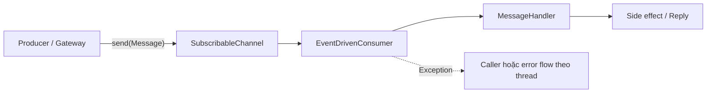
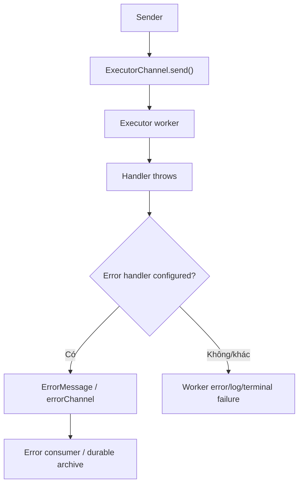

# Test event-driven endpoint trong Spring Integration

## Mục tiêu học tập

Trong Spring Integration, một endpoint *event-driven* tiếp nhận message ngay khi một `SubscribableChannel` giao message cho subscriber. Không giống một polling consumer phải đợi lịch poll, endpoint dạng này được kích hoạt theo sự kiện gửi message, nhưng **có thể chạy đồng bộ hoặc bất đồng bộ** tùy loại channel. Vì vậy, một bài test chỉ kiểm tra `send() == true` chưa chứng minh handler đã nhận, xử lý xong, ghi dữ liệu thành công hay phát reply đúng.

Bài **Test event-driven endpoint** thuộc chương **Testing runtime** của module **SPRING_INTEGRATION_RUNTIME**. Ta kiểm tra cách Spring Integration chạy và điều phối message qua channel, endpoint, consumer và executor; đối chiếu với poller để tránh nhầm mô hình. Các ví dụ còn kiểm thử lifecycle của `IntegrationFlow`, exception, error flow, retry, transaction, message store, correlation, trạng thái runtime và khả năng quan sát hiệu năng.

Sau bài học, bạn có thể:

- Phân biệt `EventDrivenConsumer` trên `DirectChannel`, `ExecutorChannel` và `PublishSubscribeChannel` với `PollingConsumer` trên `PollableChannel`.
- Tạo Spring Test context nhỏ, gửi `Message<?>` vào input channel, kiểm tra payload, headers, endpoint ID, handler invocation và kết quả xử lý.
- Viết test đồng bộ bằng JUnit 5 mà không dùng `Thread.sleep()`; dùng latch/probe có timeout hữu hạn cho endpoint chạy trên executor.
- Xác minh exception đi về caller hay xuất hiện trong error flow tùy ranh giới thread và cấu hình error publisher.
- Thay handler trong một bài integration test qua `MockIntegrationContext` khi cần cô lập dependency bên ngoài.
- Test start/stop endpoint, handler bị dừng, không có subscriber, retry, redelivery, idempotency và correlation.
- Thiết kế ma trận test có thể lặp lại và có bằng chứng đủ để phục vụ kiểm thử runtime/incident.

> **Thông điệp chính:** Event-driven có nghĩa **endpoint được kích hoạt khi channel giao message**, không phải mặc định “một thread riêng”, “xử lý non-blocking”, “đã commit”, hay “đảm bảo message bền vững”.

## 1. Event-driven endpoint là gì?

Một endpoint kiểu event-driven lắng nghe một `SubscribableChannel`. Khi có message, channel gọi subscriber/handler theo contract của nó.



Trong DSL, một `service activator` hoặc `MessageHandler` được nối tới `DirectChannel` thường tạo một consumer event-driven. Cách consumer được kích hoạt khác với việc dùng `QueueChannel` cộng poller:

```text
Event-driven:
  Producer -> DirectChannel.send -> Consumer/Handler
  Không cần poller để lấy message từ channel.

Polling:
  Producer -> QueueChannel.send -> queue
  Poller tick -> PollingConsumer.receive -> Handler
```

**Điều cần học khi test:** cùng một handler nghiệp vụ có thể chạy trong thread sender qua `DirectChannel`, trong thread pool qua `ExecutorChannel`, hoặc từ scheduler qua `QueueChannel` + poller. Nếu test không cố định loại channel thì những giả định về thời điểm assertion, transaction, lỗi và thứ tự sẽ không còn đúng.

### 1.1. Bảng phân biệt các kênh thường gặp

| Input channel | Cách endpoint nhận message | Ranh giới thread | Kiểu assertion phù hợp |
| --- | --- | --- | --- |
| `DirectChannel` | `send()` gọi dispatcher tới subscriber | Thường cùng thread sender | Kiểm tra ngay sau `send()` khi handler đồng bộ |
| `ExecutorChannel` | `send()` giao task cho executor rồi worker dispatch | Thường khác thread | Latch/queue nhận kết quả, đợi có timeout |
| `PublishSubscribeChannel` | Phát message tới các subscriber | Đồng bộ hoặc qua executor theo cấu hình | Kiểm tra từng subscriber/fan-out |
| `QueueChannel` | Message chờ trong queue, consumer chủ động `receive()` | Thread polling consumer | Test poller/trigger; **không** coi là event-driven |
| `FluxMessageChannel` | Cầu nối sang subscriber Reactive Streams | Theo subscription/scheduler | Test subscription, demand và reactive completion riêng |

`send()` có thể ném exception hoặc trả boolean theo channel; với executor hoặc queue, kết quả gửi thành công không tự chứng minh handler hoàn tất.

### 1.2. Một bài test phải tuyên bố ranh giới được kiểm chứng

Ví dụ có ba mục tiêu hoàn toàn khác nhau:

1. **Message được channel chấp nhận:** `send()` không lỗi/trả true.
2. **Handler đã được gọi:** test double/probe nhận message với payload và headers đúng.
3. **Nghiệp vụ hoàn tất:** repository đã commit, reply được phát đúng, hoặc fake client xác nhận outcome.

Không dùng assertion của mục 1 để thay cho mục 3. Đặc biệt nếu handler sử dụng executor, retry hoặc gọi một API bên ngoài, phải kiểm tra completion ở điểm phù hợp.

## 2. Lớp kiểm thử và cách chọn phạm vi

Một hệ thống Spring Integration thường cần nhiều lớp test, nhưng không cần khởi động toàn bộ application cho mỗi bài.

| Lớp test | Thành phần thật | Phụ thuộc giả lập | Mục tiêu |
| --- | --- | --- | --- |
| **Unit handler** | Java method / `MessageHandler` | Client/DAO fake | Mapping, validation, exception, business logic |
| **Component integration** | Channel + endpoint + handler trong Spring context nhỏ | Client/DAO fake | Subscription, headers, exception và lifecycle |
| **Flow integration** | Router, transformer, splitter, aggregator và các channel liên quan | Phụ thuộc ngoài được thay thế | Thứ tự flow, correlation, release, error route |
| **Infrastructure integration** | Broker, JDBC store, adapter thực, transaction manager | Dịch vụ test container | Ack/rollback, persistence và redelivery |
| **Failure/restart test** | Process/context và nguồn có khả năng replay | Dependency giả có thể gây lỗi | Crash window, idempotency, recoverability |

Bài này tập trung chủ yếu vào **component integration test của event-driven endpoint**, rồi mở rộng để nhận diện những giới hạn khi có executor, transaction và persistence.

### 2.1. Dependency và test framework

Ví dụ Java dưới đây giả định Spring Integration 6.x, Spring Framework 6, Java 17+, JUnit Jupiter và Spring Test. Các artifact thường cần tùy module dự án:

```text
Production:
  spring-integration-core
  spring-context / spring-messaging (transitively)

Testing:
  spring-test
  spring-integration-test          # khi cần MockIntegrationContext
  junit-jupiter
  Mockito / Awaitility (tùy chọn, không bắt buộc)
```

Dự án dùng Spring Boot nên để Boot BOM/parent quản lý phiên bản tương thích; không trộn ngẫu nhiên phiên bản Spring Framework, Spring Integration và JUnit. Những ví dụ dưới dùng `@SpringJUnitConfig` thay vì boot toàn bộ ứng dụng để bài test tập trung và dễ dự đoán.

## 3. Fixture tối thiểu: DirectChannel + event-driven endpoint

Ta tạo một input `DirectChannel`, một recorder fake ghi lại message và một endpoint có ID rõ. Recorder không gọi mạng hoặc DB nên dễ kiểm tra **sự kiện được giao tới handler**.

### 3.1. IntegrationFlow dưới test

```java
import java.util.List;
import java.util.concurrent.CopyOnWriteArrayList;

import org.springframework.context.annotation.Bean;
import org.springframework.context.annotation.Configuration;
import org.springframework.integration.channel.DirectChannel;
import org.springframework.integration.config.EnableIntegration;
import org.springframework.integration.dsl.IntegrationFlow;
import org.springframework.messaging.Message;
import org.springframework.messaging.MessageChannel;
import org.springframework.messaging.MessageHandler;
import org.springframework.beans.factory.annotation.Qualifier;

@Configuration
@EnableIntegration
class AuditFlowTestConfig {

    @Bean("auditInput")
    MessageChannel auditInput() {
        return new DirectChannel();
    }

    @Bean
    RecordingHandler recordingHandler() {
        return new RecordingHandler();
    }

    @Bean
    IntegrationFlow auditFlow(
            @Qualifier("auditInput") MessageChannel input,
            RecordingHandler recorder) {

        MessageHandler handler = recorder::record;

        return IntegrationFlow.from(input)
                .handle(handler, endpoint ->
                        endpoint.id("auditHandlerEndpoint"))
                .get();
    }

    static final class RecordingHandler {
        private final List<Message<?>> received =
                new CopyOnWriteArrayList<>();

        void record(Message<?> message) {
            received.add(message);
        }

        List<Message<?>> snapshot() {
            return List.copyOf(received);
        }

        void clear() {
            received.clear();
        }
    }
}
```

**Những điểm cần chú ý:**

- `DirectChannel` là `SubscribableChannel`. Handler được gọi đồng bộ khi producer gửi message trong fixture này.
- `auditHandlerEndpoint` là ID endpoint rõ ràng, hữu ích cho test lifecycle và điều tra runtime.
- `RecordingHandler` ghi **nguyên message**, không chỉ payload; ta còn kiểm tra được `id`, `correlationId` và business key.
- `CopyOnWriteArrayList` phù hợp cho fixture ít sự kiện, không nên dùng làm queue production khi lưu lượng lớn.
- Bean recorder là singleton trong test context; phải reset giữa các test để assertion không phụ thuộc thứ tự chạy.

### 3.2. Test gửi message và xác minh headers

```java
import org.junit.jupiter.api.BeforeEach;
import org.junit.jupiter.api.Test;
import org.springframework.beans.factory.annotation.Autowired;
import org.springframework.beans.factory.annotation.Qualifier;
import org.springframework.integration.IntegrationMessageHeaderAccessor;
import org.springframework.messaging.Message;
import org.springframework.messaging.MessageChannel;
import org.springframework.messaging.support.MessageBuilder;
import org.springframework.test.context.junit.jupiter.SpringJUnitConfig;

import static org.junit.jupiter.api.Assertions.*;

@SpringJUnitConfig(AuditFlowTestConfig.class)
class AuditEventDrivenEndpointTest {

    @Autowired
    @Qualifier("auditInput")
    MessageChannel input;

    @Autowired
    AuditFlowTestConfig.RecordingHandler recorder;

    @BeforeEach
    void reset() {
        recorder.clear();
    }

    @Test
    void directChannelDeliversSynchronouslyWithHeaders() {
        Message<String> command = MessageBuilder
                .withPayload("ORD-42")
                .setHeader("businessKey", "tenant-a:ORD-42")
                .setHeader(
                        IntegrationMessageHeaderAccessor.CORRELATION_ID,
                        "workflow-42")
                .build();

        assertTrue(input.send(command));

        assertEquals(1, recorder.snapshot().size());
        Message<?> seen = recorder.snapshot().get(0);

        assertEquals("ORD-42", seen.getPayload());
        assertEquals("tenant-a:ORD-42",
                seen.getHeaders().get("businessKey"));
        assertEquals("workflow-42", seen.getHeaders().get(
                IntegrationMessageHeaderAccessor.CORRELATION_ID));
        assertEquals(command.getHeaders().getId(),
                seen.getHeaders().getId());
    }
}
```

Đây là **một test event-driven thực sự**, vì nó gửi message qua channel trong Spring context và kiểm tra recorder ở endpoint. Không có poller hoặc `Thread.sleep()`. Do `DirectChannel` đang dùng handler đồng bộ, khi `send()` trả thành công thì recorder đã ghi message.

### 3.3. Vì sao cần kiểm tra cả payload và headers?

Trong runtime thật, transformer, enricher, splitter và adapter có thể tạo message mới. Nếu chỉ assert payload, test có thể bỏ qua việc mất `correlationId` hoặc `businessKey`, khiến error flow/aggregator không nối được message với workflow gốc.

Một test nên mô tả contract:

```text
Input:
  payload = "ORD-42"
  headers.businessKey = "tenant-a:ORD-42"
  headers.correlationId = "workflow-42"

Expected at handler:
  payload = "ORD-42"
  businessKey and correlationId preserved
  no extra unexpected invocation
```

Trong fixture `DirectChannel` không có transformer, message đến handler chính là message đã gửi. Nếu thêm transformer tạo message mới, `MessageHeaders.ID` có thể đổi; khi đó test nên kiểm tra correlation/business key và chỉ assert ID theo hợp đồng thực tế, không bắt buộc luôn bằng nhau.

## 4. Test lifecycle: stop/start một event-driven endpoint

Một endpoint thường có lifecycle riêng. Khi subscriber của `DirectChannel` bị stop, channel có thể không còn subscriber nhận message; tùy cấu hình, gửi có thể thất bại nhanh.

### 4.1. Test trên context được cách ly

Có thể thêm method vào `AuditEventDrivenEndpointTest`:

```java
import org.springframework.context.ApplicationContext;
import org.springframework.context.Lifecycle;
import org.springframework.messaging.MessageDeliveryException;

// Các field input và recorder dùng từ fixture ở mục 3.
@Autowired
ApplicationContext applicationContext;

@Test
void stopUnsubscribesAndStartResubscribes() {
    Lifecycle endpoint = applicationContext.getBean(
            "auditHandlerEndpoint", Lifecycle.class);
    boolean initiallyRunning = endpoint.isRunning();

    try {
        endpoint.stop();
        assertFalse(endpoint.isRunning());

        Message<String> ignored = MessageBuilder
                .withPayload("ORD-43")
                .build();

        // Fixture chỉ có một subscriber trên DirectChannel.
        assertThrows(MessageDeliveryException.class,
                () -> input.send(ignored));
        assertTrue(recorder.snapshot().isEmpty());

        endpoint.start();
        assertTrue(endpoint.isRunning());

        assertTrue(input.send(
                MessageBuilder.withPayload("ORD-44").build()));
        assertEquals(1, recorder.snapshot().size());
    }
    finally {
        // Không để trạng thái endpoint bị đổi sang test khác.
        if (initiallyRunning && !endpoint.isRunning()) {
            endpoint.start();
        }
        if (!initiallyRunning && endpoint.isRunning()) {
            endpoint.stop();
        }
    }
}
```

Đoạn này **thuộc cùng test class và context của mục 3**, không phải một source file Java độc lập. Với đúng fixture chỉ có một subscriber và `DirectChannel`, có thể assert failure khi endpoint đã stop. Nếu channel có thêm subscriber, adapter khác hoặc cơ chế buffer, kỳ vọng sẽ khác; hãy test đúng topology đang chạy.

**Giới hạn quan trọng:** `endpoint.stop()` chỉ dừng lifecycle/subscription theo contract. Nó không bảo đảm rằng một tác vụ đã chạy trước đó được hủy, một API call đã gửi được rollback, hoặc message đã đi vào queue sẽ tự được phát lại. Test ở đây đo **control behavior** của endpoint, không đo durability.

### 4.2. Không stop bean sai

Một handler là POJO hoặc `MessageHandler` có thể không triển khai `Lifecycle`; bean cần stop thường là **endpoint consumer** do DSL tạo, không nhất thiết là bean handler. Đặt `endpoint.id("auditHandlerEndpoint")` giúp test lấy đúng đối tượng.

Với dynamic flow đăng ký qua `IntegrationFlowContext`, lifecycle ở registration khác với một endpoint đơn lẻ; xem mục 12 để tránh vô tình remove cả flow khi chỉ muốn tạm stop endpoint.

## 5. Test event-driven bất đồng bộ qua ExecutorChannel

Một endpoint vẫn là **event-driven** nếu source input là `ExecutorChannel`; điểm khác là channel chuyển dispatch sang worker của executor. Do đó assertion phải đợi một tín hiệu có timeout hữu hạn.

### 5.1. Context dùng một worker riêng

```java
import java.util.concurrent.CountDownLatch;
import java.util.concurrent.ExecutorService;
import java.util.concurrent.Executors;
import java.util.concurrent.TimeUnit;
import java.util.concurrent.atomic.AtomicReference;

import org.springframework.beans.factory.annotation.Qualifier;
import org.springframework.context.annotation.Bean;
import org.springframework.context.annotation.Configuration;
import org.springframework.integration.channel.ExecutorChannel;
import org.springframework.integration.config.EnableIntegration;
import org.springframework.integration.dsl.IntegrationFlow;
import org.springframework.messaging.Message;
import org.springframework.messaging.MessageChannel;
import org.springframework.messaging.MessageHandler;

@Configuration
@EnableIntegration
class AsyncEndpointTestConfig {

    @Bean(destroyMethod = "shutdownNow")
    ExecutorService testExecutor() {
        return Executors.newSingleThreadExecutor(
                job -> new Thread(job, "async-endpoint-test-worker"));
    }

    @Bean("asyncInput")
    MessageChannel asyncInput(ExecutorService testExecutor) {
        return new ExecutorChannel(testExecutor);
    }

    @Bean
    AsyncProbe asyncProbe() {
        return new AsyncProbe();
    }

    @Bean
    IntegrationFlow asyncFlow(
            @Qualifier("asyncInput") MessageChannel input,
            AsyncProbe probe) {

        MessageHandler handler = probe::accept;

        return IntegrationFlow.from(input)
                .handle(handler, endpoint ->
                        endpoint.id("asyncHandlerEndpoint"))
                .get();
    }

    static final class AsyncProbe {
        final CountDownLatch received = new CountDownLatch(1);
        final AtomicReference<Message<?>> message =
                new AtomicReference<>();
        final AtomicReference<String> workerThread =
                new AtomicReference<>();

        void accept(Message<?> input) {
            message.set(input);
            workerThread.set(Thread.currentThread().getName());
            received.countDown();
        }
    }
}
```

Bean executor dùng một worker để test dễ đoán; `shutdownNow` giải phóng worker khi Spring test context đóng. Nếu dự án có nhiều bean `ExecutorService`, thêm `@Qualifier` rõ ràng cho tham số factory method.

### 5.2. Test đợi handler thực sự chạy

```java
import java.util.concurrent.TimeUnit;

import org.junit.jupiter.api.Test;
import org.springframework.beans.factory.annotation.Autowired;
import org.springframework.beans.factory.annotation.Qualifier;
import org.springframework.messaging.Message;
import org.springframework.messaging.MessageChannel;
import org.springframework.messaging.support.MessageBuilder;
import org.springframework.test.context.junit.jupiter.SpringJUnitConfig;

import static org.junit.jupiter.api.Assertions.*;

@SpringJUnitConfig(AsyncEndpointTestConfig.class)
class AsyncEventDrivenEndpointTest {

    @Autowired
    @Qualifier("asyncInput")
    MessageChannel input;

    @Autowired
    AsyncEndpointTestConfig.AsyncProbe probe;

    @Test
    void executorChannelDispatchesOnWorker() throws Exception {
        Message<String> command = MessageBuilder
                .withPayload("ORD-42")
                .setHeader("correlationId", "workflow-42")
                .build();

        String senderThread = Thread.currentThread().getName();

        assertTrue(input.send(command));

        // Không suy luận completion chỉ từ send().
        assertTrue(probe.received.await(5, TimeUnit.SECONDS),
                "Timed out waiting for handler invocation");

        Message<?> received = probe.message.get();
        assertNotNull(received);
        assertEquals("ORD-42", received.getPayload());
        assertEquals("workflow-42",
                received.getHeaders().get("correlationId"));
        assertNotEquals(senderThread, probe.workerThread.get());
    }
}
```

Lý do dùng `CountDownLatch`: `send()` trên `ExecutorChannel` có thể trả trước khi worker xử lý. `Thread.sleep(500)` vừa tạo test chậm, vừa dễ flaky trên CI khi máy quá tải; một latch có timeout kiểm chứng **sự kiện thực sự đã xảy ra**.

**Lưu ý:** latch đếm xuống tại điểm `probe.accept()` không chứng minh toàn bộ xử lý nghiệp vụ đã commit. Nếu cần test end-to-end, đặt tín hiệu sau bước transaction commit hoặc quan sát repository/business result thật.

### 5.3. Tại sao test không nên assert thứ tự ngầm?

Nếu executor có nhiều worker, event A có thể bắt đầu trước B nhưng hoàn tất sau B. Dùng một worker trong fixture giúp kiểm tra rõ việc dispatch; muốn test concurrency thì cấu hình nhiều worker và assert điều kiện được hỗ trợ, không giả định ordering toàn cục. Nếu nghiệp vụ yêu cầu tuần tự theo `orderId`, cần giải pháp partition/serial processing theo key và test riêng.

## 6. PublishSubscribeChannel: test nhiều subscriber

`PublishSubscribeChannel` phát message tới nhiều subscriber theo cấu hình; khác với `DirectChannel` thường chọn một subscriber để dispatch trong cùng một lần gửi.

Một test nhỏ kiểm tra hành vi fan-out ở mức channel:

```java
import java.util.concurrent.atomic.AtomicInteger;

import org.junit.jupiter.api.Test;
import org.springframework.integration.channel.PublishSubscribeChannel;
import org.springframework.messaging.support.MessageBuilder;

import static org.junit.jupiter.api.Assertions.*;

class PublishSubscribeChannelTest {

    @Test
    void oneMessageIsDeliveredToBothSubscribers() {
        PublishSubscribeChannel channel = new PublishSubscribeChannel();

        AtomicInteger accountingCalls = new AtomicInteger();
        AtomicInteger analyticsCalls = new AtomicInteger();

        channel.subscribe(message -> accountingCalls.incrementAndGet());
        channel.subscribe(message -> analyticsCalls.incrementAndGet());

        assertTrue(channel.send(
                MessageBuilder.withPayload("ORD-42").build()));

        // PublishSubscribeChannel mặc định không cấu hình executor:
        assertEquals(1, accountingCalls.get());
        assertEquals(1, analyticsCalls.get());
    }
}
```

Đây là một **unit test của channel semantics**; để kiểm chứng endpoint lifecycle/fan-out thật, nên tạo hai `IntegrationFlow` có endpoint ID riêng, cùng subscribe vào một `PublishSubscribeChannel`, rồi assert cả hai recorder.

**Những trường hợp cần test bổ sung:**

- Một subscriber ném exception: các subscriber còn lại có nhận được hay không phụ thuộc error handling, `ignoreFailures` và executor policy.
- Channel dùng executor: phải đợi kết quả từng subscriber, không assert ngay sau `send()`.
- Không có subscriber: send sẽ xử lý thế nào theo cấu hình hiện tại?
- Duplicate side effect: cùng một event có thể được phát tới hai handler có nhiệm vụ khác nhau; đừng nhầm fan-out với competing consumers.

## 7. Test exception trên DirectChannel

Với handler đồng bộ, lỗi có thể đi ngược call stack về producer. Test cần xác nhận lỗi **không bị nuốt** và message source được xử lý đúng.

### 7.1. Handler giả cố ý lỗi

```java
import org.springframework.context.annotation.Bean;
import org.springframework.context.annotation.Configuration;
import org.springframework.integration.channel.DirectChannel;
import org.springframework.integration.config.EnableIntegration;
import org.springframework.integration.dsl.IntegrationFlow;
import org.springframework.messaging.MessageChannel;
import org.springframework.messaging.MessageHandler;

@Configuration
@EnableIntegration
class FailingEndpointConfig {

    @Bean("failingInput")
    MessageChannel failingInput() {
        return new DirectChannel();
    }

    @Bean
    IntegrationFlow failingFlow() {
        MessageHandler handler = message -> {
            throw new IllegalStateException("Downstream unavailable");
        };

        return IntegrationFlow.from("failingInput")
                .handle(handler, endpoint ->
                        endpoint.id("failingHandlerEndpoint"))
                .get();
    }
}
```

### 7.2. Assert exception và cause chain

```java
import org.junit.jupiter.api.Test;
import org.springframework.beans.factory.annotation.Autowired;
import org.springframework.beans.factory.annotation.Qualifier;
import org.springframework.messaging.MessageChannel;
import org.springframework.messaging.support.MessageBuilder;
import org.springframework.test.context.junit.jupiter.SpringJUnitConfig;

import static org.junit.jupiter.api.Assertions.*;

@SpringJUnitConfig(FailingEndpointConfig.class)
class FailingEventDrivenEndpointTest {

    @Autowired
    @Qualifier("failingInput")
    MessageChannel input;

    @Test
    void failureIsVisibleToSynchronousSender() {
        RuntimeException failure = assertThrows(
                RuntimeException.class,
                () -> input.send(
                        MessageBuilder.withPayload("ORD-42").build()));

        assertTrue(containsCause(failure, IllegalStateException.class));
    }

    private static boolean containsCause(
            Throwable failure, Class<? extends Throwable> expected) {
        for (Throwable cursor = failure;
                cursor != null; cursor = cursor.getCause()) {
            if (expected.isInstance(cursor)) {
                return true;
            }
        }
        return false;
    }
}
```

Không khóa assertion vào đúng một outer exception class nếu nó còn phụ thuộc adapter, advice hoặc wrapper của Spring Messaging. Ở nhiều flow, exception nghiệp vụ có thể được bọc trong `MessagingException` hoặc `MessageHandlingException`; test nên tìm **root cause và failed message** khi đó là contract quan trọng.

### 7.3. Vì sao errorChannel có thể không nhận?

Một lỗi đồng bộ được ném về caller **không tự được publish thành `ErrorMessage`** chỉ vì message có header `errorChannel`. Cần một thành phần bắt lỗi và xuất bản, hoặc ranh giới bất đồng bộ với error handler đã được cấu hình.

Vì vậy, một test không nên có kỳ vọng “handler throw → global errorChannel nhận message” nếu topology hiện tại chỉ là `DirectChannel` + handler và không có error publisher.

## 8. Test lỗi trên ExecutorChannel và error flow

Trên `ExecutorChannel`, lỗi có thể xảy ra trong worker sau khi `send()` đã trả. Khi đó, khẳng định exception được ném về sender thường là sai. Cần kiểm tra **lỗi được xử lý ở đâu**:



Một kế hoạch integration test lỗi bất đồng bộ:

1. Dùng `ExecutorChannel` với executor được đóng sau test.
2. Handler giả ném exception với một `businessKey` và `correlationId` dễ truy.
3. Cấu hình error publisher/error channel **theo chính xác adapter hoặc cơ chế task-executor đang dùng**, và có một error consumer/probe.
4. Gửi message rồi chờ error probe bằng latch có timeout.
5. Assert `ErrorMessage.getPayload()` là `Throwable`, kiểm tra cause chain và message gốc/failed message nếu có.
6. Xác nhận nguồn ack/rollback **theo contract đã cấu hình**; không suy từ việc có error record.
7. Kiểm tra consumer/probe không nhận hai error record cho cùng một lần thất bại, trừ khi retry/redelivery được cấu hình như vậy.

Không mặc định mọi `ExecutorChannel` tự publish tới một error channel tùy ý; hành vi này phụ thuộc error handler và header/channel resolution của môi trường test. Nếu muốn test đường lỗi thật, dùng configuration của ứng dụng (hoặc tạo test configuration tương đương), tránh hard-code giả định bên ngoài.

### 8.1. Nội dung một ErrorMessage

```java
import org.springframework.messaging.Message;
import org.springframework.messaging.MessagingException;
import org.springframework.messaging.support.ErrorMessage;

void assertFailureContainsCorrelation(ErrorMessage error) {
    Throwable failure = error.getPayload();

    Message<?> original = error.getOriginalMessage();
    if (original == null && failure instanceof MessagingException messaging) {
        original = messaging.getFailedMessage();
    }

    if (original == null) {
        throw new AssertionError("No original/failed message");
    }

    Object correlation = original.getHeaders().get("correlationId");

    if (!"workflow-42".equals(correlation)) {
        throw new AssertionError("Unexpected correlation: " + correlation);
    }
}
```

Trong thực tế, `getOriginalMessage()` và `getFailedMessage()` có thể trả `null` hoặc message ở các bước khác nhau. Test phải biết contract của error publisher cụ thể; đoạn này là helper mẫu khi flow **cần** mang message gốc. `ErrorMessage.getPayload()` là exception, **không phải** payload đơn hàng.

## 9. Dùng MockIntegrationContext để thay handler khi cần

Trong Spring Integration Test, `@SpringIntegrationTest` và `MockIntegrationContext` hỗ trợ thay thế một số component của endpoint trong test, chẳng hạn đưa một `MessageHandler` giả vào một endpoint đã có ID.

### 9.1. Mục đích đúng của substitution

Giả sử flow thật có transformer → router → outbound handler gọi API đối tác. Bạn muốn kiểm tra payload/header tới đúng endpoint nhưng **không thực hiện HTTP request**. Khi đó thay handler đích bằng recorder fake trong test giúp kiểm chứng routing mà không phụ thuộc đối tác.

```text
Input -> Validate -> Transform -> Route -> [Real Partner Handler]
                                            |
                                 Thay bằng recording fake trong test
```

Việc thay handler giúp test orchestration, nhưng **không** kiểm thử logic của handler thật hoặc giao tiếp mạng. Các test chuyên biệt của adapter/client vẫn cần chạy riêng.

### 9.2. Cách dùng ở mức minh họa

```java
import java.util.concurrent.atomic.AtomicReference;

import org.junit.jupiter.api.Test;
import org.springframework.beans.factory.annotation.Autowired;
import org.springframework.beans.factory.annotation.Qualifier;
import org.springframework.integration.test.context.SpringIntegrationTest;
import org.springframework.integration.test.mock.MockIntegrationContext;
import org.springframework.messaging.Message;
import org.springframework.messaging.MessageChannel;
import org.springframework.messaging.MessageHandler;
import org.springframework.messaging.support.MessageBuilder;
import org.springframework.test.context.junit.jupiter.SpringJUnitConfig;

import static org.junit.jupiter.api.Assertions.*;

@SpringJUnitConfig(AuditFlowTestConfig.class)
@SpringIntegrationTest
class HandlerReplacementExample {

    @Autowired
    MockIntegrationContext mockIntegrationContext;

    @Autowired
    @Qualifier("auditInput")
    MessageChannel input;

    @Test
    void captureMessageAtTargetEndpoint() {
        AtomicReference<Message<?>> captured = new AtomicReference<>();
        MessageHandler fake = captured::set;

        mockIntegrationContext.substituteMessageHandlerFor(
                "auditHandlerEndpoint", fake);

        try {
            Message<String> original = MessageBuilder
                    .withPayload("ORD-42")
                    .setHeader("correlationId", "workflow-42")
                    .build();

            assertTrue(input.send(original));
            assertNotNull(captured.get());
            assertEquals("ORD-42", captured.get().getPayload());
            assertEquals("workflow-42",
                    captured.get().getHeaders().get("correlationId"));
        }
        finally {
            mockIntegrationContext.resetBeans("auditHandlerEndpoint");
        }
    }
}
```

Ví dụ dùng lại `AuditFlowTestConfig` ở mục 3; `@SpringIntegrationTest` bật hỗ trợ `MockIntegrationContext` từ dependency `spring-integration-test`. Khi thay thế handler tại endpoint `auditHandlerEndpoint`, test vẫn gửi message qua channel thật nhưng kiểm tra kết quả ở fake. Các phương thức substitution/reset cần dùng đúng endpoint ID và phải phù hợp loại handler mà phiên bản test support thay thế.

**Tại sao phải reset?** Spring Test có thể cache application context giữa nhiều test; một handler mock còn gắn sau bài test có thể làm test khác sai ngẫu nhiên. `finally` bảo đảm khôi phục dù assertion lỗi.

### 9.3. Khi nào không dùng MockIntegrationContext?

- Nếu đang test chính logic handler: thay handler sẽ loại đúng đối tượng muốn kiểm thử.
- Nếu cần xác minh transaction/ack/HTTP response thật: fake handler có thể làm mất semantics.
- Nếu muốn test concurrency/ordering: một mock synchronous có thể che ranh giới worker/queue.
- Nếu endpoint không hỗ trợ substitution theo cơ chế bạn dùng: nên inject dependency fake tại ranh giới client/repository.

Có thể bắt đầu bằng **constructor injection cho handler dependency**. Đó thường là cách ít phụ thuộc vào cơ chế mock của framework và giúp test trung thực hơn.

## 10. Test filtering, routing và header propagation ở endpoint

Một message có thể được enrich/filter/route trước khi đến event-driven handler. Test không chỉ nên kiểm tra “đã nhận”, mà còn phải xác minh **đúng handler** và **đúng contract**.

| Loại bước | Input test | Điều cần assert |
| --- | --- | --- |
| Header enricher | Thiếu `correlationId`, có `orderId` | Header được thêm với kiểu/giá trị ổn định |
| Transformer | `OrderEvent` → `OrderCommand` | Payload/schema đúng; headers cần thiết không mất |
| Filter | Event hợp lệ/không hợp lệ | Chỉ message được chấp nhận tới downstream |
| Router | Tenant A/Tenant B | Message tới **đúng một** endpoint nếu contract yêu cầu |
| Splitter | Một order có ba items | Ba message phần, correlation/sequence đúng |
| Aggregator | Ba phần cùng group key | Release đúng group, xử lý duplicate/late arrival |
| Service activator | Message đã chuẩn hóa | Handler được gọi đúng một lần theo contract |

**Không** khẳng định message ID phải giữ nguyên sau mọi bước biến đổi. `MessageHeaders.ID` nhận diện message instance; `businessKey` và `correlationId` giúp nối các message mới vào workflow. Test nên kiểm tra từng header theo nghĩa của nó.

### 10.1. Kiểm thử correlation và grouping

Ví dụ hai message đi qua các nhánh khác nhau:

```text
payment:
  id = UUID-A
  correlationId = tenant-a:ORD-42

inventory:
  id = UUID-B
  correlationId = tenant-a:ORD-42

Expected:
  Different message IDs
  Same correlation key
  Aggregator group ID = tenant-a:ORD-42
```

Nếu aggregator dùng `payload.orderId` thay vì `headers['correlationId']`, hãy assert **group key thực tế của strategy**, không chỉ header tồn tại. Với persistent group store, phải kiểm tra release/cleanup và khả năng đọc lại sau restart ở test cấp cao hơn.

Khi aggregator sử dụng `MessageGroupStore`, test cần phân biệt **group ID** (do correlation strategy trả về) với **message UUID** (được `MessageStore` dùng khi tra cứu một message cụ thể). Có hai message cùng group ID không có nghĩa handler sẽ được gọi ngay: release strategy còn quyết định thời điểm tạo output. Một endpoint event-driven ở đầu group cũng không biến lưu trữ nhóm thành poller hoặc lịch replay tự động.

## 11. Test retry, recovery và idempotency của event-driven handler

Một test chỉ gửi message một lần không phát hiện được vấn đề khi downstream lỗi rồi retry hoặc nguồn giao lại. Tuy nhiên, cần phân biệt:

- **Retry attempt:** cùng invocation được advice gọi handler lại.
- **Source redelivery:** broker/poller phát lại một delivery mới.
- **Manual replay:** lấy từ error archive/DLQ và gửi lại.
- **Duplicate business event:** cùng `businessKey` hoặc event ID xuất hiện từ nhiều nguồn.

### 11.1. Fake client lỗi rồi thành công

```java
import java.util.concurrent.atomic.AtomicInteger;

final class FlakyInventoryClient {
    final AtomicInteger calls = new AtomicInteger();

    void reserve(String sku) {
        if (calls.incrementAndGet() <= 2) {
            throw new IllegalStateException("Temporary unavailable");
        }
        // Lần thứ ba thành công theo logic giả lập.
    }
}
```

Nếu endpoint dùng `RequestHandlerRetryAdvice` với `maxAttempts=3` và được phép retry loại lỗi này, test có thể assert handler/client được gọi ba lần và flow báo thành công. Nhưng hãy kiểm tra **advice thực sự đã gắn vào endpoint và bao đúng handler**, thay vì tự giả định vì có bean retry trong context.

Nếu retry advice có recovery callback nuốt lỗi rồi trả bình thường, test phải xác minh outcome và error archive theo contract; không coi “không ném exception” là nghiệp vụ thành công.

### 11.2. Test message bị giao hai lần

Giả lập gửi lại message cùng `businessKey=tenant-a:ORD-42` sau một lần xử lý thành công. Có thể là hai `MessageHeaders.ID` khác nhau nếu source tạo message mới.

```text
Delivery 1: businessKey=tenant-a:ORD-42, messageId=UUID-A
Delivery 2: businessKey=tenant-a:ORD-42, messageId=UUID-B

Expected:
  2 deliveries observed
  1 business side effect committed, nếu policy idempotency yêu cầu
```

Một recorder nhận hai message không chứng minh nghiệp vụ tạo duplicate; cần assert tại fake repository/ledger hoặc hệ thống đích rằng unique business key được bảo toàn. Với API bên ngoài, sử dụng idempotency key nếu API có hỗ trợ.

### 11.3. Không nhầm retry với exception propagation

Trong `DirectChannel` không có retry advice, handler ném exception và caller nhìn thấy lỗi. Khi thêm retry, exception có thể chỉ lộ ra sau lần attempt cuối hoặc được recovery chuyển thành kết quả khác. Khi chuyển sang `ExecutorChannel`, caller của `send()` thường không đợi các attempt/side effect ở worker.

Vì vậy khi đổi một cấu hình runtime, phải cập nhật **assertion timing** và **error contract**, không bê nguyên test synchronous sang asynchronous.

## 12. Transaction và ranh giới thread trong test

Một test annotated `@Transactional` không có nghĩa transaction test tự truyền qua `ExecutorChannel`. Với Spring transaction imperative, ngữ cảnh giao dịch thường gắn thread của caller.

```text
Test thread:
  begin test transaction
  input.send(message)
  test transaction rollback
                 |
                 v
Executor worker:
  handler -> repository.save(...)
  transaction có thể khác hoặc đã commit
```

Do đó một test chạy qua executor có thể để lại dữ liệu thật ở test database dù transaction của test rollback. Không chỉ dựa vào `@Transactional` trên method test để dọn state khi handler chạy ở worker.

### 12.1. Chọn test DB/transaction phù hợp

Nếu muốn chứng minh commit/rollback thật, cần dùng datasource thật trong môi trường test hoặc container DB, transaction manager của ứng dụng, lỗi có thể tái tạo và phương án cleanup độc lập:

1. Gửi message có business key độc nhất cho từng test.
2. Đợi tín hiệu **handler completion**, không chỉ `send()`.
3. Đọc DB từ transaction phù hợp để xác minh record đã commit/rollback.
4. Gửi lại cùng business key để kiểm chứng unique constraint/idempotency.
5. Dọn dữ liệu theo policy sau test, không phụ thuộc một rollback trên thread test khi xử lý đã sang executor.

Một lời gọi HTTP không tự thuộc JDBC transaction; nếu handler gọi API thành công rồi DB rollback, test cần nhận diện crash window và side effect trùng khi retry.

### 12.2. Timeout và test liveness

Đặt timeout hữu hạn cho lời chờ latch, DB query, HTTP fake và test method. Nếu test treo quá lâu thì phải báo **không có progress**, không chỉ timeout chung chung. Log nên cho biết endpoint, message ID/correlation, active threads và số lần handler được gọi.

## 13. Lifecycle và test isolation: tránh test ảnh hưởng lẫn nhau

Một Spring Test context có thể được cache giữa test methods hoặc classes. Nếu một test stop endpoint hoặc thay handler mà không khôi phục, test tiếp theo có thể thất bại theo thứ tự chạy.

### 13.1. Quy tắc cách ly

- Reset recorder/atomic counters trước mỗi test.
- Dùng business key riêng, không chia sẻ dữ liệu không dọn giữa các test.
- Với `CountDownLatch`, tạo probe/latch riêng cho mỗi kịch bản hoặc context riêng.
- Khôi phục endpoint lifecycle trong `finally`.
- Reset mock substitution qua `MockIntegrationContext.resetBeans(...)`.
- Shutdown executor/scheduler được tạo cho test, tránh thread leak.
- Hủy subscription/reactive pipeline khi test kết thúc.
- Khi test context bị dirty không thể phục hồi an toàn, cân nhắc `@DirtiesContext` **có chủ đích**, tránh áp dụng cho toàn suite nếu không cần.
- Không chạy test stop/start tác động tới production hoặc broker/shared DB thật.

### 13.2. Determinism thay vì sleep

| Cách dễ flaky | Cách chắc chắn hơn |
| --- | --- |
| `Thread.sleep(500)` rồi assert queue | `CountDownLatch.await(timeout)` hoặc probe với điều kiện rõ |
| Assert ngay sau `ExecutorChannel.send()` | Đợi handler hoặc business completion |
| Dựa vào thứ tự chạy test | Reset state và tạo fixture độc lập |
| Test với thread pool không giới hạn | Dùng executor hữu hạn, đặt timeout |
| Chờ retry/backoff thời gian thật dài | Dùng chính sách retry ngắn trong test, virtual clock khi framework hỗ trợ |
| Log “success” làm bằng chứng | Assert tại recorder/repository/response |
| Đọc cùng DB state từ transaction chưa commit | Dùng transaction/connection đọc đúng thời điểm |

Một test có timeout không đơn giản là “không flaky”: còn phải chọn **tín hiệu completion đúng**. Đếm latch khi handler mới bắt đầu rồi assert database đã commit là sai mô hình.

## 14. Test stop/start và dynamic IntegrationFlow

Khi flow được đăng ký động, `IntegrationFlowContext` quản lý registration. Một test nên xác minh registration ID, input channel và lifecycle thay vì hard-code bean name tự sinh.

```java
import org.springframework.integration.dsl.IntegrationFlow;
import org.springframework.integration.dsl.context.IntegrationFlowContext;
import org.springframework.messaging.MessageHandler;

void registerAndExerciseDynamicFlow(
        IntegrationFlowContext flowContext) {

    MessageHandler handler = message -> {
        // Test probe hoặc fake handler.
    };

    IntegrationFlow definition = flow ->
            flow.handle(handler);

    var registration = flowContext.registration(definition)
            .id("test.orders.dynamic.v1")
            .register();

    try {
        if (registration.getInputChannel() == null) {
            throw new AssertionError("Missing input channel");
        }

        registration.getInputChannel()
                .send(org.springframework.messaging.support.MessageBuilder
                        .withPayload("ORD-42")
                        .build());

        // Ở test thực tế: assert probe đã nhận message.
    }
    finally {
        flowContext.remove(registration.getId());
    }
}
```

Đây là snippet lifecycle trong một test được cấu hình Spring context đầy đủ; không phải một chương trình main độc lập. Khi tạo dynamic flow nên chú ý cách đăng ký input channel để `getInputChannel()` được cung cấp theo contract. Nếu một flow có input từ một adapter riêng thay vì channel do registration quản lý, cách nhận input có thể khác.

**Cảnh báo:** `flowContext.remove(...)` không xóa message đã lưu bền vững hoặc tự drain tasks. Chỉ remove test registration khi đã xác nhận task quan trọng kết thúc, và giữ clean-up cho executor/store nếu đã tạo.

### 14.1. Flow version và idempotency khi test rollout

Để test v1 → v2, hãy gửi message có `flowVersion`, chuyển active route, rồi phát lại message v1. Assert nó không bị ép qua v2 nếu policy yêu cầu version pinning. Với broker/redelivery, không lấy thành công của `send()` làm bằng chứng đã chuyển version đúng; phải kiểm tra handler/side effect được ghi theo version.

## 15. Kiểm thử event-driven endpoint trong vận hành

Những lỗi ở production thường bộc lộ qua signal runtime mà test chức năng đơn giản không đo:

| Tín hiệu | Ý nghĩa | Cách test liên hệ |
| --- | --- | --- |
| `endpoint.isRunning` | Lifecycle của endpoint | Start/stop và kiểm tra subscriber |
| `channel.send.accepted` | Sender đã được channel chấp nhận | Assert send result/exception |
| `handler.started` | Handler được gọi | Probe ở đầu handler |
| `handler.completed` | Handler kết thúc | Probe sau xử lý thành công |
| `handler.failed` | Handler ném lỗi | Cause chain/error archive |
| `executor.active` / `queue.depth` | Sức chứa thread/queue | Saturation test, bounded executor |
| `errorChannel.received` | Error publisher hoạt động | Error-flow integration test |
| `retry.attempts` | Số attempt thật | Fake client counter |
| `business.commit` | Side effect đã được ghi nhận | Repository/ledger assertions |
| `correlationId` / `businessKey` | Gắn các message của cùng workflow | Assert headers và trace |
| `message.group.pending` | Aggregator còn chờ | Correlation/release tests |
| `source.redelivery` | Nguồn giao lại message | Broker/infrastructure tests |

Tên metric chỉ là **đề xuất instrumentation**, không khẳng định Spring Integration cung cấp toàn bộ theo mặc định. Ở test, dùng probe rõ ràng; ở production, dùng structured log/tracing và metric có cardinality được kiểm soát.

### 15.1. Chẩn đoán các thất bại test thường gặp

| Triệu chứng | Nguyên nhân khả dĩ | Kiểm tra |
| --- | --- | --- |
| `send()` báo không có subscriber | Endpoint chưa start, sai input channel, flow không subscribe | ID, `isRunning`, topology |
| Async test thỉnh thoảng assert 0 | Assert trước khi worker xử lý | Dùng latch/await đúng completion |
| Test nhanh trên máy local nhưng timeout CI | Executor bị contention, timeout quá ngắn | Tách pool, giới hạn tải, log thread |
| Hai message được handler gọi dù test gửi một | `PublishSubscribeChannel` fan-out, nhiều registration/subscriber | Graph và subscriber count |
| Test stop làm test sau lỗi | Không restore lifecycle | `finally`, test context isolation |
| Mock handler vẫn hoạt động ở test khác | Không reset `MockIntegrationContext` | `resetBeans(...)` |
| Exception type không khớp | Spring Messaging/advice wrap exception | Check cause chain |
| Error channel trống | Flow đồng bộ không publish error hoặc error handler khác | Thread boundary/error publisher config |
| Business DB còn record sau rollback test | Worker executor dùng transaction khác | Transaction boundary và cleanup |
| Duplicate sau retry | Handler side effect trước lỗi/timeout | Business key và idempotency |
| Aggregator không release | Sai group key, thiếu part hoặc duplicate | Correlation strategy/group state |
| Broker phát lại sau restart | Source chưa ack, message đã commit | Ack policy, business result, dedupe |
| Test có treo vô hạn | Chờ latch/future không timeout | Timeouts và failure diagnostics |

### 15.2. Một báo cáo test tốt nên ghi gì?

```text
Test: executorChannelDispatchesOnWorker
Input:
  messageId = UUID-A
  businessKey = tenant-a:ORD-42
  correlationId = workflow-42
Channel: asyncInput (ExecutorChannel)
Endpoint: asyncHandlerEndpoint
Expected:
  1 handler invocation on worker thread
  original payload and correlation preserved
Actual:
  send accepted = true
  handler observed = true
  workerThread != senderThread
Timeout budget: 5s
Cleanup: executor shutdown via Spring context
```

Báo cáo này cho thấy điều **đã đo**, không tự thêm kết luận rằng nghiệp vụ đã commit hay message có durability. Khi mở rộng test E2E, bổ sung ack state và business ledger.

## 16. Ma trận test event-driven endpoint

| Case | Input / cấu hình | Assertion cốt lõi | Rủi ro được kiểm soát |
| --- | --- | --- | --- |
| DirectChannel cơ bản | Một message hợp lệ | Handler nhận payload/header đồng bộ | Sai wiring, mất header |
| DirectChannel lỗi | Handler cố ý throw | Caller thấy lỗi/cause | Error bị nuốt |
| Stop/start endpoint | Một subscriber duy nhất | Không dispatch khi stop, lại dispatch khi start | Lifecycle sai |
| ExecutorChannel | Một worker | Handler nhận trong worker, await timeout | Assertion race |
| Saturation executor | Pool/queue giới hạn | Rejection/backlog theo policy | Mất message, quá tải |
| PublishSubscribeChannel | Hai subscriber | Cả hai nhận một lần | Fan-out sai |
| Transformer/router | Multi-tenant messages | Đúng endpoint và correlation | Gửi nhầm tenant |
| Filter | Payload hợp lệ/không hợp lệ | Chỉ sự kiện được phép tới handler | Điều kiện filter sai |
| Retry thành công | Fake client fail hai lượt | Tổng attempt theo cấu hình | Retry policy không gắn |
| Retry exhausted | Fake luôn lỗi | Error/recovery theo contract | Ack sai, mất message |
| Async error flow | Handler trong worker throw | Error probe/archiver thấy exception | Error mất trong worker |
| Redelivery duplicate | Cùng business key gửi hai lần | Một side effect nếu idempotent | Duplicate |
| Transaction | DB rollback/commit theo cấu hình | State bền vững đúng | Sai thread transaction |
| Aggregator | Nhánh tới khác thứ tự | Release theo correlation/strategy | Group kẹt hoặc ghép sai |
| Restart test | Durable source + worker kill | Redelivery/recovery và idempotency | Mất dữ liệu in-flight |
| Dynamic flow | Register/start/stop/remove | Registration và consumer state đúng | Resource leak |
| No traffic | Không gửi message | Không false fail về liveness | Alert sai |
| Stress có giới hạn | Nhiều event, backend chậm | Queue age/latency được quan sát | Backpressure |

**Phân chia trách nhiệm:** hầu hết case cơ bản chạy nhanh trong Spring Test context; crash/restart, JDBC transaction, broker ack và latency dưới tải nên có bộ integration test riêng với infrastructure thật trong môi trường cách ly.

## 17. Bài thực hành có hướng dẫn

### Bài A — Viết test đầu tiên cho DirectChannel

Tạo fixture mục 3, gửi một message có `businessKey` và `correlationId`, assert recorder nhận đúng một message với payload/headers. Thêm một message khác và xác minh recorder tăng đúng số lượng.

**Kết quả mong đợi:** hiểu subscriber/handler được kích hoạt ngay khi gửi trên `DirectChannel` trong fixture này; không phải chờ poller.

### Bài B — Test lifecycle và dọn trạng thái

Thêm test stop/start ở mục 4. Gửi message khi endpoint đã stop; sau đó start và gửi lại message mới. Bảo đảm `finally` khôi phục trạng thái ban đầu.

**Kết quả mong đợi:** endpoint ID được xác định đúng, test không rò rỉ trạng thái sang test khác; biết khác biệt giữa channel không có subscriber và queue lưu message.

### Bài C — Async assertion không dùng sleep

Chuyển input sang `ExecutorChannel`, đặt một worker thread có tên dễ nhận diện. Dùng `CountDownLatch` và `AtomicReference` để kiểm tra message, thread và thời điểm handler nhận.

**Kết quả mong đợi:** không assert kết quả xử lý ngay sau `send()`; test có timeout hữu hạn và không flaky vì timing tùy máy.

### Bài D — Test exception và error boundary

Tạo handler throw ở `DirectChannel`, kiểm tra cause từ caller. Sau đó chuyển sang executor và cấu hình đường error publisher/consumer, dùng error probe thay vì assert exception của `send()`.

**Kết quả mong đợi:** hiểu lỗi synchronous và asynchronous đi hai đường khác nhau; không tự cho rằng header `errorChannel` bảo đảm publish.

### Bài E — Kiểm tra fan-out và route

Dùng `PublishSubscribeChannel` với hai recorder để test fan-out. Thêm router theo tenant A/B với hai endpoint; assert message chỉ vào đúng endpoint của tenant theo contract.

**Kết quả mong đợi:** phân biệt phát cho nhiều subscriber với chọn một handler; không nhầm message duplicate do fan-out với redelivery.

### Bài F — Test retry và idempotency

Fake client lỗi hai lần rồi thành công; cấu hình retry advice tối đa ba attempts và đo counter. Gửi lại cùng `businessKey` sau thành công, assert fake repository chỉ có một business record nếu chính sách idempotency đã được cấu hình.

**Kết quả mong đợi:** phân biệt số invocation của handler, số retry attempts và side effect thực; khi retry không gắn đúng endpoint, test phát hiện được.

### Bài G — Transaction qua thread boundary

Dùng test DB cách ly. Gửi qua `DirectChannel` rồi `ExecutorChannel` vào handler ghi DB; quan sát commit, rollback, cleanup sau test và thời điểm async completion.

**Kết quả mong đợi:** test-level `@Transactional` không tự bao phủ worker thread; assertion đọc DB phải phản ánh transaction thực.

### Bài H — Diễn tập restart và phục hồi

Tạo durable source/broker test và một event có business key. Cho handler commit side effect rồi kill worker trước ack; start consumer mới và quan sát redelivery.

**Kết quả mong đợi:** message có thể được giao lại nhưng business side effect chỉ có một lần nếu idempotency đúng; `MessageStore` hoặc `ExecutorChannel` trong RAM không tự bảo đảm yêu cầu này.

## 18. Câu hỏi tự kiểm tra

1. Endpoint event-driven khác polling endpoint ở cách nhận message như thế nào?
2. `DirectChannel` và `ExecutorChannel` đều có thể kích hoạt event-driven consumer; chúng khác nhau ra sao về thread và thời điểm assertion?
3. Vì sao `send() == true` không có nghĩa nghiệp vụ đã commit?
4. Tại sao test `DirectChannel` có thể assert recorder ngay mà test `ExecutorChannel` cần chờ?
5. Khi endpoint `STOPPED`, một `DirectChannel` chỉ có một subscriber có thể phản ứng thế nào với `send()`?
6. Vì sao cần endpoint ID rõ ràng để test lifecycle?
7. Trong test JUnit, vì sao `Thread.sleep(500)` kém tin cậy hơn latch hoặc completion signal?
8. Sự khác nhau giữa `PublishSubscribeChannel` và hai subscriber trên `DirectChannel` là gì?
9. Khi handler ném exception trên thread sender, lỗi đi đâu? Khi handler chạy trên executor thì sao?
10. Vì sao không luôn thấy `ErrorMessage` trên global error channel trong flow đồng bộ?
11. `MockIntegrationContext.substituteMessageHandlerFor` giúp test điều gì, và điều gì nó không thể kiểm chứng?
12. Vì sao phải reset bean/endpoint lifecycle sau test?
13. Nếu transformer tạo một message ID mới, header nào phải tiếp tục giữ để liên kết cùng workflow?
14. Correlation ID và message ID khác nhau như thế nào?
15. Khi retry advice cho phép ba attempts, cần kiểm tra thông tin gì để xác minh advice thực sự bao handler?
16. Hai delivery của cùng order có thể tạo hai UUID khác nhau; dùng ID nào để bảo vệ idempotency?
17. `@Transactional` trên method test có tự rollback công việc ở `ExecutorChannel` không?
18. Test aggregator release chỉ dựa vào `group.size() >= 3` có thể bỏ sót lỗi duplicate nào?
19. Test nào cần backend durable/broker thật thay vì chỉ Spring context trong RAM?
20. Những chỉ số nào giúp khẳng định một endpoint đang RUNNING nhưng không có progress?
21. Tại sao stop/remove dynamic flow không tự drain mọi message đang xử lý?
22. Để test không flaky, phải xác định **completion signal** ở đâu?
23. Khi lỗi recovery archive, test phải kiểm tra điều gì về ack và khả năng phát lại?
24. Sau restart, cần bằng chứng gì để khẳng định business effect không bị nhân đôi?

**Ghi nhớ:** Kiểm thử event-driven endpoint phải đi từ **message được gửi → channel dispatch → handler invocation → xử lý hoặc lỗi → kết quả nghiệp vụ**, với assertion ở đúng ranh giới. Dùng Spring Test context nhỏ và `DirectChannel` để có test đồng bộ rõ ràng; với `ExecutorChannel` phải đợi tín hiệu thật, với `PublishSubscribeChannel` phải kiểm tra fan-out, và với lỗi/transaction/retry phải xác định ai sở hữu ack, retry và error flow. Test tốt không chỉ “xanh” mà còn chứng minh không mất correlation, không bỏ sót lỗi và không suy diễn quá mức về durability hoặc exactly-once.

