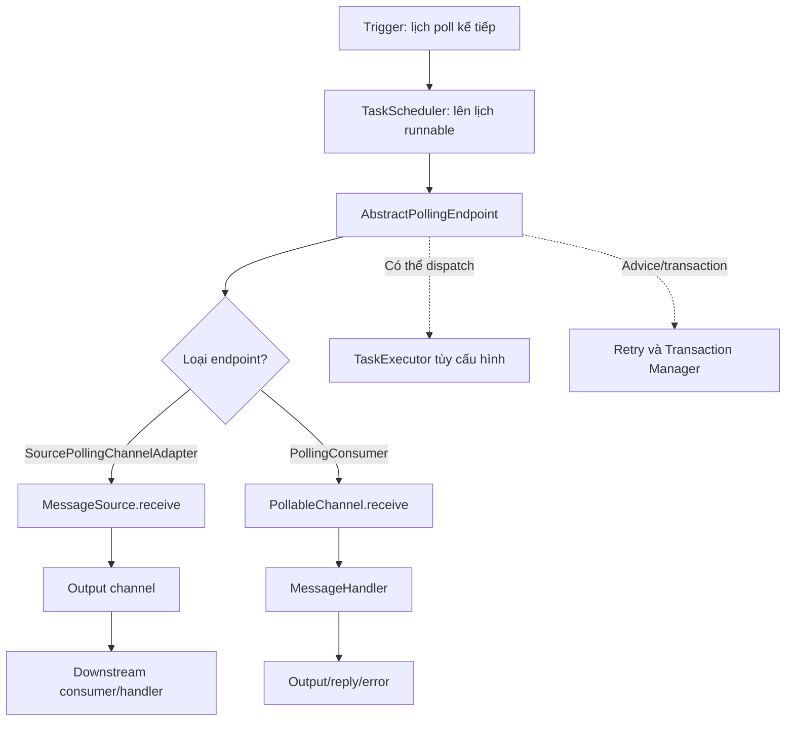
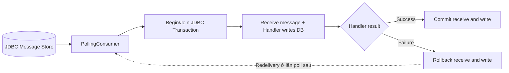

# Test polling endpoint và scheduler giả lập trong Spring Integration

## 1. Mục tiêu: kiểm thử hành vi poll mà không phụ thuộc đồng hồ thật

Một `PollingConsumer` có thể lấy message từ `QueueChannel` theo lịch; một `SourcePollingChannelAdapter` có thể định kỳ gọi `MessageSource.receive()` để nhập message từ file, database, API hoặc nguồn dữ liệu khác. Trong production, lịch chạy có thể là mỗi vài giây, mỗi giờ hoặc một biểu thức cron ban đêm. Nếu test chờ đúng lịch thật, bộ test chậm, dễ bị lỗi ngẫu nhiên (flaky) và khó tái hiện lỗi.

Ví dụ: service xử lý hóa đơn lúc 02:00, mỗi lần poll tối đa 10 record. Yêu cầu kiểm thử không phải “đợi đến 02:00”, mà là chứng minh **khi một lượt poll xảy ra**, endpoint nhận đúng số message, gọi handler đúng số lần, xử lý lỗi/rollback đúng chính sách và ngừng polling đúng lifecycle. Ta nên **điều khiển trigger hoặc scheduler** thay vì ngủ trong test rồi suy đoán.

Bài **“Test polling endpoint và scheduler giả lập”** thuộc chương **Testing runtime** của module **SPRING_INTEGRATION_RUNTIME**. Nó gắn với cách Spring Integration điều phối channel, endpoint, consumer, poller, executor và vòng đời IntegrationFlow; đồng thời liên hệ transaction, retry, message store, error channel, correlation, threading, hiệu năng và trạng thái runtime.

Sau bài này, bạn có thể:

1. Phân biệt rõ **poller**, **Trigger**, **TaskScheduler**, **TaskExecutor** và luồng xử lý được poll.
2. Sử dụng `@SpringIntegrationTest(noAutoStartup=...)` và `MockIntegrationContext` để thay message source, handler hoặc trigger khi test.
3. Dùng `OnlyOnceTrigger` kích hoạt một lượt poll có kiểm soát, không chờ cron dài.
4. Kiểm tra đúng `maxMessagesPerPoll`, `receiveTimeout` và sự khác biệt giữa hai loại polling endpoint.
5. Thiết kế test cho stop/start, async workers, transaction/rollback, retry, lỗi nguồn và persistent queue.
6. Tránh các test khó ổn định vì `Thread.sleep`, giờ hệ thống, timezone, DST và state dùng chung giữa các test.

> **Phạm vi phiên bản:** Các ví dụ hướng tới **Spring Integration 6.5.x**, **Spring Framework 6.x**, **Spring Integration Test 6.5.x**, **JUnit Jupiter 5**, **Java 17+**. Tính năng `MockIntegrationContext.substituteTriggerFor(...)` có từ Spring Integration **6.3**. Đây là nội dung viết STEP 4; việc chạy và QA chuyên môn thuộc các bước khác của quy trình.

## 2. Kiến trúc một polling endpoint và điểm có thể thay bằng fake



Các thành phần khác nhau về nhiệm vụ:

| Thành phần | Câu hỏi mà nó giải quyết | Điều test nên quan sát |
| --- | --- | --- |
| `Trigger` | **Khi nào** lượt poll tiếp theo được lên lịch? | Số lần kích hoạt, thứ tự và thời điểm logic. |
| `TaskScheduler` | **Ai** đăng ký/chạy task theo Trigger? | Có task đang được hẹn, có hủy sau stop, thread chạy ra sao. |
| `TaskExecutor` (tùy chọn) | Có chuyển việc xử lý sang worker không? | Thread boundary, queue/rejections, thời điểm kết thúc. |
| `SourcePollingChannelAdapter` | Gọi `MessageSource.receive()` rồi gửi message ra channel. | Source calls, payload/headers, số message phát. |
| `PollingConsumer` | Gọi `PollableChannel.receive()` rồi chuyển tới handler. | Số message tiêu thụ, invoke handler, remaining backlog. |
| `PollerMetadata` / `PollerSpec` | Cấu hình trigger, executor, advice, timeout, giới hạn poll. | Configuration được gắn đúng endpoint và ảnh hưởng hành vi. |

**Thay Trigger không đồng nghĩa thay scheduler.** `OnlyOnceTrigger` là một **fake lịch kích hoạt**, được `TaskScheduler` thật dùng để lên lịch gần như tức thì. Nó giúp không phải đợi một cron dài nhưng task vẫn chạy trên thread scheduler và test phải đồng bộ hóa bằng queue/latch có timeout. Nếu cần kiểm soát **virtual time** và chạy task bằng tay, phải thay `TaskScheduler` bằng một implementation dành cho test hoặc test riêng hàm tính lịch; không thể gọi `OnlyOnceTrigger` là một clock ảo đầy đủ.

### 2.1. So sánh hai loại endpoint

| Tình huống | `SourcePollingChannelAdapter` | `PollingConsumer` |
| --- | --- | --- |
| Phía được poll | `MessageSource<?>` (file/database/API/fake source). | `PollableChannel` (ví dụ `QueueChannel`). |
| Đầu ra lượt poll | Message được gửi vào output channel. | Message được đưa cho target handler. |
| `maxMessagesPerPoll` mặc định | **1**. | **-1** (không giới hạn tới khi `receive()` trả `null`). |
| Khi receive trả `null` | Không phát message cho lượt đó; có thể được schedule lần sau. | Dừng vòng receive của lượt poll hiện tại. |
| `receiveTimeout` | Phụ thuộc implementation `MessageSource`. | Giới hạn thời gian `PollableChannel.receive()` có thể đợi. |
| Test thay thế thành phần | `substituteMessageSourceFor(endpointId, fake)`. | `substituteMessageHandlerFor(endpointId, fake)` hoặc gửi message vào queue test. |
| Test thay lịch | `substituteTriggerFor(endpointId, trigger)`. | Cũng dùng `substituteTriggerFor(endpointId, trigger)`. |

Sự khác biệt về mặc định rất quan trọng: một `MessageSource` luôn trả message với `maxMessagesPerPoll=-1` có thể khiến poller xử lý không dứt, không nhường scheduler và khó stop. Trong test nên đặt giới hạn **tường minh**.

## 3. Lựa chọn kỹ thuật kiểm thử theo mục tiêu

| Mục tiêu | Kỹ thuật phù hợp | Không nên suy ra |
| --- | --- | --- |
| Test handler xử lý payload đúng | Gọi method Java hoặc mock handler thuần. | Chưa chứng minh poller hoặc channel wiring đúng. |
| Test một lượt nguồn dữ liệu được poll | Fake `MessageSource` + `OnlyOnceTrigger` + output queue. | Không chứng minh lịch cron hàng ngày đúng trên timezone thực. |
| Test consumer đọc N message/1 lượt | `QueueChannel` + trigger một lần + `maxMessagesPerPoll=N`. | Không chứng minh concurrency trên nhiều worker. |
| Test trigger tính giờ và DST | Unit test `Trigger.nextExecution(TriggerContext)` với context/clock kiểm soát. | Chưa chạy `TaskScheduler` hoặc endpoint. |
| Test scheduling/cancel/thread thật | Integration test với `TaskScheduler` và latch/await. | Không dùng thời gian tuyệt đối chính xác từng mili-giây. |
| Test transaction/rollback khi poll | JDBC store thực + transaction manager + poller. | Fake in-memory không chứng minh rollback DB. |
| Test pause/resume, dynamic lifecycle | Điều khiển `AbstractEndpoint.start()/stop()` hoặc flow lifecycle. | Stop không tự drain mọi in-flight task. |
| Test adapter thật (file/JPA/JMS/AMQP) | Testcontainers/nguồn giả lập có kiểm soát; không dùng production endpoint. | Không trộn reliability test với unit test lịch. |

Nguyên tắc **tam giác xác nhận**: kiểm tra **(a) số lần source/receive được gọi**, **(b) message hoặc handler output**, và **(c) trạng thái endpoint/queue sau poll**. Chỉ một assertion `results.receive(...) != null` có thể bỏ qua việc source bị gọi thêm nhiều lần hoặc message bị duplicate.

## 4. Công cụ Spring Integration Test: cô lập trước khi start

Dependency test chính là `spring-integration-test` (test scope), cùng `spring-test` và JUnit 5. Có thể thêm Mockito cho các mock phức tạp; ví dụ dưới đây dùng lambda/fake Java, không bắt buộc Mockito.

`@SpringIntegrationTest` tạo bean `MockIntegrationContext` trong context test. Tham số `noAutoStartup` nhận **tên bean của endpoint**, không phải tên source hoặc input channel; pattern hỗ trợ các dạng cơ bản như `source*`, `*Source`. Khi một endpoint được đánh dấu không tự start, bạn có thể thay source/trigger rồi mới khởi chạy, tránh poll source thật trong lúc Spring context được tạo.

`MockIntegrationContext` trong 6.5 hỗ trợ:

```java
// Endpoint phải tồn tại trong Spring application context.
mockIntegrationContext.substituteMessageSourceFor(
        "ordersSourceEndpoint", fakeSource, false);

mockIntegrationContext.substituteMessageHandlerFor(
        "ordersConsumerEndpoint", fakeHandler, false);

mockIntegrationContext.substituteTriggerFor(
        "ordersSourceEndpoint", new OnlyOnceTrigger(), false);

// Sau test: trả lại các bean gốc đã thay.
mockIntegrationContext.resetBeans();
```

Tham số `false` trong các overload ở ví dụ nói rằng endpoint **không tự start sau khi thay**. Bạn có thể thay cả source lẫn trigger, kiểm tra preconditions rồi gọi `endpoint.start()` đúng thời điểm. Đừng thay trigger sau khi task đã được schedule mà kỳ vọng mọi task cũ tự biến mất ngay: stop endpoint, thay, start lại khi test cần ranh giới rõ ràng.

> **ID dễ sai:** `substituteMessageSourceFor("ordersSourceEndpoint", ...)` cần ID của `SourcePollingChannelAdapter`. Với Java DSL, nên khai báo ID bằng `endpointSpec.id("ordersSourceEndpoint")` rồi xác minh bean có đúng ID đó.

## 5. Ví dụ chạy được: test một lượt SourcePollingChannelAdapter

Ví dụ giữ toàn bộ trong một Spring test context, không kết nối mạng/database. Config nguồn thật giả lập `() -> null`, nhưng test sẽ **thay** nó bằng một fake `MessageSource` trả về đúng một message. Lịch production giả lập là **12 giờ/lần**; test không đợi 12 giờ nhờ `OnlyOnceTrigger`.

### 5.1. Test configuration

```java
import java.time.Duration;

import org.springframework.context.annotation.Bean;
import org.springframework.context.annotation.Configuration;
import org.springframework.integration.annotation.EnableIntegration;
import org.springframework.integration.channel.QueueChannel;
import org.springframework.integration.core.MessageSource;
import org.springframework.integration.dsl.IntegrationFlow;
import org.springframework.integration.dsl.Pollers;
import org.springframework.messaging.PollableChannel;

@Configuration
@EnableIntegration
class PollingSourceTestConfig {

    @Bean
    MessageSource<String> originalSource() {
        return () -> null; // Không liên hệ tài nguyên bên ngoài.
    }

    @Bean
    PollableChannel polledResults() {
        return new QueueChannel();
    }

    @Bean
    IntegrationFlow scheduledSourceFlow(MessageSource<String> originalSource) {
        return IntegrationFlow
                .from(originalSource, endpoint -> endpoint
                        .id("ordersSourceEndpoint")
                        .poller(Pollers.fixedDelay(Duration.ofHours(12))
                                .maxMessagesPerPoll(1)))
                .channel("polledResults")
                .get();
    }
}
```

Giải thích:

- Bean `ordersSourceEndpoint` là `SourcePollingChannelAdapter` được DSL tạo ra.
- `.maxMessagesPerPoll(1)` giới hạn một lượt poll tối đa một lời gọi `MessageSource.receive()`.
- `polledResults` là `QueueChannel` dùng để **quan sát** message đã được adapter gửi thành công.
- `fixedDelay(12h)` đại diện cấu hình chậm trong production; test sẽ thay trigger.
- Không có downstream handler nên test này tập trung **wiring + poll + output**, chưa phải kiểm chứng side effect nghiệp vụ.

### 5.2. JUnit test với MockIntegrationContext và OnlyOnceTrigger

```java
import java.util.concurrent.atomic.AtomicInteger;

import org.junit.jupiter.api.AfterEach;
import org.junit.jupiter.api.Test;
import org.springframework.beans.factory.annotation.Autowired;
import org.springframework.beans.factory.annotation.Qualifier;
import org.springframework.integration.core.MessageSource;
import org.springframework.integration.endpoint.SourcePollingChannelAdapter;
import org.springframework.integration.test.context.MockIntegrationContext;
import org.springframework.integration.test.context.SpringIntegrationTest;
import org.springframework.integration.test.util.OnlyOnceTrigger;
import org.springframework.messaging.Message;
import org.springframework.messaging.PollableChannel;
import org.springframework.messaging.support.GenericMessage;
import org.springframework.test.annotation.DirtiesContext;
import org.springframework.test.context.junit.jupiter.SpringJUnitConfig;

import static org.junit.jupiter.api.Assertions.*;

@SpringJUnitConfig(PollingSourceTestConfig.class)
@SpringIntegrationTest(noAutoStartup = "ordersSourceEndpoint")
@DirtiesContext(classMode = DirtiesContext.ClassMode.AFTER_EACH_TEST_METHOD)
class OneShotSourcePollingTest {

    @Autowired
    MockIntegrationContext mocks;

    @Autowired
    @Qualifier("ordersSourceEndpoint")
    SourcePollingChannelAdapter endpoint;

    @Autowired
    @Qualifier("polledResults")
    PollableChannel results;

    @AfterEach
    void cleanup() {
        endpoint.stop();
        mocks.resetBeans();
    }

    @Test
    void pollsExactlyOneMessageWithoutWaitingForProductionSchedule() {
        AtomicInteger sourceCalls = new AtomicInteger();
        MessageSource<String> fakeSource = () -> {
            int invocation = sourceCalls.incrementAndGet();
            return invocation == 1 ? new GenericMessage<>("invoice-42") : null;
        };

        mocks.substituteMessageSourceFor(
                "ordersSourceEndpoint", fakeSource, false);
        mocks.substituteTriggerFor(
                "ordersSourceEndpoint", new OnlyOnceTrigger(), false);

        assertFalse(endpoint.isRunning());
        endpoint.start(); // TaskScheduler lên lịch ngay theo OnlyOnceTrigger.

        Message<?> received = results.receive(3_000);
        assertNotNull(received);
        assertEquals("invoice-42", received.getPayload());
        assertEquals(1, sourceCalls.get());
        assertNull(results.receive(0)); // Không có output thứ hai.
    }
}
```

**Điểm test chứng minh:** endpoint được Spring tạo từ IntegrationFlow; chính endpoint chạy poll qua scheduler, gọi fake source đúng một lần, phát đúng message vào channel. Không có `Thread.sleep` chờ 12 giờ hay phụ thuộc giờ máy.

**Giới hạn:** Test có một task scheduler thật nên vẫn có độ trễ thread scheduling. `results.receive(3_000)` là một **bounded await**, không phải giả định “task xong tức khắc” và không hứa hoàn tất đúng 3.000 ms. Nếu CI rất chậm, dùng timeout cấu hình phù hợp thay vì đặt thời gian chờ 0.

**Vòng đời test:** `@AfterEach` dừng endpoint và khôi phục bean đã substitute; `@DirtiesContext` cô lập state giữa các test. Với bộ test lớn có thể bỏ `@DirtiesContext` sau khi chứng minh cleanup đầy đủ các queues, tasks và trigger state, nhưng không dùng chung `OnlyOnceTrigger` đã tiêu thụ giữa hai test mà không reset.

## 6. Test PollingConsumer và maxMessagesPerPoll bằng một lượt poll

`PollingConsumer` đọc từ một `PollableChannel` đã có message, khác với adapter ở mục 5 lấy message từ `MessageSource`. Để test **tối đa N message cho mỗi lượt poll**, dùng `QueueChannel` có ba message, giới hạn hai message rồi thay trigger bằng `OnlyOnceTrigger`.

### 6.1. Cấu hình flow tiêu thụ từ QueueChannel

```java
import java.time.Duration;

import org.springframework.context.annotation.Bean;
import org.springframework.context.annotation.Configuration;
import org.springframework.integration.annotation.EnableIntegration;
import org.springframework.integration.channel.QueueChannel;
import org.springframework.integration.dsl.IntegrationFlow;
import org.springframework.integration.dsl.Pollers;
import org.springframework.messaging.PollableChannel;

@Configuration
@EnableIntegration
class PollingConsumerTestConfig {
    @Bean
    PollableChannel workQueue() {
        return new QueueChannel();
    }

    @Bean
    PollableChannel handledQueue() {
        return new QueueChannel();
    }

    @Bean
    IntegrationFlow workConsumerFlow() {
        return IntegrationFlow.from("workQueue")
                .handle((payload, headers) -> "handled:" + payload,
                        endpoint -> endpoint
                                .id("ordersConsumerEndpoint")
                                .poller(Pollers
                                        .fixedDelay(Duration.ofHours(6))
                                        .maxMessagesPerPoll(2)
                                        .receiveTimeout(0)))
                .channel("handledQueue")
                .get();
    }
}
```

`.handle((payload, headers) -> ...)` là Service Activator tạo reply, sau đó reply đi tới `handledQueue`. `receiveTimeout(0)` giúp poll của `QueueChannel` không chờ khi rỗng. `maxMessagesPerPoll(2)` làm consumer tối đa hai lần nhận thành công trong một lượt kích hoạt.

### 6.2. JUnit test: hai messages được xử lý, một còn trong queue

```java
import org.junit.jupiter.api.AfterEach;
import org.junit.jupiter.api.Test;
import org.springframework.beans.factory.annotation.Autowired;
import org.springframework.beans.factory.annotation.Qualifier;
import org.springframework.integration.endpoint.PollingConsumer;
import org.springframework.integration.test.context.MockIntegrationContext;
import org.springframework.integration.test.context.SpringIntegrationTest;
import org.springframework.integration.test.util.OnlyOnceTrigger;
import org.springframework.messaging.Message;
import org.springframework.messaging.PollableChannel;
import org.springframework.messaging.support.GenericMessage;
import org.springframework.test.annotation.DirtiesContext;
import org.springframework.test.context.junit.jupiter.SpringJUnitConfig;

import static org.junit.jupiter.api.Assertions.*;

@SpringJUnitConfig(PollingConsumerTestConfig.class)
@SpringIntegrationTest(noAutoStartup = "ordersConsumerEndpoint")
@DirtiesContext(classMode = DirtiesContext.ClassMode.AFTER_EACH_TEST_METHOD)
class OneShotPollingConsumerTest {
    @Autowired MockIntegrationContext mocks;

    @Autowired
    @Qualifier("ordersConsumerEndpoint")
    PollingConsumer consumer;

    @Autowired
    @Qualifier("workQueue")
    PollableChannel work;

    @Autowired
    @Qualifier("handledQueue")
    PollableChannel handled;

    @AfterEach
    void cleanup() {
        consumer.stop();
        mocks.resetBeans();
    }

    @Test
    void oneScheduledPollHandlesAtMostTwoMessages() {
        assertTrue(work.send(new GenericMessage<>("A")));
        assertTrue(work.send(new GenericMessage<>("B")));
        assertTrue(work.send(new GenericMessage<>("C")));

        mocks.substituteTriggerFor(
                "ordersConsumerEndpoint", new OnlyOnceTrigger(), false);
        assertFalse(consumer.isRunning());
        consumer.start();

        Message<?> first = handled.receive(3_000);
        Message<?> second = handled.receive(3_000);
        assertNotNull(first);
        assertNotNull(second);
        assertEquals("handled:A", first.getPayload());
        assertEquals("handled:B", second.getPayload());
        assertNull(handled.receive(0));

        // Bản C chưa được PollingConsumer lấy trong lượt poll duy nhất.
        Message<?> pending = work.receive(0);
        assertNotNull(pending);
        assertEquals("C", pending.getPayload());
    }
}
```

Test đi qua **QueueChannel → PollingConsumer → handler → output channel** thật. Fake trigger ngăn lượt poll thứ hai lấy tiếp message C. Một test chỉ gọi thẳng lambda handler hoặc `work.receive()` không chứng minh endpoint thực sự dùng `maxMessagesPerPoll=2`.

**Cảnh báo về cleanup:** thao tác `work.receive(0)` ở cuối test cũng **lấy message C khỏi queue** để assert. Với persistent queue và transaction, test kiểm kê nên dùng phương pháp không xóa message nếu cần xác minh trạng thái sau restart.

### 6.3. Các giá trị maxMessagesPerPoll khác nhau

| Giá trị | Hành vi trong một lượt poll | Điều cần kiểm thử |
| --- | --- | --- |
| `1` | Tối đa một message mỗi lượt. | Có backlog vẫn chỉ nhận một message. |
| `2` | Tối đa hai message mỗi lượt. | Trường hợp A/B/C ở trên. |
| `-1` | Tiếp tục tới khi source/channel trả `null` (không giới hạn số lượng). | Fake phải hữu hạn và trả `null`; tránh vòng lặp vô tận. |
| `0` | Không gọi `receive()`; có thể dùng để tạm dừng polling ở mức lấy dữ liệu. | Source calls = 0; khi thay cấu hình có thể tiếp tục. |

Đặt `maxMessagesPerPoll=0` **không giống** `endpoint.stop()`. Endpoint vẫn có thể được scheduler đánh thức nhưng bỏ qua việc lấy message; stop là thay đổi lifecycle. Khi test pause/resume, phân biệt `isRunning()` và số lần `receive()`.

## 7. Giả lập thời gian: Trigger thuần và TaskScheduler chạy thực tế

### 7.1. Test tính lịch cron bằng Clock cố định

Muốn chứng minh cron đúng theo timezone, **không cần khởi động endpoint**. Spring Framework 6 có `Trigger.nextExecution(TriggerContext)` và `SimpleTriggerContext(Clock)`, nên có thể cố định đồng hồ để tính một `Instant`.

```java
import java.time.Clock;
import java.time.Instant;
import java.time.ZoneId;
import java.time.ZoneOffset;
import org.junit.jupiter.api.Test;
import org.springframework.scheduling.support.CronTrigger;
import org.springframework.scheduling.support.SimpleTriggerContext;
import static org.junit.jupiter.api.Assertions.*;

class CronTriggerClockTest {
    @Test
    void dailyNineAmVietnamTimeMapsToTwoAmUtc() {
        Clock clock = Clock.fixed(
                Instant.parse("2026-01-15T00:00:00Z"), ZoneOffset.UTC);
        SimpleTriggerContext context = new SimpleTriggerContext(clock);

        CronTrigger daily = new CronTrigger(
                "0 0 9 * * *", ZoneId.of("Asia/Ho_Chi_Minh"));

        assertEquals(
                Instant.parse("2026-01-15T02:00:00Z"),
                daily.nextExecution(context));
    }
}
```

Test không ngủ một giây nào; nó xác minh **logic lịch**. Trong vùng có DST (ví dụ `Europe/Berlin`), nên test những ngày chuyển giờ với timezone rõ ràng: thời điểm 02:30 có thể bị bỏ qua hoặc xuất hiện hai lần, tùy vùng và chính sách lịch.

### 7.2. Fake Trigger trả đúng một Instant định trước

```java
import java.time.Instant;
import java.util.concurrent.atomic.AtomicBoolean;
import org.junit.jupiter.api.Test;
import org.springframework.scheduling.Trigger;
import org.springframework.scheduling.support.SimpleTriggerContext;
import static org.junit.jupiter.api.Assertions.*;

@Test
void customTriggerEmitsExactlyOneLogicalSchedule() {
    AtomicBoolean unused = new AtomicBoolean(true);
    Instant fireAt = Instant.parse("2026-01-15T04:00:00Z");
    Trigger once = context ->
            unused.compareAndSet(true, false) ? fireAt : null;

    SimpleTriggerContext context = new SimpleTriggerContext();
    assertEquals(fireAt, once.nextExecution(context));
    assertNull(once.nextExecution(context));
}
```

Đây là **unit test quyết định của Trigger**, không phải test scheduler chạy task. Nếu đưa `fireAt` đã qua vào scheduler thật, scheduler có thể thực thi ngay; với `fireAt` tương lai, vẫn phải chờ nếu không thay TaskScheduler. Đừng nhầm `Clock.fixed` với cơ chế điều khiển một thread scheduler thật.

### 7.3. Khi nào phải fake TaskScheduler đầy đủ?

Một *manual/virtual-time scheduler* dành cho test thường:

1. Triển khai `TaskScheduler` hoặc dùng một implementation dành cho test; lưu các task đăng ký thay vì tạo thread/timer.
2. Ghi nhận `Runnable`, `Trigger`, và `ScheduledFuture<?>` giả; hỗ trợ cancellation khi stop.
3. Có method test như `advanceTo(Instant)` hay `runNext()` để chủ động chạy runnable.
4. Cập nhật `TriggerContext` và reschedule theo quy tắc của trigger; nếu bỏ bước này thì chỉ test được một execution.
5. Làm rõ thread/concurrency: chạy mọi task ngay trên test thread không mô phỏng production executor behavior.

Đó là thiết kế **phức tạp hơn `OnlyOnceTrigger`**. Chỉ tạo custom scheduler khi phải test nhiều sự kiện theo thời gian ảo hoặc hủy task với độ chính xác cao. Fake scheduler không thực hiện đúng `ScheduledFuture.cancel()` có thể làm test về stop/start thành công giả.

### 7.4. Fixed rate và fixed delay không đồng nghĩa

| Lịch | Khoảng thời gian tính từ | Hệ quả nếu handler chạy chậm |
| --- | --- | --- |
| `fixedDelay(5s)` | Lượt trước **hoàn tất** rồi cộng delay. | Lượt sau đến muộn theo thời gian xử lý. |
| `fixedRate(5s)` | Thời điểm **bắt đầu/lịch trước** cộng chu kỳ. | Có thể lên lịch sát nhau khi xử lý kéo dài, tùy scheduler/concurrency. |
| `cron("...")` | Mốc lịch trên đồng hồ và timezone. | Chịu ảnh hưởng DST, missed schedule và chính sách cron. |

Test thuần Trigger có thể kiểm tra `nextExecution(...)`. Test throughput/concurrency thật cần `TaskScheduler` và workers thực tế, không chỉ một `Clock.fixed`.

## 8. Kiểm thử nguồn rỗng, nguồn lỗi và đường error channel

Một polling endpoint có thể kích hoạt đúng lịch nhưng **không phát message** do `MessageSource.receive()` trả `null`, hoặc bị exception khi gọi nguồn. Cần test hai trường hợp này riêng; timeout khi đợi output không tự chứng minh `receive()` đã được gọi.

### 8.1. Nguồn rỗng: xác minh poll đã xảy ra

Trong test context ở mục 5, thay source bằng fake đánh dấu lượt gọi:

```java
import java.util.concurrent.CountDownLatch;
import java.util.concurrent.TimeUnit;
import org.springframework.integration.core.MessageSource;
import org.springframework.integration.test.util.OnlyOnceTrigger;

CountDownLatch attempted = new CountDownLatch(1);
MessageSource<String> emptySource = () -> {
    attempted.countDown();
    return null;
};

mocks.substituteMessageSourceFor(
        "ordersSourceEndpoint", emptySource, false);
mocks.substituteTriggerFor(
        "ordersSourceEndpoint", new OnlyOnceTrigger(), false);
endpoint.start();

assertTrue(attempted.await(3, TimeUnit.SECONDS));
assertNull(results.receive(0));
```

Khác với `assertNull(results.receive(100))` một mình, assertion trên chứng minh fake source **đã được poll ít nhất một lần** và không tạo message. Nếu cần kiểm tra chính xác số lần, dùng `AtomicInteger` và cấu hình `maxMessagesPerPoll(1)` như mục 5.

### 8.2. Nguồn lỗi: xác minh error handling của poller

Một `SourcePollingChannelAdapter` thường chạy trên thread scheduler/worker. Exception từ nguồn có thể được cơ chế error handling của poller bắt và gửi dưới dạng `ErrorMessage`; nó **không** tự ném về thread JUnit đang gọi `endpoint.start()` như một method Java đồng bộ.

Thêm vào test config của mục 5 một output cho lỗi:

```java
@Bean
PollableChannel pollErrors() {
    return new QueueChannel();
}
```

Sửa poller của `scheduledSourceFlow` bằng cấu hình:

```java
.poller(Pollers.fixedDelay(Duration.ofHours(12))
        .maxMessagesPerPoll(1)
        .errorChannel("pollErrors"))
```

Trong test riêng, inject `PollableChannel pollErrors`, thay fake source để ném lỗi rồi thay trigger:

```java
import org.springframework.integration.core.MessageSource;
import org.springframework.integration.test.util.OnlyOnceTrigger;
import org.springframework.messaging.Message;
import org.springframework.messaging.support.ErrorMessage;

MessageSource<String> brokenSource = () -> {
    throw new IllegalStateException("Simulated source connection failure");
};

mocks.substituteMessageSourceFor(
        "ordersSourceEndpoint", brokenSource, false);
mocks.substituteTriggerFor(
        "ordersSourceEndpoint", new OnlyOnceTrigger(), false);
endpoint.start();

Message<?> failure = pollErrors.receive(3_000);
assertNotNull(failure);
assertTrue(failure instanceof ErrorMessage);
assertNotNull(((ErrorMessage) failure).getPayload());
assertNull(results.receive(0)); // Không có business message thành công
```

Đây là ví dụ **bổ sung vào config trước**, không phải test tự chạy độc lập nếu chưa khai báo bean `pollErrors` và thêm `.errorChannel(...)`. Phân biệt **error channel của poller** với error channel của inbound adapter hoặc recovery channel của `RequestHandlerRetryAdvice`. Nếu handler advice có recovery callback trả thành công, exception có thể không đi tới error channel như test kỳ vọng.

### 8.3. Phân loại lỗi cần test

| Lỗi giả lập | Hành vi nên xác minh |
| --- | --- |
| `receive()` trả `null` | Không phát message, không có lỗi và poller có thể chạy lượt sau. |
| `receive()` ném exception tạm thời | ErrorMessage/retry theo policy, không đánh dấu business success. |
| Source trả message có payload sai | Conversion/validation failure ở đúng tầng, quarantine nếu không retryable. |
| Handler ném exception sau khi lấy message | Transaction/ack/error handling quyết định có lấy lại không. |
| Error channel không có consumer hoặc consumer lỗi | Không suy ra lỗi đã được xử lý an toàn; kiểm tra fallback và alert. |
| Repeated poison message | Không để poller quay vòng vô hạn không backoff hoặc giữ worker. |

## 9. Test transaction và redelivery: phải dùng tài nguyên có rollback thật

**OnlyOnceTrigger kiểm soát lịch, không tạo transaction.** Nếu muốn chứng minh rollback của `receive()`, cần store hỗ trợ giao dịch (ví dụ `JdbcChannelMessageStore`) và cấu hình transaction của poller bằng `PollerSpec.transactional(transactionManager)`. Một `QueueChannel` trong RAM được test bằng `AtomicInteger` không tự tham gia JDBC rollback.

Giả sử flow production:



Sơ đồ này đúng **khi transaction thực tế bao cả lần receive và xử lý JDBC đồng bộ trên cùng DataSource**. Vị trí TransactionInterceptor của poller và thread boundary phải được kiểm chứng trên implementation thật.

### 9.1. Ma trận integration test với JDBC và Once Trigger

| Tình huống | Setup | Assertion mong đợi |
| --- | --- | --- |
| Handler thành công | Queue có một message; poller JDBC transactional; trigger một lần. | Business row commit, message bị xóa khỏi store. |
| Handler lỗi sau JDBC write | Như trên, handler ném exception làm transaction rollback. | Business row rollback, message còn/khôi phục trong store. |
| Poll lần hai sau rollback | Dừng/reset endpoint, dùng trigger mới và fake handler thành công. | Message được xử lý lại một cách có kiểm soát. |
| Side effect ngoài DB rồi timeout | Fake external service ghi nhận rồi báo timeout. | Idempotency/reconciliation ngăn side effect trùng khi redeliver. |
| Recovery nuốt exception | Advice phát error event rồi trả fallback/null. | Kiểm tra poller có commit hay không; không được coi recovery là business success. |
| Poller executor khác thread | Có `taskExecutor` và transaction. | Đo transaction/thread thực tế; không mặc định transaction của producer lan sang handler. |

Nếu trigger chỉ phát một schedule, **rollback không tự gây lượt retry thứ hai**. Redelivery cần một lượt poll khác: dùng trigger mới sau stop/reconfigure, hoặc một test context tách biệt. Đừng viết test nhận hai replies với cùng `OnlyOnceTrigger` mà kỳ vọng framework tự chạy tiếp.

### 9.2. Cấu hình poller transactional (trích đoạn DSL)

```java
// Ví dụ đặt vào .handle(...) endpoint specification của PollingConsumer.
.poller(Pollers.fixedDelay(Duration.ofSeconds(1))
        .maxMessagesPerPoll(1)
        .receiveTimeout(0)
        .transactional(transactionManager))
```

`transactionManager` phải là manager đúng của store và business JDBC connection. Một `@Transactional` chỉ đặt ở handler có thể **không** bao lần lấy khỏi store. Với JMS/AMQP/Kafka, ack, offset commit và redelivery có giao thức riêng; không sử dụng kết quả test JDBC để suy ra tính chính xác cho broker.

**Độ bền sau restart:** nếu muốn chứng minh message còn sau rollback/crash, test phải thật sự đóng rồi tạo lại application context cùng persistent backend/region/group ID, không chỉ kiểm tra list trong RAM. Đồng thời xác minh payload/headers vẫn deserialize được, correlation còn đúng và không có business effect trùng.

## 10. Threading, scheduler backlog và test không chập chờn

Polling endpoint có thể chạy task trên thread của `TaskScheduler` hoặc delegate sang `TaskExecutor`. Việc `endpoint.start()` trả về **không** đồng nghĩa một message đã được xử lý, và `send()` vào queue chỉ chứng minh queue đã nhận message.

### 10.1. Dùng latch thay cho sleep để bắt thời điểm handler bắt đầu

Một fake handler có thể dùng hai latches để giữ một invocation đang chạy, phục vụ test stop/cancel:

```java
import java.util.concurrent.CountDownLatch;
import java.util.concurrent.TimeUnit;
import java.util.concurrent.atomic.AtomicReference;

final class PausingFakeHandler {
    final CountDownLatch entered = new CountDownLatch(1);
    final CountDownLatch release = new CountDownLatch(1);
    final AtomicReference<String> threadName = new AtomicReference<>();

    public void handle(String payload) throws InterruptedException {
        threadName.set(Thread.currentThread().getName());
        entered.countDown();
        if (!release.await(3, TimeUnit.SECONDS)) {
            throw new IllegalStateException("Test handler wait exceeded");
        }
    }
}
```

Trong test, enqueue message, start poller, `assertTrue(fake.entered.await(3, TimeUnit.SECONDS))` rồi thực hiện một thay đổi như `endpoint.stop()`; cuối cùng **luôn gọi `fake.release.countDown()` trong `finally`** để tránh bỏ thread đang chờ nếu assertion thất bại. Ghi lại tên/ID thread của producer, scheduler, handler để phân biệt đường đồng bộ với executor.

Khi kiểm tra stop, đừng assert “không có handler nào đang chạy” ngay sau `stop()` mà chưa xác nhận semantics/hợp đồng lifecycle của endpoint. Một task đã bắt đầu có thể tiếp tục hoặc bị interrupt tùy scheduler, advice và loại I/O; cần đo kết quả thật và thiết kế drain/checkpoint.

### 10.2. Những nguyên nhân làm test timing flaky

| Thói quen | Vì sao không ổn định? | Thay bằng |
| --- | --- | --- |
| `Thread.sleep(1000)` rồi đếm messages | CI scheduler không bảo đảm task kết thúc trong thời gian đó. | `receive(timeout)`, `CountDownLatch`, `Future.get(timeout)`. |
| Assert thời gian chính xác 100 ms | JIT/GC/OS scheduling tạo độ trễ. | Biên thời gian hợp lý hoặc test trigger với `Clock.fixed`. |
| Dùng cron production trong test | Chờ lâu; timezone/DST làm kết quả đổi. | `substituteTriggerFor` + `OnlyOnceTrigger`. |
| Không đặt `noAutoStartup` | Poller chạy trước khi fake được thay; làm test rò dữ liệu. | Chặn startup trước, thay source/trigger, start chủ động. |
| Chia sẻ `OnlyOnceTrigger` giữa tests | Trigger chỉ schedule một lần, test sau không chạy. | Tạo trigger mới hoặc `reset()` và reschedule đúng cách. |
| Test async bằng `assertThrows(() -> endpoint.start())` | Exception xử lý xảy ra trên worker, không phải thread gọi start. | Quan sát error channel và fake side effects. |
| Giữ shared QueueChannel giữa test methods | Backlog cũ lẫn với message của test sau. | Context riêng, drain/cleanup minh bạch và business key. |
| Không shutdown executor/scheduler | Thread tồn tại sau test, thứ tự tests ảnh hưởng nhau. | Dọn tài nguyên được test tạo và hủy context phù hợp. |

### 10.3. Khi concurrency > 1

Một message source hoặc store có thể được poll đồng thời khi nhiều endpoint/threads cùng hoạt động. Test đơn luồng không thể chứng minh:

- Message có bị nhận hai lần do race không.
- `MessageSource.receive()` có thread-safe không, và có dùng lock đúng backend không.
- Số business effects cuối cùng có trùng khi transaction rollback/redelivery không.
- Backpressure có đủ khi executor cạn workers, queue đầy hoặc source chậm không.
- Lệnh stop có đợi/cancel tasks đang chạy đúng chính sách không.

Ở concurrency test, dùng fake nguồn có barrier, `AtomicInteger` hoặc map theo business key, executor thật có giới hạn thread, timeout hữu hạn và test DB/broker khi cần. Đừng dùng tên thread làm toàn bộ oracle; cần kiểm tra cả message count, correlation, ordering contract, trạng thái commit và các recovery events.

## 11. Test lifecycle: pause, stop, start, restart và flow động

Một polling endpoint implements Spring Integration lifecycle và thường được scheduler quản lý. Có ít nhất ba trạng thái cần phân biệt:

- **Endpoint chưa start:** chưa có task polling mới được đăng ký (trừ tác vụ bên ngoài không thuộc lifecycle endpoint).
- **Endpoint đang chạy nhưng `maxMessagesPerPoll=0`:** có thể vẫn lên lịch một tick nhưng bỏ qua việc lấy message.
- **Endpoint đã stop:** không tiếp tục scheduling theo chính sách lifecycle, nhưng không tự chứng minh message in-flight hoặc task downstream đã kết thúc.

### 11.1. Test flow startup không đụng nguồn thật

Khi dùng inbound adapter cho file, database, FTP, JMS hoặc remote service, một lỗi thường gặp là test application context vừa tạo đã **tự start** và gọi nguồn thật trước khi fake source được gắn. `@SpringIntegrationTest(noAutoStartup = "myAdapterEndpoint")` nên được dùng khi muốn cô lập cả quá trình khởi tạo.

Một quy trình an toàn:

1. Khởi tạo context với `noAutoStartup` áp đúng **endpoint ID**.
2. Tạo các `QueueChannel`/fake latches và làm sạch state.
3. Dùng `MockIntegrationContext.substituteMessageSourceFor(...)` hoặc `substituteMessageHandlerFor(...)`.
4. Dùng `substituteTriggerFor(...)` để đặt fake trigger.
5. Kiểm tra `endpoint.isRunning() == false` trước khi `start()`.
6. Start, chờ một tín hiệu có timeout, assert kết quả và trạng thái pending.
7. Stop endpoint trước cleanup, gọi `resetBeans()`, giải phóng latches/executors và hủy context nếu cần.

### 11.2. Đừng hiểu sai `OnlyOnceTrigger.reset()`

`OnlyOnceTrigger` có `reset()` để làm cho trigger có thể tạo một lịch mới. Nhưng nếu scheduler đã chạy lượt đầu và không còn task nào được đăng ký, **gọi `reset()` một mình không bắt scheduler tự tạo một task mới**. Khi muốn phát thêm một lượt có kiểm soát, thường cần:

- Dừng endpoint.
- Cấu hình một trigger vừa reset hoặc một `OnlyOnceTrigger` mới.
- Start endpoint lại để lịch mới được đăng ký.

Cần quan sát trạng thái `isRunning()` và số calls; không chỉ suy đoán từ việc `reset()` không ném exception. Với test suite lớn, tạo instance trigger mới cho từng test là lựa chọn đơn giản hơn chia sẻ/reset một trigger mutable.

### 11.3. Test flow đăng ký động

Với `IntegrationFlowContext`, một flow có `SourcePollingChannelAdapter` được đăng ký runtime có thể bị stop/remove rồi đăng ký lại với ID khác. Kiểm thử phải chứng minh:

| Giai đoạn | Điều phải kiểm chứng |
| --- | --- |
| Đăng ký flow mới | Có registration ID duy nhất; các endpoint đã xuất hiện trong context. |
| `autoStartup(false)` | Chưa có poll ngoài ý muốn trước khi test fake trigger/source. |
| Start flow | Một lượt poll được phát và đi qua đúng channel/handler. |
| Stop | Không có lượt **mới** được lên lịch sau khi stop; xử lý rõ in-flight. |
| Destroy | Bean phụ thuộc registration được dọn; không để thread, connection hoặc task scheduler tồn tại ngoài ý muốn. |
| Register lại | Message store/backlog/metadata state phải được xử lý riêng; hủy flow không tự xóa persistent data. |

Test kiểu này cần ID chính xác cho mỗi endpoint, không dùng một wildcard `noAutoStartup = "*"` trên toàn ứng dụng nếu vô tình vô hiệu hóa các endpoint khác mà test cần.

## 12. Ma trận chẩn đoán khi test poller thất bại

| Triệu chứng | Nguyên nhân có thể | Cách kiểm tra |
| --- | --- | --- |
| Context vừa load đã gọi dịch vụ ngoài | `noAutoStartup` sai endpoint ID hoặc pattern không khớp. | Kiểm tra bean endpoint thật, annotation test và lifecycle. |
| Test đợi output nhưng timeout | Trigger không được schedule, endpoint chưa start, source trả `null` hoặc handler lỗi. | Fake source counter/latch, `isRunning()`, error channel và poller config. |
| Trigger fake bị bỏ qua | Thay sau khi endpoint đã schedule với trigger cũ, hoặc gọi nhầm endpoint ID. | Stop trước, thay trigger, start lại; đọc registration. |
| Source được gọi ba lần dù dự kiến một | `maxMessagesPerPoll` > 1 hoặc poller được kích hoạt lại. | Assert source calls và số lần schedule tách biệt. |
| PollingConsumer lấy sạch ba message khi chỉ muốn hai | Không set `maxMessagesPerPoll` hoặc dùng mặc định -1. | Cấu hình giá trị 2 tường minh và `OnlyOnceTrigger`. |
| Message không còn trong queue dù handler thất bại | Receive không transactional, store trong RAM hoặc recovery đã nuốt exception. | Poller transaction advice, DataSource và error/recovery. |
| Error không xuất hiện ở test thread | Scheduler/worker chạy bất đồng bộ. | Poller `errorChannel`, `ErrorMessage` và bounded wait. |
| `assertNull(receive(0))` pass nhưng poll chưa từng chạy | Test không có tín hiệu poll bắt đầu. | `CountDownLatch` hoặc `AtomicInteger` trên fake source/handler. |
| Stop rồi vẫn thấy output | Task in-flight hoặc downstream executor còn hoạt động. | Ghi thread/timestamp, drain, chờ ack với timeout. |
| Test chạy lại bị thiếu một lượt | Trigger `OnlyOnceTrigger` cũ chưa reset hoặc context/queue còn state. | Trigger mới/context sạch, `resetBeans()`, cleanup. |
| Test khác nhau theo múi giờ của máy CI | Cron dùng timezone mặc định. | Truyền `ZoneId` rõ ràng và kiểm tra `Instant` với Clock cố định. |
| Queue có backlog nhưng throughput thấp | Poller interval, receiveTimeout, pool threads/DB connection hoặc handler chậm. | Đo queue depth/age, poll duration, active worker, lock wait. |

### 12.1. Các chỉ số hữu ích cho runtime và test

Nên thu thập:

- `pollAttempts`: bao nhiêu lượt poll đã được kích hoạt.
- `sourceReceiveCalls`: bao nhiêu lần source/queue receive thực sự chạy.
- `messagesReceived` và `messagesHandled`: số record đã đến handler, số record xử lý thành công.
- `nullReceives`: số lượt không có message; phân biệt *không có dữ liệu* với *không có lịch*.
- `pollDuration` và `handlerDuration`: thời gian poll/handler, không chỉ end-to-end latency.
- `errorCount`, `retryCount`, `rollbackCount`: failure có được chuyển đúng tầng không.
- `queueDepth`, tuổi message lâu nhất, thread pool active/queued/rejected, DB lock wait.
- Endpoint ID, integration flow ID, business/correlation key ở trace hoặc log được bảo vệ.

**Quan sát không được làm thay đổi state** trong production. Một phép đo backlog bằng `PollableChannel.receive(0)` sẽ lấy message khỏi queue và thay đổi hành vi thật; dùng metrics/store query read-only hoặc API phù hợp. Đừng gắn business key duy nhất vào metric labels vì sẽ tạo cardinality lớn.

### 12.2. Test timeouts là ngân sách, không phải lịch chính xác

Khi fake trigger lập lịch gần tức thời, một test `receive(3_000)` chỉ nói “cho phép chờ tối đa 3 giây”; nó không xác nhận scheduler cam kết latency dưới 3 giây trong mọi môi trường. Nên tách **test correctness** (được một message đúng, không duplicate) khỏi **load/latency test** (SLA dưới mức cụ thể với môi trường ổn định).

Một test không có bounded await có thể treo vô hạn. Ngược lại, timeout 10 ms quá ngắn có thể làm test thất bại ngẫu nhiên. Chọn timeout đủ cho CI, và khi thất bại nên in ra endpoint ID, trigger state, source calls, error channel, queue depth, active threads để chẩn đoán.

## 13. Bài tập thực hành

**Bài tập 1 — Source một lượt:** từ ví dụ mục 5, gửi `invoice-42` bằng fake source và trigger một lần. Assert `sourceCalls == 1`, đúng payload, không có output thứ hai. Thay fake source trả `null`, dùng latch chứng minh poll vẫn chạy nhưng không có business message.

**Bài tập 2 — maxMessagesPerPoll:** sửa `maxMessagesPerPoll(2)` trong mục 6 thành 1 và 3. Với queue A/B/C và `OnlyOnceTrigger`, dự đoán số output, số pending. Thử `-1` với fake queue hữu hạn; giải thích vì sao cần `receiveTimeout(0)`.

**Bài tập 3 — Error channel:** fake source ném `IllegalStateException` sau khi được poll. Cấu hình `PollerSpec.errorChannel("pollErrors")`, kiểm tra một `ErrorMessage`, không có reply nghiệp vụ. Bỏ error channel riêng rồi tìm lỗi ở error handling mặc định của endpoint.

**Bài tập 4 — Timezone:** viết test cho cron `0 0 9 * * *` ở Việt Nam với `Clock.fixed`. Sau đó thử timezone có DST và hai ngày quanh thời điểm chuyển giờ; đối chiếu lịch theo `Instant`, không so sánh chuỗi giờ địa phương thiếu offset.

**Bài tập 5 — Một lượt xong rồi restart:** chạy trigger một lần, dừng endpoint, thay bằng `OnlyOnceTrigger` mới, start lại. Assert source calls tăng thêm một. So sánh với trường hợp chỉ gọi `reset()` khi endpoint đã dừng nhưng không schedule lại.

**Bài tập 6 — Scheduler thật và executor:** dùng `PausingFakeHandler` với latch, kiểm tra thread của producer, scheduler và handler. Thử cấu hình `PollerSpec.taskExecutor(...)` để quan sát thread boundary. Trong `finally` giải phóng latch và đóng executor.

**Bài tập 7 — JDBC rollback:** đưa message vào `JdbcChannelMessageStore` của test PostgreSQL, dùng poller transactional và fake handler ghi JDBC rồi ném lỗi. Với trigger một lần, kiểm tra rollback; với lượt poll tiếp theo, kiểm tra redelivery và idempotency.

**Bài tập 8 — Pause bằng cấu hình:** đổi maxMessagesPerPoll về 0, test một tick không gọi source; sau đó đổi về 1 và kích hoạt tick khác. So sánh với `endpoint.stop()` về `isRunning()`, task đã schedule và in-flight message.

**Bài tập 9 — Retry không nhân vô hạn:** cấu hình retry advice tối đa 3 attempts ở handler và một cơ chế redelivery của nguồn. Tiêm lỗi cố định, tính tổng lời gọi thực tế khi có hai lượt poll; thiết kế giới hạn/quarantine thay vì vòng lặp poison message.

**Bài tập 10 — Multi-instance:** chạy hai consumer trên store/broker dùng chung, mock lịch mỗi consumer một lần. Ghi business event IDs, transaction outcomes và unique constraint để chứng minh không mất/trùng business effect dù có concurrent polling.

### Câu hỏi tự kiểm tra

1. `Trigger` và `TaskScheduler` khác nhau ở trách nhiệm nào?
2. Vì sao `OnlyOnceTrigger` không được coi là một virtual-time scheduler đầy đủ?
3. `PollingConsumer` và `SourcePollingChannelAdapter` khác nhau ở đối tượng được poll và giá trị mặc định của `maxMessagesPerPoll`?
4. Vì sao phải dùng `@SpringIntegrationTest(noAutoStartup=...)` khi thay nguồn dữ liệu của inbound adapter?
5. `MockIntegrationContext.substituteTriggerFor(...)` bắt đầu được hỗ trợ từ phiên bản Spring Integration nào?
6. Vì sao `endpoint.start()` không có nghĩa business handler đã hoàn tất?
7. Làm sao phân biệt poll đã xảy ra nhưng nguồn rỗng với poll chưa hề chạy?
8. `receiveTimeout` khác interval của `Trigger` như thế nào?
9. Một lần `OnlyOnceTrigger` với `maxMessagesPerPoll=5` có thể gọi source bao nhiêu lần?
10. Khi poller dùng JDBC transactional, vì sao rollback có thể giúp redelivery nhưng không tự rollback một HTTP side effect?
11. Vì sao phải cleanup trigger, fake source, endpoint và executor sau mỗi test?
12. Làm sao kiểm tra cron timezone/DST mà không chờ tới ngày đổi giờ?

## 14. Tài liệu tham khảo chính thức

- Spring Integration **6.5** — [Testing support](https://docs.spring.io/spring-integration/reference/6.5/testing.html): `@SpringIntegrationTest`, `MockIntegrationContext`, `OnlyOnceTrigger` và test context.
- Spring Integration **6.5** — [Message Endpoints](https://docs.spring.io/spring-integration/reference/6.5/endpoint.html): `PollingConsumer`, trigger, `receiveTimeout`, `maxMessagesPerPoll`.
- Spring Integration **6.5** — [Channel Adapter](https://docs.spring.io/spring-integration/reference/6.5/channel-adapter.html): `SourcePollingChannelAdapter`, maxMessagesPerPoll mặc định và poller configuration.
- Spring Integration **6.5** — [Transaction Support](https://docs.spring.io/spring-integration/reference/6.5/transactions.html): poller transaction, advice order và transaction boundaries.
- Spring Integration **6.5** — [Message Store](https://docs.spring.io/spring-integration/reference/6.5/message-store.html), [JDBC Message Store](https://docs.spring.io/spring-integration/reference/6.5/jdbc/message-store.html): persistence, receive/rollback và redelivery.
- Spring Integration **6.5 API** — [`MockIntegrationContext`](https://www.springframework.org/spring-integration/docs/6.5.0/api/org/springframework/integration/test/context/MockIntegrationContext.html): `substituteMessageSourceFor`, `substituteMessageHandlerFor`, `substituteTriggerFor`.
- Spring Integration **6.5 API** — [`OnlyOnceTrigger`](https://www.springframework.org/spring-integration/docs/6.5.0/api/org/springframework/integration/test/util/OnlyOnceTrigger.html): one-shot scheduling, `reset` và `await`.
- Spring Integration **6.5 API** — [`Pollers`](https://www.springframework.org/spring-integration/docs/6.5.0/api/org/springframework/integration/dsl/Pollers.html), [`PollerSpec`](https://www.springframework.org/spring-integration/docs/6.5.0/api/org/springframework/integration/dsl/PollerSpec.html).
- Spring Framework **6.2 API** — [`TriggerContext`](https://docs.spring.io/spring-framework/docs/6.2.6/javadoc-api/org/springframework/scheduling/TriggerContext.html), [`SimpleTriggerContext`](https://docs.spring.io/spring-framework/docs/6.2.6/javadoc-api/org/springframework/scheduling/support/SimpleTriggerContext.html): clock và next-execution.

**Kết luận:** kiểm thử polling đáng tin không phải là “ngủ đủ lâu để hy vọng poll đã chạy”. Hãy **kiểm soát trigger, thay source/handler bằng fake, start endpoint có chủ đích, dùng bounded await và assert cả message lẫn trạng thái còn lại**. Khi cần kiểm chứng transaction, concurrency hoặc restart, chuyển sang test với store/scheduler thực theo đúng ranh giới hệ thống.
