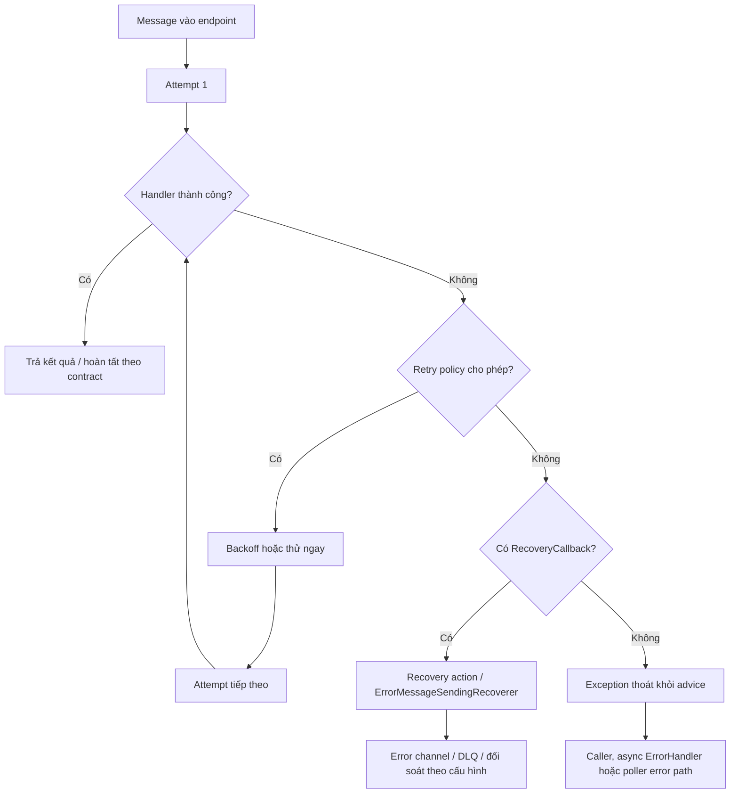
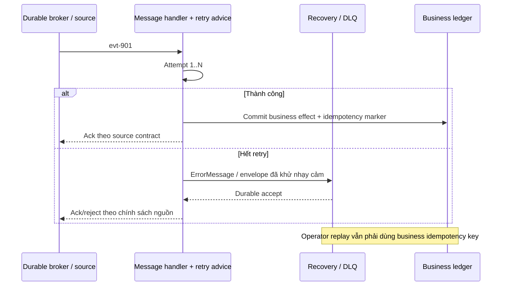
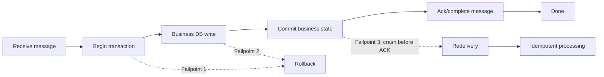

# Test retry, error channel và recovery trong Spring Integration

## 1. Vì sao phải kiểm thử cả đường lỗi của message flow?

Trong chương **Testing runtime** của module `SPRING_INTEGRATION_RUNTIME`, một flow không chỉ cần chạy đúng khi message hợp lệ đi qua channel, endpoint và consumer. Nó còn phải có hành vi **có thể dự đoán** khi handler ném exception, executor đang bận, poller rollback, broker phát lại message hoặc ứng dụng restart giữa lúc xử lý.

Giả sử một consumer nhận sự kiện `ReserveStock(eventId="evt-501", sku="SKU-7")`. Dịch vụ database gặp timeout hai lần và thành công ở lần thứ ba. Một sự kiện khác bị lỗi vĩnh viễn; sau khi retry hết giới hạn, message phải đi vào **recovery flow** để kiểm tra và xử lý thủ công. Trong một flow bất đồng bộ, exception có thể xuất hiện trên worker thread và cần được công bố thành `ErrorMessage`, thay vì ném trực tiếp về producer.

Một bài test chỉ kiểm tra `input.send(...) == true` không chứng minh được các yêu cầu đó:

- `send()` có thể trả về thành công vì channel đã nhận message, **không đồng nghĩa business transaction đã commit**.
- Retry có thể gọi handler nhiều lần nhưng chỉ **một lần tạo business effect**.
- Lỗi đồng bộ từ `DirectChannel` có thể truyền ngược cho caller, trong khi lỗi bất đồng bộ được phát qua cơ chế error publisher.
- Recovery callback có thể nhận lỗi đã hết retry nhưng **không tự bảo đảm message được lưu bền hoặc đưa vào DLQ**.
- Lỗi sau database commit nhưng trước broker ack có thể khiến message được phát lại sau restart.

### Mục tiêu học tập

Sau bài này, bạn có thể:

1. Vẽ đúng chuỗi xử lý **attempt → retry → recovery/error channel → ack/replay**.
2. Cấu hình một fixture kiểm thử bằng `RequestHandlerRetryAdvice`, `RetryTemplate`, `QueueChannel` và `ErrorMessageSendingRecoverer`.
3. Viết test JUnit 5 kiểm chứng **số lần gọi handler**, kết quả nghiệp vụ và message lỗi sau khi hết retry.
4. Phân biệt kiểm thử error channel **đồng bộ** và **bất đồng bộ**, gồm header `errorChannel` theo từng message.
5. Dùng latch, queue timeout và trạng thái có thể quan sát để viết test ổn định, tránh giả định về thứ tự thread.
6. Kiểm chứng rollback, retry/backoff, idempotency, message store, recovery sau restart và error path trong poller.
7. Xây dựng một test matrix và failure injection để xác nhận giới hạn thực tế của runtime.

## 2. Ba cơ chế dễ bị nhầm là một

| Cơ chế | Ai kích hoạt? | Kết quả thường thấy | Điều không được tự suy ra |
|---|---|---|---|
| **Retry trong handler** | `RequestHandlerRetryAdvice` hoặc policy tương tự bao lời gọi handler | Cùng logical request được thử lại khi exception phù hợp | Không phải broker redelivery; không tự rollback side effect ngoài DB |
| **Error channel** | Thành phần bắt và **publish** exception thành `ErrorMessage`, hoặc recovery callback gửi lỗi | Consumer lỗi nhận message có payload là `Throwable` | Không phải mọi exception đồng bộ đều tự đi qua global `errorChannel` |
| **Recovery sau hết retry** | `RecoveryCallback`, error flow/DLQ hoặc cơ chế recover của nguồn | Message bị phân loại, lưu, thông báo hoặc được operator can thiệp | Gửi tới error channel trong memory không bảo đảm tồn tại sau process crash |

Một message có thể trải qua cả ba, nhưng **thứ tự và điểm giao nhau** tùy topology.



**Quy tắc kiểm thử:** mỗi mũi tên cần một assertion hoặc tín hiệu quan sát nếu nó ảnh hưởng kết quả nghiệp vụ. Đừng chỉ assert “không có exception” khi mục tiêu là xác nhận recovery đã chạy.

## 3. Thiết kế hợp đồng trước khi viết test

Xác định rõ đầu vào, hành vi và **oracle** (dấu hiệu chứng minh test đúng):

| Tình huống | Đầu vào/failure injection | Oracle cần kiểm tra |
|---|---|---|
| Thành công ngay | Handler không ném lỗi | Một lần gọi, một business result, không có recovery error |
| Lỗi tạm thời rồi thành công | Hai attempt đầu ném exception, attempt thứ ba thành công | Ba attempts **tổng cộng**, một result, error channel rỗng |
| Hết retry | Mọi attempt đều ném exception | Số attempts bằng policy, một thông báo recovery lỗi, không có business result |
| Lỗi vĩnh viễn | Payload không hợp lệ/exception không retryable | Không thử lại theo classifier policy; đúng recovery destination |
| Lỗi bất đồng bộ | Handler ném trên executor thread | Caller không nhất thiết nhận exception; error channel nhận `ErrorMessage` trong hạn chờ |
| DB rollback | Exception xảy ra giữa hai câu SQL cùng transaction | Không còn bản ghi/side effect commit nửa chừng |
| Crash sau commit trước ack | Cùng event được redeliver | Idempotency ledger chặn business effect trùng |
| Retry source/poller | Message được đưa lại nguồn hoặc queue theo transaction/ack contract | Work không mất và không tạo duplicate effect |
| Recovery sink lỗi | DLQ/DB để lưu lỗi tạm không khả dụng | Hệ thống không báo “recovered” sai; có error/retry hoặc operator alert |

**Hai bất biến quan trọng:**

1. **Safety:** một logical event có tác dụng nghiệp vụ tối đa một lần nếu hợp đồng yêu cầu idempotency, kể cả khi handler chạy nhiều lần.
2. **Liveness:** message hợp lệ sau lỗi tạm thời có đường tiến tới completion hoặc trạng thái cuối có thể theo dõi; không kẹt vô hạn trong retry.

Test cần kiểm tra **cả safety lẫn liveness**; một flow luôn bỏ qua mọi message có thể không gây duplicate nhưng vẫn sai nghiêm trọng.

## 4. Test pyramid cho Spring Integration runtime

Chia kiểm thử theo phạm vi để vừa nhanh vừa đủ độ tin cậy:

| Cấp độ | Phạm vi | Ví dụ | Tài nguyên |
|---|---|---|---|
| **Unit test** | Retry policy, selector, phân loại exception, idempotency key | `RetryTemplate` với service stub ném lỗi theo số attempt | Không cần ApplicationContext |
| **Integration slice** | `MessageChannel`, endpoint, advice, error channel và handler | Test JUnit ở mục 6 với `DirectChannel` và `QueueChannel` | Spring context in-memory |
| **Component integration** | Poller, executor, transaction manager, JDBC message store | Gây lỗi rồi xác minh rollback/receive lại | DB hoặc hạ tầng test có kiểm soát |
| **End-to-end / crash test** | Broker ack, restart, recovery, DLQ và business effect | Kill consumer giữa DB commit và ack, chạy lại cùng event | Broker/DB thật hoặc test container |
| **Runtime/observability test** | Logs, metrics, attempt, error/correlation, thread | Kiểm tra số lần retry, error destination và oldest backlog age | Test app với instrumentation |

Spring Integration còn cung cấp module `spring-integration-test` với `@SpringIntegrationTest`, `MockIntegrationContext`, `MockMessageHandler` và các tiện ích như `TestUtils`. Chúng hữu ích khi cần thay endpoint hoặc kiểm tra message; nhưng **không bắt buộc** cho fixture đầu tiên nếu chỉ dùng Spring context và JUnit 5.

Một dependency set tham khảo cho dự án Spring Boot (để BOM của dự án chọn phiên bản tương thích):

```groovy
dependencies {
    implementation "org.springframework.boot:spring-boot-starter-integration"
    implementation "org.springframework.retry:spring-retry"

    testImplementation "org.springframework.boot:spring-boot-starter-test"
    testImplementation "org.springframework.integration:spring-integration-test"
}
```

Khi dùng Java DSL, JDBC, Kafka/AMQP hoặc client riêng, thêm artifact tương ứng. **Không kết hợp ngẫu nhiên Spring Integration 6.x/7.x và Spring Framework/Boot không tương thích**; dùng dependency management và tài liệu của đúng version đang chạy.

## 5. Fixture JUnit: cấu hình retry và recovery thật, không mock toàn bộ flow

Fixture sau dùng:

- `DirectChannel` tên `commands` để handler chạy đồng bộ; test có thể assert ngay sau `send()`.
- `RequestHandlerRetryAdvice` với `RetryTemplate` cho tối đa **3 attempts bao gồm lần đầu**.
- `NoBackOffPolicy` để test nhanh và xác định được số lần gọi, không phải chính sách production.
- `ErrorMessageSendingRecoverer` gửi lỗi sau khi hết retry tới `QueueChannel` tên `recoveryErrors`.
- Handler thử lỗi theo chỉ số attempt để test có thể điều khiển chính xác.

**File `RetryFlowFixture.java` (Java 17+):**

```java
package example.integration;

import java.util.concurrent.atomic.AtomicInteger;

import org.springframework.beans.factory.annotation.Qualifier;
import org.springframework.context.annotation.Bean;
import org.springframework.context.annotation.Configuration;
import org.springframework.integration.annotation.ServiceActivator;
import org.springframework.integration.channel.DirectChannel;
import org.springframework.integration.channel.QueueChannel;
import org.springframework.integration.config.EnableIntegration;
import org.springframework.integration.handler.advice.ErrorMessageSendingRecoverer;
import org.springframework.integration.handler.advice.RequestHandlerRetryAdvice;
import org.springframework.messaging.MessageChannel;
import org.springframework.retry.backoff.NoBackOffPolicy;
import org.springframework.retry.policy.SimpleRetryPolicy;
import org.springframework.retry.support.RetryTemplate;

@Configuration
@EnableIntegration
public class RetryFlowFixture {

    public record WorkCommand(String eventId) {}

    @Bean("commands")
    public MessageChannel commands() {
        return new DirectChannel();
    }

    @Bean("recoveryErrors")
    public QueueChannel recoveryErrors() {
        return new QueueChannel();
    }

    @Bean("retryAdvice")
    public RequestHandlerRetryAdvice retryAdvice(
            @Qualifier("recoveryErrors") MessageChannel recoveryErrors) {

        RetryTemplate template = new RetryTemplate();
        template.setRetryPolicy(new SimpleRetryPolicy(3));
        template.setBackOffPolicy(new NoBackOffPolicy());

        RequestHandlerRetryAdvice advice = new RequestHandlerRetryAdvice();
        advice.setRetryTemplate(template);
        advice.setRecoveryCallback(
                new ErrorMessageSendingRecoverer(recoveryErrors));
        return advice;
    }

    @Bean
    public ProbeHandler probeHandler() {
        return new ProbeHandler();
    }

    public static class ProbeHandler {

        private final AtomicInteger attempts = new AtomicInteger();
        private final AtomicInteger successfulCalls = new AtomicInteger();
        private volatile int failFirstAttempts;

        public void failFirst(int count) {
            failFirstAttempts = count;
        }

        public int attempts() {
            return attempts.get();
        }

        public int successfulCalls() {
            return successfulCalls.get();
        }

        @ServiceActivator(
                inputChannel = "commands",
                adviceChain = "retryAdvice")
        public void handle(WorkCommand command) {
            int current = attempts.incrementAndGet();

            if (current <= failFirstAttempts) {
                throw new IllegalStateException(
                        "Temporary failure for " + command.eventId());
            }

            successfulCalls.incrementAndGet();
        }
    }
}
```

### Vì sao fixture này đủ nhỏ nhưng vẫn có giá trị?

`@ServiceActivator` tạo message handler endpoint thực qua annotation processing. Advice được gắn vào handler bằng tên bean `retryAdvice`; test **không gọi method `ProbeHandler.handle(...)` trực tiếp** vì làm thế sẽ bỏ qua channel/endpoint/advice chain. `@EnableIntegration` phải được áp dụng khi tạo context.

`ErrorMessageSendingRecoverer` chỉ chạy sau khi retry đã exhausted. Nó **publish lỗi**, không tự sửa lỗi hoặc tự lưu vào dead-letter queue bền vững. `QueueChannel` ở fixture là **in-memory**, phù hợp để test synchronous result nhưng không bảo vệ dữ liệu sau restart.

### Phân biệt maxAttempts và số lần retry

Với `new SimpleRetryPolicy(3)`:

```text
Attempt 1: lỗi
Attempt 2: lỗi      <- retry 1
Attempt 3: lỗi      <- retry 2
RecoveryCallback    <- khi hết 3 attempts
```

Vậy `maxAttempts=3` nghĩa là **tổng 3 lần gọi**, không phải “lần đầu cộng thêm 3 lần retry”.

## 6. JUnit 5: thành công sau retry và hết retry vào recoveryErrors

**File `RetryFlowFixtureTest.java` (cùng package):**

```java
package example.integration;

import org.junit.jupiter.api.AfterEach;
import org.junit.jupiter.api.BeforeEach;
import org.junit.jupiter.api.Test;
import org.springframework.context.annotation.AnnotationConfigApplicationContext;
import org.springframework.integration.channel.QueueChannel;
import org.springframework.messaging.Message;
import org.springframework.messaging.MessageChannel;
import org.springframework.messaging.support.ErrorMessage;
import org.springframework.messaging.support.MessageBuilder;

import static org.junit.jupiter.api.Assertions.*;

class RetryFlowFixtureTest {

    private AnnotationConfigApplicationContext context;
    private MessageChannel input;
    private QueueChannel recoveryErrors;
    private RetryFlowFixture.ProbeHandler probe;

    @BeforeEach
    void setUp() {
        context = new AnnotationConfigApplicationContext(
                RetryFlowFixture.class);
        input = context.getBean("commands", MessageChannel.class);
        recoveryErrors = context.getBean("recoveryErrors",
                QueueChannel.class);
        probe = context.getBean(RetryFlowFixture.ProbeHandler.class);
    }

    @AfterEach
    void tearDown() {
        context.close();
    }

    private boolean sendEvent(String eventId) {
        return input.send(MessageBuilder.withPayload(
                new RetryFlowFixture.WorkCommand(eventId)).build());
    }

    @Test
    void retriesTwiceThenSucceedsWithoutRecoveryMessage() {
        probe.failFirst(2);

        assertTrue(sendEvent("evt-501"));

        assertEquals(3, probe.attempts());
        assertEquals(1, probe.successfulCalls());
        assertNull(recoveryErrors.receive(0));
    }

    @Test
    void exhaustedRetryPublishesExactlyOneErrorMessage() {
        probe.failFirst(Integer.MAX_VALUE);

        assertTrue(sendEvent("evt-502"));

        assertEquals(3, probe.attempts());
        assertEquals(0, probe.successfulCalls());

        Message<?> error = recoveryErrors.receive(1_000);
        assertNotNull(error);
        assertInstanceOf(ErrorMessage.class, error);
        assertInstanceOf(Throwable.class, error.getPayload());

        // Không có một ErrorMessage cho từng attempt.
        assertNull(recoveryErrors.receive(0));
    }

    @Test
    void successfulFirstAttemptDoesNotEnterRecovery() {
        probe.failFirst(0);

        assertTrue(sendEvent("evt-503"));

        assertEquals(1, probe.attempts());
        assertEquals(1, probe.successfulCalls());
        assertNull(recoveryErrors.receive(0));
    }
}
```

### Đọc kết quả test đúng cách

1. **Retry success:** `attempts=3`, `successfulCalls=1` và `recoveryErrors` rỗng. Điều này chứng minh advice đã gọi lại handler, rồi dừng retry khi thành công.
2. **Exhausted:** handler bị gọi ba lần và `ErrorMessage` được gửi một lần vào recovery channel qua `ErrorMessageSendingRecoverer`.
3. **Success first attempt:** advice không tự thực hiện ba lần gọi nếu handler đã thành công.
4. **Test isolation:** mỗi test tạo context mới, store và bộ đếm mới. Không dùng một bean singleton bị chia sẻ giữa các test và vô tình khiến attempt count bị cộng dồn.
5. **Timeout:** `receive(1_000)` chỉ chờ tối đa một giây; `receive(0)` là phép kiểm tra **không chờ** trong ngữ cảnh `PollableChannel`. Không dùng `Thread.sleep` để đoán thời điểm error xuất hiện.

**Điều test chưa chứng minh:** fixture không có database, broker, retry backoff thực, transaction hay idempotency. `successfulCalls` chỉ là bộ đếm của handler demo, không phải bằng chứng database commit. Cần kiểm thử từng resource ở các mục sau.

### Khi test không đạt kỳ vọng

Nếu handler chỉ chạy một lần:

- Kiểm tra `adviceChain = "retryAdvice"` có được gắn cho đúng `@ServiceActivator` không.
- Đảm bảo gửi qua `commands` thay vì gọi `ProbeHandler.handle(...)` trực tiếp.
- Kiểm tra exception có bị handler bắt rồi nuốt hay không; advice chỉ thấy exception **thoát ra** khỏi lời gọi được wrap.
- Phân biệt exception được classify retryable với exception bị policy loại trừ.

Nếu handler lỗi nhưng `recoveryErrors` rỗng:

- Kiểm tra `setRecoveryCallback(...)` và đúng `MessageChannel` target.
- Phân biệt error channel của recovery callback với **global `errorChannel`** hoặc per-message header.
- Kiểm tra consumer khác có vô tình lấy mất message từ `QueueChannel` không.
- Kiểm tra recovery publisher có ném exception hoặc flow bị stop trước khi publish không.

## 7. Kiểm thử error channel: đồng bộ và bất đồng bộ khác nhau

Một case rất dễ viết test sai:

```text
DirectChannel.send(...) -> ServiceActivator ném RuntimeException
```

Với handler đồng bộ **không có recovery advice**, exception có thể truyền ngược theo call stack cho `send()`. **Không phải** framework luôn tự đóng gói exception vào `ErrorMessage` rồi gửi global `errorChannel`.

Ngược lại:

```text
ExecutorChannel.send(...) -> worker thread -> handler ném exception
                                        -> ErrorHandler/error publisher
                                        -> ErrorMessage trên errorChannel
```

Lỗi ở worker không thể được ném ngược về call stack producer đã trả quyền điều khiển theo cách đồng bộ thông thường. Spring Integration sử dụng error handling phù hợp ở ranh giới bất đồng bộ. Nếu message mang header `MessageHeaders.ERROR_CHANNEL`, thành phần publish error có thể ưu tiên gửi tới channel này; nếu không, có thể dùng global `errorChannel`. Chính sách thực tế phụ thuộc adapter/dispatcher/error handler được cấu hình.

### Bảng oracle

| Flow | Assertion chính | Không nên assert |
|---|---|---|
| `DirectChannel` + handler luôn throw, không recovery | `assertThrows(...)` khi gọi `send`; kiểm tra handler bị gọi | Global error channel chắc chắn nhận lỗi |
| `DirectChannel` + retry + recoverer mục 5 | `send` không ném khi recovery thành công; recovery channel có một error | Một `ErrorMessage` cho mỗi attempt |
| `ExecutorChannel` + handler throw | `send` có thể trả về trước; nhận `ErrorMessage` với timeout hữu hạn | `assertThrows(...)` trên thread producer là đủ |
| Polling endpoint + handler throw | Error handling/transaction của poller theo advice và source | Message chắc chắn trở lại queue nếu queue là in-memory |
| Source adapter/broker | Ack/nack/requeue/DLQ theo contract adapter | Error channel nhận lỗi nghĩa là broker đã redeliver |

## 8. Ví dụ async: test header errorChannel theo từng message

Để không lẫn recovery của `RequestHandlerRetryAdvice` với lỗi của dispatcher bất đồng bộ, tạo **fixture khác** không có retry advice.

**File `AsyncErrorFixture.java`:**

```java
package example.integration;

import org.springframework.beans.factory.annotation.Qualifier;
import org.springframework.context.annotation.Bean;
import org.springframework.context.annotation.Configuration;
import org.springframework.integration.annotation.ServiceActivator;
import org.springframework.integration.channel.ExecutorChannel;
import org.springframework.integration.channel.QueueChannel;
import org.springframework.integration.config.EnableIntegration;
import org.springframework.messaging.MessageChannel;
import org.springframework.scheduling.concurrent.ThreadPoolTaskExecutor;

@Configuration
@EnableIntegration
public class AsyncErrorFixture {

    @Bean("workerExecutor")
    public ThreadPoolTaskExecutor workerExecutor() {
        ThreadPoolTaskExecutor executor = new ThreadPoolTaskExecutor();
        executor.setThreadNamePrefix("async-test-");
        executor.setCorePoolSize(1);
        executor.setMaxPoolSize(1);
        executor.setQueueCapacity(10);
        return executor;
    }

    @Bean("asyncCommands")
    public MessageChannel asyncCommands(
            @Qualifier("workerExecutor")
            ThreadPoolTaskExecutor workerExecutor) {
        return new ExecutorChannel(workerExecutor);
    }

    @Bean("asyncErrors")
    public QueueChannel asyncErrors() {
        return new QueueChannel();
    }

    @Bean
    public AsyncFailureHandler asyncFailureHandler() {
        return new AsyncFailureHandler();
    }

    public static class AsyncFailureHandler {

        @ServiceActivator(inputChannel = "asyncCommands")
        public void handle(String payload) {
            throw new IllegalStateException("Async failure: " + payload);
        }
    }
}
```

**Test JUnit 5:**

```java
import org.junit.jupiter.api.Test;
import org.springframework.context.annotation.AnnotationConfigApplicationContext;
import org.springframework.integration.channel.QueueChannel;
import org.springframework.messaging.Message;
import org.springframework.messaging.MessageChannel;
import org.springframework.messaging.MessageHeaders;
import org.springframework.messaging.support.ErrorMessage;
import org.springframework.messaging.support.MessageBuilder;

import static org.junit.jupiter.api.Assertions.*;

class AsyncErrorFixtureTest {

    @Test
    void routesAsyncFailureToPerMessageErrorChannel() {
        try (var context = new AnnotationConfigApplicationContext(
                AsyncErrorFixture.class)) {

            MessageChannel input = context.getBean(
                    "asyncCommands", MessageChannel.class);
            QueueChannel errors = context.getBean(
                    "asyncErrors", QueueChannel.class);

            Message<String> request = MessageBuilder
                    .withPayload("event-900")
                    .setHeader(MessageHeaders.ERROR_CHANNEL, errors)
                    .build();

            assertTrue(input.send(request));

            Message<?> failure = errors.receive(3_000);
            assertNotNull(failure);
            assertInstanceOf(ErrorMessage.class, failure);
            assertInstanceOf(Throwable.class, failure.getPayload());
        }
    }
}
```

Fixture tạo `ExecutorChannel` với worker executor riêng. Test dùng một **`QueueChannel` object** trong header `errorChannel` nên không phụ thuộc resolution một string channel name. Nó đợi nhận lỗi bằng `receive(3_000)` thay vì `sleep`.

**Giới hạn của oracle:** test xác nhận một lỗi được publish về channel cụ thể qua error handler của asynchronous dispatcher trong cấu hình đang dùng. Nếu một dự án thay dispatcher/error handler hoặc đưa adapter khác vào giữa, cùng message có thể đi theo error route khác; hãy test lại **chính topology production**. Đừng tự suy ra `send()==true` chứng minh handler đã thành công.

### Đọc failed message một cách phòng thủ

`ErrorMessage` có payload là một `Throwable`, thường liên quan `MessagingException`. Tùy nguồn lỗi, không phải mọi exception đều mang đủ message gốc:

```java
import org.springframework.messaging.MessagingException;
import org.springframework.messaging.support.ErrorMessage;

void inspectError(ErrorMessage error) {
    Throwable cause = error.getPayload();

    if (cause instanceof MessagingException messagingError) {
        var failed = messagingError.getFailedMessage();
        if (failed != null) {
            System.out.println("Failed message id="
                    + failed.getHeaders().getId());
        }
    }

    var original = error.getOriginalMessage();
    if (original != null) {
        System.out.println("Original message id="
                + original.getHeaders().getId());
    }
}
```

**Không log toàn bộ `failedMessage` hoặc payload thật** trong production: có thể chứa token, PII, dữ liệu thanh toán hoặc object không được serialize. Với test, dùng event ID giả lập/headers an toàn và kiểm tra message identity khi component bảo toàn được nó.

## 9. Test classification: lỗi nào đáng retry?

Một hệ thống đúng không nên retry mọi exception giống nhau:

- **Transient:** database deadlock, timeout mạng ngắn, HTTP 503 có giới hạn; có thể thử lại theo backoff.
- **Permanent/business:** payload sai schema, thiếu key bắt buộc, trạng thái nghiệp vụ không hợp lệ; retry thường không giúp.
- **Ambiguous outcome:** timeout sau khi gửi thanh toán; provider có thể đã xử lý. Chỉ retry khi có **idempotency key** hoặc cơ chế hỏi trạng thái.
- **Concurrency/lock busy:** retry có thể hợp lý nhưng phải giới hạn tổng thời gian và tránh nhiều consumer đánh vào cùng hot key.

Test nên xác minh **classification thực**, không chỉ số lần mặc định:

| Loại lỗi | Policy mong đợi | Assertions |
|---|---|---|
| `TransientDataAccessException` | Retry tối đa N attempts | Count = N khi luôn fail; Count nhỏ hơn N nếu thành công sớm |
| `IllegalArgumentException` | Không retry | Count = 1, error/recovery theo contract |
| HTTP 503 | Backoff + retry hữu hạn | Không có tight loop; các attempt giữ cùng idempotency key |
| Timeout mơ hồ sau side effect | Retry có điều kiện | Business effect cuối chỉ xảy ra một lần |
| `InterruptedException` / cancellation | Tôn trọng cancel/interrupt | Không cố chạy thêm vô hạn hoặc nuốt interrupt |

Một cấu hình `SimpleRetryPolicy` phân loại theo exception có thể dùng khi chạy kiểm thử riêng:

```java
import java.util.Map;
import org.springframework.dao.TransientDataAccessException;
import org.springframework.retry.policy.SimpleRetryPolicy;

var retryable = Map.<Class<? extends Throwable>, Boolean>of(
        TransientDataAccessException.class, true,
        IllegalArgumentException.class, false
);

SimpleRetryPolicy policy =
        new SimpleRetryPolicy(3, retryable, true);
```

Tham số `traverseCauses=true` hữu ích khi exception có thể được framework wrap; cần kiểm thử bằng exception chain **thực tế** (ví dụ `MessagingException` chứa cause). Với cấu hình này, các exception không được liệt kê không mặc định được retry, trừ khi classifier được cấu hình khác.

### Backoff không nên khiến unit test chậm hoặc flaky

Fixture mục 5 dùng `NoBackOffPolicy` để kiểm tra **hợp đồng số lần thử**. Một test riêng ở cấp component có thể dùng `FixedBackOffPolicy` hoặc `ExponentialBackOffPolicy`, nhưng đo thời gian chính xác đến từng mili-giây sẽ không ổn định do scheduling/CI load.

```java
import org.springframework.retry.backoff.FixedBackOffPolicy;

FixedBackOffPolicy backOff = new FixedBackOffPolicy();
backOff.setBackOffPeriod(100L); // ms, chỉ cho integration test
```

Thay vì assert `elapsed == 200 ms`, kiểm tra retry không diễn ra thành tight loop, khoảng chờ nằm trong **biên hợp lý** và tổng thời gian không vượt deadline test. Với kiến trúc cho phép inject scheduler/clock, ưu tiên **virtual time/fake clock** hoặc test chính sách tính delay riêng.

## 10. Recovery đúng nghĩa: error message không tự là DLQ bền vững

`ErrorMessageSendingRecoverer` publish lỗi đến `recoveryErrors` trong fixture. Nếu process chết ngay sau đó, `QueueChannel` in-memory **không giữ được** state qua restart.

Một recovery flow production cần định nghĩa rõ:

1. **Message nào cần đưa vào recovery?** Lỗi hết retry, dữ liệu vĩnh viễn sai hoặc trạng thái external chưa thể xác định.
2. **Lưu ở đâu?** Durable broker DLQ, database recovery table, persistent message store hoặc hệ thống ticket phù hợp.
3. **Ai có thể xem và phát lại?** Operator có quyền, quy trình phê duyệt, ID duy nhất, audit hành động.
4. **Khi replay, idempotency ở đâu?** Cùng business event ID và ledger đủ retention để không nhân side effect.
5. **Khi recovery sink lỗi, điều gì xảy ra?** Không đánh dấu đã xử lý thành công nếu thực tế chưa lưu lỗi. Cần một đường escalation/durability rõ.
6. **Quy tắc cleanup:** giữ failed message, error metadata và tombstone ít nhất đến hết cửa sổ replay/audit theo policy.



Sơ đồ là **quy trình mục tiêu**: `ErrorMessageSendingRecoverer` tự nó không xử lý ack broker và không đảm bảo durable accept nếu kênh target chỉ là memory. Cần adapter và integration test thực tế để chứng minh thứ tự commit/ack tương ứng.

### Recovery callback trả kết quả gì?

Trong một request–reply flow, callback có thể trả kết quả thay thế hoặc exception, tùy hợp đồng. Nếu recovery trả `null` hoặc endpoint handler dùng `void`, gateway đợi reply có thể timeout hoặc phát `ReplyRequiredException` khi yêu cầu reply bắt buộc.

Vì vậy khi test gateway, ngoài error channel còn phải assert **reply semantics**: lỗi cuối được trả về gateway như exception, mã trạng thái rõ ràng hay một object `RecoveryResult`. Tránh tình trạng “test error channel PASS” nhưng caller vẫn timeout không có ý nghĩa.

## 11. Retry và transaction: rollback phải được thử bằng dữ liệu thật

Trong imperative Spring transaction, `@Transactional` thường gắn transaction với thread được gọi qua proxy. Nếu flow có `ExecutorChannel`, transaction ở producer **không tự đi qua** executor. Retry advice và transaction advice còn có thứ tự bao quanh khác nhau:

```text
RetryAdvice(
    TransactionAdvice(
        businessAttempt()
    )
)
=> Thường mỗi attempt có thể mở transaction riêng.

TransactionAdvice(
    RetryAdvice(
        businessAttempt()
    )
)
=> Nhiều attempts có thể nằm trong một transaction;
   lỗi trước có thể đánh dấu rollback-only.
```

Test phải kiểm chứng transaction boundary theo **topology thực**; không có một thứ tự advice đúng cho mọi cấu hình hoặc resource.

### Ví dụ rollback trong một database

Giả sử handler nhận `eventId` và cập nhật tồn kho kèm marker trong cùng JDBC transaction:

```sql
CREATE TABLE stock (
    sku VARCHAR(60) PRIMARY KEY,
    available INTEGER NOT NULL
);

CREATE TABLE processed_event (
    event_id VARCHAR(120) PRIMARY KEY,
    processed_at TIMESTAMP NOT NULL DEFAULT CURRENT_TIMESTAMP
);

INSERT INTO stock(sku, available) VALUES ('SKU-7', 10);
```

Service bên dưới giả định có `JdbcTemplate jdbc` và transaction manager đúng datasource:

```java
import org.springframework.transaction.annotation.Transactional;

@Transactional(transactionManager = "transactionManager")
public void reserve(String eventId, String sku, int amount) {
    int inserted = jdbc.update(
            "INSERT INTO processed_event(event_id) VALUES (?) " +
            "ON CONFLICT DO NOTHING",
            eventId);

    if (inserted == 0) {
        return; // Duplicate, không trừ tồn kho lại.
    }

    int updated = jdbc.update(
            "UPDATE stock SET available = available - ? " +
            "WHERE sku = ? AND available >= ?",
            amount, sku, amount);

    if (updated != 1) {
        throw new IllegalStateException("Insufficient stock");
    }
}
```

Ví dụ dùng PostgreSQL `ON CONFLICT DO NOTHING`, cần chuyển SQL theo DBMS nếu khác. Để test rollback, inject failure sau khi chèn marker nhưng trước khi method commit. Assertions:

- Sau failure và rollback, **không có `processed_event(eventId)`**.
- Stock vẫn ở 10.
- Retry thành công sau đó sẽ chèn marker và trừ đúng một lần.
- Replay sau commit không được trừ thêm.
- Nếu hai worker nhận cùng event, unique constraint/transaction bảo vệ race; `SELECT` rồi `INSERT` không nguyên tử là phản mẫu.

**Lưu ý:** `RequestHandlerRetryAdvice` có thể retry lời gọi trên transaction đã bị đánh dấu rollback-only nếu thứ tự advice không phù hợp. Test phải quan sát **commit thật**, không chỉ handler không ném exception. Khi có retry + transaction + poller, kiểm tra cả rollback của việc lấy message từ nguồn.

## 12. Poller và message store: test requeue chứ không chỉ test exception

Một polling consumer có nguồn `PollableChannel`. Khi handler lỗi, outcome của message còn phụ thuộc vào **store/transaction source**:

| Nguồn | Khi handler throw | Test bắt buộc |
|---|---|---|
| `QueueChannel` in-memory | JDBC transaction rollback **không tự hoàn tác dequeue trong RAM** | Kiểm tra message còn hay mất; quyết định replay ngoài |
| `QueueChannel` có `JdbcChannelMessageStore` | Receive có thể tham gia transaction JDBC nếu poller được cấu hình đúng | Crash/failure: row còn hoặc được khôi phục để poll tiếp |
| JMS/AMQP/Kafka adapter | Ack/requeue/offset/visibility theo adapter và broker | Redelivery count, DLQ, transaction/ack thực, không suy diễn từ error channel |
| File poller/filter có metadata | Marker file có thể cập nhật trước business handler | Retry sau lỗi có được poll lại? Marker cần rollback/remove không? |
| Aggregator/message group store | Group có thể đã lưu một phần, chưa release | Restart: group còn, timeout/expiry và duplicate semantics |

### Checklist polling integration test

1. Dùng một source **có thể kiểm tra pending/inflight** (JDBC message store/broker test).
2. Đưa đúng một event có business ID ổn định vào nguồn.
3. Làm handler ném exception ở một điểm đã chọn.
4. Xác nhận trạng thái **transaction** và source ack/requeue sau lỗi.
5. Cho handler thành công ở lần tiếp theo hoặc cho phép recovery tới DLQ.
6. Xác nhận business effect một lần, message không bị kẹt vô hạn.
7. Restart ApplicationContext/worker giữa các mốc; kiểm tra pending work còn.
8. Kiểm tra error handling không nuốt exception quá sớm khiến poller commit nhầm.

Nếu poller có advice chain gồm transaction và retry, thứ tự phải được test qua dữ liệu thật. `errorChannel` là đường **báo lỗi**, không tự là cơ chế roll back queue.

## 13. Kiểm thử concurrency, async timing và tránh flaky test

### 13.1. Không dùng sleep để “đợi chắc là đã xong”

Trong async flow, lời gọi `send()` có thể trả về trước handler. `Thread.sleep(500)` không xác định được hành vi dưới tải CI và làm test chậm khi mọi thứ đã hoàn tất sớm.

Dùng một trong các phương án:

- `QueueChannel.receive(timeout)` để đợi `ErrorMessage`/reply trong giới hạn hữu hạn.
- `CountDownLatch.await(timeout, unit)` khi cần xác nhận một hoặc vài callback.
- `Awaitility` hoặc polling assertion có timeout để kiểm tra cuối cùng DB/metric đã đạt trạng thái.
- `CompletableFuture`, `StepVerifier` với reactive flow nếu contract trả Publisher.
- `Testcontainers`/broker test resource với readiness và cleanup rõ ràng.

### 13.2. Ví dụ latch xác nhận worker đã chạy

```java
import java.util.concurrent.CountDownLatch;
import java.util.concurrent.TimeUnit;
import java.util.concurrent.atomic.AtomicInteger;

CountDownLatch handled = new CountDownLatch(1);
AtomicInteger attempts = new AtomicInteger();

Runnable work = () -> {
    try {
        attempts.incrementAndGet();
    } finally {
        handled.countDown();
    }
};

Thread worker = new Thread(work, "test-worker");
worker.start();

boolean finished = handled.await(2, TimeUnit.SECONDS);
assertTrue(finished);
assertEquals(1, attempts.get());

worker.join(2_000);
```

Snippet này chỉ dạy **primitive đồng bộ hóa test**. Khi kiểm thử Spring Integration, latch nên được đặt trong handler/spy thực nhận message qua channel, không chạy `Runnable` rời rạc rồi coi đó là bằng chứng endpoint đã xử lý đúng.

### 13.3. Kiểm tra duplicate do concurrent retry/redelivery

Cho hai message **cùng business event ID** được xử lý bởi hai consumer. Kết quả đúng không phải “method được gọi một lần”, mà là **business effect chỉ commit một lần** nếu nghiệp vụ có idempotency. Dùng unique constraint/inbox và giao dịch cùng database.

Không chỉ dựa vào `AtomicInteger` trong memory để tuyên bố an toàn đa JVM. Test cấp cluster cần hai context/instance dùng **cùng database** và đo final state.

### 13.4. Dọn tài nguyên sau mỗi test

Mỗi test nên:

- Đóng `ApplicationContext`, executor, message source và các kết nối.
- Không để scheduler/poller chạy từ test trước sang test sau.
- Làm sạch database/queue theo ID test hoặc dùng transaction cleanup phù hợp; đừng vô tình xóa dữ liệu của test chạy song song.
- Đặt tên event riêng từng test; tránh tái sử dụng key khiến persistent idempotency marker làm test tiếp theo bị skip.
- Có timeout hữu hạn và failure message mô tả số attempt, thread, channel và error queue.
- Khi dùng `@SpringBootTest` và `@SpringIntegrationTest`, quản lý application context cache/`@DirtiesContext` đúng lúc, không reset global state tùy tiện.

## 14. Failure injection: lỗi phải xảy ra đúng vị trí

Một bài test khó nhất thường không phải cấu hình retry mà là **chọn đúng điểm ngắt**:



| Failpoint | Cách mô phỏng | Invariant cần kiểm chứng |
|---|---|---|
| Trước khi vào handler | Adapter không kết nối, input send bị reject | Không có business effect và có đường retry nguồn |
| Attempt 1 hoặc 2 | Handler stub ném exception theo attempt | Advice retry đúng budget và dừng khi thành công |
| Ngay sau DB insert marker | Ném unchecked exception trước commit | Marker và business update cùng rollback |
| Sau DB commit trước ack | Kill process/tắt adapter theo điểm đồng bộ | Redelivery không nhân side effect |
| Error channel target đầy | Queue capacity nhỏ hoặc executor reject | Recovery failure được xử lý, không báo thành công giả |
| DLQ/broker unavailable | Chặn kết nối hoặc giả lập publish failure | Không mất message lỗi âm thầm |
| Worker thread bị interrupt | Interrupt tại phép chờ kiểm soát | Thread được dừng đúng policy, không retry vô hạn |
| Restart sau claim/lock | Kill worker trong vùng đang sở hữu state | Lock/lease hết hạn và replay recovery phù hợp |
| Two-instance race | Cùng event gửi hai instance | Một business effect, không có double credit |

**Không sử dụng exception ngẫu nhiên** cho test bảo đảm correctness. Failure injection nên dựa trên attempt index, barrier/latch hoặc mốc transaction rõ ràng để có thể tái hiện lỗi khi test thất bại.

## 15. Chẩn đoán runtime qua logs, metrics và error envelope

Khi một test retry/error/recovery thất bại, điều cần xác minh là **đường đi thực** của message:

```text
received_at
  -> attempt_no / handler_thread
  -> exception_type + retry decision
  -> transaction_commit_or_rollback
  -> error_published_at + destination
  -> recovery_persisted_at
  -> source_ack_or_redelivery
```

Các mốc này không tự được Spring Integration lưu đủ dưới dạng field có sẵn. Test fixture cần instrument những thứ cần xác minh. Ưu tiên structured logs/metrics chứa **business event ID giả lập**, không in raw payload hoặc `ErrorMessage.toString()` nếu có dữ liệu nhạy cảm.

| Metric/quan sát | Câu hỏi kiểm chứng |
|---|---|
| `handler_attempts_total` theo outcome | Một event đã được thử mấy lần? |
| `handler_success_total` | Có bao nhiêu lần business operation thành công? |
| `retry_exhausted_total` | Bao nhiêu event đi vào recovery? |
| `error_channel_published_total` | Có lỗi được publish không, vào kênh nào? |
| `recovery_durable_accept_total` | DLQ/store đã commit bản ghi lỗi chưa? |
| `source_redelivery_total` | Broker/file/poller đã phát lại bao nhiêu lần? |
| `business_duplicate_suppressed_total` | Idempotency bảo vệ được các replay không? |
| `oldest_pending_message_age` | Có event kẹt không tiến triển? |
| `executor_rejected_total` / queue depth | Lỗi có phải do saturation không? |
| `transaction_rollback_total` | Business data có rollback đúng đường lỗi không? |

Tên metric trên là **đề xuất đo của ứng dụng**, không phải mặc định Spring Integration xuất ra các meter có tên y hệt. Có thể kết hợp với Micrometer `spring.integration.*`, Observation/tracing, channel interceptors và message history tùy version.

### Khi errorMessage không có đủ thông tin

Đừng assert rằng mọi `ErrorMessage` có cùng exact exception class hay một `failedMessage` khác null. Với adapter/handler/proxy khác nhau, exception có thể bị wrap hoặc message đã bị biến đổi. Test nên:

1. Assert `ErrorMessage` và payload `Throwable`.
2. Nếu nghiệp vụ yêu cầu biết event ID, chủ động bảo toàn ID qua headers/envelope.
3. Kiểm tra `MessagingException.getFailedMessage()` **nếu có**.
4. Kiểm tra `ErrorMessage.getOriginalMessage()` **nếu có**.
5. Phân loại root cause/loại lỗi theo policy, không so nguyên chuỗi `Exception.toString()` dễ đổi giữa các version.

## 16. Các phản mẫu phổ biến trong test runtime

| Phản mẫu | Vì sao nguy hiểm | Cách sửa |
|---|---|---|
| Chỉ gọi trực tiếp handler method | Bỏ qua advice chain, channel và error publisher | Gửi message qua channel/endpoint thật |
| Assert `send() == true` là nghiệp vụ đã commit | Với async/poller, send chỉ xác nhận một bước giao nhận | Đợi outcome business/recovery |
| Dùng `Thread.sleep(1000)` để đợi | Flaky và chậm; không có deadline outcome rõ | Queue receive/latch/Awaitility với timeout |
| Test chỉ kiểm tra số attempt | Không chứng minh rollback và idempotency | Assert database/side effect cuối |
| Mọi lỗi đều retry | Lỗi vĩnh viễn có thể gây poison loop | Test classifier và DLQ riêng |
| Recovery channel là memory nhưng gọi là durable DLQ | Restart làm mất message lỗi | Test persistent store/broker ack |
| Bắt exception rồi trả bình thường trong transaction | Advice/poller có thể commit sai | Propagate hoặc rollback-only có chủ đích |
| Một test chung context cho nhiều case | State/queue/counter chảy qua test | Tạo context mới hoặc reset đúng toàn bộ fixture |
| Kỳ vọng mọi lỗi vào global `errorChannel` | Sync exception có thể throw thẳng; per-message header có ưu tiên | Test từng ranh giới sync/async |
| Retry vô hạn trong unit test | Test treo và gây tải hạ tầng | Bounded attempts, timeouts và backoff |
| Nhìn log “recovered” là đủ | Sink có thể chưa commit | Kiểm tra durable receipt và trạng thái nguồn |
| In toàn bộ ErrorMessage/payload | Rò rỉ dữ liệu, log tăng đột biến | Redact + allowlist event ID/correlation |

## 17. Bộ test case tối thiểu để duyệt một flow production

Một checklist đủ thực dụng cho nhóm phát triển:

- [ ] Message hợp lệ thành công ở attempt đầu tiên, không có recovery event.
- [ ] Lỗi transient hai lần rồi thành công đúng lần thứ ba; không có business effect trùng.
- [ ] Lỗi liên tục đến hết retry budget; đúng một final recovery event.
- [ ] Lỗi permanent không retry hoặc được phân loại chính xác theo policy.
- [ ] `DirectChannel` throw đồng bộ được assert tại caller khi không có recovery advice.
- [ ] `ExecutorChannel` lỗi bất đồng bộ tới đúng `errorChannel` header hoặc global channel tùy cấu hình.
- [ ] Error handler và recovery callback không vô tình nuốt exception khiến transaction commit sai.
- [ ] DB rollback giữa các lệnh không lưu marker/idempotency state nửa chừng.
- [ ] Broker/JDBC poller redelivery sau crash không gây duplicate business effect.
- [ ] Recovery sink unavailable không làm message lỗi biến mất âm thầm.
- [ ] Gateway request–reply có kết quả hoặc exception có ý nghĩa sau recovery.
- [ ] Retry/backoff có giới hạn, không tight loop, có timeout và cancellation.
- [ ] Test có lifecycle cleanup cho context/executor/scheduler/database/broker.
- [ ] Logs/metrics đủ nối các attempt theo business event ID nhưng không chứa dữ liệu nhạy cảm.

### Bài tập mở rộng

1. Sửa fixture mục 5 để chỉ retry exception `TransientDataAccessException`, không retry `IllegalArgumentException`. Viết hai test đếm attempts.
2. Thay `NoBackOffPolicy` bằng `FixedBackOffPolicy` và kiểm tra biên thời gian hợp lý; không assert chính xác từng mili-giây.
3. Thay `recoveryErrors` in-memory bằng một consumer ghi vào database recovery table. Giả lập lỗi commit ở recovery sink và chứng minh error không được coi là durable.
4. Chuyển input sang `ExecutorChannel`, thêm per-message `errorChannel` và xác minh exception ở worker không được assert sai tại `send()`.
5. Thêm một JDBC service dùng `@Transactional`, inject lỗi sau insert marker; assert rollback và retry commit đúng một lần.
6. Dựng flow dùng `JdbcChannelMessageStore` và transactional poller; khởi động lại context khi handler lỗi để kiểm tra pending message có thể xử lý lại.
7. Với broker test, kill consumer **sau DB commit trước ack**, kiểm tra redelivery và idempotency; ghi lại timeline đầy đủ.
8. Với gateway, thiết kế `RecoveryResult` rõ ràng để duplicate/final failure không biến thành timeout khó hiểu.

## 18. Ghi nhớ

- **Retry**, **error channel** và **recovery** là các hợp đồng riêng. Cần test cả số attempt, đường error và business effect cuối cùng.
- `SimpleRetryPolicy(3)` tương ứng **3 attempts tổng**, không phải 3 lần retry bổ sung.
- `ErrorMessageSendingRecoverer` có thể publish một `ErrorMessage` khi exhausted; kênh memory không tự là durable DLQ.
- **DirectChannel** có thể truyền exception trực tiếp về caller; **ExecutorChannel** cần test tín hiệu lỗi bất đồng bộ bằng queue/latch có timeout.
- Một `ErrorMessage` chứng minh lỗi được báo tới nơi nhận; nó không chứng minh database rollback, broker redelivery hay recovery store commit.
- Transaction, source ack và idempotency phải được kiểm tra trên **tài nguyên thật** khi mục tiêu là khôi phục sau crash/restart.
- Test runtime tốt có **fault injection xác định**, **assertion trên trạng thái cuối**, **timeout hữu hạn**, **cleanup rõ ràng** và log/metric không lộ payload.

### Tài liệu tham khảo chính thức

- [Spring Integration Reference — Retry Advice](https://docs.spring.io/spring-integration/reference/handler-advice/classes.html): `RequestHandlerRetryAdvice`, recovery callback và advice chain.
- [Spring Integration Reference — Error Handling](https://docs.spring.io/spring-integration/reference/error-handling.html): `ErrorMessage`, global/per-message `errorChannel`, đồng bộ/bất đồng bộ.
- [Spring Integration Reference — Testing Support](https://docs.spring.io/spring-integration/reference/testing.html): `spring-integration-test`, test utilities và mock integration context.
- [Spring Integration Reference — Transaction Support](https://docs.spring.io/spring-integration/reference/transactions.html): transaction tại poller, rollback và ranh giới thread.
- [Spring Integration Reference — Polling Consumer](https://docs.spring.io/spring-integration/reference/endpoint.html): polling endpoint, scheduler, advice và message receive.
- [Spring Integration Reference — Message Store](https://docs.spring.io/spring-integration/reference/message-store.html): durable queue/group state, replay và store lifecycle.
- [Spring Retry Reference](https://docs.spring.io/spring-retry/reference/): `RetryTemplate`, `RetryPolicy`, backoff, recovery và retry classification.
