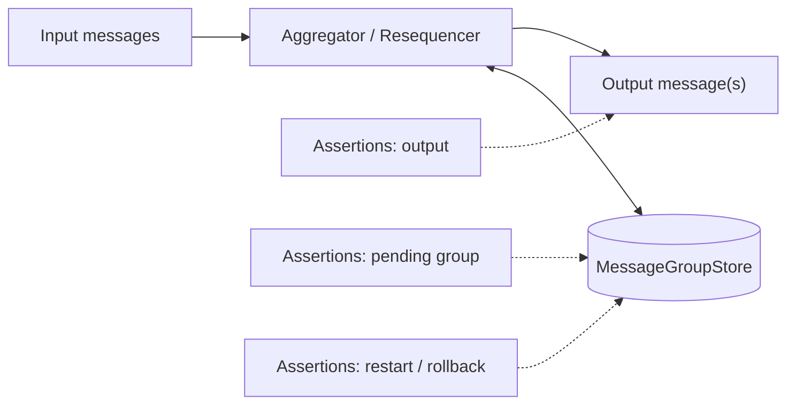
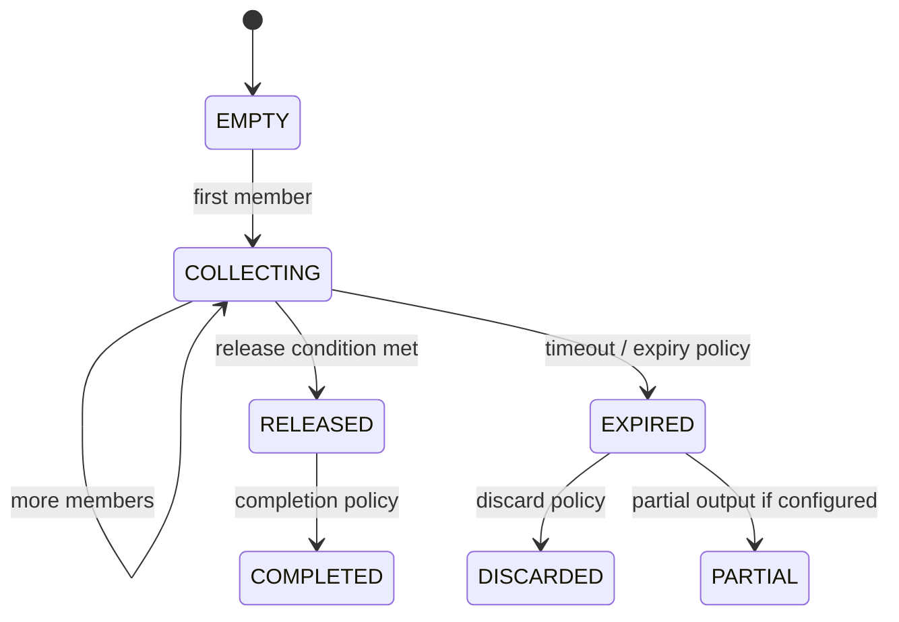
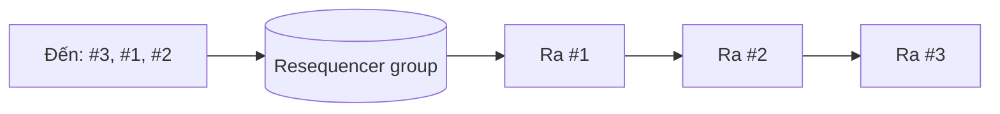
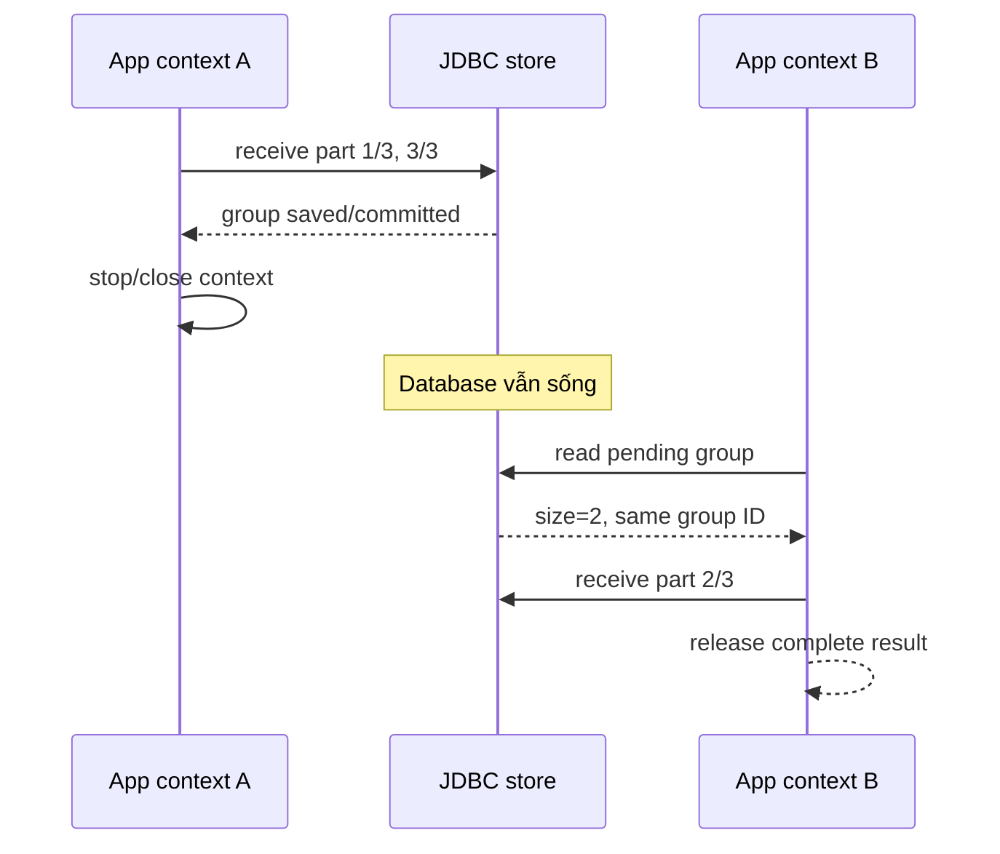
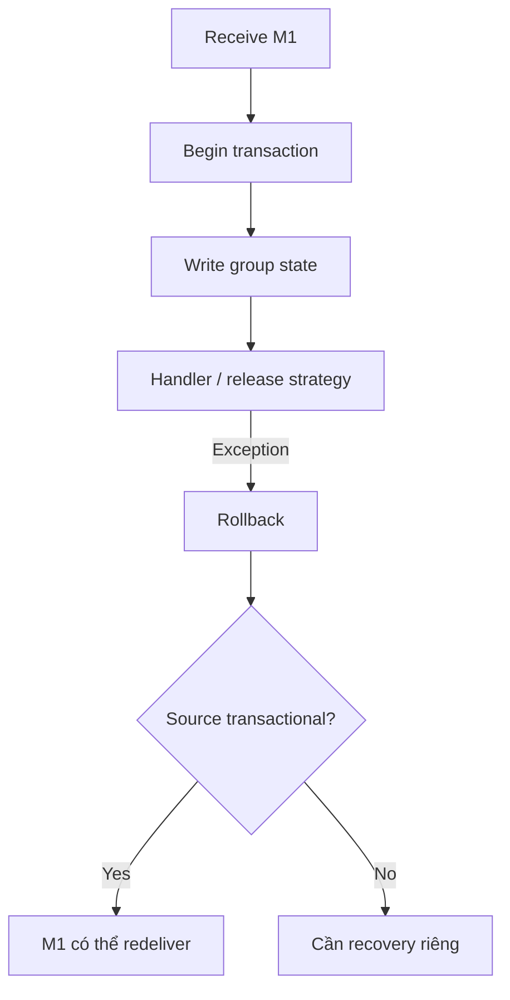
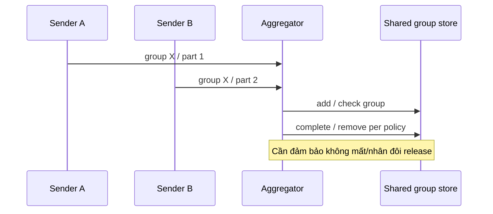
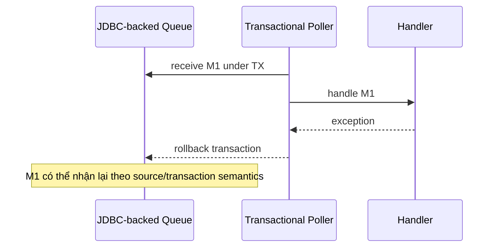

# Test message store và group state

Trong **Spring Integration runtime**, message không phải lúc nào cũng được xử lý ngay khi đi vào channel. Một `QueueChannel` có thể giữ message để poller lấy sau; một **aggregator** phải chờ đủ các phần có cùng correlation key; một **resequencer** giữ message đến sai thứ tự; còn **message group store** lưu state giữa các lần nhận. Vì vậy, một bài test chỉ khẳng định “handler nhận được output” thường chưa chứng minh runtime hoạt động đúng khi có **message thiếu, retry, rollback, restart hay nhiều consumer đồng thời**.

Bài thuộc chương **Testing runtime** của module `SPRING_INTEGRATION_RUNTIME`. Mục tiêu là xây dựng chiến lược kiểm thử message store và vòng đời `MessageGroup`, hiểu ranh giới giữa message channel store và group store, quan sát correlation/sequence/release/expiry, mô phỏng lỗi và chẩn đoán state còn tồn tại khi flow dừng hoặc khởi động lại.

Thông điệp cốt lõi: **kiểm thử cả dữ liệu được phát ra và state chưa phát ra**. Không có output có thể nghĩa là hệ thống đang chờ hợp lệ, nhưng cũng có thể là message đã mất hoặc group bị kẹt.

## 1. Hai câu hỏi phải kiểm tra riêng

Khi một flow có lưu state, test cần trả lời hai câu hỏi:

1. **Data-plane:** message nào đi vào, message nào đi ra, có đúng số lượng, thứ tự, nội dung và outcome nghiệp vụ không?
2. **State-plane:** trước/sau mỗi bước, message đang ở queue nào, group nào, đã completed/expired chưa, có thể phục hồi sau lỗi hoặc restart không?



Giả sử một hóa đơn `INV-42` được chia thành ba message:

| Message | Correlation key | Sequence | Expected size |
| --- | --- | --- | --- |
| `line-A` | `INV-42` | 1 | 3 |
| `line-B` | `INV-42` | 2 | 3 |
| `line-C` | `INV-42` | 3 | 3 |

Kiểm thử đúng phải chứng minh: sau hai phần đầu **chưa có output nhưng group có hai thành viên**; khi phần thứ ba đến, output được tạo theo release strategy; state sau release **phù hợp chính sách giữ/xóa completed group**, không kết luận bừa rằng row nhất thiết biến mất.

## 2. Các loại store cần phân biệt

Spring Integration có nhiều thành phần tên gần nhau. Chọn sai lớp khi test sẽ tạo kết luận sai.

| Thành phần | Vai trò thường gặp | Test quan trọng |
| --- | --- | --- |
| `SimpleMessageStore` | Store trong RAM, thường dùng cho message và nhóm trong test/flow đơn giản | Thêm/lấy group, completion trong một JVM |
| `JdbcMessageStore` | Store thông điệp và message group trong database | Persistence, restart, SQL transaction, serialization |
| `JdbcChannelMessageStore` | Backing store cho channel dạng queue JDBC | Enqueue/dequeue, poller transaction, redelivery |
| `MessageGroupStore` | Hợp đồng lưu và quản lý `MessageGroup` | Add, inspect, complete/expire/remove theo API |
| `MessageStore` | Hợp đồng lưu/lấy message độc lập | Thông điệp theo ID, serialization và cleanup |
| `MessageGroupStoreReaper` | Dọn/expire group theo chính sách và lịch | Group thiếu thành viên, timeout, discard/partial |
| `MetadataStore` | Key-value cho marker/checkpoint/idempotency | Trạng thái accepted/claimed, không phải group payload |

**Đặc biệt:** `JdbcMessageStore` và `JdbcChannelMessageStore` không được coi là tương đương. Một cái dùng cho **correlating group**, cái còn lại thường dùng để **back queue channel**. Test aggregator không tự kiểm tra semantics của JDBC dequeue, và test `QueueChannel` không tự kiểm tra release của aggregator.

### 2.1. In-memory và persistent cho ra hai loại bằng chứng khác nhau

- Test `SimpleMessageStore` giúp chứng minh **logic grouping/release** khi mọi thành phần chạy trong một process. Nó **không** chứng minh state sống qua restart.
- Test `JdbcMessageStore` trong cùng một application context giúp kiểm tra JDBC integration nhưng chưa chứng minh một tiến trình mới có thể đọc state cũ.
- Test **đóng context A, mở context B dùng cùng database**, sau đó xử lý tiếp mới gần với bằng chứng restart/recovery thực tế.
- Test **hai process/node với một backing store** còn phải kiểm tra locking, transaction isolation và concurrency mà single-JVM unit test không chứng minh.

## 3. Mô hình trạng thái của MessageGroup

Một `MessageGroup` được xác định bởi **group ID/correlation key**. Endpoint có thể dùng `CorrelationStrategy` để quyết định khóa và `ReleaseStrategy` để xác định thời điểm phát kết quả.



Sơ đồ này diễn tả **logic nghiệp vụ kiểm thử**; tên trạng thái `COLLECTING`, `PARTIAL` hay `DISCARDED` không nhất thiết là các enum được store triển khai sẵn.

| Giai đoạn | Khẳng định cần test | Sai lầm thường gặp |
| --- | --- | --- |
| Chưa nhận | Không có message thuộc group | Coi group không tồn tại với mọi implementation mặc dù có empty/completed marker |
| Nhận chưa đủ | Group có đúng thành viên đã nhận, chưa phát output | Chỉ `assertNull(output)`, không kiểm tra group state |
| Đủ điều kiện release | Output xuất hiện theo strategy | Coi số lượng output luôn bằng 1, kể cả resequencer |
| Sau release | Group đã completed hoặc được xóa theo policy | Mặc định group phải có `size==0` hoặc phải biến mất |
| Group hết hạn | Discard/partial/error đúng cấu hình | Coi timeout luôn tự phát kết quả một phần |
| Đến muộn | Late arrival được xử lý theo policy | Cho rằng cùng key luôn được chấp nhận lại |
| Restart | State tồn tại hoặc được phục hồi đúng yêu cầu | Test bằng in-memory rồi kết luận durable |

**Thời điểm “đủ thành viên” không tự bảo đảm đúng nghiệp vụ.** Nếu cùng `sequenceNumber` bị gửi hai lần hoặc có duplicate với ID mới, test phải xác minh member identity và idempotency; chỉ `group.size()` đủ không chứng minh đã đủ ba phần mong muốn.

## 4. Xác định invariant trước khi viết test

Đặt các invariant có thể assert, thay vì chỉ mô tả đầu ra mong đợi bằng lời.

```text
INV-1: Mỗi message được gắn vào đúng group key.
INV-2: Hai group khác key không chia sẻ thành viên.
INV-3: Chưa đủ điều kiện release -> không có output.
INV-4: Đủ điều kiện -> output đúng cardinality và dữ liệu.
INV-5: Retry/duplicate không tạo sai business effect.
INV-6: Group timeout có outcome rõ, không bị kẹt vô hạn.
INV-7: Với durable store: restart không làm mất state đã commit.
INV-8: Rollback không được báo business completion giả.
INV-9: Concurrency không vi phạm cách ly group và transition.
INV-10: Cleanup không xóa state vẫn cần cho recovery.
```

Các invariant không phải do Spring Integration mặc định đảm bảo toàn bộ. Chẳng hạn, **INV-5 cần ứng dụng thiết kế dedup**, còn **INV-7 cần persistent store và transaction đúng**. Test phải phản ánh hợp đồng của **flow đã cấu hình**, không kỳ vọng framework tự giải quyết mọi lỗi.

## 5. Kim tự tháp kiểm thử phù hợp

| Mức | Dùng gì | Kiểm tra chính | Không chứng minh |
| --- | --- | --- | --- |
| Unit | `SimpleMessageStore`, test `CorrelationStrategy`/`ReleaseStrategy` | Group ID, số thành viên, điều kiện release | Database và restart |
| Flow integration | `@SpringJUnitConfig`, `DirectChannel`, `QueueChannel`, JUnit | Endpoint nhận/gom/phát đúng | Redelivery từ broker thật |
| Persistence integration | `JdbcMessageStore` + PostgreSQL/Testcontainers | Schema, serialization, transaction, restart | Consumer concurrency ngoài môi trường test |
| Concurrency/stress | Nhiều sender/consumer, latch, executor | Race, group locking, duplicate | Tự đại diện toàn bộ production load |
| Failure/recovery | Inject exception, rollback, stop/restart, broker source | Cửa sổ crash, reprocess, pending state | Exactly-once end-to-end nếu không đo business effects |

Không cần dùng database cho mọi test nhỏ. Nhưng **bắt buộc có test tích hợp backend thật** trước khi tuyên bố hệ thống lưu state bền vững và phục hồi được.

## 6. Fixture message đúng correlation và sequence

Một test có kết quả đáng tin nên tự tạo message headers rõ ràng, không dựa vào `MessageHeaders.ID` để làm group key.

```java
import org.springframework.messaging.Message;
import org.springframework.messaging.support.MessageBuilder;

final class TestMessages {
    private TestMessages() {}

    static Message<String> part(
            String groupId, int sequenceNumber,
            int sequenceSize, String payload) {

        return MessageBuilder.withPayload(payload)
                .setHeader("correlationId", groupId)
                .setHeader("sequenceNumber", sequenceNumber)
                .setHeader("sequenceSize", sequenceSize)
                .build();
    }
}
```

Đối với Spring Integration, các key chuẩn tương ứng được khai báo trong `IntegrationMessageHeaderAccessor`; ví dụ dùng tên chuỗi để dễ quan sát. Producer thật cần có hợp đồng rõ ràng với `correlationId`/`sequenceNumber`/`sequenceSize`; nếu payload đến từ bên ngoài, phải kiểm tra type và tính hợp lệ của header.

### 6.1. Test data dễ cô lập

Trong test hãy sử dụng:
- Group ID khác nhau cho từng case, ví dụ `test:invoice:run-42`.
- Business ID riêng với message ID khi kiểm tra duplicate.
- Sequence number bắt đầu từ 1, expected size đúng với số phần.
- Payload nhỏ và serializable khi dùng JDBC store.
- Không dùng dữ liệu khách hàng thật, token hoặc payload nhạy cảm.

Không tái sử dụng group ID giữa hai test chạy chung context nếu chưa kiểm soát completed group retention và cleanup. Một completed marker tồn dư có thể làm test sau thất bại theo cách rất khó hiểu.

## 7. Unit test trực tiếp MessageGroupStore

Khi chỉ muốn kiểm tra API lưu nhóm, có thể dùng `SimpleMessageStore` và JUnit 5. Ví dụ sau tập trung vào **hai lần add và inspect**, không gắn aggregator.

```java
import static org.junit.jupiter.api.Assertions.assertEquals;

import org.junit.jupiter.api.Test;
import org.springframework.integration.store.MessageGroupStore;
import org.springframework.integration.store.SimpleMessageStore;
import org.springframework.messaging.Message;
import org.springframework.messaging.support.MessageBuilder;

class MessageGroupStoreUnitTest {

    @Test
    void storesMembersUnderTheSameGroupKey() {
        MessageGroupStore store = new SimpleMessageStore();
        String groupKey = "test:invoice:42";

        Message<String> first = MessageBuilder
                .withPayload("line-A").build();
        Message<String> second = MessageBuilder
                .withPayload("line-B").build();

        store.addMessageToGroup(groupKey, first);
        store.addMessageToGroup(groupKey, second);

        var group = store.getMessageGroup(groupKey);

        assertEquals(2, group.size());
        assertEquals(groupKey, group.getGroupId());
    }
}
```

Ở đây `getGroupId()` và `size()` xác nhận nhóm đã lưu thành viên. Test không cần dựa vào thứ tự iterator của `group.getMessages()`. Nếu sau này chuyển sang JDBC, hãy kiểm tra **semantics được framework/backend hỗ trợ**; thứ tự lưu/đọc từ store không mặc nhiên là thứ tự nghiệp vụ.

### 7.1. Vì sao test này vẫn chưa đủ?

Hai lần `addMessageToGroup` thành công chỉ chứng minh store nhận dữ liệu trong tình huống đơn giản. Nó không chứng minh:

1. Một `Aggregator` thật sự dùng đúng instance store này.
2. `ReleaseStrategy` thỏa đúng lúc.
3. Sau release, group được complete/expire đúng policy.
4. Store còn state khi restart.
5. Hai consumer đồng thời không release trùng.
6. Xử lý rollback/redelivery không làm mất hoặc nhân đôi business effect.

Vì thế cần test flow ở cấp tiếp theo.

## 8. Integration test: aggregator lưu pending group rồi mới phát

Ví dụ dưới đây dùng Spring Integration Java DSL, JUnit 5 và Spring Test. Cấu hình dùng `DirectChannel` để tránh poller bất đồng bộ gây nhiễu khi chỉ muốn kiểm tra **grouping**; `QueueChannel` ở đầu ra cho phép dùng `receive()` để assert.

```java
import static org.junit.jupiter.api.Assertions.assertEquals;
import static org.junit.jupiter.api.Assertions.assertNotNull;
import static org.junit.jupiter.api.Assertions.assertNull;

import java.util.Collection;
import java.util.HashSet;
import java.util.Set;

import org.junit.jupiter.api.Test;
import org.springframework.beans.factory.annotation.Autowired;
import org.springframework.beans.factory.annotation.Qualifier;
import org.springframework.context.annotation.Bean;
import org.springframework.context.annotation.Configuration;
import org.springframework.integration.annotation.EnableIntegration;
import org.springframework.integration.channel.DirectChannel;
import org.springframework.integration.channel.QueueChannel;
import org.springframework.integration.dsl.IntegrationFlow;
import org.springframework.integration.store.MessageGroupStore;
import org.springframework.integration.store.SimpleMessageStore;
import org.springframework.messaging.Message;
import org.springframework.messaging.MessageChannel;
import org.springframework.messaging.PollableChannel;
import org.springframework.messaging.support.MessageBuilder;
import org.springframework.test.context.junit.jupiter.SpringJUnitConfig;

@SpringJUnitConfig(classes = AggregatorStateTest.Config.class)
class AggregatorStateTest {
    @Autowired
    @Qualifier("partsInput")
    private MessageChannel input;

    @Autowired
    @Qualifier("aggregatedResults")
    private PollableChannel output;

    @Autowired
    private MessageGroupStore store;

    @Test
    void waitsForThirdPartAndReleasesOneResult() {
        String key = "test:invoice:complete-42";

        input.send(part(key, 3, 3, "C"));
        input.send(part(key, 1, 3, "A"));

        assertEquals(2, store.getMessageGroup(key).size());
        assertNull(output.receive(0)); // Chưa đủ phần nên chưa phát.

        input.send(part(key, 2, 3, "B"));

        Message<?> result = output.receive(2_000);
        assertNotNull(result);
        Collection<?> payload = (Collection<?>) result.getPayload();
        assertEquals(Set.of("A", "B", "C"), new HashSet<>(payload));

        assertNull(output.receive(0)); // Không có kết quả thứ hai.
        // KHÔNG khẳng định group biến mất sau release:
        // retention/completed-group policy quyết định điều này.
    }

    private Message<String> part(
            String key, int number, int size, String value) {
        return MessageBuilder.withPayload(value)
                .setHeader("correlationId", key)
                .setHeader("sequenceNumber", number)
                .setHeader("sequenceSize", size)
                .build();
    }

    @Configuration
    @EnableIntegration
    static class Config {
        @Bean
        MessageChannel partsInput() {
            return new DirectChannel();
        }

        @Bean
        QueueChannel aggregatedResults() {
            return new QueueChannel();
        }

        @Bean
        MessageGroupStore store() {
            return new SimpleMessageStore();
        }

        @Bean
        IntegrationFlow aggregateFlow(MessageGroupStore store) {
            return IntegrationFlow.from("partsInput")
                    .aggregate(spec -> spec.messageStore(store))
                    .channel("aggregatedResults")
                    .get();
        }
    }
}
```

Trong cấu hình mặc định phù hợp, aggregator dùng correlation và sequence headers để nhận biết group đủ ba phần; processor tổng hợp mặc định thường trả collection payload. Nếu ứng dụng dùng `MessageGroupProcessor` riêng, **phải assert đúng contract của processor đó** thay vì cast thành collection. API/behavior cụ thể cần đối chiếu bản Spring Integration đang dùng.

### 8.1. Tại sao đầu vào gửi 3, 1, 2?

Đó là cách kiểm tra aggregator **không cần thứ tự đến là 1, 2, 3** để nhóm đúng. Tuy nhiên, aggregation không có nghĩa giữ đúng thứ tự output list trừ khi processor/strategy có quy định. Bài test dùng `Set` để chỉ assert **đủ phần tử**, không giả định thứ tự trong group store.

Nếu bài toán cần thứ tự, hãy kiểm tra `Resequencer` hoặc dùng processor sắp theo `sequenceNumber` một cách tường minh.

### 8.2. Test trạng thái trước release mới có giá trị nhất

Trong ví dụ, dòng:

```java
assertEquals(2, store.getMessageGroup(key).size());
```

là một assertion cốt lõi. Nếu chỉ kiểm tra output sau đủ ba message, test có thể không phát hiện một số lỗi lưu pending state hoặc nhầm store. Khi muốn kiểm tra nội dung nhóm, lấy `group.getMessages()` rồi so sánh **member key hoặc tập payload**, không suy ra thứ tự nếu API không cam kết.

## 9. Hai correlation groups xen kẽ

Một lỗi rất thực tế là dùng correlation key quá rộng khiến message của hai đơn hàng bị gộp thành một group. Test có thể gửi:

```text
A/1, B/1, A/2, B/2, B/3, A/3
```

Kiểm tra theo mốc:

| Sau message | Group A | Group B | Kỳ vọng |
| --- | --- | --- | --- |
| `A/1` | 1 | 0 | Chưa output |
| `B/1` | 1 | 1 | Chưa output |
| `A/2` | 2 | 1 | Chưa output |
| `B/2` | 2 | 2 | Chưa output |
| `B/3` | 2 | Release | Chỉ output B |
| `A/3` | Release | Đã hoàn tất | Chỉ output A, không trộn B |

Một test tốt kiểm tra **nội dung từng output** đi với group key đúng. Nếu output chỉ còn payload tổng hợp mà không còn header correlation, cần business key trong output contract hoặc adapter test chuyên dụng để đối chiếu.

### 9.1. Khóa group không được chỉ là message ID

Mỗi Spring message có `MessageHeaders.ID` riêng. Dùng ID đó làm group key sẽ khiến mỗi phần thành một group. Hãy tách:
- `messageId`: định danh một message object/delivery.
- `correlationId`: định danh một nhóm được xử lý chung.
- `businessEventId`: khóa idempotency xuyên retry/redelivery.
- `sequenceNumber`: vị trí một thành viên trong chuỗi.

## 10. Resequencer: test thứ tự output và state chờ

Resequencer dùng correlation ID và sequence headers để chờ phần thiếu, rồi phát từng message theo thứ tự đúng. Không giống aggregator, nó thường **không gộp payload thành một output duy nhất**.



Một integration test resequencer có thể dùng flow:

```java
@Bean
IntegrationFlow resequencerFlow(MessageGroupStore store) {
    return IntegrationFlow.from("outOfOrderInput")
            .resequence(spec -> spec.messageStore(store))
            .channel("orderedOutput")
            .get();
}
```

Đây là fragment khi `outOfOrderInput`, `orderedOutput` và `store` đã khai báo. Test gửi số thứ tự `3, 1, 2` trong cùng group, đọc ba output và assert `sequenceNumber` tăng đúng theo policy.

**Lưu ý về release:** resequencer có thể có chiến lược release từng đoạn liên tiếp khi đủ điều kiện, không nhất thiết phải đợi đủ toàn bộ `sequenceSize` mới phát. Vì vậy, đừng viết assert “không có bất cứ output nào trước khi đủ ba phần” nếu chưa kiểm tra cấu hình release strategy cụ thể.

### 10.1. Test thứ tự sau executor là bài toán riêng

Nếu sau resequencer là `ExecutorChannel` với nhiều worker, các message có thể được **phát đúng thứ tự** nhưng hoàn tất side effect không theo thứ tự. Khi kiểm thử requirement “cập nhật DB đúng thứ tự”, cần assert **commit order hoặc state cuối cùng**, không chỉ kiểm tra thứ tự dequeue của `orderedOutput`.

## 11. Kiểm thử completed group và late arrival

Sau khi aggregator release, một store có thể lưu marker cho group completed hoặc xóa group tùy cấu hình. Test phải xác định **policy cụ thể** trước khi assert.

```text
T0:  A/1, A/2, A/3  -> release A
T1:  duplicate A/2 -> late arrival
T2:  new batch reused same key A
```

Những câu hỏi cần test:

1. Group completed được giữ hay xóa?
2. Message đến muộn được **discard**, gây lỗi hay tạo một group mới?
3. Nếu xóa marker, một duplicate với key cũ có thể lại hình thành group mới?
4. Nếu giữ marker, memory/DB footprint có dọn theo thời hạn?
5. Khi business tạo batch mới, key có được **versioning** để không va chạm với batch cũ?

**Không tái sử dụng key chỉ vì một nhóm đã release.** Một key như `INV-42` có thể cần thêm `batchVersion`/`runId` nếu nghiệp vụ xử lý nhiều đợt liên quan tới cùng một hóa đơn.

## 12. Test group timeout, expiry và discard

Giả sử một group kỳ vọng ba message nhưng chỉ nhận `1/3` và `3/3`. Đây là trường hợp hệ thống cần policy rõ, nếu không các nhóm có thể giữ vô thời hạn.

| Chính sách | Outcome kỳ vọng | Assertion cần kiểm tra |
| --- | --- | --- |
| Tiếp tục chờ | Group còn pending | Group age/size, không output |
| Expire và discard | Không có business result | Discard/error có audit; state được dọn theo policy |
| Release partial | Có output được đánh dấu thiếu | Payload chỉ có phần đã nhận, có cờ partial/quality |
| Quarantine/recovery | Ghi record xử lý lại | Durable recovery state, không ack giả |
| Reaper cleanup | Dọn completed/expired group | Không xóa nhóm vẫn đang cần cho nghiệp vụ |

Spring Integration có thể dùng `groupTimeout`, `sendPartialResultOnExpiry`, discard channel và `MessageGroupStoreReaper` tùy loại endpoint/phiên bản. **Timeout không tự đồng nghĩa phát partial result**; hãy assert đúng cấu hình của flow.

### 12.1. Tránh test timeout dễ flaky

Không dùng:
```java
// Dễ flaky trên CI vì scheduler và độ trễ máy chạy.
Thread.sleep(100);
assertEquals(0, countPendingGroups());
```

Nên:
- Dùng timeout đủ lớn so với jitter của CI.
- Dùng **Awaitility** hoặc cơ chế chờ theo điều kiện với deadline.
- Khi có thể, inject `TaskScheduler`/clock có thể điều khiển trong test theo API thật.
- Kiểm tra **outcome và state**, không chỉ “đã ngủ đủ 100 ms”.
- Cleanup scheduled tasks sau test để tránh ảnh hưởng test khác.

```java
import static org.awaitility.Awaitility.await;
import java.time.Duration;

// Ví dụ fragment, predicate phụ thuộc ứng dụng và store:
await().atMost(Duration.ofSeconds(5))
        .until(() -> recoveryEventsFor(groupId) == 1);
```

**Chú ý:** virtual time của Reactor `StepVerifier` không tự điều khiển scheduler timeout của Spring Integration nếu hai bên không chia sẻ clock/scheduler. Không áp dụng virtual time theo suy đoán.

## 13. JDBC MessageGroupStore: test đúng backend và schema

Khi cần bền vững, dùng `JdbcMessageStore` với database và schema tương ứng phiên bản Spring Integration. Test nên chạy với **cùng loại database production** khi điều kiện cho phép, vì SQL dialect, locking và transaction isolation khác nhau.

Ví dụ bean cơ bản:

```java
import javax.sql.DataSource;
import org.springframework.context.annotation.Bean;
import org.springframework.context.annotation.Configuration;
import org.springframework.integration.jdbc.store.JdbcMessageStore;

@Configuration
class JdbcGroupStoreConfig {

    @Bean
    JdbcMessageStore groupMessageStore(DataSource dataSource) {
        return new JdbcMessageStore(dataSource);
    }
}
```

Đoạn này yêu cầu module `spring-integration-jdbc` và schema message-store được khởi tạo theo tài liệu chính thức. **Không giả định Spring Boot tự tạo đủ bảng** chỉ vì bean được khai báo. Tùy database/version có script/schema, region, serializer và transaction manager cần cấu hình rõ.

### 13.1. Những gì phải xác minh với JDBC

| Hạng mục | Vì sao |
| --- | --- |
| Schema đã khởi tạo đúng | Thiếu bảng/index làm test lỗi lúc nhận message |
| Serializer/deserializer | Payload/header có thể không serialize được hoặc không tương thích khi deploy |
| Region/namespace | Hai flow có thể trùng group ID nhưng không được chia sẻ state |
| Transaction manager | Save group và business DB có tham gia cùng transaction không? |
| Commit visibility | Context B có đọc được state do context A commit không? |
| Cleanup/expiry | Nhóm completed/expired có dọn đúng hạn? |
| Lock contention | Hai consumer cùng group có được đồng bộ đúng không? |
| Restart migration | Payload class/schema cũ đọc lại được sau nâng cấp không? |

`JdbcChannelMessageStore` có mục đích khác — dùng cho channel queue JDBC. Nếu bài toán là transactional dequeue, phải test source/channel store đó **riêng**, không kết luận từ test `JdbcMessageStore` của aggregator.

## 14. Testcontainers: dựng môi trường tích hợp có thể tái lập

Một kế hoạch thường dùng:
1. Khởi động PostgreSQL container dành riêng cho suite.
2. Nạp đúng schema SQL cho phiên bản Spring Integration đang kiểm thử.
3. Tạo `DataSource`, transaction manager và `JdbcMessageStore`.
4. Gửi message, đọc state từ API store.
5. Đóng Spring context, mở context mới cùng database.
6. Gửi phần còn lại, kiểm tra group/output và cleanup.

Skeleton với JUnit 5, Spring Boot test và Testcontainers:

```java
import org.junit.jupiter.api.Test;
import org.springframework.boot.test.context.SpringBootTest;
import org.springframework.test.context.DynamicPropertyRegistry;
import org.springframework.test.context.DynamicPropertySource;
import org.testcontainers.containers.PostgreSQLContainer;
import org.testcontainers.junit.jupiter.Container;
import org.testcontainers.junit.jupiter.Testcontainers;

@Testcontainers
@SpringBootTest
class JdbcGroupStoreIntegrationTest {

    @Container
    static PostgreSQLContainer<?> postgres =
            new PostgreSQLContainer<>("postgres:16-alpine")
                    .withDatabaseName("si_test");

    @DynamicPropertySource
    static void dataSourceProperties(DynamicPropertyRegistry registry) {
        registry.add("spring.datasource.url", postgres::getJdbcUrl);
        registry.add("spring.datasource.username", postgres::getUsername);
        registry.add("spring.datasource.password", postgres::getPassword);
    }

    @Test
    void restartScenarioShouldBeVerifiedWithTwoContexts() {
        // Skeleton: bước test hoàn chỉnh phải thiết lập schema,
        // khởi tạo context A và B theo thứ tự, cùng một database,
        // assert pending group sau A và release sau B.
    }
}
```

**Đây là skeleton minh họa, không phải một integration test hoàn chỉnh đã chạy.** `@SpringBootTest` không tự đóng/mở hai context độc lập chỉ vì test method có tên `restartScenario`. Muốn test restart, phải tự điều phối hai `ApplicationContext` hoặc chạy hai pha ứng dụng riêng, giữ nguyên database.

### 14.1. Restart thực sự phải test thế nào?



Không khởi chạy A và B đồng thời nếu mục tiêu chỉ là test restart tuần tự. Trước khi mở B, phải đảm bảo transaction A đã commit và A không còn poller/consumer nắm quyền nguồn. Nên giữ **endpoint group region/ID và serializer tương thích** để B đọc lại cùng state thay vì tình cờ tạo một nhóm mới.

Một test chỉ tạo **instance `JdbcMessageStore` mới trong cùng context** kiểm tra một phần persistence, nhưng chưa chứng minh lifecycle và khôi phục sau restart của ứng dụng.

## 15. Test transaction rollback đúng ranh giới

Giả sử message được thêm vào group trong database transaction, rồi handler ném exception. Test phải phân biệt:
- Transaction **lưu group** có rollback không?
- Transaction **receive từ source** có rollback/redelivery không?
- Transaction **business DB update** có rollback không?
- Output phát ra trước rollback có bị phát lại không?



**Rollback database không tự trả message vào `QueueChannel` RAM.** Muốn redelivery cần broker/transactional channel store phù hợp và poller transaction bao quanh đúng `receive`/handler. Ngược lại, một `JdbcMessageStore` cho aggregator không tự chứng minh source adapter có transactional dequeue.

### 15.1. Vì sao `@Transactional` trên test có thể đánh lừa?

Một test được Spring Test bọc trong transaction thường **rollback khi test kết thúc**. Điều đó hữu ích để cleanup nhưng có thể làm bạn hiểu sai:
- Test tưởng state đã được commit nhưng thực tế context khác không nhìn thấy.
- Lời gọi qua thread `ExecutorChannel` không dùng cùng transaction của test thread.
- Đóng context trước khi commit test transaction làm kết quả restart không đúng.

Khi test commit/restart, dùng `TransactionTemplate` hoặc cơ chế quản lý transaction tường minh; nếu có `@Transactional` ở test, cần chủ động kết thúc transaction trước khi đọc từ context/connection khác. Đừng dùng `Thread.sleep()` để “đợi transaction commit”.

### 15.2. Bảng assertion theo failure point

| Lỗi xảy ra | Assertion cần ghi nhận |
| --- | --- |
| Trước khi add group | Store không có thành viên mới |
| Sau add nhưng trước commit | Sau rollback, state phải phù hợp transaction và store implementation |
| Sau commit group, trước release | Pending group vẫn đọc được sau restart nếu durable |
| Sau release, trước output ack | Có thể phát trùng sau redelivery; cần idempotency |
| Business DB commit nhưng source ack lỗi | Business effect không bị áp dụng lần hai |
| Error handler nuốt exception | Kiểm tra source có coi message đã thành công không |

Không gộp tất cả trường hợp vào một assert “message count cuối bằng 1”. Cần quan sát transaction outcome và trạng thái thật của source/store.

## 16. Retry, redelivery và duplicate message

Một nhóm có thể nhận lại thành viên do retry trong handler hoặc redelivery từ source. Cần test ít nhất hai dạng duplicate:

```text
Case A: cùng Message ID được gửi/lưu lại.
Case B: Message ID mới nhưng cùng businessMemberId và sequenceNumber.
```

**Message ID mới không đồng nghĩa sự kiện nghiệp vụ mới.** Trên đường broker redelivery/bridge, message có thể được dựng lại với ID khác. Nếu release strategy chỉ kiểm tra `group.size() >= 3`, ba message trùng business part có thể khiến release sai khi thiếu phần thật.

### 16.1. Case thử nghiệm cụ thể

| Input | Kỳ vọng khi có dedup business member | Cần kiểm tra |
| --- | --- | --- |
| `A1, A2, A3` | Một kết quả đầy đủ | Đúng ba thành viên khác nhau |
| `A1, A2, A2, A3` | Không có kết quả sai, không nhân đôi A2 | Member key và release strategy |
| `A1, A2` rồi redeliver `A1` | Vẫn thiếu A3 | Không cộng duplicate vào số phần hợp lệ |
| `A1, A2, A3` rồi redeliver `A3` | Không phát lại business effect | Completed group policy, inbox/idempotency |
| Retry after partially committed side effect | Không thực hiện lại cập nhật business đã commit | Unique business event ID/transaction |

Spring Integration group store có semantics riêng cho message ID và completed group; **đừng giả định nó tự dedup theo `businessMemberId`**. Nếu đó là requirement, thiết kế validation/idempotency ở producer/consumer hoặc group processor rồi test công khai hành vi này.

### 16.2. Exactly-once là invariant nghiệp vụ

Ngay cả khi test aggregator thấy một output trên `QueueChannel`, ứng dụng vẫn có thể:
1. Gửi output sang hệ thống ngoài.
2. Crash trước khi đánh dấu hoàn thành.
3. Nhận lại message và tạo output lần nữa.

Để kiểm tra **business effect once**, cần assert trên **database/inbox/outbox hoặc API đích có idempotency key**, không chỉ trên số lượng message ở channel output.

## 17. Concurrency: nhiều sender cùng correlation key

Group store có thể được gọi từ nhiều consumer/executor song song. Một test đơn thread không phát hiện race do **add, check release, complete** xen kẽ.



### 17.1. Dùng latch để đồng bộ khởi phát

```java
import java.util.concurrent.CountDownLatch;
import java.util.concurrent.ExecutorService;
import java.util.concurrent.Executors;
import java.util.concurrent.Future;
import java.util.concurrent.TimeUnit;

// Fragment test, input và part(...) do fixture bên trên cung cấp.
int workers = 3;
CountDownLatch start = new CountDownLatch(1);

ExecutorService pool = Executors.newFixedThreadPool(workers);
try {
    Future<?> a = pool.submit(() -> {
        awaitStart(start);
        input.send(part("group-concurrent", 1, 3, "A"));
    });
    Future<?> b = pool.submit(() -> {
        awaitStart(start);
        input.send(part("group-concurrent", 2, 3, "B"));
    });
    Future<?> c = pool.submit(() -> {
        awaitStart(start);
        input.send(part("group-concurrent", 3, 3, "C"));
    });

    start.countDown();
    a.get(5, TimeUnit.SECONDS);
    b.get(5, TimeUnit.SECONDS);
    c.get(5, TimeUnit.SECONDS);
    // Assert số output + dữ liệu; xem cả store state.
}
finally {
    pool.shutdownNow();
}
```

Đoạn trên dùng `try/finally` tương thích Java 17. Hàm `awaitStart` là helper test tự viết: dùng `start.await(...)` có deadline, bắt `InterruptedException`, gọi `Thread.currentThread().interrupt()` rồi chuyển lỗi thành exception test phù hợp. Nếu cần đo contention, log thread và group key pseudonym. **Một lần chạy thành công không chứng minh không có race**: thử nhiều seed/interleaving, kết hợp stress tests và chạy đa instance với persistent store.

### 17.2. Đừng dùng shared ArrayList không khóa để ghi output test

Nếu handler callback chạy ở nhiều thread, một `ArrayList` thường không thread-safe có thể tự làm **test bị race**. Dùng `BlockingQueue`/`ConcurrentLinkedQueue` hoặc bộ đếm nguyên tử, rồi assert sau khi futures và output đã hoàn tất.

## 18. Lock registry, nhiều instance và group isolation

Với `SimpleMessageStore`, nhiều JVM có các bản state riêng. Thêm `DefaultLockRegistry` trên mỗi node không khiến chúng phối hợp group giữa process. Khi chạy cluster cần:
- Shared persistent group store phù hợp.
- Group lock/coordinator có phạm vi bao phủ các consumer.
- Transaction/locking semantics được backend đảm bảo.
- Namespace/region tránh va chạm group ID.
- Test crash/lease timeout/stale worker nếu dùng distributed locks.

### 18.1. Hai nhóm khác nhau phải xử lý độc lập

Một số test concurrency chỉ dùng **cùng một key**, dễ che vấn đề lock quá rộng. Nên thêm test hai nhóm `A` và `B`:
- Cả hai tiến hành đồng thời, không chờ vô lý vì một global lock.
- Không có thành viên của A nằm trong B.
- Timeout/expiry của A không xóa state B.
- Key cùng tên ở hai tenant/flow version không bị va chạm nếu thuộc domain riêng.

Nếu có business invariant chung giữa hai key, test phải phản ánh phạm vi lock/state thật — **group key không phải lúc nào cũng là lock key đúng cho toàn bộ business effect**.

## 19. Serialization, headers và schema evolution

Một store bền vững phải serialize payload và headers. Vì vậy ngoài assert count, hãy test:

| Thành phần | Kiểm tra |
| --- | --- |
| Payload | Đọc lại đúng type/nội dung sau restart |
| `correlationId` | Không đổi hoặc được migrate theo contract |
| `sequenceNumber`/`sequenceSize` | Vẫn đúng để release/resequence |
| `replyChannel`/`errorChannel` | Có cách khôi phục hợp lệ; tránh giả định object runtime serializable |
| Domain DTO | Tương thích khi nâng cấp class/package/serializer |
| Message group metadata | Created/last modified/completed được giữ theo contract |
| Null/unsupported payload | Serialization error được báo rõ, không silently dropped |

Một `DirectChannel` là runtime object, không phải business identifier bền vững. Nếu dựa vào header chứa channel object cho reply sau restart, có thể không khôi phục được như kỳ vọng. Khi thiết kế durable request–reply, dùng mapping hoặc hợp đồng định tuyến bền vững phù hợp.

### 19.1. Test upgrade payload schema

Thực hiện hai pha:
1. Phiên bản A ghi pending group với DTO/schema cũ.
2. Phiên bản B đọc lại từ store và hoàn tất group.
3. Assert deserialize được, business key/sequence không bị mất.
4. Nếu không tương thích, xác định migration trước khi deploy B.

Một test dùng cùng một binary cho cả write/read chỉ chứng minh serializer hoạt động **trong cùng phiên bản**, chưa chứng minh deploy upgrade an toàn.

## 20. Test group cleanup và rò rỉ state

Group hoàn tất hoặc hết hạn có thể được giữ lại để xử lý late arrival, nhưng nếu không có cleanup policy, store có thể tăng không giới hạn.

```text
after 1 hour:
  pending groups:       12
  completed markers:    9,800
  expired groups:       45
  recovery jobs:        3
```

Con số là ví dụ giả định. Test cleanup phải kiểm tra:
- Group nào đủ điều kiện xóa theo policy?
- Group nào còn pending không được xóa?
- Completed marker cần giữ bao lâu để chống late duplicate?
- Reaper có chạy đúng schedule, region và transaction?
- Cleanup lỗi có được retry/audit không?
- Đóng flow khi group chưa hoàn tất có chuyển vào recovery không?

**Đừng xóa toàn bộ message store trong `@AfterEach` rồi coi như cleanup production hoạt động đúng.** Test cleanup riêng với thời gian/criteria cụ thể; cleanup test fixtures là một việc khác.

### 20.1. Trạng thái đã hoàn tất có thể là dữ liệu cần bảo vệ

Nếu xóa completed marker ngay sau release, redelivery cũ có thể tạo lại group mới. Test nên bao gồm message đến muộn trong khoảng retention và sau retention; outcome mong muốn phải được ghi rõ theo hợp đồng nghiệp vụ.

## 21. Poller và transactional channel store: một test độc lập

Nếu flow dùng `QueueChannel` được back bởi `JdbcChannelMessageStore`, cần suite test riêng cho **channel receive semantics**. Mẫu tình huống:



Bài test cần assert:
1. Poller lấy message trong transaction đúng cấu hình.
2. Handler exception được propagate (không bị error flow nuốt sai).
3. Rollback xảy ra; sau đó message có thể được poll lại theo store contract.
4. Commit thành công làm message không được dequeue lần nữa.
5. Redelivery không nhân đôi business side effect.

Nếu thay `JdbcChannelMessageStore` bằng `QueueChannel` trong RAM, **không được giữ nguyên kỳ vọng rollback tự đưa message trở lại**. Test cần phân biệt source semantics, không chỉ dùng cùng tên `queue`.

## 22. Async và polling: assert có deadline, không đoán bằng sleep

Một flow có `ExecutorChannel`, task scheduler hoặc polling consumer có thể xử lý trên thread khác. Test cần đợi **điều kiện** chứ không đợi một số mili giây tùy ý.

```java
import static org.awaitility.Awaitility.await;
import java.time.Duration;

await()
    .atMost(Duration.ofSeconds(5))
    .untilAsserted(() ->
        assertEquals(1, businessOutcomeRepository.countCommitted("E-42")));
```

`businessOutcomeRepository` chỉ là collaborator minh họa, không phải Spring Integration API. Khi assert group state trong quá trình xử lý đồng thời, tránh đọc snapshot rồi kết luận bất biến toàn cục nếu write đang tiếp diễn; dùng checkpoint/latch để kiểm tra ở mốc nhất quán.

### 22.1. Timeouts là giới hạn an toàn, không phải logic test

Có ba khoảng thời gian khác nhau:
- **Business timeout**: khi nào nhóm thiếu phần phải expire.
- **Poll/receive timeout**: test chờ output tối đa bao lâu.
- **CI safety timeout**: tránh test treo vô hạn.

Không đặt tất cả cùng một giá trị rất ngắn vì CPU scheduling/GC/IO jitter. Cũng không dùng await vô hạn: test deadlock phải có deadline, để phân biệt lỗi runtime với suite không bao giờ kết thúc.

## 23. Kiểm thử dừng/khởi động lại dynamic IntegrationFlow

Nếu ứng dụng thay flow lúc runtime bằng `IntegrationFlowContext`, test phải đo **in-flight và pending group** trước khi stop/remove.

```text
Flow A:
  group X = 2/3
  in-flight handler = 1
  pending reply = 0

Manager:
  register/start Flow B
  switch ingress
  stop/remove A  <-- quá sớm nếu state X vẫn cần A
```

Nên assert:
- Flow B nhận message mới sau cutover.
- Flow A không nhận thêm message mới ngoài những handoff đã thuộc A.
- Group X được pin về A hoặc migrate sang B theo protocol.
- Stop của A không mặc nhiên xóa state cần recovery.
- Sau restart, các group pending còn hợp lệ hoặc có record hồi phục.

**Flow registration sống hay chết không cùng nghĩa với message group đã completed.** Một dynamic flow có thể bị remove trong khi JDBC store còn group; đó có thể là trạng thái cần migration, không phải lý do xóa DB.

## 24. Quan sát group state nhưng không lộ payload

Khi test thất bại, in toàn bộ `group.getMessages()` vào CI log có thể lộ payload/header. Nên ghi log cấu trúc an toàn:

```json
{
  "event": "group_state_observed",
  "endpoint": "invoiceAggregator",
  "group_key_ref": "hmac:example-token",
  "received_count": 2,
  "expected_count": 3,
  "completed": false,
  "pending_age_ms": 840,
  "store_type": "JdbcMessageStore",
  "test_phase": "before_restart"
}
```

Nếu group key có chứa email/PII, đừng log raw. Không gắn từng group key làm label metric có cardinality vô hạn. Khi debug serializer, có thể log **class name allowlisted**, byte count hoặc exception code, không dump payload và toàn bộ headers.

Những tín hiệu hữu ích:
- `group_count`/pending/completed/expired theo endpoint.
- `group_age`, `group_size`, `release_count`, `discard_count`.
- `store_write_duration`, `store_read_duration`, `lock_wait_duration`.
- `retry_count`, `redelivery_count`, `business_committed_count`.
- `queue_depth`, `poller_lag`, `in_flight_handlers`.

Không giả định mọi metric trên được framework export sẵn; có thể cần instrument ở app/stores.

## 25. Một ma trận test regression đầy đủ

| Case | Input/điều kiện | State phải kiểm tra | Output/business outcome |
| --- | --- | --- | --- |
| Nhóm đủ | A1, A2, A3 | Group release theo strategy | Một kết quả đúng |
| Nhóm thiếu | A1, A3 | Pending size=2 | Chưa có complete result |
| Đảo thứ tự | A3, A1, A2 | Group/sequence hợp lệ | Aggregation đủ phần; resequencing đúng order |
| Hai nhóm xen kẽ | A1, B1, A2, B2, A3, B3 | State tách theo key | Không trộn payload |
| Header thiếu | Không có correlation/sequence cần thiết | Validation/error policy | Không nhập nhầm nhóm |
| Sequence sai | size=3 nhưng có part 4 hoặc trùng part 2 | Không coi size đủ là dữ liệu đúng | Outcome theo policy |
| Duplicate | A1, A2, A2, A3 | Member dedup | Không double business effect |
| Late arrival | Duplicate sau completed | Completion retention/discard | Không replay ngoài ý muốn |
| Timeout | Chỉ 2/3, vượt hạn | Expired/discard/partial | Đúng chính sách |
| Restart | Lưu 2/3, đóng A mở B | B đọc pending group | Nhận phần 3 và release |
| Serialization | Payload/header phiên bản A | Deserialization ở B | Không mất/corrupt dữ liệu |
| Rollback save | Exception trước commit | State không commit nếu transaction bao phủ | Có cơ chế retry phù hợp |
| Rollback source | Transactional queue receive | Message có thể lấy lại theo contract | Không bị mất âm thầm |
| Concurrency | 3 sender cùng group | Không tạo group sai, không deadlock | Đúng số result |
| Multi-node | 2 app cùng store | Locking/region/ownership | Không duplicate business effect |
| Reaper cleanup | Completed/expired/pending xen kẽ | Chỉ xóa đúng group | Không mất recovery state |
| Dynamic remove | Flow A còn group pending | State A được giữ/migrate | Không mất message khi đổi B |

Đối với mỗi case, nên có **expected state tại từng checkpoint**, không chỉ một snapshot cuối. Nếu case thất bại ngẫu nhiên, lưu seed/timing, thread, transaction outcome và version cấu hình trong report.

## 26. Các bài thực hành

### Bài 1 — Test trực tiếp SimpleMessageStore

Tạo hai message khác ID nhưng cùng group key. Ghi bằng `addMessageToGroup`, đọc bằng `getMessageGroup` và assert size/tập payload. Đổi group key của một message, chứng minh hai nhóm độc lập.

### Bài 2 — Aggregator chờ thành viên cuối

Dùng Java DSL flow với `SimpleMessageStore` và `QueueChannel` output. Gửi phần 3/3 và 1/3, assert group size=2 nhưng output chưa có. Gửi 2/3, assert một output có đủ ba phần.

### Bài 3 — Resequencer và thứ tự

Gửi sequence 3, 1, 2 vào `Resequencer`; xác định release policy đang dùng, assert thứ tự thực sự ở output. Đặt `ExecutorChannel` sau resequencer và giải thích vì sao side effect commit có thể khác thứ tự phát.

### Bài 4 — Group timeout

Chỉ gửi 1/3 và 3/3. Cấu hình group timeout và discard/recovery policy; dùng Awaitility chờ outcome. Assert group được dọn/giữ theo policy và không có kết quả đủ bị phát giả.

### Bài 5 — Persistent group qua restart

Dùng PostgreSQL Testcontainers và `JdbcMessageStore`. Context A lưu hai phần, commit rồi close; context B cùng database đọc group, gửi phần cuối và assert output. Đổi class DTO giữa hai phiên bản để thử serializer compatibility.

### Bài 6 — Duplicate với business member ID

Gửi cùng phần hai lần bằng message IDs khác nhau. Chứng minh release strategy chỉ dựa trên size có thể không đủ; bổ sung dedup theo `businessMemberId`/`sequenceNumber` đúng contract rồi kiểm tra kết quả và state.

### Bài 7 — Rollback và redelivery

So sánh `QueueChannel` RAM với channel dùng `JdbcChannelMessageStore` được poll trong transaction. Ném exception từ handler, theo dõi rollback và khả năng nhận lại; không giả định hai source giống nhau.

### Bài 8 — Stress test cùng group

Cho ba sender được latch giải phóng cùng lúc, tất cả thêm part vào một group. Lặp nhiều lần với keys khác nhau, assert không có group kẹt/output trùng và không có deadlock. Đo store/lock wait.

### Bài 9 — Completed marker và late arrival

Sau release, redeliver một part cũ. Quan sát chính sách late arrival theo `expireGroupsUponCompletion` và cleanup đã chọn. Thử tái sử dụng group ID cho batch mới và sửa bằng versioned key.

### Bài 10 — Multi-node với shared store

Chạy hai Spring application contexts hoặc hai process dùng cùng database, gửi phần message qua cả hai. Kiểm tra group/region, transaction và lock consistency; xác minh mỗi business event chỉ áp dụng một lần tại authoritative DB.

### Bài 11 — Cleanup và reaper

Tạo pending, completed và expired groups trong cùng store. Chạy cơ chế cleanup theo cấu hình; assert chỉ nhóm đủ điều kiện bị dọn. Mô phỏng lỗi cleanup và kiểm tra recovery/audit.

### Bài 12 — Dynamic flow cutover

Tạo flow A có pending group, stage flow B với `IntegrationFlowContext` rồi đổi ingress. Chứng minh remove A quá sớm làm nhóm không hoàn tất; thử pin/migrate state để hoàn tất đúng.

## 27. Những sai lầm thường gặp

| Sai lầm | Hậu quả | Cách sửa |
| --- | --- | --- |
| Chỉ assert output cuối | Không phát hiện group pending sai | Assert store state tại checkpoint |
| Test JdbcMessageStore bằng SimpleMessageStore rồi tuyên bố durable | Không kiểm tra persistence/serialization | Backend thật + restart |
| Nhầm `JdbcMessageStore` với `JdbcChannelMessageStore` | Kết luận sai về rollback dequeue | Test hai phạm vi riêng |
| Reuse group key giữa test | Completed marker/state rò qua case | Unique key, cleanup đúng policy |
| Giả định group phải biến mất sau release | Test sai với completed-group retention | Assert theo cấu hình cụ thể |
| Dùng `Thread.sleep` để chờ expiry | CI flaky hoặc test treo | Await theo điều kiện + deadline |
| Cho rằng `sequenceSize==3` nghĩa có 3 phần duy nhất | Duplicate có thể làm release sai | Dedup/member identity |
| Assert thứ tự iterator store khi không có cam kết | Test phụ thuộc implementation | So sánh set hoặc sort tường minh |
| `@Transactional` test chưa commit mà mở context mới | State B không thấy dù code đúng | Điều khiển transaction tường minh |
| Dùng message ID làm business event key | Redelivery có thể tạo ID mới | Business ID ổn định |
| Xóa sạch store sau mỗi case và cho rằng cleanup đã được test | Không phát hiện reaper/retention bug | Test cleanup riêng |
| Lấy `send()==true` làm business success | Async handler còn lỗi | Assert commit/ack/outcome |
| Test concurrency chỉ chạy một lần | Race có thể không xuất hiện | Latch, nhiều interleavings, stress |
| Bỏ qua serializer khi upgrade | Group cũ không thể phục hồi | Two-version compatibility tests |
| In toàn bộ group messages khi test fail | Lộ payload/headers | Structured safe diagnostics |
| Dùng một context để “test restart” | Chỉ test bean/state trong cùng process | Close A/open B cùng DB |
| Coi one output là exactly-once end-to-end | Side effect ngoài store có thể lặp | Inbox/outbox và business outcome assertions |

## 28. Câu hỏi tự kiểm tra

1. **Vì sao cần assert group state trước release?** Vì không có output có thể là chờ đúng hoặc state bị mất; cần biết group đã giữ gì.
2. **`MessageGroupStore` khác `JdbcChannelMessageStore` như thế nào?** Một bên lưu nhóm correlation, bên kia hỗ trợ queue channel có lưu trữ JDBC.
3. **`SimpleMessageStore` có giữ state qua JVM restart không?** Không; đây là store trong RAM.
4. **Sau aggregator release, group có bắt buộc biến mất không?** Không; phụ thuộc completion/expiry policy.
5. **Resequencer có luôn chờ đủ `sequenceSize` mới phát không?** Không thể suy đoán; phải kiểm tra release strategy thực tế.
6. **Vì sao message ID không đủ làm khóa dedup nghiệp vụ?** ID có thể thay qua retry/redelivery hoặc message reconstruction.
7. **Test restart dùng cùng context Spring có đủ không?** Không; cần kiểm tra state được khôi phục từ backend ở một context/process mới.
8. **Tại sao `@Transactional` trên test có thể làm sai kết luận persistence?** Transaction test có thể chưa commit hoặc được rollback sau test.
9. **Rollback handler có tự trả message vào QueueChannel RAM không?** Không.
10. **`group.size()==3` có chứng minh đủ ba business member khác nhau không?** Không, nếu duplicate không được chặn.
11. **Tại sao cần test group expiry?** Nhóm thiếu phần có thể tồn tại rất lâu nếu không có recovery/cleanup policy.
12. **Có nên assert order của `group.getMessages()` mặc định không?** Không nếu store không cam kết thứ tự đó.
13. **Test concurrency tối thiểu phải quan sát gì?** Tính đầy đủ/cách ly group, số release, lỗi/lock wait và business outcome.
14. **Dùng `ExecutorChannel`, `send()` thành công có nghĩa đã commit không?** Không; có thể mới enqueue.
15. **Tại sao test serializer compatibility khi deploy version mới?** Vì pending group có thể chứa payload/header của version cũ.
16. **Khi late arrival sau completion, cần kiểm tra gì?** Marker/retention policy, discard/reopen và duplicate business effect.
17. **Một test group store chứng minh exactly-once business effect không?** Không; cần xác nhận tại authoritative business DB/API.
18. **Bản log nào tốt khi group timeout?** Correlation key pseudonym, group size, expected size, age, outcome; không dump payload.

## 29. Tài liệu tham khảo

- [Spring Integration Reference Documentation](https://docs.spring.io/spring-integration/reference/): message store, aggregator, resequencer, message channels, poller, transaction và testing.
- [Spring Integration — Aggregator](https://docs.spring.io/spring-integration/reference/aggregator.html): correlation, release strategy, timeout và message group.
- [Spring Integration — JDBC Support](https://docs.spring.io/spring-integration/reference/jdbc.html): JDBC message store và schema/backend.
- [Spring Integration — Testing](https://docs.spring.io/spring-integration/reference/testing.html): test utilities và integration testing.
- [Testcontainers for Java](https://java.testcontainers.org/): tích hợp database/container thật trong suite test.
- [Awaitility](https://github.com/awaitility/awaitility): await condition trong test bất đồng bộ.

Hãy đối chiếu tên API, overload DSL, lifecycle và SQL schema **với phiên bản Spring Integration đang sử dụng**. Các code fragment minh họa không thay thế test compile/run theo dependency của ứng dụng.

## 30. Tổng kết

**Test message store và group state không chỉ là gửi ba message rồi chờ một output.** Cần kiểm chứng cả **correlation key**, thành viên pending, release/expiry/completion, late arrival, duplicate, serialization, transaction, retry/redelivery, concurrency, restart và cleanup. Một store trong RAM phù hợp để test logic; một backing store thực sự và vòng đời application context mới cần thiết để kiểm chứng độ bền.

Khi gặp lỗi “message không đi tiếp” hoặc “đã xử lý hai lần”, hãy lần theo **source → channel/queue → poller/consumer → correlation group → MessageGroupStore → release strategy → output → business transaction/ack → retry/recovery**. Test tốt đặt assertion ở từng ranh giới quan trọng, có deadline rõ ràng và đo business effect thật. **State đúng sau lỗi, sau restart và khi nhiều worker cùng chạy mới là bằng chứng một runtime flow đáng tin cậy.**
