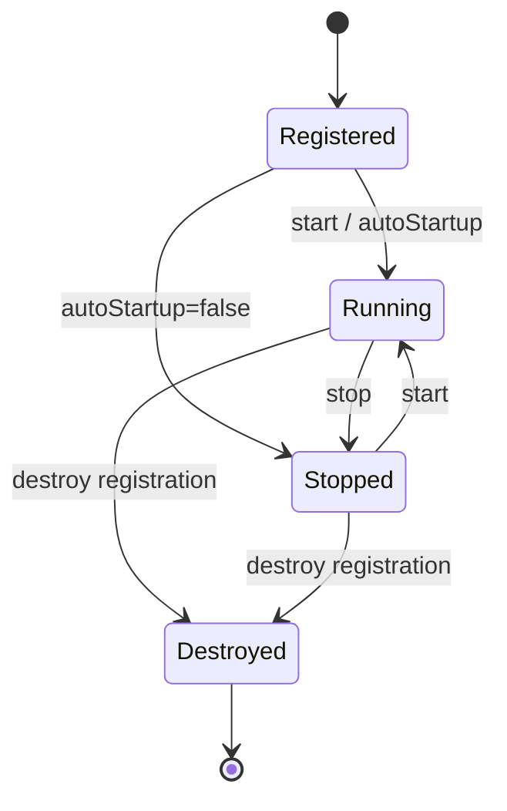
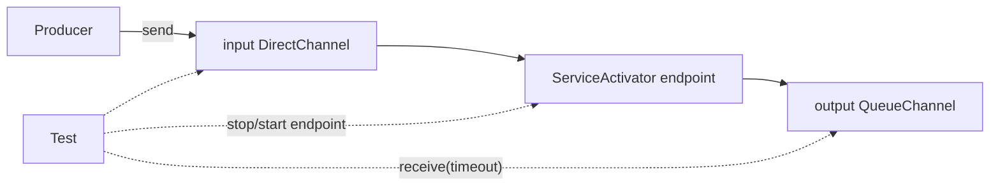
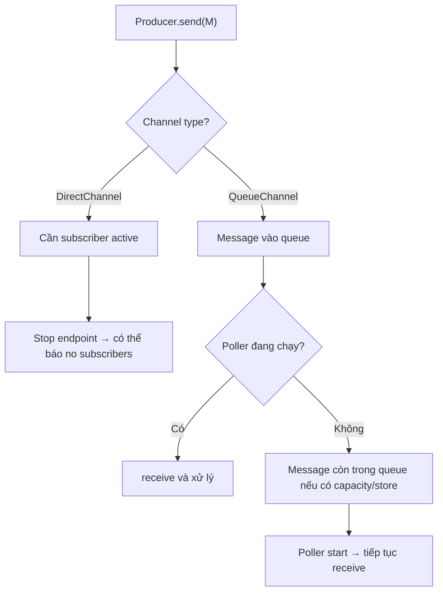
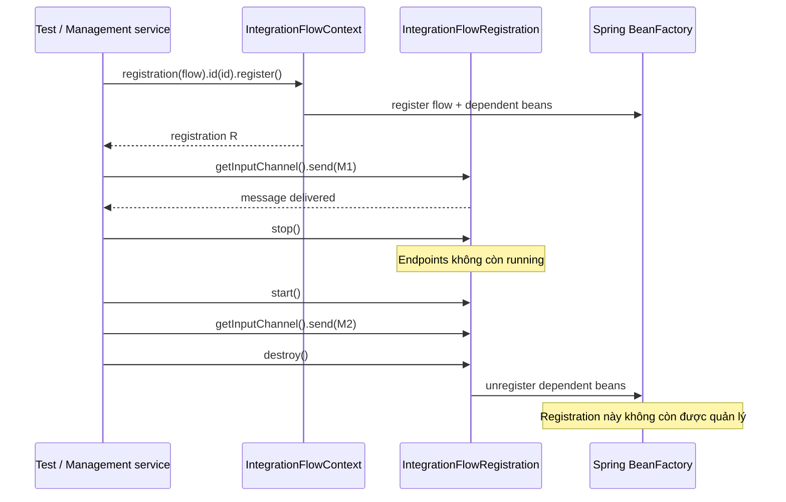
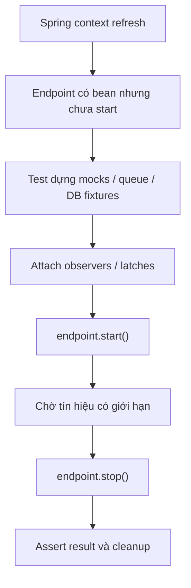
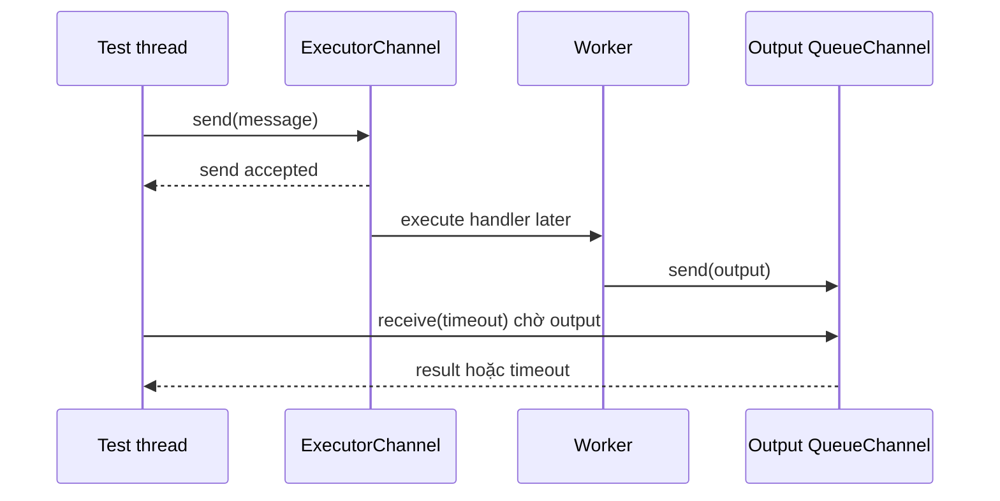
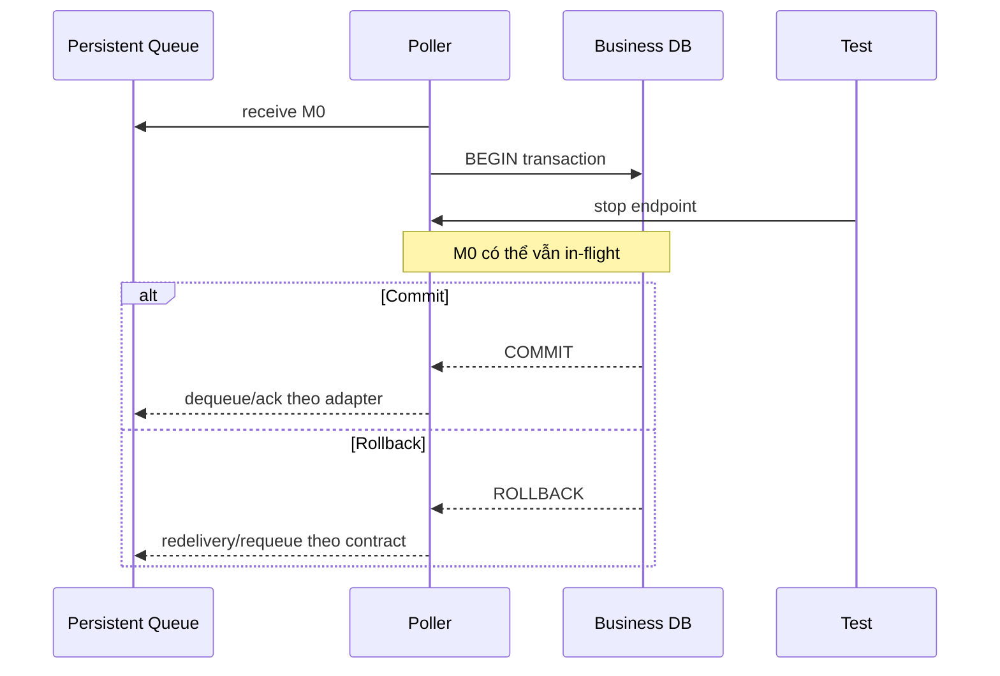

# Test start, stop và dynamic registration trong Spring Integration runtime

## 1. Mục tiêu bài học và bài toán thực tế

Trong module **SPRING_INTEGRATION_RUNTIME**, việc kiểm thử một message flow không chỉ dừng ở chuyện handler trả đúng payload. Ứng dụng còn phải **khởi động endpoint**, **dừng tiếp nhận hoặc tiêu thụ message**, **đăng ký IntegrationFlow khi đang chạy** và **hủy đăng ký** mà không để lại thread, subscription, message hoặc bean ngoài dự kiến. Việc này đặc biệt quan trọng với inbound adapter, poller, `ExecutorChannel`, `QueueChannel`, aggregator, transaction, retry và message store.

Bài thuộc chương **Testing runtime**, có đề bài trực tiếp: **Test start, stop và dynamic registration**. Trọng tâm là kiểm chứng **runtime lifecycle** và **dynamic topology**, không chỉ xác minh Spring context load thành công.

Sau bài này, bạn có thể:

- Phân biệt `ApplicationContext` lifecycle, `SmartLifecycle` của endpoint và lifecycle của `IntegrationFlowRegistration`.
- Xây fixture JUnit 5/Spring Test có `DirectChannel`, `QueueChannel` và named endpoint, rồi kiểm tra `isRunning()`, `stop()`, `start()` và output.
- Dùng `IntegrationFlowContext.registration(flow).id(...).register()`, `getInputChannel()`, `stop()`, `start()`, `destroy()` để thử luồng được tạo động.
- Giải thích vì sao dừng consumer **không đồng nghĩa** dừng mọi producer, làm rỗng queue, hủy DB transaction hoặc xóa messages.
- Kiểm thử poller và asynchronous flow bằng `CountDownLatch`/timeout hữu hạn thay vì phụ thuộc `Thread.sleep()` cố định.
- Phân biệt kiểm thử lifecycle ở một JVM với kiểm thử phục hồi sau restart, transaction và nhiều replicas.
- Dọn registrations/threads/test state để các test không ảnh hưởng nhau; kết hợp graph, metrics và error flow để chẩn đoán.

Ví dụ dùng **Java 17+, Spring Integration 6.x (định hướng 6.5.x), JUnit Jupiter 5 và Spring Test**. Tên overloaded DSL methods hoặc annotation có thể thay đổi giữa phiên bản; khi chuyển sang dự án thật hãy khớp BOM/dependencies với Spring Integration đang chạy.

## 2. “Start” và “stop” trong Integration runtime có nghĩa gì?

Spring Integration có nhiều đối tượng có lifecycle khác nhau. Một channel, một endpoint, một `IntegrationFlow` và một inbound connection không phải là cùng một thực thể.

| Đối tượng | Cơ chế chính | Khi start | Khi stop |
|---|---|---|---|
| `ApplicationContext` | `refresh()` và Spring lifecycle processor | Tạo bean, chạy các `SmartLifecycle` auto-start | Đóng context; stop/destroy beans theo lifecycle |
| `EventDrivenConsumer` | `SmartLifecycle` | Subscribe handler vào `SubscribableChannel` | Unsubscribe handler; channel có thể vẫn tồn tại |
| `PollingConsumer` | `SmartLifecycle` và `TaskScheduler` | Schedule tác vụ polling, nhận message rồi gọi handler | Ngừng lên lịch/poll mới theo implementation |
| `SourcePollingChannelAdapter` | `SmartLifecycle` | Schedule nhận message từ `MessageSource` | Ngừng polling source |
| `IntegrationFlowRegistration` | `start()`, `stop()`, `destroy()` | Điều phối các endpoints của flow đã đăng ký | Ngừng endpoints, còn registration và topology |
| `QueueChannel` | `PollableChannel`/message store | Channel vẫn có thể nhận `send()` | Stop consumer không tự xóa queue |
| `DirectChannel` | `SubscribableChannel` | Có subscriber đang hoạt động | Có thể không còn subscriber nên `send()` thất bại |

Một số loại channel không có `start()`/`stop()`. Trên `DirectChannel`, hiệu quả của `endpoint.stop()` có thể là **consumer được unsubscribe** khỏi dispatcher, chứ không phải channel bean biến mất.

### Các trạng thái cần phân biệt



Sơ đồ là **mô hình khái niệm**: `destroy()` áp dụng trực tiếp cho dynamic registration, còn một endpoint tĩnh thường được Spring destroy khi `ApplicationContext` đóng. Một endpoint có thể được tạo nhưng chưa chạy; một flow đã stop vẫn còn bean definitions và channels.

### Ba câu hỏi khác nhau trong test

1. **Lifecycle state:** `isRunning()` đã đổi từ `true` sang `false` hay chưa?
2. **Behavior:** sau `stop()`, message có còn được consumer xử lý không?
3. **Resources:** task polling, executor job, in-flight transaction, message và registration đã được quản lý/dọn đúng chưa?

Chỉ kiểm tra câu (1) là chưa đủ. `isRunning()==false` không bảo đảm không còn callback đang chạy; cũng không cho biết queue còn bao nhiêu message.

## 3. Runtime topology và ranh giới kiểm thử



Một test lifecycle tốt thường có:

- **Một đầu vào kiểm soát được**: gọi `MessageChannel.send()` hoặc `MessagingTemplate`.
- **Một endpoint có tên ổn định** để tìm bean hoặc registration.
- **Một đầu ra quan sát được**: `QueueChannel`, mock handler hoặc latch/counter.
- **Một điều kiện kết thúc hữu hạn**: `receive(timeout)`, `Future.get(timeout)` hoặc `CountDownLatch.await(timeout)`.
- **Một bước cleanup**: `try/finally` với dynamic registration; đóng context hoặc `@DirtiesContext` khi cấu hình bị biến đổi.

Trong sản phẩm thật, cần thêm chẩn đoán nếu fail: endpoint ID, trạng thái `SmartLifecycle`, `IntegrationGraphServer`, queue size, thread name, error channel, transaction outcome và số attempts retry.

### Test pyramid theo phạm vi

| Lớp test | Mục tiêu | Có thể bỏ qua điều gì? |
|---|---|---|
| Unit test handler | Input → output và xử lý lỗi của phương thức | Spring endpoint lifecycle, channel dispatch |
| Spring Integration context test | Channel, endpoint, start/stop, wiring | Broker/DB thật nếu đã mô phỏng |
| Dynamic registration test | Register, start, stop, destroy, bean name collision | Cluster behavior và restart JVM |
| Integration test với JDBC/broker | Ack, rollback, redelivery, persistent store, poller | Toàn bộ hạ tầng production |
| Process/chaos test | Kill process, restart, rolling deployment, multi-instance | Không nên thay bằng một context restart trong cùng JVM |

**Không gọi test gửi message vào handler trực tiếp là “lifecycle integration test”.** Khi gọi thẳng `new MyHandler().handleMessage(...)`, bạn bỏ qua consumer endpoint, subscription, poller, advice chain và transaction boundary.

## 4. Chuẩn bị dependency và fixture JUnit 5

Một dự án dùng Spring Boot BOM thường cần các dependency tương đương:

```text
Main:
  spring-boot-starter-integration

Test:
  spring-boot-starter-test
  spring-integration-test

Tùy tình huống:
  spring-integration-jdbc
  spring-jdbc
  Testcontainers + JDBC driver
  Reactor Test
  WireMock hoặc mock HTTP server
```

`spring-integration-test` cung cấp `@SpringIntegrationTest`, `MockIntegrationContext` và các công cụ test chuyên biệt. Không nhất thiết phải dùng nó cho mọi test: `@SpringJUnitConfig` + một vài bean có thể đủ để kiểm tra lifecycle cơ bản.

### Một fixture Spring Integration nhỏ có endpoint ID rõ

```java
package example.runtime.testing;

import java.util.Locale;

import org.springframework.context.annotation.Bean;
import org.springframework.context.annotation.Configuration;
import org.springframework.integration.channel.DirectChannel;
import org.springframework.integration.channel.QueueChannel;
import org.springframework.integration.config.EnableIntegration;
import org.springframework.integration.dsl.IntegrationFlow;
import org.springframework.messaging.MessageChannel;

@Configuration
@EnableIntegration
public class LifecycleFixture {

    @Bean
    public MessageChannel staticInput() {
        return new DirectChannel();
    }

    @Bean
    public QueueChannel staticOutput() {
        return new QueueChannel(16);
    }

    @Bean
    public IntegrationFlow staticFlow() {
        return IntegrationFlow.from("staticInput")
                .handle(
                        (payload, headers) -> payload.toString()
                                .trim().toUpperCase(Locale.ROOT),
                        endpoint -> endpoint.id("uppercaseEndpoint"))
                .channel("staticOutput")
                .get();
    }
}
```

Điểm quan trọng của fixture:

- `staticInput` là `DirectChannel`; producer gọi `send()` đồng bộ vào subscriber.
- `uppercaseEndpoint` được gán **endpoint ID tường minh**. Không phụ thuộc tên bean tự sinh hoặc thứ tự registration.
- Handler tạo payload mới, gửi sang `staticOutput`.
- `staticOutput` là `QueueChannel`; test có thể nhận output theo timeout.
- Không có outbound HTTP/broker/DB thật, nên kiểm tra lifecycle có thể nhanh và ít biến động.

Để compile, đặt class public trong tệp Java có tên tương ứng, cấu hình dependencies tương thích và tạo riêng class test ở mục sau. Với các API DSL trong Spring Integration, hàm handler lambda được framework chuyển thành message handler/consumer endpoint.

## 5. Test start → stop → start với endpoint tĩnh

Một `@Bean IntegrationFlow` thường auto-start khi context đã refresh, tùy `autoStartup` và lifecycle configuration. Test cần assert initial state trước khi thay đổi.

```java
package example.runtime.testing;

import static org.assertj.core.api.Assertions.assertThat;
import static org.assertj.core.api.Assertions.assertThatThrownBy;

import org.junit.jupiter.api.Test;
import org.springframework.beans.factory.annotation.Autowired;
import org.springframework.beans.factory.annotation.Qualifier;
import org.springframework.context.SmartLifecycle;
import org.springframework.integration.channel.QueueChannel;
import org.springframework.messaging.MessageChannel;
import org.springframework.messaging.MessagingException;
import org.springframework.messaging.support.GenericMessage;
import org.springframework.test.annotation.DirtiesContext;
import org.springframework.test.context.junit.jupiter.SpringJUnitConfig;

@SpringJUnitConfig(LifecycleFixture.class)
@DirtiesContext(classMode = DirtiesContext.ClassMode.AFTER_CLASS)
class StaticLifecycleTest {

    @Autowired
    @Qualifier("staticInput")
    MessageChannel input;

    @Autowired
    @Qualifier("staticOutput")
    QueueChannel output;

    @Autowired
    @Qualifier("uppercaseEndpoint")
    SmartLifecycle endpoint;

    @Test
    void stopAndRestartAnEventDrivenConsumer() {
        assertThat(endpoint.isRunning()).isTrue();

        assertThat(input.send(new GenericMessage<>(" order-1 ")))
                .isTrue();
        assertThat(output.receive(1_000).getPayload())
                .isEqualTo("ORDER-1");

        endpoint.stop();
        assertThat(endpoint.isRunning()).isFalse();

        // DirectChannel với không có subscriber thường báo lỗi
        // thay vì giữ message để xử lý lại khi endpoint start.
        assertThatThrownBy(() ->
                input.send(new GenericMessage<>(" order-stopped ")))
                .isInstanceOf(MessagingException.class);

        assertThat(output.receive(0)).isNull();

        endpoint.start();
        assertThat(endpoint.isRunning()).isTrue();

        assertThat(input.send(new GenericMessage<>(" order-2 ")))
                .isTrue();
        assertThat(output.receive(1_000).getPayload())
                .isEqualTo("ORDER-2");
    }
}
```

**Ý nghĩa của assertions:**

1. Trước stop, `SmartLifecycle.isRunning()` là `true` và message đi hết flow.
2. Sau stop, trạng thái endpoint là `false`.
3. `DirectChannel` không còn subscriber phù hợp; lời gọi `send()` có thể ném `MessageDeliveryException` (một `MessagingException`). Kết quả phụ thuộc topology thực tế; test này **chỉ đúng khi** input channel không có consumer khác.
4. Không có output mới sau lần gửi thất bại.
5. Sau start lại, message mới được xử lý bình thường.

**Không áp đặt cùng assertion cho `QueueChannel`.** Với queue, producer vẫn có thể `send()` thành công khi poller đã stop; message được giữ trong queue chờ poller khởi động lại.

### Vì sao dùng `@DirtiesContext`?

Test trực tiếp thay trạng thái bean `SmartLifecycle`. Spring TestContext có thể cache ApplicationContext giữa nhiều test class. Nếu test dừng endpoint rồi không start lại do assertion fail, test sau dễ bị nhiễm trạng thái. `@DirtiesContext(AFTER_CLASS)` đóng context sau class; `try/finally` còn giúp cleanup ngay trong method.

Với suite lớn, tạo context mới cho mọi test rất tốn thời gian. Chỉ dùng `@DirtiesContext` khi thực sự cần thay đổi bean definitions, registrations hoặc lifecycle state không thể reset an toàn.

## 6. Khi stop không làm `send()` thất bại: QueueChannel và poller

Sự khác nhau quan trọng:



Giả sử `PollingConsumer` đang nhận từ `QueueChannel`. Khi `consumer.stop()`:

- Poller không còn schedule các lần nhận tiếp theo theo lifecycle contract.
- Producer vẫn có thể gửi vào queue nếu queue chưa đầy.
- Những message đã enqueue **không bị xóa** chỉ vì stop.
- Một lần xử lý đã bắt đầu trước stop có thể tiếp tục hoặc kết thúc tùy executor, transaction và endpoint implementation.
- Khi start lại, consumer có thể lấy các message tồn trong queue.

### Pseudocode kiểm thử queue/poller

```java
// Pseudocode: pollerEndpoint và queue phải được đăng ký trong Spring.
// pollerEndpoint.stop();
// assertThat(pollerEndpoint.isRunning()).isFalse();
//
// assertThat(queue.send(new GenericMessage<>("M1"))).isTrue();
// assertThat(queue.getQueueSize()).isEqualTo(1);
//
// // Không có poll mới trong khoảng kiểm thử, sau khi
// // chắc chắn tác vụ đang chạy cũ đã quiesce.
// assertThat(processedCount.get()).isZero();
//
// pollerEndpoint.start();
// awaitAtMost(Duration.ofSeconds(3),
//         () -> processedCount.get() == 1);
// assertThat(queue.getQueueSize()).isZero();
```

**Đây là pseudocode:** `awaitAtMost` là helper tự viết hoặc dùng Awaitility; `getQueueSize()` và consumer scheduling cần cấu hình đúng. Không khẳng định “stop xong thì không có callback” nếu poller đã lấy M0 trước stop và callback vẫn đang in-flight.

### Stop không phải pause transaction

Một transaction đã bắt đầu khi consumer nhận M0 không tự rollback ngay chỉ vì operator gọi `stop()`. Test cần quan sát transaction hoàn thành, rollback hoặc timeout riêng, theo adapter và transaction manager thật.

## 7. Dynamic registration bằng IntegrationFlowContext

`IntegrationFlowContext` là API Java DSL để tạo một `IntegrationFlow` **sau khi ApplicationContext đã khởi động**. Bạn có thể cấp một ID cho registration để quản lý nó theo lifecycle.

```java
import org.springframework.integration.dsl.IntegrationFlow;
import org.springframework.integration.dsl.IntegrationFlowContext;

IntegrationFlow flow = ...;

IntegrationFlowContext.IntegrationFlowRegistration registration =
        flowContext.registration(flow)
                .id("runtime-orders-v1")
                .register();
```

`flowContext` là Spring bean do Integration DSL/configuration cung cấp. Việc tạo biến Java `flow` **chưa** làm nó chạy: phải gọi `registration(...).register()` để framework tạo/đăng ký các bean/endpoints tương ứng.

### Sơ đồ vòng đời dynamic flow



| API | Mục đích | Cần kiểm tra |
|---|---|---|
| `flowContext.registration(flow)` | Bắt đầu một builder đăng ký | Flow chưa được đăng ký ở bước này |
| `.id("runtime-orders-v1")` | Đặt registration ID duy nhất | Không dùng trùng với registration/bean khác |
| `.register()` | Đăng ký flow và dependent beans | Thành công, auto-start policy, bean collisions |
| `registration.getId()` | Đọc ID được cấp | Dùng để theo dõi/cleanup |
| `registration.getInputChannel()` | Input channel của flow đăng ký | Chỉ có ý nghĩa khi flow có input channel thích hợp |
| `registration.getMessagingTemplate()` | Template để tương tác với flow | Chú ý request/reply/timeouts |
| `registration.isRunning()` | Trạng thái lifecycle của flow | Không đảm bảo mọi in-flight task đã xong |
| `registration.stop()/start()` | Dừng/khởi động lại endpoints | Không xóa registration và state |
| `registration.destroy()` | Hủy registration/dependent beans | Không tự giải quyết message đã nằm ngoài flow |

`IntegrationFlowContext` hỗ trợ cấu hình `autoStartup` và xử lý bean IDs ở builder; với nhiều flow động, dùng ID có namespace rõ. `useFlowIdAsPrefix()` có ích khi cần tạo bean names dựa trên registration ID để giảm xung đột tên giữa các flows, nhưng không phải giải pháp cho việc bạn cố tình dùng trùng một named channel toàn cục.

### Dừng khác hủy như thế nào?

```text
registered + running:
  flow có beans và consumers active

stop():
  flow vẫn còn đăng ký, có thể start lại

destroy():
  registration và beans phụ thuộc bị hủy/loại theo API
  cần register lại nếu muốn tạo flow mới
```

Nếu dùng `registration.destroy()`, **không gọi `start()` trên cùng registration rồi coi đó là “khôi phục”**. Hãy xây và đăng ký một flow mới với ID hợp lệ. Các tài nguyên do ứng dụng tự tạo và giữ bên ngoài registration (ví dụ thread pool, broker queue, database rows) cần cleanup/lifecycle riêng.

## 8. Test động đầy đủ: register → send → stop → start → destroy

Một fixture JUnit với Spring context chỉ bật `@EnableIntegration` có thể test toàn bộ lifecycle dynamic flow mà không cần external broker.

```java
package example.runtime.testing;

import static org.assertj.core.api.Assertions.assertThat;

import java.util.Locale;
import java.util.UUID;

import org.junit.jupiter.api.Test;
import org.springframework.beans.factory.annotation.Autowired;
import org.springframework.context.annotation.Configuration;
import org.springframework.integration.channel.DirectChannel;
import org.springframework.integration.channel.QueueChannel;
import org.springframework.integration.config.EnableIntegration;
import org.springframework.integration.dsl.IntegrationFlow;
import org.springframework.integration.dsl.IntegrationFlowContext;
import org.springframework.messaging.MessageChannel;
import org.springframework.messaging.Message;
import org.springframework.messaging.support.GenericMessage;
import org.springframework.test.annotation.DirtiesContext;
import org.springframework.test.context.junit.jupiter.SpringJUnitConfig;

@SpringJUnitConfig(DynamicRegistrationTest.Config.class)
@DirtiesContext(classMode = DirtiesContext.ClassMode.AFTER_CLASS)
class DynamicRegistrationTest {

    @Configuration
    @EnableIntegration
    static class Config {
    }

    @Autowired
    IntegrationFlowContext flowContext;

    @Test
    void registerStartStopRestartAndDestroy() {
        QueueChannel output = new QueueChannel(8);
        String flowId = "test-flow-" + UUID.randomUUID();

        IntegrationFlow flow = IntegrationFlow.from(new DirectChannel())
                .handle((payload, headers) ->
                        payload.toString().toUpperCase(Locale.ROOT))
                .channel(output)
                .get();

        IntegrationFlowContext.IntegrationFlowRegistration registration =
                flowContext.registration(flow)
                        .id(flowId)
                        .register();

        try {
            assertThat(registration.getId()).isEqualTo(flowId);
            assertThat(registration.isRunning()).isTrue();

            MessageChannel input = registration.getInputChannel();
            assertThat(input.send(new GenericMessage<>("alpha")))
                    .isTrue();
            Message<?> first = output.receive(1_000);
            assertThat(first).isNotNull();
            assertThat(first.getPayload()).isEqualTo("ALPHA");

            registration.stop();
            assertThat(registration.isRunning()).isFalse();

            // Không send thêm vào DirectChannel đang dừng:
            // no-subscriber là hệ quả implementation, không phải queueing.
            assertThat(output.receive(0)).isNull();

            registration.start();
            assertThat(registration.isRunning()).isTrue();

            assertThat(input.send(new GenericMessage<>("beta")))
                    .isTrue();
            Message<?> second = output.receive(1_000);
            assertThat(second).isNotNull();
            assertThat(second.getPayload()).isEqualTo("BETA");
        }
        finally {
            // Dọn bean registration ngay cả khi assertion fail.
            registration.destroy();
        }
    }
}
```

**Những điều test này chứng minh:**

- Dynamic flow được đăng ký sau khi Spring context đã tồn tại.
- Endpoint auto-start theo chính sách mặc định của registration.
- Có thể gửi message qua input channel lấy từ registration.
- Sau stop, flow không còn ở trạng thái running; sau start, hoạt động được khôi phục.
- Dùng `finally` để release ownership/beans mà flow tạo.
- Test không dựa trên tên bean endpoint tự sinh hoặc thứ tự node IDs.

**Điều chưa chứng minh:** xử lý đồng thời nhiều requests, transaction persistence, crash giữa commit/ack, dọn mọi externally owned resources hay distributed orchestration.

### Lưu ý về flow ID ngẫu nhiên

Dùng `UUID` trong test có thể tránh collision khi chạy song song, nhưng **đừng gắn ID ngẫu nhiên không giới hạn vào metric tags** của production. Với dynamic flows ngoài test, cần namespace, TTL, cleanup và chính sách giám sát số flow đang tồn tại.

### Có thể đăng ký ở trạng thái stopped từ đầu

Builder có cơ chế auto-start policy. Ví dụ cấu hình trên phiên bản hỗ trợ:

```java
IntegrationFlowContext.IntegrationFlowRegistration registration =
        flowContext.registration(flow)
                .id("manual-orders")
                .autoStartup(false)
                .register();

// Xác minh đã đăng ký nhưng chưa chạy:
assertThat(registration.isRunning()).isFalse();

registration.start();
assertThat(registration.isRunning()).isTrue();
```

`flowContext`, `flow` và `assertThat` được giả định có trong test/method. **Đặt `autoStartup(false)` trước `register()`**, vì default register thường auto-start. Không sử dụng pattern này để giả lập một source đã từng chạy và có in-flight tasks; đây là test **cold start**.

## 9. Khi nào sử dụng @SpringIntegrationTest(noAutoStartup)?

Module `spring-integration-test` cung cấp `@SpringIntegrationTest`. Một tính năng hữu ích là `noAutoStartup`: yêu cầu các endpoint matching pattern không tự start trong test context.

```java
import org.springframework.integration.test.context.SpringIntegrationTest;
import org.springframework.test.context.junit.jupiter.SpringJUnitConfig;

@SpringJUnitConfig(PollerFixture.class)
@SpringIntegrationTest(noAutoStartup = "ordersPollerEndpoint")
class ControlledPollerTest {
    // ordersPollerEndpoint là endpoint ID có trong PollerFixture.
}
```

`PollerFixture` là test configuration do ứng dụng định nghĩa, phải có endpoint ID `ordersPollerEndpoint`. Ví dụ trên chỉ trình bày **cách dùng annotation**, không tuyên bố một bean giả định tự xuất hiện. Bạn có thể kết hợp `@Autowired` lấy endpoint và tự `start()` khi các dependency/mock đã sẵn sàng.

### Vì sao noAutoStartup hữu ích?

Nếu poller đọc filesystem, JMS queue hoặc gọi HTTP ngay lúc `ApplicationContext.refresh()`, nó có thể chạy trước khi test đã đặt mock, nạp dữ liệu hoặc đăng ký assertions. Điều này tạo race: message đầu tiên bị xử lý **trước** khi test bắt đầu quan sát.

Khi `noAutoStartup` phù hợp, trình tự là:



**Chú ý:** Spring Test và Spring Integration test infrastructure cần đúng dependency; chỉ import annotation mà thiếu `spring-integration-test` có thể khiến test không chạy/không áp dụng cấu hình. Pattern noAutoStartup dùng cho endpoint lifecycle IDs, không phải arbitrary Java method names.

### @SpringIntegrationTest và MockIntegrationContext

`MockIntegrationContext` có thể được inject trong test có `@SpringIntegrationTest` để thay thế message handler hoặc trigger ở những endpoint được test support hỗ trợ, chẳng hạn:

- Thay outbound network handler bằng mock để test flow còn lại.
- Thay poller trigger bằng trigger điều khiển được.
- Phân lập tác động bên ngoài mà không xóa toàn bộ IntegrationFlow.

Không mặc định mọi loại endpoint đều thay thế được bằng cùng API hoặc mọi động tác substitution diễn ra khi consumer đang active. Tốt nhất cấu hình noAutoStartup trước, substitute mock rồi mới start. Đảm bảo test cleanup/revert substitution theo contract của test support để context cache không bị nhiễm.

## 10. Test polling consumer mà không phụ thuộc thời gian máy

Poller là phần dễ tạo flaky test nhất, bởi việc nhận message phụ thuộc `TaskScheduler`, cron/fixed delay, thread pool, source availability và transaction.

### Anti-pattern: chờ một thời gian cố định

```java
// Không nên:
endpoint.start();
Thread.sleep(250);
assertThat(processedCount.get()).isEqualTo(1);
```

Máy CI có thể bận, GC pause hoặc scheduler chạy chậm. Việc sleep 250 ms không bảo đảm poll đã xảy ra; kéo sleep lên 5 giây khiến test chậm mà vẫn không deterministic.

### Pattern: CountDownLatch + timeout

```java
import static org.assertj.core.api.Assertions.assertThat;

import java.util.concurrent.CountDownLatch;
import java.util.concurrent.TimeUnit;
import java.util.concurrent.atomic.AtomicInteger;

CountDownLatch processed = new CountDownLatch(1);
AtomicInteger count = new AtomicInteger();

MessageHandler testHandler = message -> {
    count.incrementAndGet();
    processed.countDown();
};

// Tạo/publish testHandler cho polling flow, sau đó start endpoint.
endpoint.start();

boolean completed = processed.await(3, TimeUnit.SECONDS);
assertThat(completed).isTrue();
assertThat(count.get()).isGreaterThanOrEqualTo(1);

endpoint.stop();
```

Đây là **method-level snippet**: `endpoint` và `testHandler` phải được gắn thực sự vào poller flow; cần import `org.springframework.messaging.MessageHandler`. Đặt latch trước khi start, để không bỏ lỡ message đầu tiên.

### Không assert “exactly once” chỉ từ một latch

Một poller có thể gọi handler nhiều lần nếu source trả lặp message, retry advice đang hoạt động hoặc `maxMessagesPerPoll` lớn hơn 1. `CountDownLatch(1)` chỉ chứng minh **đã có ít nhất một signal**, không chứng minh không có signal thứ hai.

Muốn test exactly-once business effect:

- Dùng unique business event ID.
- Ghi số output/rows bằng store có concurrency semantics rõ.
- Đợi flow quiescent rồi assert tổng kết.
- Test source redelivery và ack/transaction, không suy ra từ timing của latch.

### Kiểm soát nguồn thay vì kiểm soát đồng hồ

Một `MessageSource` fake có thể trả một message rồi trả `null`:

```java
import java.util.concurrent.atomic.AtomicBoolean;
import org.springframework.integration.core.MessageSource;
import org.springframework.messaging.Message;
import org.springframework.messaging.support.GenericMessage;

AtomicBoolean first = new AtomicBoolean(true);

MessageSource<String> source = () -> {
    if (first.compareAndSet(true, false)) {
        return new GenericMessage<>("only-once");
    }
    return null;
};
```

Kết hợp source này với một poller có lịch thật hoặc test trigger có thể chủ động kích hoạt, để giảm rủi ro “số lần poll không xác định”. Mỗi test phải tạo instance `AtomicBoolean` mới hoặc reset state trước mỗi case; đừng dùng singleton fake source chung qua các test song song.

## 11. Test asynchronous flow: ExecutorChannel và worker threads

Với `ExecutorChannel`, `input.send()` có thể trả về sau khi đưa task cho executor, trước khi handler hoàn thành.



**Sai:**

```java
input.send(new GenericMessage<>("hello"));
assertThat(processedCount.get()).isEqualTo(1);
```

Nếu handler chạy ở thread khác, assertion có thể chạy trước worker, tạo false negative.

**Đúng về nguyên tắc:**

```java
assertThat(input.send(new GenericMessage<>("hello"))).isTrue();

Message<?> actual = outputQueue.receive(3_000);

assertThat(actual).isNotNull();
assertThat(actual.getPayload()).isEqualTo("HELLO");
```

Những biến trong snippet được cấu hình ở test fixture; `outputQueue` là `PollableChannel`/`QueueChannel` nhận output từ worker.

### Kiểm tra stop khi worker còn đang chạy

Một test có kiểm soát hai latch:

```java
CountDownLatch enteredHandler = new CountDownLatch(1);
CountDownLatch releaseHandler = new CountDownLatch(1);
CountDownLatch finishedHandler = new CountDownLatch(1);

// Trong handler async:
enteredHandler.countDown();
try {
    if (!releaseHandler.await(5, TimeUnit.SECONDS)) {
        throw new IllegalStateException("Test handler timed out");
    }
    performBusinessAction();
}
finally {
    finishedHandler.countDown();
}
```

Trình tự test:

1. Gửi message M0 và chờ `enteredHandler` để biết handler đã bắt đầu.
2. Gọi stop trên endpoint trong **thread riêng** nếu stop có thể chờ in-flight work; giữ timeout cho `Future.get()`.
3. Quan sát sau stop có chặn việc **nhận message mới** không, trong khi M0 vẫn còn in-flight.
4. Mở `releaseHandler` trong `finally` để tránh test bị treo.
5. Chờ `finishedHandler` và xác nhận business effect chỉ một lần theo contract.
6. Shutdown executor theo lifecycle mà Spring/test tạo và xác nhận không rò worker threads.

**Không tuyên bố chung** rằng stop sẽ interrupt một handler đang chạy hoặc đợi nó hoàn thành: hành vi phụ thuộc `TaskExecutor`, consumer type, timeout và implementation. Test phải xác định desired behavior cho hệ thống đang dùng.

## 12. Kiểm tra endpoint state và source/consumer contracts

Một kế hoạch test lifecycle cần biết **đang stop cái gì**.

| Test gọi stop trên... | Có thể xảy ra | Assertion hợp lệ |
|---|---|---|
| Event-driven consumer trên `DirectChannel` | Hủy subscription | `isRunning()==false`; message mới không còn subscriber nếu không có consumer khác |
| Polling consumer nhận `QueueChannel` | Ngừng lịch poll | Queue vẫn nhận/giữ message; sau start tiêu thụ lại |
| Inbound file/JMS adapter | Ngừng polling/consumer container | Nguồn không tạo message mới theo contract khi stopped |
| Outbound handler có endpoint wrapper | Endpoint không nhận message mới | Remote requests đã phát trước stop có thể tiếp tục |
| Aggregator endpoint | Ngừng nhận parts | Group persistent/in-memory vẫn có state theo store |
| `IntegrationFlowRegistration` | Endpoints flow đổi lifecycle | Registration/beans vẫn tồn tại cho đến destroy |
| ApplicationContext | Đóng Spring container | Các beans/resources được cleanup theo lifecycle; external storage vẫn tồn tại |

### Stop source khác stop downstream handler

Nếu bạn stop **handler** nhưng upstream inbound adapter vẫn active:

```text
Inbound adapter vẫn đọc source
    → send(inputChannel)
    → không có subscriber
    → lỗi/delivery failure/đường error flow tùy cấu hình
```

Điều này có thể tạo message loss hoặc retry storm trong hệ thống thật. Khi muốn tạm dừng an toàn, thường cần **stop/quiesce source trước**, cho in-flight work hoàn thành, rồi stop downstream. Test nên kiểm chứng trình tự thay vì stop ngẫu nhiên.

## 13. Không nhầm stop/start với restart thực sự

### In-memory context stop/start

```text
Spring ApplicationContext vẫn sống
  endpoint.stop()
  endpoint.start()
```

State ở `SimpleMessageStore`/`QueueChannel`, beans singleton và các reference in-memory thường vẫn còn khi chỉ stop endpoint. Vì vậy, nếu test chứng minh group còn sau stop/start, đó **không** phải bằng chứng nó tồn tại qua JVM crash.

### Context close/recreate

```text
Context A close()
Context B start()
```

Đây là bài test mạnh hơn đối với state đã lưu bền vững, nhưng vẫn không hẳn mô phỏng OS kill -9, network partition hoặc DB process crash. Trong cùng JVM, một số singleton/static state cũng có thể sống ngoài context nếu test không dọn.

### Kill/restart process thực

Muốn kiểm tra durability và restart recovery:

- Dùng `JdbcMessageStore`/`JdbcChannelMessageStore`/`JdbcMetadataStore` với DB thật hoặc Testcontainers.
- Gửi messages và xác minh records đã commit.
- Dừng hoặc kill ứng dụng ở điểm đã chọn.
- Start instance mới dùng **cùng persistent resource**.
- Kiểm tra redelivery, group completion/orphan cleanup, transaction rollback và idempotency.
- Đánh giá broker ack/offset và outbox/inbox nếu có external systems.

**Không dùng `SimpleMessageStore` in-memory để khẳng định persistence sau restart**, cũng không dùng dynamic `registration.stop/start` như test crash recovery.

## 14. Transaction, retry, ack và stop giữa chừng

### Case: poller lấy message rồi transaction business đang chạy



Khi test stop, cần phân biệt:

- **Không nhận M1 mới** sau stop theo contract.
- **M0 đang xử lý** có thể hoàn tất hoặc rollback.
- **Queue state** sau commit/rollback tùy source, store, transaction manager và ack mode.
- **Retry advice** có thể giữ thread trong backoff hoặc phát một thông điệp error.
- **Error flow** có thể dùng thread/channel khác và vẫn chạy sau khi endpoint gốc stop.

Dùng `@Transactional` trên handler không tự bảo đảm thao tác `QueueChannel.receive()` và business write atomic. Nếu cần kiểm tra atomic dequeue + business update, phải có poller transaction advice bao **đúng thao tác receive/processing**, cùng resource/transaction manager tương thích.

### Test matrix transaction/lifecycle

| Điểm stop/failure | Cần assert |
|---|---|
| Trước khi poller receive | Không có message bị lấy; nguồn vẫn giữ M |
| Sau receive, trước business commit | Rollback và redelivery/requeue theo contract; không mất business event |
| Sau business commit, trước broker ack | Redelivery có thể xảy ra; inbox/idempotency chặn duplicate business effect |
| Trong retry backoff | Hệ thống không giữ resource/lock quá lâu, policy shutdown rõ |
| Khi outbound HTTP đang chạy | Stop không làm remote side effect đã hoàn tất tự rollback |
| Khi group chưa đủ phần | Persistent MessageGroupStore giữ state; orphan timeout/reaper policy phù hợp |
| Sau destroy dynamic flow | Registration biến mất, nhưng durable messages/DB rows không bị xóa ngoài ý muốn |

**Exactly-once effect** không được chứng minh chỉ bằng một lần gọi handler sau start. Cần test duplicate delivery, unique constraint/inbox, idempotent outbound operation và crash windows.

## 15. Kiểm thử dynamic registration trùng ID và tên component

Dynamic flows dễ gặp **bean name collision** khi hai registrations tạo các endpoint có cùng tên.

```java
IntegrationFlow flowA = ...;
IntegrationFlow flowB = ...;

var first = flowContext.registration(flowA)
        .id("orders-flow")
        .register();

try {
    // Trong một context thông thường, registration ID trùng
    // không thể được coi là một flow mới độc lập.
    // Test nên assert exception/registration policy
    // của phiên bản đang dùng.
    flowContext.registration(flowB)
            .id("orders-flow")
            .register();
}
finally {
    first.destroy();
}
```

Đoạn này minh họa tình huống lỗi, **không phải code test cần chạy ở happy path**. Đừng cố khôi phục sau một register thất bại bằng cách giả định không có bean nào đã được tạo: kiểm tra rollback/cleanup của framework và test context. Có thể dùng `@DirtiesContext` nếu trạng thái context bị thay đổi sau registration failure.

### ID có namespace

```text
Thường nên:
  tenant-A-orders-flow-v2
  batch-import-worker-01

Dễ xung đột:
  flow
  input
  handler
```

Dù tên ổn định giúp debugging, không dùng trực tiếp business ID có cardinality vô hạn cho một flow được tạo trên mỗi request. Nếu bạn tạo hàng chục nghìn registrations mà không destroy, memory, bean registry, scheduling và metrics đều có thể tăng không giới hạn.

### Chọn reuse hay recreate?

- **stop/start** khi muốn tạm dừng rồi tiếp tục **cùng topology/configuration**.
- **destroy/register mới** khi thay đổi cấu trúc, handler hoặc input channels.
- Nếu muốn thay flow đang chạy bằng version mới, nên có bước quiesce nguồn, drain/hand-off in-flight messages, đăng ký mới, chuyển traffic và cleanup cũ.
- Test rollback khi registration mới thất bại: flow cũ có còn hoạt động không? Có đưa traffic vào một “khoảng trống” không có consumer không?

## 16. Test isolation: context caching, test parallelism và cleanup

Một test lifecycle có thể pass riêng nhưng fail khi chạy cả suite vì context hoặc dynamic registrations bị dùng lại.

### Những nguồn state dùng chung

1. Spring TestContext cache giữa các test classes có cùng configuration.
2. `IntegrationFlowContext` giữ registrations tới khi destroy.
3. `TaskScheduler` và `ThreadPoolTaskExecutor` còn workers.
4. Static counters/singletons/test fake sources.
5. `SimpleMessageStore`, `QueueChannel` hoặc `MessageGroupStore` còn dữ liệu.
6. Error channel hoặc message interception vẫn gắn với context.
7. Global Micrometer/Reactor hooks hoặc mock framework state.
8. JDBC/Testcontainers schema shared giữa nhiều tests.

### Quy tắc cleanup

```java
IntegrationFlowContext.IntegrationFlowRegistration registration =
        flowContext.registration(flow)
                .id(flowId)
                .register();

try {
    // Test behavior, có assertions có thể throw.
}
finally {
    registration.destroy();
}
```

Khi tự tạo executor:

```java
ExecutorService pool = Executors.newFixedThreadPool(2);
try {
    // Submit công việc; chờ Future.get(timeout).
}
finally {
    pool.shutdownNow();
    pool.awaitTermination(5, TimeUnit.SECONDS);
}
```

Nếu đang dùng `ThreadPoolTaskExecutor` do Spring quản lý, hãy để Spring lifecycle quản lý shutdown hoặc cấu hình đúng shutdown policy, không tự `shutdownNow()` bean dùng chung của cả context giữa một suite.

### Không chạy đồng thời hai test mutate cùng flow

Nếu hai tests song song cùng `stop()`/`start()` một singleton endpoint, chúng có thể giẫm lên nhau:

```text
Test A: stop endpoint
Test B: assert running
Test A: start endpoint
Test B: send message

=> kết quả phụ thuộc interleaving, không phải bug sản phẩm
```

Các giải pháp:

- Dùng config/context riêng cho lớp tests mutate lifecycle.
- Dùng test execution resource lock hoặc tắt parallel execution cho nhóm đó.
- Dùng flow IDs riêng và tách input/output test resources.
- Dùng `@DirtiesContext` có chọn lọc, không áp dụng bừa bãi cho tất cả unit tests.

## 17. Quan sát bằng IntegrationGraphServer, metrics và logs

Khi test dynamic registration fail, kiểm tra graph giúp xác định **flow có thật sự được đăng ký không**.

```java
// Giả định đã inject IntegrationGraphServer graphServer.
var graphAfterRegister = graphServer.rebuild();

var names = graphAfterRegister.getNodes().stream()
        .map(node -> node.getName())
        .toList();

System.out.println(names);
```

`rebuild()` làm mới cached topology; `getGraph()` có thể trả topology cũ sau dynamic registration. Tuy nhiên:

- Graph cho biết **component topology**, không phải bằng chứng message đã được xử lý.
- Stop endpoint không nhất thiết xóa node; lifecycle và topology là hai lớp khác nhau.
- `nodeId` có thể thay đổi giữa rebuilds, nên test bằng **component names/links**, không hardcode numeric IDs.
- Bean được tạo động nhưng chưa đăng ký dưới cùng `ApplicationContext` có thể không xuất hiện như kỳ vọng.

### Tín hiệu chẩn đoán hữu ích

| Tín hiệu | Kiểm tra điều gì? |
|---|---|
| `registration.getId()` | ID flow đã được cấp đúng chưa |
| `registration.isRunning()` | Flow lifecycle có running không |
| `SmartLifecycle.isRunning()` | Endpoint cụ thể active không |
| `IntegrationGraphServer.rebuild()` | Nodes/links hiện tại có đúng không |
| Channel `send()` outcome | Producer đã dispatch/queue thành công chưa |
| `QueueChannel.receive(timeout)` | Có output message không |
| `errorChannel` | Có lỗi async/retry/recovery không |
| Micrometer `spring.integration.*` | Số lần send/handler, duration, failures, queue size |
| Thread dump | Consumer kẹt lock, blocking I/O hay scheduler |
| Message store/broker metrics | Backlog, redelivery, oldest message age |

Đừng lấy `spring.integration.send` tăng làm bằng chứng handler đã xong nếu flow dùng `ExecutorChannel` hoặc `QueueChannel`. Timer send có thể kết thúc khi task được giao/queued, trong khi handler làm việc sau.

### Ví dụ log audit lifecycle

```text
2026-... flowId=orders-flow-v2 action=register outcome=success
2026-... flowId=orders-flow-v2 action=start running=true
2026-... flowId=orders-flow-v2 action=stop running=false
2026-... flowId=orders-flow-v2 action=destroy outcome=success
```

Đây là **mẫu cấu trúc log**, không phải log do Spring Integration tự sinh. Trong production hãy thêm deployment instance, operator ID được xác thực và correlation key đủ để audit, nhưng tránh ghi token, payload chứa PII hoặc business ID có độ nhạy cao.

## 18. Bảng kế hoạch test đầy đủ

| Case | Fixture | Hành động | Kết quả mong đợi |
|---|---|---|---|
| Context auto-start | Static flow | Refresh context | Endpoint chạy nếu autoStartup=true |
| Static direct flow | DirectChannel + service activator | Send M1 | Nhận output đã transform |
| Stop event-driven | DirectChannel + endpoint | Stop rồi send M2 | Không xử lý bởi endpoint đã stop; no-subscriber có thể ném exception |
| Restart event-driven | Cùng endpoint | Start rồi send M3 | Xử lý M3 |
| Cold start | `autoStartup(false)` | Register rồi inspect | Bean/registration có, chưa running |
| Dynamic register | `IntegrationFlowContext` | Register flow mới | Input channel và endpoint dùng được |
| Dynamic stop/start | Registration | Stop/start | `isRunning` đổi đúng, message mới chạy lại |
| Dynamic destroy | Registration | Destroy | Registration/dependent bean lifecycle cleanup |
| Duplicate ID | Hai flow cùng ID | Register lần hai | Báo lỗi phù hợp, không phá flow cũ |
| Stop poller | QueueChannel + poller | Stop, enqueue M | M được giữ, không consume mới theo policy |
| Restart poller | Cùng queue | Start | M được xử lý |
| In-flight stop | Executor + latch | Stop khi M0 đang chạy | Kết quả đúng policy, không deadlock |
| Handler throws | DirectChannel | Send lỗi | Caller/error flow đúng synchronous contract |
| Async error | ExecutorChannel | Handler throws | Error channel/handler nhìn thấy lỗi nếu cấu hình |
| Retry/recovery | Advice chain | Ném lỗi 2 lần | Expected attempts/outcome, không duplicate business effect |
| Persistent restart | JDBC message store | Kill/recreate | Durable message được phục hồi và xử lý an toàn |
| Aggregator restart | JDBC group store | Dừng lúc 2/3 parts | Group còn; hoàn tất/orphan cleanup theo policy |
| Parallel test | Nhiều flow IDs | Register đồng thời | Không collision/leak, topology đúng |
| Security/control API | Management endpoint | Start/stop flow qua API | Chỉ authorized caller thao tác được |

Không phải case nào cũng phù hợp với một JUnit fixture. Ưu tiên test nhanh cho wiring/lifecycle, test tích hợp thật cho persistence/broker, và process-level test cho crash windows.

## 19. Những lỗi kiểm thử thường gặp

### 19.1. “Context load thành công” nhưng endpoint không chạy

Nguyên nhân có thể:

- `autoStartup=false` hoặc `@SpringIntegrationTest(noAutoStartup=...)` được áp dụng.
- Endpoint bean chưa được tạo/đăng ký trong context dùng cho test.
- Poller chưa có trigger/scheduler phù hợp.
- Input channel không có subscriber.
- Flow dynamic mới được **build**, chưa `register()`.

Kiểm tra bean ID, `isRunning()`, graph nodes/links và log startup, thay vì chỉ assert context not null.

### 19.2. Gửi message sau stop nhưng vẫn có output

Có thể:

- Message được gửi **trước** stop và vẫn in-flight.
- Có consumer khác trên `PublishSubscribeChannel`/`DirectChannel`.
- Đã stop nhầm bean thay vì endpoint cần test.
- Channel là `QueueChannel`, message được enqueue rồi poller khác xử lý.
- `start()` đã được gọi lại bởi test/thread khác hoặc context lifecycle.

Test phải tách message ID trước/sau stop và chỉ assert về message được gửi **sau khi xác định quiescent**.

### 19.3. Dynamic flow tồn tại sau khi test kết thúc

Thông thường thiếu `registration.destroy()` hoặc test bị throw trước cleanup. Dùng `finally`; nếu vẫn còn bean/endpoint, xem external resources do ứng dụng giữ ngoài registration.

### 19.4. Test treo hoặc ngẫu nhiên fail trên CI

- Chờ queue `receive()` không timeout.
- Dùng `Thread.sleep` với giả định scheduler chính xác.
- Giữ latch không bao giờ countdown do exception.
- Stop endpoint khi handler đang đợi test thread giải phóng latch, gây deadlock.
- Worker pool bị cạn vì jobs blocking/retry.
- Parallel tests share singleton registration/context.

Dùng timeout hữu hạn ở mọi wait, có `finally` nhả latch và cleanup, thu thread dump khi CI timeout.

### 19.5. Gửi một message và assert đúng một output nhưng test pass giả

Nếu có retry/redelivery, test có thể đọc đúng output đầu tiên trong khi output thứ hai đến muộn. Với business exactly-once contract, đợi đến khi hệ thống đạt quiescence hoặc dựa vào durable uniqueness assertions; không chỉ `receive(1000)` một lần rồi kết luận không có duplicate.

### 19.6. Test stop làm “mất” message

Có thể stop consumer không đúng thứ tự, upstream vẫn phát và `DirectChannel` không còn subscriber. Đừng sửa bằng cách cho tất cả send exceptions vào recoverer trả về success. Cần thiết kế quiesce/ack/retry và test error flow theo nguồn.

## 20. Lộ trình thực hành tăng dần

### Bài tập A — Endpoint tĩnh

1. Tạo `LifecycleFixture` và `StaticLifecycleTest`.
2. Xác nhận endpoint tự start.
3. Gửi message, nhận output.
4. Stop endpoint, xác nhận state và lỗi no-subscriber trên DirectChannel (khi chỉ có một subscriber).
5. Start lại và gửi message mới.
6. Đổi input sang QueueChannel + poller, mô tả lại assertion nào phải thay đổi.

### Bài tập B — Dynamic registration

1. Dùng `IntegrationFlowContext` đăng ký flow với ID duy nhất.
2. `getInputChannel().send(M1)` và nhận output.
3. Stop/start, kiểm tra `isRunning()` và M2.
4. Destroy trong `finally`.
5. Đăng ký một flow khác dưới cùng ID sau khi cleanup; kiểm tra policy và graph.
6. Thử `autoStartup(false)`, xác nhận không phát output trước khi start.

### Bài tập C — Poller được kiểm soát

1. Tạo fake `MessageSource` chỉ có một message.
2. Ngăn poller auto-start bằng `@SpringIntegrationTest(noAutoStartup=...)`.
3. Lắp mock handler và `CountDownLatch` trước khi start.
4. Start và chờ hữu hạn.
5. Stop, kiểm tra không có poll mới sau khi đã quiesce.
6. Thử error case, xác nhận error channel/recovery và không có task treo.

### Bài tập D — In-flight work và transaction

1. Dùng ExecutorChannel để handler giữ latch trước DB update.
2. Gửi M0 rồi stop endpoint, ghi lại hành vi.
3. Nhả latch và quan sát transaction commit/rollback.
4. Thử hai messages, M0 trước stop và M1 sau stop; phân biệt outcomes.
5. Thử broker/JDBC-backed queue, kiểm tra ack và redelivery.
6. Không dùng local in-memory queue để suy ra durability sau crash.

### Bài tập E — Multi-instance và nâng cấp flow

1. Chạy hai application instances trên cùng broker/DB test.
2. Chỉ register dynamic flow ở instance A.
3. Dùng `IntegrationGraphServer` ở từng instance để xác nhận local topology khác nhau.
4. Test chuyển ownership/traffic sang B trong rolling deployment.
5. Đảm bảo business idempotency dù hai instances nhận trùng một event lúc chuyển giao.
6. Test lỗi giữa destroy old flow và register new flow, có khả năng rollback/khôi phục.

## 21. Checklist production-ready cho lifecycle tests

- [ ] Mỗi flow/endpoint quan trọng có ID ổn định để test và quan sát.
- [ ] Test phân biệt context start với endpoint start và dynamic registration.
- [ ] Có test start → send → output → stop → restart cho event-driven consumer.
- [ ] Không dùng chung assertion no-subscriber của DirectChannel cho QueueChannel/poller.
- [ ] Test `autoStartup(false)` và `@SpringIntegrationTest(noAutoStartup)` nếu source có side effect lúc startup.
- [ ] Dynamic registration dùng ID riêng, xác nhận `getInputChannel()`/output và destroy trong `finally`.
- [ ] Không cố start lại registration sau destroy; tạo registration mới.
- [ ] Chặn bean/flow ID collision, có policy cleanup và kiểm tra flow count.
- [ ] Mọi asynchronous wait có timeout hữu hạn; không dựa vào `Thread.sleep()` ngẫu nhiên.
- [ ] Poller test kiểm soát source/trigger/latch trước start.
- [ ] Có test stop trong lúc handler in-flight và xác định cancellation/drain policy.
- [ ] Có test error flow, retry, transaction rollback và ack behavior.
- [ ] Với persistent store, test restart process/context và redelivery thật.
- [ ] Aggregator/resequencer có test group state, late arrivals, orphan timeout sau restart.
- [ ] Cleanup executor, latches, dynamic flows, mock substitutions và Context cache có kiểm soát.
- [ ] Các lifecycle tests không chạy parallel nếu mutate cùng singleton bean/context.
- [ ] Diagnostics khi fail gồm endpoint state, graph, error messages, queue depth và thread dump.
- [ ] Có assertions business outcome/idempotency, không nhầm send thành business commit.
- [ ] Test management/control API cần authn/authz; không expose operations cho caller bất kỳ.

## Tài liệu tham khảo

- [Spring Integration Reference — Testing Support](https://docs.spring.io/spring-integration/reference/testing.html): `spring-integration-test`, `@SpringIntegrationTest`, `MockIntegrationContext` và test utilities.
- [Spring Integration Reference — Java DSL and Dynamic Flows](https://docs.spring.io/spring-integration/reference/dsl/java-runtime-flows.html): `IntegrationFlowContext` và đăng ký flow lúc runtime.
- [Spring Integration 6.5 Javadoc — IntegrationFlowContext](https://docs.spring.io/spring-integration/docs/6.5.0/api/org/springframework/integration/dsl/context/IntegrationFlowContext.html): registration builder, flow management.
- [Spring Integration 6.5 Javadoc — IntegrationFlowRegistration](https://docs.spring.io/spring-integration/docs/6.5.0/api/org/springframework/integration/dsl/context/IntegrationFlowContext.IntegrationFlowRegistration.html): `getInputChannel()`, `start()`, `stop()`, `destroy()`.
- [Spring Integration Reference — Endpoint and Polling Consumer](https://docs.spring.io/spring-integration/reference/endpoint.html): polling endpoints, lifecycle, task scheduling.
- [Spring Integration Reference — Message Channels](https://docs.spring.io/spring-integration/reference/channel.html): `DirectChannel`, `QueueChannel`, `ExecutorChannel` và threading.
- [Spring Integration Reference — Integration Graph](https://docs.spring.io/spring-integration/reference/graph.html): runtime topology, rebuild khi dynamic registrations thay đổi.
- [Spring Integration Reference — Transactions](https://docs.spring.io/spring-integration/reference/transactions.html): transaction boundaries của poller và message flow.
- [Spring Integration Reference — Error Handling](https://docs.spring.io/spring-integration/reference/error-handling.html): synchronous/async error flow và `errorChannel`.
- [Spring Framework Reference — Spring TestContext Framework](https://docs.spring.io/spring-framework/reference/testing/testcontext-framework.html): context caching, `@DirtiesContext` và JUnit integration.
- [JUnit 5 User Guide](https://junit.org/junit5/docs/current/user-guide/): lifecycle và assertions/timeouts.
- [Testcontainers Documentation](https://java.testcontainers.org/): kiểm thử database/broker trong containers khi cần.

**Ghi nhớ:** Một bài test Spring Integration runtime đúng phải kiểm tra **endpoint/flow có tồn tại, đang chạy ở trạng thái nào, có nhận và xử lý message thật không, và có dọn sạch registration/resources hay không**. `stop()` không tự xóa messages hoặc rollback mọi in-flight transaction; `destroy()` khác stop; dynamic flow phải được `register()` trước khi dùng. Với `DirectChannel`, `QueueChannel`, poller và executor, kết quả sau stop/start khác nhau — vì vậy luôn kết hợp **lifecycle assertions, behavior assertions, timeout hữu hạn và cleanup**.

