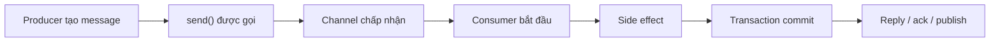
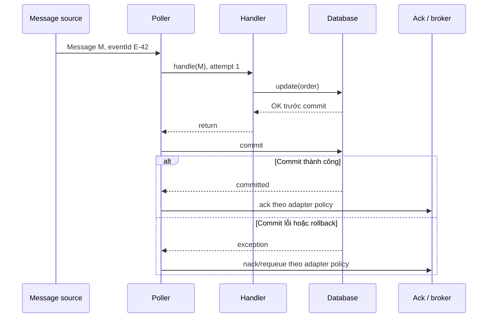

# Test concurrency, ordering và backpressure trong Spring Integration Runtime

## 1. Bài toán: cùng một message flow, ba kiểu lỗi khác nhau

Một hệ thống nhận các sự kiện đơn hàng, chuyển chúng qua `ExecutorChannel` để gọi dịch vụ tồn kho, sau đó dùng aggregator để chờ kết quả của từng đơn. Ở môi trường phát triển với một message/lần, flow hoạt động bình thường. Khi tăng tải, ba vấn đề xuất hiện:

1. **Concurrency:** hai worker cùng cập nhật một correlation group khiến output được gửi hai lần hoặc state bị ghi đè.
2. **Ordering:** sự kiện `CREATED` được gửi trước `CANCELLED` nhưng `CANCELLED` hoàn tất xử lý trước.
3. **Backpressure:** producer đẩy nhanh hơn consumer, queue hoặc executor tăng backlog, ứng dụng hết memory hay bắt đầu từ chối task.

Trong chương **Testing runtime** của module **SPRING_INTEGRATION_RUNTIME**, bài **“Test concurrency, ordering và backpressure”** hướng dẫn cách chứng minh bằng kiểm thử thay vì kết luận từ thời gian chạy thuận lợi. Các ví dụ gắn với channel, endpoint, consumer, poller, executor, `IntegrationFlow` lifecycle, message store, transaction, retry, error handling và correlation.

Mục tiêu sau bài:

- Diễn đạt một **invariant** có thể assert cho từng loại hành vi: safety, ordering, liveness và bounded resource usage.
- Viết kiểm thử đa thread **có điều phối bằng latch/barrier**, ít phụ thuộc lịch OS.
- Kiểm tra thứ tự **gửi**, **nhận**, **bắt đầu xử lý**, **hoàn tất**, **commit** và **publish** như những khái niệm khác nhau.
- Kiểm tra backpressure bằng `request(n)`, `StepVerifier` và các giới hạn queue/concurrency.
- Thiết lập test context Spring Integration, mô phỏng source/handler/trigger và khôi phục các mock giữa test.
- Dùng failure injection, metrics và log để phát hiện race, retry trùng, backlog và timeout mà không tạo test flaky.

Các mẫu Java nhắm tới Java 17+, JUnit Jupiter, Spring Integration 6.x, Spring Test và Reactor; chọn dependency versions tương thích trong dự án. Ví dụ unit test thuần channel không cần khởi tạo application context; integration test yêu cầu các bean và Spring Integration infrastructure tương ứng.

## 2. Bốn câu hỏi cần tách bạch trước khi test

| Thuộc tính | Câu hỏi kiểm thử | Ví dụ invariant |
| --- | --- | --- |
| **Safety / mutual exclusion** | Có hai thao tác xung đột chạy cùng lúc không? | Với cùng `orderId`, không có hai writer cùng vào critical section. |
| **Ordering** | Thứ tự nào phải được bảo toàn, tại ranh giới nào? | Các event thuộc cùng partition được **commit** theo `sequenceNumber` tăng dần. |
| **Liveness** | Một message hợp lệ có hoàn tất trong thời gian hữu hạn không? | Khi downstream tiếp tục hoạt động, tất cả N message được xử lý hoặc đưa vào error/DLQ đúng hạn. |
| **Backpressure / boundedness** | Khi consumer chậm, producer bị giới hạn ra sao? | In-flight không vượt 32; producer không tạo vô hạn task chưa được xử lý. |

Hai chỉ số “đã xử lý 10.000 message” và “không có exception” **không chứng minh** cả bốn thuộc tính. Có thể đã mất message, xử lý trùng, đảo thứ tự rồi mới hoàn tất.

### 2.1. Các mốc trong vòng đời message



Không phải flow nào cũng đi đủ các bước theo đúng thứ tự sơ đồ; đây là mô hình để đặt câu hỏi. Một `ExecutorChannel` có thể trả từ `send()` trước khi handler bắt đầu. Broker có thể ack ở một vị trí khác DB commit. Một `Mono` cold có thể chưa thực thi trước khi có subscriber.

Vì vậy, một bài test phải ghi rõ đang assert **acceptance order**, **dequeue order**, **handler invocation order** hay **business completion order**. “Message đến đúng thứ tự” là phát biểu không đủ chính xác.

## 3. Semantics của channel định hình điều được phép kỳ vọng

| Channel / endpoint | Mô hình | Điều có thể test | Không nên giả định |
| --- | --- | --- | --- |
| `DirectChannel` | Đồng bộ trên thread sender | Với **một sender gửi tuần tự** và một subscriber đồng bộ, processing theo thứ tự send | Nhiều sender đồng thời sẽ có total order duy nhất hoặc tự được serialize. |
| `ExecutorChannel` | Handoff sang `TaskExecutor` | Số tasks, rejection, async error, max concurrency | Thứ tự **hoàn tất** giống thứ tự gửi khi executor có nhiều workers. |
| `QueueChannel` | Buffer kiểu FIFO theo cấu hình thông thường | Receive order của một consumer và capacity | Nhiều consumers hoàn tất FIFO, hoặc JDBC/broker khác có cùng semantics. |
| `PriorityChannel` | Ưu tiên theo comparator/priority | Dequeue theo priority trong những phần tử còn đang đợi | Thứ tự arrival sẽ được giữ, nhất là khi poller chạy song song. |
| `PublishSubscribeChannel` | Fan-out đến subscribers | Mỗi subscriber nhận theo routing contract, error policy | Một global order khi dùng executor hoặc fan-out async. |
| `FluxMessageChannel` | `Publisher<Message<?>>` với reactive subscriber | Demand, cancellation, completion và operator behavior | Durable queue, ack broker hoặc end-to-end backpressure nếu upstream imperative. |
| Aggregator | Nhóm theo correlation key | Release đủ điều kiện, không double-release, late-arrival policy | Arrival order tự là business sequence order. |
| Resequencer | Lưu và release theo `sequenceNumber` | Reordering của **cùng correlation group** | Giải quyết mọi gap vô hạn hoặc thông lượng như pass-through channel. |

Spring Integration Java DSL có `.resequence()`; mặc định nó dựa vào `CORRELATION_ID` và `SEQUENCE_NUMBER`/`SEQUENCE_SIZE`, khác với việc chỉ bật nhiều threads. Một flow có thể cần resequencer **trước** các bước đòi thứ tự, nhưng cũng cần kiểm thử gap, duplicate, timeout và trạng thái group sau restart.

### 3.1. Một giả định sai phổ biến

```text
send(M1); send(M2);            // Producer đã gửi M1 trước M2

Executor worker A: M1 bắt đầu → I/O mất 300 ms
Executor worker B: M2 bắt đầu → I/O mất 10 ms

M2 hoàn tất, commit trước M1.
```

Ở đây không nhất thiết có bug trong `ExecutorChannel`. Test sai thường đòi “parallel execution nhưng mọi kết quả phải hoàn tất FIFO” mà không đưa vào thiết kế ordering: **single-thread executor, partitioned workers, `concatMap`, resequencer hoặc điều phối theo khóa**.

## 4. Test pyramid và công cụ phù hợp

| Mức test | Công cụ | Nên kiểm tra |
| --- | --- | --- |
| Unit test thuần Java | JUnit Jupiter, `CountDownLatch`, `CyclicBarrier`, `ExecutorService` | Shared state, race, locking, concurrency cap và timeouts. |
| Channel test | Spring Integration `DirectChannel`, `ExecutorChannel`, `QueueChannel` | Thực tế dispatch, buffer, order và error. |
| Integration flow test | Spring Test, `@SpringJUnitConfig`, `@SpringIntegrationTest` | Bean wiring, endpoint lifecycle, poller, advice, flow output. |
| Reactive operator test | Reactor `StepVerifier`, `VirtualTimeScheduler`, `TestPublisher` | Demand, backpressure, cancellation, retry/backoff và error. |
| Backend test | Testcontainers hoặc environment DB/broker phù hợp | JDBC message store, ack/redelivery, distributed lock và transaction. |
| Load/soak test | K6/Gatling hoặc generator phù hợp, metrics/traces | Latency under load, backlog growth, resource saturation và leak. |

**Không dùng mock để chứng minh thuộc tính của backend thật.** Một `ConcurrentHashMap` test không chứng minh `JdbcMessageStore` atomic trên hai JVM. Một `Flux.range` test không chứng minh broker adapter quản lý prefetch/ack theo demand khi network mất kết nối.

### 4.1. Thư viện test thường cần

- `spring-integration-test` cho test context, `MockIntegrationContext` và các test utilities.
- `spring-test` và JUnit Jupiter cho context/test lifecycle.
- `reactor-test` cho `StepVerifier` và `TestPublisher`.
- Tùy tình huống: Mockito, Awaitility (không bắt buộc), Testcontainers và drivers/backend thực.

Đừng thêm tất cả thư viện chỉ để làm một unit test channel. Chọn hạ tầng ít nhất nhưng đủ tái hiện failure mode.

## 5. Nguyên tắc kiểm thử concurrency không flaky

**Một test concurrency đáng tin cần điều khiển được điểm giao nhau** giữa các threads. `Thread.sleep(100)` không phải một synchronization primitive: chạy trên CI chậm hoặc môi trường có GC pause có thể đổi toàn bộ lịch thực thi.

### 5.1. Dùng latch/barrier thay vì sleep

```text
Test thread:
  tạo 4 tasks
  chờ cả 4 tasks đã vào critical section / điểm quan sát
  assert đúng condition
  release tất cả tasks
  await completion (timeout hữu hạn)

Worker threads:
  signal "entered"
  await "release"
  xử lý và signal completion
```

Các công cụ có vai trò khác nhau:

| Công cụ | Khi dùng | Lưu ý |
| --- | --- | --- |
| `CountDownLatch` | Chờ N sự kiện xảy ra, rồi mở một gate | Không reset được; một latch thường dùng cho một phase. |
| `CyclicBarrier` | N threads cùng đến một điểm rồi tiếp tục | Nếu một worker lỗi/timeout, barrier bị broken; xử lý exception rõ ràng. |
| `Phaser` | Nhiều phase hoặc số participants thay đổi | Phù hợp stress test theo vòng, nhưng dễ phức tạp nếu không cần. |
| `Semaphore` | Giới hạn concurrency theo permits | Kiểm tra bảo vệ tài nguyên và bounded in-flight. |
| `AtomicInteger`/`LongAdder` | Đếm attempts, đang chạy, peak concurrency | Không thay thế business-level atomicity của một transaction. |
| `Future.get(timeout)` | Nhận exception và kết quả từ worker | Không để test treo vô hạn khi task bị deadlock. |
| `ExecutorService.shutdownNow()` | Cleanup nếu test lỗi/timeout | Luôn release gates trong `finally` trước khi shutdown. |

### 5.2. Một test phải có cả điều kiện dương và điều kiện âm

Không chỉ assert “đã nhận N messages” mà cần kiểm tra:

1. **Có thật sự tạo được concurrent execution?** Nếu không, test không chạm vào race.
2. **Điều gì bị cấm?** Ví dụ hai thread cùng sửa group hoặc size vượt bound.
3. **Điều gì phải tiến triển?** Sau khi mở gate, các tác vụ hoàn tất trong deadline.
4. **Không còn resource leak?** Executor được shutdown, mock endpoint reset, subscription cancel và DB rollback/cleanup theo quy trình.

Một test pass vì tasks vô tình chạy tuần tự là **false confidence**, không phải bằng chứng an toàn dưới concurrency.

## 6. Test 1 — `DirectChannel` đồng bộ nhưng nhiều sender vẫn chạy đồng thời

Nhầm lẫn thường gặp: “`DirectChannel` là đồng bộ, do đó mọi handler invocation đều nối đuôi nhau”. Thực tế **đồng bộ theo từng lời gọi `send()`**: mỗi sender thực thi handler trên thread của chính sender; nếu có nhiều senders, chúng có thể vào handler cùng lúc.

Test sau **buộc bốn sender gặp nhau bên trong handler** và đo peak concurrency:

```java
import static org.junit.jupiter.api.Assertions.*;

import java.util.ArrayList;
import java.util.List;
import java.util.concurrent.Callable;
import java.util.concurrent.CountDownLatch;
import java.util.concurrent.ExecutorService;
import java.util.concurrent.Executors;
import java.util.concurrent.Future;
import java.util.concurrent.TimeUnit;
import java.util.concurrent.atomic.AtomicInteger;

import org.junit.jupiter.api.Test;
import org.springframework.integration.channel.DirectChannel;
import org.springframework.messaging.support.MessageBuilder;

class DirectChannelConcurrencyTest {

    @Test
    void concurrentSendersCanRunTheSameSubscriberConcurrently()
            throws Exception {
        int senders = 4;
        DirectChannel channel = new DirectChannel();
        ExecutorService pool = Executors.newFixedThreadPool(senders);

        CountDownLatch enteredHandler = new CountDownLatch(senders);
        CountDownLatch releaseHandler = new CountDownLatch(1);
        AtomicInteger inFlight = new AtomicInteger();
        AtomicInteger maxInFlight = new AtomicInteger();
        List<Future<?>> futures = new ArrayList<>();

        channel.subscribe(message -> {
            int active = inFlight.incrementAndGet();
            maxInFlight.accumulateAndGet(active, Math::max);
            enteredHandler.countDown();
            try {
                if (!releaseHandler.await(5, TimeUnit.SECONDS)) {
                    throw new IllegalStateException("Handler gate timeout");
                }
            } catch (InterruptedException ex) {
                Thread.currentThread().interrupt();
                throw new IllegalStateException(ex);
            } finally {
                inFlight.decrementAndGet();
            }
        });

        try {
            for (int i = 0; i < senders; i++) {
                final int number = i;
                futures.add(pool.submit((Callable<Boolean>) () ->
                        channel.send(MessageBuilder
                                .withPayload(number)
                                .build())));
            }

            assertTrue(enteredHandler.await(3, TimeUnit.SECONDS),
                    "All senders must reach the handler");
            assertEquals(senders, maxInFlight.get(),
                    "Concurrent sends must overlap");

            releaseHandler.countDown();
            for (Future<?> future : futures) {
                assertEquals(Boolean.TRUE, future.get(3, TimeUnit.SECONDS));
            }
            assertEquals(0, inFlight.get());
        } finally {
            releaseHandler.countDown(); // Không giữ worker nếu assert fail.
            pool.shutdownNow();
            assertTrue(pool.awaitTermination(3, TimeUnit.SECONDS));
        }
    }
}
```

**Test chứng minh:** có bốn lời gọi `send()` đang chờ hoàn tất trong handler cùng lúc. Nó **không** chứng minh thứ tự xử lý, vì bốn sender khởi phát đồng thời và thứ tự được scheduler quyết định.

Nếu nghiệp vụ yêu cầu cập nhật cùng `orderId` tuần tự, phải thêm bảo vệ: `LockRegistry` theo correlation key, database optimistic locking, single-thread partition executor hoặc cơ chế khác phù hợp. Không kết luận `DirectChannel` đã cung cấp group-level mutex.

### 6.1. Test an toàn của `LockRegistry`: đo critical section, không chỉ đo kết quả

Mô hình test bổ sung:

```text
Input: 100 messages, 10 correlation keys.

Worker:
  lockRegistry.obtain(groupId).lock()
  try:
    activeForGroup[groupId]++
    assert activeForGroup[groupId] == 1
    update group
  finally:
    activeForGroup[groupId]--
    unlock

Kỳ vọng:
  max active cùng một group = 1
  max active toàn flow có thể > 1
  tất cả group được xử lý, không deadlock.
```

Đây là pseudo-code cho property test. Với multi-node, phải dùng **distributed** `LockRegistry` và shared `MessageGroupStore` trong integration test; `DefaultLockRegistry` chỉ bảo vệ trong JVM của nó. Cần fault injection mất lease, node chết và stale writer nếu hệ thống dựa vào khóa phân tán.

## 7. Test 2 — Thứ tự của một producer và thứ tự hoàn tất không giống nhau

### 7.1. Positive control: `DirectChannel` với một sender duy nhất

```java
import static org.junit.jupiter.api.Assertions.assertEquals;

import java.util.ArrayList;
import java.util.List;
import org.junit.jupiter.api.Test;
import org.springframework.integration.channel.DirectChannel;
import org.springframework.messaging.support.MessageBuilder;

class DirectChannelOrderTest {

    @Test
    void sequentialSendFromOneThreadPreservesInvocationOrder() {
        DirectChannel channel = new DirectChannel();
        List<Integer> handled = new ArrayList<>();

        channel.subscribe(message ->
                handled.add((Integer) message.getPayload()));

        for (int sequence = 1; sequence <= 5; sequence++) {
            channel.send(MessageBuilder
                    .withPayload(sequence)
                    .build());
        }

        assertEquals(List.of(1, 2, 3, 4, 5), handled);
    }
}
```

Test có **một subscriber và một sender**, handler không tự khởi động async task. Nó chứng minh thứ tự *invocation/return* trong điều kiện này, không chứng minh điều tương tự khi một caller gọi `send()` từ nhiều threads hoặc khi handler publish sang `ExecutorChannel`.

### 7.2. Test FIFO enqueue/dequeue của `QueueChannel`

```java
import static org.junit.jupiter.api.Assertions.*;

import org.junit.jupiter.api.Test;
import org.springframework.integration.channel.QueueChannel;
import org.springframework.messaging.Message;
import org.springframework.messaging.support.MessageBuilder;

class QueueChannelOrderTest {

    @Test
    void singleConsumerReceivesInFifoOrder() {
        QueueChannel queue = new QueueChannel(3);

        assertTrue(queue.send(MessageBuilder.withPayload(1).build()));
        assertTrue(queue.send(MessageBuilder.withPayload(2).build()));
        assertTrue(queue.send(MessageBuilder.withPayload(3).build()));

        for (int expected = 1; expected <= 3; expected++) {
            Message<?> received = queue.receive(1_000);
            assertNotNull(received);
            assertEquals(expected, received.getPayload());
        }
        assertEquals(0, queue.getQueueSize());
    }
}
```

Đây là queue trong bộ nhớ với **một consumer** và không có `PriorityChannel` hay external broker. Thứ tự FIFO ở bước dequeue **không** bảo đảm nhiều consumers sẽ hoàn tất, commit hoặc gửi reply theo FIFO.

### 7.3. Test đảo thứ tự được điều khiển ở `ExecutorChannel`

Đừng dùng `Thread.sleep(300)` để “hy vọng” message 2 kết thúc trước message 1. Ta cố ý **chặn handler của message 1**, chờ message 2 hoàn tất rồi mới mở gate:

```java
import static org.junit.jupiter.api.Assertions.*;

import java.util.List;
import java.util.concurrent.ConcurrentLinkedQueue;
import java.util.concurrent.CountDownLatch;
import java.util.concurrent.ExecutorService;
import java.util.concurrent.Executors;
import java.util.concurrent.TimeUnit;

import org.junit.jupiter.api.Test;
import org.springframework.integration.channel.ExecutorChannel;
import org.springframework.messaging.support.MessageBuilder;

class ExecutorChannelOrderTest {

    @Test
    void completionCanBeOutOfSendOrder() throws Exception {
        ExecutorService executor = Executors.newFixedThreadPool(2);
        ExecutorChannel channel = new ExecutorChannel(executor);

        CountDownLatch firstStarted = new CountDownLatch(1);
        CountDownLatch releaseFirst = new CountDownLatch(1);
        CountDownLatch secondFinished = new CountDownLatch(1);
        CountDownLatch bothFinished = new CountDownLatch(2);
        ConcurrentLinkedQueue<Integer> completion = new ConcurrentLinkedQueue<>();

        channel.subscribe(message -> {
            int id = (Integer) message.getPayload();
            if (id == 1) {
                firstStarted.countDown();
                try {
                    if (!releaseFirst.await(5, TimeUnit.SECONDS)) {
                        throw new IllegalStateException("Gate timeout");
                    }
                } catch (InterruptedException ex) {
                    Thread.currentThread().interrupt();
                    throw new IllegalStateException(ex);
                }
            }
            completion.add(id);
            if (id == 2) {
                secondFinished.countDown();
            }
            bothFinished.countDown();
        });

        try {
            assertTrue(channel.send(
                    MessageBuilder.withPayload(1).build()));
            assertTrue(firstStarted.await(2, TimeUnit.SECONDS));

            assertTrue(channel.send(
                    MessageBuilder.withPayload(2).build()));
            assertTrue(secondFinished.await(2, TimeUnit.SECONDS));
            assertEquals(List.of(2), List.copyOf(completion));

            releaseFirst.countDown();
            assertTrue(bothFinished.await(2, TimeUnit.SECONDS));
            assertEquals(List.of(2, 1), List.copyOf(completion));
        } finally {
            releaseFirst.countDown();
            executor.shutdownNow();
            assertTrue(executor.awaitTermination(3, TimeUnit.SECONDS));
        }
    }
}
```

Test chứng minh một `ExecutorChannel` với executor hai worker **có thể** hoàn tất message 2 trước 1 dù producer gửi 1 trước 2. Đây là **expected semantics**, không phải lỗi của Spring Integration.

**Hệ quả về transaction/error:** lời gọi `send()` có thể trả thành công trước khi worker xử lý. Nếu worker về sau ném exception, exception không tự đi ngược vào transaction của sender đã kết thúc. Với một flow thực, test cả `errorChannel`/ack/retry và **commit order**, không chỉ danh sách callback.

## 8. Test 3 — Resequencer khôi phục thứ tự theo correlation và sequence

Khi nghiệp vụ **bắt buộc** xuất ra theo `sequenceNumber`, hãy kiểm thử một thành phần có contract ordering, thay vì yêu cầu `ExecutorChannel` tự giữ FIFO completion.

Spring Integration resequencer:

- Gom message theo `CORRELATION_ID`.
- Dùng `SEQUENCE_NUMBER` để sắp thứ tự.
- Dựa vào `SEQUENCE_SIZE`/release strategy để biết khi nào đủ phần.
- Có tùy chọn release partial sequences, timeout, discard channel và `MessageGroupStore`.

### 8.1. Flow cấu hình

```java
import org.springframework.context.annotation.Bean;
import org.springframework.context.annotation.Configuration;
import org.springframework.integration.channel.DirectChannel;
import org.springframework.integration.channel.QueueChannel;
import org.springframework.integration.config.EnableIntegration;
import org.springframework.integration.dsl.IntegrationFlow;
import org.springframework.messaging.MessageChannel;
import org.springframework.messaging.PollableChannel;

@Configuration
@EnableIntegration
public class ResequencerTestConfiguration {

    @Bean("unordered")
    public MessageChannel unordered() {
        return new DirectChannel();
    }

    @Bean("ordered")
    public PollableChannel ordered() {
        return new QueueChannel();
    }

    @Bean
    public IntegrationFlow resequenceFlow() {
        return IntegrationFlow.from("unordered")
                .resequence()
                .channel("ordered")
                .get();
    }
}
```

### 8.2. Test gửi 3 → 1 → 2 và nhận 1 → 2 → 3

```java
import static org.junit.jupiter.api.Assertions.*;

import org.junit.jupiter.api.Test;
import org.springframework.context.annotation.AnnotationConfigApplicationContext;
import org.springframework.integration.IntegrationMessageHeaderAccessor;
import org.springframework.messaging.MessageChannel;
import org.springframework.messaging.PollableChannel;
import org.springframework.messaging.support.MessageBuilder;

class ResequencerOrderTest {

    @Test
    void releasesOneGroupInSequenceNumberOrder() {
        try (var context = new AnnotationConfigApplicationContext(
                ResequencerTestConfiguration.class)) {
            MessageChannel input =
                    context.getBean("unordered", MessageChannel.class);
            PollableChannel output =
                    context.getBean("ordered", PollableChannel.class);

            sendPart(input, 3);
            sendPart(input, 1);

            // Default: chưa đủ sequence, chưa release partial.
            assertNull(output.receive(0));

            sendPart(input, 2);

            for (int expected = 1; expected <= 3; expected++) {
                var part = output.receive(1_000);
                assertNotNull(part);
                assertEquals("part-" + expected, part.getPayload());
            }
        }
    }

    private static void sendPart(MessageChannel input, int number) {
        assertTrue(input.send(MessageBuilder.withPayload("part-" + number)
                .setHeader(IntegrationMessageHeaderAccessor.CORRELATION_ID, "batch-42")
                .setHeader(IntegrationMessageHeaderAccessor.SEQUENCE_NUMBER, number)
                .setHeader(IntegrationMessageHeaderAccessor.SEQUENCE_SIZE, 3)
                .build()));
    }
}
```

Đây là integration test với **một correlation group** và store in-memory mặc định. Trong thực tế nên thêm test:

1. Hai group (`batch-42` và `batch-43`) xen kẽ nhau không bị trộn.
2. Duplicate sequence number và late-arriving message được xử lý theo strategy/policy thực tế.
3. Thiếu sequence 2 khiến nhóm chờ; timeout/partial release quyết định outcome.
4. Một filter upstream loại mất phần tử nhưng `sequenceSize` vẫn giữ 3.
5. Restart trong lúc nhóm chưa đủ, so sánh `SimpleMessageStore` với `JdbcMessageStore`.
6. Hai JVM cùng cập nhật persistent group store phải có distributed lock registry thích hợp.

**Không đồng nhất resequencer với exactly-once.** Nó sắp thứ tự phần tử trong nhóm theo contract; không bảo đảm source không redeliver hay downstream không xử lý cùng business event hai lần.

## 9. Test 4 — Bounded `QueueChannel` và dấu hiệu quá tải

**Capacity** là giới hạn số message đang nằm trong hàng đợi, không phải giới hạn tổng message đã gửi suốt đời ứng dụng. Với queue có capacity 2 và không có consumer, lần gửi thứ ba không thể enqueue ngay nếu hai slot còn bị chiếm.

```java
import static org.junit.jupiter.api.Assertions.*;

import org.junit.jupiter.api.Test;
import org.springframework.integration.channel.QueueChannel;
import org.springframework.messaging.Message;
import org.springframework.messaging.support.MessageBuilder;

class BoundedQueueTest {

    @Test
    void rejectsImmediateSendWhenQueueIsFull() {
        QueueChannel queue = new QueueChannel(2);

        assertTrue(queue.send(MessageBuilder.withPayload("A").build(), 0));
        assertTrue(queue.send(MessageBuilder.withPayload("B").build(), 0));

        assertEquals(2, queue.getQueueSize());
        assertEquals(0, queue.getRemainingCapacity());

        // timeout=0: không chờ để có thêm capacity.
        assertFalse(queue.send(MessageBuilder.withPayload("C").build(), 0));

        Message<?> first = queue.receive(0);
        assertNotNull(first);
        assertEquals("A", first.getPayload());
        assertEquals(1, queue.getRemainingCapacity());

        assertTrue(queue.send(MessageBuilder.withPayload("C").build(), 0));
        assertEquals("B", queue.receive(0).getPayload());
        assertEquals("C", queue.receive(0).getPayload());
    }
}
```

Test chứng minh **bounded buffering và non-blocking offer** theo `QueueChannel` memory implementation. Một flow có thể chọn policy khác khi full: chờ một khoảng timeout, báo failure, route fallback, DLQ hoặc giới hạn rate upstream.

### 9.1. Không nhầm bounded queue với Reactive Streams backpressure

Queue có capacity 2 chỉ nói rằng sau hai message, phép enqueue tiếp sẽ phải **chờ hoặc thất bại** theo timeout/policy. Nó chưa có giao thức `Subscriber.request(n)`, cũng không đảm bảo upstream publisher tự giảm nhu cầu phát message.

| Cơ chế | Ý nghĩa | Cần test thêm |
| --- | --- | --- |
| `QueueChannel(capacity)` | Giới hạn số message lưu trong channel | Producer block/reject; mất dữ liệu khi crash nếu in-memory. |
| `ExecutorChannel` + bounded executor | Giới hạn workers và task queue | Rejection handler, error routing, task in-flight. |
| Reactive Streams `request(n)` | Subscriber thông báo demand | Upstream có thực sự tuân thủ demand không? |
| Broker prefetch / consumer credits | Buffer/credit do protocol adapter quản lý | Offset/ack/commit, redelivery và backpressure bridge. |
| Rate limiter / bulkhead | Giới hạn request rate hoặc concurrency | Bị quá tải có reject, retry hay chờ; fairness theo tenant. |

Đặc biệt, tăng `QueueChannel` capacity có thể làm hệ thống **chịu burst tốt hơn**, nhưng không tăng processing capacity của consumer; dưới tải duy trì cao hơn service rate, backlog vẫn tăng cho đến khi đầy.

## 10. Test 5 — Reactive Streams chỉ phát khi có demand

Để kiểm tra **Reactive Streams protocol**, test cần khởi tạo subscriber với demand ban đầu bằng 0, sau đó cấp từng số lượng `request(n)`. Reactor `StepVerifier` hỗ trợ điều này với `create(publisher, initialRequest)` và `thenRequest(n)`.

```java
import static org.junit.jupiter.api.Assertions.assertEquals;

import java.time.Duration;
import java.util.concurrent.atomic.AtomicLong;
import org.junit.jupiter.api.Test;
import reactor.core.publisher.Flux;
import reactor.test.StepVerifier;

class ReactiveDemandTest {

    @Test
    void publisherRespectsSubscriberDemand() {
        AtomicLong requested = new AtomicLong();

        Flux<Integer> source = Flux.range(1, 3)
                .doOnRequest(requested::addAndGet);

        StepVerifier.create(source, 0)
                .expectSubscription()
                .expectNoEvent(Duration.ofMillis(20))
                .thenRequest(1)
                .expectNext(1)
                .thenRequest(2)
                .expectNext(2, 3)
                .verifyComplete();

        assertEquals(3L, requested.get());
    }
}
```

**Điều đã kiểm chứng:** publisher `Flux.range` chưa phát `onNext` khi subscriber không yêu cầu, sau đó phát đúng số lượng đã request. Đây là một *protocol-level unit test*, chưa chứng minh Spring Integration adapter cụ thể nối qua broker/file/JDBC cũng điều tiết upstream theo demand.

### 10.1. `FluxMessageChannel` nằm trong bài test ở đâu?

`FluxMessageChannel` vừa nhận Spring messages, vừa là `Publisher<Message<?>>` cho reactive subscriber. Nó không phải `SubscribableChannel`/`PollableChannel` thông thường. Khi cần kiểm thử một flow thực với `FluxMessageChannel`:

1. Tạo test source dạng `Publisher<Message<?>>` có thể ghi lại số lần `request(n)`.
2. Nối source với `ReactiveStreamsSubscribableChannel.subscribeTo(...)` hoặc DSL tương ứng.
3. Subscribe bằng `StepVerifier` với initial demand nhỏ, hoặc dùng `BaseSubscriber` tự điều khiển request.
4. Xác minh **upstream requested count**, số message đã được handler tiêu thụ, error/completion và cancellation.
5. Thử publisher chậm/nhanh hơn consumer, có/không có `publishOn`, và đo buffer/in-flight.
6. Lặp lại với **adapter thật** nếu yêu cầu bảo đảm backpressure xuyên nguồn.

**Điểm giới hạn:** khi một imperative producer gọi `channel.send(message)` liên tục, phản ứng khi chưa có downstream demand phụ thuộc semantics/buffer của channel và phiên bản triển khai. Không lấy test `Flux.range` ở trên làm bằng chứng mọi trường hợp `FluxMessageChannel` đều chặn sender thay vì buffer/reject.

### 10.2. Kiểm thử backpressure của reactive handler

Spring Integration có `ReactiveMessageHandler` trả `Mono<Void>`; khi nó chạy trong `ReactiveStreamsConsumer`, framework có thể compose publisher vào stream bằng `flatMap`, tôn trọng demand trong phạm vi pipeline. Khi handler được bọc để dùng trong imperative flow, framework có thể subscribe ngay, khiến không còn **end-to-end** demand propagation.

Vì vậy cần ít nhất hai test khác nhau:

| Test | Input | Kết luận mong muốn |
| --- | --- | --- |
| Reactive consumer | `FluxMessageChannel` + reactive handler | Demand/in-flight được giới hạn theo subscriber/operator. |
| Imperative bridge | `DirectChannel` → handler trả `Mono` | Hoạt động async có thể tách khỏi demand downstream; cần kiểm soát buffering riêng. |

Một pipeline có `Mono` không tự trở thành “backpressure-ready”. Muốn chứng minh, phải đo **demand tại nguồn**, không chỉ việc handler không block ở lời gọi đầu.

## 11. Test 6 — Timeout, retry và cancellation bằng virtual time

Test có `delay` hoặc exponential backoff không nên chờ theo wall clock nhiều phút. Reactor `StepVerifier.withVirtualTime(...)` cho phép điều khiển scheduler ảo khi publisher được tạo **trong supplier**, sau lúc scheduler test đã sẵn sàng.

### 11.1. Kiểm tra timeout mà không chờ thật

```java
import java.time.Duration;
import java.util.concurrent.TimeoutException;
import org.junit.jupiter.api.Test;
import reactor.core.publisher.Mono;
import reactor.test.StepVerifier;

class ReactiveTimeoutTest {

    @Test
    void timesOutUnresponsiveOperation() {
        StepVerifier.withVirtualTime(
                    () -> Mono.<String>never()
                            .timeout(Duration.ofMinutes(5)))
                .expectSubscription()
                .thenAwait(Duration.ofMinutes(5))
                .expectError(TimeoutException.class)
                .verify();
    }
}
```

Test này **không hề gọi remote API thật**. Nó chỉ xác nhận publisher timeout theo virtual clock. Nếu cần kiểm tra HTTP client, broker cancellation, DB transaction hoặc network timeout thực, phải có integration test riêng với backend/adapter thích hợp.

### 11.2. Retry có thể subscribe lại và tạo duplicate side effect

Ví dụ một publisher cold gửi request khi subscribe, upstream có thể được gọi lại sau `retryWhen`:

```java
import static org.junit.jupiter.api.Assertions.assertEquals;

import java.util.concurrent.atomic.AtomicInteger;
import org.junit.jupiter.api.Test;
import reactor.core.publisher.Mono;
import reactor.test.StepVerifier;

class ReactiveRetryTest {

    @Test
    void retryCanSubscribeMultipleTimes() {
        AtomicInteger invocations = new AtomicInteger();

        Mono<String> operation = Mono.defer(() -> {
            int current = invocations.incrementAndGet();
            return current < 3
                    ? Mono.error(new IllegalStateException("temporary"))
                    : Mono.just("OK");
        }).retry(2);

        StepVerifier.create(operation)
                .expectNext("OK")
                .verifyComplete();

        assertEquals(3, invocations.get()); // 1 lần đầu + 2 retries.
    }
}
```

Khi side effect là thanh toán, gửi email hoặc gọi HTTP, số subscription **không** bằng số nghiệp vụ hợp lệ duy nhất. Test phải có **idempotency key** và kiểm tra backend state cuối, không chỉ `StepVerifier.verifyComplete()`.

### 11.3. Cancellation không có nghĩa đã rollback external side effect

```java
import java.time.Duration;
import org.junit.jupiter.api.Test;
import reactor.core.publisher.Flux;
import reactor.test.StepVerifier;

class CancellationTest {

    @Test
    void subscriberCanCancelAfterTwoItems() {
        StepVerifier.withVirtualTime(() ->
                        Flux.interval(Duration.ofSeconds(1)))
                .expectSubscription()
                .thenAwait(Duration.ofSeconds(2))
                .expectNext(0L, 1L)
                .thenCancel()
                .verify();
    }
}
```

Kết quả cho thấy subscriber ngừng nhận thêm item theo subscription. Nó **không** chứng minh broker đã rewind offset, database đã rollback hoặc một HTTP request đã được hủy ở remote server.

### 11.4. Virtual time không áp dụng cho mọi clock

Không mong `VirtualTimeScheduler` tự điều khiển:

- `Thread.sleep` trong Java handler.
- `TaskScheduler` của một Spring Integration poller đang chạy thật.
- Bộ đếm timeout từ database, socket, JMS/Kafka broker hoặc Redis.
- `ExecutorService`/`ScheduledExecutorService` tùy chỉnh nằm ngoài Reactor.

Với những phần đó, dùng **fake clock/trigger, latch, test scheduler phù hợp hoặc backend test có deadline**. Một test virtual time pass không thể thay cho việc xác minh retry/ack trong môi trường broker thật.

## 12. Harness kiểm thử Spring Integration: kiểm soát source, poller và handler

Spring Integration có module `spring-integration-test` để nâng cấp Spring Test context. Annotation `@SpringIntegrationTest` đăng ký `MockIntegrationContext`, cho phép thay thế một source/handler thuộc endpoint đang tồn tại. Việc này rất hữu ích khi production flow có adapter kết nối database, SFTP hoặc broker mà unit/integration test không muốn tự động mở kết nối thật.

### 12.1. Test context không tự khởi động inbound endpoint

```java
import org.junit.jupiter.api.AfterEach;
import org.springframework.beans.factory.annotation.Autowired;
import org.springframework.integration.test.context.MockIntegrationContext;
import org.springframework.integration.test.context.SpringIntegrationTest;
import org.springframework.test.context.junit.jupiter.SpringJUnitConfig;

@SpringJUnitConfig(YourFlowConfiguration.class)
@SpringIntegrationTest(noAutoStartup = {"ordersInboundAdapter", "*RemoteSource*"})
class FlowHarnessSkeleton {

    @Autowired
    MockIntegrationContext mocks;

    @AfterEach
    void restoreMocks() {
        mocks.resetBeans();
    }
}
```

`YourFlowConfiguration` ở đây là class cấu hình flow cần test của ứng dụng, không phải class framework. `noAutoStartup` nhận các pattern tên endpoint, ngăn những component tương ứng khởi động theo `autoStartup=true` mặc định. **Nó không tự thay thế source**; phải gọi API của `MockIntegrationContext` trước khi start endpoint test.

Các API quan trọng:

| API | Thay thế thành phần gì? | Điểm dễ nhầm |
| --- | --- | --- |
| `substituteMessageSourceFor(endpointId, source)` | `MessageSource<?>` của `SourcePollingChannelAdapter` | `endpointId` là bean name endpoint, không phải tên channel output. |
| `substituteMessageHandlerFor(endpointId, handler)` | `MessageHandler` bên trong `IntegrationConsumer` | `endpointId` không nhất thiết trùng bean name của POJO method. |
| `substituteTriggerFor(endpointId, trigger)` | `Trigger` của polling endpoint (từ Spring Integration 6.3) | Phải thay trigger trước khi endpoint start. |
| `resetBeans()` | Khôi phục component đã bị thay trong test | Gọi sau mỗi test, tránh rò state sang test kế tiếp. |

### 12.2. Test one-shot poller đầy đủ

Ví dụ dưới dùng `OnlyOnceTrigger` để poll một lần, không cần `Thread.sleep` chờ fixed delay.

**`OneShotPollerConfiguration.java`**

```java
import java.time.Duration;
import org.springframework.context.annotation.Bean;
import org.springframework.context.annotation.Configuration;
import org.springframework.integration.channel.QueueChannel;
import org.springframework.integration.config.EnableIntegration;
import org.springframework.integration.core.MessageSource;
import org.springframework.integration.dsl.IntegrationFlow;
import org.springframework.integration.dsl.Pollers;
import org.springframework.messaging.PollableChannel;

@Configuration
@EnableIntegration
public class OneShotPollerConfiguration {

    @Bean("pollResults")
    public PollableChannel pollResults() {
        return new QueueChannel();
    }

    @Bean
    public IntegrationFlow oneShotFlow() {
        // Source gốc là placeholder; test sẽ substitute.
        MessageSource<String> placeholder = () -> null;

        return IntegrationFlow.from(
                    placeholder,
                    endpoint -> endpoint.id("ordersInboundAdapter")
                        .poller(Pollers.fixedDelay(Duration.ofHours(1))
                            .maxMessagesPerPoll(1)))
                .channel("pollResults")
                .get();
    }
}
```

**`OneShotPollerTest.java`**

```java
import static org.junit.jupiter.api.Assertions.*;

import java.util.concurrent.atomic.AtomicBoolean;
import org.junit.jupiter.api.AfterEach;
import org.junit.jupiter.api.Test;
import org.springframework.beans.factory.annotation.Autowired;
import org.springframework.beans.factory.annotation.Qualifier;
import org.springframework.integration.core.MessageSource;
import org.springframework.integration.endpoint.SourcePollingChannelAdapter;
import org.springframework.integration.test.context.MockIntegrationContext;
import org.springframework.integration.test.context.SpringIntegrationTest;
import org.springframework.integration.test.util.OnlyOnceTrigger;
import org.springframework.messaging.PollableChannel;
import org.springframework.messaging.support.GenericMessage;
import org.springframework.test.context.junit.jupiter.SpringJUnitConfig;

@SpringJUnitConfig(OneShotPollerConfiguration.class)
@SpringIntegrationTest(noAutoStartup = "ordersInboundAdapter")
class OneShotPollerTest {

    @Autowired
    MockIntegrationContext mocks;

    @Autowired
    @Qualifier("ordersInboundAdapter")
    SourcePollingChannelAdapter endpoint;

    @Autowired
    @Qualifier("pollResults")
    PollableChannel results;

    @AfterEach
    void cleanUp() {
        endpoint.stop();
        mocks.resetBeans();
    }

    @Test
    void pollsExactlyOneMessageFromStubSource() {
        AtomicBoolean produced = new AtomicBoolean();
        MessageSource<String> source = () ->
                produced.compareAndSet(false, true)
                        ? new GenericMessage<>("SO-42")
                        : null;

        mocks.substituteMessageSourceFor("ordersInboundAdapter", source);
        mocks.substituteTriggerFor("ordersInboundAdapter",
                new OnlyOnceTrigger()); // SI 6.3+

        endpoint.start();

        var message = results.receive(3_000);
        assertNotNull(message);
        assertEquals("SO-42", message.getPayload());
        assertNull(results.receive(0));
    }
}
```

**Giới hạn của test:** nó khống chế source và trigger trong **cùng Spring context**, chứng minh poller đã nhận đúng một message từ stub. Nó chưa chứng minh transaction với JDBC store, broker ack hay source ngoài chạy đúng khi mất mạng. Test cũng phải đảm bảo dùng phiên bản Spring Integration có `substituteTriggerFor` (6.3+).

### 12.3. Thay handler để kiểm tra order mà không gọi network

Với một flow gọi remote API, có thể thay `MessageHandler` tại endpoint bằng mock ghi nhận sequence/message headers; Spring Integration cung cấp `MockIntegration.mockMessageHandler(...)` và `MockIntegrationContext.substituteMessageHandlerFor(...)`. Chú ý mock **endpoint ID**, không phải tên một handler interface bất kỳ.

Để test ordering, lưu kết quả trong `BlockingQueue` hoặc danh sách thread-safe, đợi đúng N phần tử rồi assert thứ tự. Để test concurrency, dùng mock handler có latch ở trước side effect nhằm tạo overlap. Đừng chỉ dùng Mockito `verify(handler, times(N))`: nó đếm invocation nhưng không xác định thứ tự completion/commit.

## 13. Backpressure end-to-end: test phải đo tại nguồn và tại consumer

Reactive Streams phát tín hiệu theo demand giữa `Publisher` và `Subscriber`. Nhưng một flow tích hợp có thể chuyển qua:

```mermaid
flowchart LR
    A["Reactive source<br/>request(n)"] --> B["FluxMessageChannel"]
    B --> C["ReactiveStreamsConsumer"]
    C --> D["Reactive client<br/>Mono<Void>"]
    C --> E["Bounded in-flight"]
    X["Imperative adapter"] -->|send() push| B
    Y["Broker prefetch / ack"] --> X
```

**Phép đo cần có ở hai đầu:**

- **Upstream demand**: tổng số `request(n)` và thời điểm request.
- **Downstream completion**: số `onNext` đã xử lý, `onComplete`, `onError` và cancel.
- **In-flight**: số tác vụ đang thực thi, max concurrency.
- **Backlog/buffer**: queue size, executor queue, broker lag, khi nào saturated.
- **Acceptance/rejection**: producer bị block, `send` trả `false` hay ném exception theo contract.

Nếu consumer chậm mà upstream demand vẫn tăng không giới hạn, có thể pipeline đang **prefetch/buffer** nhiều hơn kỳ vọng. Không kết luận “vi phạm protocol” chỉ vì thấy `request(n)` lớn: các operator như `flatMap`, `publishOn` có prefetch nhằm duy trì throughput. Phải so với **concurrency/prefetch cấu hình** và memory bound chấp nhận được.

### 13.1. Test một pipeline reactive có giới hạn concurrency

Ví dụ này giới hạn tối đa ba thao tác đang chạy bằng `flatMap` và kiểm thử kết quả. Nó không dùng Spring Integration channel; đây là bước baseline để chứng minh semantics của Reactor trước khi tích hợp channel:

```java
import static org.junit.jupiter.api.Assertions.*;

import java.util.concurrent.atomic.AtomicInteger;
import org.junit.jupiter.api.Test;
import reactor.core.publisher.Flux;
import reactor.core.publisher.Mono;
import reactor.test.StepVerifier;

class ReactiveConcurrencyLimitTest {

    @Test
    void neverExceedsConfiguredFlatMapConcurrency() {
        AtomicInteger current = new AtomicInteger();
        AtomicInteger maximum = new AtomicInteger();

        Flux<Integer> pipeline = Flux.range(1, 100)
                .flatMap(i -> Mono.defer(() -> {
                    int active = current.incrementAndGet();
                    maximum.accumulateAndGet(active, Math::max);

                    return Mono.just(i)
                            .doOnTerminate(current::decrementAndGet);
                }), 3);

        StepVerifier.create(pipeline)
                .expectNextCount(100)
                .verifyComplete();

        assertTrue(maximum.get() <= 3);
        assertEquals(0, current.get());
    }
}
```

**Thận trọng:** `Mono.just(i)` hoàn tất gần như ngay lập tức, nên test chủ yếu chứng minh **không vượt giới hạn**, chưa chắc đạt `maximum==3`. Để test tải thực sự khiến ba tác vụ overlap, dùng publisher bất đồng bộ có **controllable completion gate** (ví dụ `Sinks.One`/`TestPublisher`), đợi đúng ba subscriptions, rồi chỉ cho tác vụ thứ tư bắt đầu sau khi một task hoàn tất. Không đặt assert “max phải bằng 3” trong một test không tạo overlap.

### 13.2. Kiểm tra prefetch khác capacity

Một operator có thể request trước nhiều phần tử hơn concurrency thực thi để giảm overhead. Kiểm thử nên ghi riêng:

| Đại lượng | Ví dụ | Ý nghĩa |
| --- | --- | --- |
| `requested` | Upstream nhận `request(32)` | Subscriber cho phép tối đa 32 item theo yêu cầu đó; không nói 32 HTTP calls đang chạy. |
| `buffered` | Operator giữ 20 item | Chiếm memory dù chưa xử lý. |
| `inFlight` | 3 HTTP operations | Số side effects concurrent. |
| `completed` | 100 operations | Tổng công việc đã kết thúc. |
| `acknowledged` | 97 broker records | Phụ thuộc protocol/adapter, có thể khác số hoàn tất. |

Một test chỉ assert `inFlight<=3` nhưng để `buffered` tăng vô hạn vẫn chưa bảo vệ memory. Trong load test cần đo cả **pending buffer bound** và throughput ổn định.

## 14. Ordering theo partition, correlation group và business invariant

Không phải mọi message của hệ thống phải có một total order. Thường chỉ cần **per-key ordering**:

```text
Order SO-42: CREATED → RESERVED → CANCELLED
Order SO-99: CREATED → SHIPPED

Giữa SO-42 và SO-99 có thể xử lý song song.
Trong từng order, không được commit SHIPPED trước CREATED.
```

Đây là bài toán khác với bảo đảm “worker nào chạy trước”. Có thể dùng:

- Partitioned queue theo `orderId`, mỗi partition có một consumer tuần tự.
- `ExecutorChannel` chỉ khi downstream có cơ chế ordering theo key.
- Resequencer khi đủ headers sequence và khoảng gap hữu hạn.
- `LockRegistry` để ngăn **cập nhật đồng thời** cùng group, kết hợp version/sequence check để xử lý **out-of-order**.
- Optimistic locking/unique constraints trong DB để từ chối stale writes.

**Lock không tự sắp thứ tự.** Nếu message `CANCELLED` lấy lock trước `CREATED`, lock vẫn chỉ đảm bảo hai worker không cùng ghi. Nếu nghiệp vụ cần thứ tự, handler phải kiểm tra state transition hoặc sequence version; test nên chủ động tạo arrival sai thứ tự.

### 14.1. Một bộ assertions đúng cho per-key ordering

Giả sử mỗi order có `sequenceNumber` chạy từ 1 đến 100. Hãy lưu **committed sequence numbers theo order ID** trong test sink hoặc DB:

```text
For every orderId:
  all committed sequence numbers are unique
  committed[0] == 1
  committed[i] == committed[i-1] + 1
  final committed sequence == expected size

Across different orderIds:
  không bắt buộc có thứ tự toàn cục
  có thể quan sát peak concurrency > 1
```

Khi hệ thống có retry/redelivery và idempotency, có thể nhận cùng `sequenceNumber` nhiều lần ở **ingress**, nhưng chỉ nên có một **business commit** cho mỗi event ID. Test phải phân biệt arrivals, handler attempts và committed state.

### 14.2. Test gap và late arrival

Cho sequence `1, 3` đến nhưng `2` bị delay:

- Với resequencer chờ đủ, output có thể không được release cho tới khi đủ sequence.
- Với partial release được bật, message 1 có thể được release trước khi 2, 3 đến.
- Khi group timeout, behavior phụ thuộc `sendPartialResultOnExpiry`, `expireGroupsUponTimeout` và discard channel.
- Sau khi group complete, giữ empty group metadata có thể giúp chặn late arrival; remove group có thể cho cùng correlation ID tạo nhóm mới.

Test cần assert **nội dung output, thứ tự, trạng thái group còn/lost và discard/error messages**, không chỉ kiểm tra `QueueChannel.getQueueSize()`.

## 15. Concurrency + transaction: test đúng mốc commit và acknowledgment

Trong flow có transaction, “handler không ném lỗi” và “business operation đã commit” là hai điều khác nhau. Nếu transaction interceptor ném lỗi ở bước commit, các meter handler có thể đã ghi success trước đó.

Ví dụ timeline:



Các nhánh ack trong sơ đồ là **minh họa**: khả năng rollback/ack phụ thuộc source adapter/container, transaction manager, resource và thread. `DataSourceTransactionManager` không tự rollback Kafka offset/JMS acknowledgment nếu chúng không được phối hợp bằng cơ chế phù hợp.

### 15.1. Invariant của test transaction + redelivery

Một test chống xử lý trùng nên kiểm tra:

| Điều kiện | Bằng chứng cần lấy |
| --- | --- |
| Một business event chỉ được commit một lần | Unique constraint/idempotency record theo stable `eventId`, trạng thái DB cuối. |
| Retry sau transient failure không mất message | Nguồn còn có khả năng redeliver hoặc durable retry queue giữ message. |
| Handler failure đồng bộ kích hoạt đúng rollback | DB transaction outcome, message store state, error channel/exception. |
| Async worker failure không bị “nuốt” | Future/publisher exceptional completion hoặc ErrorMessage đúng channel. |
| Commit success nhưng ack fail dẫn tới replay an toàn | Event được nhận lại nhưng không tạo side effect thứ hai. |
| Poison message hết retry | DLQ/discard/recovery policy rõ ràng; không vòng lặp vô hạn. |

Một test chỉ assert “đã gọi `repository.save()` một lần” bằng Mockito không đủ. Khi cần bằng chứng exactly-once **ở local business effect**, phải assert trạng thái database, unique event ID và kết quả sau restart/redelivery.

### 15.2. Các điểm chèn failure

```text
receive → validate → reserveInventory → write DB → commit → ack → publish
    ^         ^            ^                ^        ^       ^
    A         B            C                D        E       F
```

- **A:** source nhận message nhưng poller crash trước handler.
- **B:** validation từ chối, không gọi business side effect.
- **C:** remote inventory timeout nhưng thực tế remote đã xử lý thành công.
- **D:** DB commit thất bại hoặc rollback-only được đánh dấu từ bước trước.
- **E:** DB commit xong nhưng ack broker chưa thành công → redelivery.
- **F:** đã ack/commit nhưng publish event thất bại → cần outbox hoặc recovery khác.

Test mỗi điểm phải có **expected outcome** độc lập: số delivery, số attempts, DB state, source offset/ack, error/DLQ và eventual reply. Nếu không xác định được trạng thái ở một điểm, đó là một **design gap** cần xử lý bằng idempotency hoặc reconciliation.

### 15.3. Concurrency thực sự ở persistent store

Một test hai threads dùng `SimpleMessageStore` chỉ chứng minh thao tác trong memory JVM. Khi production có nhiều replicas cùng dùng `JdbcMessageStore`, `JdbcChannelMessageStore`, distributed `LockRegistry` hoặc Redis/JDBC metadata store, cần test với **backend chung** và **nhiều app contexts/processes**:

1. Hai nodes cùng nhận part mang `correlationId=SO-42`.
2. Cố ý cho chúng tranh khóa group hoặc cùng update state.
3. Theo dõi lock ownership, transaction commit order và duplicate output.
4. Kill một node đúng lúc giữ lock hoặc trước DB commit.
5. Cho node còn lại tiếp tục, kiểm tra business state và tombstone.
6. Thử lease expiry và stale owner để thấy lock không phải fencing token.

Không xóa lock row hoặc message rows thủ công trong test khi chưa xác định transaction/lifecycle; việc đó có thể làm test pass giả tạo bằng cách bỏ qua điều kiện cạnh tranh cần kiểm tra.

## 16. Test backpressure khi source có prefetch, broker hoặc poller

Không phải một reactive test với `Flux.range` sẽ đại diện được cho Kafka/JMS/AMQP hoặc file polling. Những source đó có cơ chế delivery/ack và buffer riêng:

| Nguồn | Cần test gì về backpressure? | Đồng thời cần test gì về data safety? |
| --- | --- | --- |
| `QueueChannel` bounded | Enqueue full → block/reject; consumer chậm; drain sau resume | Message in-memory có mất khi restart không? |
| `ExecutorChannel` | Bounded executor queue, max active, rejection policy | Error đến sender hay async error channel? |
| Source polling | `maxMessagesPerPoll`, trigger cadence, consumer saturation | Transaction boundary quanh receive, rollback source. |
| JMS/AMQP listener | Container concurrency, prefetch, ack delay | Redelivery, DLQ và transaction/ack khi consumer fail. |
| Kafka inbound | Max poll/pause/resume, partition assignment, consumer lag | Offset commit, duplicate delivery và per-partition order. |
| File/SFTP inbound | Poll frequency, max files per scan, accept-once filter | Marker file sau handler lỗi, replay, checkpoint. |
| Reactive source | `request(n)`, operator prefetch, buffer, cancel | Error/retry, subscription lifecycle, durable upstream. |

### 16.1. Test chậm consumer nhưng producer không được tăng memory mãi

Kịch bản mẫu:

```text
Configuration:
  queue capacity: 100
  executor: 4 workers, queue capacity: 20
  downstream: mỗi request mất 200 ms
  producer: burst 1000 messages

Expected:
  accepted + rejected + retried = 1000 (không im lặng mất message)
  queue size <= 100
  executor pending <= 20
  worker active <= 4
  không có unbounded buffer ở các bridge khác
  sau khi producer dừng: backlog được drain hoặc chuyển DLQ có kiểm soát
```

Con số là **bộ tham số ví dụ**, không phải giá trị mặc định của Spring Integration. Cần định nghĩa phép đếm theo stable event ID và outcome để tránh cộng nhiều lần cùng một event khi retry.

### 16.2. Source polling không tự trở thành demand-driven

`Pollers.fixedDelay(...)` đặt lịch lấy message. Nếu downstream dùng `DirectChannel` và handler blocking, polling task có thể bị giữ theo thời gian xử lý. Nếu chuyển qua `ExecutorChannel`, poller có thể **nhận và handoff nhanh hơn** khả năng xử lý thật, gây backlog executor.

Test nên cho source phát messages nhanh hơn service rate rồi đo:

- `poll count`, số `receive()`, receive timeout và `maxMessagesPerPoll`.
- Số task được executor chấp nhận, chờ, từ chối.
- Message source cursor/ack khi worker chậm hoặc fail.
- Queue depth, thời gian đợi queue và transaction lifetime.
- Khả năng stop/start poller mà không mất message.

Với `SourcePollingChannelAdapter` có reactive output `ReactiveStreamsSubscribableChannel`, một số phiên bản có cơ chế nối lịch poll vào `Flux` và demand downstream. Nhưng **không nên suy rằng mọi poller setup đều tuân thủ Reactive Streams**: cần test chính configuration đang chạy.

## 17. Fault injection, repeatability và kiểm thử độ bền

Concurrency bugs thường chỉ xuất hiện dưới một interleaving hiếm. Một lần test “xanh” không đủ; nhưng chạy 10.000 lần một test có race không được điều phối cũng có thể luôn xanh nếu scheduler vô tình thuận lợi.

### 17.1. Ba tầng kiểm thử

1. **Deterministic test:** latch/barrier tạo chính xác cửa sổ race, assert state và cleanup. Tầng này chạy nhanh trong mỗi CI build.
2. **Randomized/stress test:** thay đổi số threads, seed, correlation keys, sequence order, thời gian delay, retry profile. Khi fail phải log **seed và sequence input** để tái lập.
3. **Integration/chaos test:** kill process, mất network/Redis lease, DB restart, broker rebalance, slow consumer, crash sau commit trước ack. Tầng này chạy trên backend gần production và có test isolation.

### 17.2. Property-based test cho ordering và message loss

Tạo ngẫu nhiên:

```text
orders = 50
partsPerOrder = 1..20
events = shuffle(allParts) + selectedDuplicates
faults = [transient-failure, timeout, redelivery, cancellation]
randomSeed = 48216
```

Sau mỗi lượt:

- Mỗi order có sequence đã commit **tăng dần**, không có gap không được giải quyết theo policy.
- Một stable `eventId` không tạo hai business commits.
- Mỗi input event cuối cùng có một trạng thái **completed / rejected / DLQ / pending có lý do**.
- Trong suốt test, queue và in-flight không vượt giới hạn đã khai báo.
- Không còn running task/subscription hoặc leaked lock sau khi shutdown.

Nếu test fail, ghi seed, correlation IDs, arrival order, fault stage, timestamps và component names. Tránh log raw customer payload nếu không cần.

### 17.3. Deadlock và liveness

`Future.get(timeout)` hoặc `await(timeout)` thất bại cho biết **không tiến triển đúng deadline**, chưa đủ kết luận deadlock. Cần thêm thread dump, trạng thái lock, DB wait graph, metrics backend và exception chain.

Ví dụ hai aggregators giữ nested locks theo thứ tự khác nhau có thể deadlock dù mỗi lock dùng `try/finally` đúng. Test có thể điều phối:

```text
T1: giữ lock(groupA), chờ lock(groupB)
T2: giữ lock(groupB), chờ lock(groupA)

assert: timeout được báo + không để CI treo.
cleanup: thử release hoặc cancel theo policy test.
resolution: thống nhất lock order hoặc tránh nested locks.
```

Không chạy một test cố ý deadlock với hai non-daemon threads và không có cơ chế terminate trong cùng JVM test runner; nó có thể treo toàn bộ CI. Dùng sandbox/process isolation khi cần thử deadlock thực sự, còn unit test nên mô phỏng timeout/failure state.

## 18. Observability để hỗ trợ kiểm thử runtime

Spring Integration có những meter qua `MetricsCaptor`/`MicrometerMetricsCaptor` và ở phiên bản 6.x còn có **Micrometer Observation**. Test metrics hữu ích nhưng phải hiểu **nó đo ranh giới nào**.

| Tín hiệu | Dùng để kiểm tra | Không tự chứng minh |
| --- | --- | --- |
| `spring.integration.send` timer | Số lượt/thời gian gửi channel hoặc gọi handler của nhánh metrics truyền thống | Worker async đã commit. |
| `spring.integration.receive` counter | Số lượt nhận ở source/channel tương ứng | Số business event unique. |
| `QueueChannel.getQueueSize()` | Backlog tại queue cụ thể | Backlog ở executor/broker khác. |
| Executor active/queued tasks | Concurrency/saturation của pool | Thứ tự commit theo business key. |
| Custom `inflight` gauge | Số business operations đang xử lý | Mọi future đã hủy hoặc side effect đã rollback. |
| `completion_total`/`failure_total` do ứng dụng tạo | Kết quả nghiệp vụ theo contract | Deduplication tự động nếu chỉ dùng raw counter. |
| `errorChannel`/DLQ count | Async errors và recovery | Lỗi đã rollback source thành công. |

Khi test retry:

```text
event E-42:
  receive count = 2       (source redeliver)
  handler attempts = 3    (retry thêm trong JVM)
  business commits = 1
  published replies = 1
```

Các counts này có thể đồng thời hợp lệ. Đừng assert mọi counter phải bằng nhau. Với trace/log, nên giữ `eventId` và `correlationId` để nối những attempts, nhưng **không dùng eventId làm metric tag** vì cardinality quá cao.

### 18.1. Một số metric nên thêm trong test/load environment

- `processing_inflight` — số operations hiện tại.
- `processing_concurrency_peak` — peak được reset giữa runs.
- `queue_wait_duration` — thời gian từ enqueue tới dequeue.
- `out_of_order_completion_total` — số completion đảo so với sequence expected khi có ordered contract.
- `duplicate_delivery_total` và `duplicate_commit_total` — hai khái niệm khác nhau.
- `backpressure_rejected_total` — số lần producer bị reject theo capacity.
- `retry_attempts_total`, `dlq_total`, `transaction_rollback_total`.
- `oldest_pending_message_age` — phát hiện một message bị treo dù queue size thấp.

Đây là **metric names gợi ý của ứng dụng**, không phải danh sách Spring Integration tự export. Chọn labels cardinality thấp: `flowType`, `stage`, `outcome`, `exceptionClass`; đưa event/trace ID vào logs/traces thay vì vào metrics.

## 19. Bảng chẩn đoán khi concurrency/ordering/backpressure test thất bại

| Triệu chứng | Nguyên nhân thường gặp | Kiểm tra ngay |
| --- | --- | --- |
| Test concurrent pass nhưng production race | Test không tạo overlap; chỉ chạy một sender hoặc một JVM | Dùng latch xác nhận max concurrency, thử nhiều JVM/backend chung. |
| `DirectChannel` xuất hiện handler concurrency > 1 | Nhiều senders vào đồng thời | Phân biệt sync call stack với serialization; dùng per-key lock nếu cần. |
| `ExecutorChannel` cho completion sai FIFO | Có nhiều workers, I/O latency khác nhau | Assert arrival/commit order riêng; thêm resequencer hoặc partition ordering. |
| `QueueChannel` dequeue đúng thứ tự nhưng DB commit đảo | Nhiều consumers xử lý sau dequeue | Đo thứ tự begin/commit, không chỉ dequeue; giới hạn consumer concurrency theo key. |
| Resequencer không release | Thiếu sequence, `sequenceSize` sai, filter loại part | Inbound headers, group metadata, timeout/discard policy. |
| Resequencer release trùng | Duplicate events, group bị expire/remove, redelivery | Stable event ID, group tombstone, message store/transaction. |
| Queue `send` trả `false` khi full | Capacity được giới hạn, timeout=0 | Policy reject/backpressure/retry; tránh silent drop. |
| Producer vẫn đẩy nhanh khi downstream chậm | Imperative push, buffer/prefetch, thiếu rate limit | Đo `request(n)`, upstream buffered và executor queue. |
| Reactive test pass nhưng broker quá tải | Test chỉ dùng `Flux.range`, không bao gồm adapter prefetch/ack | Test với broker thật, cấu hình consumer credits/offset policy. |
| `StepVerifier` treo | Chưa `thenRequest` khi initial demand 0, chờ clock ảo chưa advance | Kiểm tra expectations, demand, `thenAwait` và terminal signal. |
| Virtual time test pass nhưng poller vẫn lỗi | Poller dùng Spring `TaskScheduler` thật | Test `OnlyOnceTrigger` hoặc scheduler/clock đúng layer. |
| Test flaky chỉ trên CI | Dùng sleep, timeout quá ngắn, GC/CPU contention | Latches, bounded await, print diagnostics, giảm phụ thuộc timing. |
| Test mãi không thoát sau assertion failure | Gate không release, executor/subscription không cleanup | `finally` release latch, shutdown executor, cancel subscription. |
| Ack nguồn thành công nhưng DB chưa commit | Transaction boundary/ack order sai | Quan sát adapter ack, DB transaction, async handoff. |
| DB commit đúng nhưng event được nhận lại | Ack fail hoặc source redelivery | Assert idempotent business effect, không chỉ receive count. |
| Hai replicas cùng release group | Lock registry local trong khi store dùng chung | Shared/distributed `LockRegistry` + persistent store + ownership tests. |
| Retry count gấp nhiều lần dự đoán | Reactor retry, handler advice và broker redelivery chồng nhau | Đếm attempts tại từng tầng, giới hạn retry budget. |
| Thêm workers nhưng throughput không tăng | Hot correlation key, lock contention, downstream connection pool | Peak in-flight, lock wait, p95 latency và saturation. |
| Memory tăng dù queue capacity nhỏ | Buffer khác ở publisher/operator/executor/broker client | Đo mọi boundary thay vì mỗi `QueueChannel`. |
| Message bị mất sau restart | In-memory queue/store, checkpoint trước commit hoặc error bị swallow | Test persistence, crash points và recovery/replay. |

### 19.1. Quy trình 9 bước cho một lỗi runtime khó tái hiện

1. **Viết invariant chính xác:** “mỗi order ID chỉ có một commit trên mỗi sequence number”, không chỉ “mọi message theo thứ tự”.
2. **Vẽ đường đi:** inbound source → channel → consumer → executor/poller → group store → DB/broker/output.
3. **Đánh dấu thread boundary:** chỗ nào `DirectChannel` đồng bộ, chỗ nào `ExecutorChannel`/reactive/QueueChannel đổi thread.
4. **Đánh dấu transaction boundary:** ai mở, ai commit, source ack ở đâu, retry nằm trước hay sau transaction.
5. **Ghi trace đồng nhất:** event ID, correlation key, sequence, thread, attempt, ingress/start/commit/ack timestamps.
6. **Tạo interleaving bị nghi ngờ:** dùng latches/barriers hoặc test backend contention có điều khiển.
7. **Assert outcome cuối:** DB state, output order, queue, DLQ và retained group metadata; không chỉ số lần handler bị gọi.
8. **Quan sát bound:** max in-flight, buffer/queue size, executor rejection và deadline.
9. **Dọn và lặp:** cleanup resources, lưu seed/trace khi fail, chạy test stress ngắn trong CI và test chaos định kỳ.

## 20. Checklist để một test không flaky và có ý nghĩa

### 20.1. Thiết kế

- [ ] Đã đặt tên invariant: **concurrent safety**, **ordering**, **eventual completion** hay **boundedness**?
- [ ] Đã phân biệt **send order**, **receive order**, **handler start**, **finish**, **DB commit**, **ack/reply**?
- [ ] Đã chọn đúng abstraction: `DirectChannel`, `QueueChannel`, `ExecutorChannel`, resequencer hay `FluxMessageChannel`?
- [ ] Có **positive control** để chắc test thực sự tạo overlap hoặc đảo thứ tự?
- [ ] Có test duplicate, missing sequence, late arrival và out-of-order input?
- [ ] Có deadline theo **test policy**, tránh chờ vô hạn?

### 20.2. Tài nguyên và tính lặp lại

- [ ] Không dùng `Thread.sleep` làm cơ chế tạo interleaving?
- [ ] Dùng `CountDownLatch`, barrier/virtual time hoặc source/trigger controllable?
- [ ] Release tất cả gates trong `finally` ngay cả khi assertion fail?
- [ ] Shutdown `ExecutorService`, stop endpoint, cancel subscriptions và reset mock beans?
- [ ] Test với DB/broker thực khi cần chứng minh persistence, ack hoặc distributed lock?
- [ ] Không dùng state của test trước (message store cũ, group tombstone, persisted offset)?
- [ ] Test có ghi seed, topology, component IDs và metrics cần thiết khi fail?

### 20.3. Chính xác nghiệp vụ

- [ ] Kết quả được assert dựa trên **stable business event ID**, không phải mỗi message delivery ID?
- [ ] Có phân biệt attempts, accepted, completed, committed và DLQ?
- [ ] Kiểm thử transaction commit/error ngoài handler, không chỉ mock repository invocation?
- [ ] Ordering requirement áp dụng **per key/partition** hay toàn hệ thống?
- [ ] Backpressure được kiểm tra cả **demand**, **buffer bound** và **in-flight**?
- [ ] Với reactive publisher, đã test resubscription, cancellation và timeout?
- [ ] Không tuyên bố exactly-once chỉ vì lock hoặc resequencer chạy thành công?

## 21. Bài tập thực hành

### Bài tập A — Kiểm soát concurrency của một order

1. Tạo `DirectChannel` có bốn sender, chạy test ở mục 6 để quan sát peak in-flight bằng 4.
2. Thêm `LockRegistry` keyed theo `orderId` quanh thao tác cập nhật trạng thái của handler.
3. Gửi 100 messages của 10 order IDs đồng thời; chứng minh **peak per-order = 1** nhưng tổng global peak có thể lớn hơn 1.
4. Chuyển sang hai JVM cùng shared `JdbcMessageStore`; thay registry local bằng shared lock registry và gây lỗi giữa chừng.
5. Nêu rõ lock **không** tự bảo đảm thứ tự sequence nếu messages đến sai thứ tự.

### Bài tập B — Reordering sau executor

1. Chạy `ExecutorChannelOrderTest` để tái hiện completion `2 → 1`.
2. Tạo flow DSL `split → executor → resequence → output` với sequence headers ổn định.
3. Gửi `3, 1, 2` và verify output `1, 2, 3` của cùng group.
4. Cố tình bỏ part 2, đo group wait và thử timeout/partial release.
5. Gửi event của hai correlation groups xen kẽ; xác nhận không bị trộn và không đòi global total order.

### Bài tập C — Boundedness và backpressure

1. Tạo `QueueChannel(2)`, test send khi đầy với timeout=0.
2. Đổi sang producer blocking có timeout hữu hạn, chứng minh producer tiến triển lại sau khi consumer dequeue.
3. Test Reactor `StepVerifier.create(flux, 0)`, cấp lần lượt `thenRequest(1)` và `thenRequest(2)`.
4. Tạo flow có `FluxMessageChannel` nối publisher demand-aware; đo upstream request count và downstream in-flight.
5. Chèn một imperatively pushing source để tìm vị trí flow phải buffer/reject thay vì có demand propagation.

### Bài tập D — Crash, redelivery và transaction

1. Cho source emit 10 events với stable `eventId` và unique constraint trong business DB.
2. Gây rollback DB ở attempt đầu của một event, bảo đảm event vẫn retry được.
3. Commit DB thành công rồi giả lập mất acknowledgment; cho redelivery cùng event ID.
4. Assert event có **nhiều deliveries** nhưng chỉ **một business commit** và output phù hợp contract.
5. Tăng consumer concurrency và cho nhiều event cùng order ID tranh khóa, kiểm tra thứ tự version/state cuối.

### Bài tập E — Soak test và chẩn đoán

1. Tạo burst 10.000 messages với nhiều correlation IDs và một **hot key** chiếm nhiều traffic.
2. Đo throughput, end-to-end latency, max in-flight, queue depth, error/retry count, lock wait.
3. Tăng executor threads từng bước, ghi thay đổi throughput và contention.
4. Cho downstream chậm gấp nhiều lần; kiểm tra queue có bound, producer reject/block đúng policy.
5. Stop/start flow khi đang có backlog, kiểm tra data safety, duplicate/late arrival và resource leak.

### Câu hỏi tự kiểm tra

1. Vì sao `DirectChannel` đồng bộ **không** đồng nghĩa chỉ một thread được gọi handler ở mọi thời điểm?
2. Cách dùng latch nào chứng minh hai senders thật sự overlap bên trong handler?
3. `ExecutorChannel` phá ordering ở mốc nào: accept, start hay completion?
4. FIFO dequeue trên một `QueueChannel` có bảo đảm FIFO DB commit khi có nhiều consumers không?
5. `LockRegistry` bảo vệ điều gì, và vì sao nó không tự sắp xếp event theo `sequenceNumber`?
6. Resequencer dựa vào những header nào để xác định group và thứ tự?
7. Khi `sequenceSize=3` nhưng part 2 bị filter bỏ, test timeout cần kiểm tra những outcome gì?
8. Bounded `QueueChannel` có giống Reactive Streams `request(n)` không?
9. Khi `StepVerifier.create(publisher, 0)` không phát item, phải gọi method nào để tăng demand?
10. Vì sao một `Flux.range` test không đủ chứng minh JMS/Kafka adapter honor backpressure?
11. `VirtualTimeScheduler` có tự điều khiển `Thread.sleep` hoặc Spring `TaskScheduler` không?
12. Vì sao `getQueueSize()==0` vẫn có thể đi cùng hàng nghìn tasks đang xử lý?
13. Broker redelivery sau DB commit nhưng trước ack cần test idempotency theo key nào?
14. Phân biệt handler invocation count, source receive count và business commit count.
15. Làm sao chứng minh một test concurrency **đã tạo race window** thay vì vô tình tuần tự?
16. Lý do nào khiến stress test pass 10.000 lượt vẫn chưa chứng minh chính xác khi production có hai JVM?

## 22. Tài liệu tham khảo

- [Spring Integration Reference — Testing Support](https://docs.spring.io/spring-integration/reference/testing.html)
- [Spring Integration Reference — Message Channels](https://docs.spring.io/spring-integration/reference/channel/configuration.html)
- [Spring Integration Reference — Aggregators and Resequencers (Java DSL)](https://docs.spring.io/spring-integration/reference/dsl/java-aggregators.html)
- [Spring Integration Reference — Resequencer](https://docs.spring.io/spring-integration/reference/resequencer.html)
- [Spring Integration Reference — Aggregator and MessageGroupStore](https://docs.spring.io/spring-integration/reference/aggregator.html)
- [Spring Integration Reference — Reactive Streams Support](https://docs.spring.io/spring-integration/reference/reactive-streams.html)
- [Spring Integration Reference — Transactions](https://docs.spring.io/spring-integration/reference/transactions.html)
- [Spring Integration Reference — Error Handling](https://docs.spring.io/spring-integration/reference/error-handling.html)
- [Spring Integration 6.4 API — QueueChannel](https://docs.spring.io/spring-integration/docs/6.4.2/api/org/springframework/integration/channel/QueueChannel.html)
- [Spring Integration 6.4 API — IntegrationMessageHeaderAccessor](https://docs.spring.io/spring-integration/docs/6.4.2/api/org/springframework/integration/IntegrationMessageHeaderAccessor.html)
- [Reactor Test — StepVerifier](https://projectreactor.io/docs/test/release/api/reactor/test/StepVerifier.html)
- [Project Reactor Reference — Testing](https://projectreactor.io/docs/core/release/reference/testing.html)
