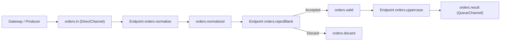
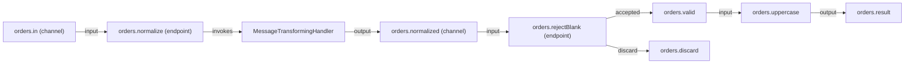
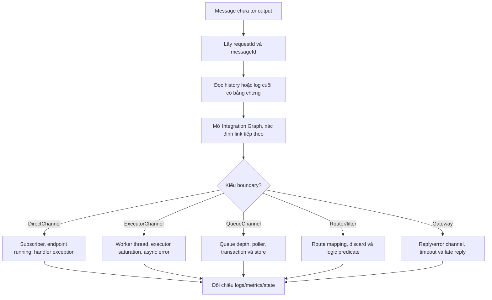

# Đọc component name và endpoint chain trong Spring Integration

## 1. Vì sao cần đọc đúng tên component khi debug runtime?

Spring Integration chia một message flow thành nhiều thành phần: `MessageChannel`, `MessageHandler`, `EventDrivenConsumer`, `PollingConsumer`, `MessageProducer`, gateway, transformer, router, aggregator và outbound adapter. Một request có thể đi qua nhiều bean trước khi trả reply; một dòng log trông như "handler" đôi khi lại nói về consumer endpoint hoặc channel.

Ví dụ lỗi:

```text
MessageDeliveryException: Dispatcher has no subscribers for channel 'orders.valid'
ReplyRequiredException: No reply produced by handler 'orders.verify'
MessageHandlingException: error occurred in message handler
beanName:      ordersFlow.org.springframework.integration.config.ConsumerEndpointFactoryBean#0
componentName: ordersFlow.transformer#0
```

Những dòng trên là **dạng thông tin minh họa**, không phải log của một ứng dụng đã chạy. Khó khăn nằm ở chỗ **bean name**, **component name**, **endpoint ID**, **handler name**, **flow ID** và **channel name** liên quan nhưng không luôn đồng nhất.

Bài **Đọc component name và endpoint chain** thuộc chương **Debugging** của module `SPRING_INTEGRATION_RUNTIME`. Trọng tâm là cách phân tích Spring Integration điều phối channel, endpoint, consumer, poller, executor; truy vết lifecycle của `IntegrationFlow`, transaction, retry, message store, error, correlation, threading và trạng thái runtime khi một message bị kẹt hoặc xử lý sai.

**Sau bài này, bạn có thể:**

1. Tách tên channel, endpoint, handler và flow khi đọc log/stack trace.
2. Nhận ra tên tự sinh trong Java DSL và tên child trong `MessageHandlerChain`.
3. Dựng lại đường kết nối endpoint với `IntegrationGraphServer`.
4. Đọc `MessageHistory`, log `WireTap` và message/correlation IDs đúng nghĩa.
5. Phân tích chain có executor, poller, gateway, router, retry, dynamic flow.
6. Viết integration test để phát hiện sai routing hoặc endpoint chưa start.

> **Phiên bản tham chiếu:** Spring Integration 6.5, Spring Framework 6.x, Java 17, Spring Boot 3.x. Những tên sinh tự động chứa `#0`, `#1` chỉ minh họa convention, không phải định danh ổn định qua mọi phiên bản/refactor.

## 2. Message flow là đồ thị, không phải danh sách Java method

Giả sử một flow nhận đơn hàng, chuẩn hóa chuỗi, kiểm tra dữ liệu rồi chuyển cho bước kết quả:



Mỗi node có **vai trò khác nhau**:

| Thành phần | Loại | Vai trò |
|---|---|---|
| `orders.in` | `DirectChannel` | Nơi producer gửi message, dispatcher chuyển đến subscriber. |
| `orders.normalize` | Endpoint/consumer có ID | Nhận message và gọi transformer. |
| Transformer bên trong | `MessageHandler` | Chuyển đổi payload. |
| `orders.normalized` | `MessageChannel` | Kết nối bước normalize với filter. |
| `orders.rejectBlank` | Filter endpoint | Chấp nhận hoặc discard theo predicate. |
| `orders.valid` | `DirectChannel` | Chuyển message hợp lệ tới endpoint tiếp. |
| `orders.uppercase` | Transformer endpoint | Chuyển payload thành chữ hoa. |
| `orders.result` | `QueueChannel` | Giữ kết quả cho consumer hoặc test `receive()`. |

Thấy log `orders.normalized` chưa chắc đó là log của transformer; có thể log phát ra từ **channel**. Thấy `orders.normalize` có thể là tên **consumer endpoint**. Thấy `.handler` thường là bean chứa **MessageHandler** của endpoint chứ không phải channel.

### 2.1. Cấu trúc endpoint cơ bản

```text
MessageChannel
  -> EventDrivenConsumer hoặc PollingConsumer (AbstractEndpoint)
       -> MessageHandler
            -> Transformer / POJO / Router / Aggregator / OutboundAdapter
```

- `SubscribableChannel` như `DirectChannel` thường dùng `EventDrivenConsumer`.
- `PollableChannel` như `QueueChannel` thường dùng `PollingConsumer` có poller.
- `MessageSource` thường được `SourcePollingChannelAdapter` poll rồi gửi vào channel; đây là **producer endpoint**, không phải consumer nhận từ channel.
- `ExecutorChannel` có thể dispatch handler trên thread khác, làm thay đổi đường exception/transaction.

**Đừng nhầm endpoint chain với Java call stack.** Flow có thể trải qua queue bền vững, nhiều luồng thread, ngã router hoặc các lần retry. Không có một stack trace duy nhất luôn bao trùm toàn bộ hành trình.

## 3. Sáu loại tên dễ bị nhầm

| Khái niệm | Ví dụ | Dùng làm gì? |
|---|---|---|
| **Flow bean name / flow ID** | `ordersFlow` | Định danh `IntegrationFlow` và prefix khi sinh tên. |
| **Channel bean name** | `orders.in`, `orders.valid` | Destination, subscriber và routing. |
| **Endpoint bean name / ID** | `orders.normalize` | Tìm lifecycle consumer, đặt advice, test endpoint. |
| **Handler bean name** | `orders.normalize.handler` (tùy cơ chế) | Bean của `MessageHandler` thuộc endpoint. |
| **componentName** | `ordersFlow.transformer#0` | Tên logic `NamedComponent` trong history/log/graph. |
| **Message ID / correlation ID** | UUID, `correlationId` header | Định danh message/nhóm request, không phải tên bean. |

`NamedComponent` trong Spring Integration cung cấp:

```java
String getComponentName();
String getComponentType();
```

`componentName` hữu ích khi debug; `getComponentType()` mô tả vai trò integration. Nó không nhất thiết bằng Java class simple name, cũng không nhất thiết là bean name để gọi `applicationContext.getBean(name)`.

### 3.1. Hậu tố `#0`, `#1` là gì?

Java DSL tạo bean names khi component chưa có ID. Từ Spring Integration 5.0.6, những tên sinh tự động thường có **flow bean name** làm prefix. Ví dụ được nêu trong tài liệu:

```text
lambdaFlow.org.springframework.integration.config.ConsumerEndpointFactoryBean#0
lambdaFlow.transformer#0
```

`#0` là **chỉ số phát sinh tên** khi xây flow, không phải message sequence number, số retry, hay số lần handler thực thi. Đổi thứ tự các bước, đổi tên bean flow hoặc cập nhật phiên bản có thể làm chỉ số/name khác.

**Quy tắc:** tại boundary quan trọng, hãy đặt endpoint ID tường minh thay vì xem tên tự sinh là API cố định để monitoring hoặc lifecycle control.

## 4. Cấu hình endpoint có tên tường minh bằng Java DSL

Spring Integration 6.5 có `transformWith(...)` nhận `TransformerEndpointSpec` để cung cấp transformer và `id(...)` cho endpoint. `filter(...)` cũng có cấu hình endpoint riêng. Ví dụ hoàn chỉnh, không cần broker ngoài:

```java
import java.util.Locale;

import org.springframework.context.annotation.Bean;
import org.springframework.context.annotation.Configuration;
import org.springframework.integration.channel.DirectChannel;
import org.springframework.integration.channel.QueueChannel;
import org.springframework.integration.config.EnableIntegration;
import org.springframework.integration.config.EnableMessageHistory;
import org.springframework.integration.dsl.IntegrationFlow;
import org.springframework.messaging.MessageChannel;
import org.springframework.messaging.PollableChannel;

@Configuration
@EnableIntegration
@EnableMessageHistory
public class NamedOrdersFlowConfig {

    @Bean("orders.in")
    MessageChannel input() {
        return new DirectChannel();
    }

    @Bean("orders.normalized")
    MessageChannel normalized() {
        return new DirectChannel();
    }

    @Bean("orders.valid")
    MessageChannel valid() {
        return new DirectChannel();
    }

    @Bean("orders.discard")
    PollableChannel discard() {
        return new QueueChannel();
    }

    @Bean("orders.result")
    PollableChannel result() {
        return new QueueChannel();
    }

    @Bean
    IntegrationFlow ordersFlow() {
        return IntegrationFlow.from("orders.in")
                .transformWith(t -> t
                        .transformer((String s) -> s.trim())
                        .id("orders.normalize"))
                .channel("orders.normalized")
                .filter(String.class, s -> !s.isBlank(),
                        e -> e.id("orders.rejectBlank")
                              .discardChannel("orders.discard"))
                .channel("orders.valid")
                .transformWith(t -> t
                        .transformer((String s) ->
                                s.toUpperCase(Locale.ROOT))
                        .id("orders.uppercase"))
                .channel("orders.result")
                .get();
    }
}
```

Flow trên có hai channel output `QueueChannel` để kiểm thử bằng `receive()`. Vì các channel trong DSL đều được đặt bằng tên, có thể đối chiếu chúng với graph và BeanFactory.

**Khi gửi payload `"  abc  "`:**

```text
orders.in
  -> orders.normalize          => "abc"
  -> orders.normalized
  -> orders.rejectBlank        => accept
  -> orders.valid
  -> orders.uppercase          => "ABC"
  -> orders.result
```

**Khi gửi `"   "`:**

```text
orders.in
  -> orders.normalize          => ""
  -> orders.normalized
  -> orders.rejectBlank        => reject
  -> orders.discard
```

### 4.1. ID của endpoint và tên channel là hai thứ khác nhau

```java
.transformWith(t -> t
        .transformer((String s) -> s.trim())
        .id("orders.normalize"))
.channel("orders.normalized")
```

Ở đây:

- `orders.normalize` là **endpoint ID**.
- `orders.normalized` là **channel bean name**.
- Handler transformer do DSL tạo có thể có tên riêng theo convention.
- `ordersFlow` là tên của bean flow, không đồng nghĩa với cả hai tên trên.

Nếu log báo không có subscriber ở `orders.normalized`, việc đổi tên transformer method chưa chắc sửa được lỗi. Cần tìm consumer nào subscribe vào channel đó và có đang running không.

### 4.2. Annotation-based endpoint

Khi dùng annotation thay Java DSL, có thể đặt tên consumer bằng `@EndpointId`:

```java
import org.springframework.integration.annotation.EndpointId;
import org.springframework.integration.annotation.ServiceActivator;
import org.springframework.stereotype.Component;

@Component
class OrderPersistenceHandler {

    @EndpointId("orders.persist")
    @ServiceActivator(inputChannel = "orders.valid",
                      outputChannel = "orders.result")
    public String persist(String order) {
        return "SAVED:" + order;
    }
}
```

**Lưu ý:** Đây là **phương án thay thế** cho bước trên `orders.valid`, không được thêm song song với `orders.uppercase` của `NamedOrdersFlowConfig` nếu không chủ ý tạo **hai competing consumers** trên `DirectChannel`.

Với XML, `id` trên `<int:service-activator>`, `<int:transformer>` hoặc `<int:chain>` cũng định danh component, nhưng wrapper bean/handler có quy tắc tên riêng. Khi debug cần biết đường khai báo thật.

## 5. Đọc đường Channel → Endpoint → Handler → Output



| Log/graph dừng ở đâu? | Cần kiểm tra ngay |
|---|---|
| `orders.in` | Có subscriber? Endpoint downstream có started? |
| `orders.normalize` | Transformer có throw, trả null hoặc lỗi type conversion? |
| `orders.normalized` | Filter có subscribe và channel name được tham chiếu đúng không? |
| `orders.rejectBlank` | Predicate trả false hay throw? Discard channel có consumer? |
| `orders.valid` | Có đúng endpoint sau filter, hay competing subscriber khác? |
| `orders.uppercase` | Handler có return output và route đúng? |
| `orders.result` | Đây là `QueueChannel`: có ai poll/receive kết quả chưa? |

### 5.1. Event-driven consumer

Với `DirectChannel`, `send()` thường gọi subscriber handler trong thread của sender. Một exception có thể lan về caller. Không có subscriber có thể gây `MessageDeliveryException`.

Nếu stack trace có:

```text
DirectChannel.send(...)
UnicastingDispatcher.doDispatch(...)
EventDrivenConsumer / MessageHandler ...
```

hãy đọc **channel name trong exception** rồi tìm **endpoint đang subscribe**. Không sửa business code khi lỗi là endpoint chưa khởi động hoặc dùng sai tên channel.

### 5.2. Polling consumer khác source polling adapter

- `PollingConsumer` gọi `PollableChannel.receive()`, sau đó gọi handler.
- `SourcePollingChannelAdapter` gọi `MessageSource.receive()` rồi **gửi** message tới channel.
- Queue có backlog nhưng poller stop sẽ không có handler invocation. Không thấy log handler không chứng minh message đã mất.
- Message source không có dữ liệu sẽ không tạo message; cần kiểm tra source và trigger/poller riêng.

### 5.3. Ranh giới thread

```text
http-nio-8080-exec-4 -> orders.in -> orders.normalize
task-executor-7       -> orders.valid -> orders.persist
```

Nếu giữa các bước là `ExecutorChannel` hoặc một queue/poller, downstream có thể chạy trên thread khác. Thread-local transaction/MDC không tự truyền theo message. Không được đọc log theo thứ tự thời gian và tự khẳng định đó là một chuỗi call đồng bộ duy nhất.

## 6. Vì sao log có cả ConsumerEndpointFactoryBean#0 và transformer#0?

Một bước Java DSL có thể sinh **nhiều đối tượng**:

```text
IntegrationFlow bean
  -> ConsumerEndpointFactoryBean (tạo endpoint consumer)
  -> MessageTransformingHandler
  -> Transformer delegate hoặc method reference
```

Tên generated trong tài liệu:

```text
ordersFlow.org.springframework.integration.config.ConsumerEndpointFactoryBean#0
ordersFlow.transformer#0
```

Một tên liên quan endpoint/factory bean, tên còn lại liên quan transformer/handler. Hai dòng log khác nhau vẫn có thể thuộc cùng một bước logic. `#0` không nói gì về số message đã xử lý.

Khi đặt `id("orders.normalize")`, endpoint có bean name rõ ràng, nhưng handler vẫn có thể được framework đặt tên theo convention. Hãy lấy **thực tế** từ Spring context.

### 6.1. Liệt kê endpoint beans

```java
import java.util.Map;
import org.springframework.context.ApplicationContext;
import org.springframework.integration.endpoint.AbstractEndpoint;

void printEndpoints(ApplicationContext context) {
    Map<String, AbstractEndpoint> endpoints =
            context.getBeansOfType(AbstractEndpoint.class);

    endpoints.forEach((beanName, endpoint) ->
            System.out.printf("bean=%s class=%s running=%s%n",
                    beanName,
                    endpoint.getClass().getSimpleName(),
                    endpoint.isRunning()));
}
```

Đọc `beanName`, Java class và `isRunning()` để phân biệt `EventDrivenConsumer`, `PollingConsumer`, `SourcePollingChannelAdapter`. Một số factory/proxy/inner components có thể không hiện ra như bean `AbstractEndpoint` độc lập; vì vậy cần kết hợp graph hoặc handler enumeration.

### 6.2. Liệt kê handler beans và componentName

```java
import org.springframework.integration.support.management.NamedComponent;
import org.springframework.messaging.MessageHandler;

context.getBeansOfType(MessageHandler.class)
        .forEach((beanName, handler) -> {
            String componentName =
                    handler instanceof NamedComponent named
                            ? named.getComponentName() : "(unnamed)";
            System.out.printf("bean=%s component=%s class=%s%n",
                    beanName, componentName,
                    handler.getClass().getSimpleName());
        });
```

Nếu `beanName` và `componentName` khác nhau, đó không tự động là lỗi. Bean name dùng truy cập container; componentName dùng định danh trong management/log/history. Tên component có thể tồn tại dù object đó không được đăng ký như một bean độc lập.

**Không phơi dump toàn bộ bean names qua HTTP public.** Nó có thể làm lộ cấu trúc nội bộ, tenant và protocol destinations.

## 7. MessageHandlerChain là một endpoint có nhiều child handlers

Một `MessageHandlerChain` khác với chuỗi nhiều consumer endpoint độc lập. Ví dụ XML:

```xml
<int:chain id="somethingChain" input-channel="input">
    <int:service-activator id="somethingService"
                           ref="someService" method="someMethod"/>
    <int:object-to-json-transformer/>
</int:chain>
```

Theo tài liệu chính thức, cách diễn giải tên:

| Thành phần | Tên minh họa | Ý nghĩa |
|---|---|---|
| Chain endpoint | `somethingChain` | Consumer endpoint bao toàn chain |
| Chain handler bean alias | `somethingChain.handler` | Alias tới `MessageHandlerChain` |
| Service activator child bean | `somethingChain$child.somethingService.handler` | Handler con, **không** là endpoint riêng |
| Child `componentName` | `somethingChain$child.somethingService` | Tên logic, không có `.handler` |
| Transformer child không `id` | `somethingChain$child#1` | Component name theo vị trí trong chain |

`#1` của child là vị trí trong chain; nó không biểu thị sequence number của message hay retry attempt. Thay thứ tự child có thể đổi tên. Có thể đặt `id` cho child quan trọng để dễ debug.

### 7.1. Đọc stack trace của chain

```text
somethingChain$child.somethingService
somethingChain.handler
somethingChain
```

Các tên có thể lần lượt nói về **child handler → chain handler → outer endpoint**. Lỗi nghiệp vụ có thể nằm ở `someService.someMethod()` trong khi exception wrapper/log hiện tên outer endpoint. Đọc `cause` sâu nhất và xác định child gây lỗi, không chỉ dựa vào tên ngoài cùng.

### 7.2. Chain với retry/transaction advice

Advice đặt ở outer endpoint có thể bao invocation của cả chain; advice đặt trong một child handler (nếu cấu hình hỗ trợ) chỉ bao child. Vì vậy khi muốn biết retry đã chạy lại toàn chain hay chỉ một bước, phải xác định vị trí advice thật trong cấu hình, không suy luận từ mỗi dòng log.

## 8. Integration Graph: dựng lại endpoint chain từ runtime

`IntegrationGraphServer` cung cấp graph của các component thực sự trong application context, gồm nodes và links. Nó đặc biệt hữu ích khi Java DSL phát sinh bean names, router có nhiều nhánh hoặc `IntegrationFlowContext` thêm/xóa flow.

### 8.1. Node và link

Ví dụ node:

```text
nodeId:        14
name:          orders.normalize
componentType: transformer
properties:    {...}
```

Theo reference, graph link có các loại:

| Link type | Nghĩa |
|---|---|
| `input` | Channel → endpoint qua input/request channel |
| `output` | Handler/producer/endpoint → output channel |
| `error` | Handler/source/poller → error channel |
| `discard` | Filter → discard channel |
| `route` | Router → channel đích qua mapping hoặc route đã biết |

**Đọc graph bằng node ID và links**, không coi thứ tự elements trong array nodes là thứ tự message. Một router có thể chọn nhánh ở runtime dựa trên payload/header, nên graph thể hiện **topology có thể đi**, không chứng minh một message cụ thể đã đi nhánh nào.

### 8.2. Khai báo và dùng Graph API

```java
import org.springframework.context.annotation.Bean;
import org.springframework.integration.graph.IntegrationGraphServer;

@Bean
IntegrationGraphServer integrationGraphServer() {
    return new IntegrationGraphServer();
}
```

Đọc graph:

```java
import org.springframework.integration.graph.Graph;
import org.springframework.integration.graph.IntegrationGraphServer;
import org.springframework.integration.graph.IntegrationNode;
import org.springframework.integration.graph.LinkNode;

void printGraph(IntegrationGraphServer server) {
    Graph graph = server.rebuild();

    for (IntegrationNode n : graph.getNodes()) {
        System.out.printf("id=%d name=%s type=%s%n",
                n.getNodeId(), n.getName(), n.getComponentType());
    }
    for (LinkNode link : graph.getLinks()) {
        System.out.printf("from=%d to=%d kind=%s%n",
                link.getFrom(), link.getTo(), link.getType());
    }
}
```

`getGraph()` trả cached graph; `rebuild()` cập nhật topology cache khi bean được thêm/xóa, ví dụ flow động được register/destroy. Những stats bên trong graph có thể động, nhưng graph topology cached không nhất thiết tự phản ánh registration vừa xảy ra cho tới khi rebuild.

Chỉ xuất graph qua endpoint quản trị có xác thực. Toàn bộ graph có thể tiết lộ channel names, broker destinations, tenant names và những service nội bộ.

## 9. MessageHistory: message này thực sự qua đâu?

Graph trả lời **"nó có thể đi đâu?"**; `MessageHistory` giúp trả lời **"message này đã được ghi nhận ở những component nào?"**.

Bật tracking:

```java
import org.springframework.context.annotation.Configuration;
import org.springframework.integration.config.EnableIntegration;
import org.springframework.integration.config.EnableMessageHistory;

@Configuration
@EnableIntegration
@EnableMessageHistory
class HistoryConfiguration {
}
```

Trong một ứng dụng chỉ cần **một nguồn cấu hình MessageHistory**. Ví dụ `NamedOrdersFlowConfig` đã có `@EnableMessageHistory`; không tạo thêm bean cấu hình history thứ hai vào cùng application context. Có thể giới hạn component-name patterns:

```java
@EnableMessageHistory({"orders.*", "*Gateway"})
```

Tên trong pattern phải khớp `componentName` thực tế được tracking; nếu không thấy một component trong history, chưa chắc message không đi qua nó.

### 9.1. Cấu trúc header history

```text
history = [
  {name=orders.in, type=channel, timestamp=...},
  {name=orders.normalize, type=transformer, timestamp=...},
  {name=orders.normalized, type=channel, timestamp=...}
]
```

Đây là **ví dụ cấu trúc**, danh sách chính xác tùy cấu hình tracking và cách message được tạo/lan truyền. `MessageHistory` chứa entries có `name`, `type`, `timestamp`.

Đọc bằng API:

```java
import java.util.Properties;
import org.springframework.integration.history.MessageHistory;
import org.springframework.messaging.Message;

void describeHistory(Message<?> message) {
    MessageHistory history = MessageHistory.read(message);

    if (history == null) {
        System.out.println("No message history recorded");
        return;
    }
    for (Properties entry : history) {
        System.out.printf("name=%s type=%s at=%s%n",
                entry.getProperty(MessageHistory.NAME_PROPERTY),
                entry.getProperty(MessageHistory.TYPE_PROPERTY),
                entry.getProperty(MessageHistory.TIMESTAMP_PROPERTY));
    }
}
```

**Giới hạn quan trọng:**

- History chỉ ghi các component được tracking; nó không bảo đảm ghi tất cả bước.
- Một custom transformer tự tạo message mà làm mất headers có thể khiến history biến mất.
- Từ Spring Integration 6.3, history được tối ưu append-only; framework xử lý clone ở những tình huống fan-out/split/router quan trọng, nhưng custom multi-producer vẫn cần chú ý copy/clone khi nhân bản message.
- History tạo overhead bộ nhớ/CPU và mở rộng header; đừng bật rộng mà không đo chi phí ở traffic lớn.
- Timestamp history không phải distributed tracing span đầy đủ.
- Header history không chứng minh transaction commit/ack hoặc ai đã ra lệnh quản trị.

## 10. WireTap và log(): thấy message mà không đổi flow chính

DSL `log()` thường thêm `WireTap` với `LoggingHandler` ở vị trí hiện tại. Nó giúp quan sát message, không phải một business handler thay thế output.

```java
import org.springframework.integration.handler.LoggingHandler;

// Bên trong IntegrationFlow DSL:
.filter(String.class, s -> !s.isBlank(),
        e -> e.id("orders.rejectBlank")
              .discardChannel("orders.discard"))
.log(LoggingHandler.Level.DEBUG, "orders.debug",
        m -> "id=" + m.getHeaders().getId()
             + " requestId=" + m.getHeaders().get("requestId"))
.channel("orders.valid")
```

Dòng log chỉ xuất hiện nếu logger/configuration bật level phù hợp và message đã vượt filter để tới vị trí wire tap. Không log toàn bộ payload có PII, token hoặc secret. `orders.debug` là **logger category**, không mặc nhiên là componentName/bean name.

### 10.1. Không nhầm WireTap với channel đầu ra

Một nhánh tap được thêm để quan sát; nó không làm business reply được tự động gửi qua `LoggingHandler`. Tuy nhiên khi log phức tạp hoặc tap subscriber chậm, side-channel có thể ảnh hưởng latency, backpressure hoặc gây exception tùy channel/dispatcher. Khi debug, quan sát thread và thời điểm thực thi.

### 10.2. Truy vết bằng correlation

```text
flow=ordersFlow
component=orders.rejectBlank
channel=orders.valid
requestId=REQ-140
messageId=<technical-message-id>
correlationId=<group-or-request-id>
thread=task-executor-7
payloadType=OrderCommand
```

Dùng một request ID nghiệp vụ ổn định qua retry và thread boundaries. `MessageHeaders.ID` có thể đổi khi tạo message mới, không tương đương business ID. Trong splitter/aggregator, `CORRELATION_ID` thường mô tả **message group**, không nhất thiết là ID của HTTP request.

## 11. Đọc lỗi theo điểm cuối cùng đã được xác nhận

Khi một message không đến đích, đừng kết luận ngay "nó chết ở component cuối cùng trong log". Hãy tìm **điểm cuối cùng có bằng chứng xử lý** và **điểm tiếp theo đáng lẽ phải có bằng chứng**. So sánh ba nguồn:

1. **Graph**: component/channel nối với nhau như thế nào theo runtime.
2. **History/log/trace**: message cụ thể đã đi tới node nào.
3. **State/metrics/store**: endpoint có chạy, channel còn subscriber, queue có backlog, thread/executor có bận hay không.



### 11.1. `Dispatcher has no subscribers`

Ví dụ:

```text
Dispatcher has no subscribers for channel 'orders.valid'
```

Khả năng cần kiểm tra:

- Bean channel `orders.valid` có tồn tại và là bean được flow tham chiếu?
- Endpoint lắng nghe channel đó có được tạo, registered và started?
- Flow động đã `destroy()`/`stop()` chưa?
- Có đang dùng hai channel instance khác nhau do tạo thủ công thay vì dùng cùng bean name?
- Có lỗi startup làm consumer không đăng ký subscriber?
- Có ai gọi `send()` trước khi context fully ready?

**Không phải** lỗi do thiếu data trong một `QueueChannel`; đó là bài toán subscribe/dispatch ở channel có subscriber. Đọc `MessageDeliveryException` và channel name trước khi sửa handler.

### 11.2. Filter không có downstream output

Message đi đến `orders.rejectBlank`, không thấy ở `orders.result`. Có thể filter **đã từ chối**. Xác nhận qua `orders.discard`/metrics predicate, thay vì kết luận transformer phía sau hỏng.

Filter mặc định có thể im lặng loại message tùy configuration; với example có `discardChannel`, message sẽ đến nhánh đó. Nếu discard channel là `QueueChannel`, trong test có thể `receive()` để chứng minh.

### 11.3. Router chọn nhầm nhánh

Router có nhiều kênh đích, vì vậy graph chứa nhiều `route` links. Message cụ thể chọn nhánh nào phụ thuộc header/payload/config mapping lúc chạy.

Một troubleshooting log hữu ích:

```text
requestId=R-2
routeKey=EU
routerComponent=orders.regionRouter
selectedChannel=orders.eu
```

Các giá trị trên là instrumentation của ứng dụng. Đừng xem mọi link `route` trong graph như các bước message đã đi qua; router **chỉ chọn nhánh thực tế**.

### 11.4. ReplyRequiredException và gateway timeout

Một handler có thể trả `null`, filter loại message hoặc aggregator đang giữ nhóm. Nếu endpoint/gateway yêu cầu reply, caller có thể nhận `ReplyRequiredException` hoặc timeout.

Tách ra:

| Quan sát | Câu hỏi |
|---|---|
| Handler throw | Lỗi từ business handler hay advice? Failed message/cause? |
| Handler return `null` | `requiresReply`? Có xử lý một chiều có chủ đích không? |
| Handler return reply nhưng gateway timeout | Reply có đúng `replyChannel`/output route không? Có vượt deadline? |
| Aggregator chưa release | `CorrelationStrategy`/`ReleaseStrategy`/group store đúng không? |
| Flow qua `ExecutorChannel` | Worker đã hoàn thành chưa? Error được gửi ở đâu? |

Không dùng tên `gateway` trong exception để suy ra lỗi phải nằm trong proxy gateway: gateway có thể chỉ là **caller đang chờ** bước downstream.

### 11.5. Lỗi trong MessageHandlerChain

Khi outer name là `somethingChain`, exception wrapper ở mức endpoint có thể che child gây lỗi. Đọc `cause` sâu nhất, kiểm tra `MessageHandlingException.getFailedMessage()` và child `componentName` trong history/log; nếu cần, thêm ID/log tại child.

Không vội di chuyển retry advice khi chưa biết advice đang bao toàn chain hay chỉ một handler.

## 12. Threading và transaction: tại sao endpoint chain "đứt" trong logs?

Một flow có thể nối logic đúng nhưng logs ở nhiều thread.

| Channel/boundary | Khi nào handler chạy? | Lỗi và transaction |
|---|---|---|
| `DirectChannel` | Đồng bộ trong thread gửi | Exception thường có thể truyền về sender; thread-bound tx có thể tiếp diễn. |
| `ExecutorChannel` | Worker executor xử lý | Thread khác; tx/MDC caller không tự truyền, lỗi có thể đi qua async error infrastructure. |
| `QueueChannel` + `PollingConsumer` | Poller `receive()` rồi xử lý | Message có thể nằm trong queue lâu; poller lifecycle/transaction quyết định tiến độ. |
| `PublishSubscribeChannel` | Một hoặc nhiều subscriber; có thể sync/async | History/log có nhiều nhánh; thứ tự events không phải một chuỗi tuyến tính. |
| `Splitter/Aggregator` | Split nhiều message rồi giữ/ghép nhóm | Header correlation/sequence và message store quyết định phát nhóm. |
| Remote gateway/broker | Ngoài JVM/process | Local graph không bao gồm nội bộ hệ thống bên kia; cần distributed trace/correlation. |

### 12.1. Lỗi "mất header" sau ExecutorChannel

Message thực sự có thể vẫn giữ headers, nhưng logging dựa vào ThreadLocal/MDC do HTTP filter thiết lập trên thread sender có thể **không xuất hiện** trên worker thread. Điều đó không chứng minh mất message correlation.

Hãy phân biệt:

- `headers['requestId']`: dữ liệu được truyền trong `Message<?>` nếu các bước bảo toàn/copy header.
- MDC `requestId`: thread-local logging context, cần propagation riêng khi đổi executor.
- `MessageHistory`: lịch sử được gắn trong message header, có thể theo message qua thread.
- Tracing span context: cần instrumentation/propagation đúng theo stack tracing đang dùng.

### 12.2. Transaction không theo flow bean name

Một message đi qua `ordersFlow` từ đầu đến cuối không có nghĩa toàn flow nằm trong một transaction. `@Transactional` trên handler, transactional poller, `RequestHandlerRetryAdvice` và thread boundary quyết định vùng transaction.

Ví dụ:

```text
Thread HTTP:  TX-A -> orders.in -> ExecutorChannel.send() -> TX-A commit
Thread worker:                 -> orders.persist -> TX-B nếu cấu hình
```

Nếu worker lỗi, transaction của HTTP sender không tự rollback. Đọc log thread name và transaction boundaries, không chỉ component name.

### 12.3. Persistent queues có thể giữ message qua restart

Khi `QueueChannel` được hỗ trợ bởi `JdbcChannelMessageStore`, một message còn trong store có thể được poll sau restart. Tên `QueueChannel` và ID group/region của store cần ổn định để không tạo backlog "mồ côi".

Một log lỗi với component name cũ sau deploy có thể là **message đã lưu từ phiên bản flow trước**, không phải endpoint hiện tại tự phát lại. Kiểm tra serialization/schema, version header và source retry/redelivery count.

## 13. Dynamic IntegrationFlow: đọc tên sau khi register/destroy

Một `IntegrationFlow` có thể được tạo tại runtime:

```java
IntegrationFlowContext.IntegrationFlowRegistration registration =
        flowContext.registration(tenantFlow)
                .id("tenant.alpha.orders")
                .useFlowIdAsPrefix()
                .autoStartup(true)
                .register();
```

Đặt `id(...)` cho registration giúp quy về tenant/flow. `useFlowIdAsPrefix()` giúp các bean names sinh trong flow có namespace và tránh va chạm. Tuy nhiên ID endpoint thủ công, global/shared bean names và tên tài nguyên ngoài vẫn phải unique theo semantics của chúng.

### 13.1. Khi cần rebuild Integration Graph?

Sau register/destroy các component động, gọi `IntegrationGraphServer.rebuild()` khi cần snapshot topology mới. Nếu chỉ dùng cached `getGraph()` từ trước khi onboarding tenant, có thể không thấy flow vừa thêm; đừng kết luận tenant flow chưa tồn tại.

### 13.2. Khi cùng flow tồn tại ở nhiều replica

`IntegrationFlowContext` và `BeanFactory` là **trong một JVM/application context**. Hai pod có thể cùng có endpoint tên `tenant.alpha.orders.transformer#0` nhưng là **hai object khác nhau**.

Để debug multi-replica, log phải gắn ít nhất:

```text
environment=prod
application=orders-worker
instanceId=pod-3
flowId=tenant.alpha.orders
endpoint=...
requestId=...
```

Đừng chỉ tìm bằng `componentName` rồi nghĩ đó là một endpoint duy nhất trên toàn cluster.

### 13.3. State sau stop/start

Đọc registration/endpoint lifecycle trước khi kết luận message "không route":

- `registration.stop()` tạm dừng endpoint nhưng giữ registration.
- `registration.destroy()` loại bỏ dynamic flow và các bean phụ thuộc.
- Broker/JDBC store có thể còn message dù flow đã bị destroy.
- Khi khởi động lại context, dynamic flow phải được khôi phục từ tenant catalog/configuration.
- Async task đang chạy có thể hoàn thành sau lệnh stop; `isRunning()==false` không đồng nghĩa in-flight work đã drain.

## 14. Test xác nhận tên và đường message đi trong flow

Dùng Java 17, JUnit 5, Spring Boot Test và `NamedOrdersFlowConfig` ở mục 4. Đây là test theo **hành vi và dấu mốc ổn định**, không khóa chặt mọi generated bean name.

```groovy
dependencies {
    implementation 'org.springframework.boot:spring-boot-starter-integration'
    testImplementation 'org.springframework.boot:spring-boot-starter-test'
}
```

### 14.1. Gửi message hợp lệ và đọc history

```java
import static org.junit.jupiter.api.Assertions.*;

import org.junit.jupiter.api.Test;
import org.springframework.beans.factory.annotation.Autowired;
import org.springframework.beans.factory.annotation.Qualifier;
import org.springframework.boot.test.context.SpringBootTest;
import org.springframework.integration.history.MessageHistory;
import org.springframework.messaging.Message;
import org.springframework.messaging.MessageChannel;
import org.springframework.messaging.PollableChannel;
import org.springframework.messaging.support.MessageBuilder;

@SpringBootTest(classes = NamedOrdersFlowConfig.class)
class NamedOrdersFlowTest {

    @Autowired @Qualifier("orders.in")
    MessageChannel input;

    @Autowired @Qualifier("orders.result")
    PollableChannel result;

    @Autowired @Qualifier("orders.discard")
    PollableChannel discard;

    @Test
    void successfulOrderTraversesNamedFlow() {
        Message<String> in = MessageBuilder
                .withPayload("  abc  ")
                .setHeader("requestId", "REQ-41")
                .build();

        assertTrue(input.send(in));
        Message<?> out = result.receive(1_000);

        assertNotNull(out);
        assertEquals("ABC", out.getPayload());
        assertEquals("REQ-41",
                out.getHeaders().get("requestId"));

        MessageHistory history = MessageHistory.read(out);
        assertNotNull(history);
        assertTrue(history.stream()
                .anyMatch(step ->
                        String.valueOf(step.get("name"))
                                .startsWith("orders.")));
    }

    @Test
    void rejectedOrderGoesToDiscardChannel() {
        assertTrue(input.send(
                MessageBuilder.withPayload("   ").build()));

        Message<?> rejected = discard.receive(1_000);
        assertNotNull(rejected);
        assertEquals("", rejected.getPayload());
        assertNull(result.receive(0));
    }
}
```

**Test minh họa:** test context dùng Spring Integration Java DSL, `@EnableMessageHistory` và channels đã khai báo. Trong project thực, cần bảo đảm application test scan/configure đủ các bean cần thiết và mỗi test có queue riêng hoặc được clear. Với `QueueChannel` giữ message trong RAM, nếu test chạy song song trên cùng application context, cần cô lập để không đọc nhầm message của test khác.

Không assert history chính xác là `["orders.in","orders.normalize","orders.normalized",...]`; framework có thể ghi thêm named components hoặc thay thứ tự do cấu hình instrumentation. Assert những tên/điểm quan trọng và payload đích. Nếu test định nghĩa exact path, cần chủ đích khóa behavior đó và hiểu chi phí khi refactor.

### 14.2. Test endpoint ID tồn tại và đang chạy

```java
import static org.junit.jupiter.api.Assertions.*;
import org.springframework.context.ApplicationContext;
import org.springframework.integration.endpoint.AbstractEndpoint;

void assertEndpointRunning(ApplicationContext context) {
    AbstractEndpoint endpoint = context.getBean(
            "orders.normalize", AbstractEndpoint.class);

    assertTrue(endpoint.isRunning());
}
```

Nếu đây là test chạy sau khi admin stop endpoint hoặc có `autoStartup(false)`, assertion `isRunning()` sẽ phản ánh trạng thái đã cấu hình chứ không phải lỗi. Đừng hardcode tên handler autogenerated để assert lifecycle khi đã có endpoint ID tường minh.

### 14.3. Chặn inbound poller tự chạy trong test

Với các adapter thật (JMS/SFTP/DB polling), sử dụng Spring Integration Test để kiểm soát lifecycle:

```java
import org.springframework.integration.test.context.SpringIntegrationTest;

@SpringIntegrationTest(noAutoStartup = {"ordersFileInbound"})
class OrdersFileInboundTest {
    // Bean endpoint ordersFileInbound được ngăn auto-start
    // để không kết nối nguồn thật trước khi test cấu hình/mocks.
}
```

Annotation này cần test infrastructure Spring Integration hoạt động; pattern khớp **endpoint bean name**, không phải tên tùy tiện của `MessageHandler`. `MockIntegrationContext.substituteMessageSourceFor(...)` cũng nhận tên endpoint source phù hợp. Vì vậy việc đặt endpoint ID có chủ đích giúp test ổn định.

## 15. Quy trình điều tra sự cố theo component name

### Bước 1 — Xác định đúng message và phạm vi

Lấy `requestId`/business key, timestamp, instance ID, tenant, flow ID và exception root cause. Đừng bắt đầu bằng grep toàn bộ log `Exception` rồi trộn các request khác nhau.

### Bước 2 — Tìm điểm cuối có bằng chứng

Từ log có filter/WireTap, `MessageHistory.read(message)` hoặc tracing spans, xác định component cuối cùng đã nhận message. Nếu không có history, kiểm tra nó có được bật/tracked và header có bị làm mất không.

### Bước 3 — Tìm đường đi được định nghĩa

Dùng `IntegrationGraphServer.rebuild()` (khi topology có thể thay đổi) để tìm node và link tiếp theo. Với router, liệt kê các nhánh khả dĩ và mapping thực tế.

### Bước 4 — Phân biệt endpoint vs handler

Từ node/link/bean names:

- Nếu lỗi thuộc channel: kiểm tra subscriber, type, capacity và send/receive.
- Nếu lỗi thuộc endpoint: kiểm tra lifecycle, poller và thread.
- Nếu lỗi thuộc handler: kiểm tra return/throw, advice, type conversion và outbound call.
- Nếu lỗi thuộc chain: tìm child component, không dừng ở outer name.
- Nếu lỗi thuộc gateway: xem reply route/timeout và downstream completion.

### Bước 5 — Đọc các boundary async

Đánh dấu chuyển thread tại executor/queue/poller; đối chiếu error infrastructure, transaction và retry. Đừng kỳ vọng lỗi ở worker luôn được ném về HTTP caller.

### Bước 6 — Kiểm tra source/store

Message có nằm trong `QueueChannel`/JDBC store/broker, group aggregator hoặc retry queue không? Persistent message cũ có thể được xử lý ở flow version mới. Xác nhận cùng region/group ID và serializer.

### Bước 7 — Khắc phục ở đúng lớp

Nếu endpoint đang stopped, sửa lifecycle; nếu filter discard hợp lệ, sửa test/expectation; nếu router sai, sửa header/mapping; nếu store không hồi phục, sửa transaction boundary/ack; nếu handler throw, sửa nghiệp vụ và đặt retry/error handling phù hợp.

### Bước 8 — Bổ sung regression test

Viết test assert output và ít nhất một boundary name ổn định, rồi thêm kịch bản negative (discard, timeout, missing subscriber, poller stopped hoặc wrong tenant). Tránh dùng generated `#0` làm contract test trừ khi chính test nhằm xác minh convention.

## 16. Bảng chẩn đoán nhanh

| Hiện tượng | Không nên vội kết luận | Kiểm tra đúng |
|---|---|---|
| `ordersFlow.transformer#0` trong log | Đây là bước thứ 0 của message | Generated component name, flow prefix, handler type |
| `ConsumerEndpointFactoryBean#0` và `transformer#0` cùng request | Có hai lần transform | Endpoint factory và handler của cùng EIP step |
| Graph có route sang `orders.eu` | Message đã qua nhánh EU | Router chọn mapping nào với message cụ thể? |
| History không có `orders.persist` | Handler chắc chắn không chạy | Track pattern, header propagation, naming và custom message creation |
| `Dispatcher has no subscribers` | DB/business handler bị lỗi | Channel destination, subscriber count, endpoint running |
| Filter không có output | Message mất do network | Predicate đã reject? Discard channel? |
| `QueueChannel` có depth lớn | Handler đang xử lý chậm | Poller started, trigger, maxMessagesPerPoll, executor và store |
| Handler báo success nhưng gateway timeout | DB chưa commit | ReplyChannel routing, async completion, gateway deadline |
| Error xuất hiện trên `errorChannel` | Transaction chắc chắn rollback | Exception propagation qua transaction boundary và error handler outcome |
| Duplicate after restart | MessageHistory sai | Broker/JDBC redelivery, idempotency key, store identity |
| Hai pod cùng componentName | Cùng một endpoint instance | Thêm application/instance/tenant ID vào trace |
| Sau dynamic register graph không có flow | Flow chưa được tạo | `getRegistry()` và `graphServer.rebuild()` |
| `isRunning()==false` | Đã drain hoàn toàn | Cần kiểm tra in-flight, ack và transaction |

## 17. Bài thực hành có đáp án

### Bài A — Đọc generated name

Trong log có:

```text
billingFlow.org.springframework.integration.config.ConsumerEndpointFactoryBean#1
billingFlow.transformer#1
```

**Câu hỏi:** Có thể suy ra message đang xử lý lần hai không?

**Đáp án:** Không. `#1` thuộc quy tắc đánh số component sinh tự động của Java DSL, không phải retry/message sequence. Tìm endpoint/handler bean tương ứng trong context hoặc graph.

### Bài B — Filter làm mất message?

Input `orders.in` nhận `"   "`, không có message ở `orders.result`, nhưng `orders.discard` có payload `""`.

**Đáp án:** Flow hoạt động đúng như cấu hình: normalize chuyển chuỗi sang rỗng, filter từ chối và discard. Không cần "sửa" `orders.uppercase`.

### Bài C — MessageHistory ngắn bất thường

History chỉ có `orders.in` dù log business cho thấy handler đã chạy.

**Câu hỏi:** Nên kiểm tra gì trước?

**Đáp án:** Cấu hình `@EnableMessageHistory`, name patterns, handler có được track không, custom transformer có copy headers/history không, và message bạn đang quan sát có phải đúng request/reply cùng nhánh không.

### Bài D — Queue có backlog

Graph có link `source.queue → billing.consumer` nhưng queue depth tăng, consumer không có log.

**Đáp án:** Graph nói topology, không chứng minh consumer đang poll. Kiểm tra `PollingConsumer.isRunning()`, trigger/scheduler, transaction, queue receive và store.

### Bài E — Gateway timeout

Gateway gửi message qua `ExecutorChannel`, worker commit DB nhưng trả reply sau timeout.

**Đáp án:** Tách status DB commit khỏi reply delivery. Xem worker thread/late reply và cấu hình reply channel; caller retry cần idempotency, không suy ra rollback chỉ từ timeout.

### Bài F — Dynamic flow trên hai pod

`tenant.alpha.orders` xuất hiện ở pod A nhưng không có trên pod B.

**Đáp án:** `IntegrationFlowContext` là registry cục bộ. Cần tenant catalog/reconciliation hoặc phân phối ownership để tạo/khởi chạy flow đúng chính sách; một lần register trên pod A không đồng bộ sang B.

## 18. Câu hỏi tự kiểm tra

**1.** `componentName` và Spring bean name có luôn giống nhau không?  
**Đáp án:** Không. Một component có thể có tên logic khác bean name hoặc không là bean độc lập; endpoint và handler có thể có tên riêng.

**2.** Hậu tố `#0` trong generated bean name chỉ điều gì?  
**Đáp án:** Chỉ số sinh tên trong cấu hình DSL, không phải message count hay retry attempt.

**3.** `EventDrivenConsumer` khác `PollingConsumer` thế nào?  
**Đáp án:** Event-driven subscribe `SubscribableChannel`; polling consumer `receive()` từ `PollableChannel` theo poller.

**4.** Trong `MessageHandlerChain`, `somethingChain$child#1` có phải endpoint thứ hai độc lập không?  
**Đáp án:** Không. Đó là component con trong một chain endpoint; có thể không được đăng ký như bean riêng.

**5.** `IntegrationGraphServer.getGraph()` có luôn chứa flow vừa đăng ký động không?  
**Đáp án:** Không chắc; graph topology được cache. Gọi `rebuild()` nếu components đã được thêm/xóa.

**6.** `MessageHistory` có thể thay thế Integration Graph không?  
**Đáp án:** Không. History mô tả các bước được track cho một message, graph mô tả cấu hình topology và các link khả dĩ.

**7.** Không có entry ở history cho một endpoint có đủ chứng minh endpoint đó không xử lý message?  
**Đáp án:** Chưa. Cần kiểm tra track patterns, header preservation và tên thực.

**8.** `.log()` trong DSL thường hoạt động như gì?  
**Đáp án:** `WireTap` gắn `LoggingHandler` để quan sát message, không tự thay business handler/output.

**9.** Vì sao không nên suy ra rollback chỉ từ gateway timeout?  
**Đáp án:** Worker có thể đã commit trước khi reply thất bại/đến muộn; cần kiểm tra transaction và idempotency.

**10.** Một componentName giống nhau trên hai pod có phải một bean chung?  
**Đáp án:** Không. Mỗi pod/JVM có context riêng; phải gắn instance ID và tenant/flow ID khi debug.

## 19. Tài liệu tham khảo chính thức

1. [Spring Integration 6.5 — Working With Message Flows](https://docs.spring.io/spring-integration/reference/6.5/dsl/java-flows.html): flow building, generated component names và naming conventions.
2. [Spring Integration 6.5 — DSL and Endpoint Configuration](https://docs.spring.io/spring-integration/reference/6.5/dsl/java-endpoints.html): `EndpointSpec.id(...)`, endpoint options và Java DSL.
3. [Spring Integration 6.5 — Message History](https://docs.spring.io/spring-integration/reference/6.5/message-history.html): `@EnableMessageHistory`, tracked component names và history header.
4. [Spring Integration 6.5 — Integration Graph](https://docs.spring.io/spring-integration/reference/6.5/graph.html): nodes, links, input/output/error/discard/route semantics.
5. [Spring Integration 6.5 — Message Handler Chain](https://docs.spring.io/spring-integration/reference/6.5/chain.html): tên child, `$child`, `.handler` và `componentName`.
6. [Spring Integration 6.5 — Messaging Channels](https://docs.spring.io/spring-integration/reference/6.5/channel.html): DirectChannel, ExecutorChannel, QueueChannel.
7. [Spring Integration 6.5 — Error Handling](https://docs.spring.io/spring-integration/reference/6.5/error-handling.html): errors trên sync/async boundaries và errorChannel.
8. [Spring Integration 6.5 — Testing Support](https://docs.spring.io/spring-integration/reference/6.5/testing.html): `@SpringIntegrationTest`, `MockIntegrationContext` và endpoint IDs.
9. [Spring Integration 6.5 — Dynamic and Runtime Integration Flows](https://docs.spring.io/spring-integration/reference/6.5/dsl/java-runtime-flows.html): `IntegrationFlowContext`, ID và flow prefixes.
10. [Spring Integration 6.5 API — IntegrationGraphServer](https://docs.spring.io/spring-integration/docs/6.5.0/api/org/springframework/integration/graph/IntegrationGraphServer.html): `getGraph()` và `rebuild()`.
11. [Spring Integration 6.5 API — MessageHistory](https://docs.spring.io/spring-integration/docs/6.5.0/api/org/springframework/integration/history/MessageHistory.html): `MessageHistory.read(...)` và các properties.
12. [Spring Integration 6.5 API — TransformerEndpointSpec](https://docs.spring.io/spring-integration/docs/6.5.0/api/org/springframework/integration/dsl/TransformerEndpointSpec.html): `transformer(...)`, `id(...)` và transformer options.
