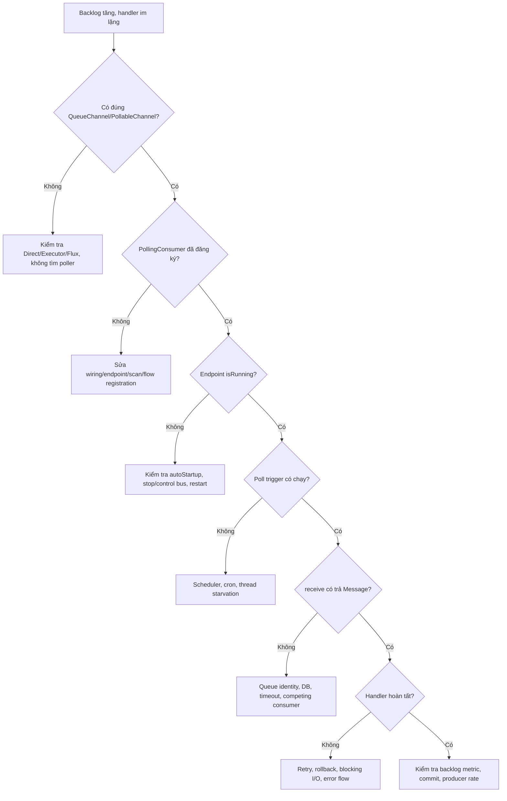
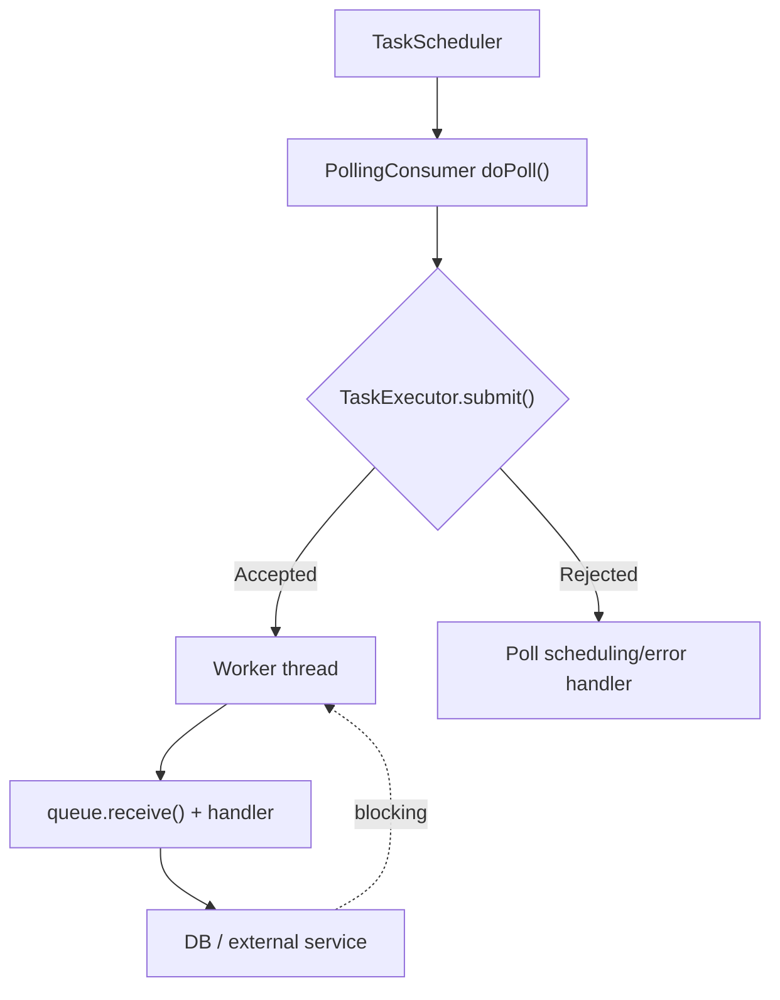
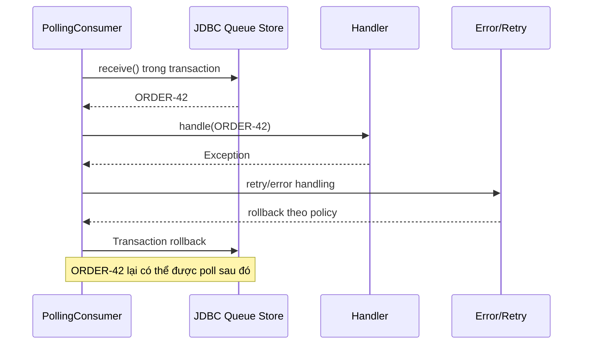

# Chẩn đoán message bị queue nhưng không được poll trong Spring Integration

## 1. Hiện tượng: queue còn message, nhưng handler im lặng

Một dashboard báo **`ordersQueue backlog = 2.400`**, trong khi `ordersWorker` không ghi log xử lý mới. Producer vẫn gửi thành công; sau restart ứng dụng backlog còn tăng. Người vận hành có thể kết luận ngay là “`QueueChannel` bị hỏng”. Thực tế nguyên nhân có thể nằm ở endpoint/poller, scheduler, transaction, định danh persistent store hoặc ở cách đo.

Trong Spring Integration, message thường đi theo đường:

```mermaid
flowchart LR
    A["Producer"] -->|send| B["QueueChannel / PollableChannel"]
    B -->|receive(timeout)| C["PollingConsumer"]
    T["TaskScheduler / Trigger"] -->|kích hoạt| C
    C --> D["MessageHandler"]
    D --> E["Business DB / outbound adapter"]
    D -. "Exception / retry / rollback" .-> R["Error flow / recovery"]
```

**Một message nằm trong queue không tự gọi handler.** `QueueChannel` là `PollableChannel`: producer gửi vào queue; một **polling consumer** phải được tạo, được start và được scheduler kích hoạt để gọi `receive()` rồi bàn giao message cho handler.

Bài **“Chẩn đoán message bị queue nhưng không được poll”** thuộc chương **Debugging** trong module **SPRING_INTEGRATION_RUNTIME**. Mục tiêu là khoanh vùng chính xác từ **channel → endpoint → poller → scheduler/executor → transaction/retry/error flow**, đồng thời bảo toàn message khi kiểm tra và xử lý tình huống sau restart.

> **Quy tắc an toàn:** Không dùng `queue.receive()` để “xem thử có message không” trên production. `receive()` **tiêu thụ** một message; nếu store có transaction và đang không nằm trong transaction phù hợp, hành động quan sát có thể làm mất work item. Bắt đầu bằng số đếm, trạng thái bean, metrics, log và kiểm tra read-only của store.

## 2. Trước tiên phải xác định “không poll” là điều gì

Một hệ thống có thể có backlog không giảm trong cả ba trạng thái rất khác nhau:

| Tình huống | Thao tác `receive()` | Handler | Dấu hiệu thường thấy |
| --- | --- | --- | --- |
| **A. Không có polling consumer hoạt động** | Không được gọi | Không chạy | Endpoint missing/stopped, scheduler chưa kích hoạt |
| **B. Có poll nhưng không lấy được message** | Được gọi, trả `null` hoặc lỗi | Không chạy | Queue bị nhìn sai, region khác, DB unavailable, receive timeout |
| **C. Lấy được rồi thất bại/rollback** | Trả message | Chạy rồi lỗi | Cùng business ID lặp; backlog không giảm; retry/error logs |
| **D. Lấy được, xử lý rất chậm** | Trả message | Đang chạy | Thread blocked, DB lock, remote API timeout; poll tiếp theo trễ |
| **E. Consumer khác đã lấy trước** | Poller hiện tại nhận `null` | Handler ở instance khác | Competing consumers, metric theo node không khớp |
| **F. Dashboard đo sai đối tượng** | Tùy thực tế | Có thể chạy bình thường | Metric stale, queue khác, region khác, sampled logs |

Một báo cáo “queue có 10 message nhưng handler chưa chạy” chỉ là **triệu chứng**. Cần thu thập **số lần poll**, **số lần receive trả message**, **số lần handler bắt đầu**, **số lần handler commit**; chỉ khi tách bốn số này mới có thể xác định điểm mất tiến độ.

## 3. Quy trình triage nhanh trong sự cố



**Thứ tự chẩn đoán tối ưu** là từ cấu trúc tương đối rẻ tới nghiệp vụ đắt và có rủi ro: xác nhận loại channel, sự tồn tại của endpoint, lifecycle, lịch poll, `receive()` rồi mới đến transaction/handler.

### Thông tin cần chụp ngay, không phá dữ liệu

1. Timestamp/tên environment/instance và phiên bản ứng dụng.
2. Channel bean ID, endpoint ID, flow ID, `region`/table prefix nếu JDBC.
3. Backlog hiện tại, backlog cũ nhất và tốc độ tăng.
4. Endpoint state `isRunning()`, `isAutoStartup()` và lần chuyển trạng thái gần nhất.
5. Lần poll gần nhất; số poll rỗng, lỗi poll, số message nhận được.
6. Scheduler thread active/blocked và executor active/queued/rejected.
7. Log lỗi DB/broker, transaction rollback và error channel.
8. Có node khác đang dùng cùng queue hay không.

Nếu hệ thống quan trọng, giữ nguyên log/thread dump/metric snapshot trước khi restart poller; restart có thể làm mất bằng chứng của deadlock hoặc thay đổi thứ tự tái giao message.

## 4. Đúng loại channel trước khi debug poller

Spring Integration có nhiều loại channel với semantics khác nhau.

| Channel | Consumer nhận theo cách nào? | Có cần poller để đọc channel? | Điều dễ nhầm |
| --- | --- | --- | --- |
| `DirectChannel` | `SubscribableChannel`, dispatch tới handler theo caller thread | **Không** | Stop endpoint có thể khiến send lỗi “no subscribers”, không tạo backlog |
| `ExecutorChannel` | Dispatch handler qua `TaskExecutor` | **Không** | “Queue đầy” đôi khi là queue của executor, không phải `QueueChannel` |
| `PublishSubscribeChannel` | Broadcast đến subscriber | **Không** | Nhiều subscriber khác với competing consumers |
| `QueueChannel` | `PollableChannel.receive(timeout)` | **Có**, nếu xử lý qua polling consumer | Message còn trong queue nhưng không có handler tự chạy |
| `PriorityChannel` | Pollable theo priority | **Có** | Thứ tự lấy có thể không giống thứ tự enqueue |
| `RendezvousChannel` | Handoff đồng bộ, kiểu pollable | **Có**, khi consumer kiểu polling | Sender có thể chờ receiver; không dùng làm backlog lớn |
| `FluxMessageChannel` | `Publisher<Message<?>>`, Reactive Streams subscription | Không dùng poller để đọc như queue | Phụ thuộc subscription/demand |

Dùng `ApplicationContext` hoặc Integration Graph để xác minh **class thực tế của bean**. Một bean tên `ordersQueue` không nhất thiết là `QueueChannel` nếu sau refactor nó đã được thay bằng `DirectChannel` hoặc một gateway/channel khác.

### Phân biệt queue của channel với queue của executor

`ExecutorChannel` có thể dùng `ThreadPoolTaskExecutor` với internal task queue. Metric `executor.queue.size` tăng cho biết task bị kẹt **trước khi handler chạy**, nhưng không có `PollableChannel.receive()` nào trong đường đó.

Ngược lại, `QueueChannel` lưu **message**, và worker cần polling consumer. Hai loại “backlog” có thể cùng tăng nhưng hướng sửa hoàn toàn khác nhau.

## 5. Tạo đúng QueueChannel và PollingConsumer

Một cấu hình Java Annotation minh họa rõ các thành phần:

```java
import org.springframework.context.annotation.Bean;
import org.springframework.context.annotation.Configuration;
import org.springframework.integration.annotation.MessageEndpoint;
import org.springframework.integration.annotation.Poller;
import org.springframework.integration.annotation.ServiceActivator;
import org.springframework.integration.channel.QueueChannel;
import org.springframework.integration.config.EnableIntegration;

@Configuration
@EnableIntegration
public class QueueConfiguration {

    @Bean("ordersQueue")
    public QueueChannel ordersQueue() {
        return new QueueChannel(500); // Bounded in-memory queue.
    }
}

@MessageEndpoint
class OrderQueueConsumer {

    private final OrderService orderService;

    public OrderQueueConsumer(OrderService orderService) {
        this.orderService = orderService;
    }

    @ServiceActivator(
            inputChannel = "ordersQueue",
            poller = @Poller(
                    fixedDelay = "1000",
                    maxMessagesPerPoll = "10",
                    receiveTimeout = "100"))
    public void handle(OrderCommand command) {
        orderService.process(command);
    }
}
```

`OrderCommand` và `OrderService` là kiểu nghiệp vụ do ứng dụng định nghĩa; bean service phải được đăng ký trong context. `@MessageEndpoint` cần được component-scan phù hợp. Đoạn ví dụ dùng queue trong RAM để thử poller; nó **không giữ message sau restart**.

Với đúng wiring:

1. Producer gửi `Message<OrderCommand>` vào bean `ordersQueue`.
2. Spring Integration tạo polling consumer endpoint cho `@ServiceActivator` vì input là `PollableChannel`.
3. `TaskScheduler` gọi poller theo `fixedDelay`.
4. Trong mỗi lượt, poller lấy tối đa 10 message (hoặc dừng khi receive không còn message), rồi gọi method handler.
5. Nếu handler ném exception, xử lý lỗi/rollback phụ thuộc error handler, advice và transaction được cấu hình.

**Có một bean queue nhưng không có consumer/poller không đủ.** Khi dùng annotation, một nguyên nhân thường gặp là package chứa `@MessageEndpoint` không nằm trong phạm vi component scan.

### Cấu hình tương đương bằng XML

```xml
<int:channel id="ordersQueue">
    <int:queue capacity="500"/>
</int:channel>

<int:service-activator id="ordersQueueConsumer"
                       input-channel="ordersQueue"
                       ref="orderService"
                       method="process">
    <int:poller fixed-delay="1000"
                max-messages-per-poll="10"
                receive-timeout="100"/>
</int:service-activator>
```

XML là một trích đoạn của Spring context có namespace `int`; bean `orderService` do ứng dụng định nghĩa. `id="ordersQueueConsumer"` giúp tra endpoint dễ hơn. Không cấu hình đồng thời **hai polling consumers** giống hệt nhau trong Java và XML nếu không chủ định chạy competing consumers.

## 6. Nếu thiếu poller thì chuyện gì xảy ra?

Khi một handler nhận từ `PollableChannel`, Spring Integration cần cấu hình poller cụ thể hoặc **global default poller** phù hợp.

Đối với XML/DSL, nếu `PollingConsumer` không có poller và không có global default, application context thường **báo lỗi khởi tạo** vì không có `Trigger`, thay vì tự chạy một poller ẩn. Tuy nhiên, bạn vẫn có thể gặp queue có backlog trong ứng dụng running nếu:

- Queue là bean độc lập nhưng không có endpoint nối tới nó.
- Endpoint chỉ được tạo trong một dynamic flow **chưa đăng ký**.
- Endpoint bị stop bởi operator/Control Bus.
- Flow có `autoStartup=false` hoặc registration chưa `start()`.
- Một profile/condition làm bean consumer không được tạo.
- Input channel name trong endpoint **khác** queue thực tế mà producer đang dùng.
- Có default poller nhưng trigger không tới hạn hoặc scheduler không hoạt động.

Do đó không nên chỉ tìm chuỗi `@Poller` trong source. Kiểm tra **runtime bean graph** xem có một `PollingConsumer` thực sự gắn với đúng channel ID và có trigger hay không.

### Global default poller

Một ứng dụng có thể định nghĩa global default poller cho các polling endpoints chưa có cấu hình riêng. Trong XML, dùng `<int:poller default="true" .../>`; trong Java configuration, một bean poller phù hợp được đăng ký theo convention của Spring Integration.

Nếu đã có global default, **không tự suy ra** mọi endpoint dùng đúng interval mong muốn: endpoint có poller riêng sẽ dùng cấu hình riêng. Một default poller quá thưa, cron sai hoặc dùng scheduler bị nghẽn có thể làm nhiều flow chậm đồng loạt.

## 7. Kiểm tra endpoint đã được start hay chưa

Nhiều endpoint Spring Integration thực hiện `SmartLifecycle`; nó cung cấp `start()`, `stop()`, `isRunning()` và các thông tin auto-start/phase.

Ví dụ quan sát an toàn (đổi bean ID theo ứng dụng thực tế):

```java
import org.springframework.context.ApplicationContext;
import org.springframework.context.SmartLifecycle;

public final class PollerLifecycleProbe {

    private final ApplicationContext context;

    public PollerLifecycleProbe(ApplicationContext context) {
        this.context = context;
    }

    public String describe(String endpointBeanName) {
        SmartLifecycle endpoint =
                context.getBean(endpointBeanName, SmartLifecycle.class);

        return "endpoint=" + endpointBeanName
                + " running=" + endpoint.isRunning()
                + " autoStartup=" + endpoint.isAutoStartup()
                + " phase=" + endpoint.getPhase();
    }
}
```

Đây là mã chẩn đoán chỉ đọc. Bean ID phải là **endpoint**, không phải tên queue hoặc service object. Với XML ở phần 5, ID là `ordersQueueConsumer`; với annotation/DSL có thể có tên endpoint khác do framework đặt.

### Những lý do khiến running=false

- `autoStartup=false` hoặc component được cấu hình pause chủ động.
- Control Bus/JMX/management API đã gọi `stop()`.
- Dynamic `IntegrationFlowRegistration` được tạo với `autoStartup(false)`.
- Context đang shutdown hoặc endpoint không được start do lỗi startup trước đó.
- Container/adapter có lifecycle riêng; bên ngoài báo lỗi nhưng app chưa reconcile.
- Operator đã stop poller để xử lý downstream lỗi rồi quên resume.

**Chỉ khi đã xác minh nguyên nhân và bảo đảm downstream an toàn** mới gọi `start()`. Bật lại poller có thể xử lý toàn bộ backlog ngay, tạo lưu lượng đột biến tới DB/HTTP/broker.

### Thao tác Control Bus

Với Spring Integration 6.4+/7.x, Control Bus nhận managed command dạng `beanName.methodName`, ví dụ:

```text
ordersQueueConsumer.stop
ordersQueueConsumer.start
```

Đây là thao tác quản trị **có thể thay đổi runtime**, không thực hiện chỉ để kiểm tra. Ví dụ SpEL `@ordersQueueConsumer.start()` thuộc cú pháp Control Bus cũ, không nên áp dụng nguyên xi cho 6.4+/7.x. Khi start lại, đo backlog và failure rate; đừng xem “command sent” là xác nhận consumer đã sẵn sàng.

## 8. Poller thực tế chạy vào lúc nào?

Một poller có `Trigger` như `fixedDelay`, `fixedRate` hoặc `cron`:

| Thuộc tính | Ý nghĩa | Lỗi thường gặp |
| --- | --- | --- |
| `fixedDelay` | Đợi một khoảng từ khi lần chạy trước hoàn tất để chạy tiếp | Handler chậm khiến poll kế tiếp đến muộn |
| `fixedRate` | Lập lịch theo chu kỳ; nếu thread bận không phải lúc nào cũng chạy đúng hạn | Đặt kỳ vọng throughput cao hơn năng lực scheduler |
| `cron` | Chạy tại thời điểm thỏa biểu thức lịch | Sai ngày/giờ/time zone, lịch chỉ chạy giờ hành chính |
| `initialDelay` | Độ trễ trước lần poll đầu tiên | Mới deploy và thấy queue chưa được nhận ngay |
| `maxMessagesPerPoll` | Số message tối đa lấy trong một lần poll | Quá thấp, backlog giảm chậm; quá cao, chiếm scheduler lâu |
| `receiveTimeout` | Thời gian chờ của polling consumer khi channel chưa có message | Nhiều poller chờ dài có thể chiếm hết scheduler threads |
| `taskExecutor` | Executor được poller sử dụng nếu cấu hình | Executor bị reject/queue đầy, scheduler trông như không tiến |

### Điểm dễ nhầm: maxMessagesPerPoll có default khác nhau

Spring Integration phân biệt:

- **`PollingConsumer`** (đọc từ `QueueChannel`/`PollableChannel`): mặc định `maxMessagesPerPoll = -1`, nghĩa là có thể tiếp tục nhận cho đến khi `receive()` trả `null`.
- **`SourcePollingChannelAdapter`** (poll một `MessageSource`): mặc định `maxMessagesPerPoll = 1` trong tài liệu.
- Từ Spring Integration 5.5, `maxMessagesPerPoll = 0` được mô tả như cách **bỏ qua gọi `MessageSource.receive()`** đối với inbound source adapter để tạm dừng pulling. **Không áp dụng lời giải thích đó một cách máy móc cho `PollingConsumer` của QueueChannel**; kiểm tra đúng handler/version.

Nếu nguồn queue liên tục có message và dùng `-1`, một lần poll có thể kéo dài rất lâu. Với nhu cầu công bằng giữa nhiều pollers, nên chọn giới hạn dương hợp lý và đo backlog/throughput thực tế.

### Ví dụ tính backlog

Một poller chạy `fixedDelay=1000 ms`, `maxMessagesPerPoll=5`, mỗi handler mất 100 ms. Bỏ qua overhead, mỗi chu kỳ xử lý 5 message tốn 500 ms rồi đợi thêm khoảng 1 giây; thông lượng xấp xỉ **3,3 message/s**, thấp hơn con số tưởng tượng “5 message/s”.

Nếu producer tạo **10 message/s**, backlog tăng khoảng **6,7 message/s**; poller **vẫn chạy bình thường** nhưng không theo kịp. Tăng `maxMessagesPerPoll`, tách executor hoặc scale chỉ có ý nghĩa sau khi xác định bottleneck và độ an toàn của downstream.

## 9. receiveTimeout: queue không rỗng nhưng poller khác đang chờ?

`receiveTimeout` quy định **thời gian tối đa một polling consumer đợi message** khi gọi `receive()` trên channel có khả năng chờ.

Ví dụ:

```xml
<int:service-activator id="fastQueueConsumer"
                       input-channel="ordersQueue"
                       ref="orderService"
                       method="process">
    <int:poller fixed-delay="1000"
                receive-timeout="100"
                max-messages-per-poll="5"/>
</int:service-activator>
```

Trong đa số cấu hình, nếu queue đã có message thì `receive()` trả ngay; `receiveTimeout` không làm handler chờ đủ 100 ms mỗi lần. Khi queue trống, polling thread có thể chờ tới timeout. Với nhiều poller cùng dùng shared scheduler, những thread đang chờ đó vẫn chiếm tài nguyên trong khoảng chờ.

Theo reference, default `receiveTimeout` của polling consumer là **1 giây**. Khi nhiều pollers chạy đồng thời, một scheduler pool nhỏ có thể bị chiếm bởi nhiều lần chờ, làm endpoint khác không được kích hoạt đúng lịch.

### Long polling khác poll liên tục

- `fixedDelay` dài + `receiveTimeout` ngắn: thread ít chờ nhưng message đến giữa hai lần poll có thể đợi lâu.
- `fixedDelay` ngắn + `receiveTimeout` dài: có thể phản ứng nhanh với message mới, nhưng giữ thread chờ lâu.
- Polling nguồn file thường trả ngay khi không có file; `receiveTimeout` ở adapter không có cùng ý nghĩa blocking wait như `QueueChannel`.

Chọn timeout và scheduler pool dựa trên số endpoint, tải, latency SLA; không chỉnh `receiveTimeout` như một nút tăng tốc mù quáng.

## 10. TaskScheduler starvation: poller running nhưng không có lượt chạy

Spring Integration cung cấp task scheduler dùng chung (bean tên `taskScheduler` theo convention). Theo reference, default thường là `ThreadPoolTaskScheduler`, với pool **10 threads** trong cấu hình mặc định được mô tả; nếu ứng dụng cung cấp bean `taskScheduler` riêng, size/autoStartup có thể khác.

Sự cố điển hình:

```text
taskScheduler pool: 10 threads
  8 threads: poller chờ receiveTimeout dài
  1 thread : file adapter đang block I/O
  1 thread : handler JDBC mất 60 giây
  -------------------------------------
  ordersQueueConsumer: đã schedule, không có thread rảnh
```

Backlog của `ordersQueue` tăng dù `ordersQueueConsumer.isRunning() == true` vì **đăng ký scheduled task không chứng minh một thread đang thực thi task đó đúng hạn**.

### Dấu hiệu scheduler bị nghẽn

- Nhiều endpoint polling cùng trễ, không chỉ một flow.
- Thread dump có các thread `taskScheduler-...` nằm trong `QueueChannel.receive`, JDBC hoặc gọi HTTP blocking.
- Gauge active scheduler threads chạm pool size lâu dài.
- Poll interval thực tế dài hơn nhiều so với `fixedDelay`/`fixedRate`.
- Sau khi một endpoint khác được stop hoặc một HTTP call hết timeout, các queue đột nhiên được poll lại.
- Không nhất thiết có ERROR log; chỉ là không có thread sẵn sàng.

### Cách xử lý

1. Dùng thread dump/profiler để xác định **ai chiếm scheduler**, không chỉ tăng pool size.
2. Giảm `receiveTimeout` khi hợp lý; tránh hàng trăm pollers cùng chờ dài.
3. Với handler blocking/lâu, cấu hình **`TaskExecutor` riêng** cho polling consumer hoặc thiết kế async boundary có backpressure.
4. Đặt timeout cho DB/HTTP client, tránh một poller chiếm thread vô hạn.
5. Giới hạn concurrency/queue executor để không chuyển nghẽn sang một pool khác.
6. Theo dõi số lượng endpoints tạo động và ngân sách scheduler trong cluster.

**Cẩn trọng:** Đẩy handler từ scheduler sang executor có thể làm thay đổi transaction boundary và error handling. Nếu dùng JDBC-backed QueueChannel, cần kiểm thử lại ack/dequeue/rollback/duplicate khi thêm task executor.

## 11. TaskExecutor saturation và rejection

Một poller có thể thực sự được trigger, nhưng không thể submit công việc vào executor:

- `ThreadPoolTaskExecutor` hết active threads.
- Task queue đầy; rejection policy ném `TaskRejectedException` hoặc `RejectedExecutionException`.
- Worker threads chờ database lock hoặc remote API.
- Executor đã shutdown/stop trong khi poller còn running.

Sơ đồ:



Chi tiết thứ tự `submit` và `receive` phụ thuộc cách cấu hình polling endpoint và framework. Khi có executor cho poller, đừng mặc định scheduler thread đang trực tiếp xử lý message; kiểm tra stack thực tế.

**Không đặt queue capacity vô hạn để che saturation.** Đó là cách trì hoãn vấn đề, có thể biến queue task trong RAM thành OOM. Thực tế cần giới hạn lưu lượng, timeout, rejections có quan sát và xử lý backpressure.

## 12. Wiring mismatch: producer gửi một queue, poller đọc queue khác

Một lỗi rất phổ biến khi có nhiều bean cùng kiểu:

```text
Producer → "ordersQueue"       (QueueChannel A, 200 messages)
Consumer ← "orderQueue"        (QueueChannel B, 0 messages)
```

Chỉ thiếu chữ `s`, khác prefix namespace hoặc dùng annotation `@Qualifier` sai có thể tạo hai luồng không gặp nhau.

Nguồn gây nhầm khác:

- Có bean trong parent context và child context với cùng tên nhưng instance khác.
- Dynamic `IntegrationFlow` tạo **input channel riêng**, còn producer gửi vào bean cũ.
- `@ServiceActivator(inputChannel="...")` chỉ sai một ký tự.
- Producer gửi sang `PriorityChannel` hoặc `ExecutorChannel` khác với queue đang đo.
- Router quyết định output channel khác với tưởng tượng.
- Vừa deploy version mới, tên channel ID bị đổi; backlog vẫn ở store cũ.
- Poller đang ở instance B, dashboard chỉ xem bean ở instance A.

### Chẩn đoán không tiêu thụ message

```java
import org.springframework.context.ApplicationContext;
import org.springframework.integration.channel.QueueChannel;

public final class QueueIdentityProbe {

    private final ApplicationContext context;

    public QueueIdentityProbe(ApplicationContext context) {
        this.context = context;
    }

    public int queued(String channelBeanName) {
        QueueChannel queue =
                context.getBean(channelBeanName, QueueChannel.class);
        return queue.getQueueSize(); // Chỉ đọc số lượng, KHÔNG dequeue.
    }

    public boolean sameBean(String first, String second) {
        return context.getBean(first) == context.getBean(second);
    }
}
```

`QueueChannel.getQueueSize()` phản ánh số message trong channel theo implementation. Với store ngoài hoặc concurrent consumers, giá trị là một **snapshot** có thể thay đổi ngay sau khi đọc; không sử dụng nó như một invariant transaction.

Đối chiếu runtime graph `input-channel → consumer endpoint` với logger của producer/route. Nếu cần xem một message cụ thể, chọn **log correlation/trace hoặc truy vấn read-only vào store**; không gọi `receive(0)`, vì dù timeout bằng 0, nó vẫn lấy và tiêu thụ message nếu có.

## 13. Persistent QueueChannel: DB có rows nhưng poller không thấy

Queue in-memory khác queue có `JdbcChannelMessageStore`. Spring Integration khuyến nghị `JdbcChannelMessageStore` cho channel có DB backing.

```xml
<!-- Trích đoạn minh họa; có schema và namespace Spring Integration. -->
<bean id="ordersChannelStore"
      class="org.springframework.integration.jdbc.store.JdbcChannelMessageStore">
    <constructor-arg ref="dataSource"/>
    <property name="region" value="ORDERS_V1"/>
    <property name="channelMessageStoreQueryProvider"
              ref="ordersSqlQueryProvider"/>
</bean>

<int:channel id="ordersQueue">
    <int:queue message-store="ordersChannelStore"/>
</int:channel>
```

Phải có `spring-integration-jdbc`, schema chuẩn, provider SQL cho database tương ứng, datasource/transaction manager, các quyền SELECT/INSERT/DELETE thích hợp. **Không khai báo `capacity` cùng `message-store` trong XML `<int:queue>`**.

### Dữ liệu ở DB không đồng nghĩa consumer nhìn thấy

Store có thể phân vùng theo:

- **Channel name / group ID**.
- **Region**, ví dụ `ORDERS_V1`.
- Table prefix/schema và datasource.
- Điều kiện SQL query provider, transaction và locking.

Ví dụ phiên bản cũ dùng `ordersQueue + ORDERS_V1`, phiên bản mới đọc `ordersQueueV2 + ORDERS_V2`: record cũ vẫn nằm trong DB nhưng consumer mới không thể nhìn thấy qua store identity mới.

**Đừng đổi region chỉ để “thử sửa”.** Trước tiên đối chiếu cấu hình trước/sau deploy, bảng/region, số row theo queue và quyền DB. Nếu cần migration, phải có kế hoạch tránh đọc trùng/làm mất message trong lúc hai phiên bản còn chạy.

### Bẫy query provider và schema

`JdbcChannelMessageStore` dùng `ChannelMessageStoreQueryProvider` phù hợp SQL dialect. Một provider không đúng database hoặc schema/index chưa được tạo có thể dẫn tới lỗi poll SQL hoặc transaction lock.

Từ Spring Integration 6.2, các JDBC stores có kiểm tra tồn tại bảng ở thời điểm `start()` trong một số implementation; nếu schema thiếu, có thể làm **application context fail startup**, chứ không phải chạy im lặng. Dù vậy, lỗi DB sau startup hoặc cấu hình datasource sai vẫn có thể làm poller không tiến.

Với nhiều instance cùng đọc DB, có thể gặp row lock, isolation/MVCC, connection pool starvation hoặc deadlock. Không suy luận “queue rỗng” chỉ vì một query trả 0 trên một connection đang trong transaction/isolation không phù hợp.

## 14. Transaction rollback tạo cảm giác “không được poll”

Khi polling consumer lấy một message và handler thất bại, nếu `receive()` và handler cùng nằm trong transaction phù hợp, thao tác dequeue có thể rollback. Message **trở lại trạng thái chưa tiêu thụ** trong DB.



Triệu chứng:

- Backlog không giảm dù poller có chạy.
- Cùng `businessId` xuất hiện nhiều lần trong log attempt.
- DB thấy nhiều transactions rolled back.
- `handler_attempts_total` tăng nhưng `business_commits_total` không tăng.
- Một “poison message” chiếm vị trí đầu queue, khiến message sau phải chờ tùy queue/order/locking.

**Trường hợp khác:** retry advice có `RecoveryCallback` hấp thụ exception và gửi `ErrorMessage` sang failure channel, rồi trả bình thường. Poller transaction có thể **commit**; queue giảm nhưng nghiệp vụ vẫn thất bại. Đây không phải “message chưa poll”, mà là **đã xử lý theo recovery policy**.

### Phải đọc đúng error flow

- Với `DirectChannel` đồng bộ, exception thường về thread gọi send.
- Với poller có `MessagePublishingErrorHandler`, exception có thể trở thành `ErrorMessage` được publish tới error channel.
- `RequestHandlerRetryAdvice` có thể retry rồi gửi đến **dedicated recovery channel**.
- Nếu error channel consumer chỉ log rồi trả bình thường, điều đó không chứng minh failure record đã được lưu bền vững.

Khi debug backlog, xem cả **poller error logs, retry count, transaction outcome và DLQ**, không chỉ global `errorChannel`.

## 15. Poller thực sự được kích hoạt nhưng handler không bắt đầu

Một vài nguyên nhân ít rõ ràng hơn:

1. `receive()` trả `null` do store identity/region sai hoặc queue đã được consumer khác lấy hết.
2. `receive()` ném exception (JDBC connection, deserialize message, permission).
3. Polling advice/filter chặn trước handler.
4. Input message conversion/parameter mapping không tương thích với `@ServiceActivator` method; lỗi phát sinh trước body handler.
5. Endpoint được tạo đúng nhưng target handler reference không phải bean mong muốn.
6. Message bị filter/discard hoặc router chuyển sang nhánh khác.
7. Transaction interceptor bắt đầu thất bại trước khi vào handler.
8. Thread bị interrupt/stop trong lúc chờ receive.
9. `TaskExecutor` reject trước khi poll/dispatch task theo topology.

Vì vậy, **không có DEBUG log ở đầu method handler** chưa đủ kết luận “poller không chạy”. Hãy đặt tín hiệu ở nhiều boundary: **poll triggered → receive returned message → handler entered → handler completed → business commit**.

Không bật toàn bộ DEBUG trong nhiều giờ: log mọi message có thể gây bão log, làm tăng latency, thậm chí che lấp vấn đề nguyên bản. Bật theo endpoint/package hẹp, ghi correlation ID thay vì full payload/PII.

## 16. Cách quan sát poller không phá dữ liệu

Một bộ chỉ số khuyến nghị do ứng dụng định nghĩa:

| Metric | Kiểu | Mục đích |
| --- | --- | --- |
| `app.integration.queue.depth` | Gauge | Backlog hiện tại |
| `app.integration.queue.oldest_age` | Gauge | Tuổi message cũ nhất theo timestamp enqueue |
| `app.integration.poll.triggered` | Counter | Số lượt poll thực sự được scheduler kích hoạt |
| `app.integration.poll.empty` | Counter | Poll có `receive() == null` |
| `app.integration.poll.received` | Counter | Số message lấy thành công |
| `app.integration.handler.started` | Counter | Handler bắt đầu |
| `app.integration.handler.completed` | Counter | Handler kết thúc thành công ở boundary được định nghĩa |
| `app.integration.handler.failed` | Counter | Handler ném lỗi, tính theo attempt |
| `app.integration.tx.rollback` | Counter | Transaction rollback |
| `app.integration.executor.rejected` | Counter | Task bị executor từ chối |
| `app.integration.poll.last_success_age` | Gauge | Thời gian kể từ lần poll có message thành công |
| `app.integration.dlq.committed` | Counter | Failure record đã được lưu bền vững |

**Các tên trên là ví dụ, không phải meter built-in mặc định của mọi phiên bản.** Với Micrometer/Observation, Spring Integration có sẵn instrumentation cho channel/handler/source trong nhiều trường hợp; nhưng để đo cụ thể “lần poll nào rỗng” hoặc “message cũ nhất”, có thể phải bổ sung instrumentation ứng dụng hay đọc từ broker/store.

### Gauge queue depth bằng Micrometer

```java
import io.micrometer.core.instrument.MeterRegistry;
import io.micrometer.core.instrument.Tags;
import org.springframework.integration.channel.QueueChannel;

// ordersQueue là bean singleton đã tồn tại trong ApplicationContext.
// registry là MeterRegistry do Spring/Micrometer cung cấp.
registry.gauge(
        "app.integration.queue.depth",
        Tags.of("queue", "ordersQueue"),
        ordersQueue,
        QueueChannel::getQueueSize);
```

Metric này **không tiêu thụ message**. Nhưng nó không cho biết tuổi message cũ nhất hoặc poller có chạy hay không; cũng không thay cho counter business commit.

Nếu dùng multi-instance, mỗi instance có queue in-memory riêng nên cần biết metric đang đo **queue nào của node nào**. Với JDBC shared store, các instance có thể cùng nhìn một backlog; tránh **cộng** cùng một shared queue depth từ nhiều node rồi kết luận số message bị nhân lên.

### Structured debug log tối thiểu

```json
{
  "time": "2026-11-22T10:18:31Z",
  "level": "DEBUG",
  "event": "poll_received",
  "flow": "orders",
  "endpoint": "ordersQueueConsumer",
  "channel": "ordersQueue",
  "instance": "worker-2",
  "messageId": "spring-message-id",
  "businessId": "ORDER-42",
  "correlationId": "checkout-42",
  "thread": "taskScheduler-4"
}
```

Đây là format log **minh họa**. Ghi `messageId`, `businessId` và correlation trong logs/tracing có giới hạn truy cập; **không đưa chúng thành Micrometer tags cardinality cao**.

## 17. Một custom hook để biết poller có chạy không

Nếu muốn thêm probe ở đúng ranh giới poll, có thể dùng **poller advice** hoặc hạ tầng instrumentation của endpoint. Mục tiêu là phân biệt “scheduler không kích hoạt” với “poll kích hoạt nhưng receive không có message”.

Một thiết kế instrument tốt nên đo:

```text
Scheduled poll START
    |
    v
receive() called
    |--- null → empty_poll++
    |--- exception → poll_errors++
    |--- Message<?> → poll_received++
                           |
                           v
                     handler attempt
                       |        |
                    success   failure
                       |        |
                    commit    retry/rollback
```

**Không đặt metric poll trong handler rồi gọi đó là số poll.** Handler chỉ chạy khi đã có message được nhận và chuyển vào. Một poll rỗng hoặc lỗi trước handler sẽ không được đếm.

Khi dùng custom `MethodInterceptor`/poller advice, cần chọn vị trí và scope đúng. Có những advice bao quanh `doPoll()` toàn bộ một lần trigger, có advice quanh handler invocation; chúng đo **khác đơn vị**. Nếu thêm transaction advice, thứ tự advice ảnh hưởng lỗi có được propagate và thời gian có bao gồm retry/backoff hay không.

### Probe bằng log tại ranh giới dễ triển khai

Có thể tạm tăng log level của các package liên quan đến poller/scheduler trong môi trường kiểm thử hoặc một instance được chọn. Kết hợp một log tại **đầu handler**, trace/error log của DB và metric backlog. Đặt thread name vào log để nhận diện scheduler hay executor.

Khi sự cố được khoanh vùng, hoàn nguyên DEBUG, tránh dùng log chi tiết vĩnh viễn làm nguồn đo throughput.

## 18. Chẩn đoán scheduler bằng thread dump

Nếu endpoint có `isRunning=true` nhưng không có log poll, hãy chụp thread dump tại đúng thời điểm backlog tăng (qua công cụ JVM/management được cấp quyền):

- Tìm thread tên `taskScheduler-...`, `pool-...` hoặc tên đã cấu hình.
- Đếm thread `RUNNABLE`, `WAITING`, `TIMED_WAITING` và `BLOCKED`.
- Xem stack có đang ở `QueueChannel.receive`, `PollingConsumer`, JDBC pool, HTTP socket read hay lock nào.
- Tìm các thread chờ trên cùng database lock hoặc connection pool.
- Lặp thread dump cách nhau vài giây để phân biệt **chờ hợp lệ** với **kẹt kéo dài**.
- Đối chiếu với `maxMessagesPerPoll`, `receiveTimeout` và số pollers dùng chung `TaskScheduler`.

**Không suy ra mọi TIMED_WAITING là lỗi.** Một poller đang chờ `receiveTimeout` khi queue thực sự rỗng là bình thường. Nó đáng ngờ khi **queue mà đúng consumer phải đọc có backlog**, hoặc cùng thread chờ trên sai queue/source và không còn worker cho endpoint khác.

### Vấn đề đồng hồ và cron

Nếu cron chỉ chạy vào giờ nhất định hoặc time zone khác kỳ vọng, thread dump có thể hoàn toàn bình thường. Kiểm tra trigger, zone, last/next scheduled execution và clock/time sync. Một thay đổi timezone giữa môi trường dev và production có thể biến “mỗi phút” thành “chỉ một khoảng giờ/ngày”.

## 19. MessageGroup và metadata: đừng nhầm với QueueChannel backlog

Không phải mọi message còn nằm trong database đều đang **chờ poll**.

| Dữ liệu thấy trong DB | Ý nghĩa | Ai xử lý tiếp? |
| --- | --- | --- |
| Rows của JDBC channel store | Message đang chờ trong persistent QueueChannel | PollingConsumer của đúng channel |
| Rows của `JdbcMessageStore`/`MessageGroupStore` | Aggregator/resequencer đang giữ fragment | Correlation handler/release strategy/reaper |
| Records của `JdbcMetadataStore` | Checkpoint/accept-once/idempotency marker | Inbound adapter/selector hoặc ứng dụng |
| Outbox rows | Event nghiệp vụ chờ publish | Outbox publisher/worker |
| DLQ/failure records | Message lỗi được cách ly | Replay/admin/recovery worker |

Một group aggregator giữ 2/3 fragment có thể đứng yên **đúng thiết kế** cho tới khi phần cuối đến hoặc expiry/reaper chạy. Việc tăng pool poller cho `ordersQueue` không giúp aggregator release thiếu message.

Tương tự, một file bị đánh dấu “accepted” trong metadata có thể không được source poll lại; đó là vấn đề filter/checkpoint, không phải một `QueueChannel` đã chứa file mà không đọc được.

## 20. Test case điển hình: poller sống nhưng backlog tăng

Giả sử thống kê trong 60 giây:

```text
incoming_rate            = 40 messages/s
polling_consumer_running = true
poll_triggered           = 30/minute
poll_received            = 300/minute
handler_success          = 290/minute
handler_failed           = 10/minute
queue_depth              = 1200 → 3300
```

Nếu đo đúng, poller đã nhận **5 messages/s**, producer tạo **40 messages/s**, nên backlog tăng lý thuyết **35 messages/s**, tức **2.100 messages/phút**. Số depth 1.200 → 3.300 phù hợp. Vấn đề là **throughput/capacity**, không phải thiếu poller.

Một hướng khắc phục gồm: kiểm tra handler latency, batch size, scheduler/executor, DB throughput, rate limiting producer; chỉ scale consumer khi transaction, downstream và retry/idempotency đã đủ an toàn.

### Trường hợp receive tăng nhưng handler success bằng 0

Có thể do error ngay khi chuyển từ poller sang handler (payload conversion), handler luôn throw, hoặc source handler đã poll và recovery nuốt lỗi. Cần xem `handler_started`, `attempt_failure`, `tx_rollback`, `DLQ_committed`; không chỉ nhìn backlog.

### Trường hợp queue depth giảm nhưng business commit bằng 0

Poller đã lấy message; có thể handler chuyển chúng sang nhánh discard/recovery hoặc ack quá sớm, không có business commit. Đây là **nguy cơ mất nghiệp vụ**, cần ưu tiên kiểm tra error/transaction path, không mừng vì backlog giảm.

## 21. Các nguyên nhân theo thứ tự ưu tiên

| Mức | Triệu chứng | Kiểm tra nhanh | Hướng xử lý |
| --- | --- | --- | --- |
| P0 | Queue có backlog, endpoint bean không tồn tại | Runtime graph / bean registry | Sửa component scan, profile, dynamic flow registration |
| P0 | Endpoint `isRunning=false` | Lifecycle/management audit | Xác nhận lý do stop; start có kiểm soát |
| P0 | Poller ở sai channel | Producer route vs endpoint input-channel | Sửa wiring/bean ID |
| P0 | TaskScheduler không hoạt động | Scheduler bean state, thread dump | Sửa `autoStartup`/pool/trigger |
| P1 | Trigger quá thưa/cron sai | FixedDelay/cron/zone/last poll | Sửa lịch, kiểm thử |
| P1 | Scheduler threads starvation | Thread dump + pool stats | Giảm blocking, tách executor/sizing |
| P1 | TaskExecutor reject | Rejection logs, active/queue | Quota, backpressure, executor policy |
| P1 | JDBC store region/schema/provider sai | Read-only SQL/bean config | Khôi phục identity, schema/query |
| P1 | DB pool/locks không cho poll | DB wait, connection pool, tx logs | Sửa connection/isolation, retry |
| P1 | Receive có message nhưng handler throw | Attempts, exception, rollback | Sửa handler, DLQ, idempotency |
| P2 | Queue tăng vì consumer chậm | Ingress vs processed rate | Throughput/capacity planning |
| P2 | Message đã bị consumer khác lấy | Multi-node/competing consumers | Kiểm tra node/partition ownership |
| P2 | Dashboard stale/sai queue | Scrape timestamps/tags | Sửa instrumentation và aggregation |

**Mức ưu tiên chỉ là quy ước triage**; cần điều chỉnh theo SLO và tác động nghiệp vụ. Một downstream thanh toán bị retry vô hạn có thể cần P0 dù scheduler vẫn hoạt động.

## 22. Mẫu runbook xử lý production

Khi nhận alert `ordersQueue oldestAge > 10m`:

1. **Xác nhận alert:** backlog và oldest age có còn tăng trong 5 phút? Có phù hợp ingress/commit rate?
2. **Giới hạn phạm vi:** đúng channel/region nào, app instance nào, consumer endpoint nào?
3. **Không làm mất message:** không `receive()`, `purge()`, xóa DB row hoặc đổi region trong quá trình điều tra.
4. **Kiểm tra lifecycle:** bean có tồn tại, đang running, lịch poll được start?
5. **Kiểm tra last poll:** có trigger gần đây, poll rỗng, poll lỗi hay có nhận message?
6. **Kiểm tra tài nguyên:** scheduler thread dump, executor saturation, DB pool/locks, CPU/memory/GC.
7. **Kiểm tra đường handler:** retry/rollback/DLQ và số lần business commit.
8. **Chọn hành động ít rủi ro:** start endpoint nếu thực sự bị stop; sửa lịch/timeout; tăng capacity có kiểm soát; khôi phục DB; cô lập poison message qua cơ chế nghiệp vụ.
9. **Đo sau sửa:** backlog depth/oldest age phải giảm, business commit tăng, error/retry không tăng bất thường.
10. **Ghi hậu kiểm:** nguyên nhân gốc, bằng chứng metrics/log/trace, thay đổi cấu hình, cách tránh lặp lại.

### Nếu phải restart poller

- Xác định có message đang xử lý/in-flight hay không; stop không đồng nghĩa chúng đã hoàn tất.
- Với broker/DB, hiểu rõ ack và transaction rollback/redelivery.
- Nếu nhiều app instance, tránh hai operator cùng start/stop hoặc tăng concurrent consumers ngoài dự kiến.
- Sau start, kiểm tra `isRunning` **và** readiness/handler progress.
- Đừng dùng “restart toàn JVM” làm bước đầu tiên; nó có thể che nguyên nhân scheduler starvation và ảnh hưởng nhiều flow khác.

## 23. Thực hành: xây dựng các lỗi có thể tái hiện

### Lab A — Có QueueChannel nhưng không có consumer

1. Tạo bean `ordersQueue = new QueueChannel(50)`, chưa tạo `@ServiceActivator`/flow downstream.
2. Gửi 3 message có business IDs `A`, `B`, `C`.
3. Dùng `getQueueSize()` xác minh backlog = 3.
4. Đọc bean registry/runtime graph, xác nhận không có polling consumer được nối.
5. Thêm `@MessageEndpoint` với `@ServiceActivator(poller=@Poller(...))` như phần 5.
6. Khởi động context mới và quan sát handler nhận 3 message (nếu cùng context in-memory được giữ; nếu đã restart thì cần gửi lại vì queue RAM cũ mất).

**Kỳ vọng:** bản thân queue không tạo consumer; component scan và endpoint configuration quyết định poll.

### Lab B — PollingConsumer stop/start

1. Dùng XML ở phần 5 có ID `ordersQueueConsumer`.
2. Gửi 1 message và xác nhận handler nhận khi running.
3. Gọi `SmartLifecycle.stop()` trong môi trường thử nghiệm.
4. Enqueue thêm 5 message; kiểm tra backlog tăng.
5. Xác nhận `isRunning=false`; gọi `start()`.
6. Quan sát backlog giảm, ghi nhận handling latency và thứ tự nhận.

**Kỳ vọng:** stop poller không xóa queue trong cùng JVM. Nếu restart process với in-memory queue, backlog có thể biến mất.

### Lab C — Trigger, timeout và maxMessagesPerPoll

1. Cho consumer `fixedDelay=5000`, `maxMessagesPerPoll=1` và handler chạy 100 ms.
2. Enqueue 20 messages, ghi nhận throughput và backlog.
3. Thử `fixedDelay=1000`, `maxMessagesPerPoll=5`, `receiveTimeout=100`.
4. Đo thời gian poll thực tế; phân biệt fixed delay sau khi hoàn thành với fixed rate.
5. Dùng `SourcePollingChannelAdapter` riêng để quan sát default 1 và ý nghĩa tạm ngừng khi `maxMessagesPerPoll=0` theo version hỗ trợ.
6. Không dùng giá trị 0 của source adapter để suy luận hành vi một `PollingConsumer` đọc queue.

**Kỳ vọng:** không cần exception để một poller chạy **quá chậm**; lịch và batch size quyết định tốc độ.

### Lab D — Scheduler starvation

1. Tạo một scheduler có pool nhỏ chỉ để lab, ví dụ 2 threads.
2. Đăng ký nhiều queue-based polling consumers với `receiveTimeout` dài.
3. Cho các poller khác ngồi chờ trên queue trống, còn `ordersQueue` có message.
4. Chụp thread dump, đo last poll time và queue age.
5. Giảm receive timeout hoặc cấp task executor phù hợp, rồi quan sát poller hoạt động trở lại.
6. Ghi nhận tác động tới transaction/error flow nếu di chuyển xử lý sang executor.

**Kỳ vọng:** `isRunning=true` vẫn có thể không có lần poll thực thi kịp thời.

### Lab E — JDBC store, region và restart

1. Cấu hình `JdbcChannelMessageStore` với schema/provider đúng database và region `ORDERS_V1`.
2. Gửi message vào persistent `QueueChannel`, xác minh enqueue commit.
3. Dừng consumer, restart app cùng datasource/channel name/region.
4. Start consumer và xác minh message được lấy.
5. Thử đổi region ở staging; quan sát dữ liệu cũ không được đọc bởi region mới dù DB rows còn.
6. Làm DB unavailable, kiểm tra poll exceptions, transaction rollback và recovery sau DB kết nối lại.

**Kỳ vọng:** store bền vững bảo vệ dữ liệu đã commit, nhưng identity/schema/worker lifecycle quyết định khả năng đọc sau restart.

### Lab F — Poison message và transaction rollback

1. Dùng transactional poller với handler luôn throw cho `businessId=POISON-1`.
2. Theo dõi mỗi lần `poll_received` và `handler_failed`; xác minh queue entry có thể vẫn còn sau rollback.
3. Gửi message `OK-2` phía sau và quan sát khả năng starvation/head-of-line theo store và policy.
4. Giới hạn retry, ghi failure record bền vững vào DLQ và xác nhận sink đã commit trước khi coi work nguồn hoàn thành.
5. Re-run với handler idempotent và check business outcomes.
6. Không giải quyết bằng cách xóa tay row của `POISON-1` nếu chưa có kế hoạch replay/audit.

**Kỳ vọng:** backlog không giảm có thể do **đã poll nhưng transaction rollback**, không phải thiếu scheduler.

### Lab G — Hai consumer trên cùng queue

1. Tạo một `QueueChannel` và hai polling consumers có ID khác nhau, hoặc hai app instance cùng dùng JDBC channel store phù hợp.
2. Enqueue 100 message có business IDs duy nhất.
3. Đếm số lần mỗi consumer/instance nhận message.
4. Kiểm tra queue point-to-point: một message không được phát broadcast cho cả hai như `PublishSubscribeChannel`.
5. Xem idempotency, transaction và behavior khi kill một consumer giữa xử lý.
6. Đối chiếu metric queue depth theo node: không cộng hai phép đo cùng một shared DB queue như hai nguồn độc lập.

**Kỳ vọng:** consumer A có 0 lần xử lý không nhất thiết là lỗi nếu consumer B đã lấy hết; phải xét topology và load balancing.

### Lab H — Quan sát mà không phá dữ liệu

1. Cấu hình queue có 10 message.
2. Lấy `getQueueSize()`; đối chiếu metric và log enqueue.
3. Ghi nhận `MessageHeaders.ID` từ producer log, không đọc bằng `receive()` chỉ để kiểm tra.
4. Với JDBC store, truy vấn read-only tổng row theo region/channel theo schema phiên bản, không sửa row.
5. Thử `queue.receive(0)` **chỉ trên một queue riêng trong lab**, quan sát queue size giảm 1 để hiểu rủi ro.
6. Ghi runbook production ngăn `receive()`, `purge()` và cleanup thủ công trong lúc chẩn đoán.

**Kỳ vọng:** operator biết phân biệt **inspection** và **consumption**.

## 24. Checklist trước khi kết luận nguyên nhân

- **Đúng loại channel?** `PollableChannel` hay executor/Direct/Flux?
- **Đúng channel ID?** Producer, router và polling consumer có tham chiếu cùng bean/region?
- **Endpoint có tồn tại?** `@MessageEndpoint` có được scan, dynamic `IntegrationFlow` có đăng ký?
- **Endpoint có running?** `autoStartup`, management stop, phase và desired state?
- **Trigger có chạy?** Fixed delay/rate, cron/timezone, scheduler startup?
- **Scheduler có đủ threads?** Có thread đang chờ `receiveTimeout`, JDBC, HTTP hoặc deadlock?
- **Executor có reject?** Capacity, worker saturation, thread lifecycle?
- **Poller nhận được message?** `receive()` trả message, `null` hay exception?
- **Persistent store đúng?** DataSource, schema, query provider, region, channel name, transaction?
- **Có consumer khác?** Competing consumers/instances hoặc route khác?
- **Handler có chạy rồi rollback?** Retry, poison message, error handler nuốt exception?
- **Backlog tăng vì chậm?** Ingress rate lớn hơn commits/second?
- **Đã kiểm tra an toàn?** Không tiêu thụ hoặc xóa message chỉ để debug?
- **Đã chứng minh phục hồi?** Backlog age giảm, terminal outcomes tăng, không mất/duplicate side effect?

## 25. Tổng kết

Khi một message ở `QueueChannel` nhưng “không được poll”, đừng vội restart JVM hay xóa queue. Hãy xác định **có polling consumer hay không, endpoint có running, TaskScheduler/TaskExecutor có kích hoạt poll đúng lịch, `receive()` có trả message, handler có hoàn tất và transaction có commit**.

Các nhánh cần phân biệt rõ:

- **Không poll**: endpoint chưa được tạo/start hoặc scheduler/trigger không chạy.
- **Poll rỗng**: sai channel/region, store/DB lỗi, consumer khác đã lấy hoặc metric đang đo nhầm.
- **Poll rồi rollback**: handler lỗi, transaction rollback và message được giao lại.
- **Poll chậm**: scheduler starvation, `receiveTimeout`, batch size thấp, executor hoặc downstream quá tải.
- **Không có business outcome**: error/recovery/transaction semantics khác với số lần receive.

Chẩn đoán runtime Spring Integration hiệu quả nhất khi có **metrics theo từng boundary, logs theo correlation ID, thread dump đúng thời điểm, inspection read-only của store và kiểm thử restart/idempotency**. Mỗi thay đổi cấu hình nên được đánh giá cả về throughput lẫn tính đúng đắn nghiệp vụ, bởi “poller chạy lại” không đồng nghĩa “message chắc chắn được xử lý đúng một lần”.

## Tài liệu tham khảo

- [Spring Integration Reference — Message Endpoints và Poller Configuration](https://docs.spring.io/spring-integration/reference/endpoint.html)
- [Spring Integration Reference — Configuring the Task Scheduler](https://docs.spring.io/spring-integration/reference/configuration/namespace-taskscheduler.html)
- [Spring Integration Reference — Channel Adapter và maxMessagesPerPoll](https://docs.spring.io/spring-integration/reference/channel-adapter.html)
- [Spring Integration Reference — Configuring Message Channels](https://docs.spring.io/spring-integration/reference/channel/configuration.html)
- [Spring Integration Reference — Message Channel Implementations](https://docs.spring.io/spring-integration/reference/channel/implementations.html)
- [Spring Integration Reference — JDBC Message Store](https://docs.spring.io/spring-integration/reference/jdbc/message-store.html)
- [Spring Integration Reference — Transaction Support](https://docs.spring.io/spring-integration/reference/transactions.html)
- [Spring Integration Reference — Error Handling](https://docs.spring.io/spring-integration/reference/error-handling.html)
- [Spring Integration Reference — Metrics and Management](https://docs.spring.io/spring-integration/reference/metrics.html)
- [Spring Integration Reference — Control Bus](https://docs.spring.io/spring-integration/reference/control-bus.html)

