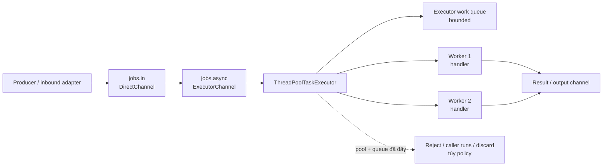
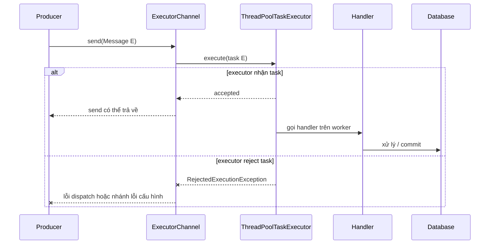
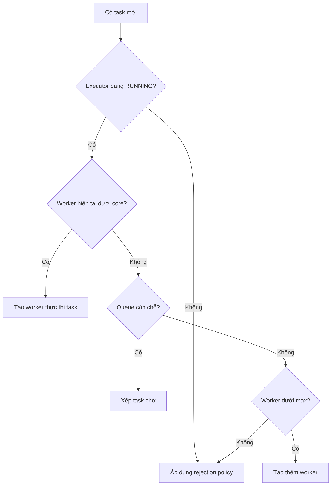
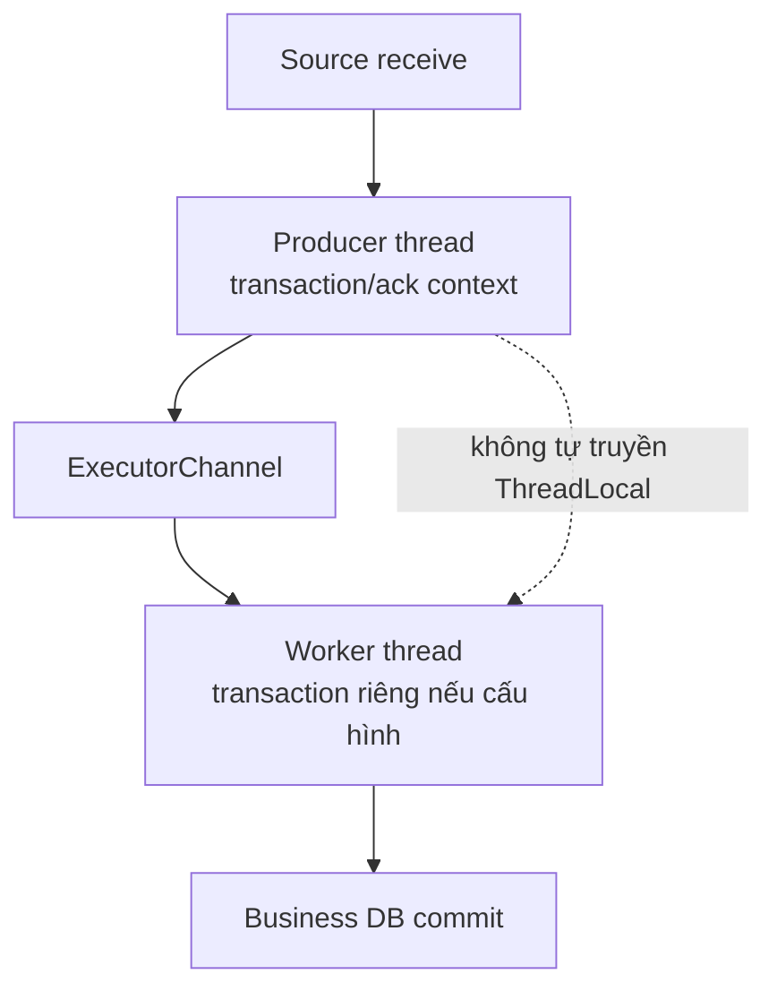
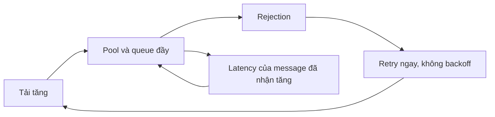

# Chẩn đoán executor đầy hoặc bị reject

## 1. Vấn đề: message đã gửi nhưng worker không còn nhận thêm

Trong Spring Integration, một `IntegrationFlow` có thể nhận message qua `DirectChannel`, giao công việc tới `ExecutorChannel` hoặc kích hoạt polling consumer dùng task executor. Khi khối lượng message tăng nhanh, downstream chậm hoặc thread pool cấu hình không phù hợp, executor có thể **hết khả năng nhận thêm công việc**.

Ví dụ, một flow xử lý hóa đơn nhận 300 message/giây, nhưng mỗi message phải chờ database hoặc HTTP API. Khi các worker đều bận và hàng đợi executor đã đầy, lời gọi gửi task mới có thể ném `TaskRejectedException` hoặc `RejectedExecutionException`, bị xử lý theo chính sách rejection khác, hoặc chuyển việc chạy sang thread của producer.

Người vận hành thường thấy một hoặc nhiều dấu hiệu:

- Log có `TaskRejectedException`, `RejectedExecutionException` hoặc thông báo “executor did not accept task”.
- `ExecutorChannel` bị lỗi khi dispatch, trong khi handler nghiệp vụ đôi lúc không được gọi.
- Thread đang hoạt động bằng số worker tối đa, queue đầy và latency tăng dần.
- Broker lag, `QueueChannel` backlog hoặc thời gian chờ poller tăng.
- Producer/gateway bị chậm đáng kể sau khi đổi rejection policy.
- Không có exception rõ ràng nhưng một số message không tới downstream vì policy bỏ task.

Bài thuộc chương **Debugging** của module **SPRING_INTEGRATION_RUNTIME**: điều tra việc điều phối message qua channel, endpoint, consumer, poller và executor; tác động đến transaction, retry, message store, error channel, correlation, vòng đời flow và hiệu năng runtime.

**Mục tiêu:** đọc đúng dấu hiệu saturation, xác định thread pool nào có vấn đề, tái hiện lỗi có kiểm soát, phân biệt rejection với xử lý nghiệp vụ lỗi, và sửa nguyên nhân mà không làm mất message hoặc tạo retry storm.

> **Nguyên tắc quan trọng:** `send()` thành công không đồng nghĩa **handler đã hoàn tất**, còn `RejectedExecutionException` không mặc nhiên là lỗi của handler. Hãy tìm ranh giới chính xác giữa **tiếp nhận message**, **đưa task vào executor**, **thực thi handler**, **commit nghiệp vụ** và **acknowledgement**.

## 2. Executor đứng ở đâu trong message flow?



**`ExecutorChannel`** sử dụng `Executor` để dispatch message tới subscriber/handler. Nếu thread pool còn khả năng nhận task, lời gọi `send` có thể hoàn tất **trước** khi handler chạy xong. Khi worker pool hoặc queue bão hòa, việc **submit** task có thể thất bại ngay tại ranh giới dispatch.

Ở polling flow, có thể có **hai hàng đợi khác nhau**:

1. **Message queue** như `QueueChannel`/broker: nơi giữ các message chưa được polling consumer nhận.
2. **Executor work queue** bên trong `ThreadPoolTaskExecutor`: nơi giữ các `Runnable` đã được submit nhưng chưa có worker chạy.

Hai queue có chủ sở hữu và cơ chế bền vững khác nhau. `QueueChannel` có thể được cấu hình với persistent message store; **queue mặc định của thread pool không phải message store bền vững** và không tự khôi phục sau JVM crash.

### Mốc thời gian một message



Nhánh lỗi có thể được bọc trong exception của Spring messaging hoặc do error handler riêng tiếp nhận, tùy loại endpoint và cấu hình. **Không giả định mọi lỗi reject đều được đưa tới cùng một `errorChannel`.** Cần quan sát bằng test trên topology đang dùng.

## 3. Cách `ThreadPoolExecutor` quyết định tạo thread, xếp queue và reject

`ThreadPoolTaskExecutor` của Spring bọc mô hình `ThreadPoolExecutor` từ Java. Các tham số nền tảng:

| Tham số | Vai trò | Lưu ý quan trọng |
| --- | --- | --- |
| `corePoolSize` | Số core worker tối đa ưu tiên tạo khi tiếp nhận task | Pool thường tạo worker dần khi có task; không mặc định có sẵn toàn bộ core thread. |
| `maxPoolSize` | Trần số worker | Với hàng đợi rất lớn, pool có thể **không tăng đến max** cho tới khi queue đầy. |
| `queueCapacity` | Số task tối đa nằm trong queue executor | `0` thường dùng cơ chế handoff không lưu queue; capacity dương tạo bounded queue. |
| `keepAliveSeconds` | Thời gian thread vượt core có thể idle trước khi bị thu hồi | Không sửa được handler treo hoặc database pool hết kết nối. |
| Rejection policy | Điều gì xảy ra khi không nhận thêm task | Có thể ném lỗi, chạy trên caller hoặc bỏ task. |
| `threadNamePrefix` | Tên worker khi tạo thread | Hữu ích để tìm đúng executor trong logs/thread dump. |

Với `ThreadPoolExecutor` thông thường, đường quyết định gần đúng:



**Hệ quả rất dễ nhầm:** cấu hình `core=2, max=16, queueCapacity=10000` không có nghĩa pool nhanh chóng có 16 worker khi xuất hiện 100 message. Sau khi đủ core worker, phần lớn task có thể chờ trong queue; pool chỉ có lý do tạo vượt core khi queue đã đầy. Đặt queue quá lớn có thể làm latency tăng âm thầm trước khi xuất hiện rejection.

Nếu `queueCapacity=0`, không có hàng đợi task kiểu lưu trữ; khi worker không thể nhận handoff, pool có thể tăng đến max rồi reject theo policy. Cấu hình thích hợp tùy workload, không có một con số mặc định an toàn cho mọi ứng dụng.

**Ngoài saturation, executor đã shutdown hoặc đang shutdown cũng có thể reject task.** Vì vậy phải kiểm tra lifecycle trước khi kết luận cần tăng thread.

## 4. Phân biệt bốn tình huống dễ bị chẩn đoán sai

| Hiện tượng | Dấu hiệu | Chẩn đoán chính |
| --- | --- | --- |
| **Executor saturation** | `active≈max`, queue gần capacity, task mới bị reject | Tải vượt năng lực trong khoảng thời gian quan sát, handler chậm hoặc cấu hình giới hạn quá thấp. |
| **Executor shutdown** | Task bị reject sau stop/destroy/context close, kể cả queue chưa đầy | Lifecycle, deploy, shutdown race hoặc dùng executor đã đóng. |
| **Không có subscriber** | `Dispatcher has no subscribers` trên `DirectChannel` hoặc channel khác | Wiring/consumer lifecycle; **không** phải executor đầy. |
| **Handler failure** | Task đã chạy, stack trace lỗi business/JDBC/HTTP | Exception ở worker sau khi submit; kiểm tra transaction, retry và error handling. |
| **Executor work queue không giảm** | Worker bận/chờ lâu, số task chờ tăng | Slow I/O, lock wait, deadlock, GC, connection pool starvation hoặc CPU saturation. |
| **Caller-runs gây chậm** | Không thấy reject, thread producer đột nhiên chạy handler | Rejection policy chuyển việc sang caller để tạo backpressure ngầm. |
| **Discard policy làm thiếu message** | Ít lỗi, throughput business thấp hơn số task submitted | Task bị bỏ theo policy; cần kiểm tra loss và durability. |

Thông báo “channel send returned false” cũng chưa đủ để xác định nguyên nhân. Cần tìm **exception type và root cause**, tên channel, tên executor, trạng thái thread pool lúc sự cố và số message đã được xử lý thật.

## 5. Ví dụ Java DSL: pool nhỏ để dễ tạo saturation

Ta tạo một topology thử nghiệm có:

- `jobs.in`: `DirectChannel` để test nhìn thấy thời điểm submit.
- `jobs.async`: `ExecutorChannel` dùng executor riêng.
- `jobs.executor`: `ThreadPoolTaskExecutor` với **core=2, max=2, queueCapacity=2**.
- `jobs.out`: `QueueChannel` nhận kết quả.
- `ProcessingGate`: giữ handler ở một điểm có kiểm soát, không dùng `Thread.sleep` để đoán thời điểm pool bận.

```java
package example.runtime.debugging;

import java.util.concurrent.CountDownLatch;
import java.util.concurrent.TimeUnit;

public final class ProcessingGate {

    private final CountDownLatch firstTwoEntered = new CountDownLatch(2);
    private final CountDownLatch mayContinue = new CountDownLatch(1);

    public void process(String jobId) {
        firstTwoEntered.countDown();
        try {
            if (!mayContinue.await(15, TimeUnit.SECONDS)) {
                throw new IllegalStateException("Gate timeout: " + jobId);
            }
        } catch (InterruptedException interrupted) {
            Thread.currentThread().interrupt();
            throw new IllegalStateException("Handler interrupted", interrupted);
        }
    }

    public boolean awaitTwoBusy(long timeout, TimeUnit unit)
            throws InterruptedException {
        return firstTwoEntered.await(timeout, unit);
    }

    public void releaseAll() {
        mayContinue.countDown();
    }
}
```

Handler ở các worker sẽ chờ `mayContinue`. Tại thời điểm hai handler đầu đã vào `process`, **hai worker đều đang bận**. Khi submit thêm hai message, chúng được đưa vào queue capacity 2. Message thứ năm sẽ chạm chính sách rejection của executor thử nghiệm.

Cấu hình Spring:

```java
package example.runtime.debugging;

import org.springframework.beans.factory.annotation.Qualifier;
import org.springframework.context.annotation.Bean;
import org.springframework.context.annotation.Configuration;
import org.springframework.integration.channel.DirectChannel;
import org.springframework.integration.channel.ExecutorChannel;
import org.springframework.integration.channel.QueueChannel;
import org.springframework.integration.config.EnableIntegration;
import org.springframework.integration.dsl.IntegrationFlow;
import org.springframework.messaging.MessageChannel;
import org.springframework.messaging.PollableChannel;
import org.springframework.scheduling.concurrent.ThreadPoolTaskExecutor;

import java.util.concurrent.ThreadPoolExecutor;

@Configuration
@EnableIntegration
public class SaturatedFlowConfiguration {

    @Bean("jobs.executor")
    ThreadPoolTaskExecutor jobsExecutor() {
        ThreadPoolTaskExecutor executor = new ThreadPoolTaskExecutor();
        executor.setCorePoolSize(2);
        executor.setMaxPoolSize(2);
        executor.setQueueCapacity(2);
        executor.setThreadNamePrefix("invoice-worker-");
        executor.setRejectedExecutionHandler(
            new ThreadPoolExecutor.AbortPolicy());
        return executor; // Bean lifecycle sẽ initialize/shutdown executor.
    }

    @Bean("jobs.in")
    MessageChannel jobsIn() {
        return new DirectChannel();
    }

    @Bean("jobs.async")
    MessageChannel jobsAsync(
            @Qualifier("jobs.executor") ThreadPoolTaskExecutor executor) {
        return new ExecutorChannel(executor);
    }

    @Bean("jobs.out")
    PollableChannel jobsOut() {
        return new QueueChannel(100);
    }

    @Bean
    ProcessingGate processingGate() {
        return new ProcessingGate();
    }

    @Bean
    IntegrationFlow jobsFlow(ProcessingGate gate) {
        return IntegrationFlow.from("jobs.in")
            .channel("jobs.async")
            .handle(String.class, (payload, headers) -> {
                gate.process(payload);
                return "DONE:" + payload;
            })
            .channel("jobs.out")
            .get();
    }
}
```

Đây là **cấu hình cố ý gây lỗi ở môi trường test**, không phải cấu hình khuyến nghị cho production. Với `AbortPolicy`, khi không còn worker/queue để nhận task, executor từ chối bằng exception thay vì âm thầm bỏ công việc.

Trong Spring container, `ThreadPoolTaskExecutor` là bean được quản lý lifecycle; không cần gọi `initialize()` thủ công trong ví dụ này. Nếu tự tạo executor bằng `new` bên ngoài Spring, phải xác định rõ ai khởi tạo và shutdown nó, nếu không có nguy cơ rò thread hoặc dùng executor chưa sẵn sàng.

## 6. JUnit 5: kiểm thử rejection một cách xác định

```java
package example.runtime.debugging;

import java.util.ArrayList;
import java.util.List;
import java.util.concurrent.TimeUnit;

import org.junit.jupiter.api.Test;
import org.springframework.context.annotation.AnnotationConfigApplicationContext;
import org.springframework.messaging.Message;
import org.springframework.messaging.MessageChannel;
import org.springframework.messaging.PollableChannel;
import org.springframework.messaging.support.GenericMessage;
import org.springframework.scheduling.concurrent.ThreadPoolTaskExecutor;

import static org.junit.jupiter.api.Assertions.*;

class ExecutorSaturationTest {

    static boolean send(MessageChannel channel, String id) {
        return channel.send(new GenericMessage<>(id));
    }

    @Test
    void rejectsFifthTaskWhenTwoWorkersAndTwoQueueSlotsAreBusy()
            throws Exception {

        try (var context = new AnnotationConfigApplicationContext(
                SaturatedFlowConfiguration.class)) {

            MessageChannel input =
                context.getBean("jobs.in", MessageChannel.class);
            PollableChannel output =
                context.getBean("jobs.out", PollableChannel.class);
            ProcessingGate gate =
                context.getBean(ProcessingGate.class);
            ThreadPoolTaskExecutor executor =
                context.getBean(
                    "jobs.executor", ThreadPoolTaskExecutor.class);

            try {
                assertTrue(send(input, "J-1"));
                assertTrue(send(input, "J-2"));

                assertTrue(gate.awaitTwoBusy(5, TimeUnit.SECONDS),
                    "Hai worker phai vao handler");

                // Hai worker đang bị giữ; queue còn đúng hai slot.
                assertTrue(send(input, "J-3"));
                assertTrue(send(input, "J-4"));
                assertEquals(2, executor.getQueueSize());

                // AbortPolicy: submit task thứ năm không được nhận.
                assertThrows(RuntimeException.class,
                    () -> send(input, "J-5"));

            } finally {
                // Nhả worker dù assertion fail để test không treo.
                gate.releaseAll();
            }

            List<String> results = new ArrayList<>();
            for (int i = 0; i < 4; i++) {
                Message<?> reply = output.receive(5_000);
                assertNotNull(reply, "Phai nhan du bon ket qua");
                results.add(String.valueOf(reply.getPayload()));
            }

            assertEquals(4, results.size());
            assertTrue(results.containsAll(List.of(
                "DONE:J-1", "DONE:J-2", "DONE:J-3", "DONE:J-4")));
            assertFalse(results.contains("DONE:J-5"));
        }
    }
}
```

**Điều test chứng minh:** có hai task đang chạy, hai task chờ, task thứ năm bị từ chối **ở ranh giới executor submission**, chứ không phải fail trong nghiệp vụ. Khi gate mở, bốn task được nhận tiếp tục chạy.

**Điều test chưa chứng minh:** broker retry, durability sau restart, exactly-once, timeout của JDBC hoặc error-channel routing trên mọi adapter. Test dùng in-memory channels/executor, không có transaction manager hay broker.

Tại sao chỉ `assertThrows(RuntimeException.class)`? Spring có thể bọc lỗi reject trong `TaskRejectedException`, `MessageDeliveryException` hoặc một wrapper khác tùy đường dispatch/phiên bản. Đây là assertion tối thiểu để bài test ít phụ thuộc wrapper; **test sản phẩm thật nên kiểm tra cause chain** và phân biệt reject với một exception nghiệp vụ không liên quan. Không viết assertion kiểu “bất kỳ exception nào đều là saturation” trong hệ thống giám sát.

Thứ tự hoàn thành của bốn task **không được đảm bảo** vì worker pool có nhiều thread. Vì vậy ta so sánh tập kết quả, không so sánh đúng thứ tự trả về.

## 7. Đọc metric executor thay vì suy từ stack trace

Khi điều tra production, nên có các metric tại cùng thời điểm:

| Metric | Lấy từ đâu? | Dùng để kết luận gì? |
| --- | --- | --- |
| `poolSize` | `ThreadPoolTaskExecutor.getPoolSize()` | Số worker hiện có, không luôn bằng core hoặc max. |
| `activeCount` | `getActiveCount()` | Worker đang hoạt động gần hay bằng trần. |
| `corePoolSize` | `getCorePoolSize()` | Cấu hình core worker. |
| `maxPoolSize` | `getMaxPoolSize()` | Ngưỡng tối đa worker. |
| `queueSize` | `getQueueSize()` | Số task đang chờ trong queue executor. |
| Queue capacity | Giá trị cấu hình và loại queue | Số slot còn khả năng nhận; không có API thống nhất cho tất cả `Executor`. |
| Rejected task counter | Custom rejection handler/metric hoặc instrumentation | Bao nhiêu lần task không được nhận. |
| Handler latency p50/p95/p99 | Timer quanh xử lý | Có phải handler chậm khiến worker bị giữ lâu? |
| Wait time trước handler | Timestamp khi enqueue và lúc worker bắt đầu | Phân biệt chờ executor với thực thi handler. |
| `QueueChannel` backlog / broker lag | Channel/broker metrics | Áp lực nguồn message, khác executor work queue. |

Ví dụ snapshot tự lấy từ bean:

```java
import org.springframework.scheduling.concurrent.ThreadPoolTaskExecutor;

ThreadPoolTaskExecutor executor =
    context.getBean("jobs.executor", ThreadPoolTaskExecutor.class);

System.out.printf(
    "pool=%d active=%d core=%d max=%d queue=%d%n",
    executor.getPoolSize(),
    executor.getActiveCount(),
    executor.getCorePoolSize(),
    executor.getMaxPoolSize(),
    executor.getQueueSize());
```

`context` là Spring `ApplicationContext` đang chạy. Những giá trị này là **snapshot tức thời**, có thể thay đổi ngay sau khi đọc. Không lấy mỗi một snapshot rồi kết luận chắc chắn rằng pool chưa từng bão hòa; nên thu thập metric theo thời gian và ghép với thời điểm reject.

Nếu dùng Micrometer/Actuator, việc tên metric và mức độ tự động instrument phụ thuộc version, cấu hình observation và executor bean. Hãy **kiểm tra metric nào thực sự đã được xuất**; không giả định chỉ vì có Actuator là tất cả executor đều tự có rejected-count hoặc queue-wait histogram.

### Không đo sai loại queue

Trong flow có `QueueChannel` rồi poller dùng `TaskExecutor`, có thể quan sát:

- `QueueChannel.size()`: số **message** chưa được polling consumer nhận, nếu implementation có hỗ trợ kích thước.
- `ThreadPoolTaskExecutor.getQueueSize()`: số **task** chờ worker, có thể mỗi task tương ứng một lần poll, một lời gọi handler hoặc công việc khác.

Không cộng hai số này để gọi là “số message tồn đọng” khi chưa hiểu một task xử lý bao nhiêu message. Một task có thể chứa nhiều message, hoặc một message bị retry nhiều lần.

## 8. Chính sách rejection làm thay đổi hành vi message như thế nào?

Java cung cấp các `RejectedExecutionHandler` phổ biến. Chúng có hệ quả rất khác nhau khi dùng với hệ thống message.

| Policy | Hành vi khi pool/queue không nhận task | Rủi ro với Spring Integration |
| --- | --- | --- |
| `AbortPolicy` | Ném `RejectedExecutionException` hoặc wrapper | Dễ quan sát nếu lỗi được xử lý đúng; cần backpressure/retry hoặc fail-fast phù hợp. |
| `CallerRunsPolicy` | Có thể chạy task ngay trên thread gọi `execute` nếu executor chưa shutdown | Đột nhiên biến đường async thành synchronous, tăng latency của producer/poller. |
| `DiscardPolicy` | Có thể bỏ task im lặng | **Rất nguy hiểm** với message nghiệp vụ vì mất tác dụng mà không có tín hiệu reject rõ ràng. |
| `DiscardOldestPolicy` | Loại task đầu queue rồi thử submit task mới | Có thể mất message cũ, phá thứ tự/correlation và làm test khó phát hiện. |
| Custom handler | Do ứng dụng định nghĩa | Phải chứng minh không drop, không deadlock và có metric/semantics rõ ràng. |

### `CallerRunsPolicy`: giảm reject nhưng đổi thread

```mermaid
sequenceDiagram
    participant P as Producer thread
    participant EC as ExecutorChannel
    participant EX as Full executor
    participant H as Handler
    P->>EC: send(E)
    EC->>EX: execute(task E)
    Note over EX: worker busy, queue full
    EX-->>P: CallerRunsPolicy
    P->>H: handler chạy ngay trên producer thread
    H-->>P: completion
    Note over P: send chậm; boundary async thay đổi
```

Policy này có thể tạo backpressure hữu ích **nếu caller có thể chờ**. Nhưng nếu caller là poller, event-loop hoặc gateway có timeout chặt, xử lý handler trực tiếp sẽ kéo dài call stack và làm tắc phần tiếp nhận.

Đặc biệt, vì handler đôi khi chạy trên **thread producer** khi pool đầy, các giả định về ThreadLocal (MDC, security context, transaction, resource binding) có thể thay đổi theo trạng thái tải. **Không dùng CallerRunsPolicy để “chữa” transaction context không được propagate**; phải thiết kế transaction đúng ranh giới và test cả hai chế độ thread.

Khi executor đã shutdown, `CallerRunsPolicy` theo hợp đồng JDK có thể **không chạy task**. Vì vậy, đừng dùng nó như cách bảo đảm task luôn được xử lý.

### Vì sao `DiscardPolicy` thường không phù hợp với message nghiệp vụ?

Nếu task bị drop nhưng upstream đã xác nhận message hoặc ghi checkpoint, đơn hàng có thể biến mất khỏi đường xử lý mà không có error message. Trong hệ thống cần đảm bảo delivery, **từ chối có quan sát được** thường tốt hơn **bỏ tác vụ im lặng**.

## 9. Phân biệt submit rejected với handler thất bại sau khi accepted

Đây là ranh giới quan trọng nhất khi lần theo một lỗi:

```text
Producer / InboundAdapter
   |
   +-- 1) send() -> ExecutorChannel -> submit rejected
   |       Handler chưa chạy; có thể lỗi tại caller/adapter
   |
   +-- 2) send() -> ExecutorChannel -> submit accepted
           |
           +-- worker chạy handler -> success
           |
           +-- worker chạy handler -> exception
                   Transaction/retry/error path của worker
```

**Case 1: submit bị reject.** Handler có thể **chưa chạy lần nào**. Nếu nguồn còn giữ message và không ack, có thể retry có backoff. Nhưng nếu gateway đã gửi request và không có retry contract, caller cần được trả lỗi đúng.

**Case 2: handler lỗi sau submit.** Lời gọi `send()` có thể đã trả về. Việc xử lý lỗi phải dựa vào error channel, retry advice, recoverer hoặc cơ chế của nguồn adapter được cấu hình ở worker, không dựa vào việc bắt exception ở producer.

Một `errorChannel` header chỉ là địa chỉ cho các thành phần biết sử dụng nó. Không giả định mọi loại channel/adapter tự phát `ErrorMessage` cho cả rejection lẫn handler exception. Cần kiểm thử cụ thể trên phiên bản Spring Integration và topology đang dùng.

### Header và correlation

Ghi `MessageHeaders.ID`, `correlationId`, business `eventId` và trace ID khi submit/reject/handler start/handler end. Mục tiêu là đối chiếu **một message** từ nguồn tới executor và downstream. Không dùng message ID mới tạo sau mỗi transform làm idempotency key nếu một event có thể redeliver dưới ID khác.

## 10. Transaction và acknowledgement bị ảnh hưởng ra sao?

Trong một `DirectChannel` đồng bộ, handler thường chạy trên thread gửi, nên transaction đã mở ở producer có thể được tham gia nếu cùng transaction manager và tài nguyên. Khi đi qua `ExecutorChannel`, handler có thể chạy trên **worker thread khác**, khiến transaction context/`TransactionSynchronizationManager` của producer **không tự chuyển theo**.



Cần đặt ra các câu hỏi:

1. Nguồn message đang dùng broker ack, offset commit hay nhận từ `QueueChannel`?
2. Ack/commit nguồn xảy ra **trước hay sau** khi handler trên worker hoàn tất?
3. Khi submit bị reject, nguồn có được báo lỗi để redeliver không?
4. Khi submit thành công nhưng handler lỗi, exception có được đưa tới transaction/ack owner phù hợp không?
5. Side effect nghiệp vụ có idempotency key hoặc unique constraint để chống redelivery không?

**Cảnh báo:** đưa message từ một polling consumer vào `ExecutorChannel` bất đồng bộ có thể làm phạm vi transaction/ack của poller kết thúc **trước khi worker xử lý xong**, tùy cấu hình. Một transaction bao lời gọi `send()` **không tự bao** phần handler chạy sau trên thread khác.

Nếu nguồn đã ack mà executor work queue chỉ ở RAM, hard crash sau submit nhưng trước handler có thể khiến công việc mất. Nếu nguồn chưa ack và redeliver, cùng event có thể xử lý lại sau khi side effect đã commit. Bài toán này cần kiểm tra transaction, ack, persistence và idempotency **end-to-end**, không chỉ tăng `queueCapacity`.

## 11. Retry: vì sao retry ngay khi pool đầy dễ tạo bão lỗi?

Khi executor full, có thể xuất hiện vòng phản hồi xấu:



Retry tức thời thường **không tạo thêm năng lực xử lý**, mà còn tăng CPU, log, broker traffic và contention. Hãy phân biệt:

- **Transient saturation:** pool tạm đầy do burst. Có thể retry với **số lần giới hạn, backoff và jitter**, hoặc để nguồn durable giữ message đến khi có capacity.
- **Saturation kéo dài:** tốc độ đến vượt tốc độ xử lý. Retry không giải quyết được; phải giảm tốc đầu vào, cải thiện handler, điều chỉnh concurrency hoặc scale đúng cách.
- **Shutdown rejection:** retry cùng executor đã stop sẽ tiếp tục fail; cần sửa lifecycle/restart, không retry vô hạn.
- **Business failure:** không nên thay đổi pool size nếu root cause là database constraint hoặc payload validation.

Nếu nguồn là broker, kiểm tra cơ chế nack/requeue, retry topic, delayed delivery hoặc DLQ theo transport đang dùng. Không gọi `ack` trước rồi hy vọng một retry in-memory sẽ bảo đảm xử lý sau crash.

**Idempotency:** message có thể được gửi lại vì caller không biết lần submit trước được nhận hay đã chạy. Dùng business event ID ổn định và xử lý idempotent tại database/API đích. `MessageHeaders.ID` không tự bảo đảm cùng ID giữa các lần redelivery.

## 12. Tìm nguyên nhân thực: handler chậm, lock, database hay CPU?

Khi `activeCount` gần max và queue tăng, saturation là **triệu chứng**, không phải nguyên nhân cuối.

| Tình huống | Dấu hiệu nổi bật | Điều cần đo |
| --- | --- | --- |
| CPU-bound handler | CPU cao, worker RUNNABLE liên tục | CPU utilization, CPU profiling, số core, thời gian tính toán. |
| HTTP call chậm | Worker WAITING/TIMED_WAITING hoặc socket read lâu | Request latency, connect/read timeout, retry số lần. |
| JDBC connection pool cạn | Worker chờ lấy connection | Pool active/idle/pending, DB throughput, transaction length. |
| Database lock/deadlock | Query bị chặn hoặc lỗi deadlock victim | DB lock graph, SQL/transaction order, isolation. |
| `LockRegistry` contention | Nhiều worker chờ cùng business key | Lock wait/hold time, lock key, thread owner. |
| GC/heap pressure | Pause dài, allocation rate cao | GC pause, heap usage, allocation profile. |
| Task bên ngoài cùng executor | Pool bị chiếm bởi công việc không thuộc flow đang quan sát | Mapping executor bean → endpoint/task source. |
| Downstream reply bị chặn | Worker chờ send tới output channel/queue đầy | Channel capacity, send timeout, subscriber lifecycle. |
| Retry/backoff giữ worker | Worker ngủ giữa các attempt | Retry advice scope, backoff time, số attempts. |

Một hệ thống có 16 worker không có nghĩa xử lý được 16 message/giây. Nếu mỗi message chờ HTTP 5 giây và worker bị giữ trong suốt khoảng chờ, throughput lý thuyết của 16 worker chỉ khoảng `16 / 5 = 3,2` message/giây khi không có bất kỳ overhead nào. Việc nhận 100 message/giây sẽ khiến backlog tăng rất nhanh.

**Không dùng mỗi thread dump để kết luận database chậm.** Phải đối chiếu với pool metrics, DB query traces, HTTP timing và thời điểm submit/handler start. Nếu tất cả worker ở `WAITING`, cần xác định họ chờ **điều kiện gì**.

## 13. Thread dump và log để nhận diện executor bị kẹt

Khi ứng dụng không có tiến triển, lấy thread dump bằng công cụ JVM được phép trong môi trường vận hành, ví dụ:

```bash
jcmd <pid> Thread.print
# Hoặc dùng công cụ quan sát JVM tương đương phù hợp hệ điều hành.
```

Đây là ví dụ lệnh, không cần chạy để đọc bài. Với production, phải tuân thủ quyền truy cập, bảo vệ thông tin trong thread dump và quy trình thu thập sự cố của tổ chức.

Hãy tìm tên thread theo prefix như `invoice-worker-` rồi xem:

- Thread đang `RUNNABLE`, `WAITING` hay `TIMED_WAITING`?
- Stack đang nằm tại handler, database driver, HTTP client, `Lock.lock()`, `Future.get()`, hoặc waiting queue?
- Có vòng chờ lock giữa nhiều thread không?
- Task có đang nằm trong executor queue nhưng không có worker xử lý không?
- Một pool có dùng chung cho adapter khác hoặc scheduled task khác không?
- Có dấu hiệu shutdown/rejection do lifecycle stop trong lúc deploy không?

**Một thread ở trạng thái WAITING không tự đồng nghĩa deadlock.** Nó có thể đang đợi queue, latch, HTTP hoặc JDBC connection. Cần xét owner, wait-for graph và tiến triển theo thời gian.

### Log chẩn đoán có cấu trúc

```text
event=E-101 endpoint=invoiceFlow executor=jobs.executor phase=SUBMIT
event=E-101 thread=http-nio-8080-exec-3 pool=2 active=2 queue=2
event=E-101 phase=REJECTED error=TaskRejectedException
event=E-099 phase=HANDLER_START thread=invoice-worker-1
event=E-099 phase=HANDLER_FINISH outcome=SUCCESS durationMs=7800
```

Các giá trị chỉ minh họa. Nên log **event ID, executor ID, channel ID, endpoint ID, thread name, thời gian enqueue/wait/run** và outcome. Không log toàn bộ payload nhạy cảm hoặc credential.

Nếu log rejection chỉ có “rejected task” mà không có executor ID, sẽ khó xác định pool nào đầy trong một ứng dụng có nhiều task executor.

## 14. Playbook điều tra theo thứ tự ưu tiên

### Bước 1 — Xác định lỗi xảy ra ở thời điểm nào

Tìm exception gốc hoặc lý do một message không đến đích:

- `RejectedExecutionException`/`TaskRejectedException` ở **submit**?
- Handler exception **sau submit**?
- `Dispatcher has no subscribers` do endpoint đã dừng?
- `MessageDeliveryException` do channel/output không chấp nhận?
- Broker redelivery hoặc poller rollback liên tục?

Không điều chỉnh pool size trước khi phân loại đúng.

### Bước 2 — Xác định chính xác executor

Lập bảng **endpoint → channel → executor bean → config**. `ExecutorChannel` có thể dùng một executor riêng; polling endpoint cũng có thể có task executor hoặc scheduler riêng. Đừng điều chỉnh nhầm `applicationTaskExecutor` nếu flow thật đang dùng bean khác.

### Bước 3 — Chụp trạng thái theo thời gian

Theo dõi `poolSize`, `activeCount`, `queueSize`, rejects, accepted rate, completed rate, handler latency và broker lag. So sánh với thời điểm deploy/start/stop.

- `active=max, queue=capacity, rejects tăng`: có bằng chứng trực tiếp cho saturation.
- `active thấp, queue thấp, rejects tăng`: kiểm tra executor shutdown, policy hoặc instrumentation sai.
- `active=core, queue lớn, max cao hơn core`: kiểm tra chính sách queue-before-grow, không suy ra JVM thiếu CPU.
- `queue tăng nhưng không reject`: có thể đang tích tụ latency và memory pressure.

### Bước 4 — Điều tra tại sao worker không giải phóng

Đo thời gian trong handler, chờ database/HTTP, lock contention, GC và backoff. So sánh latency thông thường với latency khi lỗi. Nếu một flow dùng chung executor với các tác vụ khác, phải tách số liệu theo nguồn task.

### Bước 5 — Kiểm tra ranh giới message và lỗi

Đối chiếu event ID và nguồn:

- Message chưa ack có thể redeliver không?
- Khi submit reject, exception có quay tới adapter để nack/retry?
- Khi worker fail, error channel hoặc recoverer nào tiếp nhận?
- Nếu có `CallerRunsPolicy`, message có chạy trên producer thread và làm thay đổi transaction/timeout không?
- Queue đang là RAM hay persistent store? Crash có làm mất accepted work không?

### Bước 6 — Giảm tải và phục hồi có kiểm soát

Áp dụng backpressure, giảm concurrency ở ingress nếu cần, giới hạn retry, xác định thông lượng thực tế rồi mới chỉnh pool/queue/scale. Sau thay đổi, xác minh backlog giảm, rejects ngừng tăng, p95/p99 cải thiện và **business event không bị mất/trùng ngoài chính sách**.

## 15. Kích thước thread pool và queue: tính từ workload

### Bài toán minh họa

Giả sử:

- Tốc độ nhận `λ = 120 message/giây`.
- Thời gian trung bình giữ một worker `S = 0,1 giây/message`.
- Pool có 4 worker.
- Executor queue capacity = 400 task.
- Không tính overhead, retry và các nguồn tải khác.

Năng lực tối đa lý tưởng của 4 worker xấp xỉ `4 / 0,1 = 40 message/giây`. Khi nhập 120 message/giây, backlog tăng khoảng `120 − 40 = 80 task/giây`; queue 400 slot có thể đầy sau khoảng `400 / 80 = 5 giây` nếu ban đầu rỗng và không có thay đổi tốc độ. Đây là ước lượng sơ bộ, không phải cam kết thời gian reject chính xác.

Để xử lý ổn định ở tốc độ đến nói trên khi latency giữ nguyên, số worker trung bình tối thiểu về mặt công suất là khoảng `λ × S = 12` worker, **chưa tính dự phòng burst, p99 latency, I/O, CPU, giới hạn DB pool hoặc thread overhead**. Không nên đặt luôn `maxPoolSize=120` chỉ vì có 120 message/giây.

### Chọn dựa trên loại workload

| Loại workload | Hướng phân tích |
| --- | --- |
| CPU-bound | Số worker dựa vào số core và thời gian xử lý thực; tăng quá mức có thể làm tăng context switching. |
| I/O-bound | Có thể cần nhiều concurrency hơn nhưng phải kiểm tra HTTP/DB connection pool và rate limit của downstream. |
| Nhiều key/partition độc lập | Có thể chia công việc theo partition, giữ ordering/idempotency cho từng key. |
| Tác vụ dài, không ổn định | Cần timeout, circuit breaker, bulkhead và queue bounded; tăng thread không sửa remote service treo. |
| Ingress burst lớn, downstream ổn định | Durable broker/queue và backpressure thường phù hợp hơn queue executor khổng lồ. |

**Giữ queue bounded** và định nghĩa chính sách lúc đầy giúp failure rõ ràng. Queue không giới hạn có thể tránh reject tạm thời nhưng tích tụ memory và biến lỗi thành latency rất lớn hoặc OOM.

### Kiểm tra cả nguồn tài nguyên khác

Tăng worker từ 8 lên 40 trong khi JDBC pool chỉ cho 10 connection có thể khiến thêm 30 thread đứng chờ connection. Khi đó latency và memory tăng mà throughput không cải thiện. Tương tự, downstream API có rate limit 50 request/giây thì tăng số thread không thay đổi giới hạn bên ngoài.

## 16. Những cách sửa nguy hiểm và lựa chọn tốt hơn

| Sửa nhanh thường gặp | Vì sao nguy hiểm | Hướng phù hợp |
| --- | --- | --- |
| Tăng `queueCapacity` lên rất lớn | Che dấu saturation, tăng thời gian chờ, memory và rủi ro mất task khi crash | Bounded queue + durable backlog/backpressure + alert sớm. |
| Tăng `maxPoolSize` tùy ý | Có thể không có tác dụng nếu queue chưa đầy; tăng contention cho DB/API | Dựa trên loại workload và đo throughput/latency. |
| Chuyển sang `DiscardPolicy` | Task có thể mất mà không có lỗi dễ thấy | Abort/retry có kiểm soát hoặc backpressure có quan sát. |
| Bật `CallerRunsPolicy` mà không test | Producer thread chạy handler, latency và transaction assumptions thay đổi | Chỉ dùng khi caller có thể chờ, test dưới saturation. |
| Retry tức thì vô hạn | Retry storm khiến pool tiếp tục đầy | Backoff + jitter + retry budget + DLQ/durable source. |
| Khởi động lại ứng dụng để “xóa queue” | Mất task in-memory, có thể trùng side effect sau redelivery | Tìm root cause và kế hoạch drain/recovery. |
| Ack source ngay sau submit | Accepted task chưa chắc đã xử lý, crash có thể mất | Ack theo điểm hoàn tất phù hợp, hoặc durable handoff. |
| Cố stop/start endpoint liên tục | Shutdown rejection, task in-flight, consumer race | Quiesce/drain, stop có kiểm soát, quan sát lifecycle. |
| Dùng chung một executor cho mọi flow | Một downstream chậm có thể làm nghẽn toàn bộ flows | Tách pool/bulkhead theo workload quan trọng khi cần. |
| Chỉ giám sát exception | Caller-runs/discard và queue buildup có thể không sinh exception | Theo dõi throughput, latency, queue, rejects và business outcome. |

## 17. Kiểm thử thêm các trường hợp runtime quan trọng

Một bài test đơn lẻ với `AbortPolicy` chưa đủ để tin tưởng một flow production. Cần có các phép thử riêng:

| Test ID | Tình huống | Điều cần assert |
| --- | --- | --- |
| E01 | Pool=2, queue=2, submit task thứ năm | Rejection được phát hiện; handler task thứ năm chưa chạy. |
| E02 | Mở gate sau saturation | Bốn task accepted hoàn tất; output không trùng ngoài chính sách. |
| E03 | Đổi sang `CallerRunsPolicy` | Task ở lúc full chạy trên caller thread; send latency tăng; không giả định async boundary. |
| E04 | Executor shutdown rồi submit | Lỗi/loss được phát hiện dù queue chưa đầy. |
| E05 | Handler ném exception sau khi accepted | Error path của worker được quan sát, khác submit rejection. |
| E06 | JDBC pool cạn | Worker bị giữ ở connection acquisition; latency tăng, queue tích tụ. |
| E07 | Output `QueueChannel` đầy | Worker có thể bị block tại output send; phân biệt với lỗi đầu vào. |
| E08 | Poller dùng executor bão hòa | Kiểm tra chính sách poll, nhận/ack, retry và backlog của nguồn. |
| E09 | Retry vô hạn dưới full load | Thấy retry storm; thay bằng backoff/jitter và giới hạn. |
| E10 | Redelivery cùng business ID | Idempotency ngăn side effect lặp sau lỗi submit/ack. |
| E11 | Stop endpoint hoặc context trong lúc còn task | Quan sát shutdown rejection, in-flight, cleanup. |
| E12 | Crash sau submit, trước handler | Task RAM có thể mất; durable source có thể replay theo cấu hình. |
| E13 | Hai flow dùng chung executor | Một flow chậm có thể ảnh hưởng flow kia; so với pool tách biệt. |
| E14 | Load tăng đột ngột rồi giảm | Queue drain, p95/p99 phục hồi và rejects trở lại bằng không. |

**Thử nghiệm phải có giới hạn thời gian.** Sử dụng `CountDownLatch` và `try/finally` như ví dụ; tránh `Thread.sleep(10000)` làm cơ chế đồng bộ duy nhất vì CI có thể chậm, test sẽ không xác định. Với lỗi hệ thống thật, dùng test harness có thể kiểm soát broker/database và thu thập dữ liệu trước/sau crash.

## 18. Checklist xử lý sự cố thực tế

Khi nhận cảnh báo “executor rejected”, hãy thực hiện theo thứ tự:

1. **Xác nhận đường lỗi:** reject lúc submit, handler exception sau accepted, hay endpoint không có subscriber?
2. **Xác định pool:** executor bean nào, endpoint/channel nào dùng, có pool dùng chung không?
3. **Đọc cấu hình:** `corePoolSize`, `maxPoolSize`, `queueCapacity`, rejection handler, trạng thái lifecycle.
4. **Đo triệu chứng:** active, pool size, queue size, reject count, accepted/completed rate, p95/p99 latency.
5. **Đọc nguyên nhân:** thread dump, DB connection/row lock, HTTP timeout, GC, retry/backoff, blocking output.
6. **Kiểm tra message:** nguồn có durable không, ack/transaction ở đâu, event có bị mất hoặc xử lý trùng không?
7. **Phục hồi an toàn:** backpressure, giảm tải, bounded retry; không drop task hoặc reset queue tùy tiện.
8. **Chỉnh có căn cứ:** tối ưu handler, pool/bulkhead hoặc số instance, rồi load test và đo lại.
9. **Ghi nhận kết quả:** rejects, queue depth, handler throughput, backlog, business completion và idempotency sau khi sửa.
10. **Thêm regression test:** tái hiện đầy queue và shutdown rejection trong CI theo quy trình thử nghiệm.

### Bảng điều tra nhanh

| Triệu chứng | Nghi ngờ chính | Bằng chứng ưu tiên |
| --- | --- | --- |
| `RejectedExecutionException`, active=max, queue=cap | Pool bão hòa | Pool/queue/reject counters cùng thời điểm. |
| Reject ngay sau deploy, active thấp | Executor đã stop/shutdown, lifecycle race | Startup/shutdown logs và executor state. |
| Không reject nhưng API response chậm | `CallerRunsPolicy` hoặc producer bị block | Thread name của handler, send duration. |
| Accepted cao, business completed thấp | Handler lỗi, discard hoặc task chưa chạy | Business metrics, error channel, queue growth. |
| Queue executor tăng vô hạn | Core thấp, queue lớn, handler chậm | Queue config, wait latency, handler timing. |
| Thread nhiều nhưng throughput không tăng | DB/HTTP bottleneck hoặc lock contention | DB pool pending, external rate limit, thread dump. |
| Poller lag dù executor ít busy | Scheduler/poller chưa chạy, inbound source blocked | Endpoint lifecycle, poll timing, source backlog. |
| Message lặp sau retry | Ack bị trễ so với commit, thiếu idempotency | Event ID, DB unique marker, redelivery count. |
| Message mất sau crash | Task được giữ trong executor RAM, nguồn đã ack | Ack timeline, persisted message state. |
| Lỗi “no subscribers” | Endpoint/channel wiring sai hoặc stopped | Consumer registration và runtime bean lifecycle. |

## 19. Bài thực hành và câu hỏi tự kiểm tra

**Bài 1 — Tái hiện saturation.** Chạy `SaturatedFlowConfiguration` và `ExecutorSaturationTest`. Xác nhận hai worker bị giữ bởi gate, hai task chờ queue và task thứ năm bị reject. Đo `activeCount`, `queueSize` và latency của `send`.

**Bài 2 — Phân biệt core/max/queue.** Thử `core=2, max=8, queueCapacity=100`. Gửi 10 task bị gate giữ và quan sát khi nào pool tạo vượt core. Sau đó thử `queueCapacity=0` và giải thích vì sao kết quả khác.

**Bài 3 — CallerRunsPolicy.** Đổi policy sang `CallerRunsPolicy` trong môi trường test. Ghi tên thread tại handler và producer, đo thời gian `send` thứ năm. Vì sao một flow được thiết kế async bỗng có lần chạy synchronous?

**Bài 4 — Shutdown rejection.** Gọi stop/shutdown executor thử nghiệm có kiểm soát rồi submit task. So sánh metric active/queue với rejection khi saturation; bổ sung phép phân loại nguyên nhân.

**Bài 5 — Handler failure.** Cho handler ném exception ở worker sau khi task đã accepted. Thiết kế error flow cho cấu hình đang thử, xác minh lỗi có root cause và business ID, không nhầm với reject khi submit.

**Bài 6 — Bottleneck từ database.** Dùng datasource thử nghiệm với connection pool rất nhỏ và handler JDBC chậm có kiểm soát. Quan sát worker chờ connection, queue tích tụ. Tăng worker nhưng không tăng DB pool: throughput có tăng như kỳ vọng không?

**Bài 7 — Retry an toàn.** Giả lập burst 200 message vào pool 2 worker và queue nhỏ. So sánh retry ngay với retry có backoff/jitter và giới hạn attempts, kiểm tra số task hoàn tất, trùng lặp, DLQ và thời gian phục hồi.

**Bài 8 — Message durability.** Với nguồn durable hoặc persistent channel store, làm full pool rồi gây crash thử nghiệm trước khi worker xử lý hết. Xác minh khả năng replay và side effect idempotent. So sánh khi chỉ dùng queue executor in-memory.

**Bài 9 — Đo dưới tải.** Bơm traffic theo các mức 10, 50, 100 message/giây, đo throughput, queue, reject, p95/p99 và năng lực downstream. Đề xuất một cấu hình tối ưu có lý giải, không chỉ tăng số worker.

**Bài 10 — Xác định phạm vi tác động.** Tạo hai flows chia sẻ executor; làm một flow bị kẹt và quan sát flow kia. Sau đó tách executor riêng, đánh giá isolation, tài nguyên và khả năng quan sát.

### Câu hỏi tự kiểm tra

1. `ExecutorChannel` khác `DirectChannel` thế nào về thread và thời điểm `send()` trả về?
2. Executor work queue khác `QueueChannel` ở điều gì, nhất là qua crash?
3. Khi nào `ThreadPoolExecutor` ưu tiên queue thay vì tăng worker từ core lên max?
4. Vì sao `maxPoolSize=100` có thể gần như không phát huy tác dụng nếu queue rất lớn?
5. Rejection do pool đầy khác rejection do executor shutdown thế nào?
6. `AbortPolicy`, `CallerRunsPolicy` và `DiscardPolicy` ảnh hưởng thế nào đến message delivery?
7. Vì sao `CallerRunsPolicy` có thể làm thay đổi transaction/thread-local assumptions?
8. `send()==true` có chứng minh handler trên worker đã commit thành công không?
9. Nếu polling consumer ack trước khi async handler hoàn tất, crash có thể gây gì?
10. Vì sao retry ngay khi executor đang full có thể làm tình hình tệ hơn?
11. Metric nào cho biết backlog đang ở executor queue hay ở nguồn message?
12. Khi active=max nhưng CPU thấp, nên kiểm tra các thành phần nào?
13. Vì sao tăng pool size mà không xét JDBC/HTTP limits có thể khiến latency cao hơn?
14. Một test dùng `CountDownLatch` tốt hơn `Thread.sleep` khi kiểm tra saturation ở điểm nào?
15. Khi nào cần backpressure, durable broker, idempotency và DLQ thay vì chỉ tăng `queueCapacity`?
16. Có những bằng chứng nào cho thấy sự cố đã được khắc phục mà message không bị mất hoặc lặp sai?

**Nguyên tắc vận hành:** khi executor bị đầy hoặc reject, đừng sửa bằng cách tăng thread/queue một cách mù quáng. Hãy xác định **đúng executor và đúng ranh giới lỗi**, đo `activeCount`, `queueSize`, reject count và thời gian chờ/thực thi; kiểm tra handler, database, HTTP, lock và lifecycle. Sau đó thiết kế **bounded capacity, backpressure, retry có giới hạn, durable handoff và idempotency** phù hợp với transaction/ack của nguồn message. Một executor có thể xử lý nhanh hơn sau khi tối ưu, nhưng chỉ các kiểm chứng về **delivery và business outcome** mới chứng minh message flow hoạt động đúng.
