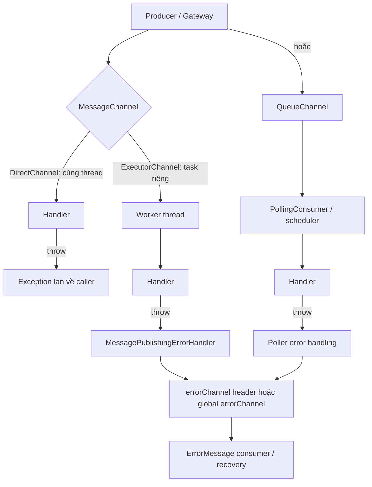
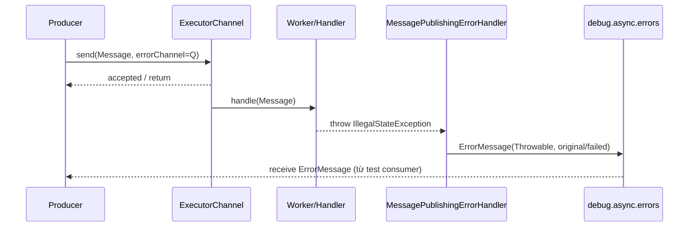
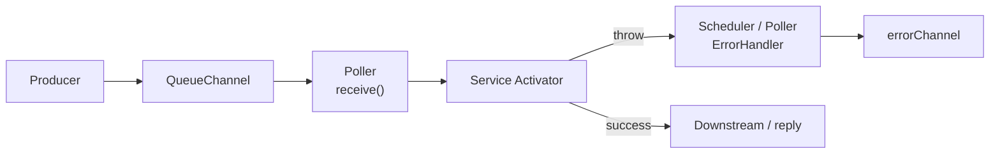
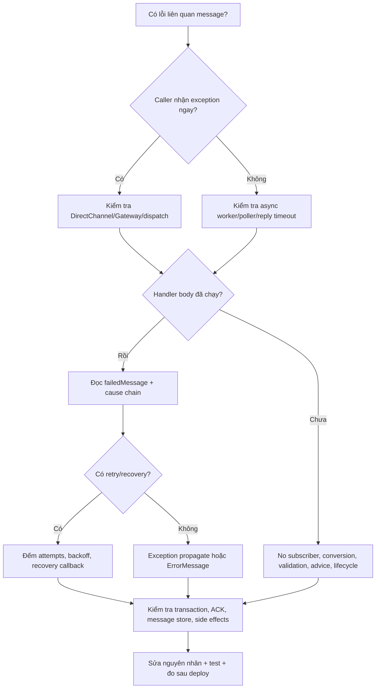

# Chẩn đoán handler throw exception trong Spring Integration Runtime

## 1. Bài toán: handler ném lỗi nhưng nguyên nhân nằm ở đâu?

Trong Spring Integration, một `Message<?>` được gửi qua `MessageChannel` tới consumer endpoint rồi đi vào `MessageHandler`. Handler có thể ném exception vì dữ liệu đầu vào không hợp lệ, thiếu bean/configuration, lỗi mạng, khóa bị timeout, transaction thất bại hoặc một bug trong code nghiệp vụ.

Ở runtime, cùng một câu lệnh `throw new IllegalStateException(...)` có thể tạo **các triệu chứng rất khác nhau**:

- Producer gọi `DirectChannel.send()` nhận exception ngay.
- Producer gửi qua `ExecutorChannel` thấy `send()` thành công, nhưng worker xử lý sau và phát `ErrorMessage`.
- Poller lấy message từ `QueueChannel` thất bại rồi chuyển lỗi qua error channel do `MessagePublishingErrorHandler`.
- Gateway ném lỗi về caller, trả response lỗi qua error flow, hoặc timeout khi chưa có reply.
- Retry advice gọi handler nhiều lần, sau đó ném lỗi cuối hoặc phát `ErrorMessage` tới recovery channel.
- Transaction rollback, broker redeliver, nhưng external side effect từ lần thử trước vẫn có thể đã xảy ra.

Vì vậy **“handler throw exception” không đủ để biết message đã được xử lý ra sao**. Phải tìm lỗi gốc, nơi exception được quan sát, thread thực thi, message đang được xử lý, ranh giới transaction và cấu hình error/retry/recovery.

Bài **Chẩn đoán handler throw exception** thuộc chương **Debugging** của module **`SPRING_INTEGRATION_RUNTIME`**. Nội dung gắn trực tiếp với điều phối message qua channel, endpoint, consumer, poller, executor, quản lý `IntegrationFlow`, transaction, retry, message store, error, correlation, threading, hiệu năng và trạng thái runtime.

### 1.1. Kết quả học tập

Sau bài học, bạn có thể:

1. Lần theo đường exception từ `MessageHandler` về caller hoặc `errorChannel`.
2. Phân biệt `MessagingException` wrapper với **root cause** và truy `getFailedMessage()`.
3. Chạy được ví dụ Java tái hiện handler throw trên `DirectChannel` và `ExecutorChannel`.
4. Xử lý `ErrorMessage` an toàn, giữ correlation ID và thông tin business request.
5. Kiểm tra `RequestHandlerRetryAdvice`, `ErrorMessageSendingRecoverer` và ý nghĩa số attempts.
6. Phân biệt handler failure với no subscriber, timeout, drop message, rejected send, lỗi converter hoặc database rollback.
7. Thiết kế integration tests, logging/metrics và runbook incident không tạo thêm duplicate side effects.

**Phạm vi API:** Spring Integration **6.x**, tham chiếu tài liệu **6.5**, Spring Framework 6.x và Java 17+. Ví dụ Spring Retry cần dependency `spring-retry`; test dùng JUnit 5, `spring-test` và khi cần `spring-integration-test`.

## 2. Hiểu pipeline trước khi đọc stack trace

### 2.1. Handler và endpoint không phải cùng một đối tượng

Một cấu hình:

```java
@ServiceActivator(inputChannel = "orders.input")
public void process(Message<Order> message) {
    orderService.process(message.getPayload());
}
```

thường được Spring Integration triển khai thông qua **consumer endpoint** điều phối message tới **service-activating handler** gọi method. Stack trace có thể chứa những lớp framework như:

- `DirectChannel` và dispatcher.
- `AbstractMessageHandler`, `ServiceActivatingHandler`.
- `MessagingMethodInvokerHelper` hoặc method invocation.
- `MessageHandlingException`, `MessageDeliveryException`.
- Proxy/interceptor/retry advice hoặc transaction advice.

Không thấy tên method nghiệp vụ ngay ở dòng exception đầu tiên **không có nghĩa Spring Integration là nguyên nhân**. Cần đi sâu vào cause chain, failed message và bean definition source.

### 2.2. Quan sát theo ranh giới đồng bộ / bất đồng bộ



Đường error **không giống nhau**:

| Nơi handler chạy | Ai bắt đầu thao tác? | Handler ném lỗi thì sao? | Đường quan sát ưu tiên |
|---|---|---|---|
| `DirectChannel` đồng bộ | Producer gọi `send()` hoặc gateway | Exception thường lan trong **call stack của producer** | `catch` ở caller, gateway exception, application logs |
| `ExecutorChannel` | Worker của `TaskExecutor` | Producer thường đã trả về sau khi dispatch; lỗi xử lý bất đồng bộ | `ErrorMessage`/`errorChannel`, executor logs |
| `QueueChannel` + polling consumer | Poller gọi `receive()` | Lỗi trong polling task được gửi qua error-handling path theo scheduler/poller config | Error channel, poller logs, transaction |
| `@MessagingGateway` qua DirectChannel | Caller gọi method gateway | Lỗi downstream thường được ném về caller, có thể unwrap | Gateway method và cause |
| Gateway qua async boundary | Gateway gửi rồi chờ reply | Lỗi có thể được chuyển về gateway qua error flow hoặc caller timeout | Error channel + reply timeout + timeline |
| `FluxMessageChannel` / reactive handler | Reactive subscriber | `onError` theo chuỗi Publisher, có thể bị recover hoặc cancel | Reactor signals, subscription, error handler tương ứng |

**Quan trọng:** global `errorChannel` **không phải cơ chế bắt tự động mọi exception** trong một flow đồng bộ. Tài liệu Spring Integration 6.5 nhấn mạnh những lỗi của handler đang chạy trực tiếp trên producer thread thường được ném lại cho producer.

### 2.3. Lập một timeline đơn giản

```text
09:00:00.000  orderReceived       messageId=M1 corr=RUN-17
09:00:00.005  orders.input        send=accepted
09:00:00.006  orders.handler      attempt=1
09:00:00.050  partnerClient       IOException: connect timeout
09:00:00.052  orders.handler      MessageHandlingException
09:00:00.053  orders.errors       ErrorMessage published
09:00:00.056  recovery.handler    classified=TRANSIENT
```

Đây là **timeline minh họa**. Khi dùng `DirectChannel` đồng bộ mà không cấu hình gateway error flow, dòng `ErrorMessage published` sẽ **không tự xuất hiện**. Test và log phải dựa trên topology thật.

## 3. Phân loại exception đúng trước khi khắc phục

### 3.1. Các lớp lỗi thường gặp

| Lớp / biểu hiện | Ý nghĩa thường gặp | Điểm cần xác minh |
|---|---|---|
| `MessageHandlingException` | Handler không xử lý được message; có thể wrap cause | `failedMessage`, nested `cause` và endpoint |
| `MessageDeliveryException` | Gửi/dispatch tới channel không thành công | Channel, subscriber count, executor rejection |
| `MessageDispatchingException` | Lỗi dispatcher, ví dụ thiếu subscriber | Endpoint có start không, destination có đúng không |
| `MessagingException` | Họ exception messaging có thể chứa failed message | `getFailedMessage()` + root cause |
| `MessagingTimeoutException` | Timeout thuộc thao tác messaging | Send/receive/reply timeout nào? |
| `IllegalArgumentException` / validation exception | Payload/header không hợp lệ | Input schema, converter, SpEL expression |
| `ClassCastException` / conversion exception | Method signature / payload type không khớp | Handler method overload, converter, header type |
| `SQLException` / `DataAccessException` | Database lỗi hoặc transaction rollback | SQL state, connection pool, constraint |
| `IOException` / client timeout | Gọi hệ thống bên ngoài thất bại | Network vs remote commit, idempotency |
| `RejectedExecutionException` | Executor saturated hoặc đang shutdown | Queue capacity, active threads, stop state |
| `RateLimitExceededException` hoặc circuit breaker open | Advice từ chối gọi handler | Advice order, quota/threshold, fallback |
| `Error` như `OutOfMemoryError` | JVM/resource nghiêm trọng | Heap dump, GC, container memory; không coi là retry thường |

**Tránh suy từ tên exception ra nguyên nhân duy nhất.** `MessageHandlingException` là **vỏ lỗi**; `MessageDeliveryException` có thể bao trùm lỗi xảy ra khi gửi vào channel, còn cause sâu mới giải thích thao tác thực tế thất bại.

### 3.2. Chia lỗi theo khả năng retry

| Nhóm | Ví dụ | Hướng xử lý tham khảo |
|---|---|---|
| **Permanent / deterministic** | Dữ liệu sai schema, header bắt buộc thiếu, business rule reject | Validate, reject/quarantine; không retry vô hạn |
| **Transient** | Network timeout, temporary 503, deadlock có thể thử lại | Retry có giới hạn, backoff, jitter và deadline |
| **Unknown side effect state** | Remote API timeout sau khi request có thể đã commit | Kiểm tra trạng thái theo idempotency key trước retry |
| **Resource pressure** | Executor/queue đầy, DB pool hết connection | Backpressure, giảm tải, giới hạn concurrency |
| **Configuration / lifecycle** | No subscriber, channel sai tên, bean chưa start | Sửa flow/wiring, không coi là “business transient” |
| **Fatal infrastructure** | JVM OOM, mất lock ownership | Incident/stop/reconcile; không đơn thuần loop retry |

Một exception có thể xuất hiện dưới dạng `RuntimeException` trong handler nhưng **được advice xử lý**, nên không nhìn thấy ở caller. Để biết message đã hồi phục hay chưa, theo dõi cả **attempts, recovery, transaction và reply path**.

## 4. Ví dụ 1: Handler throw trên DirectChannel

### 4.1. Cấu hình tối thiểu

Ví dụ tạo một flow đồng bộ, có handler ném lỗi có chủ ý. Không cần broker, scheduler hay executor.

```java
import org.springframework.context.annotation.Bean;
import org.springframework.context.annotation.Configuration;
import org.springframework.integration.annotation.ServiceActivator;
import org.springframework.integration.channel.DirectChannel;
import org.springframework.integration.config.EnableIntegration;
import org.springframework.messaging.Message;
import org.springframework.messaging.MessageChannel;

@Configuration
@EnableIntegration
public class SyncDebugConfig {

    @Bean("debug.sync.input")
    MessageChannel syncInput() {
        return new DirectChannel();
    }

    @Bean
    FailingOrderHandler failingOrderHandler() {
        return new FailingOrderHandler();
    }

    public static class FailingOrderHandler {

        @ServiceActivator(inputChannel = "debug.sync.input")
        public void handle(Message<String> message) {
            String orderId = message.getPayload();

            if (orderId.startsWith("FAIL")) {
                throw new IllegalStateException(
                        "Inventory unavailable for " + orderId);
            }

            // Thành công: một-way handler nên không phải tạo reply.
            System.out.println("Accepted " + orderId);
        }
    }
}
```

Handler trả `void`, không cần `outputChannel`. Nếu handler trả object nhưng message không có `replyChannel`/output channel phù hợp, có thể phát sinh một **lỗi reply destination khác**, khiến việc chẩn đoán sai rằng handler nghiệp vụ thất bại.

### 4.2. Producer quan sát exception ở cùng thread

```java
import org.springframework.context.annotation.AnnotationConfigApplicationContext;
import org.springframework.messaging.Message;
import org.springframework.messaging.MessageChannel;
import org.springframework.messaging.MessagingException;
import org.springframework.messaging.support.MessageBuilder;

public class SyncDebugDemo {

    public static void main(String[] args) {
        try (var context = new AnnotationConfigApplicationContext(
                SyncDebugConfig.class)) {

            MessageChannel input = context.getBean(
                    "debug.sync.input", MessageChannel.class);

            Message<String> request = MessageBuilder
                    .withPayload("FAIL-ORD-42")
                    .setHeader("businessRequestId", "REQ-42")
                    .setHeader("processingRunId", "RUN-9")
                    .build();

            try {
                input.send(request);
                throw new AssertionError("Expected handler failure");
            }
            catch (MessagingException failure) {
                System.out.println("Outer exception: "
                        + failure.getClass().getSimpleName());
                System.out.println("Failed message id: "
                        + (failure.getFailedMessage() == null
                                ? "<not available>"
                                : failure.getFailedMessage()
                                        .getHeaders().getId()));
                printCauseChain(failure);
            }
        }
    }

    static void printCauseChain(Throwable error) {
        Throwable current = error;
        for (int level = 0; current != null && level < 12; level++) {
            System.out.println("cause[" + level + "] "
                    + current.getClass().getName()
                    + ": " + current.getMessage());
            if (current == current.getCause()) {
                break;
            }
            current = current.getCause();
        }
    }
}
```

Với `DirectChannel`, producer bị ném lỗi trong lời gọi `send()`. Có thể gặp wrapper `MessagingException`/`MessageHandlingException` và cause `IllegalStateException` do handler tạo. **Không kiểm tra bằng cách chỉ so sánh text của exception ngoài cùng**: thông điệp framework có thể khác theo version hay điểm bọc lỗi.

Nếu handler tự ném một `Error` hoặc một interceptor có hành vi đặc biệt, phân cấp/cách wrap có thể khác. Mục tiêu là kiểm tra **cause gốc và message liên quan** chứ không giả định tất cả đều là `MessagingException`.

### 4.3. Ba phép kiểm tra để xác định nguyên nhân

Sau khi chạy demo, trả lời:

1. Handler có được gọi không? Log hoặc breakpoint ngay đầu `handle()`.
2. `failedMessage` nào đang được xử lý? So `MessageHeaders.ID`, `businessRequestId`, `processingRunId`.
3. Root cause có đúng `IllegalStateException("Inventory unavailable ...")` không, hay một lỗi method invocation/conversion xảy ra **trước khi body chạy**?

Bước thứ ba quan trọng với `@ServiceActivator`: nếu chữ ký method, payload converter, SpEL hoặc header binding sai, log có thể nhắc đến handler nhưng method nghiệp vụ thực chất **chưa được gọi**.

## 5. Đọc stack trace đúng cách

### 5.1. Outer exception, nested cause, suppressed exceptions

```text
org.springframework.messaging.MessageHandlingException:
    error occurred during message handling
  failedMessage=GenericMessage [...]
Caused by: java.lang.IllegalStateException:
    Inventory unavailable for FAIL-ORD-42
    at ...FailingOrderHandler.handle(...)
```

Đây là mẫu stack trace **minh họa**. Khi debug:

- **Outer type:** biết framework thấy lỗi ở bước handle, dispatch, convert hay send.
- **Cause chain:** tìm exception nghiệp vụ/infrastructure xảy ra đầu tiên có ý nghĩa.
- **Failed message:** payload type, headers, message ID, correlation (nếu không có dữ liệu nhạy cảm).
- **Suppressed exceptions:** ví dụ cleanup resource thất bại trong khi business code ném lỗi.
- **Bean/config source:** xác định component nào tạo endpoint.

Không tắt toàn bộ stack trace để giảm noise trong lúc incident mà chưa có dữ liệu đủ xác định root cause; thay vào đó sampling và log một lần tại **error boundary** phù hợp.

### 5.2. BeanDefinition resource/source có thể chỉ ra điểm cấu hình

Từ Spring Integration 5.2, nhiều `MessageHandlingException` do framework tạo có thông tin `BeanDefinition` resource/source để giúp truy nguyên cấu hình endpoint. Với Java configuration, thông tin thường gắn tới `@Configuration`/`@Bean`; với XML có thể là file XML/tag.

Không phải mọi `RuntimeException` custom đều được bổ sung metadata này. Nếu thấy log có tên bean/endpoint, tận dụng để tìm **cấu hình đã đăng ký**; với dynamic `IntegrationFlowContext`, cần biết flow ID/endpoint ID đang hoạt động ở thời điểm message lỗi.

### 5.3. Đừng chỉ chọn cause sâu nhất mà bỏ context

Trong nhiều trường hợp, root cause như `SocketTimeoutException` giải thích **vì sao I/O thất bại**, nhưng outer `MessageHandlingException` và failed message giải thích **request nào, endpoint nào, attempt nào bị ảnh hưởng**. Chỉ log `getMostSpecificCause().getMessage()` có thể bỏ mất flow ID và correlation.

Một bản ghi lỗi hữu ích gồm:

```text
event=message_failed
flow=orders-v2
component=orders.outbound
messageId=UUID-1
businessRequestId=REQ-42
processingRunId=RUN-9
attempt=2
outerException=MessageHandlingException
rootCause=SocketTimeoutException
thread=orders-worker-3
outcome=retry_pending
```

Đây là schema log đề xuất, không phải output Spring Integration mặc định. Không log raw payload, token, password hay toàn bộ headers trong môi trường production không kiểm soát.

## 6. Phân biệt lỗi handler với lỗi gửi và lỗi nhận

### 6.1. No subscriber không phải handler throw

Khi gửi message đến một `DirectChannel` không có consumer, sender có thể gặp `MessageDispatchingException` hoặc `MessageDeliveryException` tương ứng với dispatcher/channel.

```text
Producer --send--> channel "orders.input"
                       |
                       +-- không có subscriber
                           -> dispatch failure
                           -> handler chưa bao giờ được gọi
```

Cần kiểm tra:

- Endpoint đã `start()` chưa?
- `@ServiceActivator(inputChannel=...)` có đúng tên bean/channel?
- Flow vừa được `destroy()` hoặc router vẫn trỏ channel cũ?
- `autoStartup(false)` được đặt trên endpoint/poller không?
- Consumer đăng ký có bị unsubscribed khi stop không?

**Đừng retry lỗi no subscriber như một lỗi network ngẫu nhiên** nếu topology đang sai: nó sẽ gây thêm backlog và che giấu cấu hình hỏng.

### 6.2. Method conversion/binding có thể lỗi trước khi handler chạy

Ví dụ:

```java
@ServiceActivator(inputChannel = "orders.input")
public void handle(OrderRequest request) {
    // Input payload thực tế là String không chuyển đổi được.
}
```

Nếu payload không tương thích với `OrderRequest` và không có converter phù hợp, invocation layer có thể ném exception. Lúc này breakpoint ở dòng đầu `handle()` **không dừng**.

Xác minh:

1. Runtime payload class trước handler.
2. Headers kiểu dữ liệu và conversion service.
3. Chữ ký method, `@Header`/`@Headers` bindings.
4. Có overloaded methods hoặc SpEL method selector không?
5. Converter/serializer có thay payload type sau QueueChannel/broker/persistence không?

### 6.3. Handler trả null/không có reply khác với throw exception

Một `@ServiceActivator` trả `null` trong request-reply flow có thể làm không có reply; gateway chờ cho đến timeout. Nếu handler được cấu hình yêu cầu reply (`requiresReply`), có thể ném `ReplyRequiredException` thay vì im lặng.

Ba kịch bản khác nhau:

| Hiện tượng | Có exception trong handler? | Cần tìm |
|---|---|---|
| Handler ném `IllegalStateException` | Có | Stack trace/cause |
| Handler trả `null` hoặc filter drop | Không nhất thiết | `requiresReply`, filter behavior, reply channel |
| Handler tạo reply nhưng không có destination | Có thể lỗi sau handler | `outputChannel`, `replyChannel` và routing |

Đừng vội kết luận “handler throw” chỉ vì gateway timeout hoặc caller không nhận response.

## 7. Ví dụ 2: Handler throw phía sau ExecutorChannel

### 7.1. Producer và handler chạy trên hai thread

`ExecutorChannel` chuyển việc gọi handler sang `TaskExecutor`. Gửi thành công có nghĩa message **được chấp nhận để dispatch**, không có nghĩa xử lý nghiệp vụ đã hoàn tất.

Để quan sát lỗi async một cách **có thể kiểm thử**, tạo một `QueueChannel` nhận `ErrorMessage` và đặt reference của nó trong header `errorChannel`.

```java
import org.springframework.context.annotation.Bean;
import org.springframework.context.annotation.Configuration;
import org.springframework.integration.annotation.ServiceActivator;
import org.springframework.integration.channel.ExecutorChannel;
import org.springframework.integration.channel.QueueChannel;
import org.springframework.integration.config.EnableIntegration;
import org.springframework.messaging.Message;
import org.springframework.messaging.MessageChannel;
import org.springframework.messaging.PollableChannel;
import org.springframework.scheduling.concurrent.ThreadPoolTaskExecutor;

@Configuration
@EnableIntegration
public class AsyncDebugConfig {

    @Bean("debug.executor")
    ThreadPoolTaskExecutor executor() {
        ThreadPoolTaskExecutor executor = new ThreadPoolTaskExecutor();
        executor.setCorePoolSize(1);
        executor.setMaxPoolSize(2);
        executor.setQueueCapacity(10);
        executor.setThreadNamePrefix("debug-worker-");
        return executor;
    }

    @Bean("debug.async.input")
    MessageChannel asyncInput(ThreadPoolTaskExecutor executor) {
        return new ExecutorChannel(executor);
    }

    @Bean("debug.async.errors")
    PollableChannel errors() {
        return new QueueChannel();
    }

    @Bean
    AsyncFailingHandler asyncFailingHandler() {
        return new AsyncFailingHandler();
    }

    public static class AsyncFailingHandler {

        @ServiceActivator(inputChannel = "debug.async.input")
        public void handle(Message<String> message) {
            System.out.println("worker="
                    + Thread.currentThread().getName());

            throw new IllegalStateException(
                    "Simulated async failure for "
                            + message.getPayload());
        }
    }
}
```

Trong cấu hình trên, `PollableChannel` `debug.async.errors` là nơi test **đọc lỗi**; bản thân nó không xử lý/ghi log nếu không có consumer. Ở production cần một recovery handler hoặc error flow, giới hạn queue và chính sách dữ liệu lỗi.

### 7.2. Gửi message với header errorChannel

```java
import org.springframework.context.annotation.AnnotationConfigApplicationContext;
import org.springframework.messaging.Message;
import org.springframework.messaging.MessageChannel;
import org.springframework.messaging.MessageHeaders;
import org.springframework.messaging.PollableChannel;
import org.springframework.messaging.support.ErrorMessage;
import org.springframework.messaging.support.MessageBuilder;

public class AsyncDebugDemo {

    public static void main(String[] args) {
        try (var context =
                new AnnotationConfigApplicationContext(
                        AsyncDebugConfig.class)) {

            MessageChannel input = context.getBean(
                    "debug.async.input", MessageChannel.class);
            PollableChannel errors = context.getBean(
                    "debug.async.errors", PollableChannel.class);

            Message<String> request = MessageBuilder
                    .withPayload("FAIL-ORD-42")
                    .setHeader("businessRequestId", "REQ-42")
                    .setHeader(MessageHeaders.ERROR_CHANNEL, errors)
                    .build();

            boolean dispatched = input.send(request);
            System.out.println("send accepted=" + dispatched);

            Message<?> observed = errors.receive(2_000);
            if (!(observed instanceof ErrorMessage error)) {
                throw new IllegalStateException(
                        "Expected ErrorMessage; check routing/logs");
            }

            Throwable cause = error.getPayload();
            System.out.println("error type="
                    + cause.getClass().getName());
            SyncDebugDemo.printCauseChain(cause);
        }
    }
}
```

Phần demo thứ hai gọi helper `SyncDebugDemo.printCauseChain` của mục 4 (hoặc bạn có thể sao chép method helper vào lớp demo này). Ví dụ không cần cấu hình thêm global error channel vì message đã mang **đối tượng `PollableChannel`** qua `MessageHeaders.ERROR_CHANNEL`.

**Điều quan sát được:**

- `input.send(request)` có thể trả `true` **trước khi handler ném exception**.
- `ErrorMessage` được đưa vào channel lỗi sau khi worker bắt được lỗi.
- `ErrorMessage.getPayload()` chứa `Throwable`. `originalMessage` và `failedMessage` giúp truy request gốc.
- Nếu executor shutdown/reject **trước khi task được chấp nhận**, lỗi dispatch có thể xảy ra ngay tại `send()`; không được kết luận tất cả lỗi qua `ExecutorChannel` đều async.

Lúc test, dùng timeout hữu hạn (`errors.receive(2_000)`) để CI không treo nếu error path chưa được wire đúng.

### 7.3. Sơ đồ đường đi lỗi



Đây là một đường có error publication được Spring Integration quản lý, không phải bảo đảm cho bất kỳ lệnh `executor.execute(() -> doWork())` tùy ý nào trong ứng dụng. Nếu tự submit tasks ra ngoài framework, cần tự quản lý `ErrorHandler`, `Future` và callback cleanup.

## 8. ErrorMessage và failed/original message

### 8.1. Hai lớp thông tin không nên bỏ sót

`ErrorMessage` kế thừa `Message<Throwable>`: **payload** là exception, còn `ErrorMessage` có thể giữ **originalMessage** theo `ErrorMessageStrategy`. `MessagingException` trong payload có thể chứa **failedMessage**.

```text
ErrorMessage (một message mới, có ID riêng)
  payload = MessagingException
       cause = IllegalStateException hoặc IOException
       failedMessage = Message đã bị lỗi
  originalMessage = Message đầu vào trong context tạo lỗi (nếu có)
```

Những message này có thể trùng hoặc khác nhau khi flow có transformer/splitter/retry. Có thể null; **không** giả định `getOriginalMessage()` luôn có giá trị.

### 8.2. Hàm lấy identity để log có kiểm soát

```java
import org.springframework.integration.IntegrationMessageHeaderAccessor;
import org.springframework.messaging.Message;
import org.springframework.messaging.MessagingException;
import org.springframework.messaging.support.ErrorMessage;

public final class ErrorInspector {

    private ErrorInspector() {}

    public static void inspect(ErrorMessage error) {
        Throwable cause = error.getPayload();
        Message<?> failed = findFailedMessage(cause);

        Message<?> source = failed != null
                ? failed : error.getOriginalMessage();

        Object businessId = source == null ? null
                : source.getHeaders().get("businessRequestId");
        Object correlation = source == null ? null
                : source.getHeaders().get(
                        IntegrationMessageHeaderAccessor.CORRELATION_ID);

        System.out.printf(
                "errorEnvelopeId=%s, businessId=%s, corr=%s, type=%s%n",
                error.getHeaders().getId(),
                businessId,
                correlation,
                cause.getClass().getSimpleName());

        for (Throwable current = cause; current != null;
                current = current.getCause()) {
            System.out.println(current.getClass().getName()
                    + ": " + current.getMessage());
            if (current == current.getCause()) {
                break;
            }
        }
    }

    private static Message<?> findFailedMessage(Throwable problem) {
        Throwable current = problem;
        for (int i = 0; current != null && i < 20; i++) {
            if (current instanceof MessagingException messaging
                    && messaging.getFailedMessage() != null) {
                return messaging.getFailedMessage();
            }
            if (current == current.getCause()) {
                break;
            }
            current = current.getCause();
        }
        return null;
    }
}
```

Trong môi trường production, **không dump toàn bộ `ErrorMessage.toString()`, failed payload hoặc headers** nếu có thông tin nhạy cảm. Chỉ log các IDs cần tra cứu, tên endpoint, exception class và root-cause message được kiểm soát độ dài.

### 8.3. DefaultErrorMessageStrategy làm gì?

Spring Integration cung cấp `ErrorMessagePublisher` và `ErrorMessageStrategy`. `DefaultErrorMessageStrategy` có thể lấy request message từ `AttributeAccessor` context (với khóa `ErrorMessageUtils.INPUT_MESSAGE_CONTEXT_KEY`) để đặt vào `ErrorMessage.originalMessage`.

Không nên tự suy ra từ tên lớp rằng **mọi error envelope đều mang original message**: tùy adapter/endpoint/đường tạo lỗi mà context gốc có thể khác nhau hoặc không tồn tại. Khi quan sát, kiểm tra cả `failedMessage` lẫn `originalMessage`.

### 8.4. Phân biệt ID của ErrorMessage với ID của message gốc

Ví dụ một handler lỗi ba lần rồi recovery:

```text
businessRequestId = REQ-42
originalMessageId = M-001
attempt 1 -> IllegalStateException
attempt 2 -> IllegalStateException
attempt 3 -> IllegalStateException
recovery -> ErrorMessage ID E-009
```

Nếu dashboard chỉ đếm `E-009` và mất `REQ-42`/`M-001`, rất khó ghép lỗi với upstream. Hãy ghi rõ **message ID, error envelope ID, business ID, processing run ID và attempt** khi cần. Không dùng mỗi `MessageHeaders.ID` làm idempotency key vì redelivery có thể tái tạo một message mới.

## 9. Default errorChannel và error channel riêng

### 9.1. Quy tắc chọn channel lỗi

Theo Spring Integration 6.5, khi một tác vụ được framework quản lý cần phát `ErrorMessage`:

1. Nếu request message có `MessageHeaders.ERROR_CHANNEL`, gửi lỗi tới channel được chỉ định.
2. Nếu không, fallback tới bean `errorChannel` toàn cục.
3. Default global error channel là `PublishSubscribeChannel` và có `LoggingHandler` ghi log ở mức ERROR.
4. Khi có custom error channel, endpoint của bạn phải subscribe hoặc poll tương ứng để thật sự xử lý lỗi.

Có thể khai báo channel riêng trong Java config:

```java
import org.springframework.context.annotation.Bean;
import org.springframework.integration.channel.QueueChannel;
import org.springframework.messaging.PollableChannel;

@Bean("orders.errors")
PollableChannel ordersErrors() {
    return new QueueChannel(200);
}
```

Khi dùng `QueueChannel` cho error buffer, cần poll/drain bằng consumer tương ứng và đặt capacity hợp lý. Đừng để lỗi chất đống trong RAM không giới hạn rồi dẫn đến OOM.

### 9.2. Đừng tắt log lỗi trong lúc chưa có consumer recovery

Global `errorChannel` theo mặc định có một `LoggingHandler`. Nếu định nghĩa custom `errorChannel` hoặc thêm subscriber khác, phải hiểu:

- Các subscriber của `PublishSubscribeChannel` được điều phối theo cấu hình dispatcher, có thể ảnh hưởng cách exception từ error handler tiếp tục lan.
- `QueueChannel` cần consumer chủ động lấy message; nếu không, lỗi có thể nằm trong queue và không ai quan sát.
- Từ Spring Integration 5.4.3, global default error channel đặt `requireSubscribers=true` để tránh bỏ qua error messages một cách im lặng khi không có subscriber, chẳng hạn trong shutdown.
- Không định tuyến error flow tới cùng handler lỗi một cách không kiểm soát; có thể tạo error loop/retry storm.

Một consumer lỗi nên có **phương án khi chính error handler thất bại**: ghi log tối thiểu, đưa tới DLQ/quarantine nếu phù hợp và có alert về loss-of-error-observability.

### 9.3. Router theo loại exception

`ErrorMessageExceptionTypeRouter` có thể định tuyến `ErrorMessage` dựa trên exception class. Tuy nhiên, error payload thường là wrapper `MessagingException`; nếu bạn muốn phân loại theo **root cause** như `SocketTimeoutException` hay business validation exception, hãy kiểm tra router có resolve cause chain theo behavior của API và cấu hình thực tế, hoặc viết classifier explicit trong handler.

Bảng policy minh họa:

| Nhóm nguyên nhân | Recovery path | Vì sao |
|---|---|---|
| Validation exception | `orders.reject` | Không retry sai dữ liệu |
| Partner timeout | `orders.retry` / delayed retry | Có thể transient nhưng cần idempotency |
| Unknown DB outcome | `orders.reconcile` | Phải kiểm tra side effects |
| Lock ownership expired | `orders.incident` | Không thể coi là lỗi retry đơn giản |
| Fallback advice đã xử lý | Success/fallback metrics | Caller có thể nhận kết quả, nhưng nghiệp vụ khác |
| Error-handler failure | `criticalAlerts` | Cần tránh mất dấu lỗi đầu tiên |

## 10. Poller: handler throw xảy ra sau khi đã receive

### 10.1. Flow có QueueChannel và polling consumer



Producer gửi vào `QueueChannel` và có thể thấy `send()` thành công. Poller xử lý sau trên scheduler thread, nên exception handler không trở lại producer thông qua Java stack.

Một `SourcePollingChannelAdapter` hoặc `PollingConsumer` có scheduler, trigger, `maxMessagesPerPoll` và có thể có transaction advice. Khi xảy ra lỗi, framework dùng `MessagePublishingErrorHandler` phù hợp để tạo `ErrorMessage` và đưa tới header `errorChannel` hoặc global channel.

### 10.2. Một cấu hình annotation với poller riêng

```java
import org.springframework.context.annotation.Bean;
import org.springframework.context.annotation.Configuration;
import org.springframework.integration.annotation.Poller;
import org.springframework.integration.annotation.ServiceActivator;
import org.springframework.integration.channel.QueueChannel;
import org.springframework.integration.config.EnableIntegration;
import org.springframework.messaging.Message;
import org.springframework.messaging.PollableChannel;

@Configuration
@EnableIntegration
class PollerDebugConfig {

    @Bean("debug.poll.input")
    PollableChannel pollInput() {
        return new QueueChannel(10);
    }

    @Bean
    PollerFailingHandler pollerFailingHandler() {
        return new PollerFailingHandler();
    }

    static class PollerFailingHandler {

        @ServiceActivator(
                inputChannel = "debug.poll.input",
                poller = @Poller(
                        fixedDelay = "200",
                        maxMessagesPerPoll = "1"))
        public void handle(Message<String> message) {
            throw new IllegalStateException(
                    "Polling handler failed: " + message.getPayload());
        }
    }
}
```

`@Poller` còn có thuộc tính `errorChannel` để gắn đường lỗi của poller vào một channel cụ thể; ví dụ này cố ý chưa khai báo để minh họa fallback về global error channel. Nếu cần test có thể nhận lỗi, tạo error channel riêng và cấu hình `errorChannel="..."` theo API, rồi đợi nhận `ErrorMessage`.

### 10.3. Lỗi có làm message quay lại queue không?

**Không được mặc định có.** Với `QueueChannel` in-memory, việc `receive()` đã lấy message ra khỏi queue có thể khiến message **không còn trong queue** khi handler ném exception. Một `ErrorMessage` là đường báo lỗi, **không phải tự động requeue message**.

Muốn có rollback/requeue cần store và transaction thực sự hỗ trợ:

- Channel backed bởi `JdbcChannelMessageStore` hoặc transactional store tương thích.
- Poller có transaction advice và transaction manager phù hợp.
- Broker adapters (JMS/Rabbit/Kafka) có ACK/rollback/redelivery semantics theo protocol.
- Idempotency và recovery strategy để tránh duplicate side effects.

Việc bật `@Transactional` trên một method khác thread không tự bảo đảm toàn bộ đường `receive()` + handler + message store cùng nằm trong transaction.

### 10.4. Scheduler custom có thể đổi error handling

Reference 6.5 khuyến nghị dùng `MessagePublishingErrorHandler` của Spring Integration cho custom `TaskScheduler` nếu muốn lỗi từ scheduled poller tasks được đưa vào chuẩn `errorChannel`. Nếu thay scheduler bằng một executor/scheduler riêng với error handler chỉ log, bạn có thể thấy lỗi trên console mà không có `ErrorMessage` trong channel.

Điều tra bằng cách xác nhận:

1. Poller thực sự sử dụng scheduler nào?
2. Scheduler có `ErrorHandler` nào?
3. Poller có `errorChannel` override không?
4. Có transaction interceptor bắt và xử lý/rollback exception không?
5. Tại thời điểm lỗi, `errorChannel` có consumer đang active không?

## 11. Retry advice: handler throw có thể không kết thúc flow

### 11.1. Retry stateless và stateful

`RequestHandlerRetryAdvice` có thể gọi lại handler khi lỗi xảy ra. Hai mô hình:

| Mô hình | Đường xử lý | Cần quan sát |
|---|---|---|
| Stateless retry | Advice thử nhiều lần trong một lượt gọi | Số attempts, backoff, thread hold time |
| Stateful retry | Lỗi được ném lại để nguồn message **redeliver**; advice giữ retry state theo key | Stable state key, broker transaction/ACK, redelivery |
| Recovery sau khi retry cạn | `RecoveryCallback` xử lý lỗi cuối | ErrorMessage/DLQ, reply, trạng thái success/fail |

Không nhầm **attempt của retry advice** với **lượt delivery từ broker**. Một message có thể trải qua nhiều redeliveries, và trong mỗi delivery có thêm attempts nội bộ. Cần tính tổng chi phí và side effects.

### 11.2. Cấu hình retry có giới hạn rõ ràng

Ví dụ dùng `spring-retry` với tối đa **3 attempts tổng cộng** (một lần đầu và tối đa hai lần retry):

```java
import org.springframework.context.annotation.Bean;
import org.springframework.integration.handler.advice.RequestHandlerRetryAdvice;
import org.springframework.retry.backoff.FixedBackOffPolicy;
import org.springframework.retry.policy.SimpleRetryPolicy;
import org.springframework.retry.support.RetryTemplate;

@Bean("ordersRetryAdvice")
RequestHandlerRetryAdvice ordersRetryAdvice() {
    RetryTemplate template = new RetryTemplate();

    SimpleRetryPolicy retryPolicy = new SimpleRetryPolicy(3);
    template.setRetryPolicy(retryPolicy);

    FixedBackOffPolicy backOff = new FixedBackOffPolicy();
    backOff.setBackOffPeriod(200); // milliseconds
    template.setBackOffPolicy(backOff);

    RequestHandlerRetryAdvice advice = new RequestHandlerRetryAdvice();
    advice.setRetryTemplate(template);
    return advice;
}
```

Gắn vào handler:

```java
@ServiceActivator(
        inputChannel = "orders.request",
        adviceChain = "ordersRetryAdvice")
public void handleOrder(Message<String> message) {
    invokePartner(message.getPayload());
}
```

Mẫu là các phần cấu hình thuộc một Spring `@Configuration` với imports/beans tương ứng. `SimpleRetryPolicy(3)` nghĩa là giới hạn tổng attempts theo hợp đồng Spring Retry; khác với cách diễn đạt “số lần retry” ở một số API builder. Khi nâng version, xác nhận policy và kết quả qua test thay vì tự suy.

**Quan trọng:** exception nghiệp vụ có thể bị bọc trong `MessagingException`. Khi cấu hình retry chỉ cho một tập exception classes, cân nhắc **cause traversal** của retry policy; nếu chỉ nhìn wrapper có thể retry sai loại lỗi hoặc không retry lỗi transient thực sự.

### 11.3. ErrorMessageSendingRecoverer sau khi retry cạn

```java
import org.springframework.beans.factory.annotation.Qualifier;
import org.springframework.context.annotation.Bean;
import org.springframework.integration.channel.QueueChannel;
import org.springframework.integration.handler.advice.ErrorMessageSendingRecoverer;
import org.springframework.integration.handler.advice.RequestHandlerRetryAdvice;
import org.springframework.messaging.PollableChannel;

@Bean("orders.recovery")
PollableChannel recoveryQueue() {
    return new QueueChannel(50);
}

@Bean("ordersRetryWithRecovery")
RequestHandlerRetryAdvice retryWithRecovery(
        @Qualifier("orders.recovery") PollableChannel recovery,
        RetryTemplate retryTemplate) {

    RequestHandlerRetryAdvice advice = new RequestHandlerRetryAdvice();
    advice.setRetryTemplate(retryTemplate);
    advice.setRecoveryCallback(
            new ErrorMessageSendingRecoverer(recovery));
    return advice;
}
```

Khi attempts cạn, recoverer phát một `ErrorMessage` tới `orders.recovery`. **Nó không tự đảo ngược mọi side effect** và không đảm bảo caller nhận một reply nghiệp vụ hợp lệ. Nếu recovery callback trả `null` cho request-reply flow, caller có thể không có reply; cần thiết kế rõ ACK/transaction/gateway response.

Không dùng recovery channel chỉ để “nuốt exception”: phải có consumer, alert/audit, giới hạn backlog, xử lý retry sau cùng và cơ chế quarantine/DLQ khi phù hợp.

### 11.4. Thứ tự advice và tính đúng đắn

Đối với một handler có retry, transaction, circuit breaker, rate limiter:

```text
Retry ngoài transaction:
    attempt 1: begin transaction -> fail -> rollback
    backoff
    attempt 2: begin new transaction -> success -> commit

Transaction ngoài retry:
    begin transaction
        attempt 1 fail
        attempt 2 success
    commit/rollback theo tình trạng transaction cuối
```

Đây là **sơ đồ ranh giới ý tưởng**. Thứ tự advice thực tế còn phụ thuộc interceptor và các loại advice Spring Integration; cần instrument transaction status, retry attempts và thời điểm gọi handler để xác nhận.

Một transaction bị đánh dấu `rollbackOnly` sau lần thử đầu có thể làm lần thử sau nhìn thấy thành công nhưng commit cuối vẫn thất bại. Trong nghiệp vụ DB thường ưu tiên mỗi attempt được bao bởi transaction riêng khi retry transient, nhưng phải phù hợp adapter/ACK boundary và idempotency.

### 11.5. Lỗi handler được “hồi phục” có phải thành công?

Có ba khả năng:

1. Handler thử lại và **thành công**: message có kết quả thành công cuối cùng, nhưng latency và số calls tăng.
2. Handler lỗi và recovery callback **xử lý lỗi**: không thể gọi là thành công nghiệp vụ nếu chỉ phát `ErrorMessage`.
3. Handler lỗi và retry cạn **ném lại**: error path của DirectChannel/ExecutorChannel/poller tiếp tục hoạt động tùy topology.

Metrics nên tách `attempt_failure`, `message_recovered`, `message_failed_terminally` và `business_completed`. Nếu gộp cả ba vào một counter `errors`, dashboard khó trả lời message đã hoàn thành hay chưa.

## 12. MessagingGateway và hai loại timeout

### 12.1. Gateway đồng bộ

Với một `@MessagingGateway` đưa message qua `DirectChannel`, handler throw có thể được gateway unwrap và ném lại về caller. Nếu cấu hình `errorChannel` trên gateway, lỗi có thể được chuyển vào một error flow rồi **trả một response được biến đổi**, thay vì ném exception mặc định.

Phân biệt:

- `requestTimeout`: thời gian chờ khi **gửi request** có thể block (ví dụ QueueChannel đầy).
- `replyTimeout`: thời gian gateway **đợi reply** sau khi gửi request.
- Timeout của outbound HTTP/DB client: độc lập với hai giá trị trên.
- Retry backoff time: tăng tổng thời gian xử lý, có thể vượt gateway deadline.

### 12.2. replyTimeout không ngắt handler đồng bộ đang block

```text
Caller -> gateway -> DirectChannel -> handler blocks 10 seconds
                  replyTimeout=2 seconds
```

Nếu toàn bộ flow tiếp tục ở **cùng thread**, gateway không thể tự quay về sau đúng hai giây chỉ vì `replyTimeout`, vì thread còn kẹt trong lời gọi handler đồng bộ.

Nếu có `ExecutorChannel`, gateway có thể đang chờ trên reply channel và hết timeout **trong khi worker vẫn tiếp tục xử lý**. Khi đó client nhận timeout/`null` tùy method/config, nhưng remote side effect có thể đã commit. Không retry một thao tác không idempotent chỉ vì caller không thấy reply.

### 12.3. Flow không có reply chưa chắc ném lỗi

Ví dụ handler trả `void` hoặc filter loại bỏ message, gateway không có reply. Đây là **missing reply** chứ không nhất thiết handler throw. Nếu handler yêu cầu reply (`requiresReply=true`), framework có thể ném `ReplyRequiredException`. Kiểm tra config output channel và `replyChannel` trước khi thêm retry.

### 12.4. Error flow có thể che lỗi gốc nếu không thiết kế cẩn thận

Nếu error channel của gateway trả một object nghiệp vụ làm fallback, caller có thể nhận response bình thường. Nhưng nguyên nhân gốc vẫn cần log/metrics và business status.

Ví dụ policy:

```text
ValidationException -> trả response 400 nghiệp vụ, không retry
Transient timeout -> đưa vào recovery/retry, có status "PENDING"
Unknown commit state -> status "RECONCILING", không khẳng định thất bại
Unexpected bug -> báo lỗi, alert và giữ failed message an toàn
```

Không trả “SUCCESS” từ gateway error flow chỉ để hết exception khi side effect chưa chắc thành công.

## 13. Transaction, message store và redelivery sau khi handler throw

### 13.1. Unlock, rollback, ACK và error publication là các trạng thái khác nhau

Một message gặp exception có thể đồng thời liên quan đến:

- **Handler result:** xử lý thành công hay thất bại?
- **Database transaction:** commit hoặc rollback?
- **Message store:** message đã bị remove khỏi queue/store, giữ lại hay hoàn nguyên?
- **Broker delivery:** ACK, negative ACK, reject, seek hoặc redelivery?
- **Error channel:** một `ErrorMessage` đã được phát hay chưa?
- **External side effect:** thanh toán, email, HTTP call có thật sự xảy ra?
- **Gateway reply:** caller đã nhận được phản hồi hợp lệ chưa?

Không có một API `throw`/`catch` nào trong Spring Integration bảo đảm tất cả các trạng thái trên luôn thay đổi cùng nhau.

Ví dụ:

```text
t0: Poller nhận message từ QueueChannel
t1: Handler gọi external payment API -> giao dịch được ghi nhận
t2: Handler ghi DB -> SQLException
t3: Transaction DB rollback
t4: ErrorMessage được phát
t5: Caller/broker retry -> payment API bị gọi lần nữa
```

Đây là tình huống **đã có side effect ngoài transaction nhưng database rollback**. Nếu không có business idempotency key, retry có thể tạo giao dịch trùng.

### 13.2. QueueChannel RAM và durable channel store

| Nguồn message | Handler throw | Điều không được tự giả định |
|---|---|---|
| `QueueChannel` in-memory | Poller đã lấy message; exception theo poller error path | Không mặc định queue tự reinsert |
| `QueueChannel` với `JdbcChannelMessageStore` | Có thể tham gia transaction với poller | Không mặc định rollback đúng nếu thiếu TransactionInterceptor/manager |
| AMQP/JMS inbound | ACK/nack/transaction tùy adapter | Không mặc định error channel đã xử lý là broker ACK |
| Kafka inbound | Commit offset/seek/retry tùy adapter/container | Không mặc định mỗi exception gây redelivery |
| HTTP inbound gateway | Caller có thể nhận lỗi | Không có broker durable tự giữ request |
| Aggregator trên `MessageGroupStore` | Group có thể chưa complete hoặc bị rollback | Unlock không đồng nghĩa xóa group hay publish reply |

Phải kiểm tra **adapter cụ thể** và transaction boundary, đặc biệt khi chuyển từ `DirectChannel` sang `ExecutorChannel`. Transaction dùng `ThreadLocal` ở phần imperative thường **không tự tiếp tục** qua một thread khác.

### 13.3. Thứ tự transaction và retry

Khi handler có `@Transactional` và `RequestHandlerRetryAdvice`, điều tra:

1. Transaction bắt đầu trước hay sau retry advice?
2. Có transaction mới cho mỗi attempt không?
3. Bất kỳ attempt nào đã làm transaction `rollbackOnly` chưa?
4. Lỗi handler được ném ra để transaction interceptor rollback hay bị recoverer “nuốt”?
5. ACK/offset commit nằm trước hay sau commit database?
6. Một external API đã thành công trước khi exception xảy ra chưa?

Nếu muốn exactly-once business effect, cần **idempotency/unique constraint, outbox/inbox hoặc reconciliation** phù hợp; không chỉ thêm retry và transaction rồi giả định đã đủ.

### 13.4. Message group còn treo khi handler fail

Aggregator/resequencer giữ state trong `MessageGroupStore` theo correlation ID. Khi processing/release strategy throw, message group có thể còn:

- Đủ parts nhưng chưa phát result.
- Chưa đủ parts và chờ timeout/reaper.
- Đã marked complete nhưng output downstream fail.
- Giữ metadata để nhận biết late arrivals.
- Bị collision giữa hai tenant/run do key quá thô.

Trong sự cố, kiểm tra `groupId`, `messageGroupSize(groupId)`, `SEQUENCE_NUMBER`, `SEQUENCE_SIZE`, `ReleaseStrategy`, `expireGroupsUponCompletion` và transaction của store. **Không tự xóa group để “fix exception”** khi chưa xác định khả năng replay và business ownership.

## 14. Correlation ID, MessageHistory và root-cause observability

### 14.1. Tại sao chỉ có stack trace vẫn không đủ?

Một `MessageHandlingException` nói handler lỗi nhưng không tự trả lời:

- Request thuộc khách hàng/tenant nào?
- Lỗi thuộc lượt retry thứ mấy?
- Message đã chờ trong QueueChannel bao lâu?
- Flow đã đổi phiên bản lúc nào?
- Message được split thành nhiều phần, group nào đang chờ?
- Gateway đã timeout trước khi handler hoàn tất hay chưa?

Nên ghi thêm **business request ID**, **processing run ID**, `MessageHeaders.ID`, `CORRELATION_ID`, endpoint, component name, flow version, thread, attempt và outcome.

### 14.2. Correlation ID không phải message ID hoặc trace ID

| ID | Dùng để |
|---|---|
| `MessageHeaders.ID` | Theo dõi instance message; có thể đổi qua transform/replay |
| `IntegrationMessageHeaderAccessor.CORRELATION_ID` | Gom một nhóm message của splitter/aggregator hoặc custom strategy |
| `businessRequestId` | Liên hệ mọi message của một request nghiệp vụ |
| `processingRunId` | Phân biệt các lần xử lý cùng business entity |
| `traceId/spanId` | Distributed tracing qua các spans/đường xuyên service |
| `deliveryAttempt` / retry attempt | Phân biệt những lần thử xử lý |

Một splitter có thể tạo nhiều message IDs cho cùng correlation ID. Một trace có thể chứa nhiều correlation groups của nested splitter. Khi root cause bị mất ở một async boundary, business request ID thường giúp ghép timeline hơn là chỉ dùng message ID.

### 14.3. MessageHistory và IntegrationGraphServer

`@EnableMessageHistory` có thể bổ sung history header để biết message **đã đi qua những component có tên nào**. `IntegrationGraphServer` cung cấp topology **có thể đi qua** dựa trên các node/link đang có.

Hai loại bằng chứng khác nhau:

```text
IntegrationGraphServer: "Có route từ orders.in tới orders.outbound"
MessageHistory:        "Message M9 đã đi qua orders.in và orders.validate"
ErrorMessage:          "Lỗi xảy ra khi xử lý M9 ở orders.outbound"
Tracing span:          "Outbound call mất 2.4 giây"
```

Sau dynamic registration/removal của `IntegrationFlow`, dùng `IntegrationGraphServer.rebuild()` để lấy topology mới. Chỉ dựa vào graph cache cũ có thể khiến bạn điều tra nhầm handler v1 đã bị destroy.

### 14.4. MDC và thread pool

SLF4J `MDC` thường là ThreadLocal. Nếu code đặt `correlationId` vào MDC ở producer nhưng handler chạy trên `ExecutorChannel`, không được mặc định worker có cùng MDC. Ngược lại, nếu quên clear MDC, worker sau có thể dùng lại ID của request trước.

```java
import org.slf4j.MDC;
import org.springframework.integration.IntegrationMessageHeaderAccessor;
import org.springframework.messaging.Message;

static void withMdc(Message<?> message, Runnable action) {
    Object id = message.getHeaders().get(
            IntegrationMessageHeaderAccessor.CORRELATION_ID);

    String correlationId = id == null ? "missing" : id.toString();

    try (MDC.MDCCloseable ignored =
                 MDC.putCloseable("correlationId", correlationId)) {
        action.run();
    }
}
```

Đây là **helper logging**, không được sử dụng `"missing"` làm fallback correlation **group key** vì nhiều request có thể bị gộp sai. Nếu business flow bắt buộc correlation, validate và reject sớm.

### 14.5. Metrics tìm bottleneck khi handler throw nhiều

Một bộ quan sát:

| Metric / event | Điều muốn biết |
|---|---|
| `handler.failure.count` theo component/class | Endpoint nào lỗi nhiều nhất? |
| `handler.attempt.count` | Có retry storm không? |
| `handler.latency` p50/p95/p99 | Lỗi xuất hiện sau bao lâu? |
| `errorChannel.publish.failure` | Có mất đường quan sát lỗi không? |
| `recovery.success/error` | Lỗi được recover hay vẫn pending? |
| Queue depth / oldest age | Producer nhanh hơn consumer? |
| Executor active/queue/rejected | Worker có bị saturation/shutdown không? |
| Poller lag / last successful poll | Consumer có còn chạy? |
| Gateway replyTimeout | Caller có timeout trong khi handler còn xử lý không? |
| Message group age/size | Aggregator có bị kẹt do lỗi release? |
| DB pool active, timeout, transaction rollback | Nút thắt ở database? |
| Lock wait/lease-expired | Lock registry có mất ownership? |

Các tên trên là **instrumentation gợi ý**, không phải danh sách metrics mặc định của framework. Spring Integration 6.5 hỗ trợ Micrometer Observation/management; cần cấu hình `ObservationRegistry`, `@EnableIntegrationManagement` và observation patterns phù hợp, cộng tracing handlers/exporter nếu cần spans.

**Không tag mỗi `correlationId`/messageId thành metric label**: cardinality sẽ tăng theo lưu lượng. Dùng chúng trong structured logs hoặc trace attributes được kiểm soát.

## 15. Runbook chẩn đoán “handler throw exception”

### 15.1. Quy trình 12 bước

1. **Xác định sự kiện khởi phát:** caller nhận exception, gateway timeout, alert error channel hay log scheduler? Ghi thời gian có timezone.
2. **Đọc loại exception ngoài cùng** và xem có `MessagingException`/`failedMessage` hay không.
3. **Duyệt cause chain**, tìm root cause có ý nghĩa và stack frame đầu tiên thuộc ứng dụng/driver.
4. **Lấy định danh:** message ID, correlation ID, business request ID, run ID, endpoint/flow version; mask dữ liệu nhạy cảm.
5. **Vẽ đúng đường flow:** `DirectChannel`, `ExecutorChannel`, `QueueChannel`, poller, gateway hay reactive channel?
6. **Xác nhận handler body đã được gọi** hay lỗi xảy ra ở conversion, channel dispatch, advice hoặc destination.
7. **Kiểm tra endpoint lifecycle:** bean/flow đã start chưa, có subscriber, scheduler còn chạy, flow vừa bị remove không?
8. **Kiểm tra advice chain:** retry count, circuit breaker/rate limiter, fallback và transaction boundary.
9. **Kiểm tra error path:** header `errorChannel`, global error channel, recoverer và lỗi trong chính error handler.
10. **Đối chiếu message state:** queue, persistent message store, broker ACK/offset, aggregator group, rollback/redelivery.
11. **Xác minh side effects:** DB/external API đã commit chưa; quyết định retry/replay sau khi kiểm tra idempotency.
12. **Khắc phục có kiểm chứng:** viết regression test đúng failure mode, chạy canary/shadow an toàn, quan sát metrics sau triển khai.

Một runbook tốt phải kết thúc bằng **trạng thái cuối của message**, không chỉ bằng câu “đã bắt được exception”.

### 15.2. Decision tree từ triệu chứng



### 15.3. Bảng “triệu chứng → giả thuyết → bằng chứng”

| Triệu chứng | Giả thuyết cần kiểm tra trước | Bằng chứng/hành động |
|---|---|---|
| `send()` throw ngay | DirectChannel handler error hoặc dispatch error | Thread, cause, failed message, subscriber count |
| `send()` true, không thấy reply | Handler async thất bại, filter drop hoặc timeout | Error channel, worker logs, reply timeout |
| Không thấy log đầu method | Conversion/argument resolver lỗi, endpoint chưa active | Breakpoint trước handler, payload type |
| Chỉ lỗi sau khi scale thread pool | Race, thread safety, transaction context, MDC sai | Thread dumps, message IDs, transaction boundaries |
| Handler lỗi xong message biến mất khỏi RAM queue | Queue message đã được receive, không có rollback | Queue/store contract, error path |
| Retry diễn ra quá nhiều | Advice + broker redelivery cùng áp dụng | Attempt/delivery counters, ACK policy |
| Lỗi DB sau external call thành công | Side effect ngoài transaction | Đối soát provider/DB, idempotency key |
| Gateway timeout nhưng handler log success | Async worker hoàn tất sau deadline | Timeline send–queue–handler–reply |
| Global error channel không có lỗi | Handler chạy đồng bộ hoặc header override | Channel type và errorChannel header |
| ErrorMessage bị giữ lại mãi | Custom error channel QueueChannel không có poller | Error backlog, consumer lifecycle |
| `MessageDispatchingException` | Không có subscriber | Bean/endpoint status, dynamic flow registration |
| `RejectedExecutionException` | Executor queue đầy/đang stop | Active/queue/rejected metrics |
| Handler lỗi khi group release | Group chứa data sai/correlation collision | Group ID, tenant/run, release strategy |
| Sau restart lỗi lặp | Persistent broker/store redelivery; state chưa idempotent | Offsets, DB unique constraints, event ID |
| Lỗi “không đúng message” trong log | MDC không clear hoặc header bị overwrite | Thread reuse, failedMessage vs envelope |
| `ErrorMessage` tới error flow rồi lại lỗi | Error handler throw/route loop | Logs, subscriber order, DLQ |
| Lỗi chỉ trong canary v2 | Graph/router/advice khác v1 | `IntegrationGraphServer.rebuild()`, flow diff |
| OOM khi nhiều lỗi | Unbounded error queue, retry contexts, message groups | Heap dump, channel/store counts |

### 15.4. Thực hành phân tích một incident

Giả sử log ghi:

```text
10:00:00.000  input accepted REQ-42, run=RUN-9, msg=M0
10:00:00.010  queue added M0
10:00:05.200  poller received M0
10:00:05.210  handler attempt=1
10:00:05.900  HTTP client timeout
10:00:06.120  handler attempt=2
10:00:06.400  HTTP provider reports success
10:00:06.420  DB insert failed: unique constraint
10:00:06.430  ErrorMessage published
10:00:03.000  gateway replyTimeout
```

Nhận định:

- Caller timeout **trước khi poller bắt đầu xử lý**. Lỗi gateway timeout không chứng minh handler fail.
- Queue wait hơn 5 giây là nút thắt ban đầu.
- Handler có hai attempts và external provider đã thành công ở attempt sau.
- DB insert failed có thể do dữ liệu trùng/idempotency nhưng cần truy vấn trạng thái thật.
- ErrorMessage chỉ nói **flow thất bại tại bước DB**, không tự hoàn tác HTTP provider success.

Hành động hợp lý: **đối soát external side effect theo business ID**, kiểm tra DB transaction/unique constraint, điều chỉnh queue/poller và timeout budget, rồi viết test cho trường hợp retry gặp response muộn. Không lập tức replay toàn bộ message chỉ vì error channel có lỗi.

## 16. Kiểm thử để tái hiện thay vì đoán

### 16.1. JUnit: DirectChannel throw về producer

Với `SyncDebugConfig` ở mục 4:

```java
import static org.junit.jupiter.api.Assertions.*;

import org.junit.jupiter.api.Test;
import org.springframework.beans.factory.annotation.Autowired;
import org.springframework.beans.factory.annotation.Qualifier;
import org.springframework.messaging.Message;
import org.springframework.messaging.MessageChannel;
import org.springframework.messaging.MessagingException;
import org.springframework.messaging.support.MessageBuilder;
import org.springframework.test.context.junit.jupiter.SpringJUnitConfig;

@SpringJUnitConfig(classes = SyncDebugConfig.class)
class SyncHandlerFailureTest {

    @Autowired
    @Qualifier("debug.sync.input")
    MessageChannel input;

    @Test
    void exceptionPropagatesToProducer() {
        Message<String> request = MessageBuilder
                .withPayload("FAIL-ORD-42")
                .setHeader("businessRequestId", "REQ-42")
                .build();

        MessagingException failure = assertThrows(
                MessagingException.class, () -> input.send(request));

        // Không so sánh outer exception message text:
        assertTrue(hasCause(failure, IllegalStateException.class));

        if (failure.getFailedMessage() != null) {
            assertEquals("REQ-42",
                    failure.getFailedMessage()
                            .getHeaders().get("businessRequestId"));
        }
    }

    static boolean hasCause(Throwable throwable, Class<?> expected) {
        Throwable current = throwable;
        for (int i = 0; current != null && i < 20; i++) {
            if (expected.isInstance(current)) {
                return true;
            }
            if (current == current.getCause()) {
                break;
            }
            current = current.getCause();
        }
        return false;
    }
}
```

Test không phụ thuộc chính xác số wrapper classes trong cause chain. Nó xác nhận **root cause thuộc handler** và `businessRequestId` còn được đọc qua failed message khi framework cung cấp.

Nếu đang viết test cho một flow khác, có thể handler throw `RuntimeException` trực tiếp thay vì `MessagingException`. Khi đó điều chỉnh expected outer type dựa trên semantics thực tế; test không nên gượng ép mọi exception vào một wrapper cố định.

### 16.2. JUnit: ExecutorChannel đưa lỗi vào ErrorMessage

```java
import static org.junit.jupiter.api.Assertions.*;

import org.junit.jupiter.api.Test;
import org.springframework.beans.factory.annotation.Autowired;
import org.springframework.beans.factory.annotation.Qualifier;
import org.springframework.messaging.Message;
import org.springframework.messaging.MessageChannel;
import org.springframework.messaging.MessageHeaders;
import org.springframework.messaging.PollableChannel;
import org.springframework.messaging.support.ErrorMessage;
import org.springframework.messaging.support.MessageBuilder;
import org.springframework.test.context.junit.jupiter.SpringJUnitConfig;

@SpringJUnitConfig(classes = AsyncDebugConfig.class)
class AsyncHandlerFailureTest {

    @Autowired
    @Qualifier("debug.async.input")
    MessageChannel input;

    @Autowired
    @Qualifier("debug.async.errors")
    PollableChannel errors;

    @Test
    void failureIsPublishedToSpecifiedErrorChannel() {
        Message<String> request = MessageBuilder
                .withPayload("FAIL-ORD-7")
                .setHeader("businessRequestId", "REQ-7")
                .setHeader(MessageHeaders.ERROR_CHANNEL, errors)
                .build();

        assertTrue(input.send(request));

        Message<?> response = errors.receive(5_000);
        assertInstanceOf(ErrorMessage.class, response);

        ErrorMessage error = (ErrorMessage) response;
        assertTrue(
                SyncHandlerFailureTest.hasCause(
                        error.getPayload(), IllegalStateException.class));

        // Nếu failed/original message có mặt, có thể assert request ID.
        ErrorInspector.inspect(error);
    }
}
```

Lúc chạy test thực tế, dùng Spring context riêng hoặc dọn queue giữa các tests, vì `PollableChannel` có thể giữ message lỗi từ test trước. Không đặt timeout quá lớn làm CI treo lâu; có thể dùng latch để đồng bộ nếu cần test timing.

### 16.3. Những case phải bổ sung trước khi lên production

| Test | Mục tiêu |
|---|---|
| Handler throw `IllegalStateException` | Cause và failed message có thể được quan sát |
| No subscriber | Phân biệt lỗi dispatch với lỗi handler |
| Wrong payload type | Method binding/converter exception |
| Async handler failure | ErrorMessage đến đúng channel |
| Poller failure | Error handling và policy rollback/requeue |
| Custom scheduler | MessagePublishingErrorHandler có hoạt động? |
| Retry transient, thành công attempt 2 | Số attempts và business outcome |
| Retry permanent failure | Không retry vô hạn; recovery đúng |
| Recovery callback throw | Không mất error chain |
| Gateway request/reply timeout | Side effect có thể vẫn chạy |
| Transaction rollback sau side effect | Idempotency và state reconciliation |
| Executor overload/shutdown | Dispatch rejection và cleanup |
| Correlation key collision | Không trộn tenant/run trong message group |
| Dynamic flow start/stop/destroy | Không còn handler orphan/no-subscriber bất ngờ |
| Reactive handler onError/cancel | Không nhầm cancel là exception |
| Error queue đầy | Có alert/backpressure chứ không mất lỗi âm thầm |

### 16.4. Spring Integration test support

`spring-integration-test` cung cấp:

- `@SpringIntegrationTest(noAutoStartup=...)` để ngăn inbound adapter thật tự khởi động trong test.
- `MockIntegrationContext` để thay `MessageSource`/`MessageHandler` ở endpoint cụ thể.
- `MockMessageHandler` và các tiện ích assert/message matching.
- `mockIntegrationContext.resetBeans()` để phục hồi endpoint sau test.

Ví dụ khung:

```java
import org.springframework.beans.factory.annotation.Autowired;
import org.springframework.integration.test.context.MockIntegrationContext;
import org.springframework.integration.test.context.SpringIntegrationTest;
import org.springframework.test.context.junit.jupiter.SpringJUnitConfig;

@SpringJUnitConfig
@SpringIntegrationTest(noAutoStartup = {"realInbound*", "*Source*"})
class IsolatedIntegrationTest {

    @Autowired
    MockIntegrationContext mockIntegrationContext;

    // substituteMessageHandlerFor() dùng tên endpoint bean
    // (IntegrationConsumer), không phải tùy tiện tên handler.

    @org.junit.jupiter.api.AfterEach
    void cleanup() {
        mockIntegrationContext.resetBeans();
    }
}
```

Không mock toàn bộ flow rồi tuyên bố đã kiểm tra error publication thực. Giữ các bài kiểm thử có **đường dispatch và error handler thật** để bảo vệ hợp đồng runtime.

## 17. Threading, performance và xử lý lỗi khi shutdown

### 17.1. Handler throw có thể khiến hệ thống chậm dần

Một flow đang lỗi nhiều không nhất thiết dùng CPU cao. Chẳng hạn:

```text
Producer:         200 messages/s
Worker pool:      10 threads
Handler:          mỗi attempt gọi HTTP timeout 2 s
Retry:            3 attempts + backoff
Error queue:      không có active consumer
```

Trong kịch bản này, worker bị giữ lâu vì timeout/backoff, executor queue tăng, `send()` có thể bắt đầu bị reject. Lỗi gốc có thể là remote API unavailable, còn triệu chứng bề mặt là `RejectedExecutionException` hoặc gateway timeout.

Tính toán cần dựa trên **service time tính cả retry** và **tốc độ phát message**, không chỉ trung bình thời gian handler khi thành công. Một lỗi remote chậm có thể khiến throughput thực tế giảm hàng chục lần.

### 17.2. Những thread dumps đáng chú ý

| Trạng thái thread | Có thể gợi ý |
|---|---|
| `WAITING`/`TIMED_WAITING` trong `Thread.sleep` | Backoff của retry, scheduled delay |
| Chờ `Lock`/`AbstractQueuedSynchronizer` | Lock contention hoặc deadlock |
| Chờ DB connection pool | Pool hết connection, không phải bug handler thuần |
| Chờ HTTP socket/read | Dependency timeout, cần xác minh remote side effect |
| Poller idle | Không có message hoặc trigger/endpoint chưa active |
| Executor task queue lớn | Consumer chậm, task overload |
| Thread bị interrupt khi shutdown | Lifecycle/cancellation, cleanup cần thực hiện |

Không kết luận một thread `WAITING` là deadlock nếu chưa kiểm tra owner, wait graph và thời gian chờ. Với `LockRegistry` distributed, cần quan sát backend lease/TTL: một `finally` đã gọi unlock vẫn có thể báo lỗi nếu ownership hết hạn.

### 17.3. Khi stop IntegrationFlow giữa lúc lỗi

`IntegrationFlowContext.remove(id)`/`IntegrationFlowRegistration.destroy()` có thể hủy endpoint đang được quản lý, nhưng **không tự rollback mọi side effect**, giải phóng message khỏi mọi external store hay chờ tất cả callback do ứng dụng tự submit.

Khi graceful shutdown:

1. Ngừng nhận message mới từ inbound adapter/router.
2. Theo dõi in-flight handlers và retry tasks.
3. Cho worker hoàn tất hoặc hủy cooperative theo deadline.
4. Đảm bảo retry/transaction/lock cleanup có cơ hội chạy.
5. Xác minh pending ACK, error channel backlog và persistent group state.
6. Đóng executor, connection pools và các external resources sau khi cleanup.
7. Sau restart, dựa vào idempotency/recovery thay vì giả định message đã “thành công” chỉ vì bean đã stop.

Với `SIGKILL`/process crash, Java `finally`, `@PreDestroy` và error channel publication **không được bảo đảm chạy**. Thiết kế reliability phải nằm ở durable broker/store và business reconciliation.

## 18. Bài tập thực hành

### Bài 1 — Đọc cause chain đúng

Chạy `SyncDebugDemo`, ghi lại outer exception, nested cause và failed message ID. Thay handler ném `IllegalArgumentException`, so sánh khác biệt. Trình bày vì sao không nên chỉ log `Exception.getMessage()`.

### Bài 2 — Handler chưa được gọi

Đổi input channel sang một `DirectChannel` không có subscriber và gửi message. Quan sát lỗi dispatch. Viết test phân biệt trường hợp này với handler thực sự được gọi rồi ném `IllegalStateException`.

### Bài 3 — Payload conversion

Đặt chữ ký handler nhận DTO nhưng gửi payload String không tương thích. Dùng breakpoint ở method, message inspector và cause chain để xác minh lỗi xảy ra **trước method body**.

### Bài 4 — ExecutorChannel và ErrorMessage

Chạy `AsyncDebugDemo`, nhận `ErrorMessage` từ `debug.async.errors`. Đọc `failedMessage`/`originalMessage`, so `businessRequestId` và original ID; thử bỏ header `ERROR_CHANNEL` để xem lỗi được xử lý qua global path.

### Bài 5 — Poller và QueueChannel

Dùng `PollerDebugConfig`, gửi ba messages. Gắn custom error channel và một consumer đọc lỗi; kiểm tra handler throw không tự đưa message trở lại `QueueChannel` RAM. Thử lại với transactional store trên môi trường kiểm thử.

### Bài 6 — Retry theo đúng số attempts

Cấu hình `RequestHandlerRetryAdvice` có `SimpleRetryPolicy(3)`. Handler đếm số lần gọi rồi luôn throw. Assert tổng attempts, latency có backoff và exception cuối. Sau đó cho thành công ở attempt thứ hai và xác minh không có recovery message.

### Bài 7 — Recovery callback và gateway

Thêm `ErrorMessageSendingRecoverer`, thu `ErrorMessage` khi retry cạn. Xác định caller gateway nhận gì: exception, reply lỗi, null hay timeout. Giải thích theo topology và error flow, không chỉ theo cấu hình retry.

### Bài 8 — Transaction và duplicate side effect

Mô phỏng partner API thành công, sau đó DB throw. Cho broker/message retry. Dùng stable business event ID và unique constraint để tránh duplicate; xác minh thực tế một logical transaction không bị tính tiền hai lần.

### Bài 9 — Executor saturation

Cấu hình thread pool nhỏ, handler sleep có giới hạn và producer gửi burst. Theo dõi rejected tasks, queue depth, `ErrorMessage` và latency. Phân biệt overload khi `send()` bị từ chối với handler throw sau dispatch thành công.

### Bài 10 — Dynamic IntegrationFlow stop

Đăng ký một flow có ID theo phiên bản, giữ một handler đang xử lý bằng `CountDownLatch`, rồi thử stop và drain. Không destroy khi chưa xác minh in-flight đã về 0. Kiểm tra graph sau thay đổi và đường error/recovery của message cũ.

### Bài 11 — Correlation group failure

Tạo aggregator chờ ba message cùng run. Cho một part thiếu hoặc custom release strategy ném lỗi. Đọc group ID, age và status; phân biệt “group không release” với “handler downstream throw”.

### Bài 12 — Incident theo timeline

Dùng timeline ở mục 15, trình bày root cause, các yếu tố góp phần, trạng thái business cuối và các biện pháp ngăn tái phát. Không đề xuất replay cho tới khi đã xác minh external side effect.

## 19. Checklist khi debug production

### 19.1. Danh sách kiểm tra ngắn gọn

- **Xác định ranh giới thực thi:** sync DirectChannel, async ExecutorChannel, poller, gateway hay reactive pipeline.
- **Phân biệt loại lỗi:** handler, dispatch, conversion, missing reply, timeout, transaction hoặc lỗi chính error flow.
- **Lấy failed message và cause chain:** không chỉ error-envelope ID hay một câu log ngắn.
- **Giữ identity:** businessRequestId, processingRunId, correlationId, messageId và flowVersion theo đúng scope.
- **Kiểm tra endpoint lifecycle:** có subscriber, đang running, scheduler active, flow chưa bị destroy.
- **Đọc advice chain:** retry/circuit-breaker/rate-limiter/transaction có làm thay đổi kết quả không?
- **Kiểm tra errorChannel:** header override, global default, consumer active, capacity và lỗi khi publish.
- **Xác minh retry policy:** max attempts, backoff, cause traversal, stateful/stateless và recovery behavior.
- **Phân biệt error report và rollback:** ErrorMessage không tự requeue, rollback hay xóa external side effect.
- **Đối chiếu ACK/transaction:** store/broker/DB có cùng transaction scope không?
- **Không replay mù:** timeout có thể xảy ra sau remote commit; yêu cầu idempotency/reconciliation.
- **Theo dõi perf:** queue wait, worker saturation, lock contention, retry backoff và gateway deadlines.
- **Bảo vệ error observability:** không để unbounded error queue hoặc recovery loop.
- **Giữ logs an toàn:** không ghi credentials, raw headers hay payload nhạy cảm.
- **Viết test tái hiện:** cả sync/async, error channel, retry và transaction side effects.
- **Kết thúc bằng message outcome:** completed, pending, recovered, DLQ, discarded, rolled back hay unknown cần reconcile.

### 19.2. Mẫu biên bản incident

```text
Incident ID:             INC-2026-...
Business request:        REQ-42
Processing run:          RUN-9
Message ID(s):           M0, M1
Flow/endpoint:           orders-v2 / orders.outbound
Channel/consumer mode:   QueueChannel + PollingConsumer
First symptom:           gateway replyTimeout
Outer exception:         MessageHandlingException
Root cause:              SQLException (unique constraint)
Retry attempts:          2
Error route:             orders.errors -> recovery
Database state:          [verified]
External side effect:    [verified]
Broker ACK/redelivery:   [verified]
Final business outcome:  SUCCESS / FAILED / PENDING / UNKNOWN
Corrective action:       ...
Regression test:         ...
```

Mẫu này giúp phân biệt **lỗi quan sát được** với **trạng thái nghiệp vụ đã xác minh**. Nếu chưa biết external side effect thành công hay không, ghi `UNKNOWN` và mở quy trình đối soát; không ghi “FAILED” chỉ vì có stack trace.

## 20. Tài liệu tham khảo chính thức

1. [Spring Integration 6.5 — Error Handling](https://docs.spring.io/spring-integration/reference/6.5/error-handling.html): lỗi đồng bộ/bất đồng bộ, `ErrorMessage`, `errorChannel` header, global `errorChannel`, `MessagePublishingErrorHandler` và `DefaultErrorMessageStrategy`.
2. [Spring Integration — Provided Advice Classes](https://docs.spring.io/spring-integration/reference/handler-advice/classes.html): `RequestHandlerRetryAdvice`, stateless/stateful retry, `ErrorMessageSendingRecoverer`, retry policies, circuit breaker, expression advice.
3. [Spring Integration — Messaging Gateways](https://docs.spring.io/spring-integration/reference/gateway.html): exception propagation/unwrap, gateway `errorChannel`, request/reply timeout, missing reply.
4. [Spring Integration 6.5 — Testing Support](https://docs.spring.io/spring-integration/reference/6.5/testing.html): `@SpringIntegrationTest`, `MockIntegrationContext`, `MockMessageHandler`, `OnlyOnceTrigger`.
5. [Spring Integration — Message Channels](https://docs.spring.io/spring-integration/reference/6.5/channel.html): `DirectChannel`, `ExecutorChannel`, `QueueChannel`, dispatcher và threading.
6. [Spring Integration — Annotation Support](https://docs.spring.io/spring-integration/reference/6.5/configuration/annotations.html): `@ServiceActivator`, `@Poller` và cấu hình error channel của polling consumer.
7. [Spring Integration — Message Store](https://docs.spring.io/spring-integration/reference/6.5/message-store.html): queue/group persistence, transactional store và xử lý state sau lỗi.
8. [Spring Integration — Aggregator](https://docs.spring.io/spring-integration/reference/6.5/aggregator.html): correlation/release strategy, group expiry và trạng thái message group.
9. [Spring Integration — Metrics and Management](https://docs.spring.io/spring-integration/reference/6.5/metrics.html): `ObservationRegistry`, management và quan sát handler/channel.
10. [Spring Messaging — MessagingException API](https://docs.spring.io/spring-framework/docs/6.2.x/javadoc-api/org/springframework/messaging/MessagingException.html): `failedMessage`, exception hierarchy và cause.
11. [Spring Framework — Task Execution and Scheduling](https://docs.spring.io/spring-framework/reference/integration/scheduling.html): `ThreadPoolTaskExecutor`, `TaskScheduler` và cấu hình lifecycle/error handling.
12. [Spring Retry — RetryTemplate API](https://docs.spring.io/spring-retry/docs/current/apidocs/org/springframework/retry/support/RetryTemplate.html): retry policy, backoff và recovery.

**Ghi nhớ cuối bài:** một handler ném exception chỉ cho biết **một bước xử lý thất bại**. Kết luận vận hành chỉ đáng tin khi đã xác định **message gốc, cause gốc, channel/thread, advice/recovery, ACK/transaction, side effect và final business outcome**. Đó mới là chẩn đoán đầy đủ trong `SPRING_INTEGRATION_RUNTIME`.
