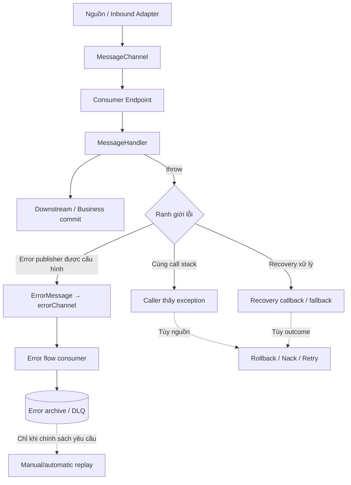
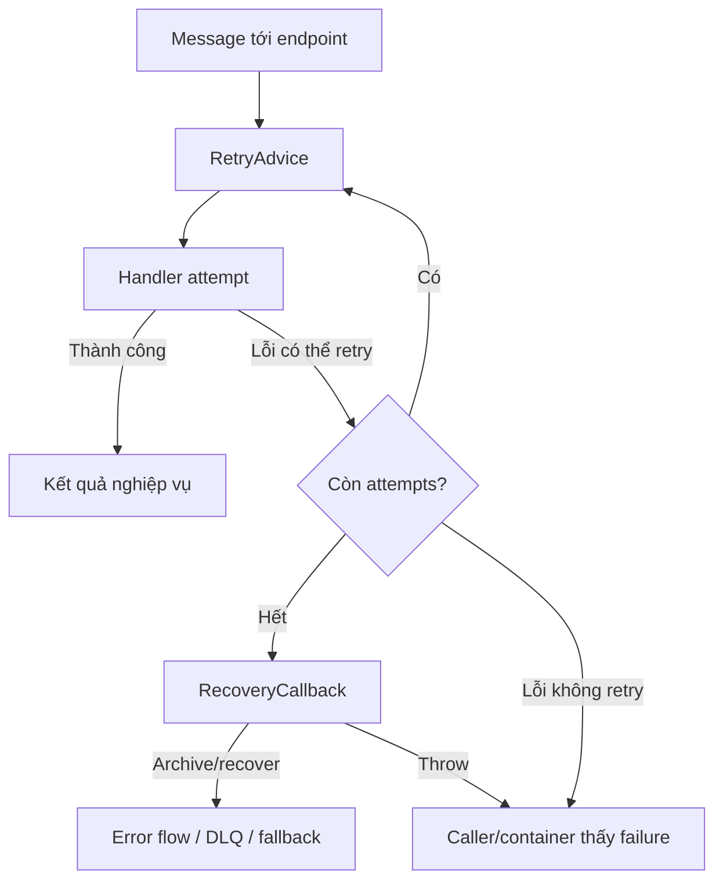

# Kiểm tra errorChannel và recovery flow trong Spring Integration

## Mục tiêu học tập

Một message đi qua `DirectChannel` rồi handler ném exception, nhưng dashboard không thấy gì trên `errorChannel`. Ở một flow khác, lỗi chỉ xuất hiện trên error channel sau khi message đã chuyển sang `ExecutorChannel` hoặc được poller xử lý; tuy có `ErrorMessage`, broker lại liên tục giao lại cùng sự kiện. Có trường hợp recovery callback ghi log “đã xử lý lỗi” nhưng record nghiệp vụ chưa được commit. Những hiện tượng này không mâu thuẫn: **đường đi của exception, cách xuất bản ErrorMessage và quyết định retry/ack là các cơ chế khác nhau**.

Bài **Kiểm tra errorChannel và recovery flow** thuộc chương **Debugging** của module **SPRING_INTEGRATION_RUNTIME**. Ta sẽ truy vết message qua channel, endpoint, consumer, poller và executor; xác định khi nào lỗi đi ngược call stack, khi nào được biến thành `ErrorMessage`, khi nào được recovery xử lý và vì sao transaction, retry, message store, correlation và trạng thái runtime quyết định kết quả cuối.

Sau bài này, bạn có thể:

- Phân biệt **exception đồng bộ**, **ErrorMessage bất đồng bộ**, **recovery callback**, **durable error archive/DLQ** và **business compensation**.
- Tìm nguồn phát lỗi, message gốc, `failedMessage`, `correlationId` và endpoint ID trong một `ErrorMessage`.
- Xác minh message/header `errorChannel`, bean `errorChannel` toàn cục và channel nhận lỗi riêng của từng adapter/flow.
- Chẩn đoán các tình huống “handler đã throw nhưng errorChannel rỗng”, “có ErrorMessage nhưng không có failed message”, “error flow ghi lỗi rồi upstream vẫn redeliver”.
- Dùng Spring Integration Java DSL và Spring Test viết probe/error consumer có kiểm tra payload, cause chain và propagation.
- Thiết kế retry, recovery, transaction/ack, replay và idempotency mà không làm mất hoặc nhân đôi side effect.
- Thực hiện runbook debug có thứ tự, giữ bằng chứng và chỉ kết luận sự cố được xử lý khi **kết quả nghiệp vụ** đã được xác minh.

> **Ý chính:** `errorChannel` là **một đường truyền message chứa thông tin lỗi**, không phải “nơi mọi exception của JVM tự động đổ về”. Cần biết **thành phần nào bắt exception và publish ErrorMessage**, cũng như **nơi nào quyết định ack/rollback**.

## 1. Bản đồ lỗi tại runtime: Throwable đi đâu?

Một flow thực tế có thể chứa inbound adapter, channel, service activator, transformer, router, aggregator, retry advice và outbound handler. Ở mỗi ranh giới thread, lỗi có thể được quan sát hoặc chuyển tiếp khác nhau.



Một lỗi có thể đi qua **nhiều lớp**: handler gốc ném `IllegalStateException`, endpoint hoặc advice bọc thành `MessageHandlingException`, poller/container đưa lỗi vào error handler, rồi error consumer ghi bản ghi bền vững. Nếu error consumer cũng lỗi, ta có **lỗi thứ cấp**. Debugging phải giữ thông tin của cả lỗi gốc và lỗi thứ cấp.

### 1.1. Năm đối tượng không đồng nghĩa

| Đối tượng | Chứa gì? | Nhiệm vụ | Không tự đảm bảo |
| --- | --- | --- | --- |
| `Throwable` | Exception/cause chain | Báo lỗi trong thread/call stack | Có message để recovery |
| `MessagingException` | Exception có thể mang `failedMessage` | Gắn lỗi với ngữ cảnh message | Tự được publish ra channel |
| `ErrorMessage` | Một `Message<Throwable>`, có thể có `originalMessage` | Biểu diễn lỗi như một message | Tự durable hoặc tự nack nguồn |
| `errorChannel` | `MessageChannel` nhận `ErrorMessage` | Định tuyến cho error consumer | Tự giữ vô hạn mọi lỗi |
| Recovery callback/handler | Quyết định hành động khi lỗi | Retry exhausted handling, fallback, archive | Tự đảm bảo exactly-once hoặc giữ nguyên rollback |
| Error archive/DLQ | Bản ghi lỗi có retention/replay policy | Điều tra, sửa dữ liệu, phục hồi | Tự làm business side effect đúng |

Sự phân biệt này là nền tảng: “đã gửi ErrorMessage” khác “đã ghi record lỗi bền vững”, và “đã archive lỗi” khác “nguồn được phép ack”.

## 2. Đồng bộ và bất đồng bộ: nguồn gốc các hiểu nhầm về errorChannel

### 2.1. DirectChannel: exception đi ngược về sender

`DirectChannel` thường gọi subscriber trên cùng thread đang gọi `send()`:

```text
HTTP/Gateway/Producer thread:
    input.send(message)
        -> DirectChannel
        -> EventDrivenConsumer
        -> Handler
        -> throw IllegalStateException
    <- caller nhận exception (có thể đã được wrap)
```

Nếu không có một error publisher/advice rõ ràng, exception **không tự biến thành `ErrorMessage` trên global errorChannel**. Điều này vẫn đúng ngay cả khi message chứa header tên `errorChannel`: header là một chỉ dẫn cho những thành phần có cơ chế publish lỗi, không tự catch exception trong mọi handler.

Ví dụ đơn giản:

```java
import org.springframework.integration.channel.DirectChannel;
import org.springframework.messaging.MessageChannel;
import org.springframework.messaging.support.MessageBuilder;

MessageChannel input = new DirectChannel();

// Mô phỏng subscriber/handler đồng bộ ném exception.
((DirectChannel) input).subscribe(message -> {
    throw new IllegalStateException("Inventory unavailable");
});

try {
    input.send(MessageBuilder.withPayload("ORD-42").build());
}
catch (RuntimeException failure) {
    System.err.println("Synchronous failure: " + failure);
}
```

Đây là ví dụ tối thiểu với một subscriber trực tiếp, không cần Spring context; lỗi từ subscriber được truyền về người gửi qua call stack (có thể được Spring Messaging wrap). Khi dùng endpoint thật do Java DSL đăng ký, nguyên tắc đồng bộ cũng tương tự. Bài test có Spring context nằm ở mục 9.

### 2.2. ExecutorChannel: thread người gửi khác thread xử lý

`ExecutorChannel` giao việc cho executor và handler chạy sau trong một worker. Lời gọi `send()` có thể trả về trong khi handler còn chưa bắt đầu:

```text
Sender thread:
    input.send(message) -> task được enqueue -> return

Worker thread:
    executor -> handler -> throw
                           |
                           v
                  Error handler / log /
                  ErrorMessage publication
                  (tùy cấu hình thực tế)
```

Sender thường **không nhận trực tiếp lỗi handler phát sinh sau đó**; nhưng nó vẫn có thể thấy lỗi tại thời điểm enqueue như `RejectedExecutionException` hoặc lỗi dispatch trước ranh giới executor. Vì vậy, test và runbook phải phân biệt **lỗi gửi task** với **lỗi thực thi task**.

Không nên khẳng định mọi `ExecutorChannel` sẽ luôn gửi lỗi vào một channel do người vận hành tự đặt tên: cần xem `error handler` thực tế, header `errorChannel`, resolver và cách framework/adapter tích hợp với executor.

### 2.3. Poller và message-driven adapter

Với `PollingConsumer`, `SourcePollingChannelAdapter` hoặc inbound adapter dùng broker, một thread do scheduler/container quản lý lấy message rồi gọi handler:

- Lỗi có thể được poller/container error handler publish thành `ErrorMessage` nếu được cấu hình đúng.
- Lỗi cũng có thể đi vào rollback, nack/requeue hoặc dead-letter policy của nguồn.
- Source ack và message đã xử lý nghiệp vụ **không** được suy ra từ việc có ErrorMessage.
- Poller có transaction advice riêng; transaction ở một thread khác không tự đi theo qua `ExecutorChannel`.

Một lỗi xuất hiện trên `errorChannel` **không tự chứng minh** message nguồn đã được giữ lại để replay; điều đó do contract của adapter, queue/broker và recovery quyết định.

### 2.4. So sánh nhanh theo ranh giới

| Topology | Caller nhìn thấy gì? | Lỗi runtime quan sát ở đâu? | Đừng mặc định |
| --- | --- | --- | --- |
| `DirectChannel → handler` | Exception đồng bộ khi handler throw | Stack/caller, trace, advice | Global errorChannel nhận mọi lỗi |
| `ExecutorChannel → handler` | Send accepted hoặc lỗi enqueue; handler failure thường xảy ra sau | Worker, error handler/channel hoặc log | `send(true)` = nghiệp vụ thành công |
| `QueueChannel → poller → handler` | Sender có thể chỉ biết queue nhận | Poller/error handler, source/queue | Producer transaction bao worker |
| Broker inbound → handler | Container quyết định delivery outcome | Error publisher/adapter, broker DLQ | Ghi ErrorMessage = ack thành công |
| Gateway request/reply | Reply hoặc exception/timeout | Gateway/flow và lỗi tùy topology | Timeout nghĩa side effect chưa xảy ra |
| Reactive bridge | `onError` terminal hoặc xử lý cục bộ | Reactor pipeline/error adapter | Reactor Throwable tự là ErrorMessage |

## 3. ErrorMessage có gì và tìm message thất bại thế nào?

`ErrorMessage` thuộc Spring Messaging. Nó chứa một `Throwable` dưới dạng **payload**, và tùy nguồn phát lỗi có thể giữ message gốc qua `getOriginalMessage()`.

```text
ErrorMessage
  payload: MessageHandlingException
    cause: IllegalStateException("inventory timeout")
    failedMessage: Message<OrderCommand>  (có thể có)
  originalMessage: Message<OrderCommand>  (có thể null)
  headers:
    id: UUID của ErrorMessage
    timestamp: ...
```

Những UUID khác nhau có thể xuất hiện: ID message nghiệp vụ gốc, ID message sau transformer và ID của chính `ErrorMessage`. **Không dùng ID của ErrorMessage thay cho correlation/business key khi replay nghiệp vụ.**

### 3.1. Helper trích message thất bại và cause chain

```java
import org.springframework.messaging.Message;
import org.springframework.messaging.MessagingException;
import org.springframework.messaging.support.ErrorMessage;

final class ErrorMessageInspector {

    static Message<?> failedMessage(ErrorMessage error) {
        Message<?> original = error.getOriginalMessage();
        if (original != null) {
            return original;
        }

        Throwable cursor = error.getPayload();
        while (cursor != null) {
            if (cursor instanceof MessagingException messaging) {
                Message<?> failed = messaging.getFailedMessage();
                if (failed != null) {
                    return failed;
                }
            }
            cursor = cursor.getCause();
        }

        return null;
    }

    static Throwable rootCause(Throwable error) {
        Throwable last = error;
        // Production: bảo vệ thêm với cause chain vòng lặp bất thường.
        while (last.getCause() != null && last.getCause() != last) {
            last = last.getCause();
        }
        return last;
    }

    static Object correlation(ErrorMessage error) {
        Message<?> failed = failedMessage(error);
        return failed == null
                ? null
                : failed.getHeaders().get("correlationId");
    }
}
```

`getOriginalMessage()` và `MessagingException.getFailedMessage()` không luôn có dữ liệu, nhất là khi lỗi bị convert/wrap hoặc source không gắn message gốc. Nếu helper trả `null`, **không đoán** payload nghiệp vụ từ `ErrorMessage.getPayload()`; cần truy log, trace hoặc error record của adapter nguồn.

### 3.2. Những trường cần ghi vào error record

| Trường | Vì sao cần? | Nguồn dữ liệu |
| --- | --- | --- |
| `businessKey`/`eventId` | Dedupe và truy cứu nghiệp vụ | Header/payload được validate |
| `correlationId` | Gắn các nhánh cùng workflow | Failed/original message |
| `messageId` | Theo vết message instance | `MessageHeaders.ID` của failed message |
| `errorMessageId` | Theo vết lần publish lỗi | ID của ErrorMessage |
| `flowId`/`endpointId` | Khoanh nơi lỗi xảy ra | Instrumentation, handler context |
| `flowVersion`/`schemaVersion` | Replay đúng code/schema | Header hoặc registry |
| `exceptionClass`/`rootCause` | Phân loại lỗi | Throwable/cause chain |
| `attempt`/`deliveryCount` | Phân biệt retry và redelivery | Advice/adapter |
| `sourceAckStatus` | Biết còn cơ hội source redeliver không | Broker/adapter |
| `firstSeenAt`/`lastFailedAt` | SLA và cleanup | Clock/DB |
| `recoveryState` | PENDING, ARCHIVED, RETRYING, RESOLVED | Error archive ứng dụng |

Đây là **schema gợi ý**, không phải một danh sách header Spring Integration tự cung cấp đầy đủ. Hạn chế ghi payload, stack trace chứa secret hoặc thông tin nhạy cảm khi không cần; archive phải có quyền truy cập và retention phù hợp.

### 3.3. ErrorMessage không phải message nghiệp vụ gốc

Một lỗi phổ biến là:

```java
void wrong(ErrorMessage error) {
    Object order = error.getPayload(); // Thực tế là Throwable!
}
```

Đúng hơn là tìm `originalMessage` hoặc `failedMessage`, rồi mới xem `getPayload()` của **message nghiệp vụ**. Trong những flow có nhiều transformer, message gắn với exception có thể là message ở **bước gần lỗi**, không phải nguyên bản từ inbound; cần giữ business key/correlation xuyên các bước nếu muốn đối chiếu.

## 4. Xác định errorChannel nào thực sự được dùng

### 4.1. Error channel trên message

Spring Messaging định nghĩa header `MessageHeaders.ERROR_CHANNEL` với tên thường là `errorChannel`. Giá trị có thể là `MessageChannel` hoặc tên channel được resolver tương ứng hiểu, tùy thành phần publish lỗi.

```java
import org.springframework.messaging.Message;
import org.springframework.messaging.MessageHeaders;
import org.springframework.messaging.support.MessageBuilder;

Message<String> order = MessageBuilder
        .withPayload("ORD-42")
        .setHeader("businessKey", "tenant-a:ORD-42")
        .setHeader("correlationId", "workflow-42")
        .setHeader(MessageHeaders.ERROR_CHANNEL, "orderErrors")
        .build();
```

Đặt header này là **yêu cầu định tuyến lỗi**. Nó không biến mọi code đang xử lý thành try/catch tự động. Để header có tác dụng, phải có thành phần **bắt exception và phát ErrorMessage**, có cách giải tên channel, và channel đó có consumer hợp lệ.

### 4.2. Global errorChannel

Spring Integration thường thiết lập một bean tên `errorChannel` khi ứng dụng bật hạ tầng Integration, thường với cơ chế publish-subscribe và subscriber logging mặc định trong cấu hình chuẩn. Nhưng không nên dựa vào giả định rằng bản cụ thể của bạn có đúng số subscriber hay cùng chính sách log: bean có thể bị override, thay đổi theo version và custom config.

Các câu hỏi cần kiểm tra trong runtime:

1. Có bean `errorChannel` không, loại `MessageChannel` nào?
2. Có consumer/subscriber nào được đăng ký? Logging handler mặc định có còn không?
3. Adapter/poller/error publisher đang chọn global channel hay channel cụ thể của message?
4. Header `errorChannel` có bị transform/header mapper loại bỏ không?
5. Error flow có chạy trên thread khác không, có transaction hoặc retry riêng không?
6. Mức log hiện tại có che lỗi không? “Không thấy log” chưa đủ để kết luận channel không nhận.

### 4.3. Channel riêng cho từng flow

Với flow nghiệp vụ quan trọng, có thể tạo channel lỗi riêng như `orderErrors` để đính kèm quyền quản trị, retry/quarantine, metrics và retention phù hợp. Tuy nhiên, một channel tên riêng chỉ hữu ích khi **có error publisher thực sự gửi đến nó**; nếu endpoint đang throw về caller thì `orderErrors` có thể vẫn trống.

| Điểm so sánh | Error channel toàn cục | Error channel riêng |
| --- | --- | --- |
| Phạm vi | Nhiều thành phần mặc định/cấu hình | Theo flow/tenant/source |
| Thông tin ngữ cảnh | Có thể không đủ để biết owner nếu thiếu headers | Dễ gắn owner/contract rõ |
| Lưu trữ | Mặc định thường không phải durable archive | Có thể nối đến consumer ghi record bền vững |
| Rủi ro | Lỗi các nguồn khác nhau trộn chung, logging bị hiểu nhầm là recovery | Publisher định tuyến sai tên; channel không có consumer |
| Vận hành | Cần phân loại theo endpoint/business key | Dễ đặt SLO và dead-letter policy |

### 4.4. Đừng sửa header ở cuối flow rồi mong lỗi trước đó đổi tuyến

Nếu lỗi xảy ra trong transformer trước bước enrich header, header `errorChannel` được gắn ở bước sau **chưa tồn tại** tại thời điểm lỗi. Khi debugging, hãy xem message **tại chính endpoint ném exception**, không chỉ message mẫu ở producer hoặc output cuối cùng.

## 5. Ví dụ Java DSL: tạo errorChannel và error consumer quan sát được

Cấu hình sau minh họa **đường nhận ErrorMessage** riêng biệt; một business handler có thể ném lỗi nhưng trên `DirectChannel` đồng bộ, việc publish vào channel riêng **không tự động** chỉ vì error flow đã đăng ký.

### 5.1. Cấu hình channel và hai endpoint

```java
import org.springframework.context.annotation.Bean;
import org.springframework.context.annotation.Configuration;
import org.springframework.integration.channel.DirectChannel;
import org.springframework.integration.channel.PublishSubscribeChannel;
import org.springframework.integration.config.EnableIntegration;
import org.springframework.integration.dsl.IntegrationFlow;
import org.springframework.messaging.Message;
import org.springframework.messaging.MessageChannel;
import org.springframework.messaging.MessageHandler;
import org.springframework.messaging.support.ErrorMessage;

@Configuration
@EnableIntegration
class ErrorDiagnosticsConfiguration {

    @Bean("ordersInput")
    MessageChannel ordersInput() {
        return new DirectChannel();
    }

    @Bean("orderErrors")
    MessageChannel orderErrors() {
        return new PublishSubscribeChannel();
    }

    @Bean
    ErrorRecorder errorRecorder() {
        return new ErrorRecorder();
    }

    @Bean
    IntegrationFlow ordersFlow() {
        MessageHandler businessHandler = message -> {
            String orderId = String.valueOf(message.getPayload());
            if (orderId.equals("ORD-FAIL")) {
                throw new IllegalStateException("Inventory unavailable");
            }
        };

        return IntegrationFlow.from("ordersInput")
                .handle(businessHandler,
                        endpoint -> endpoint.id("ordersHandlerEndpoint"))
                .get();
    }

    @Bean
    IntegrationFlow orderErrorFlow(ErrorRecorder recorder) {
        MessageHandler errorHandler = message -> {
            if (!(message instanceof ErrorMessage error)) {
                throw new IllegalArgumentException(
                        "Expected ErrorMessage, got "
                                + message.getClass().getName());
            }
            recorder.record(error);
        };

        return IntegrationFlow.from("orderErrors")
                .handle(errorHandler,
                        endpoint -> endpoint.id("orderErrorsEndpoint"))
                .get();
    }

    static final class ErrorRecorder {
        private final java.util.List<ErrorMessage> received =
                new java.util.concurrent.CopyOnWriteArrayList<>();

        void record(ErrorMessage error) {
            received.add(error);
        }

        java.util.List<ErrorMessage> snapshot() {
            return java.util.List.copyOf(received);
        }

        void clear() {
            received.clear();
        }
    }
}
```

Đây là Spring context nhỏ cho **quan sát error flow**. `ErrorRecorder` trong RAM phù hợp test/demo, **không phải kho lỗi bền vững**. Cấu hình chưa đặt một error publisher tự động cho exception của `ordersHandlerEndpoint`; đây là điểm giúp test phân biệt “error flow đã tồn tại” với “business exception đã được chuyển thành ErrorMessage”.

### 5.2. Phát ErrorMessage có chủ đích từ một boundary

Khi ứng dụng có một **boundary chủ động bắt lỗi**, có thể tạo `ErrorMessage` với message nguồn và publish vào channel đã được cấp quyền:

```java
import org.springframework.messaging.Message;
import org.springframework.messaging.MessageChannel;
import org.springframework.messaging.support.ErrorMessage;

final class ExplicitErrorPublisher {

    private final MessageChannel errorChannel;

    ExplicitErrorPublisher(MessageChannel errorChannel) {
        this.errorChannel = errorChannel;
    }

    void publish(Message<?> original, Throwable failure) {
        ErrorMessage error = new ErrorMessage(failure, original);

        boolean accepted = errorChannel.send(error);
        if (!accepted) {
            throw new IllegalStateException(
                    "Could not dispatch ErrorMessage", failure);
        }
    }
}
```

Ví dụ này **không nên được thêm vô điều kiện vào một flow đã có error publisher**, vì có thể làm cùng một exception bị ghi lỗi hai lần. Nếu gọi từ `catch` rồi **nuốt exception**, upstream có thể coi processing thành công; nếu ném lại, nguồn có thể redeliver và cùng lỗi xuất hiện lần nữa. Quyết định nằm ở policy transaction/ack, không phải constructor của `ErrorMessage`.

### 5.3. Quy trình dùng mẫu ở runtime

```text
1. Tạo Spring context với ordersFlow và orderErrorFlow.
2. Gửi ORD-OK qua ordersInput:
   -> handler xử lý bình thường.
3. Gửi ORD-FAIL qua ordersInput:
   -> handler ném exception về caller (DirectChannel).
   -> orderErrors không tự nhận gì nếu không có publisher.
4. Gọi ExplicitErrorPublisher.publish(original, failure)
   ở một boundary đã quyết định bắt lỗi:
   -> orderErrorFlow nhận ErrorMessage.
5. Nếu cần durable recovery, thay ErrorRecorder bằng error archive
   có transaction và chính sách replay.
```

Đây là đường làm rõ contract. Trong production, thay vì gọi publish thủ công khắp handler, nên dùng **error publisher, adapter error channel hoặc recovery mechanism** phù hợp để thống nhất hành vi.

## 6. Khi errorChannel rỗng: bảng chẩn đoán

| Triệu chứng | Nguyên nhân khả dĩ | Cách kiểm tra |
| --- | --- | --- |
| Handler throw, caller thấy exception, errorChannel không có gì | `DirectChannel` đồng bộ không có error publisher | Trace call stack; xác nhận có handler bắt/publish lỗi hay không |
| `send()` thành công, không có error log nhưng nghiệp vụ thất bại | `ExecutorChannel` xử lý sau, log ở worker/handler khác | Executor error handler, error resolver, worker logs |
| Có bean `orderErrors` nhưng không có ErrorMessage | Chưa có thành phần gửi tới channel này | Xem adapter/poller/recovery configuration và header |
| ErrorMessage đi vào global channel thay vì riêng | Header bị mất, resolver không nhận tên, adapter dùng default | Log header ngay tại failure point; xem error-channel config |
| Error channel có message nhưng không thấy recovery | Chỉ có logging consumer, không có durable archive/recovery | Kiểm tra subscriber và trạng thái archive |
| Error flow nhận `Throwable` nhưng không tìm ra order ID | Đọc payload của ErrorMessage như business payload | Dùng `originalMessage`/`failedMessage`, business key |
| Nhận hai ErrorMessage cùng lỗi | Manual publisher + adapter publisher, retry nhiều tầng | Message/error ID, attempt/delivery, owner publisher |
| Publish lỗi cũng fail | Error channel không có subscriber, handler archive lỗi | Secondary exception, channel type, archive transaction |
| ErrorMessage có nhưng broker vẫn redeliver | Nguồn rollback/nack; publish lỗi chưa là ack | Ack policy, source transaction, recovery result |
| Recovery báo success nhưng business DB chưa commit | Callback đã nuốt lỗi, archive không durable hoặc DB rollback | Business ledger, source ack và transaction boundary |
| Breaker OPEN nhưng handler không được gọi | Short-circuit trước business handler | Advice/exception type và error publishing |
| Group pending mãi không release | Nhánh lỗi chưa tới aggregator hoặc correlation mismatch | Group ID, sequence, branch error flow và DLQ |

### 6.1. Phân biệt “không phát lỗi” và “phát lỗi nhưng không ai nhận”

Hai nguyên nhân này thường bị trộn:

```text
A. Handler throw nhưng không có publisher:
   Throwable --X--> ErrorMessage
   => cần tìm ở caller/advice/container.

B. Publisher đã tạo ErrorMessage nhưng dispatch thất bại:
   ErrorMessage --> errorChannel --X--> consumer/archive
   => cần kiểm tra channel, subscriber, secondary error.
```

Hãy log ở cả **trước khi publish**, **lúc error consumer nhận** và **sau khi archive commit** (với correlation đã redacted). Cách này xác định chính xác ranh giới mất thông tin mà không cần bật log payload nhạy cảm toàn hệ thống.

## 7. Retry advice và recovery flow: thời điểm nào lỗi được chuyển đi?

Một handler được bọc bởi retry advice có thể ném exception nhiều lần nhưng chỉ báo lỗi/recovery sau khi hết số attempt, tùy advice order và policy.



### 7.1. Thuật ngữ phải rõ

- **Retry attempt:** mỗi lần cùng invocation được gọi lại theo advice.
- **Backoff:** khoảng nghỉ giữa attempts, không phải TTL của message.
- **Recovery callback:** logic chạy khi retry policy cho phép chuyển sang recovery.
- **Redelivery:** broker/source gửi lại message ở một lần delivery khác.
- **Manual replay:** vận hành đưa một record đã archive quay về flow.
- **Compensation:** thao tác nghiệp vụ để xử lý side effect một phần, không đồng nghĩa retry.

Một số hệ thống cấu hình `maxAttempts=3` bao gồm lần thử đầu tiên; cần xác nhận contract của thư viện retry phiên bản thực tế. Đừng đếm mỗi event log “Retrying” rồi suy ra chính xác có bao nhiêu lần handler đã gọi API.

### 7.2. Advice order ảnh hưởng số lỗi ghi nhận

Ví dụ hình dung hai lớp advice:

```text
Phương án A:
  Retry(Handler)
  -> Sau tất cả attempts mới tới Recovery/ErrorPublisher

Phương án B:
  Retry(ErrorPublisher(Handler))
  -> Mỗi attempt lỗi có thể được ErrorPublisher thấy trước khi retry
```

Phần này là **mô hình thứ tự bao bọc**, không phải cú pháp Java DSL mặc định. Nếu error publisher đặt bên trong vòng retry, có thể có nhiều ErrorMessage của một business event. Nếu đặt ở ngoài, có thể chỉ có một ErrorMessage cuối cùng. Với stateful retry, redelivery và nguồn transaction, còn những hành vi khác cần xem cấu hình cụ thể.

### 7.3. Recovery callback nuốt lỗi và rủi ro ack

Giả sử handler gọi dịch vụ giữ tồn kho, thất bại sau ba attempts. Recovery callback bắt lỗi, chỉ ghi log rồi trả bình thường. Poller/broker adapter có thể coi invocation đã hoàn tất và ack/commit checkpoint theo policy, dù nghiệp vụ chưa thành công.

```text
Handler fail
  -> Retry exhausted
  -> Recovery callback log + return normally
  -> Upstream sees normal completion
  -> Source may ack/commit
  -> No durable recovery record
  => Có nguy cơ mất việc
```

Recovery an toàn phải định nghĩa **hành động sau cùng**: retry sau, lưu DLQ bền vững, compensation, trả fallback hợp lệ hoặc throw để source rollback. Không có quy tắc “cứ publish ErrorMessage là ack” đúng cho mọi trường hợp.

### 7.4. Khi nào lỗi không nên retry?

| Lỗi | Retry? | Recovery phù hợp |
| --- | --- | --- |
| HTTP 503/timeout tạm thời | Có thể, với backoff/jitter và giới hạn | Durable retry, breaker/bulkhead |
| Connection pool cạn do nghẽn | Điều tra/tune trước, retry có điều tiết | Pause input, backpressure |
| Payload sai schema | Thường không | Validation error, quarantine |
| Thiếu business key | Thường không | Reject và lưu lỗi có thể tra soát |
| Đã tạo side effect nhưng response timeout | Chỉ khi idempotency bảo vệ | Check status/idempotency key trước retry |
| Circuit breaker OPEN | Không nên gây retry storm mù quáng | Delay/backoff, await half-open theo policy |
| Không deserialize message từ store | Không retry tức thời vô hạn | Quarantine/migrate schema |
| Error archive backend unavailable | Không tự ack nếu nhiệm vụ yêu cầu durable recovery | Fail closed/pause source hoặc phương án fallback bền vững |

## 8. Error flow kết thúc ở đâu: logging, archive, DLQ hay reply?

Không phải mọi recovery đều là “ghi message lỗi vào một channel”.

### 8.1. Bốn mô hình thường gặp

| Mô hình | Mục tiêu | Điều phải xác minh |
| --- | --- | --- |
| **Logging-only** | Quan sát lỗi không quan trọng/telemetry | Có chấp nhận mất business event không? |
| **Durable error archive** | Lưu context để sửa và replay | Record đã commit? Có business key/correlation, retention? |
| **Dead-letter queue** | Tách message độc và giảm bão retry | Routing key, broker ack, DLQ consumer, poison-message policy |
| **Fallback response** | Trả giá trị thay thế cho caller | Fallback có hợp lệ nghiệp vụ, có đánh dấu degraded không? |
| **Compensation** | Xử lý side effect đã xảy ra một phần | Bước nào đã commit, compensation có idempotent không? |

Một logging handler trên `errorChannel` chỉ chứng minh **exception đã được quan sát**. Nó không đảm bảo message có thể replay sau restart.

### 8.2. Thiết kế error archive tối thiểu

Nếu cần lưu bền vững, nên lưu một **error record** tách rời với các trường có version, thay vì mặc nhiên serialize nguyên `Throwable` và mọi headers Java runtime:

```text
error_record:
  errorId
  eventId / businessKey / correlationId
  flowVersion / schemaVersion
  originalPayloadReference hoặc payload đã sanitize
  exceptionType / sanitizedMessage / stackFingerprint
  endpointId / source / tenant
  firstFailureAt / lastFailureAt
  attemptCount / deliveryCount
  recoveryState = PENDING | RETRYING | RESOLVED | QUARANTINED
  nextRetryAt / retentionUntil
  idempotencyKey
```

Có thể giữ full payload ở kho riêng có encryption/access control và tham chiếu bằng ID. Header có chứa channel reference, proxy, security principal hoặc object không serialize được; lưu “nguyên Message<?>” vào một `MessageStore` persistent cần kiểm chứng serializer/version compatibility.

### 8.3. Error consumer cũng có thể thất bại

Sơ đồ lỗi hai tầng:

```text
Business handler
   -> error publication
   -> error consumer
       -> DB error archive unavailable
       -> error consumer throws
       -> secondary error
```

Không được **nuốt secondary error** rồi ack source khi policy yêu cầu bản ghi lỗi bền vững. Mặt khác, nếu error publisher đồng bộ gọi một subscriber lưu DB và DB chậm, đường error có thể trở thành bottleneck làm hàng loạt worker kẹt. Cần timeout, circuit breaker, fail-safe queue/broker và cơ chế escalation phù hợp.

## 9. Spring Test: chứng minh errorChannel không tự nhận lỗi đồng bộ

Dùng cấu hình `ErrorDiagnosticsConfiguration` ở mục 5 trong Spring Test context.

### 9.1. Test DirectChannel throw nhưng recorder còn trống

```java
import org.junit.jupiter.api.BeforeEach;
import org.junit.jupiter.api.Test;
import org.springframework.beans.factory.annotation.Autowired;
import org.springframework.beans.factory.annotation.Qualifier;
import org.springframework.messaging.MessageChannel;
import org.springframework.messaging.support.MessageBuilder;
import org.springframework.test.context.junit.jupiter.SpringJUnitConfig;

import static org.junit.jupiter.api.Assertions.*;

@SpringJUnitConfig(ErrorDiagnosticsConfiguration.class)
class SynchronousErrorPathTest {

    @Autowired
    @Qualifier("ordersInput")
    MessageChannel input;

    @Autowired
    ErrorDiagnosticsConfiguration.ErrorRecorder errors;

    @BeforeEach
    void reset() {
        errors.clear();
    }

    @Test
    void synchronousExceptionDoesNotAutomaticallyPublishError() {
        RuntimeException failure = assertThrows(
                RuntimeException.class,
                () -> input.send(MessageBuilder
                        .withPayload("ORD-FAIL")
                        .setHeader("correlationId", "workflow-42")
                        .build()));

        assertNotNull(failure);
        assertTrue(errors.snapshot().isEmpty(),
                "No error publisher was configured for DirectChannel");
    }
}
```

Test này **khẳng định một contract cụ thể của topology demo**. Nếu người học bổ sung error publishing advice hoặc adapter có error handler, kỳ vọng phải đổi; không nên khái quát “mọi DirectChannel đều không thể publish error”.

### 9.2. Test riêng error consumer nhận ErrorMessage

```java
import org.junit.jupiter.api.Test;
import org.springframework.beans.factory.annotation.Autowired;
import org.springframework.beans.factory.annotation.Qualifier;
import org.springframework.messaging.Message;
import org.springframework.messaging.MessageChannel;
import org.springframework.messaging.support.ErrorMessage;
import org.springframework.messaging.support.MessageBuilder;
import org.springframework.test.context.junit.jupiter.SpringJUnitConfig;

import static org.junit.jupiter.api.Assertions.*;

@SpringJUnitConfig(ErrorDiagnosticsConfiguration.class)
class ErrorFlowConsumerTest {

    @Autowired
    @Qualifier("orderErrors")
    MessageChannel errorsInput;

    @Autowired
    ErrorDiagnosticsConfiguration.ErrorRecorder recorder;

    @Test
    void errorChannelConsumerCanInspectOriginalMessage() {
        recorder.clear();

        Message<String> original = MessageBuilder
                .withPayload("ORD-42")
                .setHeader("businessKey", "tenant-a:ORD-42")
                .setHeader("correlationId", "workflow-42")
                .build();

        ErrorMessage published = new ErrorMessage(
                new IllegalStateException("inventory unavailable"),
                original);

        assertTrue(errorsInput.send(published));
        assertEquals(1, recorder.snapshot().size());

        ErrorMessage received = recorder.snapshot().get(0);
        assertEquals("workflow-42",
                ErrorMessageInspector.correlation(received));
        assertEquals(original.getHeaders().getId(),
                ErrorMessageInspector.failedMessage(received)
                        .getHeaders().getId());
    }
}
```

`ErrorMessageInspector` là helper ở mục 3. Test này xác minh **error consumer, channel và originalMessage**, không chứng minh một exception từ business flow đã tự route vào `orderErrors`: đó là một test integration khác cần publisher/adapter thực.

### 9.3. Test integration của nguồn async

Để test đường lỗi tự động ở một poller hoặc inbound adapter:

1. Khởi tạo source/adapter có cấu hình `errorChannel` rõ ràng và error publisher được hỗ trợ.
2. Cho handler ném exception có `businessKey` và `correlationId`.
3. Dùng một error probe/recorder có latch thay vì `Thread.sleep()`; đợi tối đa một deadline hữu hạn.
4. Kiểm tra `ErrorMessage`, cause chain và message nguồn được giữ theo contract.
5. Cho error archive thất bại; xác minh nguồn **ack/rollback/nack** theo policy.
6. Bật retry với giới hạn; so số attempts, số ErrorMessage và delivery count.
7. Xác minh error consumer tiếp tục hoạt động sau một lỗi, hoặc phát cảnh báo nếu nó đã chết.

Nếu topology dùng `ExecutorChannel` mà framework/ứng dụng có cấu hình error handler khác, test phải dùng đúng error publisher đó; không giả định cùng kết quả với một poller.

## 10. Các boundary ảnh hưởng đến transaction và ack

Trong Spring Integration, handler có thể nằm trong transaction JDBC trên thread caller, nhưng khi chuyển sang executor hoặc một source khác, transaction đó thường không tự đi cùng. Hãy vẽ **đường commit thực**, không suy từ sơ đồ logical flow.

```text
Poller/Container thread:
  read source message
  begin transaction (nếu cấu hình)
  send to DirectChannel -> handler
  commit hoặc rollback / ack

Sau ExecutorChannel:
  schedule worker
  caller có thể hoàn tất sớm
  worker dùng transaction riêng hoặc không có
  handler gọi API / ghi DB sau đó
```

### 10.1. Kịch bản crash window thường gặp

| Mốc lỗi | Điều có thể đã xảy ra | Hậu quả nếu recovery sai |
| --- | --- | --- |
| Trước archive lỗi | Handler throw, source chưa ack | Redelivery có thể xảy ra; cần retry/idempotency |
| Sau khi errorChannel nhận nhưng trước archive commit | Error chỉ tồn tại trong RAM | Ack sớm có thể làm mất message |
| Sau khi archive commit nhưng trước ack | Record lỗi còn, source có thể redeliver | Có hai đường xử lý cùng event nếu không dedupe |
| Sau khi API ngoài thành công nhưng trước DONE | Side effect có thể đã commit | Retry/replay tạo duplicate |
| Sau khi metadata checkpoint được cập nhật trước xử lý | Source có thể skip record sau restart | Mất việc chưa hoàn thành |
| Sau khi ack nhưng trước error record bền vững | Source không còn redeliver | Mất cơ hội recovery |

Không có một thao tác `errorChannel.send(error)` nào tự atomically commit một HTTP API, JDBC state và broker ack trên các hệ thống độc lập.

### 10.2. Kiểm tra ngữ nghĩa completion của recovery

Hỏi rõ:

- Recovery callback **trả bình thường** hay **throw**?
- Error archive đã commit cùng transaction với nguồn, hay chỉ enqueue vào RAM?
- Retry advice có đánh dấu recover thành công rồi cho gateway trả reply không?
- Inbound adapter có tự ack khi handler hoàn tất? Có transaction manager phù hợp không?
- Error consumer chạy trên cùng thread hay một executor khác?
- Source redelivery và manual replay có dùng **cùng idempotency key** không?

Trong luồng chuyển tiền, tồn kho hoặc tạo đơn, nên đặt unique business key/ledger tại hệ thống nghiệp vụ, không chỉ dựa vào presence/absence của `ErrorMessage`.

## 11. MessageStore, MessageGroupStore và MetadataStore trong debugging lỗi

Ba store phục vụ những bài toán khác nhau:

| Store | Dữ liệu và key | Vai trò khi lỗi | Điều không tự làm |
| --- | --- | --- | --- |
| `MessageStore` | `Message<?>` theo `MessageHeaders.ID`/UUID | Cất message cho claim-check/recovery | Không tự phát lại message đã archive |
| `MessageGroupStore` | Các message theo group ID | Aggregator đang chờ các nhánh | Không tự biết phần nào bị lỗi ở nhánh khác |
| `MetadataStore` | `String key → String value` | Cursor, file filter, dedupe marker | Không giữ nguyên business payload hoặc tự ack |
| DLQ/error archive | Bản ghi lỗi có schema/retention | Điều tra và replay theo policy | Không tự xác nhận side effect chưa xảy ra |

Một message bị lỗi trước aggregator có thể dẫn đến **group pending mãi**. Nếu operator chỉ thấy group size thiếu một mà không xem error flow của nhánh còn lại, dễ kết luận sai rằng aggregator “bị treo”.

### 11.1. Tra correlation trước khi force release

Ví dụ:

```text
Order ORD-42:
  PaymentConfirmed  -> group tenant-a:ORD-42 (đã tới)
  InventoryReserved -> group tenant-a:ORD-42 (đã tới)
  ShippingQuoted    -> throw -> errorChannel/DLQ (chưa tới)

Aggregator:
  group size = 2
  expected = 3 parts
  no output
```

Cần dùng `businessKey`/`correlationId` để tìm `ShippingQuoted` ở error record, kiểm tra exception và quyết định có retry hay partial result hợp lệ. **Không xóa group** hoặc tăng release timeout mù quáng; giữ version/correlation ổn định khi replay.

### 11.2. ID và group key dễ nhầm

`MessageHeaders.ID` nhận diện từng message, trong khi group key do `CorrelationStrategy` trả về (có thể lấy từ `headers['correlationId']`). `ErrorMessage` lại có message ID riêng. Khi debug, ghi cả ba nếu cần nhưng **không dùng chúng thay thế cho nhau**.

Một transient error có thể được retry bằng cùng message instance, còn redelivery qua broker có thể tạo một instance mới với UUID khác. Dedupe theo UUID đơn lẻ không đủ nếu nghiệp vụ cần chặn lặp qua redelivery/replay.

## 12. Chẩn đoán errorChannel bằng log và metric

### 12.1. Instrument các bước thay vì chỉ log Throwable

```text
stage=business-start
  endpoint=inventoryHandler
  messageId=UUID-A
  businessKey=tenant-a:ORD-42
  correlationId=workflow-42
  attempt=2

stage=business-failure
  exception=InventoryTimeout
  failedMessageId=UUID-A
  durationMs=1200

stage=error-publish
  errorChannel=orderErrors
  errorMessageId=UUID-E

stage=error-consumed
  errorMessageId=UUID-E
  originalMessageId=UUID-A

stage=error-archive-commit
  errorId=ERR-42
  recoveryState=PENDING

stage=source-outcome
  deliveryCount=3
  ack=false
  action=REQUEUE
```

Đây là mẫu **structured log tùy ứng dụng**, không phải output Spring Integration tự cung cấp. Mỗi dòng giúp trả lời “đến đâu thì thông tin biến mất?” mà không cần log toàn bộ payload.

### 12.2. Metric nên có

| Tín hiệu | Mục đích | Cách tránh hiểu nhầm |
| --- | --- | --- |
| `handler.failure.count` | Tỷ lệ lỗi nghiệp vụ | Phân biệt attempt và message duy nhất |
| `error.publish.attempt` / `error.publish.failed` | Publisher có hoạt động không? | Đo cả lỗi thứ cấp |
| `errorChannel.received` | Consumer nhận bao nhiêu ErrorMessage | Không đồng nghĩa archive commit |
| `error.archive.committed` | Số lỗi lưu bền vững | Đối chiếu lỗi/lưu thất bại |
| `retry.attempts` | Số lần handler được gọi lại | Phân biệt broker delivery count |
| `source.redelivery` | Source có gửi lại? | Dùng business key để phát hiện duplicate |
| `recovery.pending.age` | Lỗi chờ xử lý bao lâu | Không coi logging error là recovery |
| `error.consumer.inflight` | Có nghẽn ở consumer lỗi? | Kiểm tra queue/thread pool |
| `group.pending.age` | Correlation group chờ lâu | Tra nhánh lỗi tương ứng |
| `business.commit.count` | Tiến triển nghiệp vụ thực | Không suy từ channel send accepted |

Đây là tên **đề xuất**, không mặc định được Spring Integration/Actuator sinh ra. Tránh dùng `messageId` hoặc `correlationId` làm metric label vì cardinality rất cao; đặt trong log/traces có retention và phân quyền.

### 12.3. Rà lại cấu hình log

Nếu global error channel đang có logging subscriber, mức log phù hợp có thể giúp thấy exception. Nhưng một logging handler không ghi dữ liệu bền vững, và logging cấu hình sai có thể che mất lỗi khỏi dashboard. Cần theo dõi **cả error channel dispatch và durable archive**; không dùng câu “log không có gì” để kết luận không xảy ra lỗi.

## 13. Runbook: điều tra một message không thấy trên errorChannel

### Bước 1 — Khóa đúng vụ việc

Lấy `businessKey`/`eventId`, `correlationId`, message ID gần endpoint lỗi, flow version, endpoint ID, tên source, tenant và khoảng thời gian. Nếu không có business key, ghi nhận thiếu metadata như một lỗi thiết kế cần xử lý.

### Bước 2 — Xác định ranh giới thread và điểm lỗi

Tìm đường đi thực tế: `DirectChannel`, `ExecutorChannel`, `QueueChannel`/poller, message-driven adapter, gateway hay reactive bridge. Đừng suy từ tên channel mà bỏ qua một executor/queue được chèn ở giữa.

### Bước 3 — Xác nhận handler thật sự throw hay chỉ trả error result

Một HTTP client có thể trả status 500 mà adapter không ném exception theo cấu hình; một validator có thể trả payload báo lỗi bình thường. Khi đó, không có `Throwable` để tự đưa vào error flow. Kiểm tra exception class, stack và code mapping response.

### Bước 4 — Tìm thành phần sở hữu error publication

Kiểm tra error handler của adapter/container/poller, advice/recovery callback và các handler tự publish. Có error publisher không? Nó nhận exception ở attempt nào? Có bị recovery callback chặn trước khi publish không?

### Bước 5 — Xác minh channel thật sự được chọn

Xem `MessageHeaders.ERROR_CHANNEL` tại failed message, bean/global channel, resolver, header mapper và endpoint subscription. So tên channel/string với actual bean name; không xem header của một message khác để kết luận.

### Bước 6 — Theo dấu ErrorMessage và cause

Nếu có ErrorMessage, đọc `getPayload()`, `getOriginalMessage()` và `MessagingException.getFailedMessage()` trong cause chain. Log exception type, message ID và correlation; không mặc nhiên payload của ErrorMessage là business payload.

### Bước 7 — Kiểm tra error consumer và durable archive

Có subscriber không? Có lỗi thứ cấp do DB lỗi, serializer hỏng hoặc DLQ bị đầy? Record đã commit hay chỉ được enqueue? Error flow có terminal error khiến consumer dừng không?

### Bước 8 — Đối chiếu nguồn ack/rollback và business state

Kiểm tra source vẫn có thể redeliver không. Đối chiếu `businessKey` với DB/đích để biết side effect đã thành công một phần hay chưa. Chỉ khi biết trạng thái thật mới quyết định retry/replay/quarantine.

### Bước 9 — Khắc phục nhỏ nhất và xác minh

Sửa đúng cấu hình header/channel/publisher hoặc dependency; không restart cả service nếu chỉ một error consumer lỗi. Gửi canary có business key riêng, làm phát sinh một lỗi có kiểm soát, theo dõi toàn tuyến: handler throw → publish → ErrorMessage receive → archive commit → source outcome.

### Bước 10 — Đóng incident bằng bằng chứng

Chỉ kết luận hoàn thành khi không còn mất error record, error backlog giảm, source ack hợp đồng và idempotency bảo vệ duplicate. Ghi lại đoạn flow, endpoint, cause và test hồi quy.

## 14. Các tình huống khó: gateway, breaker, reactive và restart

### 14.1. Gateway timeout dù handler đã thành công

Gateway request/reply có timeout; nếu handler gửi lệnh ra ngoài, response đến muộn, caller có thể thấy timeout dù side effect đã commit. Không replay từ error archive ngay mà phải query trạng thái nghiệp vụ theo idempotency key. Trong log, tách **timeout của caller** khỏi **lỗi thật ở handler**.

### 14.2. Circuit breaker OPEN làm error path khác

Khi breaker ở OPEN, handler có thể không được gọi; advice từ chối trước khi chạm downstream. Đây là lỗi/short-circuit cần được phân loại riêng với failure của API. Không đo “downstream calls=0” rồi kết luận endpoint không chạy. Nếu breaker được wrap bởi retry advice, có thể xảy ra retry liên tục trên lỗi OPEN; cần kiểm tra advice order và backoff.

### 14.3. Reactive pipeline không tự publish ErrorMessage

Trong Reactor, `onError` thường là terminal signal của một subscription. Nếu muốn đưa lỗi vào Spring Integration error flow, cần một bridge hoặc endpoint có policy publish ErrorMessage cụ thể. Không giả định `Flux.onError` bằng global `errorChannel`. Đặt error handler ở per-message scope khi cần stream tiếp tục xử lý message sau; đồng thời lưu lỗi bền vững.

### 14.4. Restart khi errorChannel chỉ nằm trong RAM

`PublishSubscribeChannel` hoặc `DirectChannel` dùng cho lỗi không tự giữ message bền vững qua restart. Nếu consumer đang archive nhưng app bị kill trước commit, ErrorMessage có thể mất trừ khi nguồn redeliver hoặc có durable handoff. Cần kiểm thử crash ở ranh giới **publish → archive → ack**, không chỉ một test gửi ErrorMessage trong cùng JVM.

### 14.5. Dynamic IntegrationFlow bị remove

Nếu một flow version bị remove trong lúc error archive còn message gắn `flowVersion=v1`, replay về v2 có thể sai schema, retry policy và correlation key. Recovery flow phải đọc version đã pin và tìm decoder/handler tương thích, hoặc migrate có kiểm soát; không ép mọi lỗi cũ qua active alias mới.

## 15. Ma trận kiểm thử recovery flow

| Kịch bản | Thiết lập | Điều cần assert |
| --- | --- | --- |
| Handler throw trên DirectChannel | Endpoint đồng bộ, không publisher | Caller thấy exception; error recorder rỗng |
| Explicit ErrorMessage | Publish vào channel riêng | Consumer nhận Throwable + originalMessage |
| Header errorChannel có/không | Hai message khác header | Publisher chọn đúng nơi theo cấu hình |
| Header mất ở transformer | Tạo message mới không giữ headers | Error route thay đổi hoặc validation phát hiện |
| Executor handler fail | Worker chạy sau sender | Error được quan sát ở worker/error handler, không giả định caller nhận |
| Poller handler fail | Poller có error publisher | ErrorMessage/cause được nhận và source outcome đúng |
| Retry exhausted | Nhiều attempts rồi recovery | Số attempts và số record lỗi đúng policy |
| Recovery nuốt lỗi | Callback returns normally | Kiểm tra ack và trạng thái archive; phát hiện rủi ro mất việc |
| Archive DB unavailable | Error consumer throw | Secondary failure cảnh báo, không ack sai |
| DLQ full/permission denied | Error route không publish được | Hành vi fallback/fail-closed theo policy |
| Broker redelivery | Nack hoặc rollback | Message được giao lại, business idempotency |
| ErrorMessage thiếu original | Chỉ có Throwable | Truy failedMessage/cause hoặc record thiếu context |
| Aggregator thiếu part | Một nhánh lỗi | Group pending, correlation đúng, recovery đưa phần về đúng group |
| Timeout sau side effect | External API đã commit | Không tạo duplicate khi replay |
| Process crash | Kill giữa publish/archive/ack | Xác minh durable record hoặc redelivery |
| Flow version thay đổi | Replay message v1 khi v2 active | Version pinning/migration/quarantine |
| Nhiều subscriber | Global errorChannel fan-out | Không archive hai lần nếu hai consumer cùng ghi |
| No traffic | Không có error | Không false alert nếu source idle hợp lệ |

### 15.1. Không dùng Thread.sleep để kiểm tra lỗi async

Một error probe có thể giữ `CountDownLatch` hoặc một bounded queue để đợi ErrorMessage với timeout. Đếm latch **sau khi nhận ErrorMessage** chứng minh dispatch đã tới consumer; để chứng minh durable archive commit, đặt tín hiệu sau transaction commit hoặc đọc DB theo transaction độc lập.

```java
import java.util.concurrent.CountDownLatch;
import java.util.concurrent.TimeUnit;
import java.util.concurrent.atomic.AtomicReference;
import org.springframework.messaging.support.ErrorMessage;

final class ErrorProbe {
    private final CountDownLatch arrived = new CountDownLatch(1);
    private final AtomicReference<ErrorMessage> error =
            new AtomicReference<>();

    void accept(ErrorMessage received) {
        error.set(received);
        arrived.countDown();
    }

    ErrorMessage await() throws InterruptedException {
        if (!arrived.await(5, TimeUnit.SECONDS)) {
            throw new AssertionError(
                    "No ErrorMessage received within 5 seconds");
        }
        return error.get();
    }
}
```

Bài test phải tạo probe mới mỗi lần hoặc reset đúng cách; một latch đã về 0 không thể tái dùng để đếm một lỗi mới. Với source có retry và nhiều ErrorMessage, dùng blocking queue có giới hạn hoặc một danh sách được bảo vệ thread-safe để assert thứ tự/số lượng theo contract.

## 16. Bài thực hành có hướng dẫn

### Bài A — Chứng minh exception đồng bộ không tự đến errorChannel

Dựng cấu hình mục 5 và test mục 9. Gửi `ORD-FAIL` qua `ordersInput`, assert exception ở sender; kiểm tra `orderErrors` chưa có bản ghi vì không có error publisher.

**Kết quả mong đợi:** giải thích vì sao header `errorChannel` không tự bắt mọi exception và khi nào cần một boundary publish lỗi.

### Bài B — Phân tích ErrorMessage và correlation

Tạo `ErrorMessage` có `originalMessage` với `businessKey` và `correlationId`, cho consumer nhận. Thử lần lượt ErrorMessage thiếu original nhưng exception chứa failed message, và trường hợp cả hai đều thiếu.

**Kết quả mong đợi:** lấy message gốc khi có thể, không cast `Throwable` thành payload nghiệp vụ; ghi rõ khi không tìm được context.

### Bài C — Debug async error publisher

Đưa handler sang `ExecutorChannel` hoặc poller trong Spring Test context có cấu hình error publisher phù hợp. Cho handler throw, đo thread sender/worker và số ErrorMessage bằng latch. Cố ý đổi tên channel lỗi để phát hiện đường lỗi sai.

**Kết quả mong đợi:** phân biệt enqueue success, handler failure và error dispatch; có kết quả kiểm thử theo chính topology đang chạy.

### Bài D — Retry advice và recovery policy

Cho handler fail hai lần rồi thành công ở lần ba. Sau đó cho handler luôn fail, dùng recovery callback ghi archive. Test số attempts, archive count, response/exception đến caller và source ack status trong adapter giả.

**Kết quả mong đợi:** không ghi một error record cho mỗi attempt trừ khi policy yêu cầu; không nuốt lỗi rồi ack khi recovery chưa bền vững.

### Bài E — Error archive hỏng

Thay error archive bằng fake repository ném exception. Quan sát secondary error, transaction outcome và khả năng source redeliver. Thử fail-open/fail-closed theo hai hợp đồng nghiệp vụ giả.

**Kết quả mong đợi:** biết khi nào phải pause nguồn và giữ message thay vì đánh dấu hoàn tất dựa vào logging-only.

### Bài F — Aggregator thiếu nhánh vì error

Tạo đơn hàng với ba nhánh, cho `ShippingQuoted` throw trước aggregator. Kiểm tra `MessageGroupStore` đang có hai phần, sau đó replay nhánh lỗi với correlation key ổn định. Thử key khác kiểu/namespace để thấy nhóm bị tách.

**Kết quả mong đợi:** khôi phục đúng group và release theo business contract, không force release/xóa group tùy tiện.

### Bài G — Transaction và ack sau side effect

Cho fake API tạo đơn thành công nhưng timeout trước response. Handler ném lỗi; ErrorMessage được archive nhưng source chưa ack. Khởi động consumer khác để mô phỏng redelivery, dùng unique business key ngăn tạo trùng.

**Kết quả mong đợi:** phân biệt business commit, error record commit và source ack; có thể redeliver mà không sinh thêm side effect.

### Bài H — Diễn tập incident “errorChannel im lặng”

Mô phỏng dashboard báo 0 error messages, trong khi handler có log exception và throughput thành công 0. Phân công người A theo dõi source/handler, người B kiểm tra publisher/channel, người C theo error consumer/archive và owner downstream.

**Kết quả mong đợi:** tìm được đúng nơi lỗi bị mất, đưa ra bằng chứng trước/sau và chỉ đóng incident sau khi canary failure đi qua toàn tuyến tới durable archive.

## 17. Câu hỏi tự kiểm tra

1. Vì sao một exception ném trong `DirectChannel` đồng bộ có thể không tạo `ErrorMessage`?
2. Header `MessageHeaders.ERROR_CHANNEL` có vai trò gì và điều gì nó không tự làm?
3. `ErrorMessage.getPayload()` chứa dữ liệu gì? Vì sao không đọc nó như payload đơn hàng?
4. Sự khác nhau giữa `ErrorMessage.getOriginalMessage()` và `MessagingException.getFailedMessage()`?
5. Làm thế nào tìm correlation ID khi exception bị wrap qua nhiều cause?
6. `MessageHeaders.ID` của ErrorMessage có thay thế ID message nghiệp vụ trong replay được không?
7. Một `ExecutorChannel.send(true)` chứng minh điều gì, và không chứng minh điều gì?
8. Khi error channel trống, cần phân biệt “không có publisher” và “publisher gửi thất bại” bằng tín hiệu nào?
9. Global `errorChannel` khác channel lỗi riêng ở phạm vi và chính sách recovery như thế nào?
10. Vì sao logging subscriber mặc định không phải durable error archive?
11. Retry advice đặt trong hay ngoài một error publisher có thể làm thay đổi số ErrorMessage thế nào?
12. Recovery callback trả bình thường có thể ảnh hưởng nguồn ack ra sao?
13. Một ErrorMessage đã được lưu có tự đảm bảo broker không redeliver message gốc không?
14. Nếu error archive bị lỗi, vì sao không nên ack source khi yêu cầu là recovery bền vững?
15. Tại sao transaction của poller thường không tự truyền qua một `ExecutorChannel`?
16. Ba store `MessageStore`, `MessageGroupStore`, `MetadataStore` khác nhau thế nào khi truy cứu lỗi?
17. Một aggregator chờ phần thứ ba vì nhánh đó lỗi sẽ biểu hiện thế nào?
18. Khi circuit breaker OPEN, handler có thực sự được gọi không? Lỗi cần được phân loại ra sao?
19. Reactor `onError` có tự đi vào global `errorChannel` không?
20. Sau process crash ở ranh giới publish/archive/ack, cần loại kiểm thử nào để xác minh recovery?
21. Tại sao business idempotency key phải ổn định qua retry, redelivery và replay?
22. Nếu flow v1 đã remove nhưng error archive còn message gắn v1, replay vào v2 có luôn an toàn không?
23. Những metrics nào giúp tách handler failure, error publish và archive commit?
24. Runbook nên có những exit criteria nào trước khi tuyên bố lỗi đã phục hồi?

**Ghi nhớ:** Debug `errorChannel` phải theo đúng chuỗi **handler throw → thành phần bắt lỗi → ErrorMessage được tạo → channel được chọn → error consumer nhận → archive/recovery commit → source ack hoặc rollback → business outcome**. Mỗi mũi tên có thể lỗi hoặc chạy ở thread/transaction khác. Phân biệt lỗi đồng bộ và bất đồng bộ, giữ `businessKey`/`correlationId`, đo retry/redelivery và không xem “đã có ErrorMessage” là bằng chứng xử lý nghiệp vụ thành công hoặc dữ liệu đã được lưu bền vững.

