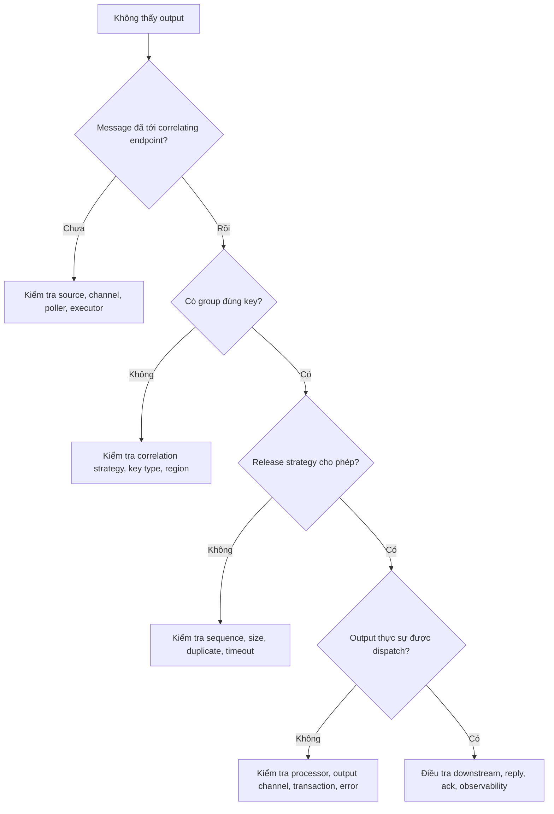
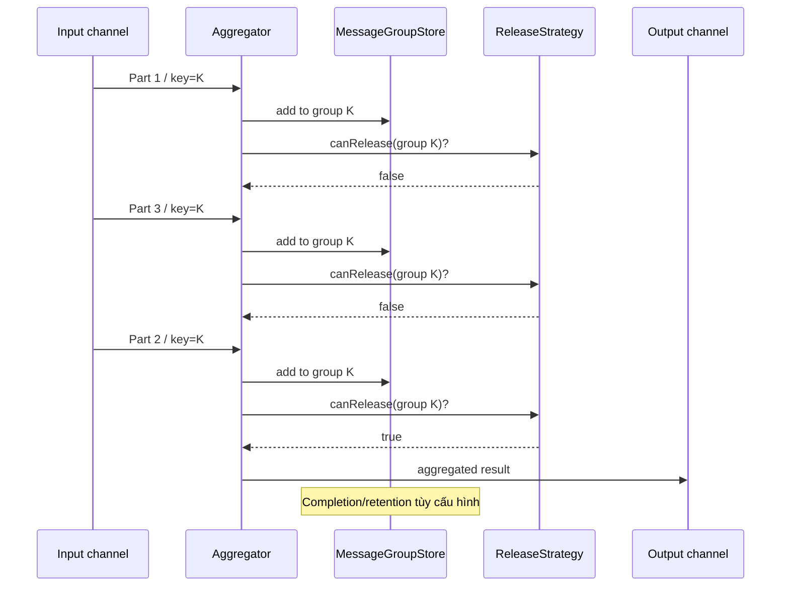
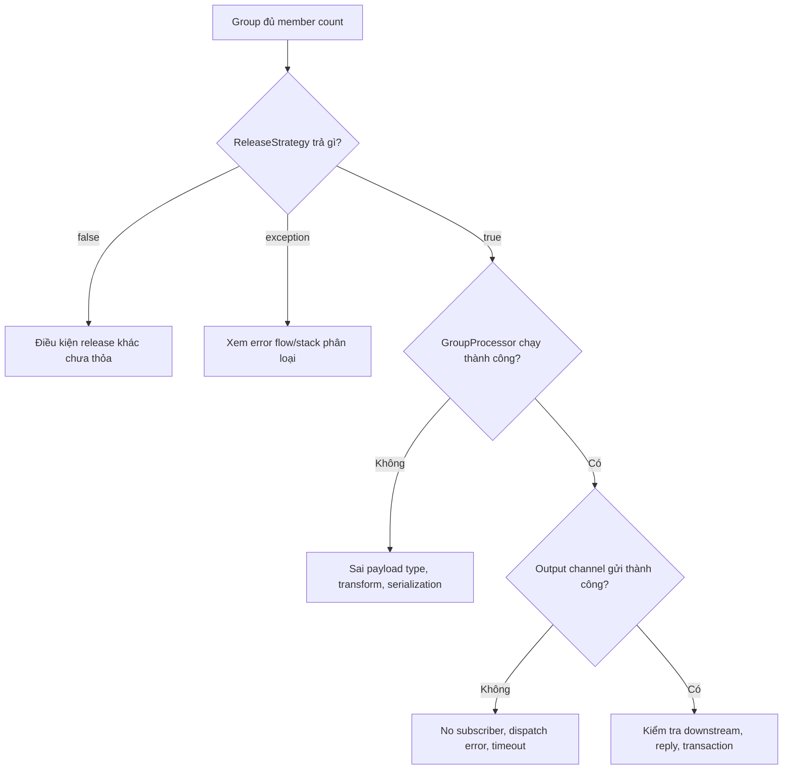
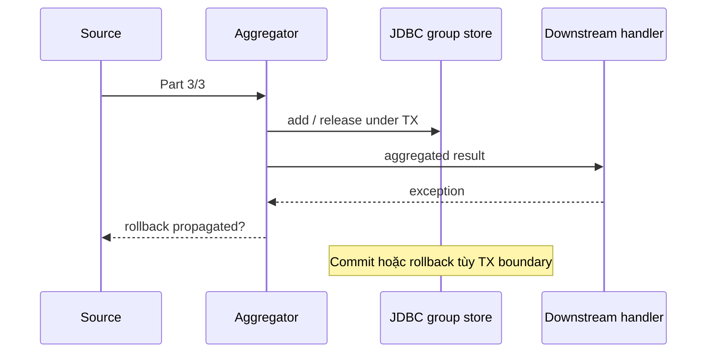
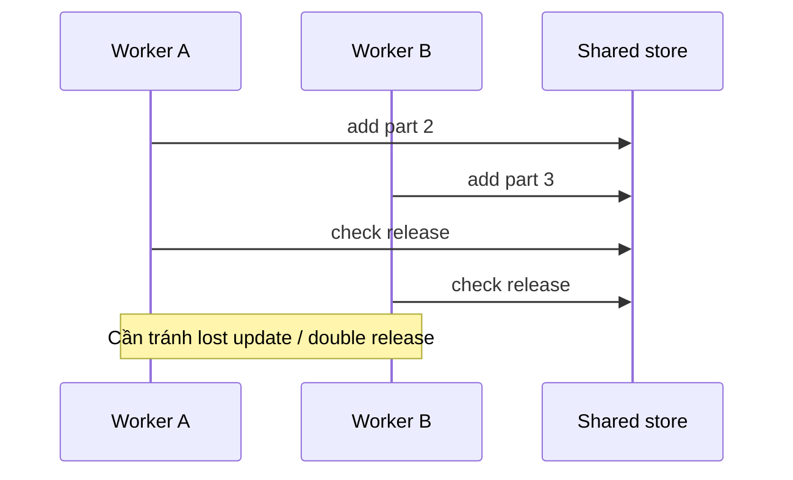
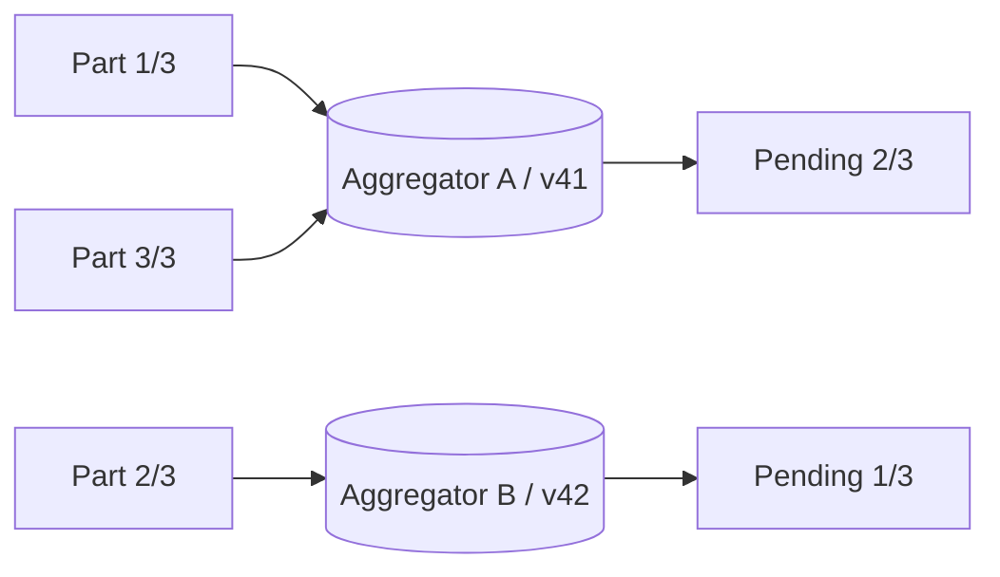

# Kiểm tra correlation group không được release

Trong **Spring Integration runtime**, một message có thể đi qua nhiều channel, poller, executor và endpoint trước khi được gom thành kết quả. Với **aggregator** hoặc **resequencer**, các message cùng một correlation key được đặt vào một `MessageGroup`, rồi một `ReleaseStrategy` quyết định có được phát kết quả hay chưa. Khi downstream không thấy output, nguyên nhân có thể là group đang chờ hợp lệ, nhưng cũng có thể là **correlation key sai, sequence headers thiếu, message không tới endpoint, store còn state cũ, timeout bị hiểu sai hoặc output đã phát nhưng thất bại phía sau**.

Bài thuộc chương **Debugging** của module `SPRING_INTEGRATION_RUNTIME`. Trọng tâm là một quy trình thực hành để kiểm tra **“correlation group không được release”**, dựa trên bằng chứng từ đường đi source → channel → consumer/poller → correlating endpoint → message group store → release strategy → output. Nội dung cũng xét transaction, retry/redelivery, locking, threading, message store bền vững, error flow, observability và các tình huống restart hoặc thay đổi topology.

> **Nguyên tắc đầu tiên:** “không thấy output” chưa chứng minh “group chưa release”. Phải xác định chính xác message đang kẹt ở **đâu** và thao tác nào **chưa xảy ra**.

## 1. Hiểu đúng triệu chứng trước khi sửa cấu hình

Giả sử một batch `ORDER-42` được chia thành ba phần:

| Phần | `correlationId` | `sequenceNumber` | `sequenceSize` |
| --- | --- | --- | --- |
| `line-A` | `ORDER-42` | 1 | 3 |
| `line-B` | `ORDER-42` | 2 | 3 |
| `line-C` | `ORDER-42` | 3 | 3 |

Nếu mọi thành viên đến đúng endpoint, cùng key và group đủ điều kiện theo release strategy, aggregator có thể tạo một message kết quả. Nhưng khi handler sau aggregator không chạy, ít nhất năm khả năng cần phân biệt:

1. `line-B` **chưa bao giờ đến** correlating endpoint.
2. `line-B` đến nhưng mang **key khác** và bị đưa vào group khác.
3. Group đã có đủ message nhưng **release strategy trả `false`** vì điều kiện khác chưa đạt.
4. Group đã được release nhưng **processor/output channel/handler sau đó lỗi**.
5. Nhóm đã từng hoàn tất, message mới bị áp dụng **completed-group/late-arrival policy** nên không tạo kết quả mới.



**Không tăng `groupTimeout` hoặc xóa group ngay từ đầu.** Nếu nguyên nhân là key sai hoặc output channel không có subscriber, tăng timeout chỉ kéo dài sự cố; xóa group có thể khiến dữ liệu đã nhận bị mất hoặc được xử lý lại.

## 2. Cấu trúc group và lifecycle liên quan

Trong các endpoint correlating, một `CorrelationStrategy` tính **group key** cho message, một `MessageGroupStore` giữ state, còn `ReleaseStrategy` quyết định khi nào endpoint được phép phát.



Một group cần được xem qua các thuộc tính:

| Thuộc tính | Cần trả lời gì? |
| --- | --- |
| `groupId` | Có đúng khóa của batch nghiệp vụ không? |
| `size` | Có bao nhiêu message đã được store chấp nhận? |
| Danh sách thành viên | Có đúng các business member/sequence mong đợi không? |
| `sequenceNumber` / `sequenceSize` | Có thiếu, trùng, sai kiểu hay mâu thuẫn không? |
| Created / last modified | Nhóm chờ bao lâu, đã có message mới gần đây không? |
| Completed/expired metadata | Group còn chờ, đã release hay đã kết thúc theo policy? |
| Store/region | Endpoint thực tế đọc đúng nơi mình đang kiểm tra không? |
| Release/expiry policy | Điều kiện nào cho phép hoàn tất hoặc dọn nhóm? |

Không dùng một dấu hiệu duy nhất như “size = 3” để kết luận chắc chắn release đúng; còn phải xét **release strategy**, chất lượng thành viên và chính sách duplicate.

## 3. Phân biệt aggregator, resequencer và barrier

Ba cơ chế này đều liên quan đến correlation nhưng không có cùng hành vi:

| Thành phần | Mục tiêu | “Không release” có thể là gì? |
| --- | --- | --- |
| **Aggregator** | Gom nhiều message thành một kết quả | Chưa đủ thành viên hoặc custom release condition chưa đạt |
| **Resequencer** | Sắp lại thứ tự trong từng chuỗi và phát từng message | Thiếu sequence trước đó, dữ liệu sequence sai hoặc release policy chưa cho phép |
| **Barrier** | Chờ trigger cùng correlation key | Trigger chưa đến/sai key hoặc đợi timeout; không phải phép đếm thành viên của aggregator |

Ở bài này, **group release** chủ yếu chỉ aggregator/resequencer dựa trên `MessageGroupStore`. Nếu endpoint thực tế là `BarrierMessageHandler`, hãy kiểm tra message chờ, trigger key, timeout và thread đang block; **đừng áp dụng quy tắc `sequenceSize` của aggregator cho barrier**.

Đối với resequencer, có thể có chính sách phát **một dải sequence liên tục** khi đủ điều kiện, thay vì phải đợi toàn bộ nhóm rồi phát một kết quả. Test và log phải đối chiếu đúng loại endpoint.

## 4. Runbook 5 phút: thu thập bằng chứng tối thiểu

Trước khi thay code hoặc metadata, ghi lại bối cảnh của **một batch cụ thể**:

1. **Business key và correlation key** (dùng token/HMAC ở log nếu giá trị nhạy cảm).
2. **Flow/endpoint ID**, version triển khai, instance/pod đang xử lý.
3. **Expected member count** và các sequence đã quan sát.
4. **Source delivery/handler attempt**: message có được giao lại hay retry không?
5. **Store implementation và namespace/region**.
6. **Group size, age, completion flag** tại thời điểm sự cố.
7. **Release strategy** đang chạy (default hay custom).
8. **Output/error channel** và transaction/ack boundary.

Một record chẩn đoán an toàn có thể trông như sau:

```json
{
  "event": "correlation_group_inspected",
  "flow": "orders-v42",
  "endpoint": "orderAggregator",
  "group_key_ref": "hmac:abc123example",
  "store_type": "JdbcMessageStore",
  "member_count": 2,
  "expected_count": 3,
  "observed_sequence_numbers": [1, 3],
  "completed": false,
  "group_age_ms": 12500,
  "last_message_age_ms": 8500,
  "release_decision": "WAITING_FOR_MEMBER",
  "instance": "worker-2"
}
```

Các giá trị là minh họa, **không phải metric mặc định** của Spring Integration. Phải instrument hoặc truy xuất bằng API thích hợp để lấy dữ liệu đó. Không dump payload/header đầy đủ vào log production để tìm key.

## 5. Điểm kiểm tra thứ nhất: message có đến endpoint không?

Một giả thuyết thường bị bỏ qua là message bị kẹt **trước** aggregator:

```text
Source
  -> inbound adapter
  -> filter/router
  -> QueueChannel
  -> poller
  -> ExecutorChannel
  -> aggregator
  -> output
```

| Vị trí | Bằng chứng nên tìm | Nguyên nhân điển hình |
| --- | --- | --- |
| Source/broker | Delivery, offset, unacked/prefetch, file selected | Chưa đọc, lỗi adapter, filter bỏ qua |
| Router/filter | Route decision, discard count | Sai điều kiện hoặc key |
| `DirectChannel` | Có subscriber và send exception không? | Endpoint chưa start, unsubscribed |
| `QueueChannel` | Depth, receive count, poller status | Poller dừng, thiếu thread, backlog |
| `ExecutorChannel` | Queue executor, rejection, active worker | Pool bão hòa, task chưa chạy |
| Correlating endpoint input | Counter số message thật sự tới endpoint | Message dừng ở bước trước |

**Một lời gọi `send()` thành công ở channel trước không luôn đồng nghĩa aggregator đã nhận message.** Với `ExecutorChannel`, message có thể chỉ vừa được enqueue. Với `QueueChannel`, poller vẫn cần lấy ra.

### 5.1. Vẽ timeline một message

```text
10:00:00.100  source_received          M2
10:00:00.105  router_selected          aggregateOrders
10:00:00.107  queue_enqueued           M2
10:00:15.220  poller_received          M2
10:00:15.224  aggregator_input_seen    M2
```

Nếu đợi output trong 3 giây nhưng queue mất 15 giây để được poll, đó là **poller lag**, không phải lỗi group release. Đo timestamp thực ở từng boundary trước khi chỉnh `ReleaseStrategy`.

## 6. Điểm kiểm tra thứ hai: correlation key có khớp tuyệt đối?

Một group được xác định bởi **giá trị khóa mà correlation strategy trả về**, không nhất thiết bằng thứ bạn nhìn thấy trong dashboard.

```text
Message A: correlationId = "ORDER-42"  (String)
Message B: correlationId = "ORDER-42 " (String có space)
Message C: correlationId = 42          (Integer)
```

Ba message này **không mặc nhiên nằm cùng một group**. So sánh thường phụ thuộc equality/type của key. Những lỗi hay xảy ra:

- Producer dùng `orderId` cho một message và `batchId` cho message khác.
- Một serializer chuyển số thành chuỗi hoặc ngược lại.
- Key được chuẩn hóa viết hoa/thường không nhất quán.
- Một branch transform làm mất header `correlationId`.
- Dùng `MessageHeaders.ID` của từng message làm group key.
- Một lần retry dựng message mới nhưng tạo correlation key khác.
- Nhiều tenant có cùng order ID nhưng không namespace.
- Flow cũ và mới dùng vùng store khác nhau hoặc reuse cùng group ID không tương thích.

### 6.1. So sánh giá trị và kiểu key

Trong môi trường test hoặc qua instrumentation an toàn, cần in **kiểu** và một bản tham chiếu của key, không in raw business ID nếu nhạy cảm:

```java
Object key = message.getHeaders().get("correlationId");

String type = key == null
        ? "missing" : key.getClass().getSimpleName();

log.debug("correlation_key_type={} correlation_key_present={}",
        type, key != null);
```

Ví dụ chỉ kiểm tra kiểu và sự hiện diện. Khi cần đối chiếu cùng nhóm, thêm token HMAC được tính từ **giá trị chuẩn hóa theo hợp đồng và namespace**, không sử dụng hash yếu cho email hoặc số điện thoại.

**Quan trọng:** nếu dùng `.aggregate(spec -> spec.correlationStrategy(...))`, header `correlationId` có thể **không phải** key thực sự. Hãy đọc chiến lược được cấu hình tại chính endpoint, rồi test giá trị nó trả về.

## 7. Không có correlation header hoặc key sai kiểu

Một số flow `split → aggregate` để framework tạo correlation/sequence headers. Nhưng khi message được gửi độc lập từ HTTP, JMS, Kafka, file adapter hoặc custom producer, không nên mặc định headers đó luôn có mặt.

Một validation boundary có thể kiểm tra:

```java
import org.springframework.messaging.Message;

void validateSequenceHeaders(Message<?> message) {
    Object correlation = message.getHeaders().get("correlationId");
    Object number = message.getHeaders().get("sequenceNumber");
    Object size = message.getHeaders().get("sequenceSize");

    if (!(correlation instanceof String key) || key.isBlank()) {
        throw new IllegalArgumentException("Missing correlation key");
    }
    if (!(number instanceof Integer n) || n < 1) {
        throw new IllegalArgumentException("Invalid sequenceNumber");
    }
    if (!(size instanceof Integer expected) || expected < 1 || n > expected) {
        throw new IllegalArgumentException("Invalid sequenceSize");
    }
}
```

Đây là **ví dụ contract của một flow yêu cầu `String` và `Integer`**, không phải quy tắc rằng Spring Integration chỉ hỗ trợ một loại key. Nếu hệ thống chủ động dùng UUID hoặc khóa số, thay validation bằng kiểu được duyệt.

Không nên tự gán cùng một key mặc định cho mọi message thiếu correlation: việc đó có thể **trộn toàn bộ các batch không liên quan** vào một group. Lỗi validation cần đi vào error/recovery policy minh bạch.

## 8. Điểm kiểm tra thứ ba: sequenceNumber và sequenceSize

Với aggregator dùng release theo sequence size, các header sau có ảnh hưởng trực tiếp:

- `sequenceNumber`: vị trí của message trong chuỗi, thường bắt đầu từ 1.
- `sequenceSize`: tổng số thành viên mong đợi.
- `correlationId`: nhóm chứa các message thuộc cùng một batch.

Các sai khác cần test:

| Trường hợp | Ví dụ | Hệ quả có thể có |
| --- | --- | --- |
| Thiếu size | Message 2 không có `sequenceSize` | Default strategy có thể không xác định đủ số phần |
| Sai size lớn hơn | Ba phần thật nhưng `sequenceSize=4` | Group chờ thành viên thứ tư không tồn tại |
| Sai size nhỏ hơn | Batch có bốn phần nhưng `sequenceSize=3` | Nguy cơ release khi chưa đủ nghiệp vụ |
| Mâu thuẫn size | Một số phần ghi 3, phần khác ghi 4 | Release behavior không đáng tin, cần validation |
| Trùng sequence | Hai message đều mang `sequenceNumber=2` | Đếm group chưa chứng minh có đủ phần |
| Sequence nhảy số | Nhận 1, 2, 4 của chuỗi 4 | Thiếu phần 3; resequencer có thể chờ |
| Dùng zero-based | 0, 1, 2 | Không khớp hợp đồng sequence thông thường |

**Phân biệt “đủ số lượng” với “đủ đúng các phần”.** Một custom release strategy chỉ kiểm tra `group.size() >= expected` có thể bị đánh lừa bởi duplicate có message ID mới. Nếu business yêu cầu đủ vị trí 1..N duy nhất, cần validation/member idempotency tương ứng.

### 8.1. Bộ thông tin sequence tối thiểu

```text
group:             ORDER-42
expected sequence: [1, 2, 3]
observed sequence: [1, 3]
missing:           [2]
duplicate:         []
release:           WAIT
```

Tập observed được suy ra từ **message đã tồn tại trong store**, không chỉ từ các log producer đã “gửi”. Một message có log ở producer nhưng bị lỗi trước endpoint vẫn không nằm trong group.

## 9. Điểm kiểm tra thứ tư: ReleaseStrategy thật sự quyết định gì?

`ReleaseStrategy` là nơi trả lời câu hỏi “nhóm đã đủ điều kiện để endpoint phát chưa?”. Trong Spring Integration có các strategy dựa trên sequence headers cũng như custom strategy theo nghiệp vụ.

Ví dụ custom policy đơn giản:

```java
// Fragment Java DSL, nằm trong định nghĩa IntegrationFlow.
.aggregate(spec -> spec
        .correlationStrategy(m -> m.getHeaders().get("batchId"))
        .releaseStrategy(group -> group.size() >= 3))
```

Đoạn trên **không** phải cấu hình universal hay một strategy chống duplicate. Nó có nghĩa: nếu group chứa từ ba message trở lên, condition về kích thước là đúng. Nó không kiểm tra ba business members duy nhất, dấu kết thúc batch hay thành công của thao tác upstream.

Một policy theo nghiệp vụ có thể còn cần:

- `expectedCount` đã được xác nhận từ metadata riêng.
- Không có sequence trùng hoặc bị bỏ qua.
- Một “end-of-batch marker” đã tới.
- Kết quả validation của từng phần hợp lệ.
- Hết thời gian chờ và được phép phát partial result.

### 9.1. Kiểm tra custom strategy có ném exception không

Nếu custom strategy truy cập payload bằng kiểu không đúng hoặc phụ thuộc API bên ngoài, nó có thể ném exception thay vì trả `false`. Lỗi đó thường hiện ở exception/error flow, không phải là “chờ thêm message”.

Không nên đặt I/O remote/blocking nặng trong `ReleaseStrategy` nếu nó được gọi nhiều lần trong critical section của group. Việc này có thể khiến lock bị giữ lâu, tăng contention và làm chậm các message khác.

### 9.2. Thực hành: tách strategy để unit test

```java
import org.springframework.integration.store.MessageGroup;

final class GroupReleaseRules {
    boolean hasAtLeastThree(MessageGroup group) {
        return group.size() >= 3;
    }
}
```

Việc tách rule giúp test từng trường hợp size=0, 1, 2, 3, duplicate và metadata bất hợp lệ mà không cần khởi động full Spring context. Nhưng test rule riêng chưa chứng minh endpoint có **thực sự dùng instance strategy đó**; cần một integration test cấu hình cuối cùng.

## 10. Điểm kiểm tra thứ năm: MessageGroupStore thật sự có gì?

Một `MessageGroupStore` lưu các nhóm trong bộ nhớ hoặc backend bên ngoài. Một số implementation thường dùng:

| Implementation | Môi trường | Rủi ro khi debug |
| --- | --- | --- |
| `SimpleMessageStore` | Trong RAM, dễ test | State mất khi restart; mỗi JVM giữ nhóm riêng |
| `JdbcMessageStore` | JDBC database | Kiểm tra schema, region, transaction, serializer, lock contention |
| Distributed/persistent store khác | Nhiều instance | Consistency, serialization, partition và lifecycle theo backend |
| `JdbcChannelMessageStore` | Backing store cho queue channel | **Không đồng nhất** với MessageGroupStore của aggregator |

Cần biết **bean instance thực sự được endpoint dùng**. Có trường hợp ứng dụng tạo `JdbcMessageStore` nhưng aggregator chưa được cấu hình dùng bean đó, nên state đang nằm trong store mặc định ở RAM.

### 10.1. Đọc group bằng API thay vì đoán schema

Đoạn Java sau minh họa inspector **chỉ đọc** bằng `MessageGroupStore`:

```java
import org.springframework.integration.store.MessageGroup;
import org.springframework.integration.store.MessageGroupStore;

public final class GroupInspector {
    private final MessageGroupStore store;

    public GroupInspector(MessageGroupStore store) {
        this.store = store;
    }

    public GroupSnapshot inspect(Object groupId) {
        MessageGroup group = store.getMessageGroup(groupId);
        return new GroupSnapshot(
                group.getGroupId(),
                group.size(),
                group.isComplete());
    }

    public record GroupSnapshot(
            Object groupId, int memberCount, boolean completed) {}
}
```

Dùng object `groupId` có type **khớp correlation strategy**; ví dụ dùng `"42"` thay vì số nguyên `42` có thể trả về group khác. Trong công cụ debug production, không in raw `groupId` nếu nó chứa dữ liệu nhạy cảm; áp dụng pseudonymization ở tầng xuất log/UI.

Lưu ý API trả về group trống/không tồn tại và metadata completion có thể được triển khai khác nhau theo store/version. Một kết quả `size=0` **chưa đủ để kết luận từng tồn tại group rồi bị mất**, hãy kiểm tra completion status và lifecycle.

### 10.2. Nếu store trả size=2, phải tiếp tục hỏi

- Hai message đó có `sequenceNumber` nào?
- Còn phần nào đang ở queue/poller upstream?
- Group có được update gần đây không?
- Có duplicate bị từ chối theo message ID?
- Có message đến sai key rơi vào group khác?
- Có phiên bản flow khác đang dùng store/region riêng?

**Không sửa trực tiếp bảng store để “bổ sung” message thiếu.** Nếu backend lưu serialized message và metadata của endpoint, một row thêm thủ công có thể phá invariant hoặc khiến transaction lỗi.

## 11. Quan sát group state mà không làm biến đổi dữ liệu

Một số API quản trị có thể có side effect; ví dụ expire/remove/force-complete không phải thao tác đọc thuần túy. Khi incident đang diễn ra:

1. Ưu tiên **read-only inspector** trên `MessageGroupStore` đúng bean.
2. Ghi snapshot group ID token, size, sequence set, age, completion state.
3. Chụp thêm snapshot upstream queue depth và handler error count.
4. Tránh gọi method mutate như `removeMessageGroup` hoặc `expireMessageGroups` chỉ để thử.
5. Nếu phải can thiệp, ghi change request, kiểm tra transaction/idempotency và chuẩn bị recovery plan.

Với JDBC, có thể inspect database bằng truy vấn `SELECT` và quyền đọc giới hạn, nhưng **schema vật lý của Spring Integration thay đổi theo phiên bản/database**. Không lấy một câu SQL giả định về bảng `INT_MESSAGE_GROUP` rồi chạy trực tiếp vào production mà chưa xác minh schema đúng của phiên bản triển khai.

## 12. Vì sao group size đủ mà vẫn không có output?

Đây là nhánh quan trọng nhất sau khi xác nhận group tồn tại:



Các nguyên nhân thường gặp:

- `ReleaseStrategy` custom cần cả cờ `batchClosed` ngoài điều kiện size.
- `MessageGroupProcessor` ném exception khi tổng hợp payload.
- Output channel chưa có subscriber, endpoint đã stop hoặc flow đã bị gỡ.
- Handler downstream lỗi, transaction rollback.
- `ExecutorChannel` đã nhận output nhưng task chưa thực thi do backlog/pool saturation.
- `errorChannel` hoặc recovery callback đã xử lý exception nên caller không thấy lỗi trực tiếp.
- Một output đã phát trước đó nhưng log/debug instrumentation đặt **sau** điểm lỗi.

### 12.1. Phân biệt release decision với output delivery

Cần log/metric riêng cho:
- `group_release_decision_true`;
- `group_processor_completed`;
- `result_channel_accepted`;
- `downstream_handler_started`;
- `business_committed`;
- `source_acknowledged`.

Đây là **tên metric đề nghị do ứng dụng tự instrument**, không phải tên metric mặc định của framework. Chúng cho phép xác định một nhóm thực sự được release hay chỉ đang chờ.

## 13. Retry, rollback và transaction có thể làm state “lùi lại”

Giả sử aggregator được gọi trong một transaction, store ghi phần thứ ba rồi release strategy trả true; handler tiếp theo lỗi:



Nếu group write và handler nằm trong **cùng một transaction JDBC**, rollback có thể đưa group về state trước khi phần thứ ba được commit. Nếu source không hỗ trợ redelivery hoặc exception bị nuốt, phần thứ ba có thể **mất cơ hội được đưa lại**.

| Quan sát | Giả thuyết |
| --- | --- |
| Group size tăng rồi lại giảm | Transaction viết group bị rollback |
| Handler log đủ ba message, store chỉ có hai | Một message bị rollback hoặc đọc nhầm store/region |
| Có result trước khi source ack, sau đó duplicate | Output/ack không atomic với group completion |
| Không có exception ở producer nhưng error channel có lỗi | Async boundary, error recovery hoặc gateway semantics |
| Message thứ ba lặp vô hạn | Poison message, error strategy, nack/redelivery loop |
| DB group đã completed nhưng business result không có | Downstream lỗi sau completion, transaction/ack boundary lệch |

**Không có “transaction toàn flow” chỉ vì đặt `@Transactional` ở một handler.** Poller, channel, executor và JDBC/broker có các ranh giới riêng. Một lần chuyển thread qua `ExecutorChannel` thường không tự truyền transaction gắn với caller thread.

### 13.1. Error flow có thể che mất dấu vết lỗi

Một `ErrorMessage` có thể được gửi tới `errorChannel` khi lỗi xảy ra ở endpoint bất đồng bộ, trong khi lỗi của `DirectChannel` đồng bộ có thể propagate về sender. Nếu error handler **log rồi trả bình thường**, upstream có thể xem việc xử lý đã kết thúc theo hợp đồng nguồn, dù output nghiệp vụ chưa tồn tại.

Khi debug, ghi **exception type/error code** và outcome recovery; không dump `ErrorMessage` vì nó có thể chứa `failedMessage`, payload hoặc secret.

## 14. Timeout và expiry: chúng không có nghĩa giống release bình thường

Một group thiếu thành viên có thể bị xử lý bằng cơ chế timeout/expiry. Tùy cấu hình và loại endpoint, hệ thống có thể:
- Tiếp tục chờ.
- Expire và discard nhóm.
- Phát partial result khi chính sách cho phép.
- Chuyển dữ liệu lỗi sang recovery/quarantine.
- Giữ metadata completed để xử lý late arrival.

```text
Group ORDER-42:
  expected = 3
  received = [1, 3]
  time waiting = 60 seconds

Policy A: continue waiting
Policy B: expire -> discard / audit
Policy C: expire -> partial result with incomplete=true
Policy D: durable recovery job
```

**Tăng timeout không làm xuất hiện phần 2.** Timeout chỉ quyết định khi nào xử lý tình huống không đầy đủ. Nếu nghiệp vụ không chấp nhận partial, không nên bật `sendPartialResultOnExpiry` chỉ để dashboard thấy một output.

### 14.1. Các câu hỏi về scheduler

- Có thực sự cấu hình `groupTimeout` hoặc cơ chế `MessageGroupStoreReaper` phù hợp?
- Scheduler/poller phục vụ expiry còn chạy không?
- Timeout được tính từ thời điểm nào, có reset theo last-message không?
- Có nhiều node cùng quét expiry trên shared store không?
- Handler của expiry/partial output có lỗi không?
- Store có đang giữ completed groups và quét cleanup theo đúng region không?

Chi tiết thời điểm scheduler và chính sách expiry phụ thuộc phiên bản/implementation. Tránh viết test dựa trên `Thread.sleep(50)`; nên await một outcome có deadline.

## 15. Completed groups và late-arrival là một nhánh chẩn đoán riêng

Một message đến sau khi group đã release có thể bị xem là **late arrival**, đặc biệt nếu store giữ marker group completed. Nếu nhóm đã bị xóa, cùng key cũ có thể tạo group mới, tùy policy.

```text
T0  ORDER-42: 1/3, 2/3, 3/3 -> release
T1  source redelivers message 2/3
T2  producer gửi batch mới nhưng tái dùng key ORDER-42
```

Những câu hỏi phải trả lời:
1. Group `ORDER-42` **đã từng release** hay chưa?
2. Completed marker được giữ bao lâu và ở store/region nào?
3. Late-arriving message bị discard, lỗi hay khởi tạo nhóm mới?
4. Producer có **tái sử dụng correlation key** cho batch khác không?
5. Có dedup theo business member ID khi message có Message ID mới không?

Nếu nhiệm vụ mới vẫn liên quan order cũ, key nên thể hiện **batch/run/version** đúng phạm vi, không chỉ `orderId` chung chung. Không reset marker completed tùy tiện trong production: redelivery cũ có thể sinh output trùng.

## 16. Multi-instance: “mỗi node có hai phần” khác “một group có bốn phần”

Trong cluster, hai instance có thể dùng `SimpleMessageStore` độc lập:

```text
Node A — group ORDER-42: [1, 3]
Node B — group ORDER-42: [2]
```

Cả cluster đã nhận ba message, nhưng **không một node nào có group đủ**. Một distributed lock thêm vào hai node không tự gom được hai bản state riêng. Cần thiết kế:
- Shared `MessageGroupStore` phù hợp; hoặc
- Partition message theo correlation key để cùng một owner nhận; hoặc
- Một protocol chuyển state rõ ràng.

### 16.1. Shared store chưa đủ nếu thiếu lock/transaction semantics

Khi hai consumer cùng key ghi vào shared JDBC store, cần xác minh group coordination, transaction isolation và locking strategy phù hợp. Nếu hai worker cùng kiểm tra group sau khi add, có thể xuất hiện race ở điểm **release/complete/output** nếu hệ thống không được cấu hình đúng.



Kiểm tra group lock registry, backend lock lease, độ dài transaction và điều kiện retry nếu lỗi concurrency. **Không coi một lần test ba sender thành công là bằng chứng không thể có race**; cần stress test và inject lỗi.

## 17. Khi group bị “kẹt” vì lock, thread hoặc executor

Không phải mọi tình huống chờ đều nằm ở `ReleaseStrategy`:

| Dấu hiệu | Giả thuyết | Cách xác minh |
| --- | --- | --- |
| Thread stack đang chờ lock của group | Lock contention hoặc deadlock | Thread dump, lock wait metrics |
| Poller không thực thi | Endpoint stopped, scheduler bận, task exception | Lifecycle, poller active/schedule |
| Executor queue tăng | Worker pool bão hòa, blocking IO | Active threads, queue depth, rejection |
| Store read/write chậm | DB lock, connection pool cạn | DB wait, query latency, pool metrics |
| Group age cao nhưng last modified mới | Message tới nhưng strategy liên tục false | Sequence/member inspection |
| Không thấy group trong JVM hiện tại | Sai node/store/region hoặc message chưa đến | So sánh instance và backing store |
| Group complete nhưng output chậm | Processor hoặc downstream chặn | Trace/span và handler latency |

Một `LockRegistry` có thể giúp bảo vệ group state nhưng **không sửa sai release condition**. Tăng lock timeout chỉ làm thread chờ lâu hơn khi key sai hoặc store đã bị kẹt vì transaction dài.

### 17.1. Thread dump

Trong môi trường có quyền truy cập hợp lệ, có thể lấy thread dump bằng công cụ JVM phù hợp, ví dụ `jcmd <pid> Thread.print`. Tìm những thread chờ DB connection, `java.util.concurrent.locks`, scheduler hoặc handler đang block. Đừng chỉ quan sát CPU: hệ thống bị chờ I/O/lock có thể có CPU thấp nhưng queue vẫn tăng.

Không đưa secret, toàn bộ payload hay raw thread dump chứa thông tin nhạy cảm vào ticket công khai.

## 18. Dynamic flow: đổi topology giữa lúc group chưa hoàn tất

Ứng dụng có thể đăng ký/gỡ `IntegrationFlow` bằng `IntegrationFlowContext` ở runtime. Nếu flow A đang giữ group 2/3 và route đổi sang flow B, phần thứ ba có thể được gửi sang B, còn A không bao giờ release.



Giải pháp cần có **group ownership/version**:
- Pin message của group cũ về A tới khi hoàn tất hoặc expire.
- Quiesce/drain A trước khi gỡ.
- Migrate group state sang B theo protocol đã kiểm thử, bao gồm serializer/schema.
- Không gỡ store/region của A khi vẫn còn nhóm pending.

“Flow B đang chạy” không chứng minh group pending trên A đã được chuyển tự động. Nếu B sử dụng chung store với A nhưng release strategy khác, cũng phải kiểm tra tương thích và tránh cả hai endpoint tranh cùng group.

## 19. Java DSL: flow tối thiểu để tái hiện lỗi

Khi production quá phức tạp, nên tạo **một flow test nhỏ** có cùng correlation/release/store config và đầu vào do test kiểm soát. Ví dụ Java 17+ với Spring Integration Java DSL:

```java
import org.springframework.context.annotation.Bean;
import org.springframework.context.annotation.Configuration;
import org.springframework.integration.annotation.EnableIntegration;
import org.springframework.integration.channel.DirectChannel;
import org.springframework.integration.channel.QueueChannel;
import org.springframework.integration.dsl.IntegrationFlow;
import org.springframework.integration.store.MessageGroupStore;
import org.springframework.integration.store.SimpleMessageStore;
import org.springframework.messaging.MessageChannel;

@Configuration
@EnableIntegration
class CorrelationDebugConfig {

    @Bean
    MessageChannel orderParts() {
        return new DirectChannel();
    }

    @Bean
    QueueChannel orderResults() {
        return new QueueChannel();
    }

    @Bean
    MessageGroupStore orderGroupStore() {
        return new SimpleMessageStore();
    }

    @Bean
    IntegrationFlow orderAggregationFlow(MessageGroupStore orderGroupStore) {
        return IntegrationFlow.from("orderParts")
                .aggregate(spec -> spec.messageStore(orderGroupStore))
                .channel("orderResults")
                .get();
    }
}
```

Ví dụ cố ý dùng `SimpleMessageStore` và `DirectChannel` để tái hiện grouping **trong một JVM** mà không bị poller/executor làm nhiễu. Nó **không** chứng minh restart, broker ack hoặc JDBC transaction. Nếu production dùng custom correlation strategy hoặc release strategy, phải cấu hình **chính cùng strategy** trong reproduction; nếu không test chỉ kiểm tra hành vi mặc định.

### 19.1. Dùng MessageBuilder gửi hai phần rồi inspect

```java
import org.springframework.integration.IntegrationMessageHeaderAccessor;
import org.springframework.messaging.Message;
import org.springframework.messaging.support.MessageBuilder;

Message<String> part(String group, int sequence, int size, String value) {
    return MessageBuilder.withPayload(value)
            .setHeader(IntegrationMessageHeaderAccessor.CORRELATION_ID, group)
            .setHeader(IntegrationMessageHeaderAccessor.SEQUENCE_NUMBER, sequence)
            .setHeader(IntegrationMessageHeaderAccessor.SEQUENCE_SIZE, size)
            .build();
}

// Từ test method có bean orderParts, orderResults và orderGroupStore:
String key = "test:ORDER-42";
orderParts.send(part(key, 1, 3, "line-A"));
orderParts.send(part(key, 3, 3, "line-C"));

var group = orderGroupStore.getMessageGroup(key);
assertEquals(2, group.size());
assertNull(orderResults.receive(0));
```

Đây là **fragment trong test JUnit**: `part()` là helper method và `assertEquals`/`assertNull` là JUnit assertions; bean phải được inject trước khi dùng. Nhóm pending size=2 cùng đầu ra null là **kết quả đúng** nếu đang chờ phần thứ hai.

### 19.2. Thêm phần cuối, xác minh release

```java
orderParts.send(part(key, 2, 3, "line-B"));

var result = orderResults.receive(2_000);
assertNotNull(result);
// Cấu trúc payload kết quả phụ thuộc GroupProcessor của flow.
// Kiểm tra members/contract; đừng luôn ép kiểu một DTO cụ thể.
assertNull(orderResults.receive(0));
```

Nếu output không xuất hiện, kiểm tra group sau input thứ ba và exception/error channel. Đừng vội sửa `SimpleMessageStore`; có thể source không thực sự gửi đủ phần hoặc strategy không được cấu hình như mong đợi.

## 20. Custom release strategy: tái hiện “size đủ nhưng condition false”

Một tình huống sát thực tế là release strategy yêu cầu cờ `batchClosed` ngoài số message:

```java
// Fragment minh họa strategy trong bean riêng.
boolean canRelease(MessageGroup group) {
    boolean enoughMessages = group.size() >= 3;
    boolean closed = group.getMessages().stream()
            .anyMatch(m -> Boolean.TRUE.equals(
                    m.getHeaders().get("batchClosed")));
    return enoughMessages && closed;
}
```

Nếu gửi ba phần nhưng **không message nào chứa `batchClosed=true`**, size=3 mà `canRelease` vẫn false. Đó là hành vi đúng theo policy, không phải bug của store.

Kiểm thử phải có ít nhất:
- 2 phần, chưa closed → false.
- 3 phần, chưa closed → false.
- 3 phần, có closed marker → true.
- Duplicate đủ count nhưng thiếu business members → không được coi complete nếu nghiệp vụ yêu cầu đủ thành viên khác nhau.

Với production, tránh log nguyên group trong `canRelease`. Ghi `group size` và các cờ điều kiện dạng enum/boolean đã duyệt.

## 21. Unit test release strategy trước integration test

Khi có custom rule, tách logic để test thuần Java:

```text
Case 1: size=2, expected=3       -> WAIT
Case 2: size=3, expected=3       -> RELEASE
Case 3: size=3, has duplicate    -> WAIT nếu policy yêu cầu 3 unique members
Case 4: size=4, conflicting size -> VALIDATION_ERROR
Case 5: closed=true, size=2      -> WAIT nếu không cho partial
```

Test strategy riêng giúp biết nguyên nhân nằm ở **điều kiện**, nhưng chưa chứng minh endpoint đã gắn đúng bean. Integration test phải xác nhận:

1. Message vào đúng group.
2. Strategy được gọi theo kịch bản test.
3. Strategy trả decision mong đợi.
4. Output được tạo và dispatch.
5. Group completion/cleanup đúng policy.

Không dùng một lần `System.out.println()` trong strategy để kết luận có hoặc không có invocation trong môi trường nhiều thread; dùng counter/test spy hoặc structured metrics.

## 22. Kiểm thử timeout và late arrival có kiểm soát

Đối với group thiếu một phần, cần một test với scheduler/timeout thực, không chỉ `Thread.sleep` ngẫu nhiên.

```java
import static org.awaitility.Awaitility.await;
import java.time.Duration;

// Fragment trong integration test với helper outcomeOf(...).
await().atMost(Duration.ofSeconds(5))
        .until(() -> outcomeOf("ORDER-42")
                .equals("EXPIRED_OR_RECOVERED"));
```

`outcomeOf` là helper do test cung cấp, không phải API sẵn của Spring Integration. Điều cần assert không phải chỉ là thời gian đã trôi, mà là **outcome đúng policy**:
- Group được giữ nếu đó là yêu cầu.
- Expired group được discard có audit.
- Partial result có cờ incomplete nếu cho phép.
- Recovery record được lưu bền vững.
- Message đến muộn không làm nhân đôi business effect.

Virtual time của Reactor không tự điều khiển scheduler expiry của Spring Integration nếu không dùng cùng clock/scheduler. Hãy kiểm tra phiên bản và cấu hình cụ thể.

## 23. JDBC backend: debug state bền vững và transaction

Khi dùng `JdbcMessageStore`, nên kiểm tra theo thứ tự:

1. Bean `JdbcMessageStore` nào đang được aggregator dùng?
2. Region/namespace có khớp sau deploy hoặc trên các node không?
3. Schema JDBC đã được khởi tạo đúng phiên bản Spring Integration chưa?
4. Group write đã **commit** hay còn nằm trong transaction chưa hoàn tất?
5. Serializer có đọc được payload/header cũ không?
6. DB connection pool và group lock có đang chờ/timeout không?
7. Sau restart, app mới đọc đúng group cũ hay tạo group mới?

```text
Context A:
  add ORDER-42 parts 1 and 3
  commit group state
  close context

Context B:
  open with same DB + compatible store region
  read group ORDER-42 -> size=2
  add part 2
  release result
```

Một **`JdbcChannelMessageStore`** dùng cho queue-backed channel có contract receive riêng; không đổi tên nó thành `JdbcMessageStore` trong suy luận chỉ vì cả hai đều JDBC. Một bên có thể quyết định **message còn ở queue sau rollback**, một bên quyết định **thành viên có nằm trong correlation group**.

### 23.1. Không tự ý sửa bảng store để force release

Một bảng message store có thể lưu serialized message, group membership, group metadata và row locks. Một câu lệnh `DELETE` hoặc `UPDATE` thủ công vào bảng có thể:
- Xóa mất dữ liệu chưa xử lý.
- Phá relation giữa group và message.
- Kích hoạt redelivery trùng.
- Làm các node thấy state không nhất quán.
- Khiến bug biến mất tạm thời nhưng tái phát sau restart.

Nếu cần replay, hãy xây **runbook recovery riêng** có bản sao state, business idempotency và quyền kiểm soát thay đổi. Cách tốt nhất là sửa nguyên nhân gốc rồi đưa message bị thiếu trở lại qua **nguồn có kiểm soát**, không can thiệp trực tiếp serialized store.

## 24. Logging và observability tối thiểu để debug

Trong production, nên tránh `log.info("group={}", group)` vì có thể chứa payload/header của toàn bộ thành viên. Thay bằng bản quan sát an toàn:

```json
{
  "event": "group_release_checked",
  "endpoint": "orderAggregator",
  "group_key_ref": "hmac:abc123example",
  "member_count": 2,
  "expected_count": 3,
  "missing_sequences": [2],
  "release_policy": "SEQUENCE_SIZE",
  "decision": "WAIT",
  "flow_version": "orders-v42",
  "trace_id": "opaque-trace-123"
}
```

Những metric đáng có:
- Input count ở correlating endpoint.
- Pending/complete/expired group count theo endpoint.
- Group size và group age histogram.
- Release success/failure count.
- Timeout/discard/partial count.
- Message store read/write latency.
- Group lock wait duration.
- Poller lag, queue depth, executor saturation.
- Retry attempt, redelivery và business commit count.

Đây là **tập tín hiệu đề xuất**, không phải cam kết rằng mọi metric đã có sẵn. Tránh gắn raw correlation key làm metric label: một key trên mỗi đơn hàng có thể gây cardinality rất lớn và rò dữ liệu. Ghi ID chi tiết an toàn vào log/trace khi cần, metrics aggregate theo endpoint/outcome.

## 25. Decision table: từ dấu hiệu đến hành động

| Dấu hiệu | Nguyên nhân có khả năng | Kiểm tra tiếp | Không nên làm |
| --- | --- | --- | --- |
| Không có group nào | Message chưa đến, sai key, sai store | Input count, router, bean store | Tăng timeout |
| Một group size=1 cho mỗi part | Key thay đổi từng message | Correlation strategy, key type | Force release từng group |
| Group size=2, expected=3 | Thiếu phần thật | Source/queue/delivery part còn thiếu | Bật partial vô điều kiện |
| Group size=3, không release | Custom strategy false hoặc lỗi | Decision/exception của strategy | Xóa store |
| Group đã completed | Late arrival/completion marker | Release history, retention | Reuse key bừa bãi |
| Group tăng rồi giảm sau lỗi | Rollback group write | TX manager, exception path | Coi mỗi save là committed |
| Release=true, không output | Processor/output/downstream lỗi | Error channel, subscriber, handler | Chỉ chỉnh correlationId |
| Một node có 2/3, node khác 1/3 | In-memory state phân tán | Shared store/partition ownership | Thêm local lock |
| Group age cao, thread chờ lock | DB/lock contention | Thread dump, lock waits | Tăng global lock vô hạn |
| Có kết quả nhưng client timeout | Reply channel/gateway/callback lỗi | Correlation reply và async boundary | Nhân đôi aggregate |
| Lỗi chỉ sau deploy phiên bản mới | Store region/serializer/correlation changed | Compare config/version | Xóa completed groups hàng loạt |

## 26. Runbook production từng bước

### Giai đoạn A — Khoanh vùng

1. Chọn **một correlation key** đại diện; xác nhận phạm vi tenant/batch/version.
2. Thu thập timestamps và trace IDs an toàn của tất cả phần.
3. Xác nhận tất cả phần đã đến **endpoint input**, không chỉ đến broker.
4. Ghi cấu hình release/correlation strategy thực tế.

### Giai đoạn B — Kiểm tra group state

5. Inspect **đúng `MessageGroupStore` bean/region** của endpoint.
6. Ghi size, sequence set, expected size, completion/age.
7. So sánh message IDs và **business member IDs** để phát hiện duplicate.
8. Kiểm tra late-arrival/completed/expiry/timeout policies.

### Giai đoạn C — Điểm release và output

9. Quan sát release strategy trả false, true hay exception.
10. Nếu true, kiểm tra group processor và output dispatch.
11. Kiểm tra error/recovery flow, transaction commit/rollback, source ack.
12. Với async channel, đo queue backlog và handler in-flight.

### Giai đoạn D — Khắc phục an toàn

13. Nếu thiếu part, khôi phục **đúng message** từ source/recovery bền vững.
14. Nếu key/sequence sai, sửa producer/transform, đánh giá dữ liệu đã vào store.
15. Nếu strategy sai, sửa policy và thêm regression test trước rollout.
16. Nếu state cũ không tương thích sau deploy, chọn pin/migrate/expire có audit.
17. Không xóa group/force complete khi chưa xác minh business idempotency.
18. Chạy lại test duplicate, restart, concurrency và timeout; theo dõi metrics sau deploy.

**Một group được release bằng thao tác cưỡng bức chưa chứng minh dữ liệu đủ hay kết quả đúng.** Force-completion chỉ là lựa chọn vận hành khi có policy nghiệp vụ chấp nhận partial và có audit/đối soát rõ.

## 27. Ma trận kiểm thử regression

| Test | Dữ liệu đầu vào | State cần assert | Kết quả |
| --- | --- | --- | --- |
| Happy path | 1, 2, 3 cùng key, size=3 | Pending→complete | Một output đúng |
| Out-of-order | 3, 1, 2 | Group đúng members | Aggregator hoàn tất |
| Missing member | 1, 3 | Size=2, missing=2 | Không complete result |
| Wrong key | Part 2 có key khác | Hai group riêng | Không trộn |
| Wrong type | `"42"` và `42` | Hai group theo equality | Validation error |
| Missing header | Thiếu `sequenceSize` | Error/conditional wait theo policy | Không silently corrupt |
| Conflicting size | 3 và 4 cùng group | Validation/strategy rõ | Không complete sai |
| Duplicate | 1, 2, 2, 3 | Business member dedup | Không double effect |
| Release strategy false | Đủ count, thiếu marker | Group vẫn pending | Không output |
| Strategy exception | Payload/header sai kiểu | Error path rõ | Recovery hoặc rollback |
| Expiry | Chỉ 2/3 quá hạn | Expired/partial/discard | Theo policy |
| Late arrival | Extra part sau complete | Completed marker/retention | Không nhân đôi |
| Two groups | A/B xen kẽ | Tách state | Hai kết quả đúng |
| JDBC restart | Lưu 2/3, restart, gửi phần 3 | Pending bền vững | Release được |
| Transaction rollback | Exception trước commit | Save rollback theo boundary | Redelivery nếu source hỗ trợ |
| Multi-node | Parts chia giữa hai instance | Shared store/owner đúng | Không kẹt |
| Executor saturation | Queue task tồn | Input arrival delay | Không đổ lỗi nhầm strategy |
| Dynamic cutover | A pending, B active | Group ownership rõ | Pin/migrate/recover đúng |

Khi dùng test `@Transactional`, nhớ rằng Spring Test có thể rollback transaction khi test kết thúc. Test restart phải bảo đảm **A đã commit state**, rồi context B sử dụng một connection/context mới với cùng database. Một test chỉ gọi bean store mới trong cùng context chưa chứng minh hoàn toàn recovery qua restart.

## 28. Bài thực hành

### Bài 1 — Ba phần nhưng chỉ có hai ở group

Tạo flow aggregator với `SimpleMessageStore`. Gửi ba message ở producer, cố tình router bỏ phần thứ hai. Chụp logs từng boundary và store state, chỉ ra vì sao “producer đã gửi ba” không đồng nghĩa “aggregator đã thấy ba”.

### Bài 2 — Correlation key sai kiểu

Gửi phần 1/3 với `correlationId="42"` (String), phần 2/3 với `correlationId=42` (Integer), phần 3/3 với String. Inspect từng group, thêm validation để từ chối input sai contract.

### Bài 3 — SequenceSize lớn hơn thực tế

Cho ba message có size=4. Xác định group vẫn chờ; gửi phần bốn thật hoặc xử lý theo timeout/expiry chính sách. Không tự force complete rồi coi input đúng.

### Bài 4 — Custom release strategy cần marker

Định nghĩa strategy `group.size()>=3 && hasBatchClosed`. Gửi đủ ba phần nhưng không có marker, xác minh false. Sau đó gửi marker theo contract, kiểm tra kết quả và state after completion.

### Bài 5 — Duplicate với Message ID mới

Gửi `part-2` hai lần dưới hai message IDs nhưng cùng business part ID. Chứng minh size không phải bằng chứng đủ các vị trí. Thiết kế dedup theo thành viên hoặc validation trước aggregator.

### Bài 6 — Lỗi sau khi release

Kết nối aggregator với handler cố tình ném exception. Ghi release decision, group completion, output send, transaction rollback và error channel. Giải thích tại sao client không thấy output dù release strategy đã true.

### Bài 7 — Timeout, expiry và partial result

Cho group chỉ nhận 1/3 và 3/3. Cấu hình expiry, chọn discard hoặc partial theo yêu cầu nghiệp vụ. Dùng Awaitility với deadline, assert outcome thay vì chỉ sleep một khoảng cố định.

### Bài 8 — Persistent group qua restart

Dùng `JdbcMessageStore` với PostgreSQL/Testcontainers, ghi group 2/3 rồi commit và đóng context A. Mở context B với cùng store/region, gửi phần thiếu, kiểm tra release. Thử đổi serializer hoặc payload type giữa hai version.

### Bài 9 — Chia message giữa hai instance

Chạy hai consumers với `SimpleMessageStore` riêng rồi chia phần A1/A3 và A2. Quan sát group kẹt. Thử shared store hoặc partition route theo correlation ID, kiểm tra đúng group ownership.

### Bài 10 — Lock contention

Dùng nhiều sender cùng key, một handler giả lập I/O chậm trong critical section. Đo lock wait, queue depth, handler duration; chứng minh lock delay khác release condition false.

### Bài 11 — Dynamic topology cutover

Khi flow A có pending group, đăng ký flow B bằng `IntegrationFlowContext` rồi chuyển route. Xác định message mới có thuộc A/B, thiết kế pin-group hoặc migration an toàn trước khi remove A.

### Bài 12 — Incident rehearsal

Mô phỏng production issue gồm: message thiếu, custom strategy, error handler, JDBC store và retry. Yêu cầu mỗi người chẩn đoán bằng **bằng chứng read-only**, viết runbook recovery và test regression trước khi thay cấu hình.

## 29. Sai lầm cần tránh

| Sai lầm | Hậu quả | Hướng sửa |
| --- | --- | --- |
| Coi không có output là release chưa xảy ra | Điều tra sai tầng | Tách arrival, group, release, processor, output |
| Chỉ nhìn log producer | Không biết message có vào endpoint | Log ở boundary input an toàn |
| Tưởng tất cả message cùng business ID phải cùng group | Scope key có thể theo batch/run khác | Đọc correlation strategy thật |
| So sánh key bằng chuỗi hiển thị, bỏ qua type | `"42"` khác `42` | Validate type và normalization |
| Chỉ kiểm tra group size | Duplicate có thể làm đủ count giả | Member identity/sequence validation |
| Mặc định thiếu output là do timeout quá ngắn | Làm chậm chẩn đoán | Kiểm tra key, sequence, strategy |
| Bật partial result chỉ để có output | Nghiệp vụ nhận dữ liệu thiếu | Policy partial rõ và audit |
| Xóa group store trong production | Mất pending/serialized state | Read-only diagnose, durable recovery |
| Đọc nhầm store/region hoặc node | Snapshot không phản ánh endpoint thật | Xác định bean, namespace, instance |
| Coi `send()` thành công là đã lưu group | Async queue chưa giao handler | Theo dõi hop và in-flight |
| Quên completed-group/late-arrival policy | Duplicate bị discard hoặc tái tạo group lạ | Test completion retention |
| Nghĩ rollback DB tự requeue QueueChannel RAM | Message có thể mất | Test source transaction/redelivery |
| Dùng lock để chữa group key sai | Nhóm sai chỉ được xử lý tuần tự | Sửa correlation/release strategy |
| Quên test serializer sau version upgrade | Pending group không đọc được | Two-version restart tests |
| Log toàn bộ group/payload trong incident | Rò rỉ dữ liệu | Projection allowlist và HMAC group key |
| Một test single-thread pass ⇒ production đúng | Race/locking chưa được kiểm chứng | Concurrency/stress/failure injection |

## 30. Tự kiểm tra kiến thức

1. **Không thấy output có chứng minh group chưa release không?** Không; lỗi có thể ở processor, output channel hoặc handler downstream.
2. **Ba message cùng `orderId` nhưng khác `correlationId` có vào cùng group không?** Không mặc nhiên; phụ thuộc correlation strategy.
3. **`MessageHeaders.ID` có phải group key mặc định thích hợp không?** Không; nó định danh từng message.
4. **`sequenceSize=4` nhưng chỉ có ba phần thì sao?** Group có thể tiếp tục chờ theo release strategy, không tự biến thành size=3.
5. **`group.size()==3` có đủ chứng minh ba business parts khác nhau không?** Không nếu duplicate không được chặn.
6. **ReleaseStrategy trả true có nghĩa business DB commit chưa?** Chưa; còn group processor/output và transaction.
7. **Nếu ReleaseStrategy ném exception nên tìm ở đâu?** Exception propagation/error channel và transaction outcome.
8. **`SimpleMessageStore` trên hai JVM có tự chia sẻ groups không?** Không.
9. **`JdbcMessageStore` và `JdbcChannelMessageStore` có cùng vai trò không?** Không; group store và queue-backed channel store phục vụ bài toán khác nhau.
10. **Một timeout có luôn phát partial result không?** Không; phụ thuộc expiry/partial/discard policy.
11. **Group completed có bắt buộc biến mất không?** Không; tùy retention/completion policy.
12. **Message đến sau completion có nhất thiết tạo group mới không?** Không; late arrival policy có thể discard.
13. **Tại sao cần biết type của correlation key?** Equality có thể phân biệt các kiểu khác nhau dù hiển thị giống nhau.
14. **Vì sao `ExecutorChannel.send()` return chưa chứng minh aggregator đã nhận?** Nó có thể mới enqueue task.
15. **Một handler error bị error channel nuốt có thể ảnh hưởng redelivery không?** Có, tùy nguồn và cách exception được propagate.
16. **Tại sao restart test dùng JDBC cần commit context A?** Nếu chưa commit, context B không có bằng chứng state bền vững để đọc.
17. **Có nên xóa group khi production bị kẹt?** Không khi chưa xác định outcome, idempotency và recovery policy.
18. **Metric nào giúp phân biệt lock contention với thiếu member?** Lock wait duration cùng group size/sequence set và arrival count.
19. **Có thể dùng trace ID thay correlation ID không?** Chỉ khi đúng phạm vi nhóm; thường chúng khác mục đích.
20. **Tuyến điều tra chính xác nhất khi group không release là gì?** Source → channel/endpoint input → correlation key → group store → release strategy → processor/output → transaction/error/recovery.

## 31. Tài liệu đối chiếu theo phiên bản

- [Spring Integration Reference](https://docs.spring.io/spring-integration/reference/): nền tảng message flow, channel, endpoint, store và error handling.
- [Spring Integration — Aggregator](https://docs.spring.io/spring-integration/reference/aggregator.html): `CorrelationStrategy`, `ReleaseStrategy`, group timeout, partial release và completion.
- [Spring Integration — Message Store](https://docs.spring.io/spring-integration/reference/message-store.html): store và vòng đời message/group (kiểm tra đường dẫn phù hợp phiên bản).
- [Spring Integration — Testing](https://docs.spring.io/spring-integration/reference/testing.html): test utilities và integration testing.
- [Spring Integration — Transaction Support](https://docs.spring.io/spring-integration/reference/transactions.html): transaction boundary và rollback trong message flow.

Một số API, schema JDBC, metrics, cấu hình scheduler và default policy thay đổi theo phiên bản Spring Integration/adapter. **Đối chiếu đúng bản thư viện triển khai** trước khi viết runbook can thiệp vào production state.

## 32. Tổng kết

**Debug một correlation group không được release là bài toán truy vết state và điều kiện chuyển trạng thái, không chỉ là nhìn số message producer đã gửi.** Bước đầu xác định message đã tới correlating endpoint chưa; tiếp theo kiểm tra **correlation key, sequence headers, group membership, release strategy và completion policy**. Nếu strategy đã cho release, tiếp tục kiểm tra **group processor, output channel, downstream transaction/error flow**, không quay lại chỉnh `sequenceSize` vô căn cứ.

Một runbook tốt luôn kết hợp **bằng chứng read-only từ store**, log cấu trúc không lộ payload, trạng thái poller/executor/lock, transaction commit/rollback và retry/redelivery. Với JDBC/cluster hoặc dynamic topology, còn phải xác minh **store region, owner version, completed marker, serializer và khả năng phục hồi qua restart**. Chỉ khắc phục sau khi đã biết chính xác dữ liệu thiếu ở đâu và nghiệp vụ có cho phép partial/replay hay không. **Group release đúng là một milestone; kết quả nghiệp vụ chính xác và có thể phục hồi mới là mục tiêu cuối cùng.**
