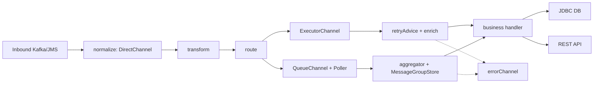
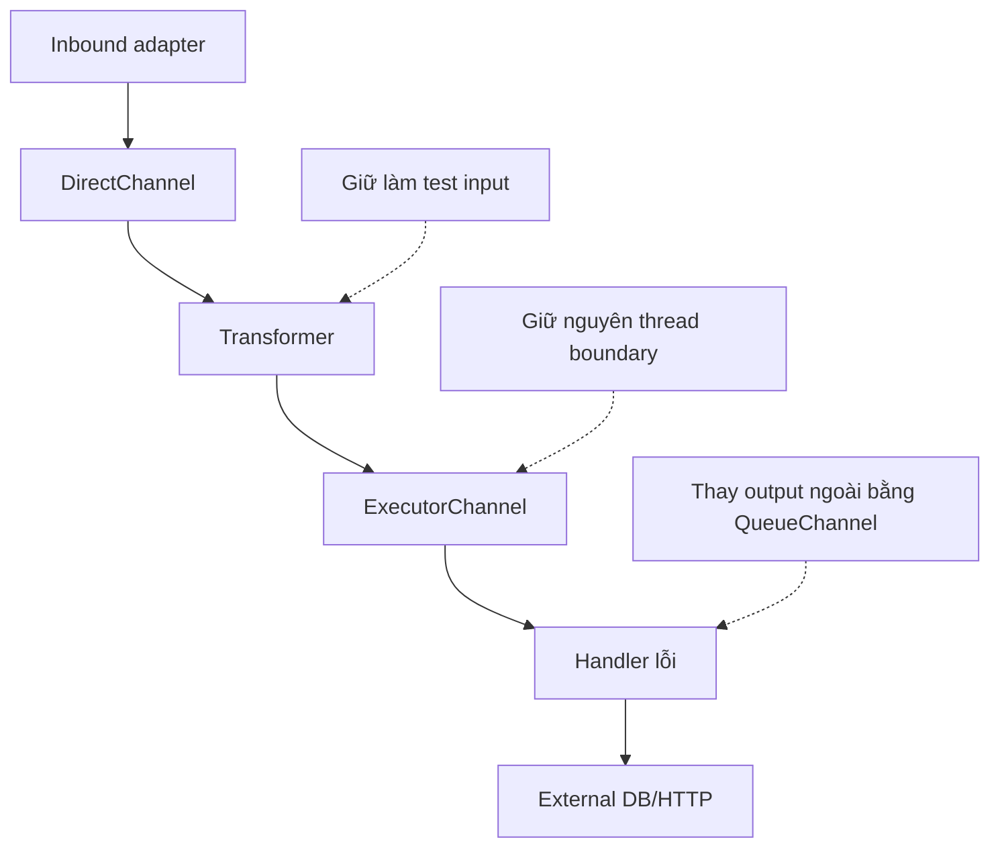
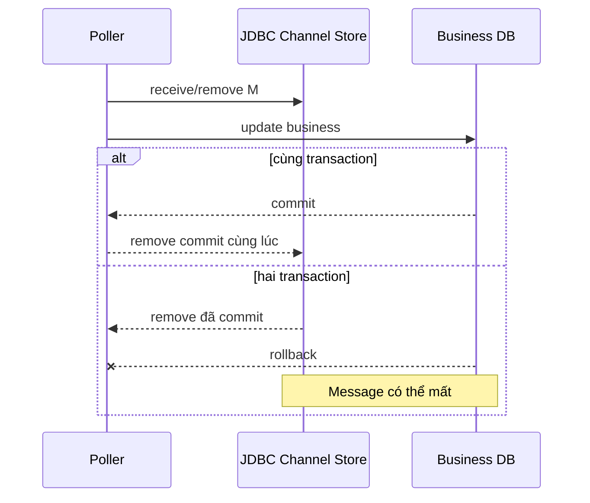
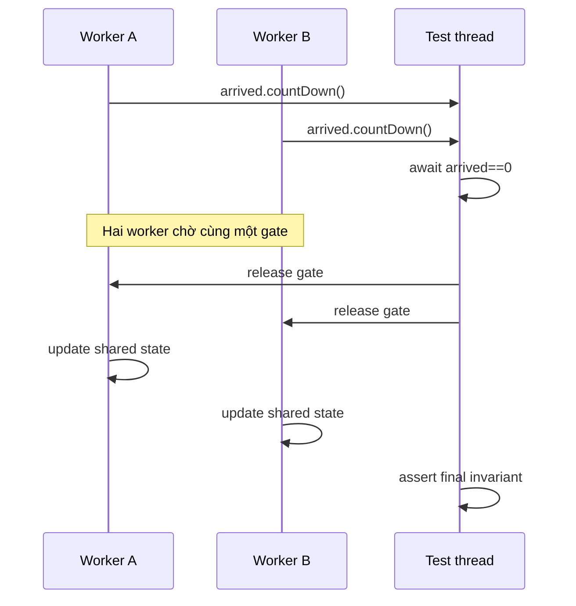
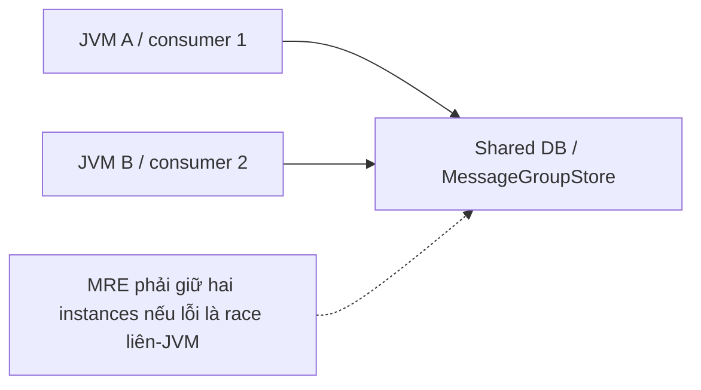

# Thu nhỏ flow để tạo testcase tái hiện trong Spring Integration

## Mục tiêu và phạm vi

Trong module **SPRING_INTEGRATION_RUNTIME**, một sự cố có thể xuất hiện giữa nhiều thành phần: message đến qua HTTP/JMS/Kafka, đi vào channel, qua router/filter, sang poller hoặc executor, được aggregator giữ lại, sau đó handler gọi database hoặc API bên ngoài. Triệu chứng thường dễ nhìn thấy — message bị mất, duplicate output, sai correlation, timeout, deadlock — nhưng **điểm gây lỗi** có thể nằm cách đó nhiều bước.

Chương **Debugging** có chủ đề **“Thu nhỏ flow để tạo testcase tái hiện”**: biến một sự cố runtime phức tạp thành một **ví dụ tái hiện tối thiểu** (*minimal reproducible example*, MRE) có thể chạy, thất bại theo một assertion rõ ràng và cung cấp đủ chứng cứ để sửa lỗi mà không cần dựng lại cả hệ thống.

Bài này đi từ quy trình thu nhỏ, chiến lược chọn ranh giới, ví dụ Java DSL/JUnit, trường hợp bất đồng bộ và giao dịch, đến cách bàn giao một testcase cho đồng nghiệp hoặc maintainer. Nó **không** nhằm thay thế vòng kiểm thử toàn hệ thống, chaos test hoặc content QA chuyên sâu.

Sau bài học, bạn có thể:

- Chuyển một mô tả mơ hồ như “message đôi khi không tới handler” thành **input, điều kiện tiên quyết, hành động, kỳ vọng, thực tế** và failure oracle cụ thể.
- Vẽ đường đi của message, phân biệt **data plane** (message đang chạy) và **control plane** (start/stop/dynamic registration).
- Thu nhỏ flow theo từng lát cắt trong khi **giữ nguyên loại channel, ranh giới thread, poller, transaction, retry, message store và correlation** nếu chúng liên quan tới lỗi.
- Tạo fixture nhỏ với `@SpringJUnitConfig`, `@EnableIntegration`, `DirectChannel` và `QueueChannel`.
- Viết testcase phân biệt lỗi synchronous với asynchronous bằng `receive(timeout)`, `CountDownLatch`, `Future.get(timeout)` và assertions về output.
- Dùng `@SpringIntegrationTest(noAutoStartup=...)`, `MockIntegrationContext`, `IntegrationFlowContext`, fake `MessageSource` và test doubles ở ranh giới bên ngoài.
- Khôi phục một failure window sau restart hoặc broker redelivery mà không đánh đồng nó với bài test in-memory.
- Gói một MRE thành báo cáo tái hiện được: version, cấu hình, dữ liệu, cách chạy, expected/actual, log đã lọc thông tin nhạy cảm và bằng chứng “red → green”.

Ví dụ hướng tới **Spring Integration 6.x (minh họa 6.5.x), Spring Framework 6.x, Java 17+, JUnit Jupiter 5**. Một số DSL overload thay đổi theo version; các ví dụ có ghi rõ khi chỉ là pseudocode hoặc phác thảo test.

## 1. Thế nào là “testcase tái hiện tối thiểu”?

Một testcase tái hiện tốt đáp ứng đồng thời năm điều kiện:

1. **Tự đủ bối cảnh:** Có input, cấu hình flow, trạng thái ban đầu và cách chạy; không cần hỏi tác giả “trên máy bạn còn cấu hình bí mật gì?”.
2. **Nhỏ:** Chỉ giữ các thành phần thật sự cần để failure xuất hiện. Component không liên quan được loại hoặc thay bằng fake.
3. **Trung thực về semantics:** Vẫn giữ đúng các ranh giới gây lỗi: sync/async, poller, ack, transaction, race, message group...
4. **Có oracle:** Assertion rõ ràng phân biệt expected với actual, không chỉ “nhìn log xem có gì bất thường”.
5. **Lặp lại được:** Chạy nhiều lần, trong CI hoặc test process sạch; nếu lỗi nondeterministic, có cách điều khiển interleaving hoặc thống kê tỷ lệ xuất hiện.

Hai tiêu chí cuối đặc biệt quan trọng. Một flow 3 dòng nhưng không có assertion **chưa đủ là testcase**; còn một testcase “pass” vì người viết đã xóa mất `ExecutorChannel` có thể là một **false negative**.

### Các phần của một MRE

| Phần | Câu hỏi | Ví dụ |
|---|---|---|
| Input | Message nào gây lỗi? | `payload="ORD-7"`, header `batchId=B-42` |
| Topology | Các channel/handler tối thiểu? | `DirectChannel → ExecutorChannel → handler` |
| Runtime condition | Có thread/transaction/timing đặc biệt? | Producer giữ `ThreadLocal`, handler chạy worker khác |
| External resource | Có broker/DB thật không? | Không; chỉ fake outbound service nếu race là in-memory |
| Expected | Invariant nghiệp vụ/kỹ thuật? | Handler nhận đúng tenant ID |
| Actual | Lỗi quan sát được? | Handler thấy `tenant=null` |
| Oracle | Assertion nào fail/pass? | `assertThat(actual).isEqualTo("tenant-A")` |
| Cleanup | Trạng thái nào phải reset? | Clear ThreadLocal, shutdown executor, drain output |
| Version | Môi trường đủ để người khác chạy? | Java 17, Spring Integration 6.5.x, Spring Test, JUnit 5 |

Không nhất thiết giữ raw payload gốc: hãy **ẩn danh dữ liệu** nhưng bảo toàn schema, null/empty, encoding, order, header values hoặc kích thước nếu chúng gây lỗi.

## 2. Bắt đầu từ một triệu chứng được đo, không phải suy đoán nguyên nhân

Các phát biểu ban đầu thường quá mơ hồ:

> “Thỉnh thoảng mất message.”

> “Aggregator hay treo.”

> “Dừng flow rồi mà đôi lúc vẫn có output.”

Trước khi xóa component, hãy biến chúng thành quan sát có thể kiểm chứng:

| Triệu chứng thô | Phát biểu kiểm thử được | Cần ghi |
|---|---|---|
| Mất message | Với message ID M1, sau khi `send()` thành công, output queue không có M1 trong 3 giây | ID, channel type, handler state, timeout, errors |
| Duplicate | Một event ID E7 tạo 2 business records sau redelivery | Event ID, transaction outcomes, broker ack |
| Sai correlation | Hai parts có cùng `batchId` không release khi size=2 | Headers, release strategy, store state |
| “Lỗi sau stop” | Sau `endpoint.stop()` và quiescence, message M2 vẫn được handler X xử lý | Endpoint ID, channel subscribers, in-flight status |
| Thread-local mất | Worker sau `ExecutorChannel` đọc `tenant=null` | Thread boundary, ThreadLocal owner, task decorator |
| Timeout ngẫu nhiên | Với 2 messages cùng key, worker B chờ lock vượt 500 ms | Lock key, thread order, critical section duration |
| Message xuất hiện lại | DB commit xong, broker ack chưa gửi, event E7 được redeliver | Commit/ack sequence, inbox idempotency |

**Tách hai câu hỏi:** “điều gì đã xảy ra” (factual observation) và “vì sao xảy ra” (hypothesis). Một testcase giảm thiểu nên được chọn bằng **observation**; nếu chọn sẵn giả thuyết chưa được chứng minh, bạn dễ loại bỏ phần tạo ra lỗi.

### Ghi một tình huống thành GIVEN–WHEN–THEN

```text
GIVEN
  Flow có ExecutorChannel; producer gắn tenantId vào ThreadLocal
  Một worker không được cấu hình ContextPropagatingTaskDecorator

WHEN
  Producer gửi Message payload="ORD-7"
  Worker xử lý Message trên thread khác

THEN (kỳ vọng nghiệp vụ)
  Handler đọc được tenantId="tenant-A"

ACTUAL
  Handler đọc tenantId=null

ORACLE
  assertThat(output).isEqualTo("tenant=tenant-A")
  nhưng output thực tế là "tenant=null"
```

Như vậy một người khác có thể viết test và xác nhận bug đã tái hiện, trước khi tranh luận cách sửa.

## 3. Vẽ một lần topology trước khi thu nhỏ

Ví dụ ứng dụng ban đầu:



Mô hình này cần được xác minh tại runtime, không chỉ đọc một Java DSL file. Có thể dùng:

- `IntegrationGraphServer.getGraph()` để xem snapshot cached topology; `rebuild()` sau dynamic registration.
- Tên channels, endpoint IDs, `SmartLifecycle.isRunning()`.
- Message history, trace ID, channel metrics và `errorChannel`.
- Thread dump nếu lỗi xảy ra khi nghẽn/đợi lock.
- Message store và broker state nếu nghi commit/ack/restart.

### Vẽ “đường cắt” theo nơi quan sát lỗi



Nếu lỗi ở **header sau ExecutorChannel**, hãy bắt đầu testcase ở channel ngay trước thread boundary, giữ `ExecutorChannel` và đọc output ở handler. Kafka topic, router trước đó và HTTP service sau đó có thể không cần.

Nếu lỗi ở **JDBC dequeue + business transaction**, lại không được thay JDBC store bằng `QueueChannel` in-memory: bạn đã xóa thứ tự commit/rollback, tức là xóa điều kiện tái hiện.

## 4. Quy trình thu nhỏ có kiểm soát: 7 bước

### Bước 1 — Cố định baseline và oracle

Ghi input và điều kiện tối thiểu để bug xuất hiện. Chạy testcase gốc ít nhất một lần, xác nhận failure. Tạo assertion vào **đầu ra có ý nghĩa**: số records, message payload/header, exception root cause hoặc absence/presence của event trong store.

Nếu lỗi mang tính xác suất, ghi số lần xảy ra. Ví dụ “7/50 runs fail khi có 8 workers”; không gọi “đã sửa” chỉ vì một lần chạy pass.

### Bước 2 — Giữ đúng đường message thực tế

Phân biệt các đường:

- `DirectChannel`: cùng thread trong trường hợp thường gặp, exception có thể trả ngược caller.
- `ExecutorChannel`: worker thread khác; `send()` không đồng nghĩa handler đã chạy xong.
- `QueueChannel`: enqueue rồi poll/receive ở thời điểm khác.
- `FluxMessageChannel`/reactive handler: subscribe/onError/backpressure có thể là ranh giới riêng.
- Inbound adapter/MessageSource: ack và retry thuộc nguồn; mock một nguồn chỉ đúng nếu lỗi không phụ thuộc broker.

Giữ **kiểu channel gây lỗi**, không thay tất cả thành `DirectChannel` để “dễ test”.

### Bước 3 — Bỏ phần ở trước lỗi

Thay inbound Kafka/HTTP/JMS bằng `MessageBuilder.withPayload(...).setHeader(...).build()` hoặc `GenericMessage` nếu lỗi không phụ thuộc transport/ack/serializer. Bảo lưu các headers thực sự được dùng: `correlationId`, `sequenceNumber`, `sequenceSize`, reply/error channel, business key, tenant, tracing carrier (nếu liên quan).

Khi lỗi liên quan headers do transport tạo, phải tái hiện **đúng sự khác biệt** giữa raw record và Spring Message; một custom fixture quá “sạch” có thể che mất lỗi serializer/mapping.

### Bước 4 — Bỏ phần ở sau lỗi

Thay outbound REST/JDBC ở sau điểm lỗi bằng `QueueChannel` hoặc một handler ghi `AtomicInteger`, `CountDownLatch`, nếu external resource không tạo ra bug.

Nhưng nếu lỗi cần transaction rollback, DB constraint, HTTP timeout hoặc broker redelivery, **đừng thay resource bằng một mock quá đơn giản**. Dùng một DB/broker thực qua Testcontainers hay một fake có behavior lỗi chính xác.

### Bước 5 — Bỏ từng component, chạy lại testcase

Dùng cách “delta debugging”: thử bỏ một đoạn liền kề, chạy test, xác nhận failure còn tồn tại.

```text
Flow gốc: A → B → C → D → E → F

Thử bỏ A, B:
  input → C → D → E → output
  Nếu vẫn fail: A/B không cần cho MRE.

Thử bỏ D:
  input → C → E → output
  Nếu không còn fail: D có thể giữ ranh giới quan trọng.

Khôi phục D và thử bỏ C:
  input → D → E → output
  Nếu vẫn fail: C có thể không cần.
```

**Không kết luận “D là bug” chỉ vì bỏ D làm hết lỗi**; D có thể chỉ tạo async boundary làm lộ lỗi nằm ở E. Sau mỗi lần thu nhỏ, ghi rõ thay đổi và kết quả.

### Bước 6 — Chứng minh testcase không “pass giả”

Làm **negative control**:

- Bỏ `ExecutorChannel`, quan sát lỗi ThreadLocal mất đi: chứng minh async boundary cần thiết.
- Thêm header `tenantId` và sửa handler đọc từ header, testcase chuyển từ fail sang pass: chứng minh hướng sửa.
- Bỏ unique constraint ở inbox, test redelivery tạo duplicate; thêm constraint trở lại, không tạo duplicate.
- Với aggregator, đổi `batchId` của part thứ hai, kiểm tra **không** release; sửa lại, group release đúng.

Negative control hữu ích, nhưng không đủ một mình: cần chứng minh với cấu hình thật hoặc ít nhất integration test ở ranh giới dự án.

### Bước 7 — Đóng gói testcase và hướng dẫn chạy

Một MRE tốt có:

```text
Case: SI-MRE-202
Spring Integration: 6.5.x
Java: 17
Input: message payload + headers được khai báo
Precondition: endpoint auto-start, worker pool size=2
Run: chạy JUnit class XxxReproTest (không cần broker ngoài)
Expected: output tenant-A
Actual: output tenant=null
Assertion: nêu tên method/test
Negative control: thay ExecutorChannel bằng DirectChannel thì pass
Proposed fix: dùng MessageHeaders hoặc context propagation được cấu hình
Cleanup: close ApplicationContext, shutdown executor, clear ThreadLocal
```

Không cần nhồi toàn bộ repository production. Quan trọng là người nhận **chạy lại được failure** với dependency và version cụ thể.

## 5. Trước khi viết code: kiểm soát môi trường và biến số

| Biến số | Nếu giữ sai sẽ gây gì? | Cách kiểm soát |
|---|---|---|
| Spring Integration / Spring Boot / Reactor version | API/behavior khác giữa phiên bản | Dùng một dependency BOM/version set đã chốt |
| JDK version | Thay scheduling, serialization, thread behavior | Ghi Java 17+ và build/runtime version thực |
| Tên endpoint/bean | Test tìm sai bean, graph khác | Đặt endpoint ID tường minh nếu cần inspect |
| Thread pool size | Race không xuất hiện nếu chỉ 1 thread | Giữ concurrency tối thiểu tạo interleaving |
| Poller delay/maxMessagesPerPoll | Thứ tự polling khác | Cấu hình cố định, có trigger/latch khi cần |
| Transaction manager | Mock không rollback DB | Cấu hình đúng DataSource/manager, kiểm tra commit |
| Retry/backoff | Failure được che bởi tự retry | Cố định số attempts và recovery behavior |
| Message IDs/headers | Aggregator group bị trộn giữa tests | Tạo business key riêng; giữ required headers |
| TestContext cache | State từ test trước ảnh hưởng | Cleanup / `@DirtiesContext` có chọn lọc |
| Executor shutdown | Thread leak làm CI treo | Spring-managed executor, `finally` và await termination |
| External service | Flaky network làm thất bại giả | Fake/deterministic service hoặc Testcontainers |
| Time zone/clock | Timeout/expiry khác | Inject `Clock` nếu logic ứng dụng phụ thuộc wall clock |

### Quy tắc “một thay đổi mỗi lần”

Nếu bạn vừa bỏ router, đổi channel sang `DirectChannel`, bỏ retry và thay DB thật bằng `HashMap`, testcase pass **không cung cấp chứng cứ** phần nào liên quan. Thu nhỏ từng lát cắt và ghi lại điều kiện bug còn hay mất.

## 6. MRE số 1: một flow đồng bộ và assertion dễ chạy

Bắt đầu từ flow tối giản: input channel → handler chuẩn hóa → output queue. Nó dùng để kiểm tra nhanh giả thuyết về payload, headers, filter/router hoặc custom transformation, **không** dùng để tái hiện lỗi async.

### Cấu hình flow

```java
package example.mre;

import java.util.Locale;

import org.springframework.context.annotation.Bean;
import org.springframework.context.annotation.Configuration;
import org.springframework.integration.channel.DirectChannel;
import org.springframework.integration.channel.QueueChannel;
import org.springframework.integration.config.EnableIntegration;
import org.springframework.integration.dsl.IntegrationFlow;
import org.springframework.messaging.MessageChannel;

@Configuration
@EnableIntegration
public class SyncReproConfig {

    @Bean
    public MessageChannel reproInput() {
        return new DirectChannel();
    }

    @Bean
    public QueueChannel reproOutput() {
        return new QueueChannel(8);
    }

    @Bean
    public IntegrationFlow reproFlow() {
        return IntegrationFlow.from("reproInput")
                .handle((payload, headers) ->
                        payload.toString()
                                .trim()
                                .toUpperCase(Locale.ROOT))
                .channel("reproOutput")
                .get();
    }
}
```

`QueueChannel` ở cuối cho phép test **nhận output bằng timeout** mà không cần HTTP listener, broker hay external service. `DirectChannel` ở đầu khiến handler chạy đồng bộ trong caller thread trong cấu hình này, nên exception có thể quan sát tại `send()`.

### JUnit 5 testcase

```java
package example.mre;

import static org.assertj.core.api.Assertions.assertThat;

import org.junit.jupiter.api.Test;
import org.springframework.beans.factory.annotation.Autowired;
import org.springframework.beans.factory.annotation.Qualifier;
import org.springframework.integration.channel.QueueChannel;
import org.springframework.messaging.Message;
import org.springframework.messaging.MessageChannel;
import org.springframework.messaging.support.MessageBuilder;
import org.springframework.test.context.junit.jupiter.SpringJUnitConfig;

@SpringJUnitConfig(SyncReproConfig.class)
class SyncReproTest {

    @Autowired
    @Qualifier("reproInput")
    MessageChannel input;

    @Autowired
    @Qualifier("reproOutput")
    QueueChannel output;

    @Test
    void keepsCaseIdAndTransformsPayload() {
        Message<String> request = MessageBuilder
                .withPayload("  ord-17 ")
                .setHeader("caseId", "CASE-17")
                .build();

        assertThat(input.send(request)).isTrue();

        Message<?> actual = output.receive(1_000);
        assertThat(actual).isNotNull();
        assertThat(actual.getPayload()).isEqualTo("ORD-17");
        assertThat(actual.getHeaders().get("caseId"))
                .isEqualTo("CASE-17");

        assertThat(output.receive(0)).isNull();
    }
}
```

Trong Spring Integration, reply-producing handler thường bảo toàn các request headers thích hợp theo handler contract; đây là **expectation để kiểm thử** trong fixture này, không phải quy tắc cho mọi custom transformer hoặc external transport.

Test có ba assertion quan trọng: send accepted, payload đúng, header được giữ; thêm `receive(0)==null` để không còn output dư **tại thời điểm kiểm tra**. Nó vẫn không chứng minh sẽ không có duplicate tới muộn khi có async producer; điều đó cần test quiescence riêng.

### Cách dùng fixture để thu nhỏ bug thật

- Nếu lỗi **payload transformation**, thay lambda ở `.handle(...)` bằng hàm production nghi vấn.
- Nếu lỗi **header propagation**, kiểm tra request/reply headers và cách tạo message mới.
- Nếu lỗi **routing/filter**, chỉ thêm router/filter gây nghi ngờ và một discard output.
- Nếu lỗi ở **threading**, fixture này **chưa đủ**, chuyển sang mục 7.

**Không để giả thuyết “framework mất header” che vấn đề gốc**: một custom handler có thể tự tạo payload/message mới hoặc một transport adapter có chiến lược header mapping khác.

## 7. MRE số 2: giữ ExecutorChannel để tái hiện mất ThreadLocal

Một lỗi phổ biến trong flow chạy bất đồng bộ:

```text
Thread A:
  TENANT.set("tenant-A")
  asyncInput.send(message)
    -> executor worker B

Thread B:
  handler gọi TENANT.get()
  trả null (không có cơ chế propagation)
```

Nếu người kiểm thử thay `ExecutorChannel` bằng `DirectChannel` để làm flow nhỏ hơn, handler sẽ chạy trên Thread A và lỗi biến mất. Đó là **thu nhỏ sai semantics**.

### Cấu hình tái hiện

```java
package example.mre;

import org.springframework.context.annotation.Bean;
import org.springframework.context.annotation.Configuration;
import org.springframework.integration.channel.ExecutorChannel;
import org.springframework.integration.channel.QueueChannel;
import org.springframework.integration.config.EnableIntegration;
import org.springframework.integration.dsl.IntegrationFlow;
import org.springframework.messaging.MessageChannel;
import org.springframework.scheduling.concurrent.ThreadPoolTaskExecutor;

@Configuration
@EnableIntegration
public class AsyncContextReproConfig {

    static final ThreadLocal<String> TENANT = new ThreadLocal<>();

    @Bean
    public ThreadPoolTaskExecutor reproExecutor() {
        ThreadPoolTaskExecutor executor = new ThreadPoolTaskExecutor();
        executor.setCorePoolSize(1);
        executor.setMaxPoolSize(1);
        executor.setQueueCapacity(8);
        executor.setThreadNamePrefix("mre-worker-");
        return executor;
    }

    @Bean
    public MessageChannel asyncInput(
            ThreadPoolTaskExecutor reproExecutor) {
        return new ExecutorChannel(reproExecutor);
    }

    @Bean
    public QueueChannel asyncOutput() {
        return new QueueChannel(8);
    }

    @Bean
    public IntegrationFlow asyncReproFlow() {
        return IntegrationFlow.from("asyncInput")
                .handle((payload, headers) ->
                        "tenant=" + TENANT.get())
                .channel("asyncOutput")
                .get();
    }
}
```

Spring-managed `ThreadPoolTaskExecutor` được đóng cùng context. Không cấu hình `TaskDecorator`, `ThreadLocalAccessor` hoặc context propagation hook trong demo này, vì cần chứng minh một **plain ThreadLocal không tự lan sang worker thread**.

### Test phơi lộ lỗi

```java
package example.mre;

import static org.assertj.core.api.Assertions.assertThat;

import org.junit.jupiter.api.Test;
import org.springframework.beans.factory.annotation.Autowired;
import org.springframework.beans.factory.annotation.Qualifier;
import org.springframework.integration.channel.QueueChannel;
import org.springframework.messaging.Message;
import org.springframework.messaging.MessageChannel;
import org.springframework.messaging.support.GenericMessage;
import org.springframework.test.annotation.DirtiesContext;
import org.springframework.test.context.junit.jupiter.SpringJUnitConfig;

@SpringJUnitConfig(AsyncContextReproConfig.class)
@DirtiesContext(classMode = DirtiesContext.ClassMode.AFTER_CLASS)
class AsyncContextReproTest {

    @Autowired
    @Qualifier("asyncInput")
    MessageChannel input;

    @Autowired
    @Qualifier("asyncOutput")
    QueueChannel output;

    @Test
    void exposesMissingThreadLocalAfterExecutorHandoff() {
        AsyncContextReproConfig.TENANT.set("tenant-A");
        try {
            assertThat(input.send(new GenericMessage<>("ORD-1")))
                    .isTrue();

            Message<?> reply = output.receive(3_000);
            assertThat(reply).isNotNull();
            assertThat(reply.getPayload())
                    .isEqualTo("tenant=null");
        }
        finally {
            AsyncContextReproConfig.TENANT.remove();
        }
    }
}
```

**Điểm đặc biệt:** testcase trên **pass** khi bug ThreadLocal mất được tái hiện; assertion này là một **reproduction/characterization test** của hành vi lỗi. Khi chuyển sang **regression test** sau sửa, đổi kỳ vọng thành `tenant=tenant-A` và sửa flow để truyền ngữ cảnh đúng.

### Sửa và chứng minh bằng negative control

Cách đơn giản khi `tenantId` là dữ liệu nghiệp vụ được phép truyền: gắn nó vào **message header** khi gửi, rồi đọc từ header trong handler.

```java
// Producer:
Message<String> request = MessageBuilder
        .withPayload("ORD-1")
        .setHeader("tenantId", "tenant-A")
        .build();
input.send(request);

// Handler:
.handle((payload, headers) ->
        "tenant=" + headers.get("tenantId"))
```

Nếu `tenantId` liên quan authorization, không tin một header do client tự đặt mà chưa xác thực. Với tracing/MDC/Observation, dùng Micrometer Context Propagation hoặc task decorator đúng boundary thay vì tự đưa nguyên `SecurityContext` vào headers.

Khi đã sửa, **giữ nguyên ExecutorChannel trong testcase**. Nếu chỉ sửa bằng cách đổi thành `DirectChannel`, bạn đã tránh lỗi chứ chưa bảo đảm hệ thống async hoạt động đúng.

## 8. MRE số 3: giữ poller và QueueChannel thay vì tự receive trong test

Một sự cố chỉ xuất hiện khi poller chạy có thể phụ thuộc:

- `fixedDelay`/`fixedRate`, `maxMessagesPerPoll`, task scheduler.
- Transaction advice bao cả `receive` và handler.
- Stop/start của `PollingConsumer`.
- Lúc message chuyển từ queue sang worker.
- Retry/recovery trong endpoint do poller quản lý.

Nếu test gọi thẳng `QueueChannel.receive()` rồi gọi handler, bạn có thể kiểm tra **message transformation**, nhưng không kiểm tra vòng polling/lifecycle.

### Fixture có poller rõ ID

```java
package example.mre;

import org.springframework.context.annotation.Bean;
import org.springframework.context.annotation.Configuration;
import org.springframework.integration.channel.QueueChannel;
import org.springframework.integration.config.EnableIntegration;
import org.springframework.integration.dsl.IntegrationFlow;
import org.springframework.integration.dsl.Pollers;

@Configuration
@EnableIntegration
public class PollerReproConfig {

    @Bean
    public QueueChannel workQueue() {
        return new QueueChannel(8);
    }

    @Bean
    public QueueChannel polledOutput() {
        return new QueueChannel(8);
    }

    @Bean
    public IntegrationFlow reproPollerFlow() {
        return IntegrationFlow.from("workQueue")
                .bridge(e -> e
                        .poller(Pollers.fixedDelay(50)
                                .maxMessagesPerPoll(1))
                        .id("reproPoller"))
                .handle((payload, headers) ->
                        "processed:" + payload)
                .channel("polledOutput")
                .get();
    }
}
```

Đoạn này giữ **một QueueChannel, một PollingConsumer/bridge endpoint có ID và một handler**, không cần adapter kết nối bên ngoài. `bridge` trên pollable channel là cách hợp lệ để đưa message sang flow downstream qua poller.

### Test cold start rồi resume

```java
package example.mre;

import static org.assertj.core.api.Assertions.assertThat;

import org.junit.jupiter.api.Test;
import org.springframework.beans.factory.annotation.Autowired;
import org.springframework.beans.factory.annotation.Qualifier;
import org.springframework.context.SmartLifecycle;
import org.springframework.integration.channel.QueueChannel;
import org.springframework.integration.test.context.SpringIntegrationTest;
import org.springframework.messaging.Message;
import org.springframework.messaging.support.GenericMessage;
import org.springframework.test.context.junit.jupiter.SpringJUnitConfig;

@SpringJUnitConfig(PollerReproConfig.class)
@SpringIntegrationTest(noAutoStartup = "reproPoller")
class PollerReproTest {

    @Autowired
    @Qualifier("workQueue")
    QueueChannel input;

    @Autowired
    @Qualifier("polledOutput")
    QueueChannel output;

    @Autowired
    @Qualifier("reproPoller")
    SmartLifecycle poller;

    @Test
    void keepsMessageUntilPollerStarts() {
        assertThat(poller.isRunning()).isFalse();

        assertThat(input.send(new GenericMessage<>("M-1"))).isTrue();
        assertThat(output.receive(0)).isNull();

        try {
            poller.start();
            assertThat(poller.isRunning()).isTrue();

            Message<?> received = output.receive(3_000);
            assertThat(received).isNotNull();
            assertThat(received.getPayload())
                    .isEqualTo("processed:M-1");
        }
        finally {
            poller.stop();
        }
    }
}
```

**Lưu ý vận hành test:** `@SpringIntegrationTest` thuộc module `spring-integration-test`; `noAutoStartup` khớp **endpoint bean ID**, không phải tên class handler. Trong fixture, `reproPoller` là ID của bridge consumer endpoint. Test nên có context riêng khi nhiều cases mutate cùng endpoint, tránh Spring TestContext cache ảnh hưởng lẫn nhau.

**Điều testcase kiểm tra:** message vẫn nằm trong input queue khi poller chưa chạy, rồi được xử lý khi start. Nó **chưa** kiểm tra JDBC persistence, ack sau crash hay exactly-once business effect. Để tái hiện lỗi có rollback/ack, thay đúng store hoặc source bằng resource thật và đặt transaction advice cần thiết.

### Khi poller chạy trước khi mock được lắp

`@SpringIntegrationTest(noAutoStartup=...)` cho phép fixture sắp xếp trước khi start. `MockIntegrationContext` còn có thể thay `MessageSource`/`MessageHandler` của endpoint được quản lý; phải reset bằng `mockIntegrationContext.resetBeans()` sau mỗi test khi có substitution.

Từ Spring Integration 6.3, `MockIntegrationContext.substituteTriggerFor(...)` có thể thay Trigger của polling endpoint để chủ động kiểm soát lịch. Đây là một cách tốt hơn `Thread.sleep` 2 giây nếu vấn đề liên quan cron dài hoặc scheduler timing.

## 9. MRE số 4: giữ correlation key và group lifecycle khi thu nhỏ aggregator

Một aggregator có thể “không release” vì input parts không có cùng correlation key, release strategy đòi đủ số phần, message group store lưu state cũ hoặc group đã expire. MRE cần ít nhất:

- Các parts có cùng key theo `CorrelationStrategy`.
- Chính xác `ReleaseStrategy`/`sequenceSize` liên quan tới lỗi.
- `MessageGroupStore` (in-memory hay JDBC) đúng với failure condition.
- Một output channel và một assertion **không release sớm**, rồi **release đúng lúc**.

### Fixture cho logic group size=2

```java
@Configuration
@EnableIntegration
class AggregatorReproConfig {

    @Bean
    MessageChannel partInput() {
        return new DirectChannel();
    }

    @Bean
    QueueChannel groupedOutput() {
        return new QueueChannel(8);
    }

    @Bean
    IntegrationFlow aggregatorReproFlow() {
        return IntegrationFlow.from("partInput")
                .aggregate(spec -> spec
                        .correlationExpression("headers['batchId']")
                        .releaseStrategy(group -> group.size() >= 2))
                .channel("groupedOutput")
                .get();
    }
}
```

Các imports tương ứng gồm `@Configuration`, `@Bean`, `@EnableIntegration`, `MessageChannel`, `DirectChannel`, `QueueChannel` và `IntegrationFlow`. Có thể dùng cùng cú pháp `@SpringJUnitConfig(AggregatorReproConfig.class)` như các ví dụ trước.

### Assertions chính

```java
String key = "batch-" + java.util.UUID.randomUUID();

Message<String> first = MessageBuilder.withPayload("part-A")
        .setHeader("batchId", key)
        .build();

Message<String> second = MessageBuilder.withPayload("part-B")
        .setHeader("batchId", key)
        .build();

input.send(first);
assertThat(output.receive(0)).isNull();

input.send(second);
Message<?> released = output.receive(1_000);
assertThat(released).isNotNull();

// Với default aggregation, payload thường là tập hợp parts.
// Assertion cụ thể phải khớp MessageGroupProcessor đang sử dụng.
```

Đây là **method-level snippet**: biến `input` và `output` là channels được inject từ fixture. Dùng `UUID` để giảm collision giữa các tests, nhưng trong production nên dùng business correlation key ổn định.

### Khi nào MRE này quá nhỏ?

Nếu lỗi gốc là “sau restart, group 2/3 parts không được release” thì dùng in-memory store đã loại bỏ điều kiện quan trọng. Phải bổ sung `JdbcMessageStore` hoặc store thật, **đóng/restart context** và giữ persistent rows. Nếu lỗi là timeout/orphan, cần `groupTimeout`/`MessageGroupStoreReaper`/scheduler có thời gian kiểm soát. Nếu lỗi chỉ xuất hiện dưới concurrency hai consumers, chạy một thread là chưa đủ.

**Không đánh đồng:** một group release không đúng không nhất thiết là bug Spring Integration. Có thể là thiếu header, key thay đổi qua transformer, message store cũ, late arrival hoặc release strategy bị cấu hình sai.

## 10. Bảo tồn transaction, retry và external side effect

Thu nhỏ flow **không** được xóa failure window cốt lõi.

### Khi lỗi ở transaction



Một fake `QueueChannel` in-memory không thể chứng minh atomicity của JDBC dequeue với business update. MRE đúng phải giữ:

1. `JdbcChannelMessageStore`/message store implementation thực sự.
2. `DataSource`/transaction manager của integration store và business DB.
3. Poller advice hoặc transaction boundary đúng phạm vi.
4. Chỗ tiêm lỗi ở trước/sau update/commit.
5. Assertion kiểm tra cả message store và business row.

Không dùng `@Transactional` trên **test method** để “bao hộ” toàn bộ test nếu chính mục tiêu là xem một worker thread/poller khác có commit riêng hay không; transaction test-level có thể che failure window.

### Khi lỗi ở retry

```text
input E7 → handler attempt #1 → timeout
            handler attempt #2 → duplicate insert
            handler attempt #3 → success/recover
```

Nếu bỏ `RequestHandlerRetryAdvice` khỏi flow thì duplicate có thể không còn. MRE phải giữ **số attempts**, **backoff** cần thiết và **thứ tự advice**. Có thể thay remote API bằng fake:

```java
final class FailingOnceService {

    private final AtomicInteger calls = new AtomicInteger();

    String invoke(String eventId) {
        int attempt = calls.incrementAndGet();
        if (attempt == 1) {
            throw new IllegalStateException("transient failure");
        }
        return "processed:" + eventId;
    }

    int calls() {
        return calls.get();
    }
}
```

Đây là test double deterministic **cho tầng business**, không tự gắn vào Spring Retry. Test cần cấu hình advice hoặc gọi qua endpoint thực sự để biết retry đã diễn ra. Assertion gồm số attempts, output cuối, exception/recovery path và số business side effects.

Một fake “lần đầu throw, lần hai success” rất hữu ích để cô lập retry mechanics. Nhưng nếu lỗi thực tế chỉ xuất hiện do timeout của HTTP socket/connection reuse hoặc DB deadlock, fake này **không đủ**; cần mock server hoặc resource thực tái hiện cơ chế đó.

### Khi lỗi ở broker ack/redelivery

Broker acknowledgment và local database commit thường là hai resources khác nhau. Một MRE in-memory không đại diện cho redelivery sau crash. Khi cần tái hiện:

- Chạy broker/testcontainer với ack mode đúng.
- Giữ event ID ổn định.
- Cho business update commit, chặn ack hoặc kill consumer ở failure window.
- Restart consumer, xác nhận broker phát lại và idempotent inbox chống duplicate business effect.
- Phân biệt “message được nhận 2 lần” với “business effect xảy ra 2 lần”.

Đây là **integration/process-level MRE**: nó có thể cần nhiều lớp hạ tầng hơn một unit test, nhưng vẫn là tối thiểu **đối với bug cần broker**.

## 11. Thu nhỏ flow khi có errorChannel và asynchronous errors

Với synchronous `DirectChannel`, exception có thể truyền về `send()`. Với `ExecutorChannel`/poller, exception có thể được chuyển thành `ErrorMessage` theo error handler hoặc endpoint configuration.

```text
DirectChannel:
test thread → send → handler throws
                        ↳ exception quay về caller

ExecutorChannel:
test thread → send accepted
worker thread → handler throws
                  ↳ async error handling / errorChannel
```

**Sai testcase:**

```java
assertThatThrownBy(() -> asyncInput.send(message))
        .isInstanceOf(MessagingException.class);
```

Nếu `asyncInput` thực sự là `ExecutorChannel`, `send()` có thể return trước khi worker ném lỗi. Assertion này không phản ánh đường lỗi thật.

**Cách đúng:** giữ một `QueueChannel` làm error receiver được cấu hình phù hợp với endpoint/source; chờ `ErrorMessage` bằng `receive(timeout)`, kiểm tra `MessagingException.failedMessage`/cause, đồng thời xác nhận không có business output sai.

### Phân biệt “không có output” với “đã xử lý lỗi”

`output.receive(0)==null` chỉ nói **ngay lúc đó không có output**. Đối với async flow, nó không chứng minh handler đã hoàn tất hoặc đã recover. Nên có tín hiệu completion/error từ worker, chẳng hạn latch, future, error channel hoặc per-event status.

### Giữ điều kiện reply/error header

Một gateway request-reply có `replyChannel`, timeout và correlation semantics khác message chỉ gửi vào `DirectChannel`. Nếu MRE về reply timeout, không loại gateway hoặc thay bằng handler trả trực tiếp rồi kết luận bug biến mất.

## 12. Concurrency MRE: điều khiển interleaving, không dùng sleep tùy tiện

Race condition có thể chỉ xuất hiện khi hai threads đi vào critical section cùng lúc. Chạy lại 1.000 lần với `Thread.sleep(10)` không đảm bảo sẽ thấy lỗi, và làm CI chậm.

### Mô hình gate hai pha



Code điều khiển:

```java
import java.util.concurrent.CountDownLatch;
import java.util.concurrent.TimeUnit;

CountDownLatch arrived = new CountDownLatch(2);
CountDownLatch release = new CountDownLatch(1);

// Trong từng worker:
arrived.countDown();
if (!release.await(3, TimeUnit.SECONDS)) {
    throw new IllegalStateException("Gate timed out");
}

// Trong test:
try {
    assertThat(arrived.await(3, TimeUnit.SECONDS)).isTrue();
}
finally {
    release.countDown(); // không bao giờ để workers treo
}
```

Snippet này mô tả **các scope riêng** (worker và test), không phải một method Java độc lập. Trong test thật dùng `ExecutorService`/`Future.get(timeout)` hoặc `ExecutorChannel` với output/error receiver. Nếu cả hai workers **không thể tới barrier** vì chỉ có một executor thread, testcase sẽ timeout: đó là bằng chứng fixture không giữ concurrency cần thiết, không phải bằng chứng app có deadlock.

### Lock/transaction race phải giữ đúng khóa

Khi tái hiện race trên aggregator hoặc message store:

- Giữ cùng `correlationId` cho hai parts nếu lỗi ở **cùng group**.
- Giữ cùng `LockRegistry` instance nếu production dùng một registry chung.
- Với nhiều JVM, `DefaultLockRegistry` local không thay distributed lock.
- Giữ database isolation/version/unique constraints nếu lỗi là lost update.
- Không thêm `synchronized` quanh handler chỉ để test ổn định: có thể che race gốc.

### Test deadlock nên có watchdog

Nếu hai threads lấy locks khác thứ tự, test phải có timeout và dọn threads. Không chạy testcase deadlock mà gọi `Future.get()` vô hạn; khi fail trên CI, nó sẽ treo cả suite. Nên dùng daemon/test executor được quản lý, timeout, thread dump có kiểm soát và hủy công việc khi kết thúc.

## 13. Khi nào thay adapter thật bằng fake, khi nào giữ hạ tầng?

| Sự cố | Có thể thay bằng fake? | Điều cần giữ |
|---|---|---|
| Sai transform payload/header | Có, đưa `Message` trực tiếp vào flow | Message structure, transformer/filter |
| Routing theo header | Có | Routing expression, channel mapping, default/discard logic |
| Mất ThreadLocal khi async | Có | `ExecutorChannel`/thread boundary, context mechanism |
| Poller chạy trước khi fixture sẵn sàng | Có | `PollingConsumer`, scheduler/trigger, lifecycle |
| Retry logic handler | Có thể fake remote lần đầu lỗi | Advice chain, attempt count, recovery |
| HTTP read timeout | Nên dùng fake HTTP server có delay/socket semantics | Client timeout, connection, error mapping |
| JDBC transaction rollback | Không nên thay bằng map in-memory | Real DB, transaction manager, store |
| Broker ack/redelivery | Không | Broker adapter/container, ack mode, restart |
| Serialization/deserialization | Không nên thay bằng direct Java object | Converter, codec, content-type, schema |
| Aggregator group logic | Có thể dùng in-memory store nếu không liên quan restart | Correlation/release/timeout semantics |
| Aggregator orphan sau restart | Không | Persistent group store, restart, reaper |
| Reactive context propagation | Có nếu không liên quan network | Reactor subscription/context/async boundary |
| Distributed lock failure | Không đủ với một JVM | Multi-instance resource, lease, ownership/fencing |

**Đừng hiểu “MRE phải chạy trong một JVM” là quy tắc.** Minimal nghĩa là **tập thành phần nhỏ nhất vẫn làm lỗi xuất hiện**. Với distributed race hoặc broker acknowledgment, tối thiểu có thể cần hai JVM hoặc một broker/container.

## 14. Test utilities của Spring Integration cho quá trình thu nhỏ

### @SpringJUnitConfig

Kết hợp `@ExtendWith(SpringExtension.class)` và `@ContextConfiguration` thuận tiện; dùng để mở một Spring context chỉ chứa fixture cần thiết.

```java
@SpringJUnitConfig(MinimalFlowConfig.class)
class MinimalFlowTest {
    // @Autowired channels, handler, store...
}
```

### @SpringIntegrationTest

`@SpringIntegrationTest` thuộc `org.springframework.integration.test.context`, cung cấp `MockIntegrationContext` và `noAutoStartup` để tránh nguồn message tự chạy trước khi test lắp mock.

```java
@SpringJUnitConfig(MinimalPollerConfig.class)
@SpringIntegrationTest(noAutoStartup = "sourceEndpoint")
class MinimalSourceTest {

    @Autowired
    MockIntegrationContext mockIntegrationContext;
}
```

`sourceEndpoint` là **endpoint bean name thật** trong test fixture, không phải generic string tùy ý. Pattern `noAutoStartup` hỗ trợ tên chính xác hoặc dạng wildcard đơn giản theo Javadoc.

### MockIntegrationContext

Dùng khi muốn giữ phần lớn wiring nhưng thay một endpoint dependency:

```java
// Gọi khi endpoint tương ứng đã được khai báo và phù hợp API.
mockIntegrationContext.substituteMessageSourceFor(
        "sourceEndpoint",
        () -> new GenericMessage<>("only-this-message"));
```

Hoặc thay handler:

```java
mockIntegrationContext.substituteMessageHandlerFor(
        "outboundEndpoint",
        message -> observedMessages.add(message));
```

`observedMessages` là collection/captor do test chuẩn bị. Endpoint IDs phải là các bean/wrapper phù hợp; API không tự tìm một method Java trùng tên. Sau test:

```java
@AfterEach
void restoreMocks() {
    mockIntegrationContext.resetBeans();
}
```

Không giả định `MockIntegrationContext` thay thế mọi bean ở mọi nơi. Nếu cần kiểm thử serialization của broker hoặc JDBC transaction, test double handler đơn thuần không đủ.

### Message history và WireTap

`@EnableMessageHistory` có thể ghi danh sách named components mà một message đã đi qua trong header `MessageHistory`. `WireTap` có thể gửi bản copy message tới kênh theo dõi.

Dùng chúng để xác định **điểm cắt chính xác**:

```text
receivedAt:
  inboundAdapter
  normalizeEndpoint
  routeEndpoint
  (không có paymentHandler)

Cắt flow trước paymentHandler, đặt output QueueChannel
rồi kiểm tra route → executor → payment boundary
```

Không bật message history/tap cho mọi payload nhạy cảm trong production. History tăng overhead và có thể ảnh hưởng serialization/header sizes; wiretap có thể có threading/error propagation khác tùy channel. Nó là công cụ chẩn đoán, không phải một assertion thay thế testcase.

### IntegrationGraphServer

Sau khi register/destroy dynamic flow, gọi `IntegrationGraphServer.rebuild()` để đọc topology mới; `getGraph()` có thể trả graph cache cũ. Test nên assert **tên component/link có ý nghĩa**, không hardcode `nodeId` xuyên rebuild.

## 15. Cắt đúng lỗi ở lifecycle và dynamic registration

Lỗi chỉ xảy ra sau `stop()/start()` hoặc register flow động cần MRE giữ control plane:

```java
IntegrationFlow flow = IntegrationFlow.from(new DirectChannel())
        .handle((payload, headers) -> "echo:" + payload)
        .channel(testOutput)
        .get();

var registration = flowContext.registration(flow)
        .id("repro-flow")
        .autoStartup(false)
        .register();

try {
    assertThat(registration.isRunning()).isFalse();
    registration.start();
    assertThat(registration.isRunning()).isTrue();

    // Gửi message và quan sát output.
    registration.stop();
    assertThat(registration.isRunning()).isFalse();
}
finally {
    registration.destroy();
}
```

Đây là **method-level snippet**, giả định `flowContext`, `testOutput`, `DirectChannel` và `assertThat` đã được khai báo/import. Dùng `autoStartup(false)` nếu lỗi phụ thuộc thao tác start thủ công.

Những biến số cần giữ:

- Endpoint autoStartup và `SmartLifecycle.phase`.
- Có producer nào vẫn gửi message trong thời gian consumer stop?
- `DirectChannel` có subscriber khác không?
- `QueueChannel` còn message chờ poller sau restart?
- Dynamic flow đã `destroy()` hay chỉ `stop()`?
- Cùng một ID flow có bị đăng ký trùng?
- Một handler đã in-flight có tiếp tục sau stop?

Nếu MRE đổi flow dynamic thành `@Bean IntegrationFlow` tĩnh, lỗi bean collision/registration order có thể không còn. Lúc đó test sai phạm vi.

## 16. Phân tích một ca điển hình từ 12 component xuống 3

**Triệu chứng:** một event đôi khi được xử lý dưới tenant không đúng khi traffic tăng; lỗi chỉ xuất hiện ở flow có `ExecutorChannel`.

### Flow ban đầu

```text
HTTP inbound
  → header enricher
  → validation
  → router
  → ExecutorChannel
  → enrich TenantContext từ ThreadLocal
  → retry advice
  → order service
  → DB
  → outbound event
```

### Lần thu nhỏ 1: bỏ external services

Thay HTTP inbound bằng `GenericMessage`; thay DB/outbound bằng `QueueChannel`. Giữ `ExecutorChannel` và handler đọc `ThreadLocal`.

Kết quả: lỗi còn.

### Lần thu nhỏ 2: bỏ validation, routing và retry

Input → `ExecutorChannel` → handler đọc `ThreadLocal` → output queue.

Kết quả: lỗi còn.

### Lần thu nhỏ 3: đổi ExecutorChannel thành DirectChannel để thử đối chứng

Input → `DirectChannel` → handler → output queue.

Kết quả: lỗi biến mất.

**Diễn giải đúng:** ranh giới thread tạo điều kiện cho lỗi, không có nghĩa `ExecutorChannel` “làm mất message” hay bản thân framework sai.

### Bằng chứng tối thiểu

```text
Tái hiện với executor:
  input thread = junit-test-thread
  worker thread = mre-worker-1
  TENANT trên producer = tenant-A
  TENANT trong handler = null

Đối chứng với DirectChannel:
  caller và handler cùng thread
  TENANT trong handler = tenant-A

Sửa:
  Input header tenantId=tenant-A
  Handler lấy từ headers
  vẫn dùng ExecutorChannel
  output = tenant-A
```

Ví dụ `AsyncContextReproConfig` ở mục 7 là dạng testcase có thể bàn giao ngay cho nhóm phụ trách. Trong production, quyết định **dữ liệu nào được phép đưa vào header** và **cách xác thực tenant** vẫn phải theo security model, không sao chép `ThreadLocal` bừa bãi.

## 17. Một bảng hướng dẫn thu nhỏ theo từng triệu chứng

| Triệu chứng | Giữ lại trong MRE | Thường có thể bỏ | Sai lầm dễ mắc |
|---|---|---|---|
| Message không đến consumer | Channel, endpoint registration, subscriber state | External logging/outbound | Thay `DirectChannel` bằng gọi handler trực tiếp |
| Send success nhưng không có output | `ExecutorChannel`/queue, worker, output wait | Inbound transport khi không liên quan | Coi `send(true)` là handler completed |
| Poller không chạy | Source/queue, poller trigger, lifecycle | Router/transformer không liên quan | Gọi `source.receive()` thủ công rồi nói poller đã được test |
| Sai header/correlation | Headers, transformer, aggregator key | DB/API sau aggregator | Tạo test message thiếu header gây lỗi gốc |
| Duplicate sau retry | Retry advice, attempt count, side-effect boundary | UI/REST frontend | Bỏ retry rồi kết luận duplicate đã hết |
| Lỗi chỉ sau restart | Persistent store, schema, transaction, recovery | Các handlers không liên quan | Dùng in-memory store thay JDBC |
| Rò ThreadLocal/MDC | Thread boundary, reuse, accessor/decorator | Broker/DB nếu không cần | Chạy mọi thứ cùng thread |
| Deadlock hai flows | Lock order, nested sends, executor model | Business payload dài | Dùng một thread khiến deadlock không thể xảy ra |
| Lỗi reactive context | Context/subscribe boundary | HTTP nếu source không liên quan | Tạo một `Mono.just` hoàn toàn đồng bộ |
| Lỗi dynamic registration | `IntegrationFlowContext`, IDs, lifecycle | Outbound clients | Chuyển thành `@Bean` flow tĩnh |
| Không thấy lỗi ở errorChannel | Async endpoint/error handler, error header | Remote IO khi có fake đúng | Assert sync exception trên `ExecutorChannel.send` |
| Mất message sau rollback | JDBC store, poller transaction, DB | Tracing/UI | Tách receive và handler ra khỏi transaction |

## 18. Tách “đã tái hiện” với “đã chứng minh nguyên nhân”

Một MRE cần hỗ trợ quy trình phát hiện lỗi, nhưng không phải mọi quan sát đều là kết luận:

```text
Observed:
  Với ExecutorChannel, worker thấy tenant=null.

Hypothesis:
  ThreadLocal không được propagate.

Control:
  Đọc header tenantId thay vì ThreadLocal -> tenant-A.

Conclusion:
  Failure liên quan context boundary; cần sửa cách truyền ngữ cảnh.

Not concluded:
  Mọi ExecutorChannel đều làm mất context.
  Framework có bug.
  Copy mọi SecurityContext qua message là an toàn.
```

Sự khác nhau này quan trọng khi viết issue công khai. Trình bày **một cơ chế có chứng cứ** và phạm vi, tránh khẳng định quá mức khi chưa thử các cấu hình observation, task decorator hoặc reactive context propagation khác.

## 19. Định nghĩa assertion vững chắc cho các trường hợp bất đồng bộ

### 19.1. Dùng deadline thay vì sleep đoán mò

```java
Message<?> actual = outputQueue.receive(3_000);
assertThat(actual).isNotNull();
```

Đây là một **bounded wait**: nếu flow không phát output, test fail sau timeout thay vì treo mãi. Nó vẫn chưa chứng minh không có output thứ hai tới sau 3 giây; muốn kiểm chứng duplicate hãy dùng durable count, quiescence hoặc barrier.

### 19.2. Cố định state trước khi gửi

Lỗi thường xảy ra vì test lắp observer **sau** khi producer đã gửi message. Với async flow:

1. Tạo `CountDownLatch` hoặc error receiver.
2. Start endpoint nếu cần.
3. Gửi message.
4. Chờ completion/error với timeout.
5. Assert output và cleanup.

Không dựa vào thứ tự message “chắc sẽ tới sau 100 ms”.

### 19.3. Dùng một case ID ở tất cả điểm quan sát

```text
caseId = CASE-711
eventId = E-711

input Message: caseId=CASE-711
handler log:  caseId=CASE-711
output:       caseId=CASE-711
error:        failedMessage.headers.caseId=CASE-711
```

ID giúp lọc logs/traces, nhưng **không** gắn một giá trị mới cho mỗi message vào metric tags vì cardinality. Với concurrent tests, tạo IDs riêng và giữ test output cách ly.

### 19.4. Xử lý exception đúng tầng

- `DirectChannel`: có thể dùng `assertThatThrownBy(() -> input.send(...))`.
- `ExecutorChannel`: chờ `ErrorMessage` hoặc future/output được endpoint cấu hình.
- Poller: lỗi có thể được xử lý bởi poller error handler; cần kiểm tra transaction/rollback.
- Reactor: dùng `StepVerifier.expectError(...)`/`verifyComplete()` cho `Mono/Flux`; không tự `subscribe()` rồi assert trước signal.

### 19.5. Kiểm thử timeout và cancellation

Một timeout có thể được tạo bởi gateway, poller receive, `tryLock`, HTTP client, Reactor operator hoặc assertion wait trong test. Đặt tên rõ:

```text
Gateway replyTimeout = 500 ms
HTTP responseTimeout = 400 ms
Test awaitTimeout = 3 s

Hai timeout đầu là behavior ứng dụng.
Timeout thứ ba chỉ là giới hạn để test không treo.
```

Tránh dùng timeout của test nhỏ hơn tổng deadline cần thiết của ứng dụng rồi gọi đó là bug.

## 20. Thu nhỏ sao cho vẫn kiểm tra được error/transaction rollback

Ví dụ report “sau exception, message mất và DB chưa được ghi”.

**MRE không đạt:**

```java
try {
    handler.handleMessage(message);
}
catch (Exception ignored) {
}
// assert DB unchanged
```

Đoạn này không dùng polling endpoint, không dequeue persistent message và có thể **nuốt exception** cần rollback.

**MRE sát lỗi hơn:**

```text
JdbcChannelMessageStore + QueueChannel
  → PollingConsumer với transaction advice
  → Business JdbcTemplate update
  → tiêm RuntimeException trước commit
  → assert DB unchanged
  → assert message được nhận lại sau rollback
```

Dù có nhiều dependency hơn, nó là tối thiểu để kiểm tra atomicity giữa **store dequeue** và business DB. Nếu stack có broker ngoài và ack semantics, phải tái hiện thêm adapter/container.

### Crash windows nên đặt trước khi thay đổi code

| Điểm tiêm lỗi | Điều cần quan sát |
|---|---|
| Trước receive | Message vẫn còn ở source |
| Sau receive, trước handler | Message có thể requeue/rollback theo adapter |
| Sau update business, trước commit | Business rollback nếu cùng transaction |
| Sau commit DB, trước broker ack | Redelivery có thể xảy ra; idempotency chặn duplicate |
| Sau aggregator group complete, trước output persistent | Không mất group/output theo kiến trúc đã chọn |
| Sau REST side effect thành công, trước ghi trạng thái | Retry có thể tạo duplicate; cần idempotency/reconciliation |

Một testcase dùng `RuntimeException` chỉ nên đặt **đúng failure window**. Nếu ném lỗi sớm hơn điểm production, không thể kết luận về atomicity ở bước cần kiểm tra.

## 21. MRE cho restart và distributed runtime

Có hai cấp độ thường bị nhầm:

**Context recreation:**

```text
Context A close()
Context B start() với cùng JDBC store
```

Phù hợp để kiểm tra một số persistence semantics, song chưa mô phỏng toàn bộ process crash/network failure.

**Process-level restart:**

```text
Process A thực hiện đến failure point
Kill/stop process A
Process B startup với cùng DB/broker
Quan sát redelivery/recovery
```

Cần Testcontainers hoặc hạ tầng test tương ứng nếu lỗi xảy ra trong broker, JDBC hoặc distributed lock. Đừng dùng `SimpleMessageStore` hay static `HashMap` để chứng minh dữ liệu bền qua restart.

### Multi-instance race



Hai `DefaultLockRegistry` local không phối hợp với nhau. Nếu production lỗi vì hai pods release cùng group, thu nhỏ xuống **một JVM** có thể làm lỗi không còn. MRE cần giữ ít nhất hai workers có shared resource và một cách kiểm soát interleaving, hoặc chứng minh bằng test database constraint/concurrency tương đương.

## 22. Chuẩn hóa một hồ sơ testcase để bàn giao

Dùng mẫu sau trong issue hoặc PR description:

```markdown
# SI-MRE: <triệu chứng ngắn>

## Environment
- Java:
- Spring Framework:
- Spring Integration:
- Spring Boot (nếu có):
- Database/broker:
- Channel/endpoint types:
- Runtime mode: single JVM / 2 pods / reactive

## Reproduction
1. Khởi tạo <fixture/state>.
2. Gửi <payload/headers>.
3. Thực hiện <start/stop/timeout/crash/action>.
4. Chạy <tên JUnit test hoặc lệnh test cụ thể>.

## Expected
- <business/runtime invariant>

## Actual
- <output/exception/record count đo được>

## Oracle
- <assertion cụ thể và message failure>

## Why minimal
- Kept: <runnable pieces>
- Removed: <independent pieces>
- Negative control: <thay đổi làm lỗi biến mất>

## Logs and metrics
- <đã loại secrets/PII>
- <caseId/correlationId, thread names, error cause>

## Cleanup
- <close context, destroy dynamic registration,
   clear ThreadLocal, release latches, stop containers>

## Verification
- Baseline: FAIL
- Candidate fix: PASS
- Regression tests: PASS
```

Đừng chèn thông tin môi trường nhạy cảm như password, token, hostname nội bộ hoặc payload chứa PII vào issue. Thay bằng giá trị giả nhưng vẫn giữ cấu trúc dữ liệu, encoding, timing và quyền cần thiết để tái hiện.

### Vì sao mẫu này đủ cho đồng nghiệp?

Người đọc không phải đoán:

- “Mất message” ở tầng send, queue, handler hay business commit?
- Lỗi xảy ra trước hay sau switch thread?
- Có retry hay transaction không?
- Test thất bại có phải vì một dependency không được bật?
- Đã phân biệt reproduction với fix/regression chưa?

Một issue có stack trace nhưng thiếu **input + topology + oracle** thường khó sửa hơn một MRE 30 dòng với assertions chính xác.

## 23. Anti-pattern khi thu nhỏ flow

### Anti-pattern A — Thay mọi channel bằng DirectChannel

**Tác hại:** xóa ranh giới executor/poller/reactive, làm mất race/context loss. Chỉ nên dùng khi bug thật sự độc lập threading.

### Anti-pattern B — Gọi handler method trực tiếp

**Tác hại:** bỏ qua endpoint lifecycle, advice, interception, conversion, error channel và transaction boundary. Dùng để unit test logic thuần, không dùng thay integration MRE khi bug ở runtime.

### Anti-pattern C — Dùng Thread.sleep để “ép” race

**Tác hại:** phụ thuộc scheduler/JIT/CI timing. Dùng latch, barrier hoặc giả lập clock/trigger khi có thể. Khi sleep là phần logic bug, ghi rõ vì sao nó cần tồn tại.

### Anti-pattern D — Thay DB bằng HashMap khi debug rollback

**Tác hại:** không có database transaction, isolation, commit và constraint. Dùng embedded/testcontainer DB hoặc test resource thật.

### Anti-pattern E — Xóa headers để testcase gọn

**Tác hại:** router, gateway, aggregator, reply/error flow có thể phụ thuộc headers. Chỉ bỏ header khi đã thử và chứng minh nó không liên quan.

### Anti-pattern F — Trộn nhiều thay đổi và nhiều giả thuyết

**Tác hại:** không biết điều gì làm bug biến mất. Giữ một bảng “removed/kept/fail?” theo từng lần giảm.

### Anti-pattern G — Chỉ assert không thấy output ngay lúc đó

**Tác hại:** worker có thể chưa chạy. Chờ completion/error và phân biệt absence tạm thời với đã quiesce.

### Anti-pattern H — Chạy MRE trên context đã nhiễm state

**Tác hại:** endpoint từ test trước, message group cũ, static counter, mock substitution, dynamic registration còn sót. Dùng isolation/cleanup.

### Anti-pattern I — Có repro nhưng không có expected behavior

**Tác hại:** người khác không biết result hiện tại là bug hay contract framework. Viết test với expected rõ và ghi actual riêng.

### Anti-pattern J — “Sửa” bằng cách tắt retry hoặc bỏ async

**Tác hại:** chỉ tránh đường gây lỗi; không chứng minh invariant sản phẩm sau sửa. Giữ nguyên ranh giới quan trọng trong regression test.

## 24. Checklist kết thúc bài

- [ ] Triệu chứng được mô tả theo GIVEN–WHEN–THEN và có oracle đo được.
- [ ] Đã xác minh message path, input headers, channel types và endpoint IDs.
- [ ] Đã xác định lỗi là **runtime/framework wiring**, business logic hay external resource boundary.
- [ ] Mỗi lần thu nhỏ chỉ thay một đoạn, chạy lại assertion và lưu kết quả.
- [ ] Không vô tình bỏ `ExecutorChannel`, poller, transaction, retry, correlation hay message store nếu chúng gây lỗi.
- [ ] Mọi test async đều có timeout hữu hạn; không phụ thuộc sleep tùy tiện.
- [ ] Có test đối chứng để chứng minh ranh giới cần thiết.
- [ ] Có expected/actual rõ, phân biệt characterization test với regression test.
- [ ] External fake được chọn đúng semantics; DB/broker thật khi cần rollback/ack.
- [ ] Test message có các headers thiết yếu, không chứa dữ liệu nhạy cảm.
- [ ] Error test quan sát đúng synchronous exception hoặc async `ErrorMessage`.
- [ ] Có cleanup cho ThreadLocal, latches, executors, message stores và dynamic registrations.
- [ ] Dùng `@SpringIntegrationTest(noAutoStartup)` nếu poller/adapter có thể chạy trước khi fixture sẵn.
- [ ] Test độc lập với các tests khác, không dựa vào context cache chứa trạng thái cũ.
- [ ] Đã thử baseline **FAIL**, sửa ứng viên **PASS**, rồi chạy regression test.
- [ ] Với restart/distributed bug, testcase giữ persistent/shared resource và failure window thực.
- [ ] Hồ sơ MRE có version, dependency, run command, dữ liệu, log đã redaction và kết quả kiểm tra.

## Tài liệu tham khảo

- [Spring Integration Reference 6.5 — Testing Support](https://docs.spring.io/spring-integration/reference/6.5/testing.html): `spring-integration-test`, `@SpringIntegrationTest`, `MockIntegrationContext` và trigger replacement.
- [Spring Integration Reference — Java DSL Runtime Flows](https://docs.spring.io/spring-integration/reference/dsl/java-runtime-flows.html): đăng ký/điều khiển flow động qua `IntegrationFlowContext`.
- [Spring Integration 6.5 Javadoc — IntegrationFlowContext](https://docs.spring.io/spring-integration/docs/6.5.0/api/org/springframework/integration/dsl/context/IntegrationFlowContext.html): registration API và lifecycle.
- [Spring Integration 6.5 Javadoc — RegistrationBuilder](https://docs.spring.io/spring-integration/docs/6.5.0/api/org/springframework/integration/dsl/context/IntegrationFlowContext.IntegrationFlowRegistrationBuilder.html): `id`, `autoStartup`, `register` và `useFlowIdAsPrefix`.
- [Spring Integration Reference — Messaging Channels](https://docs.spring.io/spring-integration/reference/channel.html): `DirectChannel`, `QueueChannel`, `ExecutorChannel`, sync/async behavior.
- [Spring Integration Reference — Poller/Consumer Endpoints](https://docs.spring.io/spring-integration/reference/endpoint.html): poller lifecycle, scheduling và task executors.
- [Spring Integration Reference — Message History](https://docs.spring.io/spring-integration/reference/message-history.html): `@EnableMessageHistory`, tracked components và message path.
- [Spring Integration Reference — Messaging Bridge](https://docs.spring.io/spring-integration/reference/bridge.html): bridge từ pollable channel với Java DSL `Pollers.fixedDelay(...)`.
- [Spring Integration Reference — Error Handling](https://docs.spring.io/spring-integration/reference/error-handling.html): synchronous/async error behavior.
- [Spring Integration Reference — Message Store](https://docs.spring.io/spring-integration/reference/message-store.html): state/durability của channel và aggregator.
- [Spring Framework — TestContext Framework](https://docs.spring.io/spring-framework/reference/testing/testcontext-framework.html): `@SpringJUnitConfig`, context caching, isolation, `@DirtiesContext`.
- [JUnit 5 User Guide](https://junit.org/junit5/docs/current/user-guide/): assertions, execution model, timeout và lifecycle.
- [Testcontainers for Java](https://java.testcontainers.org/): tái hiện JDBC/broker trong integration test.

**Ghi nhớ:** Một testcase Spring Integration tốt **không phải flow ngắn nhất bằng mọi giá**, mà là **flow nhỏ nhất vẫn giữ đúng cơ chế gây lỗi**. Trước hết đóng đinh input, topology, expected/actual và assertion; sau đó bỏ dần các component không cần, giữ nguyên ranh giới thread/poller/transaction/retry/correlation khi liên quan, và kiểm chứng bằng đối chứng. Bài test chỉ thật sự hữu ích khi người khác có thể chạy lại failure, hiểu giới hạn của nó và xác nhận bản sửa bằng regression test.

