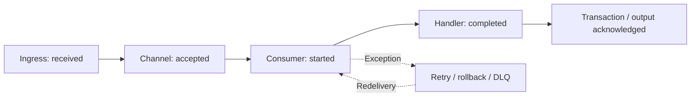
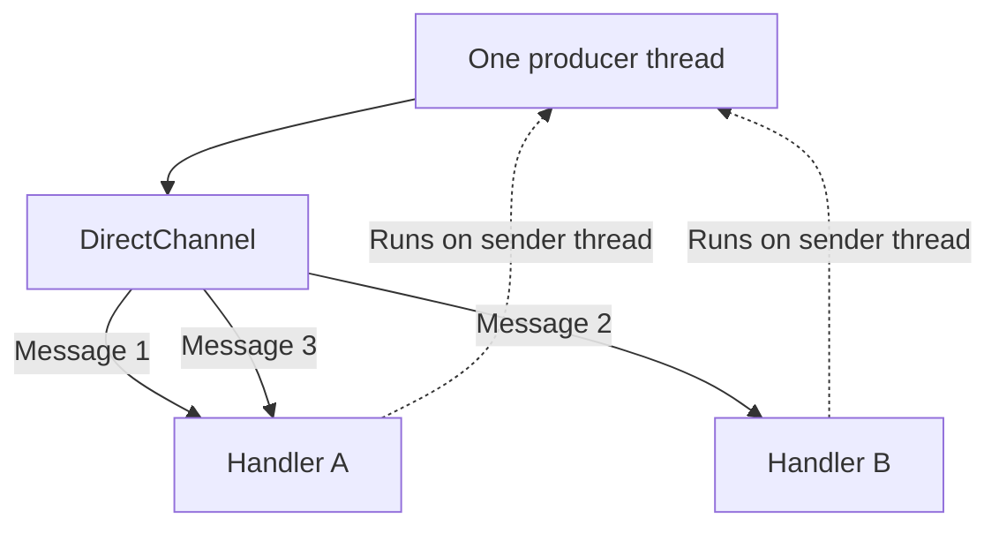
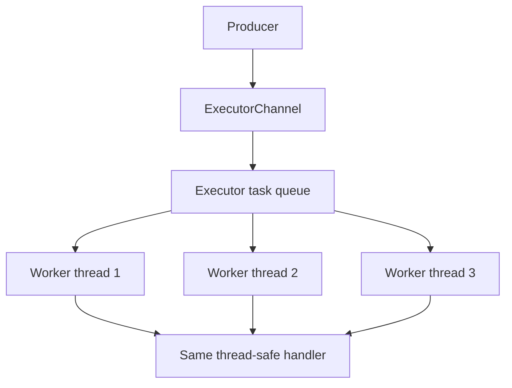
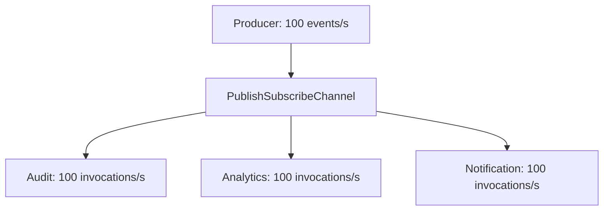
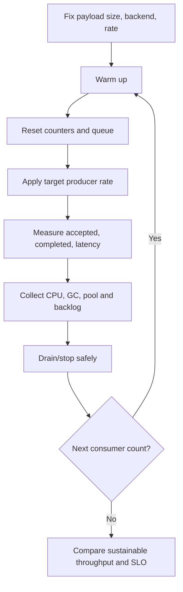
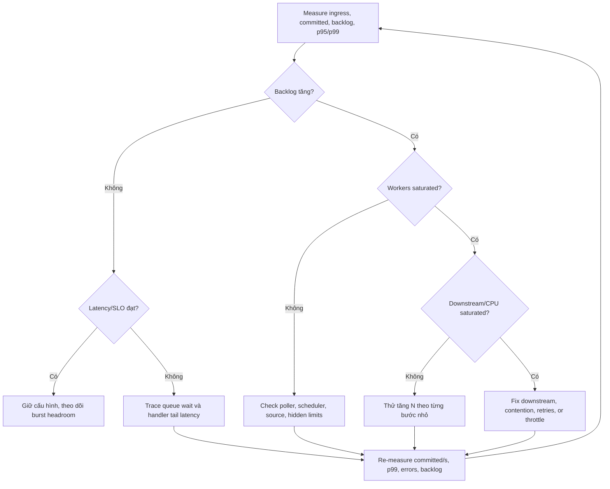

# Throughput theo channel và số consumer trong Spring Integration

## 1. Vì sao cùng một lượng message nhưng throughput khác nhau?

Giả sử hệ thống nhận 300 lệnh xử lý đơn hàng mỗi giây. Một handler mất trung bình 40 ms để gọi dịch vụ downstream. Khi chỉ có một worker xử lý tuần tự, năng lực lý thuyết của handler khoảng 25 message/giây; nếu producer tiếp tục gửi 300 message/giây, backlog sẽ tăng. Thêm consumer có thể cải thiện tốc độ xử lý, nhưng chỉ tới khi chạm giới hạn CPU, database connection pool, external API, scheduler, lock hoặc chính cấu trúc channel.

Bài **“Throughput theo channel và số consumer”** thuộc chương **Hiệu năng** của module **SPRING_INTEGRATION_RUNTIME**. Module nghiên cứu message flow, channel, endpoint, consumer, poller, executor; vòng đời IntegrationFlow, transaction, retry, message store, lỗi, correlation và chẩn đoán threading. Ở đây, trọng tâm là **đo đúng** và **tăng năng lực xử lý có kiểm soát** — không phải cứ tăng số thread là ứng dụng nhanh hơn.

Sau bài học, bạn có thể:

1. Phân biệt **tốc độ producer gửi**, **tốc độ channel chấp nhận**, **tốc độ handler hoàn tất** và **tốc độ business effect được commit**.
2. Hiểu tác động của `DirectChannel`, `ExecutorChannel`, `QueueChannel`, `PublishSubscribeChannel` và `PartitionedChannel` tới threading, ordering và backpressure.
3. Phân biệt **số subscribed handlers**, **số polling consumers**, **số executor threads** và **concurrency của transport adapter**.
4. Sử dụng các công thức giới hạn throughput, Little's Law và queue-growth để chọn số consumer ban đầu.
5. Cấu hình bounded queue, thread pool, poller, `maxMessagesPerPoll` và đo end-to-end latency một cách có ý nghĩa.
6. Tìm điểm nghẽn qua Micrometer, queue depth, p95/p99, retries, rollback và giới hạn hệ thống downstream.

> **Phạm vi API:** Ví dụ dùng Spring Integration **6.5.x**, Spring Framework 6.x và Java 17+. Các con số hiệu năng trong bài là **giả định để tính toán**, không phải kết quả benchmark thật của một phiên bản Spring Integration.

## 2. Định nghĩa đúng throughput trước khi tối ưu

Một pipeline có nhiều mốc khác nhau:



| Metric | Định nghĩa | Khi nào dễ gây hiểu lầm? |
| --- | --- | --- |
| `ingressRate` | Số message mới đi vào ứng dụng/giây. | Không gồm message được broker gửi lại nếu chỉ đo upstream event mới. |
| `acceptedRate` | Số lần `send()` được channel chấp nhận/giây. | `QueueChannel.send()` có thể chỉ **enqueue**, chưa xử lý. |
| `startRate` | Số lần handler được bắt đầu/giây. | Retry làm một business event có nhiều invocations. |
| `completionRate` | Số invocation handler hoàn thành/giây. | Handler trả về bình thường nhưng transaction có thể rollback ở bước sau. |
| `businessCommitRate` | Số business event **duy nhất** đã commit/ack đúng hợp đồng mỗi giây. | Cần business key và trạng thái commit; không đo được chỉ qua channel counter. |
| `error/retryRate` | Số exceptions/retry attempts/giây. | Không phải new traffic; cao quá có thể làm throughput hữu ích giảm. |

**KPI throughput nên ưu tiên:** số **business event hợp lệ được xử lý thành công và xác nhận** trên một đơn vị thời gian, kèm mức độ lỗi, trễ và dung lượng backlog. Nếu consumer gọi handler ba lần vì retry rồi chỉ một lần commit, đừng báo throughput tăng gấp ba.

### 2.1. Công thức cơ bản

Đặt:

- `λ` (lambda): tốc độ message **đi vào** hàng đợi, đơn vị message/giây.
- `μ` (mu): tốc độ **một consumer** có thể hoàn tất, đơn vị message/giây, khi không tranh tài nguyên.
- `N`: số consumer có thể làm việc đồng thời.
- `C_downstream`: giới hạn thực tế của database/API/broker hoặc stage chậm nhất.
- `B(t)`: độ dài backlog tại thời điểm `t`.

Với mean service time `S` (giây/message), nếu một consumer xử lý tuần tự và không có overhead lớn:

\[
\mu \approx \frac{1}{S}
\]

Giới hạn throughput bền vững **đơn giản hóa**:

\[
T_{\mathrm{useful}} \lesssim
\min(\lambda,\;N\mu,\;C_{\mathrm{downstream}},\;
C_{\mathrm{CPU}},\;C_{\mathrm{connection}},\ldots)
\]

Khi tốc độ vào đều và lớn hơn tốc độ hoàn tất:

\[
\frac{dB}{dt} \approx \lambda - T_{\mathrm{useful}}
\]

Giới hạn này chỉ là **ước lượng năng lực**, không mô tả chính xác overhead dispatcher, phân phối thời gian xử lý, contention, batching, retries hoặc ordering theo key. Thêm thread có thể khiến `S` **tăng** vì tranh chấp tài nguyên.

### 2.2. Little's Law: throughput, concurrency và độ trễ

Trong hệ thống ở trạng thái ổn định:

\[
L = \lambda_{\mathrm{effective}} W
\]

Trong đó `L` là số công việc trung bình đang ở trong hệ thống, `λ_effective` là throughput đã hoàn thành trong trạng thái ổn định và `W` là thời gian trung bình một công việc ở trong hệ thống (gồm queueing + processing).

Ví dụ: hệ thống hoàn tất 100 event/giây, thời gian end-to-end trung bình 0,2 giây thì trung bình có khoảng 20 event đang ở trong pipeline. Little's Law **không** dùng tốc độ ingress 300/giây cho một hệ thống đang chất đống backlog vô hạn rồi kết luận latency chỉ bằng số in-flight chia 300. Nó đòi điều kiện ổn định và quan sát nhất quán.

**Latency p95/p99** đặc biệt quan trọng: mean 40 ms nhưng p99 1.000 ms sẽ làm nhiều worker bị giữ lâu; lúc này năng lực xử lý thực tế khác xa công thức `1/mean` nếu thiếu tài nguyên hoặc có hàng đợi dài.

## 3. Cùng một message: các loại channel xử lý khác nhau ra sao?

| Channel | Delivery và threading | Nhiều consumer tác động thế nào? | Backpressure hoặc rủi ro |
| --- | --- | --- | --- |
| `DirectChannel` | Point-to-point, gọi **một** subscribed handler trên **thread sender**; không có queue nội bộ. | Nhiều subscribed handlers được dispatcher lựa chọn (mặc định round-robin); **không tự tạo nhiều thread**. | Producer bị giữ trong handler chậm; caller chịu latency, exception/transaction cùng thread. |
| `ExecutorChannel` | Point-to-point; gửi tác vụ tới `TaskExecutor` và xử lý bất đồng bộ. | Một subscriber vẫn có thể chạy song song trên nhiều executor threads nếu handler thread-safe; nhiều subscribers là lựa chọn đích, **không phải broadcast**. | Executor queue đầy/rejection, mất transaction boundary, gửi thành công chưa có nghĩa xử lý xong. |
| `QueueChannel` | Point-to-point với hàng đợi; producer enqueue và consumer/poller nhận sau. | Nhiều polling consumers cùng tranh dequeue, mỗi message thường giao cho **một** consumer. | Queue unbounded dễ OOM; bounded queue có thể chặn sender/timeout; persistent store tốn I/O. |
| `RendezvousChannel` | Handoff trực tiếp giữa thread gửi và nhận, không có buffer. | Nhiều receivers có thể chờ handoff; không biến thành broadcast. | Producer phải chờ có receiver, throughput bị giới hạn bởi matching. |
| `PublishSubscribeChannel` | Broadcast một message tới **mọi** subscribers (đồng bộ mặc định, hoặc qua executor). | Tăng subscribers nghĩa là **tăng số lần xử lý**, không phải chia tải cho mỗi event. | Fan-out làm tăng tổng công việc và latency; failure một nhánh tác động tùy error handling. |
| `PartitionedChannel` (từ 6.1) | Điểm-đến-một; dispatch theo partition key tới một single-thread executor của partition. | Tăng partitions giúp các key khác nhau xử lý song song, **cùng key giữ thứ tự trong partition**. | Hot key/partition skew giới hạn throughput; partition key không ổn định có thể làm sai ordering. |

Điều quan trọng là phân biệt:

- **Competing consumers:** nhiều worker lấy việc từ **cùng một hàng đợi** hoặc nhiều handlers subscribe vào `DirectChannel`; một event chọn một đích xử lý.
- **Fan-out subscribers:** nhiều handler subscribe `PublishSubscribeChannel`, **mỗi event có nhiều nhánh**. Nếu có 3 subscribers và 100 event/s, tổng số handler invocations có thể ~300/s, nhưng throughput sự kiện mới vẫn là 100/s.
- **Executor concurrency:** số thread trong executor ảnh hưởng số lời gọi xử lý chạy đồng thời, kể cả chỉ có một handler subscriber.
- **Transport concurrency:** JMS/AMQP/Kafka adapter thường có listener/container concurrency và partition/ack semantics riêng; không suy ra từ số `MessageHandler` bean trong Spring Integration.

## 4. DirectChannel: nhiều handler không đồng nghĩa nhiều thread

`DirectChannel` có dispatcher point-to-point; mặc định khi nhiều handler cùng subscribe, nó dùng chiến lược round-robin và có cơ chế failover. Mỗi `send()` chọn một handler, thực thi trên thread gọi `send()`. Nếu một producer duy nhất gửi tuần tự, nó **không thể dispatch tiếp message tiếp theo** trong khi handler hiện tại còn chạy.



Sơ đồ chỉ minh họa thứ tự **liên tiếp**; không phải H1 và H2 đang chạy song song trên hai thread.

### 4.1. Ví dụ đếm số lượt xử lý của hai subscriber

```java
import java.util.concurrent.atomic.AtomicInteger;
import org.springframework.integration.channel.DirectChannel;
import org.springframework.messaging.support.GenericMessage;

public class DirectChannelDispatchExample {
    public static void main(String[] args) {
        DirectChannel input = new DirectChannel();
        AtomicInteger handledByA = new AtomicInteger();
        AtomicInteger handledByB = new AtomicInteger();

        input.subscribe(message -> handledByA.incrementAndGet());
        input.subscribe(message -> handledByB.incrementAndGet());

        for (int i = 0; i < 100; i++) {
            boolean accepted = input.send(new GenericMessage<>(i));
            if (!accepted) {
                throw new IllegalStateException("Dispatch failed");
            }
        }

        int total = handledByA.get() + handledByB.get();
        if (total != 100) {
            throw new AssertionError("One message must reach one handler");
        }
        // Với cả hai handler thành công và round-robin mặc định,
        // thường A=50, B=50; không coi đây là fan-out 200 calls.
    }
}
```

Nếu dispatcher bật failover và handler A ném exception, dispatcher có thể thử handler B **cho cùng message** tùy strategy. Khi đo throughput, phải phân biệt lượt gọi handler A/B và số business event duy nhất được hoàn tất; một side effect đã xảy ra trước exception có thể bị lặp ở handler khác.

### 4.2. Khi nào DirectChannel là lựa chọn hiệu quả?

- Handler ngắn, CPU nhẹ, không cần buffer, muốn ít overhead scheduling/queue.
- Muốn bảo toàn transaction hiện có trên thread producer cho các bước downstream **đồng bộ**.
- Cần phản hồi lỗi đồng bộ cho gateway hoặc caller và backpressure tự nhiên (producer bị chặn trong handler).

**Không kỳ vọng tăng tốc chỉ bằng hai subscriber** nếu producer vẫn có một thread và mọi handler làm việc tuần tự. Muốn song song thật, cần nhiều producer threads, `ExecutorChannel`, polling consumer concurrency hoặc kiến trúc chia partition có kiểm soát.

### 4.3. Tác động tới transaction và latency

Nếu producer mở transaction rồi gửi qua `DirectChannel`, handler đồng bộ có thể tham gia cùng transaction khi sử dụng đúng manager/tài nguyên. Điều này hỗ trợ atomicity nhưng cũng làm thời gian giữ transaction dài hơn nếu handler chậm. Tăng concurrency ở producer mà không tăng connection pool có thể chỉ chuyển bottleneck từ thread sang DB.

## 5. ExecutorChannel: một handler vẫn có thể chạy trên nhiều workers

`ExecutorChannel` dùng một `TaskExecutor` để dispatch point-to-point bất đồng bộ. Khác `DirectChannel`, method `send()` thường trả về sau khi đã giao task cho executor, **trước khi handler hoàn thành**.



**Một subscriber + ba worker threads** có thể xử lý ba message khác nhau đồng thời. **Ba subscribers + một worker thread** không vì thế mà thực thi ba message song song. Cần điều chỉnh đúng *pool concurrency*, không nhầm với *subscriber count*.

### 5.1. Ví dụ bounded executor và đo completion, không chỉ send

Ví dụ Java thuần dưới đây sử dụng Spring Integration channel API. Nó tạo workload giả lập 10 ms/message để thấy ranh giới; **không phải benchmark production**.

```java
import java.util.concurrent.CountDownLatch;
import java.util.concurrent.TimeUnit;
import java.util.concurrent.ThreadPoolExecutor;
import java.util.concurrent.atomic.AtomicInteger;
import java.util.concurrent.locks.LockSupport;

import org.springframework.integration.channel.ExecutorChannel;
import org.springframework.messaging.support.GenericMessage;
import org.springframework.scheduling.concurrent.ThreadPoolTaskExecutor;

public class ExecutorThroughputDemo {
    public static void main(String[] args) throws InterruptedException {
        int messages = 200;
        AtomicInteger completed = new AtomicInteger();
        CountDownLatch allDone = new CountDownLatch(messages);

        ThreadPoolTaskExecutor pool = new ThreadPoolTaskExecutor();
        pool.setThreadNamePrefix("orders-worker-");
        pool.setCorePoolSize(4);
        pool.setMaxPoolSize(4);
        pool.setQueueCapacity(256);
        pool.setRejectedExecutionHandler(
                new ThreadPoolExecutor.AbortPolicy());
        pool.initialize();

        try {
            ExecutorChannel channel = new ExecutorChannel(pool);
            channel.subscribe(message -> {
                try {
                    // Chỉ mô phỏng I/O latency: không dùng để đo CPU.
                    LockSupport.parkNanos(TimeUnit.MILLISECONDS.toNanos(10));
                    completed.incrementAndGet();
                }
                finally {
                    allDone.countDown();
                }
            });

            long started = System.nanoTime();
            for (int i = 0; i < messages; i++) {
                if (!channel.send(new GenericMessage<>("order-" + i))) {
                    throw new IllegalStateException("Channel rejected message");
                }
            }

            if (!allDone.await(10, TimeUnit.SECONDS)) {
                throw new IllegalStateException(
                        "Some accepted messages are still in-flight");
            }
            double elapsed = (System.nanoTime() - started) / 1_000_000_000.0;
            double completedPerSecond = completed.get() / elapsed;

            System.out.printf(
                    "completed=%d, elapsed=%.3fs, throughput=%.1f msg/s%n",
                    completed.get(), elapsed, completedPerSecond);
        }
        finally {
            pool.shutdown();
        }
    }
}
```

Đo từ trước lượt send đầu tới **sau khi message cuối hoàn thành**, nên không nhầm thời gian “enqueue 200 tasks” với thời gian “xử lý 200 tasks”. Trong ứng dụng thật, thành công của handler chưa chắc là business commit; cần bổ sung transaction/ack metric.

**Không assert con số throughput cụ thể trong CI** cho ví dụ trên: CPU của máy CI, JIT, GC, scheduler, container quota và I/O có thể thay đổi. Mục đích là đo cùng protocol khi đổi số workers từ 1 → 2 → 4 → 8 và kiểm tra tỷ lệ tăng **thực nghiệm**.

### 5.2. Vì sao pool max=20 chưa chắc chạy 20 threads?

Với `ThreadPoolTaskExecutor` dùng queue capacity dương, thread pool thường ưu tiên:

1. Tạo đến `corePoolSize` threads.
2. Đưa tasks vào executor queue khi còn chỗ.
3. Chỉ tăng lên gần `maxPoolSize` khi queue đã đầy.
4. Khi cả pool và queue đầy, dùng rejection policy.

Ví dụ đặt `corePoolSize=4, maxPoolSize=20, queueCapacity=10_000`: dưới nhiều mức tải, ứng dụng có thể vẫn chỉ có bốn workers hoạt động, vì task queue chưa đầy. Không được nhìn `maxPoolSize=20` rồi kết luận concurrency thực tế là 20; đo `activeCount`, pool size và executor queue depth.

### 5.3. Backpressure và rejection policy

| Chính sách khi executor đầy | Tác động | Rủi ro cần test |
| --- | --- | --- |
| `AbortPolicy` | Từ chối task và thường ném `TaskRejectedException`/wrapper. | Producer/adapter phải có cơ chế retry, rollback hoặc báo lỗi; không nuốt mất message. |
| `CallerRunsPolicy` | Caller tự thực hiện task khi pool đầy. | Tạo backpressure nhưng chuyển processing về thread producer, thay đổi latency và **transaction boundary** không dự đoán trước. |
| `DiscardPolicy` / `DiscardOldestPolicy` | Có thể làm mất task theo cấu hình. | **Không** phù hợp cho message nghiệp vụ cần xử lý bền vững trừ khi có contract mất dữ liệu có chủ đích. |
| Custom policy/blocking queue | Điều tiết theo năng lực. | Cần timeout, tránh deadlock giữa upstream/downstream và có monitoring. |

Không thiết kế flow với giả định tuyệt đối “ExecutorChannel luôn bất đồng bộ”; `CallerRunsPolicy` có thể khiến lời gọi xử lý chạy trên sender thread khi cạn tài nguyên. Spring Integration không bảo đảm transaction chạy xuyên executor theo cách nhất quán.

## 6. QueueChannel: buffer và competing polling consumers

`QueueChannel` chứa message để consumer lấy sau. Producer có thể gửi nhanh, nhưng **độ dài queue chỉ che giấu chênh lệch giữa producer và consumer trong một khoảng thời gian**, không tự làm năng lực xử lý tăng.

### 6.1. Bounded và unbounded queue

```java
import org.springframework.integration.channel.QueueChannel;
import org.springframework.messaging.Message;
import org.springframework.messaging.support.GenericMessage;

QueueChannel queue = new QueueChannel(100); // Bounded capacity.

Message<String> event = new GenericMessage<>("order-42");
boolean accepted = queue.send(event, 500); // Chờ tối đa 500 ms nếu queue đầy.
if (!accepted) {
    // Caller phải có chính sách retry/timeout/rollback rõ ràng.
}
```

Khi queue dưới capacity, `send()` có thể trả rất nhanh mà không có handler nào đang chạy. Khi đầy, `send(message, timeout)` chặn tới khi có chỗ hoặc hết timeout; với timeout 0 có thể trả ngay nếu không có chỗ. Constructor không đặt capacity thường tạo queue có giới hạn rất lớn, dễ gây thiếu bộ nhớ khi consumer chậm. Với yêu cầu survive restart, cần backing store bền vững; queue in-memory mặc định không bảo đảm giữ message sau crash.

**Backpressure có thể là điều tốt:** làm producer chậm lại khi receiver quá tải thay vì tăng backlog vô hạn. Nhưng phải đo latency của producer, tỷ lệ `send() == false` và quyết định upstream có thể retry hay cần trả tín hiệu quá tải.

### 6.2. Hai polling consumers cạnh tranh trên một queue

Ví dụ Java DSL có **hai endpoint khác nhau**, cùng nhận từ `ordersQueue`. Mỗi endpoint có poller riêng, nên đây mới thực sự là **hai competing polling consumers**:

```java
import java.time.Duration;
import java.util.concurrent.atomic.AtomicInteger;

import org.springframework.context.annotation.Bean;
import org.springframework.context.annotation.Configuration;
import org.springframework.integration.annotation.EnableIntegration;
import org.springframework.integration.channel.QueueChannel;
import org.springframework.integration.dsl.IntegrationFlow;
import org.springframework.integration.dsl.Pollers;
import org.springframework.messaging.PollableChannel;

@Configuration
@EnableIntegration
class CompetingPollersConfiguration {

    static class Worker {
        final AtomicInteger completed = new AtomicInteger();

        public void process(String payload) {
            // Logic thật có thể ghi DB hoặc gọi I/O rồi return.
            completed.incrementAndGet();
        }
    }

    @Bean
    PollableChannel ordersQueue() {
        return new QueueChannel(500);
    }

    @Bean
    Worker ordersWorker() {
        return new Worker();
    }

    @Bean
    IntegrationFlow consumerA(Worker ordersWorker) {
        return IntegrationFlow.from("ordersQueue")
                .handle(ordersWorker, "process",
                        e -> e.id("consumerAEndpoint")
                                .poller(Pollers
                                        .fixedDelay(Duration.ofMillis(100))
                                        .maxMessagesPerPoll(20)
                                        .receiveTimeout(0)))
                .get();
    }

    @Bean
    IntegrationFlow consumerB(Worker ordersWorker) {
        return IntegrationFlow.from("ordersQueue")
                .handle(ordersWorker, "process",
                        e -> e.id("consumerBEndpoint")
                                .poller(Pollers
                                        .fixedDelay(Duration.ofMillis(100))
                                        .maxMessagesPerPoll(20)
                                        .receiveTimeout(0)))
                .get();
    }
}
```

Điểm chính:

- Hai `PollingConsumer` trên **cùng queue** tranh nhận message; mỗi message được một lượt `receive()` trả về cho một consumer, không phải phát cho cả hai.
- Mỗi endpoint có `maxMessagesPerPoll(20)`, nên có thể xử lý tối đa 20 message trong **một lần poll của endpoint đó**; tổng throughput còn phụ thuộc độ dài mỗi lượt, scheduler và handler.
- Handler `Worker` là singleton được dùng chung. `AtomicInteger` là thread-safe để đếm; logic nghiệp vụ thật cũng phải tránh mutable state không đồng bộ.
- `receiveTimeout(0)` tránh việc mỗi poller giữ thread khi queue tạm rỗng.
- Mỗi poller có lịch riêng; **không đảm bảo phân phối chính xác 50/50** vì scheduler, thời gian xử lý, contention và message arrival không đồng đều.

### 6.3. Poller limit không đồng nghĩa messages/second

Giả sử một `PollingConsumer` xử lý tuần tự 20 message, mỗi handler mất 10 ms và dùng `fixedDelay(500 ms)`. Bỏ qua overhead:

\[
\text{poll duration} \approx 20 \times 0.010 = 0.200\text{ s}
\]

\[
\text{cycles per second} \approx
\frac{1}{0.500 + 0.200} \approx 1.43
\]

\[
\text{throughput} \approx 20 \times 1.43 = 28.6\text{ msg/s}
\]

Không thể tính máy móc `20 / 0.5 = 40 msg/s` khi fixed delay bắt đầu sau khi lượt poll hoàn tất. Hai pollers lý tưởng có thể nâng lên gần 57 msg/s, nhưng **chỉ khi** mỗi poller thực sự có scheduler capacity, DB/API đủ năng lực, không tranh khóa và workload luôn có sẵn.

Khi queue thường rỗng, poller có thể dừng vòng `receive()` sớm; giá trị `maxMessagesPerPoll` chỉ là **giới hạn trên**, không phải số message bắt buộc nhận.

### 6.4. Số consumer và thread pool của poller là hai khái niệm

Một polling endpoint có thể dùng `PollerSpec.taskExecutor(executor)` để dispatch tác vụ poll. Tuy nhiên, chỉ thêm một executor nhiều thread **không tự chứng minh** có nhiều vòng poll đồng thời hoặc nhiều message được xử lý song song: cần xem Trigger, `TaskScheduler`, `maxMessagesPerPoll`, thời gian chạy task và khả năng overlap. Ngược lại, hai endpoint có poller riêng trên một queue thực sự là hai **competing consumers**, nhưng vẫn có thể bị giới hạn bởi scheduler thread pool.

Nếu muốn concurrency theo listener broker (JMS/AMQP/Kafka), nên điều chỉnh container/partition concurrency **đúng adapter**, không giả định cùng cú pháp/polling behavior như `QueueChannel`.

### 6.5. Queue bền vững đổi trade-off hiệu năng

Khi `QueueChannel` backed bởi `JdbcChannelMessageStore` hoặc broker bền vững:

- Enqueue/dequeue cần DB/broker I/O, serialization, index và transaction; latency khác hàng đợi RAM.
- Poller transaction có thể bao `receive()` + DB write, giúp rollback khôi phục message; tăng tính an toàn nhưng cũng tăng thời gian giữ connection/lock.
- Nhiều consumers có thể tranh cùng DB locks/partition; sau một ngưỡng throughput **giảm** vì contention.
- Crash/redelivery có thể gọi handler nhiều lần; phải đo **business commits duy nhất**, không chỉ dequeue count.

Vì vậy, benchmark QueueChannel in-memory chỉ là baseline điều phối; không thể dùng trực tiếp làm dự báo throughput cho JDBC store hoặc JMS/AMQP production.

## 7. PublishSubscribeChannel và PartitionedChannel: khác bài toán chia tải

### 7.1. Publish–subscribe là nhân công việc, không phải tăng consumers chia tải

Với `PublishSubscribeChannel`, **mỗi message** được gửi tới nhiều subscribers. Nếu có ba handlers `Audit`, `Analytics` và `Notification`, thì 100 business events/giây có thể tạo ra 300 handler invocations/giây. Báo cáo “throughput 300/s” là sai nếu mục tiêu là **100 events đầu vào được hoàn tất**.



Mặc định không cấu hình executor, `PublishSubscribeChannel` thực hiện dispatch tới subscribers trên sender thread. Một subscriber chậm có thể kéo dài thời gian `send()` và tăng end-to-end latency. Nếu thêm `TaskExecutor`, các subscriber có thể chạy bất đồng bộ; nhưng `send()` thành công không còn chứng minh mọi nhánh đã hoàn tất.

```java
import java.util.concurrent.atomic.AtomicInteger;
import org.springframework.integration.channel.PublishSubscribeChannel;
import org.springframework.messaging.support.GenericMessage;

PublishSubscribeChannel events = new PublishSubscribeChannel();
AtomicInteger audit = new AtomicInteger();
AtomicInteger notify = new AtomicInteger();

events.subscribe(message -> audit.incrementAndGet());
events.subscribe(message -> notify.incrementAndGet());

for (int i = 0; i < 10; i++) {
    events.send(new GenericMessage<>("event-" + i));
}
// Trong ví dụ đồng bộ: audit=10, notify=10.
// Business events vẫn là 10, dù có 20 handler invocations.
```

**MinSubscribers:** với `PublishSubscribeChannel`, cấu hình `minSubscribers` mặc định là 0. Vì thế producer có thể được xem là gửi thành công dù không có subscriber bắt event, tùy cấu hình. Nếu tất cả nhánh đều bắt buộc, cần contract về delivery/error và `minSubscribers` phù hợp; khi dùng executor, xác nhận số subscribers **không** đồng nghĩa chúng đã xử lý thành công.

**Throughput fan-out** phụ thuộc ý nghĩa hoàn tất:

- Nếu chỉ yêu cầu nhánh A xử lý, đo completion của A; các nhánh khác có SLA riêng.
- Nếu cả A/B/C đều bắt buộc, end-to-end latency thường chịu ảnh hưởng của nhánh chậm nhất khi chạy song song, hoặc tổng thời gian khi chạy tuần tự.
- Nếu nhánh B có retry nhiều lần, tổng số handler invocations tăng nhưng số event đầu vào không đổi.

### 7.2. PartitionedChannel khi cần ordering theo business key

Từ Spring Integration 6.1, `PartitionedChannel` hỗ trợ dispatch tới các single-thread executors phân vùng theo key. Những message **cùng partition key** đi cùng thread, giúp giữ thứ tự xử lý trong partition, trong khi các key khác có thể chạy song song.

```java
import org.springframework.integration.channel.PartitionedChannel;
import org.springframework.messaging.SubscribableChannel;

SubscribableChannel byCustomer = new PartitionedChannel(
        4, message -> message.getHeaders().get("customerId"));
```

Giả sử có bốn partitions: nếu 80% traffic thuộc một `customerId`, một partition có thể nghẽn dù ba partition khác rảnh. Tăng số partitions đôi khi giảm collision giữa các keys, **nhưng không chia một key nóng thành nhiều workers** khi còn yêu cầu ordering tuần tự theo key.

**Chỉ đo tổng threads là chưa đủ**. Với phân vùng, theo dõi backlog/latency theo partition hoặc nhóm key có giới hạn cardinality, độ lệch tải (*skew*) và tỷ lệ hot key. Tránh đưa toàn bộ customerId làm metric labels.

### 7.3. FixedSubscriberChannel: tối ưu overhead trong trường hợp rất hẹp

Spring Integration có `FixedSubscriberChannel` dành cho trường hợp **một subscriber cố định**, không cần quản lý subscriber động hoặc channel interceptors. Nó có thể giảm dispatcher overhead trên tuyến hot path. Nhưng không áp dụng máy móc: nếu flow cần interceptors, tracing đặc biệt hoặc thay consumer lúc runtime, hãy kiểm tra chức năng cần thiết trước khi đổi channel vì lợi ích throughput nhỏ. **Đo benchmark thực tế** trước khi tối ưu phần này.

## 8. Nên tăng số consumer tới đâu?

Tăng `N` chỉ có ích khi chính **handler concurrency** đang giới hạn throughput, downstream còn dư năng lực và workload có thể chạy song song mà không vi phạm ordering/transaction/idempotency.

### 8.1. Ước lượng ban đầu từ thời gian xử lý và mức sử dụng

Nếu mục tiêu là `λ_target` event/s, mean service time `S` giây/event, và muốn dùng không quá `U_target` phần năng lực worker để còn headroom:

\[
N_{\mathrm{estimate}} =
\left\lceil \frac{\lambda_{\mathrm{target}} S}
{U_{\mathrm{target}}} \right\rceil
\]

Ví dụ `λ_target=100/s`, `S=40 ms = 0.04s` và `U_target=0.7`:

\[
N_{\mathrm{estimate}}=
\left\lceil \frac{100\times0.04}{0.7}\right\rceil
= 6
\]

Sáu workers là **giả thuyết để benchmark**, không phải cấu hình chắc chắn đạt SLA. Nếu API ngoài chỉ chấp nhận 50 requests/s, hoặc DB pool chỉ cho 4 kết nối bận cùng lúc, thêm workers không giúp đạt 100 successful events/s.

**Quy tắc thực tế:** chọn N nhỏ nhất đạt throughput và p95/p99 latency đã định, với error/retry rate và backlog ổn định. Mức CPU 100% liên tục không phải mục tiêu tốt nếu cần chịu burst hoặc GC.

### 8.2. CPU-bound và I/O-bound không scale giống nhau

| Workload | Dấu hiệu | Hướng tuning |
| --- | --- | --- |
| CPU-bound (parse, transform, encrypt) | CPU cores bận, tăng threads làm context switching tăng, throughput dẹt. | Số worker gần CPU quota/core hữu ích, profiling/hotspot/algorithm, tránh allocations. |
| I/O-bound (HTTP, JDBC, file) | Threads chờ I/O, CPU còn rảnh. | Có thể tăng concurrency nhưng phải tôn trọng connection pool, rate limit, timeout, downstream quota. |
| Lock/contention-bound | Lock wait/deadlock tăng, p99 cao, CPU không nhất thiết đầy. | Giảm vùng khóa, partition theo key, transaction ngắn, thay store/index. |
| Scheduler-bound | Pollers chạy ít lượt, còn backlog dù handler nhanh. | Xem `fixedDelay`, `maxMessagesPerPoll`, scheduler pool và `receiveTimeout`. |
| Persistence-bound | JDBC/broker insert/delete/commit chậm. | Batching phù hợp, indexes, DB tuning, connection pool, transaction design. |
| Retry-bound | Nhiều attempts cho cùng business event, worker giữ bởi backoff. | Giới hạn retries, circuit breaker, DLQ/quarantine, phân loại lỗi. |

### 8.3. Khi một pipeline có nhiều stage

Một flow có ba stage tuần tự:

```text
Validate  ->  Enrich from DB  ->  Send external API
  600/s           250/s               400/s
```

Với các stage có năng lực riêng và không nhân/chia message, throughput bền vững end-to-end không thể vượt quá **stage chậm nhất**: ở đây ~250/s. Thêm consumers vào Validate (đã đạt 600/s) có thể làm hàng đợi trước Enrich phình to nhanh hơn mà không tăng business completion rate.

Đối với aggregator, resequencer và những flow có điều kiện release/correlation, throughput đầu ra không nhất thiết bằng đầu vào (nhiều message đầu vào → một kết quả). Đo bằng **business units tương ứng**, không so trực tiếp hai counter mà quên tỉ lệ nhóm.

### 8.4. Batch giúp hay làm hại?

Một consumer xử lý 100 message thành batch có thể giảm overhead network/DB transaction, nhưng:

- Batch quá lớn làm tăng latency của message đầu, kéo dài transaction và thời gian giữ connection/lock.
- Một lỗi có thể khiến rollback cả batch rồi retry 100 message; duplicate handling phức tạp hơn.
- Nếu chỉ một partition có dữ liệu, batch chưa chắc tăng parallelism.
- `maxMessagesPerPoll=100` không tự gộp 100 message thành một SQL batch. Nó chỉ cho phép polling endpoint **lặp tối đa 100 receive/process operations trong một lượt**. Muốn JDBC batching phải chủ động thiết kế store/handler tương ứng.

Đo batch size và số commits, business outcomes, p95/p99, lock wait và rollback amplification trước khi kết luận tốt hơn.

## 9. Thiết kế benchmark công bằng

Một benchmark throughput theo channel và số consumer nên trả lời: **khi giữ cùng workload và hệ thống downstream, thay channel/N làm số business event hoàn tất mỗi giây, latency và mức tiêu thụ tài nguyên đổi như thế nào?**

### 9.1. Trước khi chạy

1. **Chốt workload:** kích thước payload/header, tỷ lệ message theo key, phần trăm CPU/I/O, tỷ lệ lỗi, timeout và retry policy.
2. **Chốt hệ thống:** Java/JVM/GC, Spring Integration version, số CPU cores/container quota, heap, DB pool, network, broker partitions, scheduler và executor settings.
3. **Chọn điểm đo:** từ ingress accepted tới business commit/ack cho end-to-end; đo thêm queue wait và handler execution để định vị bottleneck.
4. **Chọn kiểu tải:** fixed input rate (*open-loop*) hay worker chờ kết quả rồi gửi tiếp (*closed-loop*). Hai kiểu có thể cho throughput/latency khác nhau.
5. **Giới hạn tải:** queue/executor capacity hữu hạn và timeout; không tạo `OutOfMemoryError` chỉ để tìm điểm bão hòa.
6. **Cô lập môi trường:** dùng nguồn giả lập ổn định cho baseline và backend test thật cho kết luận I/O; không gọi production payment API.
7. **Warm up và repeat:** để JIT, pools và caches ổn định, đo nhiều lần, ghi phân phối và độ lệch; không dựa một sample đẹp.

### 9.2. Ma trận thử nghiệm gợi ý

| Kịch bản | Channel/consumer | Biến độc lập | Kết quả phải đo |
| --- | --- | --- | --- |
| D1 | `DirectChannel` + 1 handler | Producer threads 1, 2, 4, 8 | Completed/s, sender latency, handler p99, CPU. |
| D2 | `DirectChannel` + 2 subscribed handlers | Producers cố định | Dispatcher distribution, failover, actual concurrency. |
| E1 | `ExecutorChannel` + 1 handler | Executor core threads 1, 2, 4, 8 | Completed/s, queue wait, active count, rejected tasks. |
| E2 | `ExecutorChannel` | Queue capacity 32, 128, 512 | Producer blocking/rejection, p99 và memory. |
| Q1 | Bounded `QueueChannel` + poller | 1, 2, 4, 8 competing endpoints | Receive/commit rate, backlog, oldest age, scheduler CPU. |
| Q2 | Poller | `maxMessagesPerPoll` 1, 10, 50, 100 | Throughput, fairness, poll duration, lock hold time. |
| P1 | `PublishSubscribeChannel` | Subscribers 1, 2, 3 | Business events/s **và** handler invocations/s. |
| K1 | `PartitionedChannel` | Partitions 2, 4, 8; key skew | Per-partition lag, ordering và throughput. |
| S1 | JDBC-backed queue | N consumers + pool size + transaction | DB commits/s, lock wait, redelivery, I/O. |

### 9.3. Trình tự đo ở mỗi mức N



Để tránh chỉ đo tốc độ đẩy message vào buffer, **không kết thúc benchmark khi producer gửi xong** mà phải đợi tất cả message được xử lý, bị từ chối có chủ đích hoặc hết deadline với kết quả được ghi nhận. Nếu benchmark theo tải liên tục, ghi cả tốc độ gửi và xử lý trong một cửa sổ ổn định, cùng biến thiên backlog. Không lấy throughput `accepted/s` làm `completed/s` khi `B(t)` tăng.

### 9.4. Dữ liệu minh họa (không phải benchmark thực tế)

Với workload I/O latency 40 ms, downstream đủ nhanh và không có contention ban đầu:

| N workers | Capacity lý thuyết `N / 0.04` | Throughput thực đo | Đánh giá |
| ---: | ---: | --- | --- |
| 1 | 25 msg/s | *Phải đo* | Baseline. |
| 2 | 50 msg/s | *Phải đo* | Có thể gần gấp đôi nếu hoàn toàn I/O-bound. |
| 4 | 100 msg/s | *Phải đo* | Xem DB pool và rate-limit. |
| 8 | 200 msg/s | *Phải đo* | Có thể chạm downstream capacity trước 200. |
| 16 | 400 msg/s | *Phải đo* | Có thể tăng contention/retry, thậm chí giảm throughput. |

Không điền số throughput “thực” khi chưa chạy benchmark. Chính khoảng cách giữa con số lý thuyết và số đo cho biết bạn đang gặp scheduler, contention, network hay giới hạn downstream.

## 10. Quan sát throughput và số consumer bằng Micrometer

Spring Integration 6.5 có các metric và observation giúp theo dõi channel, handler, message source. Cần phân biệt **Micrometer meters truyền thống** với **Micrometer Observation** (dùng cho metrics và tracing theo cấu hình).

### 10.1. Các meters thường gặp của Spring Integration

Theo tài liệu Spring Integration 6.5, khi có `MeterRegistry` trong application context, framework hỗ trợ:

| Meter | Loại | Diễn giải |
| --- | --- | --- |
| `spring.integration.send` với tag `type=channel` | Timer | Thời gian `send()` của channel, có tag component name, result, exception. |
| `spring.integration.send` với `type=handler` | Timer | Thời gian xử lý ở các handler framework được instrument. |
| `spring.integration.receive` với `type=channel` | Counter | Số lượt nhận từ pollable channel, phân loại thành công/thất bại. |
| `spring.integration.receive` với `type=source` | Counter | Số message source trả thành công. |
| `spring.integration.channel.queue.size` | Gauge | Số message hiện đang chờ trong `QueueChannel`. |
| `spring.integration.channel.queue.remaining.capacity` | Gauge | Dung lượng còn lại của queue. |
| `spring.integration.channels`, `handlers`, `sources` | Gauges | Số component loại tương ứng trong application context. |

Đừng suy luận `spring.integration.send{type="channel"}` đo **toàn bộ end-to-end handler time**: với `ExecutorChannel` hoặc `QueueChannel`, lời gọi `send()` thường đo dispatch/enqueue, còn handler có thể chạy sau. Tương tự, `receive{type="channel"}` tăng khi lấy message, không tự xác nhận đã commit nghiệp vụ.

Khi đọc timer/counter ở dashboard, nên chú ý:

- **Rate**: tốc độ tăng event count theo thời gian, không chỉ tổng từ khi process start.
- **Result và exception tags**: phân biệt successful send, failed send, handler error, receive thành công.
- **Queue size và remaining capacity**: xác định backlog tăng/giảm, có đầy hay chưa.
- **Handler duration p50/p95/p99**: biết worker đang bị giữ bởi tail latency.
- **Business commit counter tự định nghĩa**: kết quả thành công duy nhất theo business key, không thể thay bằng channel send count.

### 10.2. Micrometer Observation và tracing

Từ Spring Integration 6.0, có hỗ trợ `ObservationRegistry`. Khi muốn instrument components qua Observation, cần có `ObservationRegistry` và cấu hình `@EnableIntegrationManagement` với `observationPatterns` phù hợp. Mặc định không instrument tất cả `IntegrationManagement` components theo Observation. Ví dụ:

```java
import org.springframework.context.annotation.Configuration;
import org.springframework.integration.annotation.EnableIntegration;
import org.springframework.integration.config.EnableIntegrationManagement;

@Configuration
@EnableIntegration
@EnableIntegrationManagement(observationPatterns = "*")
class IntegrationObservabilityConfiguration {
    // Ứng dụng cần có ObservationRegistry bean và handlers/exporter phù hợp.
}
```

Khi dùng Micrometer Observation, tài liệu 6.5 mô tả những timer như `spring.integration.handler`, `spring.integration.producer` và `spring.integration.gateway`, cùng long-task timer `.active`, theo convention hiện hành. **Không cộng chồng** counts từ cả legacy meters và observations để báo throughput gấp đôi; chúng có thể cùng phản ánh một invocation.

**Tracing:** bật observation ở cả producer/channel và consumer thích hợp giúp theo dõi message qua executor hoặc persistent store, vì trace context có thể được mang qua headers. Nhưng tracing có overhead và không thay thế business idempotency/commit evidence. Với fan-out, một trace có thể chứa nhiều handler spans; đừng coi số spans là số event duy nhất.

### 10.3. Metric tự định nghĩa cho business throughput

Một counter ở đúng điểm **sau commit/ack** hoặc từ bảng outbox/inbox đã commit có ý nghĩa rõ ràng hơn counter ở đầu flow:

```text
business_events_committed_total{
  flow="orders",
  outcome="success"
}

business_events_failed_total{
  flow="orders",
  category="validation"
}
```

Đây là **tên metric của ứng dụng**, không phải metric framework tự có. Nên đếm theo hợp đồng duy nhất của event; với JDBC transaction, cẩn trọng nếu tăng counter trước commit rồi transaction rollback (counter đã tăng nhưng business record chưa commit). Có thể phát kết quả đo qua transactional outbox hoặc định nghĩa thêm counter “attempt succeeded” và reconciled commit rate riêng.

**Cardinality:** không đưa `eventId`, `orderId`, `correlationId` hay mỗi tenant duy nhất vào metric labels nếu số lượng giá trị lớn. Dùng trace/log có kiểm soát để truy từng event; metrics tổng hợp theo flow, endpoint, error category và tier.

### 10.4. Bảng quan sát từ triệu chứng tới bottleneck

| Triệu chứng | Dấu hiệu metric | Giả thuyết cần thử |
| --- | --- | --- |
| Ingress cao, completed thấp, queue tăng đều | Accepted/s > committed/s; queue size tăng. | Thiếu consumers hoặc downstream bottleneck. |
| Tăng N nhưng committed không tăng | Active workers tăng, DB wait/CPU/retry tăng. | Downstream hoặc contention đã bão hòa. |
| Producer send nhanh nhưng SLA chậm | Channel send p95 thấp, queue wait/handler p99 cao. | Đang chỉ đo enqueue time. |
| Producer block hoặc send=false | Bounded queue đầy, remaining capacity=0. | Backpressure hoạt động; upstream cần throttling/retry đúng. |
| Executor max cao nhưng active thấp | Executor queue sâu, pool chỉ ở core size. | Tuning core/queue; chưa sử dụng max threads. |
| Poller chạy ít lượt, queue còn dài | Poll interval lớn, maxMessagesPerPoll thấp hoặc scheduler ít thread. | Poller/scheduler limit. |
| Handler processing tăng nhiều, commits không tăng | Retry/errors/deadlocks tăng. | Retry amplification hoặc poison events. |
| Một partition backlog lớn | Key distribution lệch, các partitions khác nhàn. | Hot key/ordering constraint, không phải thiếu global threads. |
| Fan-out tổng handler calls tăng | N subscribers tăng, business event count không đổi. | Kết quả metric đang đếm invocations thay vì event. |
| Tăng concurrency làm p99 tăng rất mạnh | Locks, GC, connection pool wait, rate limiting. | Điểm bão hòa vượt ngưỡng, cần giảm N. |

## 11. Transaction, retry và error handling làm thay đổi throughput hữu ích

Số threads lớn có thể tăng số **attempts** nhưng giảm số **successful commits** nếu DB deadlock, upstream retry và downstream timeout.

### 11.1. Retry amplification

Giả sử một business event phải thử trung bình 1,5 lần mới thành công. Để hoàn tất 100 event/giây, handler phải có khả năng xử lý ít nhất khoảng 150 attempts/giây, chưa tính side effects, transaction và backoff. Nếu 10% event được retry ba lần và 90% thành công ngay:

\[
E[\mathrm{attempts}] = 0.9\times1+0.1\times3=1.2
\]

Muốn hoàn tất 100 **events/s** thì handler có thể cần khoảng 120 **attempts/s**. Nếu cả broker redelivery và `RequestHandlerRetryAdvice` cùng retry, tổng attempts có thể còn lớn hơn. Vì vậy, khi tăng số consumer, phải giữ cùng retry policy mới so sánh throughput công bằng.

### 11.2. Backoff chiếm tài nguyên ở đâu?

Với retry đồng bộ, một worker có thể giữ thread trong thời gian backoff. Nếu một handler dành 20 ms xử lý, rồi ba lần backoff lần lượt 100, 200, 400 ms, tổng thời gian giữ worker lớn hơn nhiều so với thời gian CPU. Bổ sung workers có thể giúp một phần, nhưng khi downstream đang quá tải, gửi lại nhanh hơn có thể càng làm lỗi nghiêm trọng.

Cân nhắc phân loại lỗi:

| Loại lỗi | Retry/backoff | Quan sát throughput |
| --- | --- | --- |
| Timeout tạm thời, downstream đang hồi phục | Giới hạn attempts + backoff/jitter. | Throughput hữu ích, số worker chờ và backlog. |
| Validation/permanent schema error | Không retry vô nghĩa; quarantine/DLQ. | Không để một poison message ăn hết poll cycles. |
| DB deadlock do quá nhiều consumers | Có thể retry transaction nhưng cần giảm contention. | Error rate/rollback rate và lock wait. |
| Kết quả external API chưa rõ | Idempotency + reconciliation trước khi gọi lại. | Một business effect, không chỉ một reply. |

### 11.3. Transaction boundary có thể bị đổi bởi channel

`DirectChannel` giữ xử lý cùng thread nên transaction của producer có thể bao downstream đồng bộ. `ExecutorChannel` tạo ranh giới bất đồng bộ, transaction của sender **không được tự truyền** tới worker. Với `QueueChannel` backed bởi JDBC, transaction nên bao `receive()` và cập nhật business dữ liệu nếu muốn rollback khôi phục message. Điều đó thường đặt ở poller và phải dùng đúng DataSource/transaction manager.

Khi dùng `PublishSubscribeChannel` với executor hoặc `PartitionedChannel`, các nhánh có thể chạy trên threads khác nhau; không giả định một transaction/JDBC connection tự bao toàn bộ fan-out. Tối ưu throughput không được phá hợp đồng atomicity cần thiết.

### 11.4. Correlation, ordering và idempotency là giới hạn concurrency thực tế

Một aggregator có thể cần chờ đủ message cùng `correlationId`; tăng consumers không làm nhóm đến đủ nhanh hơn nếu upstream thiếu một event. Khi nhiều threads cập nhật cùng message group, lock registry, store và release strategy có thể trở thành bottleneck.

Một nghiệp vụ đòi **thứ tự nghiêm ngặt theo accountId** không nên đơn giản chia messages của cùng tài khoản cho 16 workers rồi cho phép chạy tùy ý. Dùng partitioning theo key hoặc cơ chế serial hóa theo key, sau đó đo phân phối key và hot partitions. Đối với message redelivery, hãy dùng idempotency key ổn định để không nhân side effects khi một event được xử lý nhiều lần.

### 11.5. Vòng đời IntegrationFlow và động thái scaling

Khi đăng ký flow động bằng `IntegrationFlowContext` hoặc tăng listener/consumer runtime, phải ghi nhận **bao nhiêu endpoint thực sự đang running**. Một registration tồn tại nhưng chưa start không tăng năng lực xử lý. Stop một consumer có thể giảm throughput ngay; nhưng những tasks in-flight chưa chắc dừng tức thì. Khi scale down, cần drain/rebalance và kiểm tra queue/transaction/ack thay vì xóa endpoint đột ngột.

## 12. Tình huống phân tích: backlog tăng dù tăng 12 consumers

Một hệ thống nhận `λ=300 orders/s`, handler có mean service time `S=40 ms` khi hệ thống không bị tranh chấp. Ban đầu có bốn workers; database có thể commit tối đa khoảng 180 orders/s với cấu hình hiện tại. Queue bounded chứa tối đa 2.000 messages.

**Bước 1 — Tính trần lý thuyết theo workers:**

\[
\mu = 1/0.04 = 25\text{ orders/s/worker}
\]

Với bốn workers:

\[
T_{\mathrm{workers}}(4) \approx 4\times25=100/s
\]

Trần hữu ích:

\[
T_{\mathrm{useful}}(4)
\lesssim \min(300,100,180)=100/s
\]

**Bước 2 — Ước lượng backlog ban đầu:**

\[
\Delta B \approx 300-100=200\text{ messages/s}
\]

Nếu bắt đầu từ queue rỗng, chỉ xét chênh lệch trung bình lý tưởng, thời gian đầy queue 2.000 messages khoảng:

\[
t_{\mathrm{full}} \approx 2000/200=10\text{ s}
\]

Thực tế còn overhead, burst, p99 latency và phát sinh retries; đây không phải cam kết queue chỉ đầy sau đúng 10 giây.

**Bước 3 — Tăng lên 12 workers:**

Lý thuyết theo worker là `12 × 25 = 300/s`, nhưng DB chỉ đạt khoảng 180/s:

\[
T_{\mathrm{useful}}(12)
\lesssim \min(300,300,180)=180/s
\]

Backlog vẫn tăng khoảng `300 - 180 = 120 messages/s`, queue rỗng lý tưởng có thể đầy sau `2000/120 ≈ 16,7 giây`. **12 workers không giải quyết được yêu cầu 300/s** vì điểm nghẽn đã dịch sang database.

**Bước 4 — Chọn giải pháp theo số đo:**

- Đo `DB commit/s`, wait time, deadlocks, connection pool và duration từng SQL. Nếu DB thật sự bão hòa, giảm thời gian transaction, tối ưu query/index, batching phù hợp hoặc tăng khả năng DB.
- Nếu nguồn có thể nhận backpressure, giới hạn input rate hoặc dùng bounded queue và trả tín hiệu quá tải có thể retry an toàn.
- Nếu chỉ là burst ngắn, tính capacity queue dựa trên **thời lượng burst** và tốc độ drain sau burst, kèm bộ nhớ/độ bền cần thiết.
- Không mặc định tăng lên 24 workers: nó có thể tăng lock contention, retry và p99, làm throughput hữu ích thấp hơn 180/s.
- Với mọi chiến lược, bảo đảm xử lý không trùng business event bằng idempotency key hoặc transaction/outbox thích hợp.

**Kiểm tra Little's Law sau khi ổn định:** nếu điều tiết ingress xuống 150/s và hệ thống hoàn tất ổn định 150/s với mean end-to-end time 0,2 s, số công việc trung bình trong toàn hệ thống khoảng `L = 150 × 0,2 = 30`. Khi ingress vẫn là 300/s còn output 180/s và backlog tăng vô hạn, không dùng Little's Law như thể hệ thống đã ổn định.

### 12.1. Dung lượng queue và áp lực bộ nhớ

Giả sử payload trung bình 16 KiB/message, 2.000 messages chiếm riêng bytes payload khoảng 31,25 MiB; **headers, object overhead, queue nodes, GC metadata, serializer buffers** làm footprint thực còn lớn hơn. Với unbounded in-memory queue, tăng backlog trong vài phút có thể gây GC pressure và OOM. Với persistent queue, thay vì OOM có thể chuyển thành storage I/O/DB table growth và latency cao hơn.

**Một hàng đợi lớn giúp chịu burst, không nâng trần throughput bền vững.** Nếu `λ > T_useful` kéo dài, mọi capacity hữu hạn cuối cùng đều đầy.

## 13. Quy trình tuning từng bước trong môi trường thực

### 13.1. Tìm đúng điểm nghẽn, không tăng N theo cảm giác



**Bước 1:** xác nhận nguồn gửi bao nhiêu event mới mỗi giây, message size và error rate. Phân biệt ingress event mới với attempts do redelivery.

**Bước 2:** kiểm tra channel semantics. Nếu muốn mỗi event chỉ một handler xử lý, đừng dùng `PublishSubscribeChannel`. Nếu muốn xử lý nhanh có backpressure đồng bộ, `DirectChannel` có thể phù hợp. Nếu cần buffer, queue phải bounded và có chính sách overflow.

**Bước 3:** đo handler service time, hàng đợi và thread count. Tính mức N ban đầu theo công thức, đồng thời đọc DB/API rate limits.

**Bước 4:** tăng N theo cấp nhỏ (1, 2, 4, 8...) và giữ cố định input rate + payload profile + retry policy. Dừng tăng khi committed throughput không còn cải thiện hoặc p99/errors vượt SLO.

**Bước 5:** kiểm tra scheduler/poller. Chuyển từ `maxMessagesPerPoll=1` sang 20 có thể giúp nếu trigger overhead đang chiếm phần lớn, nhưng không sửa handler I/O chậm hoặc DB locks.

**Bước 6:** kiểm tra failure handling. Một cấu hình nhanh nhưng mất message khi executor reject, hoặc báo success dù recovery nuốt lỗi, **không** phải tối ưu hợp lệ.

**Bước 7:** ghi lại quyết định và giới hạn vận hành: N tối ưu, queue cap, send timeout, CPU quota, DB pool, max allowed input rate, alert thresholds và phương án giảm tải.

### 13.2. Thay đổi cấu hình theo tín hiệu

| Nếu thấy... | Thử điều chỉnh | Đừng bỏ qua |
| --- | --- | --- |
| DirectChannel sender latency cao | Kiểm tra handler/blocking I/O; cân nhắc queue/executor nếu cần async. | Transaction boundary và reply/exception semantics sẽ thay đổi. |
| Executor active thấp, queue dài | Core pool, queue capacity, rejection; xác minh executor đang dùng. | Threads nhiều hơn có thể chạm downstream limit. |
| Poller có backlog nhưng poll ít | Fixed delay/rate, `maxMessagesPerPoll`, `receiveTimeout`, scheduler threads. | Tránh unbounded poll loop chiếm thread. |
| JDBC queue latency cao | SQL plan, DB indexes, batch, transaction scope, lock wait. | Read/write consistency, redelivery, serialization. |
| p99 handler tăng khi N tăng | Giảm concurrency; xem API rate limit, lock, GC. | Đừng tối ưu theo mean throughput một mình. |
| Partition skew | Chọn partition key/partition count thích hợp. | Ordering theo key; hot key không chia tùy ý. |
| Fan-out tăng tải bất thường | Xem subscribers, async branches, error policies. | Số event duy nhất ≠ tổng handler invocations. |
| Retry rate cao | Error classification, backoff, circuit breaker, DLQ. | Retrying làm mất năng lực phục vụ event mới. |
| Queue thường đầy | Throttle producer, tăng capacity có tính toán, tăng năng lực downstream. | Capacity chỉ hấp thụ burst, không chữa overload kéo dài. |

## 14. Kiểm thử an toàn và bài tập

### 14.1. Test tính đúng trước khi đo throughput

Một bài benchmark tốt cần có bước **functional check**:

- Gửi 100 message có business ID khác nhau; chứng minh đúng 100 kết quả nghiệp vụ, không mất/trùng khi không có lỗi.
- Với `DirectChannel` có hai subscribers, xác minh tổng handler invocations bằng 100, không phải 200.
- Với `PublishSubscribeChannel` có hai subscribers, xác minh mỗi subscriber nhận 100 nếu đó là contract.
- Với `QueueChannel` có hai competing pollers, chứng minh mỗi business ID chỉ có một completion khi không retry; test thêm khi rollback thì invocations có thể tăng nhưng commit không trùng.
- Với `ExecutorChannel`, đợi ***completed*** bằng latch/counter/ack; không kết thúc kiểm tra khi vòng `send()` xong.
- Khi queue/executor đầy, test overflow/rejection và recovery. Mọi event cần có trạng thái cuối được xác định: success, retriable, quarantine hoặc failed with alert.

Trong CI, dùng assertions **về tính đúng và deadline rộng hợp lý**; đừng assert throughput cao hơn một con số benchmark production cố định trên máy runner dùng chung. Đo performance/SLO bằng môi trường benchmark kiểm soát, nhiều lần lặp và bộ dữ liệu đại diện.

### 14.2. Các bài tập thực hành

**Bài tập 1 — Đổi subscriber count:** chạy `DirectChannelDispatchExample` với một và hai subscribers; tăng producer threads từ một lên bốn. Ghi tổng invocations và thread IDs để chứng minh thêm subscriber không tự thêm execution thread.

**Bài tập 2 — Executor concurrency:** chạy `ExecutorThroughputDemo` với core/max cùng là 1, 2, 4, 8. Ghi completed/s, active threads và queue wait. Thử `corePoolSize=2`, `maxPoolSize=8`, `queueCapacity=10_000` để giải thích vì sao concurrency không tự tăng lên 8.

**Bài tập 3 — Bounded queue:** tạo `QueueChannel(3)`, gửi ba message mà chưa có receiver; với lần gửi thứ tư dùng timeout 0 và timeout 100 ms. Quan sát backpressure, rồi cho một receiver lấy message và gửi lại.

**Bài tập 4 — Hai competing pollers:** chạy `CompetingPollersConfiguration` và gửi 200 messages. Đếm tổng kết quả, số invocations theo endpoint, throughput completed/s; thay `maxMessagesPerPoll` từ 1 sang 20 mà giữ nguyên lịch.

**Bài tập 5 — Poller math:** handler mất 10 ms/message; poller `fixedDelay=500 ms`, `maxMessagesPerPoll=20`. Tính throughput ước lượng khi queue luôn đầy. Thay thành `maxMessagesPerPoll=1`; dự đoán sự khác biệt, rồi đo thực tế.

**Bài tập 6 — Publish-subscribe:** hai subscribers, mỗi subscriber tạo một side effect giả lập. Gửi 100 business events; chứng minh tổng calls là 200 nhưng event count vẫn 100. Thêm executor và phân biệt send latency với fan-out completion.

**Bài tập 7 — Partition skew:** dùng `PartitionedChannel` có bốn partitions; gửi 90% message cho một customer ID và 10% rải đều. Đo queue wait và throughput theo partition; đổi key strategy mà vẫn giữ yêu cầu ordering.

**Bài tập 8 — JDBC store:** thay queue RAM bằng persistent `JdbcChannelMessageStore`, poller transactional và business write JDBC cùng DataSource. Chạy 1/2/4/8 consumers, tiêm rollback và so sánh business commits, duplicates, DB lock wait.

**Bài tập 9 — Retry amplification:** 10% event lỗi hai lần rồi thành công, 90% thành công ngay. Tính trung bình attempts/event, đo tác động đến throughput và worker utilization; thêm backoff rồi quan sát queue.

**Bài tập 10 — End-to-end SLO:** định nghĩa input 150/s trong 5 phút, p95 end-to-end không quá 500 ms, zero lost business events, error rate dưới 0,5%. Thử N=2/4/8 với bounded queue và backend giả lập rồi chọn cấu hình nhỏ nhất đạt toàn bộ điều kiện.

### 14.3. Câu hỏi tự kiểm tra

1. Vì sao `QueueChannel.send() == true` chưa chứng minh event đã được handler hoàn tất?
2. Hai subscribers của `DirectChannel` có tự tạo hai worker threads không? Vì sao?
3. `ExecutorChannel` có một subscriber nhưng tám pool threads có thể xử lý song song không?
4. Vì sao `corePoolSize=4, maxPoolSize=20` có thể chỉ dùng bốn workers khi queue còn nhiều chỗ?
5. Mở thêm bốn subscribers của `PublishSubscribeChannel` sẽ ảnh hưởng tới tổng công việc và throughput event như thế nào?
6. `maxMessagesPerPoll=20` có nghĩa mỗi giây chắc chắn xử lý 20 message không?
7. Little's Law áp dụng được khi queue cứ dài mãi không đạt trạng thái ổn định không?
8. Điều gì xảy ra với throughput hữu ích nếu handler retry ba lần cho cùng một event?
9. Tại sao tăng consumer có thể làm DB deadlocks và p99 latency nặng hơn?
10. Điểm khác biệt của `PartitionedChannel` khi cần ordering theo customerId là gì?
11. Vì sao không thể thay benchmark JDBC queue bằng benchmark queue trong RAM để ra quyết định production?
12. Metríc nào chứng minh **số business event đã commit**, thay vì chỉ số lần dispatch?

## 15. Tài liệu tham khảo chính thức

- Spring Integration **6.5** — [Message Channel Implementations](https://docs.spring.io/spring-integration/reference/6.5/channel/implementations.html): `DirectChannel`, `ExecutorChannel`, `QueueChannel`, `PublishSubscribeChannel`, `PartitionedChannel`, `FixedSubscriberChannel`.
- Spring Integration **6.5** — [Configuring Message Channels](https://docs.spring.io/spring-integration/reference/6.5/channel/configuration.html): dispatcher round-robin/failover, bounded/persistent queue, executor settings.
- Spring Integration **6.5** — [Message Endpoints](https://docs.spring.io/spring-integration/reference/6.5/endpoint.html): `PollingConsumer`, `maxMessagesPerPoll`, `receiveTimeout` và `TaskExecutor`.
- Spring Integration **6.5** — [Metrics and Management](https://docs.spring.io/spring-integration/reference/6.5/metrics.html): Micrometer meters, queue gauges, Observation và tracing.
- Spring Integration **6.5** — [Transaction Support](https://docs.spring.io/spring-integration/reference/6.5/transactions.html): transaction boundary của polling consumer và channel.
- Spring Integration **6.5** — [JDBC Message Store](https://docs.spring.io/spring-integration/reference/6.5/jdbc/message-store.html): queue persistence, SQL provider, concurrency và giao dịch.
- Spring Integration **6.5** — [Thread Barrier](https://docs.spring.io/spring-integration/reference/6.5/barrier.html), [Aggregator](https://docs.spring.io/spring-integration/reference/6.5/aggregator.html): ordering, correlation và điều phối stateful.
- Spring Framework **6.x** — [ThreadPoolTaskExecutor API](https://docs.spring.io/spring-framework/docs/6.2.6/javadoc-api/org/springframework/scheduling/concurrent/ThreadPoolTaskExecutor.html): core/max pool size, queue capacity và rejection.
- Micrometer — [Concepts](https://docs.micrometer.io/micrometer/reference/concepts.html): counters, timers, gauges, low-cardinality tags.

**Kết luận:** throughput của một Spring Integration flow được quyết định bởi **đường dispatch, concurrency thực tế và tài nguyên chậm nhất**, không phải chỉ số consumer hiển thị trong cấu hình. Hãy xác định đúng point-to-point hay fan-out, đặt bounded backpressure, đo business commits/s cùng backlog và p95/p99, rồi tăng consumer theo dữ liệu đo được — đồng thời bảo toàn transaction, ordering và idempotency.
