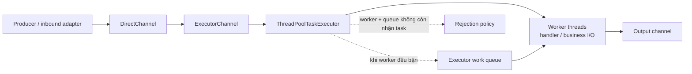
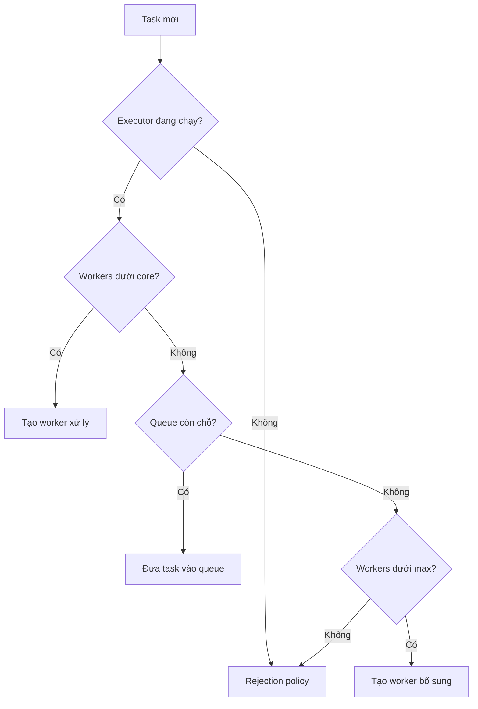
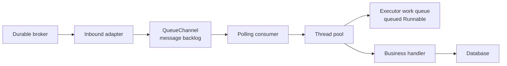
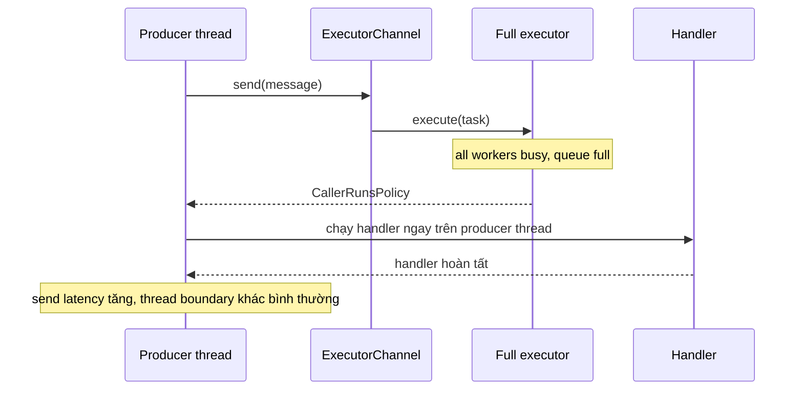
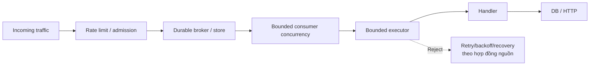

# Executor pool, queue capacity và rejection

## 1. Bài toán hiệu năng: chạy đồng thời bao nhiêu là đủ?

Một `IntegrationFlow` của Spring Integration có thể nhận message từ HTTP, broker, file adapter hoặc một `MessageChannel`; sau đó chuyển message tới consumer endpoint và handler. Khi xử lý chậm hơn tốc độ message đến, backlog tăng. Nếu dùng `ExecutorChannel` hoặc một task executor cho poller, độ trễ và khả năng tiếp nhận công việc phụ thuộc vào **thread pool**, **work queue** và **rejection policy**.

Giả sử hệ thống đồng bộ đơn hàng nhận 90 message/giây. Mỗi handler mất trung bình 120 ms để xử lý, chủ yếu là chờ HTTP/JDBC. Một pool gồm tám worker có công suất lý thuyết khoảng 67 message/giây. Khi tải đến duy trì cao hơn tải xử lý, hệ thống có thể:

- Tăng thời gian message nằm chờ trong executor queue trước khi handler bắt đầu.
- Dùng hết queue capacity và từ chối các task mới.
- Gây timeout ở API/gateway dù CPU chưa cao vì worker đang chờ I/O.
- Tạo retry storm nếu producer hoặc broker thử lại ngay khi pool vẫn quá tải.
- Làm thay đổi thread thực thi handler khi dùng `CallerRunsPolicy`.
- Tạo nguy cơ mất hoặc lặp side effect khi acknowledgement/transaction không khớp với đường xử lý bất đồng bộ.

Chủ đề thuộc chương **Hiệu năng** của module **SPRING_INTEGRATION_RUNTIME**. Mục tiêu là học cách **thiết kế, đo lường, lựa chọn và kiểm chứng** `corePoolSize`, `maxPoolSize`, `queueCapacity` và chính sách reject; đồng thời hiểu tác động lên channel, endpoint, poller, retry, transaction, message store, correlation và trạng thái runtime.

> **Nguyên tắc thiết kế:** không tăng thread hoặc queue để “che” tải vượt công suất. Hãy tìm công suất xử lý bền vững, giới hạn tài nguyên downstream, ngân sách chờ và hợp đồng message delivery trước; sau đó mới chọn cấu hình executor.

## 2. Executor xuất hiện ở đâu trong Spring Integration?

Không phải mọi message flow đều tạo task chạy bất đồng bộ. Đặc điểm quan trọng của một số thành phần:

| Thành phần | Thread xử lý thường gặp | Tác động hiệu năng |
| --- | --- | --- |
| `DirectChannel` | Thực thi subscriber trên thread gửi, nếu endpoint đồng bộ | Ít chi phí chuyển thread, nhưng producer có thể bị chặn bởi handler chậm. |
| `ExecutorChannel` | Giao việc dispatch cho một `Executor`; handler thường chạy trên worker | Tách thread nhận và thread xử lý; cần kiểm soát pool và queue. |
| `QueueChannel` | Lưu message chờ một polling consumer gọi `receive` | Là **hàng đợi message**, không phải queue task của executor. |
| Polling endpoint | Được kích hoạt bởi scheduler/trigger; có thể kết hợp task executor | Lịch poll, số message mỗi poll, transaction và concurrency cùng ảnh hưởng throughput. |
| `PublishSubscribeChannel` có executor | Subscriber có thể xử lý trên worker riêng | Fan-out, lỗi và thứ tự hoàn thành khác đường đồng bộ. |
| Handler gọi HTTP/JDBC | Theo thread do endpoint/channel cung cấp | Thread bị chiếm trong thời gian chờ I/O nếu dùng API blocking. |



Ở `ExecutorChannel`, `send(message)` có thể trả về sau khi task được executor **chấp nhận**, trước khi handler hoàn tất. Đây là một **ranh giới bất đồng bộ**. Một số ngoại lệ có thể xảy ra ngay khi submit; lỗi trong handler chạy sau đó thường đi theo error handling của worker, không mặc định trở về producer.

**Điểm cần nhớ:** `send()==true` không chứng minh đã commit dữ liệu, đã publish output hoặc broker đã ack an toàn. Phép đo throughput phải dựa trên **business completion**, không chỉ số message đã submit.

## 3. Vòng đời một task trong `ThreadPoolTaskExecutor`

`ThreadPoolTaskExecutor` là lớp Spring bọc cơ chế `ThreadPoolExecutor` của JDK và thích hợp để cấu hình một executor được Spring container quản lý. Những tham số quan trọng:

| Thuộc tính | Ý nghĩa | Lỗi hiểu nhầm thường gặp |
| --- | --- | --- |
| `corePoolSize` | Mức core worker mà pool ưu tiên tăng tới khi nhận task | Không có nghĩa mọi core thread đã được tạo ngay khi bean khởi động. |
| `maxPoolSize` | Số worker tối đa cho pool | Đặt max cao không khiến pool tự tăng tới max khi queue còn chỗ. |
| `queueCapacity` | Sức chứa queue các task chờ worker | Queue quá lớn làm độ trễ tăng dù chưa thấy reject. |
| `keepAliveSeconds` | Khoảng idle cho worker vượt core trước khi bị thu hồi theo cấu hình | Không giới hạn thời gian handler bị kẹt trong I/O. |
| `threadNamePrefix` | Prefix đặt tên thread để chẩn đoán | Không ảnh hưởng khả năng xử lý, nhưng nên đặt duy nhất theo flow. |
| `RejectedExecutionHandler` | Chính sách khi task không thể được nhận | Có thể đổi hành vi thread và khả năng giữ message. |
| Shutdown/lifecycle settings | Ứng xử khi context đóng và task đang chờ/chạy | Rejection cũng có thể xảy ra **khi shutdown**, không chỉ khi full pool. |

Với cơ chế `ThreadPoolExecutor` thông thường và executor đang chạy, một task mới đi qua trình tự gần đúng:



Do **queue được xét trước khi tăng worker vượt core**, một cấu hình `core=4, max=32, queueCapacity=10000` có thể giữ phần lớn công việc trong queue với chỉ bốn worker, ngay cả khi bạn kỳ vọng hệ thống chạy 32 luồng. Ngược lại, queue quá nhỏ làm tăng worker nhanh và có thể đẩy quá nhiều truy vấn đồng thời vào database.

### Trường hợp `queueCapacity=0`

Với `ThreadPoolTaskExecutor` thông dụng, capacity bằng 0 dẫn tới kiểu handoff không lưu task chờ (`SynchronousQueue`). Khi không có worker trống để nhận task, pool có thể tạo thêm worker cho tới `maxPoolSize`; sau đó reject theo policy.

Điều này có thể hữu ích cho workload cần **ít queue wait** và chấp nhận từ chối sớm, nhưng không phù hợp nếu producer gửi burst mà không có bộ đệm upstream. Cấu hình này **không phải** một `QueueChannel` có dung lượng 0.

### Giá trị mặc định không phải cấu hình production

Các giá trị mặc định cụ thể có thể tùy framework/version. Đừng dựa vào mặc định khi lựa chọn giới hạn hiệu năng; hãy cấu hình rõ `core/max/queue/rejection` và kiểm tra executor bean **thật sự được endpoint sử dụng**.

## 4. Ba loại queue không nên đánh đồng

Trong một hệ thống có broker, `QueueChannel` và `ExecutorChannel`, một message có thể liên quan tới ba hàng đợi:

| Queue | Chứa gì? | Ai lấy ra? | Có tự bền vững qua JVM crash không? |
| --- | --- | --- | --- |
| Broker queue/topic/partition | Message/event ở hệ thống nguồn | Adapter/consumer bên Spring Integration | Phụ thuộc cấu hình durability, ack/offset và chính broker. |
| `QueueChannel` | `Message<?>` | Polling consumer gọi `receive` | Không với store in-memory; có thể dùng persistent channel message store thích hợp. |
| Executor work queue | `Runnable`/task đã được submit | Worker thread của `ThreadPoolExecutor` | **Không**, queue task trong RAM không phải persistent message store. |



Nếu executor đã nhận một task nhưng JVM chết trước khi worker chạy nó, task trong RAM mất. Việc message có được giao lại hay không phụ thuộc vào **nguồn, acknowledgement, transaction và lưu trữ bền vững**. Tăng `queueCapacity` của executor không tạo ra khả năng phục hồi message.

**Gợi ý kiến trúc:** với tải burst lớn hoặc yêu cầu không mất message, đặt **durable backlog** ở broker/persistent message channel; dùng executor queue **bounded** chỉ để điều tiết lượng công việc trong một JVM.

## 5. Ước lượng công suất bằng tốc độ đến và thời gian xử lý

Để chọn pool, bắt đầu với các đại lượng đo được:

- `λ` (*lambda*): tốc độ message đến, đơn vị message/giây.
- `S`: thời gian trung bình một message chiếm worker, đơn vị giây.
- `n`: số worker có thể xử lý đồng thời.
- `μ`: công suất lý tưởng của pool, gần `n / S` message/giây khi các worker luôn bận và workload tương đối đồng nhất.
- `ρ`: mức sử dụng ước lượng, gần `λS / n` trong trạng thái ổn định.

Công thức cơ bản:

```text
capacity ≈ n / S                (message/s)
utilization ρ ≈ λ × S / n      (khi arrival và workload ổn định)
cần λ < capacity              (để backlog không tăng mãi)
```

### Ví dụ tính toán

Giả sử đo được `λ = 90 msg/s` và `S = 0,120 s` (120 ms/message):

- Với `n = 8`: `capacity ≈ 8 / 0,12 = 66,7 msg/s`. Tải đến lớn hơn công suất khoảng **23,3 msg/s**; backlog sẽ tăng nếu tình trạng kéo dài.
- Muốn `ρ ≤ 0,70` theo công thức lý thuyết: `n ≥ 90 × 0,12 / 0,70 ≈ 15,43`, nên cần **ít nhất 16 worker** theo ước lượng này.
- Với `n = 16`: công suất lý tưởng `≈ 133,3 msg/s` và mức sử dụng lý thuyết `≈ 67,5%`.

**Đây không phải công thức bảo đảm SLO.** Thời gian xử lý có phân phối dài, đặc biệt khi HTTP timeout hoặc chờ DB lock. CPU, connection pool, rate limit downstream và contention khiến công suất thực tế thấp hơn nhiều. Mục tiêu `ρ≤70%` chỉ là giả định để chừa headroom trong ví dụ, không phải ngưỡng cố định của Spring Integration.

### Tại sao cần đo p95/p99?

Hai workload cùng `S=120 ms` có thể có độ trễ rất khác:

- Workload A: phần lớn message đều mất khoảng 120 ms.
- Workload B: nhiều message hoàn thành trong 10 ms nhưng một số ít treo nhiều giây.

Ở workload B, các request chậm vẫn **chiếm worker** và có thể tạo hàng chờ lớn ở những thời điểm bất lợi. Chọn pool chỉ từ `S trung bình` có thể bỏ sót tail latency. Cần đo `p50/p95/p99` và số worker bị giữ bởi từng loại I/O.

## 6. Chọn `queueCapacity` từ ngân sách chờ, không từ dung lượng RAM

Nếu muốn message không phải chờ quá lâu, queue capacity phải có lý do rõ ràng. Dùng **Little's Law** làm ước lượng trong trạng thái ổn định:

```text
L = λ × W

L: số công việc trung bình trong một công đoạn của hệ thống
λ: tốc độ hoàn tất/đến ổn định (job/s)
W: thời gian trung bình ở công đoạn đó (s)
```

Nếu chỉ xét **hàng đợi trước worker**, ta có `Lq = λ × Wq`. Ví dụ, throughput ổn định khoảng `80 msg/s` và mục tiêu thời gian chờ **trung bình** `Wq=0,25 s` thì số task **trung bình** đang chờ có thể khoảng `80×0,25 = 20`.

**Cẩn trọng:** kết quả **20** không phải “hãy đặt `queueCapacity=20` là đạt p99 ≤ 250 ms”. Little's Law nói về **giá trị trung bình trong trạng thái ổn định**, không bảo đảm phân phối độ trễ, giới hạn burst hay p99. Cần load test và dự phòng theo đặc tính traffic.

### Tính với burst có thời hạn

Giả sử:

- Công suất thực tế của worker đang là **130 msg/s**.
- Trong **3 giây**, nguồn đẩy **180 msg/s**.
- Queue bắt đầu rỗng và không có nguồn tải khác.

Tốc độ tích lũy backlog xấp xỉ `180 − 130 = 50 msg/s`, nên số message chờ tăng khoảng `50 × 3 = 150`. Một queue capacity **64** có thể đầy trong burst này; queue capacity **200** có thể hấp thụ burst nếu công suất thực tế giữ được 130 msg/s và producer không làm quá tải downstream. Sau burst, queue phải **drain** trước lần tăng tải tiếp theo.

Đối với batch/seasonal traffic, cần biết **burst duration**, không chỉ peak QPS. Queue quá sâu giúp hấp thụ burst nhưng cũng kéo dài thời gian chờ của message cuối queue; giới hạn queue phải đi cùng **deadline và backpressure**.

## 7. Thiết kế theo CPU-bound và I/O-bound

| Workload | Dấu hiệu | Cách suy nghĩ về số worker |
| --- | --- | --- |
| CPU-bound | CPU gần trần, handler tính toán nhiều, ít chờ | Số worker thường bắt đầu gần số core hữu dụng; tăng quá mức gây context switch/cache contention. |
| I/O-bound | CPU còn thấp, nhiều thread chờ JDBC/HTTP | Có thể cần concurrency lớn hơn số core, nhưng bị giới hạn bởi connection pool, rate limit và timeout. |
| Mixed | Có cả tính toán, serialization và I/O | Đo riêng các pha hoặc chia bulkhead nếu có đường nóng khác nhau. |
| Key-serialized | Nhiều message cùng `accountId`/`correlationId` phải tuần tự | Tăng worker không làm cùng một key chạy song song an toàn; cần partition/key-aware design. |
| Downstream quota | API chỉ cho một lượng request/s nhất định | Concurrency không thay thế rate limit; cần throttle/buffer. |
| Long-running job | Mỗi task mất hàng chục giây hoặc phút | Không nên chiếm worker chung của flow thời gian ngắn nếu có thể tách scheduler/job executor. |

**Ví dụ giới hạn bên ngoài:** nếu executor có 32 worker nhưng JDBC connection pool chỉ có 8 connection và mỗi handler phải giữ connection trong phần lớn thời gian, nhiều worker sẽ đứng chờ connection. Tăng từ 32 lên 64 không khiến database phục vụ thêm 32 truy vấn đồng thời; nó có thể chỉ tăng memory, lock contention và latency.

Ưu tiên đo **downstream saturation** trước khi mở rộng executor.

## 8. Ví dụ Java DSL: executor riêng cho một flow

Ví dụ sau dùng Spring Integration DSL, Java 17+ và `ThreadPoolTaskExecutor`. Nó **không gọi external API thật**; mục tiêu là thể hiện wiring và ranh giới bất đồng bộ.

```java
package example.runtime.performance;

public record OrderJob(String jobId, String customerId) {}
```

Một service nhỏ:

```java
package example.runtime.performance;

public final class OrderProcessor {

    public String process(OrderJob job) {
        if (job.jobId() == null || job.jobId().isBlank()) {
            throw new IllegalArgumentException("Missing jobId");
        }
        // Trong production: database/HTTP và idempotency tùy nghiệp vụ.
        return "PROCESSED:" + job.jobId();
    }
}
```

Cấu hình:

```java
package example.runtime.performance;

import java.util.concurrent.ThreadPoolExecutor;

import org.springframework.beans.factory.annotation.Qualifier;
import org.springframework.context.annotation.Bean;
import org.springframework.context.annotation.Configuration;
import org.springframework.integration.channel.DirectChannel;
import org.springframework.integration.channel.ExecutorChannel;
import org.springframework.integration.channel.QueueChannel;
import org.springframework.integration.config.EnableIntegration;
import org.springframework.integration.dsl.IntegrationFlow;
import org.springframework.messaging.MessageChannel;
import org.springframework.messaging.PollableChannel;
import org.springframework.scheduling.concurrent.ThreadPoolTaskExecutor;

@Configuration
@EnableIntegration
public class OrderPerformanceConfiguration {

    @Bean("orders.executor")
    public ThreadPoolTaskExecutor ordersExecutor() {
        ThreadPoolTaskExecutor executor = new ThreadPoolTaskExecutor();
        executor.setCorePoolSize(8);
        executor.setMaxPoolSize(16);
        executor.setQueueCapacity(64);
        executor.setKeepAliveSeconds(30);
        executor.setThreadNamePrefix("orders-worker-");
        executor.setRejectedExecutionHandler(
            new ThreadPoolExecutor.AbortPolicy());
        return executor;
    }

    @Bean("orders.in")
    public MessageChannel input() {
        return new DirectChannel();
    }

    @Bean("orders.async")
    public MessageChannel async(
            @Qualifier("orders.executor")
            ThreadPoolTaskExecutor executor) {
        return new ExecutorChannel(executor);
    }

    @Bean("orders.results")
    public PollableChannel results() {
        return new QueueChannel(100);
    }

    @Bean
    public OrderProcessor orderProcessor() {
        return new OrderProcessor();
    }

    @Bean
    public IntegrationFlow orderFlow(OrderProcessor processor) {
        return IntegrationFlow.from("orders.in")
            .channel("orders.async")
            .handle(processor, "process")
            .channel("orders.results")
            .get();
    }
}
```

**Giải thích từng ranh giới:**

1. `orders.in` nhận message từ producer đồng bộ.
2. `orders.async` là `ExecutorChannel`, submit task vào `orders.executor`.
3. Executor có **8 core workers**, tối đa **16 workers**, queue **64 tasks**. Với cơ chế queue-before-grow, task có thể chờ queue trước khi pool vượt 8 worker.
4. `OrderProcessor.process` được gọi trên worker khi task bắt đầu chạy; kết quả được chuyển đến `orders.results`.
5. `QueueChannel(100)` đầu ra chỉ dùng để quan sát trong ví dụ. Nếu output không được drain, nó cũng có thể đầy và chặn/làm lỗi worker; đây là một bottleneck **khác** queue executor.

`AbortPolicy` chủ động báo lỗi khi không thể nhận task; nó không tự giải quyết chuyện message có được broker redeliver hay không. Cần đặt xử lý overload ở producer/adapter và bảo đảm acknowledgment phù hợp.

Spring container quản lý khởi tạo/đóng `ThreadPoolTaskExecutor` bean. Khi viết Java ngoài Spring với `new ThreadPoolTaskExecutor()`, phải chủ động `initialize()` và `shutdown()` theo lifecycle.

### Gửi message và quan sát kết quả

```java
import org.springframework.context.ApplicationContext;
import org.springframework.messaging.Message;
import org.springframework.messaging.MessageChannel;
import org.springframework.messaging.PollableChannel;
import org.springframework.messaging.support.GenericMessage;

MessageChannel input =
    context.getBean("orders.in", MessageChannel.class);
PollableChannel output =
    context.getBean("orders.results", PollableChannel.class);

boolean accepted = input.send(new GenericMessage<>(
    new OrderJob("O-101", "C-7")));

Message<?> reply = output.receive(2_000);
System.out.println("accepted=" + accepted);
System.out.println("reply=" +
    (reply == null ? "timed out" : reply.getPayload()));
```

`context` là `ApplicationContext` đã khởi động. `accepted==true` không có nghĩa kết quả đã đến `orders.results`; vì async boundary, phải chờ reply trong khoảng hữu hạn. Hai message khác nhau có thể hoàn tất **khác thứ tự đã gửi**.

## 9. Rejection policy: lựa chọn có ảnh hưởng tới semantics

Khi pool/queue hết năng lực hoặc executor không còn chạy, `RejectedExecutionHandler` quyết định điều gì xảy ra với task mới.

| Policy Java | Hành vi chính | Đánh đổi trong message flow |
| --- | --- | --- |
| `AbortPolicy` | Ném `RejectedExecutionException` (Spring có thể bọc thành `TaskRejectedException` hoặc message exception) | **Fail-fast, quan sát được**; caller phải có chính sách retry/nack/backpressure. |
| `CallerRunsPolicy` | Khi executor chưa shutdown, chạy task trên thread gọi `execute` thay vì submit vào worker | Backpressure bằng cách chặn producer, nhưng có thể phá giả định async/thread/transaction. |
| `DiscardPolicy` | Có thể bỏ task mà không báo exception | Nguy cơ **mất tác dụng nghiệp vụ âm thầm**; không phù hợp cho message quan trọng. |
| `DiscardOldestPolicy` | Có thể bỏ task ở đầu queue rồi thử gửi task mới | Có thể mất message cũ, phá ordering hoặc correlation. |
| Custom policy | Theo logic ứng dụng | Phải chứng minh overload, failure, shutdown và observability bằng test. |

### `AbortPolicy`: thường là điểm khởi đầu rõ ràng

Khi không thể nhận task, exception giúp upstream biết cần giảm tốc hoặc đưa message về nguồn durable để redeliver. Tuy nhiên, nếu exception bị nuốt trong một adapter/error flow mà nguồn đã ack, **fail-fast chưa đồng nghĩa không mất message**.

### `CallerRunsPolicy`: áp backpressure nhưng đổi thread



Policy này **có thể phù hợp** khi caller được phép chờ, không giữ lock/transaction nhạy cảm và không phải event-loop yêu cầu phản hồi nhanh. Nhưng nếu producer là gateway HTTP hoặc poller có transaction/ack semantics đặc biệt, việc handler bất ngờ chạy trên producer thread có thể tạo độ trễ, timeout hoặc side effect khác với đường worker thường ngày.

**Lưu ý quan trọng:** `CallerRunsPolicy` của JDK khi executor đã shutdown có thể **không chạy task**. Không được coi nó là cơ chế đảm bảo delivery trong mọi trường hợp.

### Vì sao tránh discard cho nghiệp vụ quan trọng?

Task có thể bị bỏ khi upstream đã coi `send` thành công. Khi đó không có kết quả, không có handler exception và đôi lúc không có error message để đối chiếu. Nếu message mang ý nghĩa chuyển tiền, tạo đơn hoặc cập nhật tồn kho, đây là rủi ro lớn. Cần phép thử **lost-business-effect**, không chỉ metric “errors=0”.

## 10. Backpressure phải xuất hiện trước khi tài nguyên cạn

Một executor bounded chỉ là **điểm giới hạn cuối**; nó không thay thế chính sách điều tiết tổng thể. Những lựa chọn thường gặp:

- **Producer throttle:** giới hạn tốc độ gửi theo tenant, endpoint hoặc nguồn.
- **Durable backlog:** cho message chờ ở broker hoặc persistent channel store thay vì tích tụ vô hạn trong executor RAM.
- **Consumer concurrency control:** giới hạn số handler đồng thời theo năng lực downstream.
- **Bounded retry:** khi quá tải tạm thời, retry với backoff/jitter và số lần hữu hạn; quá hạn đưa vào DLQ/recovery path.
- **Bulkhead:** tách executor cho nhóm công việc có SLA hoặc downstream khác nhau.
- **Circuit breaker/timeout:** ngăn worker bị giữ quá lâu bởi hệ thống ngoài đang lỗi.
- **Admission control:** trả lỗi overload rõ ràng khi hệ thống không có cách giữ yêu cầu an toàn.



**Phân biệt hai câu hỏi:** “làm sao có chỗ chứa message trong đợt burst?” nên được trả lời bằng **durable buffer và backpressure**; “bao nhiêu task nên thực thi đồng thời?” nên được trả lời bằng **executor pool và giới hạn tài nguyên downstream**.

## 11. Poller và executor: không đẩy lỗi sang chỗ khác

Đối với `QueueChannel`/message store có poller, lịch nhận message và độ đồng thời xử lý tương tác với nhau:

- `fixedDelay` hoặc trigger quyết định thời điểm polling.
- `maxMessagesPerPoll` giới hạn số message một lượt poll có thể lấy.
- Một `taskExecutor` được cấu hình ở poller/endpoint có thể đổi concurrency và thread thực thi.
- Nếu flow chuyển tiếp qua `ExecutorChannel`, có thêm một async boundary và queue task khác.
- Đặt cả poller concurrency lẫn executor concurrency rất cao có thể khiến downstream bị quá tải dù mỗi cấu hình nhìn riêng đều có vẻ hợp lý.

Ví dụ khái niệm:

```text
Persistent QueueChannel --poller--> DirectChannel --> handler
         (message)          (polling thread)

Persistent QueueChannel --poller--> ExecutorChannel --> handler
         (message)          (submit)          (worker)
```

Ở sơ đồ thứ hai, poller có thể nhận message rồi submit nhanh, còn handler chạy sau. Nếu transaction của poller chỉ bao `receive + send`, nó **không tự bao** business operation trên worker thread. Một reject khi submit cũng cần được xử lý sao cho source message chưa ack có thể retry, hoặc có durable handoff khác.

**Không giả định “thêm executor sau poller” là tăng throughput an toàn.** Phải kiểm tra cả transaction, acknowledgements, error routing và message còn ở đâu khi JVM crash.

## 12. Transaction, retry và idempotency dưới overload

Overload làm tăng xác suất timeout và retry. Khi thiết kế thread pool, cần xác định một số ranh giới:

| Ranh giới | Nguy cơ | Biện pháp cần xác minh |
| --- | --- | --- |
| Broker/source → `send` | Source ack trước khi worker hoàn tất | Ack/redelivery đúng thời điểm, durable handoff. |
| `ExecutorChannel` → worker | Task đã accepted nhưng còn ở RAM | Crash có thể mất task; không coi accepted là committed. |
| Worker → database | Transaction dài hoặc connection pool cạn | Timeout hợp lý, transaction scope ngắn, đo rollback/commit. |
| Worker → HTTP API | API thành công rồi client timeout/retry | Idempotency key phía API hoặc reconciliation. |
| Retry advice → executor | Retry tức thì khi full | Retry budget, backoff/jitter và admission control. |
| Error channel / DLQ | Error handler cũng bị nghẽn | Dành tài nguyên cho recovery path; đo exhausted count. |

`ExecutorChannel` thường đổi thread xử lý; resource binding của local JDBC transaction **không tự đi qua async boundary**. Nếu một upstream transaction kết thúc sau khi `send` accepted mà handler sau đó fail, không thể kỳ vọng transaction upstream rollback business operation của worker.

Đối với message được giao lại do timeout/restart, dùng **business idempotency key ổn định**, unique constraint, transactional outbox hoặc hợp đồng idempotent của tài nguyên đích. Không dùng `MessageHeaders.ID` ngẫu nhiên làm khóa duy nhất nếu redelivery tạo Message mới với ID khác.

## 13. Throughput, latency và ordering/correlation

Tăng concurrency có thể làm throughput tăng nhưng không bảo đảm giữ thứ tự xử lý:

```text
Input:     E1, E2, E3
Workers:   E1 mất 300 ms, E2 mất 20 ms, E3 mất 40 ms
Completed: E2, E3, E1
```

Nếu nghiệp vụ cần xử lý tuần tự theo `accountId` hoặc `orderId`, không nên chỉ đẩy tất cả message vào cùng executor rồi hy vọng thứ tự giữ nguyên. Những lựa chọn có chủ đích:

- Partition theo business key và giới hạn một worker tại mỗi partition, nếu transport hoặc flow hỗ trợ.
- Dùng resequencer khi cần **sắp lại đầu ra**, hiểu rằng resequencer không thay thế tính tuần tự của side effect đã xảy ra.
- Dùng `CorrelationStrategy`/`ReleaseStrategy` và `MessageGroupStore` khi gom nhóm fragment; xác định chính sách missing/duplicate/late messages.
- Khóa đúng tài nguyên nghiệp vụ khi cần tuần tự hóa critical section; coi lock contention là giới hạn throughput thực tế.
- Tách các message độc lập sang worker song song, không sử dụng một khóa toàn cục quá rộng.

**Hiệu năng và tính đúng phải được đo cùng nhau.** Một cấu hình cho ra 5.000 accepted messages/giây nhưng làm mất ordering hoặc ghi DB hai lần không phải cấu hình thành công.

## 14. Quan sát executor: số nào thực sự cần?

Một số API đo được trực tiếp từ `ThreadPoolTaskExecutor` khi bean đã khởi tạo:

```java
import org.springframework.context.ApplicationContext;
import org.springframework.scheduling.concurrent.ThreadPoolTaskExecutor;

ThreadPoolTaskExecutor executor = context.getBean(
    "orders.executor", ThreadPoolTaskExecutor.class);

System.out.printf(
    "core=%d max=%d pool=%d active=%d queue=%d completed=%d%n",
    executor.getCorePoolSize(),
    executor.getMaxPoolSize(),
    executor.getPoolSize(),
    executor.getActiveCount(),
    executor.getQueueSize(),
    executor.getThreadPoolExecutor().getCompletedTaskCount());
```

Đây là **snapshot**, không phải bản ghi thời gian. Số `completed` cũng chỉ phản ánh executor task kết thúc, **không chứng minh business transaction đã commit thành công**.

| Chỉ số | Cách diễn giải |
| --- | --- |
| `activeCount` / `poolSize` | Bao nhiêu worker đang bận/tồn tại tại thời điểm đo. |
| `queueSize` và queue capacity | Mức backlog task trước khi bắt đầu thực thi. |
| Rejection count | Bao nhiêu task không được chấp nhận; cần instrument rõ ràng. |
| Enqueue-to-start latency | Message/task chờ executor bao lâu trước handler. |
| Handler execution latency | Thời gian worker bị chiếm bởi nghiệp vụ; đo p50/p95/p99. |
| End-to-end message latency | Từ source nhận tới business completion/ack, gồm cả queue wait. |
| Accepted/completed/failed/duplicate | Phân biệt dispatch thành công với kết quả nghiệp vụ. |
| Broker lag / `QueueChannel` depth | Áp lực nguồn trước executor. |
| DB connection-pool pending/HTTP latency | Bottleneck downstream có thật sự do thread count? |
| CPU/GC/memory/thread count | Tăng worker/queue có gây pressure vào JVM không? |

Có thể dùng Micrometer và Spring Boot Actuator để xuất metric nếu ứng dụng đã cấu hình instrumentation phù hợp. **Không mặc định** mọi executor tự có metric `rejected` hoặc histogram queue wait chỉ vì Actuator đã bật; kiểm tra những metric thực sự tồn tại trong runtime.

### Đặt tên executor và flow

Dùng `threadNamePrefix("orders-worker-")` và bean name `orders.executor` để truy từ log/thread dump tới flow. Nếu nhiều flow dùng chung executor, log nên ghi thêm **endpoint ID**, message business key, correlation/trace ID và pha `SUBMITTED/STARTED/COMMITTED/FAILED`. Không ghi toàn bộ payload hoặc thông tin nhạy cảm vào logs.

## 15. Load test: đo đúng trước khi điều chỉnh pool

Một thử nghiệm tuning nên có ít nhất ba pha:

**Pha A — Baseline:** chạy với cấu hình hiện tại, đo tốc độ đến, tốc độ business completion, throughput ổn định, độ trễ end-to-end, queue wait và queue depth. Ghi rõ thời gian warm-up, input size, số partition/key và đặc điểm downstream.

**Pha B — Sweep cấu hình:** thay đổi lần lượt `corePoolSize`, `maxPoolSize` và `queueCapacity` trong các tổ hợp có giới hạn. Mỗi lần chạy giữ nguyên traffic và các yếu tố khác để so sánh. Đừng thay đồng thời cả database pool, HTTP timeout và executor rồi kết luận riêng một biến tạo khác biệt.

**Pha C — Burst/failure:** đưa burst ngắn, làm downstream chậm có kiểm soát, kiểm tra retry/backpressure/rejection, rồi đưa tải trở về bình thường. Quan sát **queue drain** và khả năng phục hồi sau lỗi.

### Ma trận gợi ý

| Cấu hình | Core | Max | Queue | Câu hỏi thử nghiệm |
| --- | ---: | ---: | ---: | --- |
| A | 4 | 4 | 32 | Có đủ tải cơ sở và giới hạn memory chặt không? |
| B | 4 | 16 | 32 | Khi queue đầy, tăng worker có cải thiện tail latency không? |
| C | 8 | 16 | 64 | Điểm cân bằng throughput/queue wait/reject ở đâu? |
| D | 16 | 16 | 16 | Giảm queue wait có đánh đổi rejection và áp lực DB không? |
| E | 8 | 16 | 0 | Handoff trực tiếp tạo reject sớm ra sao khi có burst? |

Các con số là **mẫu thử**, không phải cấu hình chuẩn. Kết luận cần dựa trên số đo tại phần cứng, dữ liệu và API thật.

### Tránh sai lệch khi đo

- **Open-loop vs closed-loop:** một client chờ response trước khi gửi request tiếp có thể tự giảm tốc khi hệ thống chậm, khiến tưởng throughput vẫn ổn. Nếu muốn kiểm tra nguồn đến cố định, dùng bộ phát tải duy trì tốc độ mục tiêu và ghi riêng request bị từ chối.
- **Coordinated omission:** khi hệ thống chậm, nếu công cụ không tính cả thời gian chờ trước khi phát/nhận request, p99 có thể bị đánh giá thấp.
- **Warm-up và JIT:** không lấy mỗi kết quả vài giây đầu làm kết luận.
- **Key distribution:** một key nóng với lock/ordering khác với 10.000 key độc lập.
- **Downstream rate limits:** test mock HTTP quá nhanh không phản ánh production.
- **Error path:** đo cả reject, retry, dropped, DLQ, idempotent duplicate, không chỉ success throughput.
- **GC và heap:** queue chứa nhiều task/message payload lớn có thể giữ reference lâu và tăng memory pressure.

## 16. Kiểm thử bounded pool/rejection bằng JUnit 5

Để thấy rõ ngưỡng pool/queue, dùng `CountDownLatch` giữ một worker bận thay vì `Thread.sleep`. Đây là **test định tính** cho cơ chế reject, không phải throughput benchmark.

### 16.1. Gate cho worker

```java
package example.runtime.performance;

import java.util.concurrent.CountDownLatch;
import java.util.concurrent.TimeUnit;

public final class WorkerGate {

    private final CountDownLatch entered = new CountDownLatch(1);
    private final CountDownLatch release = new CountDownLatch(1);

    public String work(String id) {
        entered.countDown();
        try {
            if (!release.await(10, TimeUnit.SECONDS)) {
                throw new IllegalStateException("Gate timeout");
            }
            return "DONE:" + id;
        } catch (InterruptedException e) {
            Thread.currentThread().interrupt();
            throw new IllegalStateException("Interrupted", e);
        }
    }

    public boolean awaitFirst(long seconds) throws InterruptedException {
        return entered.await(seconds, TimeUnit.SECONDS);
    }

    public void open() {
        release.countDown();
    }
}
```

### 16.2. Flow thử nghiệm riêng

```java
package example.runtime.performance;

import java.util.concurrent.ThreadPoolExecutor;

import org.springframework.beans.factory.annotation.Qualifier;
import org.springframework.context.annotation.Bean;
import org.springframework.context.annotation.Configuration;
import org.springframework.integration.channel.DirectChannel;
import org.springframework.integration.channel.ExecutorChannel;
import org.springframework.integration.channel.QueueChannel;
import org.springframework.integration.config.EnableIntegration;
import org.springframework.integration.dsl.IntegrationFlow;
import org.springframework.messaging.MessageChannel;
import org.springframework.messaging.PollableChannel;
import org.springframework.scheduling.concurrent.ThreadPoolTaskExecutor;

@Configuration
@EnableIntegration
public class BoundedExecutorTestConfig {

    @Bean("test.executor")
    public ThreadPoolTaskExecutor executor() {
        ThreadPoolTaskExecutor executor = new ThreadPoolTaskExecutor();
        executor.setCorePoolSize(1);
        executor.setMaxPoolSize(1);
        executor.setQueueCapacity(1);
        executor.setThreadNamePrefix("bounded-test-");
        executor.setRejectedExecutionHandler(
            new ThreadPoolExecutor.AbortPolicy());
        return executor;
    }

    @Bean("test.in")
    public MessageChannel input() {
        return new DirectChannel();
    }

    @Bean("test.async")
    public MessageChannel async(
            @Qualifier("test.executor") ThreadPoolTaskExecutor executor) {
        return new ExecutorChannel(executor);
    }

    @Bean("test.out")
    public PollableChannel output() {
        return new QueueChannel(10);
    }

    @Bean
    public WorkerGate gate() {
        return new WorkerGate();
    }

    @Bean
    public IntegrationFlow testFlow(WorkerGate gate) {
        return IntegrationFlow.from("test.in")
            .channel("test.async")
            .handle(String.class, (payload, headers) -> gate.work(payload))
            .channel("test.out")
            .get();
    }
}
```

### 16.3. Test task thứ ba bị reject

```java
package example.runtime.performance;

import java.util.HashSet;
import java.util.Set;

import org.junit.jupiter.api.Test;
import org.springframework.context.annotation.AnnotationConfigApplicationContext;
import org.springframework.messaging.Message;
import org.springframework.messaging.MessageChannel;
import org.springframework.messaging.PollableChannel;
import org.springframework.messaging.support.GenericMessage;
import org.springframework.scheduling.concurrent.ThreadPoolTaskExecutor;

import static org.junit.jupiter.api.Assertions.*;

class BoundedExecutorTest {

    @Test
    void thirdTaskIsRejectedWhenWorkerAndQueueAreFull()
            throws Exception {

        try (var context = new AnnotationConfigApplicationContext(
                BoundedExecutorTestConfig.class)) {

            MessageChannel input =
                context.getBean("test.in", MessageChannel.class);
            PollableChannel output =
                context.getBean("test.out", PollableChannel.class);
            ThreadPoolTaskExecutor pool =
                context.getBean("test.executor", ThreadPoolTaskExecutor.class);
            WorkerGate gate = context.getBean(WorkerGate.class);

            try {
                assertTrue(input.send(new GenericMessage<>("A")));
                assertTrue(gate.awaitFirst(5));

                // A đang chạy và bị giữ; B nằm ở work queue capacity 1.
                assertTrue(input.send(new GenericMessage<>("B")));
                assertEquals(1, pool.getQueueSize());

                // AbortPolicy từ chối task thứ ba khi pool không còn chỗ.
                assertThrows(RuntimeException.class, () ->
                    input.send(new GenericMessage<>("C")));

            } finally {
                gate.open(); // Luôn nhả worker, cả khi assertion thất bại.
            }

            Set<String> actual = new HashSet<>();
            for (int i = 0; i < 2; i++) {
                Message<?> reply = output.receive(5_000);
                assertNotNull(reply);
                actual.add((String) reply.getPayload());
            }

            assertEquals(Set.of("DONE:A", "DONE:B"), actual);
            assertNull(output.receive(100));
        }
    }
}
```

Bài test xác minh **ngưỡng cơ chế**: một task đang chạy, một task queued, task mới bị reject. Dùng `RuntimeException` như assertion gọn vì exception có thể được Spring messaging bọc lại; khi đưa test vào sản phẩm thật, cần kiểm tra cause chain và assert reject **không phải** lỗi nghiệp vụ ngẫu nhiên.

**Không suy ra** từ bài test này rằng broker redelivery đã đúng hoặc queue bền vững. Không nên dùng một gate cố ý chặn worker trong production.

## 17. Shutdown, deployment và dynamic flow

Khi `ThreadPoolTaskExecutor` hoặc Spring context đang shutdown, task mới có thể bị reject **dù không có saturation**. Cần phân biệt hai trường hợp khi quan sát log:

| Trường hợp | Dấu hiệu | Hướng xử lý |
| --- | --- | --- |
| Pool đầy vì tải | `active≈max`, queue đạt capacity, rejected tăng | Tìm bottleneck, thiết kế backpressure, tuning theo load test. |
| Pool đang stop/shutdown | Rejected gần thời điểm deploy, context close, flow stop hoặc executor shutdown | Điều phối lifecycle, quiesce ingress, drain task và kiểm tra startup readiness. |

Với `IntegrationFlowContext` và các `IntegrationFlowRegistration` đăng ký động, start/stop một flow không tự bảo đảm work queue đã rỗng. Nếu hai flow **dùng chung executor**, việc quản lý lifecycle một registration cũng không nhất thiết shutdown executor bean dùng chung. Đừng đóng executor khi một flow khác vẫn đang sử dụng nó.

Trước khi deploy/rolling restart:

1. Ngăn nhận thêm message mới ở ranh giới phù hợp, hoặc giữ ở durable source.
2. Quan sát message backlog, executor work queue và task in-flight.
3. Cho task hoàn tất có giới hạn thời gian nếu nghiệp vụ yêu cầu drain.
4. Xác minh ack, transaction và idempotency của message chưa hoàn tất.
5. Khởi động lại flow sau khi downstream và error/recovery path sẵn sàng.
6. Kiểm tra effective state của **mọi replica**, không chỉ một JVM.

Chính sách `waitForTasksToCompleteOnShutdown` và timeout chờ shutdown có thể cấu hình theo phiên bản Spring/framework. Không xem graceful shutdown là cơ chế duy nhất để giữ message: **SIGKILL bỏ qua cleanup**, task trong RAM vẫn mất.

## 18. Các anti-pattern và hướng khắc phục

| Anti-pattern | Vì sao gây vấn đề | Thay thế |
| --- | --- | --- |
| `queueCapacity` rất lớn để tránh reject | Che giấu queue wait, giữ nhiều task/payload trong heap, latency p99 tăng | Queue bounded + durable backlog + admission control. |
| `maxPoolSize` rất cao trong khi queue luôn còn chỗ | Pool không mở rộng như kỳ vọng vì queue-before-grow | Chọn core/queue theo hành vi mong muốn; đo runtime. |
| Tăng worker khi DB connection pool đã cạn | Chỉ tạo thêm thread chờ, tăng contention | Tối ưu DB/pool/query, giới hạn concurrency sát downstream. |
| Dùng `DiscardPolicy` cho message quan trọng | Có thể mất task không được quan sát | Fail-fast hoặc retry/durable handoff rõ ràng. |
| Dùng `CallerRunsPolicy` mà không test thread boundary | Handler bất ngờ chạy trên thread caller, kéo dài send | Test overload, transaction và timeout; dùng chỉ khi phù hợp. |
| Retry vô hạn không backoff khi reject | Tạo feedback loop, hệ thống càng quá tải | Retry budget, exponential backoff/jitter, DLQ, source throttling. |
| Chỉ đếm accepted tasks | Accepted không đồng nghĩa committed | Đo business completion/duplicates/rejects/error outcomes. |
| Một executor cho mọi flow | Một adapter chậm gây nghẽn ứng dụng khác | Tách bulkhead cho workloads quan trọng. |
| Queue executor thay thế broker | Work queue in-memory không bền vững qua restart | Dùng broker/persistent channel store cho durable backlog. |
| Bỏ qua correlation/ordering | Parallelism thay đổi thứ tự hoàn tất | Partition theo key hoặc resequencer/idempotent downstream. |
| Ack ngay sau async submit | Crash giữa submit và handler làm mất công việc | Định nghĩa ack sau durable handoff/business completion phù hợp. |
| Benchmark chỉ đo throughput trung bình | Bỏ qua p95/p99, burst và reject | Đo cả latency distribution và failure/recovery. |

### Bảng chẩn đoán nhanh khi cấu hình hoạt động không như mong đợi

| Triệu chứng | Điều cần kiểm tra trước |
| --- | --- |
| Pool luôn ở core dù `max` lớn | Queue có đang quá lớn/chưa đầy? |
| CPU thấp nhưng queue tăng | Worker đang chờ DB, HTTP, lock, connection pool hoặc output channel? |
| Reject ngay sau deploy | Executor đang shutdown hoặc chưa start? |
| Không reject nhưng producer latency tăng | Có dùng `CallerRunsPolicy` hoặc blocking send? |
| Output không có message dù submit accepted | Handler exception, result queue đầy, error route hoặc task vẫn đang chờ? |
| Tăng concurrency làm trùng cập nhật | Idempotency và transaction của tài nguyên nghiệp vụ có đúng không? |
| Backlog không giảm sau scale | Downstream rate limit, DB locks hoặc key hot serialization? |
| Message mất sau crash | Queue task nằm trong RAM và source đã ack trước khi hoàn tất? |
| Message hoàn tất đảo thứ tự | Executor parallelism, correlation/resequencer/partition strategy? |
| Retry làm reject tăng | Backoff, retry budget và số in-flight task đã giới hạn chưa? |

## 19. Thực hành tuning và câu hỏi tự kiểm tra

**Bài 1 — Quan sát pool-before-queue.** Chạy `OrderPerformanceConfiguration` với `core=8, max=16, queue=64` và một handler mô phỏng I/O chậm có kiểm soát. Đo pool size sau 8, 20 và 80 task; giải thích khi nào pool tăng vượt core.

**Bài 2 — Rejection xác định.** Chạy `BoundedExecutorTest`. Thay `queueCapacity` từ 1 thành 2, đo số task có thể accepted trước lần reject tiếp theo; giữ các yếu tố khác cố định.

**Bài 3 — So sánh ba policy.** Trên môi trường test, thử `AbortPolicy`, `CallerRunsPolicy` và `DiscardPolicy` ở cùng lưu lượng. Đo exception, send latency, handler thread name và số business completion. Giải thích vì sao “errors=0” không đồng nghĩa không mất công việc.

**Bài 4 — Tính công suất.** Với 150 msg/s và thời gian handler trung bình 80 ms, tính mức worker tối thiểu theo công suất lý tưởng và theo mục tiêu sử dụng 70%. Sau đó thêm 10% message mất 2 giây, thực hiện load test để xem công thức trung bình dự đoán kém ở đâu.

**Bài 5 — Burst budget.** Giả lập một burst 200 msg/s kéo dài 5 giây trên hệ thống xử lý ổn định 140 msg/s. Ước lượng backlog tăng; thiết kế queue capacity và chính sách từ chối phù hợp ngân sách latency mà không bỏ qua persistence.

**Bài 6 — JDBC pool bottleneck.** Cho executor 32 worker nhưng DataSource chỉ có 8 connections; giả lập transaction dài. Quan sát thread chờ connection và throughput; đưa ra phương án cải thiện đúng chỗ.

**Bài 7 — Poller + ExecutorChannel.** Tạo persistent `QueueChannel` và poller gửi task qua `ExecutorChannel`. Kiểm tra ranh giới transaction, source ack, reject và crash trước khi worker bắt đầu. Thiết kế một cách durable handoff/idempotency.

**Bài 8 — Key ordering.** Gửi xen kẽ các update cho hai `orderId` với độ trễ handler khác nhau. Quan sát thứ tự completion và thiết kế partition/serialization theo key thay vì bắt toàn bộ ứng dụng chỉ có một worker.

**Bài 9 — Bulkhead.** Cho flow A gọi HTTP API chậm, flow B cập nhật DB nhanh; đầu tiên dùng chung executor, sau đó tách executor. Đo latency và rejection của B trong cả hai trường hợp.

**Bài 10 — Kịch bản production-like.** Chạy tải bình thường → burst → downstream slowdown → phục hồi. Ghi throughput, queue wait, p95/p99, rejected/failed/duplicate, backlog nguồn và thời gian drain. Chọn cấu hình cuối dựa trên kết quả, không chỉ từ số core CPU.

### Câu hỏi tự kiểm tra

1. Vì sao `ExecutorChannel` khiến `send()==true` chưa chứng minh handler đã thành công?
2. `QueueChannel` khác executor work queue về dữ liệu chứa và độ bền thế nào?
3. `ThreadPoolExecutor` ưu tiên mở rộng worker vượt core hay enqueue khi queue còn chỗ?
4. Với `queueCapacity=0`, hành vi nhận task khác queue bounded như thế nào?
5. Khi nào `maxPoolSize` rất lớn vẫn không giúp tăng số worker?
6. Công thức `capacity≈n/S` bỏ sót những yếu tố nào của workload thật?
7. Little's Law có cho phép suy ra trực tiếp p99 queue wait từ queue capacity không?
8. Tại sao tăng số worker khi JDBC pool cạn có thể làm hệ thống tệ hơn?
9. `AbortPolicy` và `CallerRunsPolicy` khác nhau ở backpressure và thread boundary ra sao?
10. Vì sao `DiscardPolicy` nguy hiểm khi xử lý đơn hàng/thanh toán?
11. Có cách nào hấp thụ burst mà không dùng executor queue khổng lồ?
12. Tại sao retry tức thì khi executor full có thể tạo retry storm?
13. Khi polling consumer gọi `ExecutorChannel`, transaction và acknowledgement có những rủi ro gì?
14. Vì sao tăng concurrency có thể thay đổi ordering dù tổng throughput tăng?
15. Những metric nào phải đo ngoài `activeCount` và `queueSize`?
16. Làm sao phân biệt rejection do saturation với rejection do shutdown?
17. Tại sao một test dùng latch tốt hơn `Thread.sleep` để tái hiện full pool?
18. Khi nào nên tách executor theo bulkhead và khi nào nên giữ một pool dùng chung?

**Nguyên tắc vận hành:** chọn `executor pool`, `queue capacity` và `rejection policy` từ **nhu cầu throughput, độ trễ, tính chất workload và khả năng chịu tải downstream**; kiểm chứng qua load test có đo p95/p99, queue wait và business completion. Giữ queue bounded, đặt durable backlog ở đúng lớp, áp backpressure và retry có giới hạn, đồng thời bảo vệ transaction, acknowledgement, idempotency, ordering và correlation khi chuyển sang xử lý bất đồng bộ.
