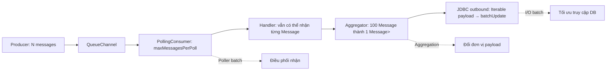
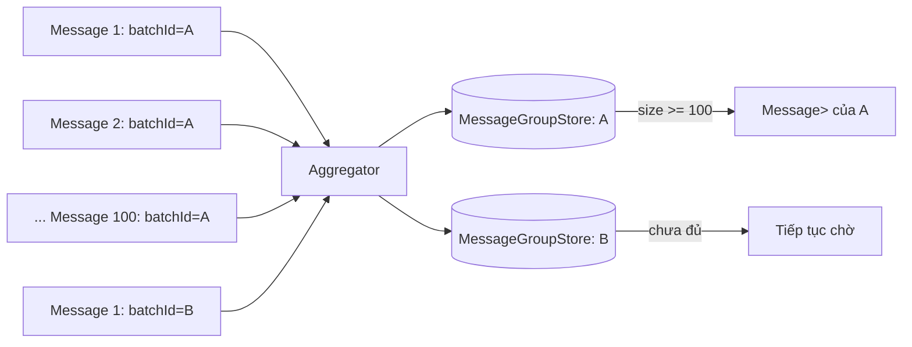
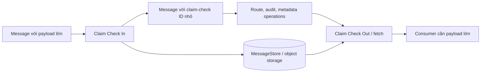
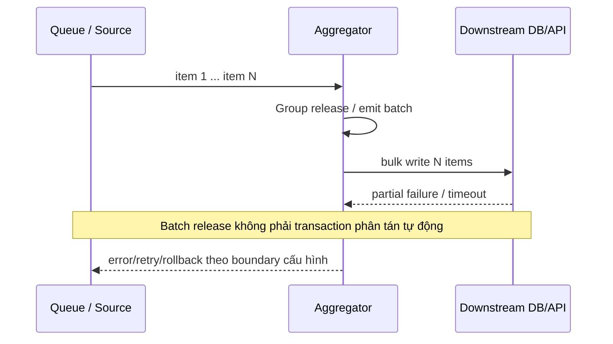

# Batching và payload size trong Spring Integration

## 1. Vì sao gom batch có thể làm hệ thống nhanh hơn — hoặc chậm hơn?

Trong module **SPRING_INTEGRATION_RUNTIME**, message đi qua channel, consumer, poller, executor và endpoint để hoàn thành công việc. Khi số message/giây tăng, cách tối ưu thường được đề xuất là **gom nhiều message thành một batch**. Đề xuất này chỉ đúng khi hiểu rõ bottleneck và chi phí của **payload size**.

Ví dụ một endpoint ghi 5.000 dòng hàng vào database:

- Gửi 5.000 lệnh INSERT đơn lẻ có thể chịu nhiều lần round-trip, prepare, commit hoặc call overhead.
- Gom 100 dòng thành mỗi batch có thể giảm số lượt tương tác JDBC.
- Nhưng gom thành một batch 5.000 dòng có thể tạo payload lớn, thời gian giữ transaction lâu, heap tăng mạnh và chỉ một dòng lỗi làm cả batch khó xử lý.
- Nếu nguồn chỉ có 2 đơn hàng mỗi giây, đợi đủ 100 phần tử có thể khiến message đầu tiên chờ gần một phút, dù throughput trung bình được cải thiện.

Vì vậy cần tối ưu **ba thứ cùng lúc**:

1. **Throughput:** số message/item nghiệp vụ hoàn tất mỗi giây.
2. **Latency:** thời gian từ lúc message xuất hiện tới khi có kết quả/commit, đặc biệt p95/p99.
3. **Resource footprint:** heap, GC, CPU serialize, thread, connection, network, broker/store và thời gian giữ lock.

> **Nguyên tắc:** Batch là *đơn vị xử lý* do ứng dụng định nghĩa; message size là *chi phí vận chuyển và lưu trữ*. Một batch lớn không tự động là một transaction nguyên tử, một message bền vững hay một phương án chống duplicate.

## 2. Ba ý nghĩa khác nhau của “batch”

Trong Spring Integration, từ “batch” có thể chỉ những thứ rất khác:

| Tầng | Cơ chế | Thực chất | Điều KHÔNG nên suy ra |
| --- | --- | --- | --- |
| **Poller batch** | `maxMessagesPerPoll=50` | Một lượt poll có thể lấy tối đa 50 message tuần tự, theo cấu hình | Không biến 50 message thành một payload `List<?>` |
| **Message aggregation** | `Aggregator` / `MessageGroupStore` | Gom nhiều message tương quan, sau đó phát một message kết quả | Không tự đảm bảo output là một JDBC batch/HTTP bulk request |
| **I/O batch** | JDBC `batchUpdate`, broker producer batch, bulk HTTP API | Gửi nhiều bản ghi trong một lần giao tiếp hoặc trong một đơn vị tối ưu của adapter | Không tự giải quyết per-item idempotency hoặc atomicity của hệ thống đích |



Các bước trên có thể dùng cùng nhau hoặc độc lập. Nếu chỉ sửa poller `maxMessagesPerPoll` từ 1 lên 50 mà handler vẫn chạy một JDBC INSERT cho từng message, có thể tăng số message được nhận mỗi lượt poll, nhưng **không tự giảm 50 cuộc gọi JDBC xuống một**.

### Một ví dụ về sự nhầm lẫn phổ biến

```xml
<int:service-activator id="writeOneOrder"
                       input-channel="ordersQueue"
                       ref="orderWriter"
                       method="writeOne">
    <int:poller fixed-delay="1000"
                max-messages-per-poll="100"/>
</int:service-activator>
```

Method `orderWriter.writeOne(...)` vẫn được gọi **theo từng message** được poll, trừ khi payload của chính message là collection và handler có logic bulk. Giá trị 100 là **giới hạn vòng polling**, không phải kích thước của một `Message<List<Order>>`.

## 3. Mô hình chi phí: giảm overhead nhưng tăng thời gian chờ

Một xấp xỉ hữu ích khi downstream hỗ trợ batch:

```text
Thời gian xử lý 1 batch (N phần tử)
  ≈ fixed_overhead_per_batch
    + N × item_processing_cost
    + serialization_and_network_cost(N)
    + transaction/commit overhead
```

Thông lượng một luồng batch gần đúng:

```text
throughput_items_per_second
  ≈ N / batch_processing_time_seconds
```

Nhưng **end-to-end latency** của phần tử đầu batch còn cộng thêm **thời gian chờ thu thập đủ phần tử**. Với nguồn đều 20 item/s, một batch đợi đủ 100 item có thể khiến item đầu đợi khoảng 5 giây trước khi batch bắt đầu xử lý. Nếu SLA p99 chỉ 500 ms, chính sách đó không phù hợp dù server giảm CPU.

Bảng minh họa số giả định, không phải benchmark mặc định của Spring Integration:

| N (item/batch) | Fixed overhead | Chi phí/item | Batch duration lý tưởng | Chờ gom tối đa nếu nguồn 20 item/s |
| ---: | ---: | ---: | ---: | ---: |
| 1 | 5 ms | 0,2 ms | 5,2 ms | ~0 ms |
| 10 | 5 ms | 0,2 ms | 7 ms | ~0,5 s |
| 100 | 5 ms | 0,2 ms | 25 ms | ~5 s |
| 1.000 | 5 ms | 0,2 ms | 205 ms | ~50 s |

Trong thực tế overhead còn gồm network MTU, broker limits, serialization, GC, lock contention và transaction duration; throughput không tiếp tục tăng tuyến tính mãi.

**Mục tiêu không phải chọn N lớn nhất.** Mục tiêu là chọn *một miền cấu hình* giữ p95/p99 latency, heap, retry và DB load trong SLO trong khi đạt thông lượng mục tiêu.

## 4. Bốn cơ chế giới hạn batch thực tế

Một chiến lược batch an toàn thường có nhiều điều kiện flush:

| Điều kiện | Ví dụ | Mục đích |
| --- | --- | --- |
| **Count** | Tối đa 100 items | Giới hạn số phần tử và overhead per-batch |
| **Bytes** | Tối đa 1 MiB encoded data | Tránh payload vượt hạn mức network/broker/heap |
| **Time** | Phát batch chậm nhất sau 500 ms từ phần đầu | Giảm thời gian chờ ở lưu lượng thấp |
| **Business boundary** | Chỉ gom cùng tenant, transaction key hoặc routing destination | Giữ semantics và isolation |

Một bộ ba thường dùng là **100 items hoặc 1 MiB hoặc 500 ms, tùy điều kiện nào xảy ra trước**; nếu có ràng buộc nghiệp vụ, batch còn phải kết thúc tại partition/tenant/transaction boundary.

Nhưng không có một method DSL duy nhất tự làm đủ mọi điều kiện với mọi source. Tùy mô hình, dùng:

- **Aggregator** với `CorrelationStrategy` và `ReleaseStrategy` cho count/logic nghiệp vụ; thêm timeout/expiry policy và metadata nếu cần.
- **Reactor `bufferTimeout`** khi nguồn và consumer thực sự reactive; nếu cần giới hạn bytes riêng phải thêm logic.
- **Adapter batch** khi downstream đã nhận một `Iterable` hoặc collection; ví dụ JDBC outbound adapter.
- **Custom batcher** có byte budget, deadline, flush và durable state cho nghiệp vụ riêng.

Không dùng một `List` mutable toàn cục không có đồng bộ hóa làm batch builder khi message có thể tới từ nhiều worker threads.

## 5. Poller: maxMessagesPerPoll không bằng kích thước batch payload

Theo Spring Integration Reference:

- `PollingConsumer` đọc `PollableChannel` có mặc định `maxMessagesPerPoll=-1`: trong một lượt, nó có thể tiếp tục gọi `receive()` cho tới khi trả `null`.
- `SourcePollingChannelAdapter` đọc `MessageSource` có mặc định `maxMessagesPerPoll=1`; nó có thể lấy thêm nếu cấu hình.
- `receiveTimeout` là khoảng chờ khi `receive()` chưa lấy được message, không phải thời gian đợi đủ N item để tạo batch.
- `fixedDelay`/`fixedRate` điều khiển thời điểm trigger. Nếu handler mất nhiều thời gian, poller có thể chậm hơn lịch.
- Với source adapter, `maxMessagesPerPoll=0` có semantics đặc biệt từ Spring Integration 5.5: bỏ qua gọi `MessageSource.receive()`. Đừng suy rộng ý nghĩa này cho mọi `PollingConsumer`.

### Ví dụ thay đổi throughput polling

```xml
<int:channel id="ordersQueue">
    <int:queue capacity="1000"/>
</int:channel>

<int:service-activator id="orderWriterEndpoint"
                       input-channel="ordersQueue"
                       ref="orderWriter"
                       method="writeOne">
    <int:poller fixed-delay="1000"
                max-messages-per-poll="20"
                receive-timeout="100"/>
</int:service-activator>
```

Một lượt có thể đọc tới 20 message và gọi `orderWriter.writeOne` từng message. Nếu mỗi lời gọi mất 50 ms, xử lý 20 message tốn khoảng 1 giây, rồi `fixedDelay=1000` chờ thêm khoảng 1 giây; throughput chỉ khoảng 10 item/s (bỏ qua overhead). Với ingress 50 item/s, backlog vẫn tăng dù poller “đang chạy”.

### Fairness giữa nhiều poller

Một `PollingConsumer` với `maxMessagesPerPoll=-1` trên queue luôn có message có thể giữ một lần poll rất lâu, đặc biệt khi downstream xử lý chậm. Điều này ảnh hưởng scheduler threads và khả năng poll các endpoint khác. Chọn giới hạn dương có chủ đích để tạo cơ hội scheduling công bằng, hoặc thiết kế executor riêng khi cần.

**Đừng sửa poller trước khi đo**: handler có thể đang chậm vì DB, retry hoặc lock; tăng `maxMessagesPerPoll` có thể chỉ kéo dài một lượt transaction và khiến sự cố nặng hơn.

## 6. Gom message bằng Aggregator

Spring Integration có `Aggregator` để gom message theo **correlation key** trong một `MessageGroupStore`. `ReleaseStrategy` quyết định khi nào group đủ điều kiện phát output, còn `MessageGroupProcessor` quyết định payload của output.

Ví dụ: mỗi batch tải vào kho dữ liệu gồm đúng 100 fragment của cùng `batchId`.



### Java DSL: gom đủ 100 phần tử

```java
import java.util.List;
import org.springframework.context.annotation.Bean;
import org.springframework.context.annotation.Configuration;
import org.springframework.integration.config.EnableIntegration;
import org.springframework.integration.dsl.IntegrationFlow;
import org.springframework.integration.store.MessageGroupStore;
import org.springframework.integration.store.SimpleMessageStore;

@Configuration
@EnableIntegration
public class OrderBatchFlowConfiguration {

    @Bean
    public MessageGroupStore orderBatchStore() {
        return new SimpleMessageStore(); // Chỉ in-memory, dùng cho lab.
    }

    @Bean
    public IntegrationFlow collectOrderBatch(
            MessageGroupStore orderBatchStore) {

        return IntegrationFlow.from("orderPartsIn")
                .aggregate(a -> a
                        .messageStore(orderBatchStore)
                        .correlationStrategy(message ->
                                message.getHeaders().get("batchId"))
                        .releaseStrategy(group ->
                                group.size() >= 100)
                        .outputProcessor(group ->
                                group.getMessages().stream()
                                        .map(m -> (OrderItem) m.getPayload())
                                        .toList())
                        .expireGroupsUponCompletion(false))
                .channel("orderBatchesOut")
                .get();
    }
}
```

`OrderItem` là payload ứng dụng, ví dụ `record OrderItem(String orderId, String sku, int quantity) {}`. Producer phải đặt header `batchId` **không rỗng** trên mọi message; `orderPartsIn` và `orderBatchesOut` cần được cấu hình/channel hóa và output cần một consumer phù hợp. Với `SimpleMessageStore`, các nhóm chưa đủ 100 sẽ **mất khi JVM restart**.

**Giới hạn của ví dụ:**

1. Nó giả định mỗi batch đã có `batchId` riêng và đúng 100 phần tử hợp lệ. Đây **không** phải một window tự phân chia stream liên tục thành từng nhóm 100.
2. `group.size() >= 100` chỉ đếm message trong group; nó **không tự chứng minh đủ 100 business fragment khác nhau** nếu có duplicate hoặc thiếu item.
3. `expireGroupsUponCompletion(false)` giữ metadata completed để xử lý late arrivals, đồng thời có thể tăng số nhóm tồn tại nếu không có cleanup/reaper thích hợp.
4. Không có timeout → batch thiếu phần sẽ chờ mãi nếu không có thêm logic expire/recovery.
5. Output vẫn chỉ là **một message có payload `List<OrderItem>`**; downstream phải hỗ trợ bulk để có lợi ích I/O.
6. Danh sách được tạo từ `group.getMessages()` **không mặc nhiên giữ thứ tự arrival hoặc `sequenceNumber`**; nếu downstream cần thứ tự, hãy sắp xếp tường minh theo khóa ổn định hoặc dùng resequencer thích hợp.

### Vòng đời correlation key và group

Nếu chỉ dùng key `tenantId`, message của tenant A có thể dồn vào một group quá lâu và trở thành **hot group**. Khi xử lý một batch hoàn chỉnh, hãy dùng khóa có vòng đời như `tenantId + batchRunId`, hoặc chọn windows bằng cơ chế batching khác. Trộn nhiều tenant vào cùng batch có thể phá transaction boundary, routing, quota và quyền truy cập.

Tài liệu Spring Integration xác nhận cập nhật một group được bảo vệ bằng `LockRegistry` theo correlation ID: nhiều message cùng key tới đồng thời sẽ được tuần tự hóa. Khóa bảo vệ consistency nhưng **không** biến một hot group thành nhiều luồng xử lý song song.

## 7. Count + timeout: tránh batch thiếu phần bị kẹt

Nếu nguồn không chắc gửi đủ 100 phần tử, cần chính sách timeout. Spring Integration có `groupTimeout`/`groupTimeoutExpression` và `MessageGroupStoreReaper`.

Một biến thể cấu hình (tùy version) của aggregator:

```java
return IntegrationFlow.from("orderPartsIn")
        .aggregate(a -> a
                .messageStore(orderBatchStore)
                .correlationStrategy(m -> m.getHeaders().get("batchId"))
                .releaseStrategy(g -> g.size() >= 100)
                .groupTimeout(2000)
                .sendPartialResultOnExpiry(true)
                .expireGroupsUponCompletion(false))
        .channel("orderBatchesOut")
        .get();
```

**Cực kỳ quan trọng:** `groupTimeout(2000)` thường là timeout từ **lần message cuối cập nhật group**, không phải cam kết “mọi item được phát muộn nhất 2 giây sau item đầu”. Nếu message liên tục tới nhưng nhóm chưa đạt count, timeout có thể liên tục được dời. Nếu business SLO yêu cầu deadline tính từ **message đầu**, thiết kế thêm deadline/`groupTimeoutExpression` dựa trên group creation timestamp hoặc batcher có timer rõ ràng.

Khi timeout xảy ra, aggregator kiểm tra lại release strategy và sau đó áp dụng partial/discard policy. `sendPartialResultOnExpiry(true)` cho phép phát kết quả một phần khi expiry, nhưng **không có nghĩa kết quả partial hợp lệ với mọi nghiệp vụ**.

### Nên làm gì với partial batch?

- Gắn marker/headers nghiệp vụ, ví dụ `batchPartial=true`, `expectedCount=100`, `actualCount=17` (do ứng dụng tạo và truyền).
- Với một thao tác bulk có thể nhận ít phần tử hơn, xử lý partial như batch bình thường nhưng ghi audit.
- Nếu nghiệp vụ yêu cầu đủ một file 100 dòng, **không** tự động commit một phần. Có thể đưa vào recovery/retry và phát cảnh báo.
- Khi late messages đến sau release, cần phân biệt group completed, group expired và khả năng tạo group mới nếu metadata đã bị xóa.
- Chọn retention/reaper policy; không giữ vô hạn mọi group đã complete trong RAM.

Reaper quét theo lịch nên timeout **xấp xỉ theo schedule**, không phải timer chính xác từng mili giây. Khi dùng persistent `MessageGroupStore`, cấu hình callback/cleanup trên đúng store và đúng correlating handler; đừng chia sẻ một store instance tùy tiện giữa các aggregator có expiry.

## 8. Gom theo byte budget thay vì chỉ count

Hai batch cùng 100 message có thể chênh nhau hàng chục lần về payload:

```text
Batch A: 100 × 1 KiB   ≈ 100 KiB payload bytes
Batch B: 100 × 150 KiB ≈ 14,6 MiB payload bytes
```

Nếu external API chỉ cho body 2 MiB hoặc broker có max frame/message size, **count threshold không đủ**.

Một chính sách hợp lý:

```text
flush if:
   itemCount >= 100
   OR encodedBytes + nextEncodedBytes > 1 MiB
   OR elapsedSinceFirstItem >= 500 ms
   OR business partition changes
```

**Đo encoded bytes**, không phải `String.length()`. UTF-8 có ký tự nhiều byte; JSON field name, quote, escape sequences, headers, multipart framing, compression và metadata đều làm kích thước trên wire khác kích thước object trong heap.

### Ví dụ tính kích thước JSON trước khi gửi

```java
import com.fasterxml.jackson.databind.ObjectMapper;
import java.util.List;

public final class JsonBatchSizer {

    private final ObjectMapper mapper;

    public JsonBatchSizer(ObjectMapper mapper) {
        this.mapper = mapper;
    }

    public int encodedBytes(List<OrderItem> batch) throws Exception {
        // Dùng đúng codec/config mà transport thật sự dùng.
        return mapper.writeValueAsBytes(batch).length;
    }
}
```

Đây là cách đo **chính xác đối với JSON codec này**, nhưng có thể tốn CPU/heap vì tạo toàn bộ byte array mỗi lần đo. **Đừng serialize lại toàn bộ batch khi thêm từng item**, vì tổng chi phí có thể trở thành O(N²). Tốt hơn là:

1. Serialize một item **một lần** và cache bytes cho tới khi flush, hoặc tính kích thước tăng dần theo định dạng đã biết.
2. Dự trù overhead của dấu phẩy, brackets, envelope/headers và frame.
3. Có **hard cap** kiểm tra kích thước thật trước gửi, kể cả khi estimate thấp hơn thực tế.
4. Từ chối/chia nhỏ một item đơn lẻ đã vượt cap: nó không thể được cứu bằng cách giảm batch count.
5. Không log toàn bộ serialized payload chỉ để biết kích thước.

Với payload đã nén, quyết định batch budget dựa trên **wire size** phù hợp transport, nhưng phải theo dõi cả **uncompressed size** để tránh OOM khi giải nén. Nén giảm network traffic nhưng thêm CPU và nguy cơ resource amplification.

## 9. Payload size: đâu là kích thước “thật”?

Một `Message<?>` có thể được biểu diễn ở nhiều tầng:

| Tầng | Điều cần đo | Nguy cơ nếu chỉ đo một tầng |
| --- | --- | --- |
| Payload object trong heap | Retained size, referenced objects, temporary copies | Java `String` hoặc collection có overhead lớn hơn bytes serialized |
| Encoded payload | JSON/Avro/Protobuf byte length | Bỏ qua envelope, headers, framing, compression |
| Transport frame/message | Headers, body, broker properties, protocol overhead | Vượt max message/frame size của broker |
| Persistent store | Serialized payload, DB rows/indexes, retention | Tăng I/O, DB disk, GC khi deserialize |
| Response/ack | Body trả về, timeout và batch result metadata | Client không biết phần tử nào đã thành công |

Ví dụ message có payload là `List<Map<String,Object>>`: Java collection chứa nhiều object tham chiếu và entry; JSON có thể gọn hơn trong file, nhưng lúc deserialize lại phát sinh nhiều object. Nếu aggregator giữ 1.000 `Message<?>` thì ngoài payload còn có **1.000 bộ headers**, group metadata và các object liên quan.

Vì vậy hãy đo đồng thời **bytes trên wire**, **heap/live set**, **GC pause**, **serialization CPU** và **batch in flight** thay vì một metric `payloadBytes` duy nhất.

### Công thức ước lượng chi phí in-memory

```text
rough_inflight_payload_bytes
  ≈ batch_items
     × avg_encoded_item_bytes
     × concurrent_batches
     × effective_in_memory_copy_factor
```

Ví dụ **200 item × 80 KiB/item × 8 batch đồng thời × 2 bản sao ≈ 250 MiB** chỉ tính phần bytes. Nếu còn headers, collection, DB driver buffers, direct byte buffers và output response, mức sử dụng thực tế có thể lớn hơn đáng kể. Đây là **ước lượng công suất**, không phải công thức đo heap chính xác.

Đặc biệt cần nhân thêm số **queue/boundary** đang giữ bản sao hoặc tham chiếu của payload. Một `QueueChannel` chứa message và một executor task queue chứa request không nhất thiết copy bytes mỗi lần, nhưng serializer, compression, aggregation và logging có thể tạo buffer mới.

## 10. Streaming thay vì mang toàn bộ payload lớn trong RAM

Với file rất lớn, thay vì đọc toàn bộ file thành `byte[]` rồi gửi qua nhiều channel, có thể dùng:

- `File` hoặc file path/`Resource` làm payload khi consumer có thể mở và đọc đúng thời điểm.
- `InputStream`/`Reader` khi lifecycle dòng dữ liệu được quản lý chặt chẽ.
- Spring Integration **`FileSplitter`**, mặc định đọc từng dòng bằng iterator cho nguồn text phù hợp.
- External object storage và **Claim Check**: lưu payload ở kho riêng, truyền reference/ID trong message, lấy lại khi cần.

### FileSplitter và sequence size

Theo Spring Integration Reference, `FileSplitter` mặc định sử dụng `Iterator` để không cần tải tất cả dòng vào memory. Nhưng với iterator không biết trước số phần tử, splitter có thể đặt `SEQUENCE_SIZE=0`. Nếu downstream dùng **default aggregator release strategy dựa trên sequenceSize**, group có thể **không bao giờ release** vì không biết tổng số fragment.

Vì vậy, đối với file lớn:

1. Truyền `fileId`/`correlationId` ổn định.
2. Chọn release strategy phù hợp: end-of-file marker, record count từ metadata, timeout/discard policy hoặc bước streaming sink không cần aggregator.
3. Giới hạn số dòng đang được lưu trong group; tránh gom toàn bộ file vào một List khổng lồ.
4. Đảm bảo file path còn tồn tại trong lúc xử lý; với distributed workers, local path của node A có thể không đọc được trên node B.

### Claim Check: tách dữ liệu lớn khỏi message đi qua nhiều bước



Spring Integration có `claim-check-in` và `claim-check-out` transformers. Incoming transformer ghi message vào `MessageStore` và trả một ID làm payload mới; outgoing transformer lấy lại message gốc. Nếu cần sống qua restart, chọn store bền vững phù hợp, không dùng in-memory store mặc định.

```xml
<int:claim-check-in id="storeLargePayload"
                    input-channel="largePayloadIn"
                    message-store="payloadMessageStore"
                    output-channel="withClaimId"/>

<int:claim-check-out id="restoreLargePayload"
                     input-channel="needPayload"
                     message-store="payloadMessageStore"
                     output-channel="processLargePayload"
                     remove-message="true"/>
```

`remove-message="true"` là chọn **lấy một lần rồi xóa**, cần kiểm chứng idempotency/retry: nếu downstream thất bại sau khi message bị xóa, payload có thể không còn để replay. Nếu cần nhiều consumer cùng lấy hoặc cần replay, quản lý retention/reference count riêng.

Claim Check có thêm **I/O ghi/đọc**; chỉ nên dùng khi giảm được chi phí mang payload qua nhiều chặng hoặc tách lưu trữ là yêu cầu kiến trúc, không phải tối ưu miễn phí.

## 11. Batch JDBC: khi một message Iterable thực sự tạo batchUpdate

Với `JdbcMessageHandler`/JDBC outbound channel adapter, Spring Integration hỗ trợ batch update từ **version 5.1**: khi **request message payload là `Iterable`**, handler dùng API JDBC `batchUpdate`, xây parameter sources cho từng phần tử. Đây là **batch I/O thật**, khác `maxMessagesPerPoll`.

Ví dụ XML (trích đoạn context có namespace `int-jdbc`):

```xml
<int-jdbc:outbound-channel-adapter
    id="ordersJdbcBatchWriter"
    channel="ordersJdbcBatches"
    data-source="dataSource"
    query="INSERT INTO order_lines (order_id, amount)
           VALUES (:payload[orderId], :payload[amount])"/>
```

Một request message trên `ordersJdbcBatches` có payload kiểu `List<Map<String,Object>>`:

```java
import java.math.BigDecimal;
import java.util.List;
import java.util.Map;

import org.springframework.messaging.support.MessageBuilder;

List<Map<String, Object>> rows = List.of(
        Map.of("orderId", "O-1", "amount", new BigDecimal("12.50")),
        Map.of("orderId", "O-2", "amount", new BigDecimal("15.00")));

ordersJdbcBatches.send(
        MessageBuilder.withPayload(rows).build());
```

Ở đây `ordersJdbcBatches` là bean `MessageChannel` đã được inject, `dataSource` có bảng `order_lines`, và JDBC dependency/schema đã được cấu hình. Một `Map` item được handler wrap phù hợp để truy cập thuộc tính qua SQL parameter expression. Truy vấn và cú pháp parameter phải được kiểm thử với version/dialect cụ thể.

**Giới hạn quan trọng:**

- `JdbcMessageHandler` không hỗ trợ chế độ batch khi dùng `keysGenerated`.
- JDBC driver/backend có thể chia một batch thành nhiều request nội bộ; xem driver metrics và database plan.
- Batch update không tự bảo đảm mọi dòng thành công khi có lỗi; **partial counts, BatchUpdateException và transaction rollback** phụ thuộc JDBC driver, transaction và DB.
- Nếu cần atomic all-or-nothing cho toàn batch, dùng transaction boundary phù hợp với DB; external API/broker nằm ngoài local DB transaction.
- Không gửi toàn bộ hàng triệu dòng thành một `Iterable` vô hạn nếu implementation phải materialize parameter array hoặc lặp nhiều lần.
- Đừng giả định thứ tự output và generated keys cho mọi driver khi batch nhiều row.

**Kiểm tra bằng benchmark:** so sánh 1 item/message gọi JDBC từng lần với một message payload chứa 10/50/100 item. Ghi cả DB round trips, commit duration, lock waits, CPU serialization, failure recovery và p99 latency.

## 12. Transaction: batch size càng lớn, rollback càng đắt

Một batch có 200 item thường có ít nhất ba mức atomicity:

1. **Atomicity của việc tạo batch:** nhiều message đã được aggregator nhận đủ và ghi group state.
2. **Atomicity của downstream storage:** ví dụ SQL transaction có 200 INSERT và commit/rollback.
3. **Atomicity của external side effect:** ví dụ HTTP bulk endpoint xử lý từng item, gửi email hoặc payment; có thể partial success không rollback được.



### Ba crash windows cần kiểm thử

| Crash xảy ra lúc nào? | Rủi ro | Cơ chế bảo vệ |
| --- | --- | --- |
| Đã nhận các fragment, group còn trong RAM | Mất partial batch khi JVM chết | Persistent `MessageGroupStore` hoặc broker durable và replay |
| Đã release batch, downstream chưa commit | Batch được gửi lại hoặc mất dấu pending | Durable handoff/outbox, transaction và idempotency |
| Downstream đã ghi thành công, nguồn chưa ack | Redelivery/retry gửi lại cả batch | Unique business key, upsert/idempotency per item |

**Không tăng batch size để giảm số transaction mà bỏ qua thời gian lock DB.** Một transaction lớn có thể giữ row/table locks lâu, tăng xác suất deadlock, log volume, replication lag và rollback cost.

Khi batch gồm nhiều item độc lập, một **poison item** có thể làm cả batch lặp vô hạn. Cần policy rõ: retry toàn batch, retry subset, phân tách đôi để cô lập item lỗi, lưu per-item failure hoặc dead-letter. Không tự drop các item thành công/thất bại chỉ để queue depth giảm.

## 13. Retry với batch: một batch failure không phải N failure giống nhau

Giả sử một batch gồm `A,B,C,D`, remote bulk API trả:

```json
{
  "batchId": "B-42",
  "results": [
    {"itemId": "A", "status": "OK"},
    {"itemId": "B", "status": "OK"},
    {"itemId": "C", "status": "RETRYABLE"},
    {"itemId": "D", "status": "REJECTED"}
  ]
}
```

**Sai:** ném exception rồi retry toàn bộ batch vô điều kiện; A và B có thể bị thực hiện lại, D có thể vĩnh viễn thất bại. **Tốt hơn:**

- Giữ kết quả từng item theo `itemId`/business key, không chỉ `batchId`.
- Retry `C` theo backoff; đưa `D` vào validation/failure path; giữ audit cho A/B.
- Khi API không có kết quả per-item và timeout khiến trạng thái không rõ, tra cứu đối soát hoặc dùng idempotency key ở hệ thống đích.
- Chỉ gửi một batch lớn trong một transaction nếu toàn bộ item bắt buộc có atomic outcome.
- Đặt max attempts và deadline; không retry vô hạn một payload lớn.
- Lưu original batch manifest/record IDs đủ để replay chính xác sau restart.

### Tách batch khi gặp lỗi không biết item nào gây ra

Một kỹ thuật với lỗi deterministic và downstream cho phép xử lý lại idempotent là **binary isolation**: thử lại nửa batch để khoanh vùng item lỗi, thay vì thử lại toàn bộ N vô hạn. Nhưng phương án này chỉ an toàn nếu đã xác định **atomicity/partial commit** và có idempotency; đừng tự tách batch đã partially succeeded rồi ghi lặp ở nơi đích.

### Correlation và business identity

- `batchId`: định danh một lần gom/flush.
- `itemId`: định danh từng record/command, ổn định qua retry và re-batch.
- `correlationId`: key để aggregator tìm group, có thể trùng batchId nhưng cần quy tắc vòng đời.
- `messageId`: ID của Spring Message, có thể đổi khi rebuild.
- `attempt`: lần thử tại một boundary; không phải business identity.

Khi re-batch item thất bại từ B-42 sang B-43, `itemId` **phải giữ nguyên** nếu cùng thao tác nghiệp vụ; nếu làm idempotency key theo batch ID mới, có thể tạo duplicate side effect.

## 14. Payload compression, chunking và giới hạn transport

Khi payload tăng, cần khảo sát hạn mức của từng lớp:

| Lớp | Vấn đề | Cách làm |
| --- | --- | --- |
| HTTP gateway/outbound | Max body, request timeout, reverse proxy limit | Tách chunk, gửi streaming API nếu có, kiểm soát 413/timeout |
| JMS/AMQP/Kafka adapter | Message/frame/broker limit, producer buffering | Kiểm tra cấu hình broker/producer và codec thực tế |
| JDBC channel/message store | DB row LOB, serializer, query latency, log/replication | Chọn schema/payload format, benchmark DB I/O |
| JSON/Avro/Protobuf | Kích thước encoded, schema evolution | Đo wire bytes, version codec, giới hạn depth |
| Claim Check/object storage | I/O và retention, expiry của reference | Durable blob + manifest, cleanup idempotent |
| Gzip/zstd | CPU compress/decompress, memory expansion | Đo ratio, đặt decompressed size cap |

**Một payload lớn không phải “miễn phí” dù chỉ gửi một message.** Một 10 MiB message có thể khiến handler chiếm heap/CPU lâu hơn 1.000 message 10 KiB nếu tồn tại nhiều copies và transform ở nhiều bước.

### Chunking không giống batching

- **Batching** gom nhiều item độc lập thành một message/request.
- **Chunking** chia một payload/file quá lớn thành những mảnh nhỏ để chuyển và tái lắp.
- **Streaming** xử lý dần mà không cần tải toàn bộ dữ liệu cùng lúc.

Ví dụ file 500 MiB: **chunking** thành mảnh 1 MiB, mỗi chunk có `fileId`, `offset`, checksum và số thứ tự. Không nên dùng **aggregator in-memory** để lắp lại toàn bộ 500 MiB thành một byte array nếu downstream có thể stream trực tiếp tới object storage.

Khi cần reassemble, phải kiểm soát thứ tự, duplicate/missing chunks, timeout, integrity và persistent state. Nếu tổng số chunk không biết, default sequence-based release strategy không có đủ thông tin để release.

## 15. Backpressure và concurrency: batch có thể đẩy nghẽn sang chỗ khác

Một aggregator vừa phát 100-item batch có thể khiến downstream `ExecutorChannel`, HTTP client hoặc JDBC pool nhận tải đột ngột. Batching giảm số request nhưng tăng **kích thước và thời gian chiếm tài nguyên mỗi request**.

Các tình huống cần xem:

- `DirectChannel`: aggregator gửi output đồng bộ, thời gian giữ call stack/lock và transaction có thể kéo dài.
- `ExecutorChannel`: dispatch nhanh nhưng task queue có thể giữ nhiều batch lớn, gây heap pressure; producer không tự nhận demand theo Reactive Streams.
- `QueueChannel`: bounded capacity đếm **số message**, không trực tiếp đếm bytes; queue 1.000 batch 2 MiB có thể quá lớn.
- `FluxMessageChannel`: downstream có thể request theo Reactive Streams khi upstream là Publisher hỗ trợ demand; imperative `send()` vẫn có thể đẩy nhanh hơn khả năng xử lý.
- Broker/adapter: producer batching/caching có thể làm queue ứng dụng nhỏ nhưng broker backlog lớn, hoặc ngược lại.

### Mô hình capacity tính theo bytes

```text
inflight_bytes ≈
    pending_batches × avg_batch_bytes
    + active_batches × working_copy_factor × avg_batch_bytes
```

Nếu queue được giới hạn 100 message nhưng mỗi message là batch 5 MiB, pending payload đã khoảng 500 MiB encoded, chưa tính copies và overhead. **Bounded queue theo count** không đủ nếu payload size có phân phối lệch nặng.

Giải pháp thường là **hai giới hạn**: max in-flight batches và max bytes in-flight, cùng client timeouts/backpressure/rejection rõ ràng. Khi hạn mức bị vượt, phải có chính sách từ chối, trì hoãn, retry hoặc durable handoff; không dùng infinite buffer.

### Thứ tự và fairness

Batch quá lớn có thể khiến một tenant chiếm DB connection lâu, gây starvation các tenant nhỏ. Có thể tách queue/partition, áp dụng per-tenant quota, max byte budget, giới hạn số in-flight batch per tenant và weighted scheduling, nhưng cần giữ thứ tự nếu nghiệp vụ yêu cầu.

Nếu consumer yêu cầu processing order, `flatMap` reactive concurrency hoặc nhiều pollers có thể làm các batch hoàn tất khác thứ tự đầu vào. Dùng `concatMap`, resequencer hoặc sequence-aware processing nếu semantics cần, đánh đổi throughput.

## 16. CPU/GC: những chi phí ẩn của payload lớn

Một pipeline có thể không bị network giới hạn mà bị **allocation rate** chi phối:

```text
Message<JSON String>
    ↓ deserialize
Map/String/List object graph
    ↓ transform/enrich
new Message + headers + copied fields
    ↓ serialize
byte[] + compression buffer
    ↓ JDBC/broker client
driver/network buffers
```

Các nguồn tạo object/copy:

- `ObjectMapper.writeValueAsBytes`, `readValue`, `String.getBytes`.
- `new ArrayList<>(...)`, `stream().toList()` hoặc convert collection ở release strategy.
- Header enrichment/claim check/serialization qua nhiều chặng.
- Logging `message.toString()` hoặc JSON log toàn bộ payload.
- Retry lưu lại cùng payload/copies trong error record hoặc scheduler task.
- Reactive operator prefetch/buffering và executor task queues.

### ReleaseStrategy ảnh hưởng hiệu năng của nhóm lớn

Tài liệu Spring Integration nhấn mạnh `ReleaseStrategy` có thể được hỏi lại khi **mỗi message đến**. Đối với group rất lớn, một POJO-based strategy nhận `List<Payload>` có thể khiến framework copy/convert collection nhiều lần. Cài trực tiếp interface:

```java
import org.springframework.integration.aggregator.ReleaseStrategy;
import org.springframework.integration.store.MessageGroup;

public final class MaxCountReleaseStrategy implements ReleaseStrategy {

    private final int maxCount;

    public MaxCountReleaseStrategy(int maxCount) {
        this.maxCount = maxCount;
    }

    @Override
    public boolean canRelease(MessageGroup group) {
        return group.size() >= maxCount;
    }
}
```

Ở đây `group.size()` là **O(1) hoặc gần O(1)** tùy implementation, đơn giản hơn việc copy/deserialize mọi payload để đếm. Tuy nhiên, nếu cần xác minh sequence uniqueness, hãy dùng strategy/identity policy phù hợp; đếm đủ 100 message không chứng minh đủ 100 item riêng.

Với split sequence có header `sequenceSize` phù hợp, `SimpleSequenceSizeReleaseStrategy` là default tối ưu trong các phiên bản hiện đại; đừng tự thay bằng một strategy quét toàn bộ message để tăng “an toàn” mà chưa đo overhead.

## 17. Message store bền vững thay đổi phép tính hiệu năng

Nếu batch/group phải tồn tại qua restart, có thể dùng `JdbcMessageStore` hoặc implementation persistent `MessageGroupStore`. Điều này tăng các thao tác I/O và transaction:

- Mỗi fragment có thể phải được serialize và ghi vào store.
- Khi release, framework cần lấy group, xử lý output rồi cập nhật/xóa group messages theo policy.
- Group metadata có thể còn để nhận diện late arrivals.
- Index, table size, cleanup, DB lock và connection pool trở thành bottleneck.
- Khi nhiều instance cùng chia sẻ group store, cần distributed `LockRegistry` tương thích để bảo vệ group updates.

Một flow nhanh trong lab với `SimpleMessageStore` không đại diện cho production dùng JDBC. Benchmark cần chạy trên **cùng kiểu store, payload codec và điều kiện DB**.

### Không nhầm độ bền với correctness

Persistent store giúp khôi phục pending group, nhưng không giải quyết:

- Release output thành công mà commit marker group thất bại.
- External API hoàn thành rồi source dequeue rollback.
- Late messages tạo group mới do đã xóa completion metadata.
- Two nodes dùng local lock trên shared DB store.
- Serializer mới không đọc được stored payload cũ sau rolling deploy.

Cần idempotency per item, transaction/outbox hoặc recovery phù hợp. Với batch giao dịch lớn, bug replay có thể tạo hàng trăm duplicate trong một lần, không chỉ một record.

## 18. Metrics: đo size/latency đúng đơn vị

Một batch thành công có thể chứa 200 item nhưng chỉ là **một** `Message<?>` gửi từ aggregator. Nếu chỉ nhìn số lượng channel sends, dashboard có thể cho rằng throughput giảm sau khi bật batch, dù số item/giây tăng.

Nên tách các đơn vị:

| Metric gợi ý (ứng dụng tự khai báo) | Đơn vị | Ý nghĩa |
| --- | --- | --- |
| `app.batch.input.items` | items | Tổng item được nhận để gom |
| `app.batch.output.batches` | batches | Số batch đã phát |
| `app.batch.output.items` | items | Tổng item trong batch đã phát |
| `app.batch.size.items` | distribution | Batch size thực tế (count) |
| `app.batch.size.bytes` | bytes | Encoded/wire size thực tế |
| `app.batch.wait.duration` | time | Thời gian từ item đầu đến flush |
| `app.batch.process.duration` | time | Thời gian xử lý/commit batch downstream |
| `app.batch.partial.count` | batches | Batch bị flush do timeout/partial |
| `app.batch.item.retry` | attempts/items | Item được retry |
| `app.batch.item.terminal_failure` | items | Item lỗi terminal |
| `app.queue.oldest.age` | time | Tuổi message chờ xử lý lâu nhất |
| `app.executor.rejected` | tasks | Task bị từ chối vì saturation |
| `app.batch.inflight.bytes` | bytes | Bytes đang nằm trong batch active/pending |

Các tên này là **đề xuất instrumentation**, không phải metric built-in của mọi phiên bản Spring Integration.

Một bộ SLI hữu ích:

- **Item throughput = items được commit / giây**, không phải batches/giây.
- **Average actual batch size = items đã phát / số batches đã phát**; theo dõi thêm p50/p95/p99 vì mean có thể che nhiều batch nhỏ và vài batch khổng lồ.
- **End-to-end latency** tính từ ingress của item tới commit, bao gồm queue/batch waiting.
- **Batch processing duration** chỉ đo từ lúc batch được gửi downstream tới response/commit; tách với wait time.
- **Failure rate** theo item và theo batch; một batch partial có thể có 1 lỗi trên 100 item chứ không phải 100 lỗi.

Không dùng `batchId`, `orderId`, `correlationId` làm Micrometer tags high-cardinality. Cho vào structured log/tracing hoặc audit store, dùng tag ổn định như `flow`, `batchPolicy`, `result`, `storeType`.

## 19. Ví dụ đo batch size và xử lý bằng Micrometer

Giả sử consumer đã nhận một `Message<List<OrderItem>>` từ aggregator. Dưới đây là method endpoint ứng dụng để đo số phần tử và thời gian xử lý một lần gọi:

```java
import io.micrometer.core.instrument.DistributionSummary;
import io.micrometer.core.instrument.MeterRegistry;
import io.micrometer.core.instrument.Timer;
import java.util.List;
import org.springframework.integration.annotation.MessageEndpoint;
import org.springframework.integration.annotation.ServiceActivator;

@MessageEndpoint
public final class MeasuredBatchConsumer {

    private final MeterRegistry registry;
    private final BulkWriter writer;

    public MeasuredBatchConsumer(
            MeterRegistry registry,
            BulkWriter writer) {
        this.registry = registry;
        this.writer = writer;
    }

    @ServiceActivator(inputChannel = "orderBatchesOut")
    public void handle(List<OrderItem> batch) {
        DistributionSummary.builder("app.batch.size.items")
                .tag("flow", "orders")
                .register(registry)
                .record(batch.size());

        Timer.Sample timer = Timer.start(registry);
        String outcome = "success";

        try {
            writer.writeBatch(batch); // Ứng dụng triển khai, có transaction.
        } catch (RuntimeException | Error error) {
            outcome = "failure";
            throw error;
        } finally {
            timer.stop(Timer.builder("app.batch.process.duration")
                    .tag("flow", "orders")
                    .tag("outcome", outcome)
                    .register(registry));
        }
    }

    public interface BulkWriter {
        void writeBatch(List<OrderItem> batch);
    }
}
```

`OrderItem`/`BulkWriter` là thành phần ứng dụng. Code này **đo theo lần gọi handler**, không bảo đảm thời điểm DB transaction commit nếu commit do một advice bên ngoài xảy ra sau khi method return.

Nếu muốn metric `items_committed`, đo ở một boundary biết chắc transaction đã commit (ví dụ after-commit callback/audit event hoặc outbox record được xác nhận), không đơn thuần ghi khi `writer.writeBatch` return. Khi một batch 100 item có 2 item lỗi partial, cần metric per-item outcome chứ không gắn cả batch thành `success` vô điều kiện.

## 20. Benchmark thế nào để không tối ưu nhầm?

Benchmark đúng phải so **các policy** trong cùng điều kiện workload và correctness, không chỉ đo số request.

### Thiết kế workload

- **Input rate:** 100, 1.000, 5.000 và burst 10.000 items/s nếu phù hợp hệ thống.
- **Payload size:** 1 KiB, 10 KiB, 100 KiB, 1 MiB; có cả distribution lệch (1% rất lớn).
- **Batch count cap:** 1, 10, 50, 100, 500.
- **Batch byte cap:** 256 KiB, 1 MiB, 4 MiB.
- **Flush time:** 50 ms, 250 ms, 1 s; cùng điều kiện input.
- **Concurrency:** 1, 4, 16 worker/batches in-flight.
- **Store:** in-memory vs persistent JDBC nếu production dùng JDBC.
- **Failures:** 0%, 1% transient, 0,1% poison/permanent, remote timeout.
- **Restart:** restart worker giữa batch accumulation và giữa downstream commit.

Không cần chạy mọi tổ hợp trong một bài lab; chọn một ma trận nhỏ đại diện cho workload. Nhưng phải so **cùng business correctness**: mọi item phải được commit đúng policy hoặc có terminal failure/recovery record rõ ràng.

### Bảng ghi kết quả thí nghiệm

| Policy | Item/s đã commit | p95 end-to-end | p99 end-to-end | Peak heap | GC pause | Retry/DLQ |
| --- | ---: | ---: | ---: | ---: | ---: | --- |
| 1 item/request | đo thực tế | đo | đo | đo | đo | đo |
| 50 items/≤1 MiB/250 ms | đo thực tế | đo | đo | đo | đo | đo |
| 100 items/≤1 MiB/500 ms | đo thực tế | đo | đo | đo | đo | đo |
| 500 items/≤4 MiB/1 s | đo thực tế | đo | đo | đo | đo | đo |

Khi batch count tăng, **số request/giây thường giảm**, nhưng p99 latency có thể tăng, nhất là lúc nguồn ít message hoặc có item lớn. Nếu CPU giảm nhưng GC tăng, hãy kiểm tra peak in-flight bytes và copy factor.

### Phương pháp đo

1. Warm-up JVM/connection pool/cache và chạy nhiều lượt.
2. Cố định version Spring Integration, driver, DB schema, network, JVM heap và logging level.
3. Đo cả client ingress timestamp, enqueue time, flush time, handler start và commit time.
4. Thu thập CPU, allocation rate, heap, GC pause, DB connection/lock wait và broker lag.
5. Bật sampling/tracing có kiểm soát; logging full payload làm sai benchmark.
6. Giữ input dataset và tỷ lệ lỗi giống nhau giữa các policy.
7. So sánh **sai số/biến thiên**, không quyết định từ một lần chạy.
8. Ghi giới hạn payload của broker/HTTP/DB để biết trường hợp có thể thất bại vì size limit.

Đừng benchmark bằng một loop gọi `DirectChannel.send()` rồi kết luận hệ thống với Kafka/JDBC persistent store có cùng throughput: chi phí durability, remote round-trip và ack thay đổi hoàn toàn.

## 21. Bài thực hành theo từng lớp của runtime

### Lab A — Phân biệt poller count và JDBC batch

1. Tạo `QueueChannel` in-memory, `PollingConsumer` với `maxMessagesPerPoll=20`.
2. Handler đếm số lần `writeOne(...)` được gọi và ghi số DB statements.
3. Gửi 100 message, đo có 100 handler invocations nếu mọi message được xử lý riêng.
4. Đổi thành một message có payload `List<Map<String,Object>>` gồm 20 items tới JDBC outbound adapter.
5. Quan sát SQL batch update và các điều kiện transaction/driver.
6. Chứng minh tăng maxMessagesPerPoll không đồng nghĩa có một JDBC batch.

**PASS:** Phân biệt được `poll lượt nhận`, `handler invocations` và `database batchUpdate`.

### Lab B — Aggregator count-based

1. Tạo flow Java DSL ở phần 6, mỗi batch có header `batchId` ổn định.
2. Gửi đúng 100 item của batch A, xác minh chỉ một output với 100 payloads.
3. Gửi 20 item của batch B, xác minh B chưa release nếu chưa có timeout.
4. Gửi trùng một `itemId` và thiếu item khác, kiểm tra releaseStrategy chỉ dùng count có thể sai về nghiệp vụ.
5. Thiết kế dedup hoặc unique fragment key trước aggregation.
6. So sánh group size, release latency và memory khi tăng batch cap.

**PASS:** Không trộn batch IDs, hiểu rõ giới hạn của strategy đếm số phần tử.

### Lab C — Flush theo timeout và partial batch

1. Thêm group timeout 2 giây và `sendPartialResultOnExpiry(true)` trong lab.
2. Gửi 7 message rồi ngừng, xác minh partial output theo policy.
3. Gửi message mỗi giây nhưng vẫn chưa đủ 100; quan sát group timeout có thể bị reset khi message mới đến.
4. Thiết kế deadline từ lần đầu nếu SLA là “không đợi quá 2 giây”.
5. Kiểm thử late arrivals, discard channel và completed metadata cleanup.
6. Ghi rõ một partial batch được phép commit hay phải recovery.

**PASS:** Phân biệt **idle timeout** với **max wait from first item**.

### Lab D — Byte budget và payload lớn

1. Tạo dữ liệu 1 KiB, 10 KiB, 100 KiB và 2 MiB với codec thật.
2. Đo `ObjectMapper.writeValueAsBytes(...).length` và so với `String.length()`.
3. Áp dụng count=100 và byte cap=1 MiB, quan sát khi flush theo bytes trước count.
4. Kiểm thử một item đã quá 1 MiB: reject/chunk/claim-check, không gửi oversized request.
5. Đo peak heap, allocation, GC, CPU serialize và wire bytes.
6. Bật gzip, so sánh compressed size với decompressed heap; kiểm tra giới hạn giải nén.

**PASS:** Không có payload vượt hard cap và không OOM khi concurrency tăng.

### Lab E — FileSplitter streaming và group không biết sequenceSize

1. Tạo text file lớn và cấu hình `FileSplitter` mặc định iterator.
2. Đo heap khi đọc dần so với cách đọc toàn bộ file vào List.
3. Quan sát sequence headers của splitter với iterator có số phần tử không biết trước.
4. Thử aggregator default dựa trên `sequenceSize`; giải thích vì sao group có thể không release.
5. Thay bằng end marker/explicit business count hoặc streaming sink không cần aggregate.
6. Restart giữa file; kiểm tra checkpoint/file identity/idempotency theo yêu cầu.

**PASS:** Giảm memory nhưng không làm mất completeness của xử lý file.

### Lab F — Retry và partial bulk failure

1. Gửi batch 50 items tới một fake bulk API có kết quả từng item.
2. Cho 48 OK, 1 RETRYABLE, 1 REJECTED.
3. Kiểm tra chỉ retry item retryable; item rejected có failure record.
4. Tạo timeout sau khi API đã xử lý một phần; xác minh idempotency per item.
5. Lặp với một transaction JDBC có rollback và phân biệt DB atomicity với API partial success.
6. Bật retry advice, đo handler attempts vs item commits vs batch failures.

**PASS:** Không báo tất cả 50 item failed nếu chỉ hai item gặp vấn đề; không ghi trùng 48 item OK.

### Lab G — Hot group, lock contention và cluster

1. Gửi 10.000 item cùng một correlation key tới nhiều executor threads.
2. Đo lock wait/group update throughput.
3. Chia thành nhiều batch IDs độc lập, giữ correctness và đo lại.
4. Dùng `JdbcMessageStore` và distributed `LockRegistry` trong test hai JVM nếu production multi-instance.
5. Kiểm tra completed-group retention, expiry/reaper và DB index/locks.
6. Restart một node giữa update, xác minh group/outputs không mất hoặc double-commit.

**PASS:** Hiểu rằng cùng group được tuần tự hóa, không tăng throughput tuyến tính theo worker count.

### Lab H — Benchmark và lựa chọn policy

1. Tạo ma trận ở phần 20 cho ba batch policies.
2. Chạy tải thấp, tải trung bình, burst và failure injection.
3. Thu item throughput, p95/p99 E2E, peak heap/GC, DB lock duration.
4. Chọn policy đạt SLO và có khoảng an toàn khi payload lớn, không chỉ policy có max throughput.
5. Test shutdown/restart tại hai crash windows: đang giữ group và sau bulk success trước ack.
6. Ghi quyết định, giả định và rollback plan nếu workload production đổi.

**PASS:** Có số đo và kịch bản correctness, không chỉ cảm nhận “batch lớn nhanh hơn”.

## 22. Runbook: khi bật batching làm performance xấu đi

| Triệu chứng | Giả thuyết | Điều tra và hành động |
| --- | --- | --- |
| Request rate giảm, item throughput không đổi | Batch chưa thật sự dùng bulk API | Kiểm tra downstream handler, JDBC `batchUpdate` |
| p99 tăng dù CPU giảm | Waiting quá lâu để đủ batch | Thêm time cap / giảm count cho low traffic |
| Heap/GC tăng mạnh | Batch nhiều bytes và copies | Byte cap, reduce concurrency, claim check/streaming |
| Queue backlog tăng | Producer nhanh hơn commit, poller giới hạn thấp | Tách queue wait/handler duration, tune poller đúng chỗ |
| Một tenant chặn cả flow | Hot group, batch quá lớn, giữ lock lâu | Partition by tenant/run, quota, giảm critical section |
| JDBC deadlock/rollback tăng | Transaction quá lớn hoặc đồng thời nhiều batch | Giảm N/concurrency, index và isolation phù hợp |
| Retry gây duplicate hàng loạt | Toàn batch được replay sau partial success | Per-item key, per-item result, reconciliation |
| Batch partial bị drop | Timeout/discard policy sai | Tách terminal outcomes, DLQ/audit và group expiry |
| Restart mất batch chưa đủ | In-memory `SimpleMessageStore` | Persistent group store + compatible codec |
| Broker báo message too large | Count cap không giới hạn bytes | Encode-size hard cap, split/chunk/claim check |
| Slow logging làm throughput giảm | Log full payload mỗi message/batch | Structured metadata, sampling, không log bytes toàn bộ |
| Một batch chứa nhiều tenant | Correlation key/partition quá rộng | Business key và tenant isolation |

### Quy trình điều tra thực tế

1. Chọn **đơn vị đo**: item, batch, handler attempt, send, DB commit.
2. Xác nhận policy flush thực tế: count, bytes, timeout, boundary nào đang thắng.
3. Đo tổng latency từ item ingress tới commit, tách batch wait/queue wait/downstream.
4. Quan sát backlog bytes, active batches, heap/GC, executor saturation, DB lock waits.
5. Lấy một batch có `batchId` cụ thể, dùng log/trace để xem size/attempt/outcome; không log payload nhạy cảm.
6. Kiểm tra transaction, partial failures, retry và idempotency per item.
7. Thay **một biến** mỗi lượt test, đo lại p95/p99 và correctness.
8. Nếu vượt SLO/heap cap, rollback batch policy về cấu hình an toàn; không chờ OOM mới hành động.

## 23. Checklist trước khi áp dụng vào production

- **Biết loại batch:** poller loop, aggregator, reactive buffer, JDBC/HTTP/broker bulk, hay chunking.
- **Có kích thước tối đa theo count và bytes:** tính encoded/wire bytes thực tế; có hard cap cho oversized item.
- **Có giới hạn thời gian chờ:** hiểu rõ idle timeout vs deadline từ phần tử đầu.
- **Có ngữ nghĩa business:** batch key, tenant isolation, ordering, dedup, release/partial và late arrivals.
- **Có bounded resources:** in-flight bytes, active batches, executor queue, DB pool, scheduler threads, max group size.
- **Có transaction đúng:** biết rollback/ack/dequeue boundary và partial success của downstream.
- **Có idempotency:** item ID ổn định qua re-batch/retry/restart; batch ID không thay thế per-item identity.
- **Có persistence nếu cần:** group/pending work/DLQ/retry state sống qua restart; codec/region tương thích.
- **Có error flow:** retry exhausted, per-item failure record, dead-letter và audit.
- **Có monitoring:** item/s, batch/s, actual batch size, encoded bytes, wait/process/E2E p95/p99, heap/GC, lock waits.
- **Có benchmark:** tải thấp, burst, large payload, failure injection, restart và multi-instance.
- **Có phương án rollback:** thay đổi policy không làm mất hoặc double-process message đang chờ.

## 24. Kết luận

**Batching là quyết định về đơn vị xử lý; payload size là quyết định về bộ nhớ, serialization và vận chuyển.** Tăng `maxMessagesPerPoll` chỉ giúp polling consumer lấy nhiều message trong một lượt poll; muốn một payload `List<?>`, cần aggregation/batching rõ ràng; muốn JDBC bulk update, downstream phải nhận `Iterable` và dùng khả năng batch của handler/adapter phù hợp.

Tối ưu đúng là cân bằng **throughput, latency p95/p99, kích thước encoded, số batch đang in-flight, transaction duration, retry và business correctness**. Một batch rất lớn có thể giảm request overhead nhưng tăng heap, GC, lock contention, head-of-line blocking và chi phí rollback. Trong runtime Spring Integration, nên chọn batch cap **theo count + bytes + time + business boundary**, đo thực tế trên đúng message store/adapter, và bảo vệ restart/replay bằng persistent state cùng idempotency per item.

## Tài liệu tham khảo

- [Spring Integration Reference — Message Endpoints và Poller Configuration](https://docs.spring.io/spring-integration/reference/endpoint.html)
- [Spring Integration Reference — Channel Adapter / maxMessagesPerPoll](https://docs.spring.io/spring-integration/reference/channel-adapter.html)
- [Spring Integration Reference — Aggregator và Aggregating Large Groups](https://docs.spring.io/spring-integration/reference/aggregator.html)
- [Spring Integration API — AggregatorSpec](https://docs.spring.io/spring-integration/api/org/springframework/integration/dsl/AggregatorSpec.html)
- [Spring Integration Reference — JDBC Outbound Adapter Batch Update](https://docs.spring.io/spring-integration/reference/jdbc/outbound-channel-adapter.html)
- [Spring Integration Reference — File Splitter](https://docs.spring.io/spring-integration/reference/file/splitter.html)
- [Spring Integration Reference — Claim Check](https://docs.spring.io/spring-integration/reference/claim-check.html)
- [Spring Integration Reference — Message Store](https://docs.spring.io/spring-integration/reference/message-store.html)
- [Spring Integration Reference — Transactions](https://docs.spring.io/spring-integration/reference/transactions.html)
- [Spring Integration Reference — Metrics and Management](https://docs.spring.io/spring-integration/reference/metrics.html)
- [Project Reactor Reference — Buffering / Backpressure](https://projectreactor.io/docs/core/release/reference/)

