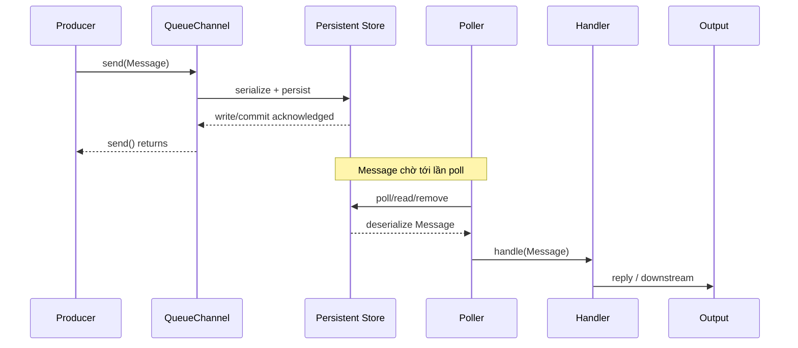
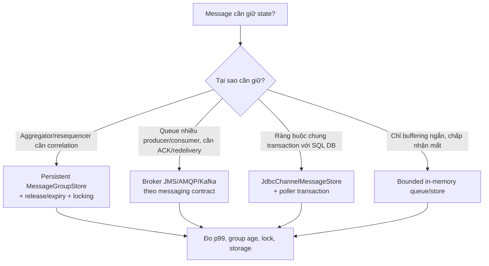
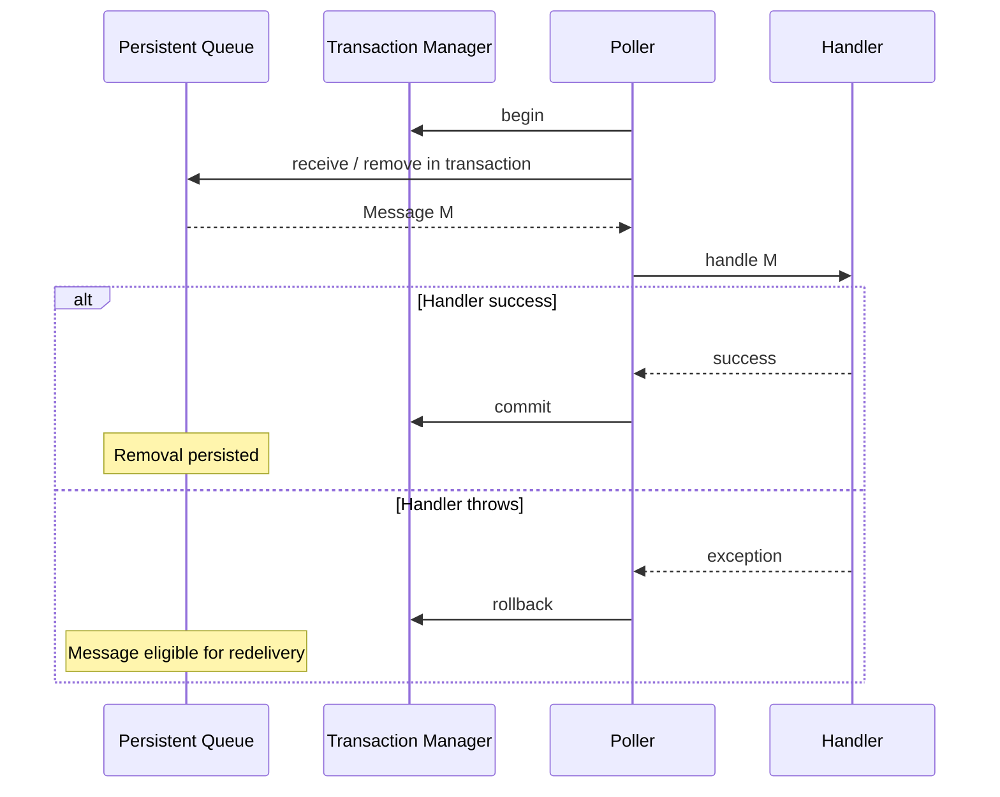
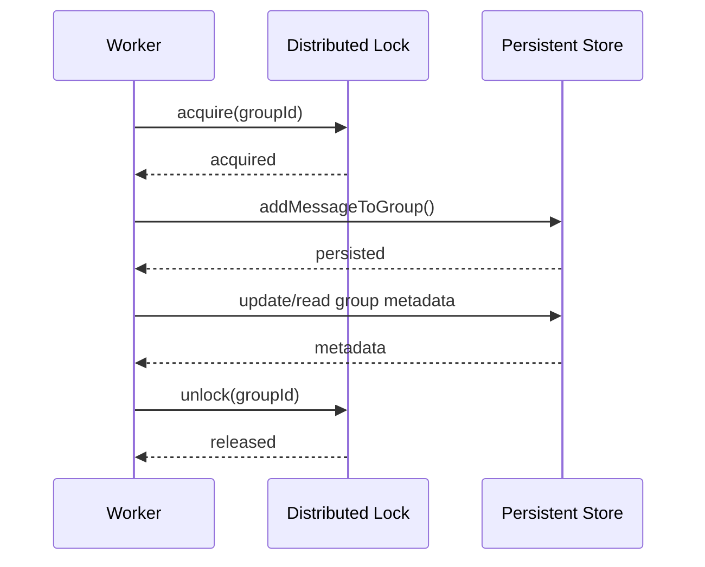
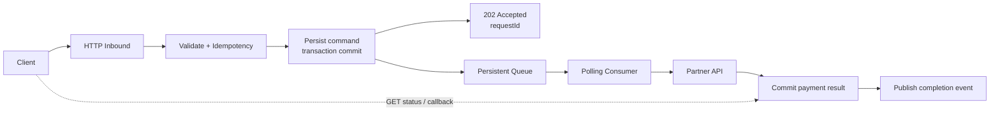

# Message store persistence và latency trong Spring Integration Runtime

## 1. Bài toán: tăng độ bền dữ liệu nhưng latency lại cao?

Trong Spring Integration, `QueueChannel`, aggregator, resequencer và delayer là những thành phần có thể **giữ message để xử lý về sau**. Khi dữ liệu chỉ nằm trong RAM, thao tác thường ít I/O hơn, nhưng message chưa xử lý có thể biến mất nếu JVM bị dừng đột ngột. Khi thay sang **persistent `MessageStore`** (JDBC, Redis, MongoDB hoặc backend khác), hệ thống có thêm khả năng khôi phục trạng thái qua restart, đồng thời phải trả chi phí của serialization, mạng, database, locking và transaction.

Ví dụ người dùng gửi yêu cầu xử lý hóa đơn:

```text
API -> QueueChannel (RAM) -> Poller -> Handler -> Database -> Reply
```

Sau khi chuyển queue sang JDBC:

```text
API -> QueueChannel (JDBC) -> Poller -> Handler -> Database -> Reply
             |                  |
        serialize + INSERT     SELECT/DELETE + deserialize
           + commit             + transaction/locks
```

Có thể quan sát thấy:

- `send()` chậm hơn do phải ghi và commit dữ liệu.
- Poller mất thêm thời gian truy vấn queue; khi không có message, database vẫn có thể bị poll nhiều lần.
- Worker tranh DB connection hoặc row locks.
- Message vào store đã nhanh nhưng chờ đến lượt poller rất lâu.
- Khi aggregator có group lớn, thao tác kiểm tra release/load metadata trở thành điểm nghẽn.
- Sau restart, hệ thống cần đọc và dựng lại nhóm/message đang chờ, làm startup chậm.
- Một cấu hình transaction không chuẩn làm throughput giảm hoặc gây duplicate/redelivery.

**Message store persistence và latency** thuộc chương **Hiệu năng** của module **`SPRING_INTEGRATION_RUNTIME`**. Bài liên hệ trực tiếp tới việc Spring Integration chạy và điều phối message flow qua channel, endpoint, consumer, poller, executor; vòng đời `IntegrationFlow`, transaction, retry, message store, error handling, correlation; đồng thời phân tích threading, hiệu năng và trạng thái runtime.

### 1.1. Mục tiêu học tập

Sau khi học, bạn có thể:

1. Phân biệt **durability, delivery guarantee, throughput, latency và backlog**.
2. Hiểu khi nào dùng `SimpleMessageStore`, `JdbcChannelMessageStore`, `JdbcMessageStore`, Redis/MongoDB stores hoặc broker.
3. Phân tách latency theo **write, commit, queue wait, poll, deserialize, lock, handler, retry, reply**.
4. Cấu hình một `QueueChannel` dựa trên JDBC và một aggregator dùng message group store.
5. Đo p50/p95/p99 và throughput một cách có thể lặp lại, không nhầm benchmark trong RAM với workload production.
6. Chẩn đoán SQL/index, connection pool, transaction boundary, polling interval và message group growth.
7. Thiết kế backpressure, scaling, recovery, observability và kiểm thử restart/rollback.

**Tham chiếu:** Spring Integration **6.x** (chủ yếu 6.5), Java 17+, Spring JDBC; các ví dụ dùng PostgreSQL khi minh họa query provider. Các thông số benchmark trong bài được ghi rõ là **giả lập**, không phải số liệu đo từ môi trường của bạn.

## 2. Những khái niệm cần tách biệt

### 2.1. Persistence không tự đồng nghĩa exactly-once

| Thuộc tính | Câu hỏi | Ý nghĩa |
|---|---|---|
| **Persistence** | Message được ghi ra nơi lưu trữ bên ngoài JVM chưa? | Có thể tồn tại sau process restart tùy backend/commit |
| **Durability** | Message đã commit có còn sau một lỗi cụ thể? | Phụ thuộc WAL/AOF, replication, storage policy, failover |
| **Acknowledgment** | Producer/consumer đã xác nhận điều gì? | ACK gửi, lưu, xử lý và commit nghiệp vụ là các mốc khác nhau |
| **At-least-once** | Message có thể được giao lại không? | Cần xử lý duplicate/idempotency |
| **At-most-once** | Message có thể mất nhưng không được thử lại? | Tùy adapter và ACK policy |
| **Exactly-once business effect** | Một tác vụ nghiệp vụ có đúng một side effect? | Cần transaction/idempotency/unique constraint/outbox tùy bài toán |
| **Latency** | Một message mất bao lâu qua flow? | Cần xác định điểm bắt đầu và kết thúc |
| **Throughput** | Số message xử lý trong một đơn vị thời gian? | Thường đo messages/s bền vững |
| **Backlog** | Bao nhiêu message còn chờ? | Tăng khi tốc độ đến vượt tốc độ phục vụ |

Một `QueueChannel` được backed bởi JDBC có thể khôi phục message đã commit sau restart; điều đó **không** có nghĩa một lời gọi HTTP ngoài transaction được rollback nếu downstream handler thất bại.

### 2.2. MessageStore, MessageGroupStore và ChannelMessageStore

Spring Integration tách một số abstraction:

| Giao diện/loại | Mục đích điển hình | Ví dụ |
|---|---|---|
| `MessageStore` | Lưu/lấy message theo ID (claim check) | `JdbcMessageStore` |
| `MessageGroupStore` | Lưu state theo group ID, correlation/release/expiry | `JdbcMessageStore`, `RedisMessageStore` |
| `BasicMessageGroupStore` | Các thao tác group tối thiểu, có thể backing queue | `JdbcChannelMessageStore` |
| `ChannelMessageStore` | Tối ưu cho `QueueChannel` | `JdbcChannelMessageStore`, `RedisChannelMessageStore` |
| `MessageGroupQueue` | Adapter `BlockingQueue<Message<?>>` chạy trên group store | `new MessageGroupQueue(store, "queue-id")` |
| `SimpleMessageStore` | Store in-memory | Test/dev hoặc use case không yêu cầu durable |

**Chọn implementation theo use case.** Spring Integration khuyến nghị `JdbcChannelMessageStore` khi backing message channel, trong khi `JdbcMessageStore` phù hợp aggregator/claim check. Không coi hai store có chi phí truy vấn và dữ liệu giống nhau.

### 2.3. Persistence không nhất thiết có chi phí bằng nhau

Một backend có thể trả ACK sau:

- Một thao tác RAM/local cache.
- Một network round trip tới Redis.
- Một database write được commit vào WAL.
- Một write có synchronous replication.
- Một batch được flush sau một thời gian.
- Một giao dịch bao gồm nhận message, xử lý nghiệp vụ và xóa message.

Mức an toàn và độ trễ phụ thuộc hợp đồng cụ thể. Ví dụ **Redis-backed store không đương nhiên cung cấp cùng durability như một transaction JDBC**; phải xét Redis persistence (RDB/AOF), replication, eviction, failover và serialization. Không xếp một backend “luôn nhanh hơn” chỉ bằng tên công nghệ.

## 3. Phân rã end-to-end latency

### 3.1. Dòng thời gian của một message



Một mô hình latency hợp lý:

```text
L_end_to_end
  = L_send_to_store
  + L_store_commit
  + L_queue_wait
  + L_poll_read_remove
  + L_deserialization
  + L_handler
  + L_retry_backoff
  + L_reply_dispatch

Trong triển khai thật, một số thành phần chồng lấn:
- serialization có thể nằm trong send/store write;
- commit của poller có thể xảy ra SAU handler;
- ack của broker hoặc gateway có ranh giới riêng.
```

Không cộng trùng `commit` với `send()` nếu instrument đo `send()` đã bao gồm thời gian commit. Luôn ghi **scope timer** rõ ràng.

### 3.2. Queue waiting thường bị bỏ qua

Giả sử publisher gửi 50 message/s, consumer chỉ xử lý được 35 message/s. Trong một giây backlog tăng khoảng 15 message nếu các con số ổn định; sau một phút tăng khoảng 900 message.

```text
Arrival rate λ = 50 msg/s
Service rate μ = 35 msg/s
Backlog growth ≈ λ - μ = 15 msg/s (khi λ > μ kéo dài)
```

Đặt backend persistent làm queue **không loại bỏ được** chênh lệch tốc độ. Nó chuyển nơi tích backlog từ heap sang storage; dung lượng disk, transaction log và index tiếp tục tăng nếu producer không được điều tiết.

Với hệ thống ổn định, Little's Law:

\[L = \lambda W\]

- `L`: số message trung bình còn trong hệ thống.
- `λ`: thông lượng hoàn thành trung bình (message/s) trong trạng thái ổn định.
- `W`: thời gian một message ở trong hệ thống (s).

Nếu trung bình có 1.000 message đang chờ/đang xử lý và throughput ổn định là 200 msg/s, thì `W ≈ 5 s`. Đây là **quan hệ trung bình**, không dùng để khẳng định p99 chỉ bằng 5 giây hoặc dùng khi backlog đang tăng không giới hạn.

### 3.3. Polling interval tạo latency kể cả khi handler rất nhanh

Với polling consumer chạy theo fixed delay/fixed rate và message đến ngẫu nhiên, nếu poller **rảnh, lịch đều và không có contention**, thời gian chờ đến poll tiếp theo có thể xấp xỉ **T/2** khi khoảng cách poll là `T`.

Ví dụ `T=1 s` thì chờ chỉ vì lịch poll trung bình có thể gần 500 ms. **Đây là xấp xỉ để hình dung**, không phải SLA hay bảo đảm; backlog, batch size, transaction, scheduling jitter và poller concurrency có thể làm wait dài hơn nhiều.

`maxMessagesPerPoll` tác động số message mỗi chu kỳ; tăng nó có thể giảm backlog nhưng cũng khiến một transaction hoặc một polling task giữ worker lâu hơn. Dùng đo thực tế để tune.

### 3.4. p99 latency không bằng average

Hai hệ thống có mean latency tương đương nhưng tail rất khác:

| Chỉ số | Giả lập A | Giả lập B |
|---|---:|---:|
| Mean end-to-end | 90 ms | 92 ms |
| p50 | 65 ms | 55 ms |
| p95 | 160 ms | 180 ms |
| p99 | 250 ms | 1.200 ms |
| Timeout rate | 0,1% | 2% |

**Số trong bảng là ví dụ minh họa.** Khi dùng persistent store, có thể gặp tail spikes từ DB checkpoint, GC, lock contention, connection acquisition, replica failover hoặc một group rất lớn.

Phải đo **p50/p95/p99, timeout/retry, throughput và backlog** cùng lúc thay vì chỉ tối ưu một average.

## 4. Chọn store theo latency và reliability

### 4.1. Bảng so sánh định tính

| Lựa chọn | Nơi dữ liệu nằm | Thế mạnh | Rủi ro/chi phí cần kiểm thử |
|---|---|---|---|
| `SimpleMessageStore` | Heap JVM | Không có network/database I/O cho store | Mất state khi crash; heap pressure, GC, giới hạn capacity |
| `JdbcMessageStore` | Relational database | Persistence cho groups, transaction SQL, dễ audit/query | Serialization, SQL/index, row locks, DB pool, group size |
| `JdbcChannelMessageStore` | Bảng queue JDBC | Tối ưu lấy/đặt message cho channels | Polling SQL, WAL/IOPS, transaction conflicts, queue growth |
| `RedisMessageStore` | Redis | Shared key-value/group state, network I/O thường thấp | Durability/eviction config, serialization, TTL, failover |
| `RedisChannelMessageStore` | Redis LIST theo channel | Queue operations chuyên biệt | Redis availability, persistence, memory, network, hot keys |
| MongoDB stores | Mongo collections/documents | Flexible document backing, lưu metadata | Index/write concern, BSON, query/transaction, document/group sizing |
| JMS/AMQP broker | Message broker | Queue/delivery/ACK được thiết kế cho messaging | Broker setup, ACK/redelivery, partitions, ordering, network |
| Kafka transport | Append-only log/broker | Durable event streaming/replay và consumer groups | Consumer lag, offset semantics, ordering per partition; không thay thẳng MessageGroupStore |

**Không có lựa chọn tốt tuyệt đối.** Nếu yêu cầu là một aggregator cần state theo group ID, dùng `MessageGroupStore` phù hợp; nếu yêu cầu là durable high-volume queue, dùng broker chuyên dụng thường hợp lý hơn việc biến relational DB thành queue nóng.

Tài liệu Spring Integration 6.5 **không khuyến khích dùng relational database như queue** trừ khi có lý do rõ, và đề nghị cân nhắc JMS/AMQP-backed channels.

### 4.2. Decision framework



Nếu ứng dụng hiện có PostgreSQL và lưu lượng vừa phải, `JdbcChannelMessageStore` có thể là lựa chọn thực tế để dùng một transaction manager. Nhưng cần xác minh **database throughput headroom và concurrency**, không tự cho rằng ít hạ tầng hơn luôn đồng nghĩa độ trễ tốt hơn.

### 4.3. Mức bảo đảm theo failure mode

Bất kỳ bảng chọn store nào cũng phải có bài kiểm thử:

- Restart ứng dụng ngay sau khi `send()` được xác nhận.
- Kill process khi message đang nằm trong store.
- Lỗi handler trước/sau DB commit.
- Database failover khi poller đang giữ transaction.
- Retry/redelivery sau timeout của caller.
- Khi store đầy, disk đầy hoặc database connection pool bị chặn.
- Khi message serializer thay phiên bản.
- Khi nhiều JVM chia sẻ một backend.

Không ghi “durable = true” trong tài liệu kiến trúc mà không nói rõ **lỗi nào được bảo vệ, mốc ACK nào và dữ liệu nào được commit**.

## 5. Cấu hình persistent QueueChannel với JDBC

### 5.1. Vì sao dùng JdbcChannelMessageStore?

`JdbcChannelMessageStore` là implementation chỉ dành cho channel, được tối ưu cho FIFO/priority queue trên một bảng riêng. Không nên dùng `JdbcMessageStore` đa năng cho queue có throughput cao nếu không có lý do. Spring Integration cung cấp `ChannelMessageStoreQueryProvider` riêng cho từng DB vì SQL lấy message cần phù hợp dialect.

Với PostgreSQL trên Spring Integration 6.2+, query provider sử dụng đường poll một câu lệnh `DELETE ... RETURNING`; đây là một tối ưu quan trọng cần xem xét khi benchmark. Dùng đúng phiên bản PostgreSQL query provider thay vì giả định các DB dùng cùng SQL.

### 5.2. Ví dụ Java configuration

Cần dependency `spring-integration-jdbc`, PostgreSQL driver và Spring JDBC/transaction tương ứng. Tables đã được tạo theo script/schema phù hợp của Spring Integration trước khi start.

```java
import javax.sql.DataSource;

import org.springframework.context.annotation.Bean;
import org.springframework.context.annotation.Configuration;
import org.springframework.integration.channel.QueueChannel;
import org.springframework.integration.jdbc.store.JdbcChannelMessageStore;
import org.springframework.integration.jdbc.store.channel.PostgresChannelMessageStoreQueryProvider;
import org.springframework.integration.store.MessageGroupQueue;
import org.springframework.messaging.PollableChannel;

@Configuration
class JdbcQueueConfig {

    @Bean("orders.channelStore")
    JdbcChannelMessageStore channelStore(DataSource dataSource) {
        JdbcChannelMessageStore store =
                new JdbcChannelMessageStore(dataSource);

        store.setChannelMessageStoreQueryProvider(
                new PostgresChannelMessageStoreQueryProvider());
        store.setRegion("payments-prod");

        return store;
    }

    @Bean("orders.persisted")
    PollableChannel durableQueue(
            JdbcChannelMessageStore channelStore) {

        return new QueueChannel(new MessageGroupQueue(
                channelStore,
                "orders.persisted")); // groupId ổn định qua restart
    }
}
```

Trong ví dụ:

- `setRegion("payments-prod")` là namespace cho dữ liệu trong bảng, nhằm tránh trùng key ở các ứng dụng/instance dùng chung database.
- `"orders.persisted"` là group ID của queue và **phải ổn định qua restart** nếu muốn đọc lại messages cũ.
- `MessageGroupQueue` triển khai `BlockingQueue<Message<?>>` trên `BasicMessageGroupStore`.
- Bean `QueueChannel` vẫn là `PollableChannel`; nó **không tự sinh poller**. Phải có polling consumer dùng channel.
- `JdbcChannelMessageStore` kiểm tra các bảng cần thiết khi start (6.2+); nếu chưa provision schema, ApplicationContext có thể fail startup.

**Lưu ý tên injection:** trong ứng dụng có nhiều `JdbcChannelMessageStore` beans, nên dùng `@Qualifier("orders.channelStore")` thay vì phụ thuộc bean name ngẫu nhiên. Ở ví dụ chỉ có một store nên autowiring theo type là đủ.

### 5.3. Polling consumer: công việc sau khi lấy message

```java
import org.springframework.context.annotation.Bean;
import org.springframework.integration.annotation.Poller;
import org.springframework.integration.annotation.ServiceActivator;
import org.springframework.messaging.Message;

@Bean
OrderConsumer orderConsumer() {
    return new OrderConsumer();
}

class OrderConsumer {

    @ServiceActivator(
            inputChannel = "orders.persisted",
            poller = @Poller(
                    fixedDelay = "100",
                    maxMessagesPerPoll = "10"))
    public void consume(Message<String> message) {
        // Ví dụ: handler được gọi bởi poller, không phải producer thread.
        System.out.println("processing " + message.getPayload());
    }
}
```

Đặt `@Bean` vào một `@Configuration` của ứng dụng; `@ServiceActivator` nằm trên class được Spring quản lý. Đây là mẫu **không có transaction advice**: nó minh họa scheduling, chưa bảo đảm `receive()+handler` rollback như một đơn vị.

Không đặt `maxMessagesPerPoll=10` và nghĩ sẽ tạo batch SQL/transaction tự động bao mọi 10 message: số lần receive, transaction boundaries và xử lý batch tùy poller configuration.

### 5.4. XML cho poller có transaction

Ví dụ từ mô hình Spring Integration JDBC; Spring transaction manager và DataSource cần được cấu hình đúng:

```xml
<int:channel id="ordersPersisted">
    <int:queue message-store="jdbcChannelStore"/>
</int:channel>

<bean id="jdbcChannelStore"
      class="org.springframework.integration.jdbc.store.JdbcChannelMessageStore">
    <property name="dataSource" ref="dataSource"/>
    <property name="channelMessageStoreQueryProvider" ref="postgresProvider"/>
    <property name="region" value="payments-prod"/>
</bean>

<bean id="postgresProvider"
      class="org.springframework.integration.jdbc.store.channel.PostgresChannelMessageStoreQueryProvider"/>

<int:service-activator
        input-channel="ordersPersisted"
        ref="orderHandler"
        method="handle">
    <int:poller fixed-delay="100" max-messages-per-poll="1">
        <int:transactional transaction-manager="transactionManager"/>
    </int:poller>
</int:service-activator>
```

Đây là **đoạn cấu hình** cần đặt trong file XML có namespaces `int` và `beans` đúng; các bean `dataSource`, `transactionManager`, `orderHandler` chưa được khai báo tại đây. Nếu yêu cầu receive, business DB work và remove cùng transaction, phải xác minh chúng dùng chung transaction manager và không có async boundary phá thread-bound context.

**Tại sao đặt `max-messages-per-poll=1` trong ví dụ transaction?** Để dễ quan sát từng message và transaction trong bài đầu. Tăng số messages/poll không mặc định thành một transaction bao trùm toàn bộ batch, và có thể đổi contention/latency.

### 5.5. Khi nào dùng capacity?

Với `QueueChannel` RAM, constructor `new QueueChannel(100)` cho phép bounded queue. Với persistent queue, XML `<int:queue message-store="..."/>` **không cho phép đặt đồng thời attribute `capacity`** theo reference.

Nếu cần giới hạn tổng backlog bền vững, hãy dùng quota ở upstream/producer hoặc thiết kế bounded `MessageGroupQueue` đúng hợp đồng; giới hạn đó không phải cơ chế mặc định thay thế chính sách disk usage/backpressure. Khi queue dùng chung nhiều nodes, giới hạn capacity phải được kiểm chứng trên toàn cluster, không chỉ trong memory của một node.

## 6. Transaction: latency và tính đúng đắn luôn gắn nhau

### 6.1. Vì sao transaction làm tăng thời gian xử lý?

Một message queue bằng JDBC thường cần nhiều thao tác:

```text
Producer:
    serialize -> INSERT -> COMMIT

Poller (không transaction hợp lệ):
    SELECT/DELETE -> deserialize -> handler
    handler lỗi -> không chắc message còn trong store

Poller (transaction với store tương thích):
    BEGIN
    SELECT/DELETE -> deserialize
    handler + DB operations
    COMMIT     (hoặc ROLLBACK nếu lỗi)
```

Các mốc có chi phí khác nhau:

- Lấy connection từ pool.
- Đợi lock/row visibility và đọc index.
- Chạy SQL đọc/xóa.
- Deserialize payload và headers.
- Chạy handler.
- Flush transaction log, commit hoặc rollback.
- Release connection/lock.
- Chờ lần redelivery/retry tiếp theo.

**Commit latency** không thể loại bỏ bằng cách chỉ thêm thread. Nếu DB đã bão hòa IOPS hoặc connection pool, tăng consumers có thể khiến contention và p99 xấu hơn.

### 6.2. Transaction rollback có thể giữ lại message

Tài liệu Spring Integration nêu rằng một `QueueChannel` với **transactional persistent store** và **poller được cấu hình transaction**, message được xóa vĩnh viễn khi transaction commit thành công; rollback khiến message có thể được lấy lại.



Không tự hiểu một exception được gửi tới `errorChannel` là message được requeue. **Error reporting** và **transaction outcome** là hai thứ khác nhau. Với `SimpleMessageStore` in-memory, việc bật `@Transactional` của business code không tự khiến memory queue có rollback durability.

### 6.3. Lưu ý ranh giới async

Giả sử:

```text
Poller -> QueueChannel(JDBC).receive()
       -> ExecutorChannel
       -> handler(@Transactional)
```

`ExecutorChannel` đổi thread. Transaction ở poller thread có thể hoàn tất **trước khi handler chạy**, vì dispatch async đã trả về. Khi handler lỗi, message có thể đã bị remove/commit trong store và không còn để rollback.

Nếu cần `receive()+process()+ack/remove` trong cùng transaction, cần thiết kế flow đồng bộ trong phạm vi transaction, hoặc dùng cơ chế ACK riêng/durable broker theo contract. **Không được coi annotation @Transactional trên handler async là bảo đảm cho thao tác receive ở thread trước.**

### 6.4. Bảng đánh đổi

| Cách triển khai | Latency | Reliability cần kiểm tra |
|---|---|---|
| Ghi message rồi commit độc lập | Thêm commit trước khi producer `send()` hoàn tất | Message tồn tại sau restart nếu commit thật |
| Poller nhận/xử lý trong transaction | Có thể tăng lock hold và thời gian connection bị chiếm | Rollback có thể phục hồi message theo store |
| Handler async sau receive | Có thể tăng producer throughput | Receive transaction không tự đi theo worker |
| Một transaction xử lý message + DB write | Có thể kéo dài do business logic | Chỉ phù hợp nếu cùng resource/transaction boundary |
| Retry trong transaction dài | Backoff làm giữ tài nguyên lâu | Timeout/lock contention, rollback-only |
| Retry mỗi attempt trong transaction riêng | Nhiều begin/commit nhưng giảm lock hold | Cần idempotency và policy rõ |

Tránh đưa một cuộc gọi HTTP dài hoặc `Thread.sleep` backoff vào vùng database transaction nếu không thật sự cần thiết.

## 7. SQL, index, concurrency và connection pool

### 7.1. JDBC queue không đơn giản là một INSERT/SELECT

`JdbcChannelMessageStore` dùng các truy vấn theo dialect database. Với PostgreSQL, Spring Integration 6.2+ có query provider tối ưu poll bằng một câu lệnh `DELETE ... RETURNING` (khi `isSingleStatementForPoll=true`), giúp bỏ thao tác xóa riêng trong đường poll.

Không nên tự viết query thủ công rồi kết luận chậm là do framework nếu:

- Query provider chọn sai DB dialect.
- Schema/index chưa đúng như các scripts được đóng gói.
- Priority queue cần index đặc biệt.
- Kết hợp region và group ID gây một hot spot.
- Các bảng queue phình lớn, vacuum/bloat gây IO bất thường.
- Database connection pool nhỏ hơn concurrency cần thiết.
- Isolation/lock policy tạo tranh chấp.

### 7.2. Chỉ số SQL cần lấy từ database

| Nguồn số liệu | Cần quan sát |
|---|---|
| SQL execution stats / `EXPLAIN (ANALYZE, BUFFERS)` | Execution time, scan type, buffer reads |
| Index usage | Có dùng index theo `REGION`/`GROUP_KEY`/`CREATED_DATE`/`MESSAGE_SEQUENCE` đúng query? |
| DB connection pool | Active, idle, pending, acquisition timeout |
| Transaction metrics | Begin/commit/rollback rate, long transaction count |
| Lock wait / deadlock | Row/table lock contention, blocked sessions |
| WAL/redo log | Write rate, fsync/checkpoint pressure |
| Disk IOPS/latency | Read/write latency, saturation, throughput |
| Database table size | Backlog bytes, index growth, fragmentation |
| CPU/GC trên ứng dụng | Serialization/row mapping pressure |
| Cross-AZ network | Round-trip latency và jitter |

**Đừng copy một CREATE INDEX cụ thể vào production chỉ từ ví dụ học:** PostgreSQL, MySQL, Oracle và SQL Server có index, isolation, optimizer và SQL khác nhau. Bắt đầu từ Spring Integration schema/dialect của phiên bản đang chạy, kiểm tra execution plan trên dữ liệu giống production rồi đánh giá lợi ích của mỗi index.

### 7.3. Concurrent polling có thể làm chậm thay vì nhanh

Với `QueueChannel` backed bởi JDBC và nhiều worker:

- Poller cạnh tranh trên cùng group/channel records.
- Nhiều transactions giữ locks lâu.
- Một số database không hỗ trợ MVCC theo mức phù hợp.
- Connection pool hết slot do các worker idle/blocked.
- Transaction retry/deadlock tăng.
- DB read/write IOPS đạt giới hạn.

Reference Spring Integration khuyến nghị xem đặc biệt cơ chế MVCC khi poll đồng thời. Với các DB không hỗ trợ MVCC phù hợp, `JdbcChannelMessageStore.setUsingIdCache(true)` có thể là một biện pháp tối ưu theo hướng dẫn; phải phối hợp `removeFromIdCache` sau commit/rollback nếu dùng cấu hình tương ứng. **Không bật `usingIdCache` theo kiểu “bật là nhanh” trên mọi database**.

### 7.4. Pool size và executor size không có tỷ lệ 1:1 cố định

Ví dụ:

```text
Executor workers:                 32
JDBC connection pool max:         10
Long handler transaction:         2 s
Connection acquisition p99:       3 s
```

Đây là **con số giả lập**. Dù executor có 32 threads, chỉ tối đa một số tác vụ dùng DB đồng thời; 22 workers có thể chờ connection. Tăng pool lên 32 có thể giảm wait nhưng cũng có thể làm DB bị quá tải. Cần đo **pool wait**, DB CPU/locks, handler concurrency và latency trước khi quyết định.

Một quy trình tune:

1. Đo số truy vấn và thời gian chiếm connection của một message.
2. Đo throughput/latency baseline với pool nhỏ vừa đủ.
3. Tăng concurrency theo bậc nhỏ, quan sát p99 và rollback/deadlocks.
4. Dừng tăng khi throughput không còn tăng hoặc tail latency/DB utilization xấu đi.
5. Dự phòng connection cho health checks, management và các flows khác.

### 7.5. Region, queue ID và partitioning

Store dùng chung cho nhiều JVM phải tránh va chạm group name. `JdbcChannelMessageStore.setRegion(...)` giúp namespace dữ liệu trong cùng bảng. Nếu hai flow có channel group ID giống nhau và dùng cùng region, chúng có thể đọc cùng messages ngoài chủ đích.

Ngược lại, nếu thay đổi region hay group ID giữa hai lần deploy, các message cũ vẫn tồn tại ở namespace trước nhưng flow mới **không nhìn thấy chúng**. Điều này thường bị chẩn đoán nhầm là "persistence mất message" hoặc "poller latency vô hạn".

Khi deploy nhiều versions hoặc chuyển tenant, cần có quy tắc migration/quarantine rõ về `region`, `groupId` và queue ownership.

## 8. Serialization: nguồn latency và lỗi âm thầm

### 8.1. Header và payload không miễn phí

Một `Message<?>` gồm payload và headers. Với persistent store:

```text
Java Message
  ├── payload object graph
  └── header map
          ↓ serialization
      bytes / JSON / BSON
          ↓ backend storage
      persisted record
          ↓ read + deserialization
      Java Message (object mới)
```

Chi phí tăng theo:

- Kích thước payload và độ sâu object graph.
- Số headers, đặc biệt headers chứa metadata lớn.
- Serializer/deserializer implementation.
- Compression (giảm bytes nhưng tăng CPU).
- Network bandwidth và số round trips.
- DB BLOB/BYTEA handling, object allocation và GC.

**Thước đo chính xác:** serialized bytes/msg, encode/decode time, allocations/GC và backend network/DB latency, không chỉ `payload.toString().length()`.

### 8.2. Default JdbcMessageStore và non-serializable headers

Theo reference Spring Integration 6.5, `JdbcMessageStore` mặc định yêu cầu dữ liệu có thể serialize; các headers không `Serializable` có thể bị loại trước khi ghi. Một số headers từ HTTP/FTP/JMS adapters có đối tượng phức tạp, có thể không serialize được theo cấu hình mặc định.

Vấn đề không chỉ là latency: **mất một header có thể làm sai chức năng**.

- `correlationId`/sequence headers bị đổi format.
- `replyChannel`/`errorChannel` kiểu object không còn hợp lệ sau deserialize/restart.
- Custom DTO không tương thích giữa hai phiên bản deploy.
- Transport metadata có class loader/serializer không chấp nhận kiểu dữ liệu.
- Message history/tracing metadata không được propagate hoặc tăng kích thước không cần thiết.

**Giải pháp:** thiết kế payload/header persistence contract rõ, chọn serialization ổn định và có version; khi cần giữ return address qua store, dùng `HeaderChannelRegistry`/header enricher hoặc named channels theo hướng dẫn, không serialize tùy tiện temporary channel objects.

### 8.3. Có nên dùng JSON thay Java serialization?

Không có đáp án phổ quát. So sánh:

| Tiêu chí | Java serialization (nếu hỗ trợ) | JSON/BSON/Protobuf tùy backend |
|---|---|---|
| Tốc độ | Phụ thuộc object graph/class metadata | Phụ thuộc mapper/schema/data type |
| Kích thước | Có thể lớn, class-related overhead | Có thể nhỏ hơn hoặc lớn hơn theo format |
| Tương thích qua deploy | Nhạy `serialVersionUID`/class change | Cần schema/version và migration |
| Bảo mật deserialization | Rủi ro với untrusted payload/classes | Cần validate types, size, polymorphism |
| Header fidelity | Object có thể giữ type nếu serializable | Có thể đổi numeric/UUID/Date types |
| Debugging | Khó đọc raw bytes | JSON dễ inspect khi dữ liệu không nhạy cảm |

Không bật default typing/polymorphic deserialization thiếu whitelist cho dữ liệu không tin cậy. Trong benchmark, dùng cùng payload, cùng header count và đúng serializer thực tế.

### 8.4. Mẫu đo encode/decode latency (không gắn backend)

Nếu serializer của ứng dụng expose serialize/deserialize, có thể instrument:

```java
long start = System.nanoTime();
byte[] encoded = serializer.serialize(message);
long encodeNanos = System.nanoTime() - start;

long decodeStart = System.nanoTime();
Object restored = serializer.deserialize(encoded);
long decodeNanos = System.nanoTime() - decodeStart;

// Record timers cho encode/decode riêng; không log raw message bytes.
```

`serializer` trong đoạn trên là **adapter serializer của ứng dụng** với API `serialize/deserialize`. Không coi đây là mã `JdbcChannelMessageStore` tự động instrument. Với store thật, `JDBC` method có thể bao gồm encode/decode, vì vậy dùng tracing ở serializer layer mới tách riêng được chi phí này.

## 9. Aggregator, resequencer và độ trễ của MessageGroupStore

### 9.1. Group state tạo nhiều thao tác hơn queue

Một aggregator có thể thực hiện:

```text
Part 1 arrives
  -> resolve correlation key
  -> acquire group lock
  -> persist message into group
  -> update metadata
  -> evaluate release
  -> unlock

Part 2 arrives
  -> same operations

Group ready
  -> load/stream messages
  -> aggregate payloads
  -> mark complete / remove group
  -> send result
```

Tổng thời gian của một logical group không chỉ là latency của một message, mà còn phụ thuộc vào **part cuối đến lúc nào** và chi phí release/cleanup.

Nếu một group có 1.000 parts, việc mỗi lần nhận part lại load toàn bộ 1.000 messages có thể tạo chi phí rất cao. Spring Integration tối ưu qua lazy loading và metadata/group condition.

### 9.2. Lazy-load MessageGroup là tối ưu quan trọng

Spring Integration 6.5 mô tả persistent `MessageGroupStore` sử dụng lazy-load để tránh nạp toàn bộ message collection mỗi lần kiểm tra correlation/release. `AbstractMessageGroupStore.setLazyLoadMessageGroups(false)` có thể tắt behavior nhưng thường phải có số đo rõ trước khi làm vậy.

Ví dụ release theo kích thước nhóm:

```java
import org.springframework.integration.aggregator.ReleaseStrategy;
import org.springframework.integration.store.MessageGroup;

ReleaseStrategy releaseWhenComplete = (MessageGroup group) ->
        group.size() >= 1000;
```

Điểm lợi: với backend hỗ trợ, `group.size()` và metadata có thể được tính/đọc mà không phải deserialize toàn bộ message parts. Nhưng khi thật sự aggregate, xử lý phải đọc payload; lazy-load **không xóa bỏ I/O cần thiết**, nó giảm những lần load vô ích trước release.

Tài liệu Spring Integration có ví dụ benchmark lịch sử lazy vs eager trên MongoDB với nhóm 1.000 messages. Đây là **minh họa trong tài liệu**, không phải dự đoán throughput/speedup cho DB và dữ liệu của bạn.

### 9.3. streamMessagesForGroup cho nhóm lớn

Từ Spring Integration 5.5, các persistent `MessageGroupStore` hỗ trợ `streamMessagesForGroup(groupId)` dựa trên streaming API của backend, giúp tránh materialize toàn bộ group trong RAM khi có nhóm lớn. Stream phải được **đóng**:

```java
import java.util.stream.Stream;
import org.springframework.integration.store.MessageGroupStore;
import org.springframework.messaging.Message;

MessageGroupStore store = ...;
Object groupId = "tenant-A:run-42";

long count = 0;
try (Stream<Message<?>> messages =
        store.streamMessagesForGroup(groupId)) {

    count = messages
            .filter(m -> m.getPayload() != null)
            .count();
}
System.out.println("read " + count);
```

Ví dụ đếm để giải thích resource cleanup; trong ứng dụng thật, `MessageGroupStore` có thể cung cấp metadata count hiệu quả hơn, không nên stream mọi phần chỉ để lấy số lượng. Với JDBC streaming, đóng stream còn quan trọng vì cursor/connection có thể bị giữ trong suốt quá trình đọc.

**Không làm việc tốn thời gian với external HTTP ngay trong vòng stream đang giữ DB cursor** nếu có thể tránh; cần cân bằng memory với thời gian chiếm connection.

### 9.4. Group condition và ReleaseStrategy

`MessageGroup` có `condition` (String) và `MessageGroupStore.setGroupCondition(...)`; từ 5.5, `AbstractCorrelatingMessageHandler.setGroupConditionSupplier(...)` cho phép cập nhật metadata condition khi thêm message.

Một `ReleaseStrategy` có thể dựa vào condition (số parts kỳ vọng/marker) thay vì duyệt toàn bộ group mỗi lần. Điều này có thể giảm số lần query và deserialize khi group lớn.

Tuy nhiên condition phải được tính **đúng trong bối cảnh concurrency và arrival order**. Nếu metadata sai, release có thể diễn ra sớm hoặc không bao giờ diễn ra, tạo backlog và latency lớn hơn rất nhiều so với tối ưu được.

### 9.5. Correlation key collision có thể tạo hot groups

Một key quá thô như `tenantId` thay vì `tenantId+orderId+runId` làm nhiều logical requests bị đẩy vào một group. Hậu quả:

- Group phình lớn.
- Nhiều threads tranh cùng group lock.
- Release strategy nhận phần thuộc nhiều requests khác nhau.
- Store read/write hot spot.
- Heap và DB tăng.
- Kết quả nghiệp vụ có thể sai.

**Lock không chữa được collision nghiệp vụ**; nó chỉ tuần tự hóa truy cập vào group sai. Cần stable composite/opaque key và test cùng tenant/order khác runs.

### 9.6. Vòng đời group và cleanup

Một group không được release hoặc expire có thể tồn tại lâu trong persistent store. `groupCapacity` của một `SimpleMessageStore` không phải TTL; persistent group cũng cần timeout/expiry/reaper tùy endpoint.

Khi thiết kế:

- Release strategy phải phù hợp sequence/business rules.
- Group timeout phải phù hợp SLA của các phần.
- Late arrivals và completed tombstones có policy rõ.
- Discard/recovery channel có consumer.
- Group metadata và messages được dọn theo policy đã xác minh.
- Không xóa group production tùy tiện khi đang có transaction/worker giữ lock.

## 10. Locking, cluster và chi phí đồng bộ hóa

### 10.1. Một key được nhiều threads cập nhật

`AbstractMessageGroupStore` trên Spring Integration 6.5 dùng `LockRegistry` để bảo vệ thao tác metadata message groups theo group ID, với `DefaultLockRegistry` là giá trị mặc định. Với nhiều replicas cùng dùng persistent store, default registry cục bộ **không tự đồng bộ khóa giữa JVMs**.

Vì thế cần kiểm tra:

- Aggregator/resequencer có dùng đúng lock registry không?
- Store có được cấu hình registry phù hợp với backend?
- Những instances có dùng cùng lock namespace không?
- Có group ownership/partitioning hay nhiều nodes cùng cập nhật một group?
- Lock wait p99, hold time và số lần mất ownership/lease expiry?

### 10.2. Distributed lock không miễn phí

Một `JdbcLockRegistry`/`RedisLockRegistry` có thể cần network round trips để acquire/renew/unlock. Nếu mỗi message cần group lock và DB write, latency có thể gồm nhiều network calls.



Đừng bỏ distributed lock để đạt throughput cao hơn nếu nhiều JVMs có thể làm hỏng group state. Tối ưu hợp lệ thường là **giảm thời gian critical section**, giảm metadata reads, chia group IDs hợp lý, dùng backend/locks cùng phạm vi và giới hạn concurrency theo group.

### 10.3. TTL hết hạn trong lúc đang giữ lock

Nếu distributed lock lease hết hạn khi worker vẫn xử lý, một worker khác có thể lấy lock và chạm cùng group. `unlock()` của worker cũ có thể báo lỗi ownership (trong Spring Integration 6.4+ một số registry có thể ném `ConcurrentModificationException`). Đây là vấn đề correctness, không chỉ là p99 latency.

Giải pháp theo nhu cầu:

- Chọn TTL và renewal phù hợp với maximum lock hold time.
- Tránh làm HTTP/backoff trong critical section.
- Alert khi renew/unlock thất bại.
- Dùng optimistic version/fencing/idempotency khi hệ thống đích cần bảo đảm mạnh.
- Test network partition/GC pauses trên staging.

Không xóa thủ công Redis/JDBC lock row chỉ để “gỡ nghẽn” khi chưa xác minh chủ sở hữu mới.

## 11. Backpressure và capacity: giữ latency bền vững

### 11.1. Store lớn không làm downstream nhanh hơn

Một persistent queue có thể lưu được nhiều message hơn heap, nhưng nếu handler chỉ tiêu thụ 30 msg/s trong khi producer gửi 100 msg/s, backlog vẫn tăng khoảng 70 msg/s.

```text
t=0:     backlog 0
t=60s:   backlog ≈ 4.200 messages
t=600s:  backlog ≈ 42.000 messages
(giả định rate ổn định, không có throttling)
```

Hậu quả tăng dần:

- `Queue waiting` tăng qua vài phút tới nhiều giờ.
- Retention/storage size tăng; index và vacuum áp lực cao hơn.
- Gateway `replyTimeout` bắt đầu tăng.
- Khi restart, queue còn lại nhưng thời gian drain backlog rất dài.
- Không gian lưu trữ hoặc quota có thể đầy, tạo error storm.

### 11.2. Kết hợp bounded admission với durable buffering

Các công cụ:

1. **Rate limiting** ở ingress hoặc producer.
2. **Concurrency limits** cho handler/remote client.
3. **Backpressure** từ publisher đến subscriber khi topology reactive thực sự hỗ trợ.
4. **Bounded in-memory prebuffer** với send timeout rõ.
5. **Durable broker/queue** có quota, retention, DLQ và lag alerts.
6. **Load shedding / reject** có response rõ thay vì âm thầm drop.
7. **Circuit breaker / retry budget** để không tạo retry storm khi DB/store chậm.

Tăng số poller threads là một biện pháp chỉ khi **bottleneck ở handler concurrency** và store/DB còn headroom; nếu vấn đề ở DB lock/IOPS, scale threads có thể làm latency xấu hơn.

### 11.3. Không đặt retry backoff trong polling transaction dài

Nếu retries chạy trong cùng transaction hoặc giữ group lock, backoff vài giây sẽ làm connection/lock bị giữ lâu. Chọn retry design tách attempts, delayed queue hoặc broker redelivery phù hợp, kèm idempotency.

Một message bị retry nhiều lần phải được đo theo **end-to-end time từ lần nhận đầu tới trạng thái cuối**, không chỉ mỗi attempt. Nếu retry thành công ở attempt thứ ba nhưng caller đã timeout, kết quả nghiệp vụ phải được đối soát.

## 12. Thiết kế benchmark: đo gì để kết luận persistence chậm?

### 12.1. Tách microbenchmark khỏi end-to-end benchmark

Một kế hoạch đo nên có **ít nhất ba lớp**:

| Lớp | Phạm vi đo | Không thể kết luận |
|---|---|---|
| **Store operation** | `addMessageToGroup`, `poll`, serialize/deserialize, commit | Không cho biết gateway latency, retry, queue wait |
| **Channel round trip** | `QueueChannel.send()` + `receive()` | Không phản ánh poller scheduling, handler/external API |
| **End-to-end flow** | Ingress → persist → poll → handler → reply/outcome | Nếu không tách spans, khó biết store hay handler là nguyên nhân |

Cần thêm **reliability tests** (restart, rollback, redelivery) không thể thay thế bằng benchmark throughput.

### 12.2. Các biến phải kiểm soát

Trong mỗi lượt benchmark, ghi:

- **Backend:** PostgreSQL/MySQL/Redis/MongoDB version, disk, instance type, WAL/fsync/write concern, network AZ.
- **Spring Integration:** version, `JdbcChannelMessageStore`/`JdbcMessageStore`/`RedisChannelMessageStore`, query provider và serializer.
- **Schema:** table prefix, region, indexes, number of rows, table bloat và retention.
- **Concurrency:** producer threads, poller threads, DB connection pool, executor size, ACK/transaction settings.
- **Payload:** byte size, type (String/DTO/byte[]), headers count, unique group IDs, compression.
- **Load:** arrival process, batch/burst size, sustained throughput, warm-up, experiment duration.
- **Environment:** JVM heap, GC, CPU/memory limits, data volume, network RTT, scheduler tick.
- **Correctness:** số accepted/completed/pending/duplicate/rejected, transaction outcomes.

Không đổi cả store backend, serializer và thread pool trong cùng một bước rồi kết luận yếu tố nào tạo chênh lệch. Chọn thay đổi **một nhóm biến mỗi lượt**.

### 12.3. Ví dụ đo store round-trip bằng Java

Đoạn dưới đây giả định có `QueueChannel` được backing bởi một `MessageGroupQueue` của store cần đo; không thay thế JMH và không đại diện cho một flow bất đồng bộ.

```java
import java.util.Arrays;
import java.util.concurrent.TimeUnit;

import org.springframework.integration.channel.QueueChannel;
import org.springframework.messaging.Message;
import org.springframework.messaging.support.MessageBuilder;

public final class QueueStoreLatencyProbe {

    private QueueStoreLatencyProbe() {}

    public static long[] run(QueueChannel queue, int count) {
        if (count <= 0) {
            throw new IllegalArgumentException("count must be > 0");
        }

        long[] samplesNanos = new long[count];

        for (int i = 0; i < count; i++) {
            Message<String> message =
                    MessageBuilder.withPayload("order-" + i)
                            .setHeader("testRun", "latency-probe-1")
                            .build();

            long started = System.nanoTime();

            if (!queue.send(message, 5_000)) {
                throw new IllegalStateException("send rejected at " + i);
            }

            Message<?> received = queue.receive(5_000);
            if (received == null) {
                throw new IllegalStateException("no reply at " + i);
            }

            samplesNanos[i] = System.nanoTime() - started;
        }

        return samplesNanos;
    }

    public static void printPercentiles(long[] samplesNanos) {
        long[] sorted = samplesNanos.clone();
        Arrays.sort(sorted);

        int n = sorted.length;
        System.out.printf(
                "n=%d p50=%.3fms p95=%.3fms p99=%.3fms%n",
                n,
                toMillis(sorted[(int) Math.ceil(0.50 * n) - 1]),
                toMillis(sorted[(int) Math.ceil(0.95 * n) - 1]),
                toMillis(sorted[(int) Math.ceil(0.99 * n) - 1]));
    }

    private static double toMillis(long nanos) {
        return nanos / (double) TimeUnit.MILLISECONDS.toNanos(1);
    }
}
```

**Cách đọc kết quả:**

- Hàm `run()` cố tình đo **send + receive liên tiếp một message**, bao gồm tạo/nhận, store và deserialization tùy implementation. Nó **không** có poller scheduler, multi-consumer contention, handler, external network.
- Mỗi message được tạo **trước khi bấm đồng hồ**, nên allocation `MessageBuilder` nằm ngoài timer.
- Các phép tính p50/p95/p99 dùng nearest-rank; với `n` nhỏ, p99 không đáng tin.
- `send(message, 5_000)`/`receive(5_000)` có timeout, nhưng timeout đó không nhất thiết ràng buộc **độ trễ của mọi JDBC call đang block** bên dưới.
- Nếu có producer/consumer khác cùng đọc queue khi test, kết quả sẽ không còn tương ứng một-một. Dùng queue test riêng và group ID riêng.
- Không chạy sát production dữ liệu thật. Với backend đã persistent, test có thể sinh database rows/transactions và gây IO.

### 12.4. Baseline RAM và JDBC trong cùng harness

Ví dụ ở lớp test/benchmark:

```java
import org.springframework.integration.channel.QueueChannel;
import org.springframework.integration.store.MessageGroupQueue;
import org.springframework.integration.store.SimpleMessageStore;

// Cấu hình RAM:
QueueChannel memoryQueue = new QueueChannel(10_000);

// Cấu hình persistent đã khởi tạo đúng schema/transaction:
QueueChannel jdbcQueue = new QueueChannel(
        new MessageGroupQueue(jdbcChannelStore, "benchmark-run-001"));

// Warm up cả hai với data set độc lập trước khi ghi nhận.
// Không để poller application đồng thời consume queue benchmark.
long[] memorySamples = QueueStoreLatencyProbe.run(memoryQueue, 5_000);
long[] jdbcSamples = QueueStoreLatencyProbe.run(jdbcQueue, 5_000);

QueueStoreLatencyProbe.printPercentiles(memorySamples);
QueueStoreLatencyProbe.printPercentiles(jdbcSamples);
```

`jdbcChannelStore` phải là bean `JdbcChannelMessageStore` đã được cấu hình; hai queues phải không có consumer khác. Trong chương trình thực, nên **warm-up không tính vào mẫu**, dùng group ID mới hoặc dọn test data theo transaction/cleanup, chạy nhiều lần và **đảo thứ tự** hai cấu hình để giảm bias cache/GC.

**Không báo cáo một tỉ lệ “JDBC chậm gấp N lần RAM” nếu chưa đo trên đúng workload.** Chi phí phụ thuộc payload, indexes, DB load, network, durability policy, commit và concurrency.

### 12.5. End-to-end với traffic ổn định và burst

Một ma trận chạy thử hữu ích:

| Workload | Arrival | Payload | Consumers | Mục tiêu |
|---|---|---|---|---|
| Baseline | 20 msg/s | 1 KB | 1 | Đo overhead ở tải thấp |
| Sustained | 100 msg/s | 4 KB | 4 | Đo steady-state p95/p99 |
| Bursty | 300 msg/s trong 30 s | 4 KB | 4 | Đo backlog và drain time |
| Large payload | 50 msg/s | 256 KB | 4 | Đo encode/network/GC |
| Hot group | 100 parts/s cùng group | 1 KB | 8 | Đo lock, metadata latency |
| Many groups | 100 parts/s khác group IDs | 1 KB | 8 | Đo cardinality/cleanup |
| Failure | 100 msg/s, DB delay spikes | 4 KB | 4 | Đo timeout, retry storm |
| Restart | Backlog 10.000 msg | 4 KB | 4 | Đo recovery và startup delay |

**Tất cả rates, payloads, thời lượng trong bảng là tham số thử nghiệm gợi ý**, không phải kết quả benchmark.

Đo ít nhất:

- Ingress accepted, rejected, completed, timed out.
- End-to-end latency histogram.
- Enqueue/store write và commit.
- Queue wait + dequeue/store read.
- Handler processing, retry/backoff.
- Oldest message age, queue/group count.
- CPU/heap/GC của JVM và DB locks/IOPS.
- Side effect duplicates và transaction rollback.
- Thời gian drain sau burst, sau restart và sau failover.

## 13. Instrumentation bằng Micrometer và tracing

### 13.1. Timer cho send và receive

Dùng Micrometer `Timer` để đo **thời gian đoạn code**, không cần thêm correlation ID vào tags:

```java
import java.util.concurrent.TimeUnit;

import io.micrometer.core.instrument.MeterRegistry;
import io.micrometer.core.instrument.Timer;
import org.springframework.messaging.Message;
import org.springframework.messaging.MessageChannel;

public class TimedSender {

    private final MessageChannel channel;
    private final Timer sendTimer;

    public TimedSender(MessageChannel channel, MeterRegistry registry) {
        this.channel = channel;

        this.sendTimer = Timer.builder("orders.channel.send")
                .description("Time to attempt send to orders channel")
                .tag("channel", "orders.persisted")
                .publishPercentileHistogram()
                .register(registry);
    }

    public boolean send(Message<?> message) {
        long started = System.nanoTime();
        try {
            return channel.send(message);
        }
        finally {
            sendTimer.record(
                    System.nanoTime() - started, TimeUnit.NANOSECONDS);
        }
    }
}
```

Đoạn này không phân biệt **send accepted**, **send rejected**, **exception**; cần counter riêng theo outcome. Và `send()` của `QueueChannel` persistent có thể bao gồm cả store write, nên không cộng chồng một timer store write vào tổng latency nếu cùng scope.

### 13.2. Đo queue wait có kiểm soát

Thêm timestamp ở ingress rồi trích khi poller lấy message:

```java
import org.springframework.messaging.Message;
import org.springframework.messaging.support.MessageBuilder;

Message<String> message = MessageBuilder.withPayload("ORD-42")
        .setHeader("queuedAtEpochMillis", System.currentTimeMillis())
        .build();

// Ở consumer sau receive():
Object timestamp = message.getHeaders().get("queuedAtEpochMillis");
if (timestamp instanceof Number number) {
    long queuedMillis = number.longValue();
    long wait = System.currentTimeMillis() - queuedMillis;

    // Record metric với giá trị đã validate clock skew.
    queueWaitTimer.record(
            Math.max(0, wait), TimeUnit.MILLISECONDS);
}
```

Từ lúc dựng `Message` đến lúc được poll có thể bao gồm cả **thời gian gửi/ghi store**; nếu muốn đo queue wait thuần, đặt timestamp **sau khi send commit** hoặc bổ sung timestamp thứ hai trong instrumentation. Qua nhiều JVM, wall-clock có thể lệch: đo p99 với NTP và ghi nhận clock skew; không dùng `nanoTime()` để trừ timestamp giữa hai process.

### 13.3. Spring Integration management/Observation

Spring Integration 6.x hỗ trợ Micrometer metrics/Observation cho các channel, handler, gateway và polling components theo cấu hình. Ví dụ:

```java
import org.springframework.context.annotation.Configuration;
import org.springframework.integration.config.EnableIntegration;
import org.springframework.integration.config.EnableIntegrationManagement;

@Configuration
@EnableIntegration
@EnableIntegrationManagement(observationPatterns = "*")
class IntegrationObservabilityConfig {}
```

Cần có `ObservationRegistry`/handlers phù hợp trong ApplicationContext. Trong Spring Boot dùng Actuator/Micrometer autoconfiguration khi phù hợp, tránh tạo registry trùng làm mất exporters.

**Tránh cộng nhầm:** `spring.integration.send` timer hoặc observation `spring.integration.producer` thường đo component scopes, **không mặc định đo total queue wait** hay end-to-end business latency. Thêm một histogram ingress→terminal outcome khi cần SLA nghiệp vụ.

### 13.4. Không sử dụng message ID làm tag time series

Thẻ (tag) có thể dùng:

```text
component=orders.persisted
storeType=jdbc
region=payments-prod
operation=send
outcome=success|error|timeout
```

Không dùng `messageId`, `correlationId`, `orderId` làm label của Prometheus/Micrometer mỗi message vì cardinality tăng theo traffic. Với điều tra một message, ghi ID trong structured log hoặc span attributes có sampling và policy bảo mật.

### 13.5. Liên hệ trace với database

Khi persistence latency tăng, cần nhìn cùng timeline:

```text
traceId=TRACE-1, businessRequestId=REQ-42
   span ingress:               3 ms
   span QueueChannel.send:    90 ms
   span DB connection wait:   45 ms
   span JDBC INSERT:          25 ms
   span DB COMMIT:            20 ms
   queue wait:               400 ms
   span handler:              30 ms
   reply dispatch:             5 ms
```

Đây là **giả lập**, và các spans ở đây minh họa quan hệ lồng/bao chứ không bắt buộc cộng thành một tổng duy nhất. Nếu `QueueChannel.send` đã bao gồm connection wait/insert/commit, không cộng nó thêm lần nữa.

## 14. Kiểm thử durability và latency cùng lúc

### 14.1. Đo nhanh không thay kiểm thử rollback

Một benchmark JDBC chạy thành công 10.000 requests chỉ chứng minh throughput/timing trong điều kiện **không có lỗi**. Để kiểm tra thật:

1. Gửi message vào persistent queue.
2. Chờ `send()` trả thành công và transaction ghi đã commit.
3. Stop/restart app instance.
4. Dùng queue **cùng group ID và region**.
5. Xác minh message còn để consume.
6. Nếu poller có transaction, gây exception và rollback.
7. Xác minh message eligible for redelivery.
8. Xác minh business side effect không nhân đôi.

### 14.2. Mô hình transaction rollback test

Với `QueueChannel` trên `JdbcChannelMessageStore` và `PlatformTransactionManager` hợp lệ:

```java
import org.springframework.transaction.support.TransactionTemplate;
import org.springframework.messaging.Message;
import org.springframework.messaging.support.MessageBuilder;
import org.springframework.integration.channel.QueueChannel;

QueueChannel persistentQueue = ...;
TransactionTemplate tx = ...;

// Message đã được persist và commit trước đoạn kiểm thử này.
Message<?> initial = MessageBuilder
        .withPayload("ORDER-42")
        .setHeader("businessEventId", "event-42")
        .build();

persistentQueue.send(initial);

tx.executeWithoutResult(status -> {
    Message<?> received = persistentQueue.receive(1_000);
    if (received == null) {
        throw new IllegalStateException("No message in persistent queue");
    }

    // Giả lập handler thất bại trước commit:
    status.setRollbackOnly();
});

// Sau rollback, cùng message có thể được nhận lại.
Message<?> redelivered = persistentQueue.receive(1_000);
if (redelivered == null) {
    throw new AssertionError("Message missing after rollback");
}
```

Đây là **phép thử khái niệm**: để có giá trị, `persistentQueue` phải thật sự backed bởi transactional `JdbcChannelMessageStore` và `tx` phải dùng **cùng DataSource/transaction manager**. Nếu gửi và nhận nằm ngoài transaction khác hoặc một worker khác lấy message trước khi test kiểm tra, assertion có thể thất bại vì lý do ngoài rollback. Dùng test fixture DB riêng và điều khiển consumer ownership.

### 14.3. Tests cho lỗi trong thời điểm xấu

| Lỗi cố tình gây | Điều cần xác minh |
|---|---|
| Kill JVM sau khi store commit | Message còn sau restart |
| Kill JVM giữa business handler | Có policy retry/redelivery, không mất business state |
| Database unavailable 2 s | Send/poll timeout rõ, không treo worker vô hạn |
| DB connection pool exhausted | Acquisition wait/reject có metric |
| Network latency tăng | p99/queue age có tăng và hồi phục sau khi hết lỗi? |
| Duplicate delivery | Idempotency key/unique constraint bảo vệ side effect |
| Deserialize payload sau rolling deploy | Tương thích schema/class version |
| Change `region`/`groupId` | Không vô tình ẩn backlog cũ |
| Poller transaction rollback | Message eligible for retry, no silent loss |
| Group expiry/reaper chạy lúc failover | Không release sai partial result |
| Redis eviction/failover | Đảm bảo tính bền theo cấu hình cụ thể |
| Shutdown trong retry backoff | Không bị giữ lock/connection vô thời hạn |

**Đừng dùng `SIGKILL`, disk-full injection hoặc phá network trên production** khi chưa có môi trường staging và phương án phục hồi.

## 15. Kỹ thuật tối ưu JDBC queue có cơ sở

### 15.1. Chọn query provider và schema đúng trước

Checklist:

- Chọn `PostgresChannelMessageStoreQueryProvider`/provider tương ứng database.
- Dùng schema scripts Spring Integration đã provision, kiểm tra indexes và constraints.
- Với PostgreSQL, xác minh single-statement poll (`DELETE ... RETURNING`) theo version/query provider.
- Kiểm tra DB execution plan thực tế, table size và index bloat.
- Chọn `region` và queue ID ổn định, tránh name collision.
- Tránh priority-enabled store khi không thật sự cần; với priority queues, indexes và ordering semantics khác.
- Kiểm tra check-on-start của store (6.2+) làm ApplicationContext start chậm hoặc thất bại khi DB unavailable.

### 15.2. PostgreSQL LISTEN/NOTIFY thay polling nóng

Từ Spring Integration 6.0, PostgreSQL có hỗ trợ notification để báo tới subscribers khi message mới được thêm vào `JdbcChannelMessageStore`:

- `PostgresChannelMessageTableSubscriber` nhận thông báo về message đến.
- `PostgresSubscribableChannel` có thể dùng notification để kích hoạt đọc message từ store.
- Cần database trigger/schema và PostgreSQL JDBC driver phù hợp.
- Notification **không thay thế dữ liệu durable trong store**; chính store/transaction vẫn quyết định việc lấy message.
- Cần có recovery khi missed/delayed notifications hoặc connection bị đứt.

Với queue có traffic rời rạc, LISTEN/NOTIFY có thể giảm hoạt động polling trống và rút ngắn thời gian chờ lịch poll. Nhưng phải benchmark đúng workload: notification thêm kết nối chuyên dụng và lifecycle/failover complexity.

**Lưu ý đặc biệt:** `PostgresChannelMessageTableSubscriber` giữ **một JDBC connection chuyên dụng** suốt vòng đời active; tài liệu khuyến nghị **không lấy connection này từ pool thông thường** và thường chỉ dùng **một subscriber per JVM** để đăng ký nhiều subscriptions. Nếu lấy từ pool, có nguy cơ pool timeouts/leak detection và cạn connection.

### 15.3. Tuning polling và batch

| Tham số | Tăng có thể giúp | Rủi ro |
|---|---|---|
| Poll frequency | Giảm chờ khi backlog thấp | Tăng query rỗng/DB load |
| `maxMessagesPerPoll` | Rút backlog nhanh hơn trong một chu kỳ | Kéo dài poll task, phải xác minh transaction scope |
| Poller concurrency | Tăng xử lý song song | DB lock/connection contention, ordering thay đổi |
| JDBC pool max | Giảm wait lấy connection | DB bão hòa và p99 tăng |
| Retry backoff | Giảm tải dependency bị lỗi | Tăng latency của message đang retry |
| Serializer compression | Giảm network/storage bytes | Tăng CPU/GC |
| Message/group batch size | Giảm round trips nếu backend hỗ trợ | Tăng memory/transaction duration |
| Transaction isolation | Có thể giảm lock conflicts ở workload cụ thể | Correctness/phantom/lost-update risk nếu đổi thiếu kiểm thử |

Dùng **A/B hoặc staged experiment** có business correctness checks. Không đổi isolation level chỉ để giảm p99 khi chưa kiểm tra invariants của message ownership.

### 15.4. Giữ payload ngắn và tách dữ liệu lớn

Một message chứa 10 MB ảnh nhị phân đi qua `MessageStore` có thể tốn:

- 10 MB serialize + network + database LOB.
- 10 MB deserialize và object allocation.
- Index row metadata, DB WAL/redo và replication traffic.
- Heap memory khi nhiều messages được poll cùng lúc.

Nếu nghiệp vụ cho phép, cân nhắc **claim check**:

```text
Object storage / DB: lưu payload lớn bằng ID
Message Store: lưu payload nhỏ chứa objectRef + metadata
Handler: lấy object theo reference và xử lý
```

Nhưng claim check thêm **một lần tra dữ liệu và một failure mode mới**. Cần xác định lifetime của object, permission, garbage collection/retention và rollback semantics. Không thay toàn bộ payload thành reference nếu downstream cần low-latency access và object store chậm.

### 15.5. Không lạm dụng metrics query vào database

Gọi `getMessageGroupCount()`, `getMessageCountForAllMessageGroups()` hoặc scan toàn bộ message groups mỗi giây có thể tự tạo một lượng queries đắt. Một số metric trong store interfaces là optional và có thể ném `UnsupportedOperationException`.

Ưu tiên:

- Metrics/instrumentation từ store/DB có sẵn.
- Sampling hoặc interval đủ lớn cho expensive cardinality counts.
- Queue age/lag đo từ bounded samples.
- Snapshot một số groups lớn khi debug incident, không tải tất cả group payload liên tục.

## 16. Runbook: persistence làm p99 latency tăng sau deploy

### 16.1. Triệu chứng và cách khoanh vùng

| Triệu chứng | Giả thuyết ưu tiên | Cách xác minh |
|---|---|---|
| `send()` chậm sau chuyển RAM → JDBC | Serialization, DB write/commit, pool wait | Timer send, SQL stats, WAL/fsync |
| Poller idle khi queue có message | Trigger, lifecycle, region/group mismatch | `isRunning`, queue ID, DB rows |
| p99 tăng nhưng p50 ổn | Lock, DB checkpoint, GC, pool spikes | Histograms, DB wait events, JFR |
| Queue depth tăng liên tục | Consumer throughput thấp hơn arrival | λ/μ, active workers, oldest age |
| DB CPU thấp nhưng poller chậm | Connection wait, lock wait, network RTT | Pool metrics, blocked sessions |
| DB CPU cao khi queue trống | Polling quá thường xuyên | Query rate/empty polls |
| Group release rất chậm | Eager group load, serializer, hot key | Group size, lazy loading, lock wait |
| Heap tăng với persistent groups | Nạp group lớn, retain payload refs | Heap dump, stream/lazy config |
| Sau restart có message nhưng không consume | Namespace đổi, poller stop, deserialization lỗi | Region/group IDs, logs, decoder |
| Message “mất” sau handler throw | Receive đã commit trước handler, async boundary | Transaction span, error path, ACK |
| Message bị xử lý hai lần | Rollback/redelivery không có idempotency | Business event ID, DB uniqueness |
| Redis nhanh nhưng mất message sau failover | Persistence/replication/eviction policy | Redis config, failover test |
| JDBC priority queue đảo thứ tự | PriorityEnabled/index/ordering config | SQL ORDER BY, `MESSAGE_PRIORITY` |
| Tăng consumers nhưng throughput giảm | DB locks/pool contention | Lock wait, rollback, CPU, IOPS |
| Retry storm sau database slowdown | Retry không có budget/jitter | Retry count, backlog growth, DB saturation |
| Monitoring query làm database chậm | Full scan của group count/size | SQL stats, scrape interval |

### 16.2. Quy trình điều tra 10 bước

1. **Xác định regression window:** trước/sau deploy, version Spring Integration, store backend, schema/index và serializer.
2. **Phân rã latency:** ingress, send/store commit, queue wait, receive/deserialization, handler, retry, reply.
3. **Đo throughput và backlog:** producer rate, consumer rate, pending/group count, oldest message age.
4. **Kiểm tra DB:** connection pool wait, SQL plans, locks, WAL/fdatasync, disk IOPS, table size.
5. **Kiểm tra polling:** active endpoint, fixedDelay, maxMessagesPerPoll, concurrency và timeout.
6. **Kiểm tra transaction:** receive và handler có nằm trong cùng transaction/worker không? Có rollback/redelivery không?
7. **Kiểm tra payload/schema:** kích thước serialized bytes, changed DTO/header, serializer exceptions.
8. **Kiểm tra aggregator:** group IDs/correlation, lazy load, release strategy, group age, lock contention.
9. **Chạy control experiment:** workload cố định, đổi một biến mỗi lần (pool size hoặc poll interval).
10. **Xác minh correctness:** throughput và p99 tốt lên nhưng không gây mất message, duplicate side effect hoặc lỗi recovery.

### 16.3. Kịch bản thực tế: queue chậm dù handler chỉ 20 ms

Ví dụ giả lập:

```text
Ingress:                    100 msg/s
Store write + commit p95:    25 ms
Poller interval:            500 ms
Poller effective capacity:   40 msg/s
Handler duration p95:        20 ms
Queue pending sau 5 phút: ~18.000 msgs (nếu rate ổn định)
Gateway replyTimeout:         5 s
```

Ở đây **handler nhanh nhưng năng lực polling chỉ 40 msg/s**, backlog tăng 60 msg/s. Tối ưu từ 25 ms xuống 10 ms của store write chưa giải quyết service rate 40 msg/s. Cần tìm vì sao poller chỉ rút 40 msg/s: `maxMessagesPerPoll`, transaction duration, concurrency, connection pool hay DB lock.

Một kế hoạch:

1. Đo throughput mỗi poller và queue oldest age.
2. Điều chỉnh polling cadence/concurrency khi DB còn headroom.
3. Nếu producer phải chờ result đồng bộ, xem lại kiến trúc gateway + durable queue: một queue backlog dài không hợp với SLA reply 5 s.
4. Thêm admission control và status-asynchronous pattern khi nghiệp vụ chấp nhận xử lý nền.
5. Xác minh redelivery/idempotency khi tăng concurrency.
6. Đo lại end-to-end p99, không chỉ `send()` hoặc handler p95.

## 17. Case study: giữ latency thấp khi vẫn phải lưu message bền vững

### 17.1. Bối cảnh nghiệp vụ

Một hệ thống thanh toán có:

- 3 application pods, Spring Integration Java DSL.
- Inbound HTTP gateway nhận payment request.
- `QueueChannel` persisted bằng PostgreSQL.
- Polling consumer gọi đối tác qua HTTP, cập nhật payment status.
- Có retry cho lỗi 503 và socket timeout.
- SLO của API đồng bộ là p99 dưới 2 giây.
- Trong sự cố dependency, backlog có thể tồn tại 30 phút.

Yêu cầu “lưu bền và trả reply đồng bộ p99 dưới 2 giây **dù backlog 30 phút**” có thể **mâu thuẫn về mặt thiết kế** nếu cùng một queue xử lý mọi request theo thứ tự và capacity không đủ. Phải định nghĩa lại cách API phản hồi: trả `202 Accepted` với `paymentRequestId` và xử lý async, hoặc dành một fast path có deadline/admission phù hợp.

### 17.2. Thiết kế lại hai mốc ACK



Trong mô hình này:

1. **ACK nhận yêu cầu** khi command được persist (và caller biết request ID).
2. **ACK hoàn tất nghiệp vụ** chỉ khi workflow có terminal outcome đã xác minh.
3. Retry/redelivery dùng stable business idempotency key.
4. Latency API `202` có thể ngắn dù background processing dài, nhưng **SLO xử lý nghiệp vụ vẫn phải đo riêng**.
5. Khi DB/store unavailable, API phải trả lỗi/`503`/retry-after hoặc cơ chế admission khác; không được trả Accepted trước khi command được xác nhận bền vững nếu contract hứa như vậy.

Đây là **một lựa chọn kiến trúc** phù hợp khi nghiệp vụ cho phép asynchronous completion, không phải lời khuyên mặc định thay mọi gateway request-reply.

### 17.3. Một chính sách SLO có thể kiểm tra

Ví dụ:

| Chỉ tiêu | SLO giả lập | Ý nghĩa |
|---|---|---|
| API acceptance p99 | 300 ms | Thời gian validate/persist/trả request ID |
| End-to-end success p99 | 10 s ở tải chuẩn | Từ accepted đến terminal business result |
| Backlog oldest age | Dưới 5 phút ở steady state | Giới hạn queue wait |
| Storage availability | Theo cam kết database | Không chấp nhận ACK giả khi store down |
| Recovery time | Dưới 10 phút sau process restart | Đo reconnect/drain |
| Duplicate business side effect | 0 theo idempotency contract | Không đồng nghĩa chỉ có 1 delivery |
| Data-loss test | Không mất command đã commit trong fault model | Ghi rõ crash/failover được thử |

Mọi số là **mục tiêu ví dụ**, phải được thống nhất từ nghiệp vụ và kiểm tra qua benchmark/fault injection.

### 17.4. Kế hoạch rollout

1. Đo baseline RAM queue (chỉ phục vụ so performance, không tương đương durability).
2. Bật JDBC queue trong staging, kiểm tra schema, serialization, transaction.
3. Thử 1 producer/1 consumer để lấy latency floor.
4. Tăng concurrency, test concurrent poll và rollback.
5. Test backlogs lớn, crash/restart, rolling deploy, group ID/region stability.
6. Bật canary một tỷ lệ traffic có thể quan sát (định tuyến deterministic).
7. So p99, error, pending ACK, duplicate business effect.
8. Nếu fail, rollback **traffic route** nhưng không xóa hoặc làm thất lạc queue rows đã commit.
9. Chỉ chuyển toàn bộ khi reliability và performance gates đều đạt.

## 18. Bài tập thực hành

### Bài 1 — Phân tách store latency và poller latency

Tạo hai flows:

```text
Flow A: DirectChannel -> ServiceActivator
Flow B: QueueChannel(JDBC) -> Poller -> ServiceActivator
```

Đo p50/p95/p99 từ ingress đến handler trên cùng input profile. Điều chỉnh `fixedDelay` từ 1.000 ms xuống 100 ms, quan sát DB query rate và thời gian chờ queue. Giải thích tại sao tăng polling frequency có thể giúp latency khi queue rỗng nhưng làm DB tốn query.

### Bài 2 — RAM so với JDBC qua cùng harness

Dùng `QueueStoreLatencyProbe` ở mục 12. Chạy warm-up, 5 lần đo 5.000 messages với payload 1 KB và 64 KB. Ghi p50/p95/p99, serialization bytes, CPU, GC, DB I/O. Không so hai cấu hình khi một bên có polling consumer phụ còn bên kia không.

### Bài 3 — Transaction rollback

Sử dụng `JdbcChannelMessageStore` cùng `TransactionTemplate`/transactional poller. Nhận một message rồi rollback; xác minh message được đọc lại. Lặp lại với `QueueChannel` in-memory và giải thích vì sao không thể mặc định cùng semantics.

### Bài 4 — Connection pool saturation

Cấu hình 16 poller workers nhưng JDBC pool chỉ 4 connections. Tạo handler chạy trong transaction có delay có kiểm soát. Đo connection acquisition p99, throughput, DB locks và queue waiting. Sau đó tăng pool từng bước, chỉ giữ mức có lợi thật.

### Bài 5 — Serialization lớn

Tạo DTO có payload 1 KB, 100 KB, 1 MB và 20 headers. Đo serialized size/encode/decode allocation. Thử biến thể có field `byte[]` lớn và biến thể chỉ lưu object reference. So latency và nguy cơ mất dữ liệu khi external object chưa commit.

### Bài 6 — Aggregator lazy loading

Tạo persistent aggregator group với 1.000 messages. Dùng release strategy chỉ kiểm tra `group.size()`. So default lazy loading với `setLazyLoadMessageGroups(false)` trong staging, ghi SQL counts, deserialization calls, p99 và heap.

### Bài 7 — Group key collision và lock

Cho hai tenant cùng `orderId`, custom correlation strategy chỉ dùng order ID. Quan sát hot group và kết quả sai. Sửa thành `tenantId+orderId+runId`, đo lock wait và group size. Giải thích vì sao giảm contention **không phải mục tiêu duy nhất**; correctness quan trọng hơn.

### Bài 8 — Restart và region

Ghi message vào queue `region=payments-v1`, `groupId=orders.persisted`. Restart với cùng namespace, xác minh message tồn tại. Đổi region trên test instance, xem message cũ không xuất hiện; phục hồi namespace và chứng minh dữ liệu không bị mất mà bị **ẩn khỏi queue ID đang đọc**.

### Bài 9 — PostgreSQL notification

Cấu hình `PostgresChannelMessageTableSubscriber` và `PostgresSubscribableChannel` trên staging. So số DB queries khi idle và first-message latency với periodic polling. Đo dedicated connection count và restart/failover behavior.

### Bài 10 — Fault injection và idempotency

Trong một test environment, kill handler process sau external API success nhưng trước DB commit. Quan sát redelivery, message state và business side effects. Dùng stable business idempotency key để ngăn duplicate; ghi reconciliation outcome.

### Bài 11 — Burst load và thời gian drain

Bơm 10.000 messages trong một burst đã định, ngừng producer và đo lúc backlog về 0. Ghi tối thiểu: accepted count, peak backlog, oldest age, effective throughput, p99, DB IOPS và error rate. Thử ba mức consumer concurrency, chọn mức tốt theo cả performance/correctness.

### Bài 12 — Phân tích incident

Dùng bảng triệu chứng mục 16, chọn trường hợp "p99 tăng sau deploy, p50 không đổi" và thiết kế timeline điều tra. Tìm bằng chứng để phân biệt DB checkpoint, lock wait, serializer allocation, connection pool wait và một số group rất lớn.

## 19. Checklist production và tài liệu tham khảo

### 19.1. Checklist trước khi đưa persistent store vào flow

- **Biết vì sao cần persist:** buffer, aggregator state, claim check hay durable channel.
- **Chọn đúng abstraction:** `JdbcChannelMessageStore` cho JDBC queue; `JdbcMessageStore` cho groups/claim check.
- **Xác định fault model:** restart/crash/failover nào được bảo vệ; ACK thành công có ý nghĩa gì.
- **Cấu hình transaction rõ:** receive/remove và handler commit có nằm trong cùng transaction nếu cần rollback?
- **Xác minh serialization:** payload/headers, compatibility, allowed types và reply/error channel mapping.
- **Giữ namespace ổn định:** region/group ID không thay tùy tiện khi còn backlog.
- **Kiểm tra SQL/index/dialect:** Postgres `DELETE ... RETURNING` nếu phiên bản hỗ trợ, priority index và SQL plans.
- **Đo connection pool và locks:** không scale threads khi DB đã saturation.
- **Tối ưu aggregator đúng nơi:** lazy-load/`streamMessagesForGroup()` và release strategy hợp lý.
- **Dọn group state:** expiry/reaper, completed metadata và late arrivals.
- **Backpressure/admission control:** durable queue không tự giải quyết arrival > service rate.
- **Đo p99 end-to-end:** queue wait và retry có thể lớn hơn handler time.
- **Tách performance tests và reliability tests:** throughput cao không đảm bảo recover an toàn.
- **Có observability:** send, commit, poll, deserialize, handler, retry, backlog, group age, DB wait events.
- **Có idempotency:** đừng giả định persistent queue bảo đảm exactly-once business side effect.
- **Có runbook:** store down, queue không drain, commit fail, restart, schema migration, rollback.
- **Quản lý thông tin nhạy cảm:** không log payload/credentials, không tag metrics bằng raw business keys.

**Tóm lại:** persistent `MessageStore` đưa state ra ngoài heap để tăng khả năng khôi phục, nhưng **latency của runtime là tổng các thời gian có ý nghĩa nghiệp vụ**: storage, transaction, poller wait, handling, retry và reply. Tối ưu đúng không phải là bỏ bớt durable writes bằng mọi giá; đó là **chọn đúng store, giảm I/O không cần thiết, đo tail latency và vẫn giữ đúng delivery/recovery contract**.

### 19.2. Tài liệu tham khảo chính thức

1. [Spring Integration 6.5 — Message Store](https://docs.spring.io/spring-integration/reference/6.5/message-store.html): `MessageStore`, `MessageGroupStore`, lazy load, streaming, `SimpleMessageStore` và `LockRegistry`.
2. [Spring Integration 6.5 — JDBC Message Store](https://docs.spring.io/spring-integration/reference/6.5/jdbc/message-store.html): `JdbcMessageStore` vs `JdbcChannelMessageStore`, query providers, indexes, MVCC, PostgreSQL notification.
3. [Spring Integration — Configuring Message Channels](https://docs.spring.io/spring-integration/reference/6.5/channel/configuration.html): `QueueChannel`, bounded queues, persistent queues và transaction.
4. [Spring Integration 6.5 — Redis Support](https://docs.spring.io/spring-integration/reference/6.5/redis.html): `RedisMessageStore`, `RedisChannelMessageStore`, Redis serialization/persistence.
5. [Spring Integration 6.5 — MongoDB Support](https://docs.spring.io/spring-integration/reference/6.5/mongodb.html): MongoDB message store, channel store và query/index.
6. [Spring Integration 6.5 — MessageGroupQueue Javadoc](https://docs.spring.io/spring-integration/docs/6.5.0/api/org/springframework/integration/store/MessageGroupQueue.html): `BlockingQueue` backed by group store, group ID/capacity.
7. [Spring Integration 6.5 — JdbcChannelMessageStore Javadoc](https://docs.spring.io/spring-integration/docs/6.5.0/api/org/springframework/integration/jdbc/store/JdbcChannelMessageStore.html): SQL-backed channel queue, `region`, priority, `usingIdCache`.
8. [Spring Integration 6.5 — JdbcMessageStore Javadoc](https://docs.spring.io/spring-integration/docs/6.5.0/api/org/springframework/integration/jdbc/store/JdbcMessageStore.html): persistent message/group operations và lifecycle.
9. [Spring Integration 6.5 — Aggregator](https://docs.spring.io/spring-integration/reference/6.5/aggregator.html): correlation/release, message group metadata, expiry/late arrivals.
10. [Spring Integration 6.5 — Polling Consumer](https://docs.spring.io/spring-integration/reference/6.5/endpoint.html): poller scheduling, `maxMessagesPerPoll`, transaction advice và timeout.
11. [Spring Integration 6.5 — Metrics and Management](https://docs.spring.io/spring-integration/reference/6.5/metrics.html): Micrometer Observation, channel/handler metrics và management.
12. [Spring Integration 6.5 — Error Handling](https://docs.spring.io/spring-integration/reference/6.5/error-handling.html): error channel, failure/retry semantics.
13. [Spring Framework — Transaction Management](https://docs.spring.io/spring-framework/reference/data-access/transaction.html): `PlatformTransactionManager`, rollback và thread-bound transaction contexts.
14. [Micrometer Documentation](https://docs.micrometer.io/micrometer/reference/): `Timer`, histograms, meter cardinality và monitoring.

Khi hoàn thành bài thực hành, hãy giữ lại hai loại kết quả: **đồ thị latency/throughput** và **bằng chứng recovery không mất message đã commit hoặc tạo side effect trùng**. Nếu thiếu một trong hai, chưa thể kết luận cấu hình message store phù hợp production.
