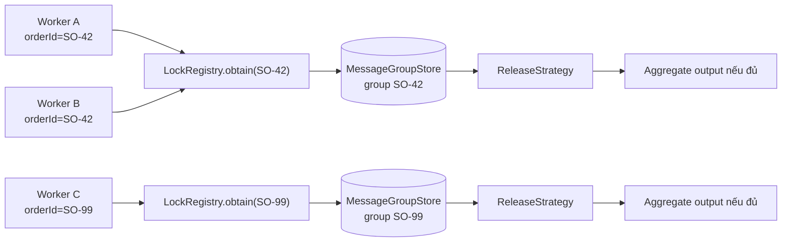
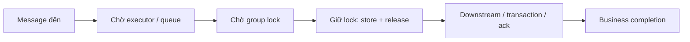
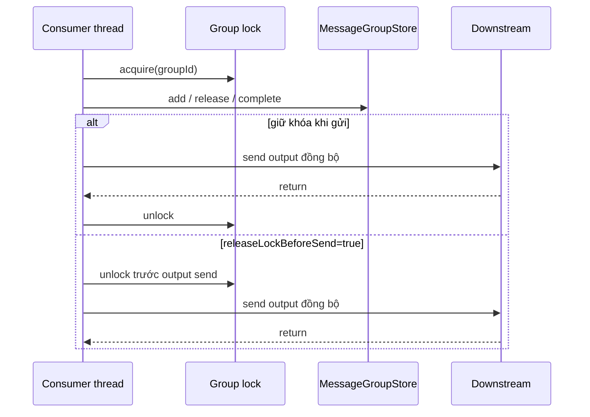
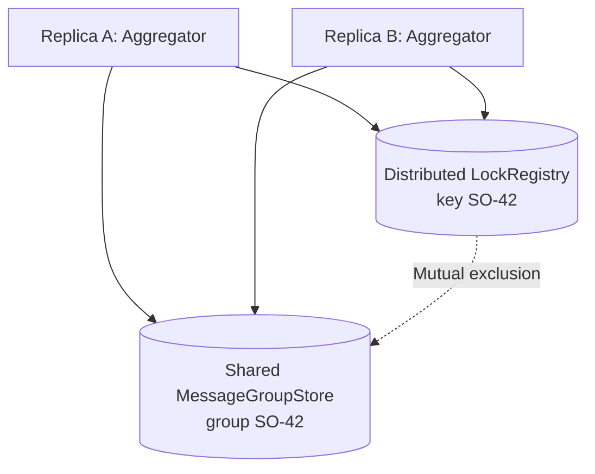
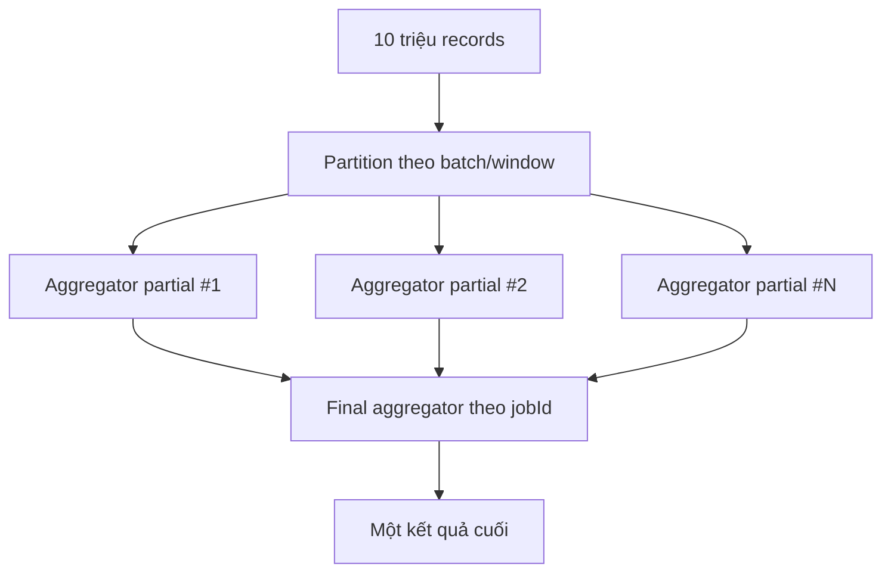
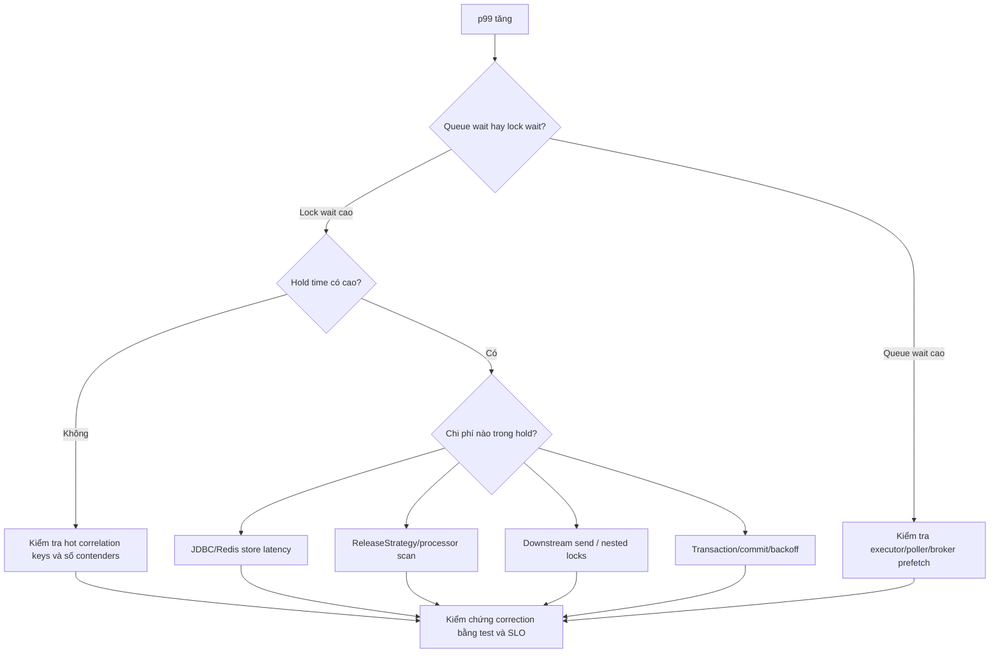

# Aggregator lock và group contention trong Spring Integration Runtime

## 1. Vấn đề hiệu năng: thêm worker nhưng throughput không tăng

Một hệ thống nhận kết quả kiểm tra giá, tồn kho và vận chuyển rồi dùng **aggregator** tổng hợp theo `orderId`. Khi lưu lượng tăng, đội vận hành đổi `ExecutorChannel` từ 4 lên 32 worker. CPU vẫn chưa đạt 100%, nhưng throughput gần như không đổi, p99 latency tăng mạnh và các thread dành nhiều thời gian chờ. Một vài đơn hàng có hàng nghìn parts, trong khi đa số đơn chỉ có ba parts.

Đây là dấu hiệu điển hình của **group contention**: nhiều consumer đang tranh quyền cập nhật **cùng một `MessageGroup`**. Spring Integration dùng `LockRegistry` theo correlation key để ngăn nhiều thread đồng thời làm sai trạng thái nhóm. Lock bảo vệ tính đúng đắn, nhưng cũng giới hạn số thao tác *critical section* có thể xử lý song song cho **một group**.

Bài **“Aggregator lock và group contention”** thuộc chương **Hiệu năng** của module **SPRING_INTEGRATION_RUNTIME**. Nội dung gắn trực tiếp với cách runtime điều phối channel, endpoint, consumer, poller và executor, đồng thời xét vòng đời `IntegrationFlow`, transaction, retry, message store, lỗi, correlation, threading và observability.

Sau bài này, bạn có thể:

1. Phân biệt **thời gian chờ lock**, **thời gian giữ lock**, **thời gian xử lý downstream** và **thời gian chờ trong queue**.
2. Giải thích vì sao mỗi correlation group thường được cập nhật tuần tự nhưng nhiều groups có thể chạy song song.
3. Nhận ra **hot correlation key**, group quá lớn, release strategy chậm và backend store chậm.
4. Cấu hình `LockRegistry` phù hợp single-JVM/multi-JVM, đánh giá `releaseLockBeforeSend` và tránh deadlock.
5. Tối ưu store, release condition, processor và transaction mà không làm sai semantics.
6. Thiết kế benchmark và kiểm thử concurrency có thể tái lập, đo SLO và data correctness.
7. Điều tra p95/p99, thread dump, DB lock wait, lease expiry, retry storm và orphaned groups.

Ví dụ dùng Java 17+, Spring Integration 6.x và Micrometer theo hướng dẫn. Một số API ở 6.5+ được đánh dấu riêng; hãy kiểm tra dependency thực tế khi áp dụng.

## 2. Khóa theo nhóm: tính đúng đắn và giới hạn tự nhiên

Mỗi message được gán một **correlation key**; các message cùng khóa thuộc cùng một `MessageGroup`, được lưu qua `MessageGroupStore`. Aggregator kiểm tra một `ReleaseStrategy` để quyết định nhóm đã đủ điều kiện tổng hợp hay chưa. Với concurrent senders, quy trình đọc–sửa–đánh giá–release phải được điều phối.



**Điều quan trọng:** `DefaultLockRegistry` bảo vệ lock key trong **một JVM**. Khi hai ứng dụng cùng truy cập persistent group store, chúng cần một registry phân tán dùng chung nếu cùng thao tác những group IDs. Có database chung **không tự** khiến hai registry local khóa lẫn nhau.

### 2.1. Critical section của aggregator

Ở mức khái niệm:

```text
correlationId = correlationStrategy(message)

acquire lock(correlationId)
try:
    read group state / check complete
    add message to group store
    update condition / group metadata
    evaluate ReleaseStrategy
    if releasable:
        invoke group processor
        update complete/remove/release state
        send output (tùy releaseLockBeforeSend)
finally:
    unlock(correlationId)
```

Đây là sơ đồ **logic**, không phải mã nguồn nội bộ theo đúng thứ tự từng dòng. Thứ tự chi tiết phụ thuộc implementation, advice và phiên bản, đặc biệt khi cấu hình `releaseLockBeforeSend`. Điều cần nhớ: khi code giữ lock trong lúc truy vấn JDBC, duyệt group hoặc gửi output đồng bộ, **các message khác cùng group phải chờ**.

| Thao tác | Có thể nằm trong đường xử lý của aggregator | Chi phí tiềm ẩn |
| --- | --- | --- |
| Tính correlation key | Trước khi lấy khóa group | Header conversion, expression hoặc lookup quá đắt. |
| Acquire `Lock` | Cửa vào critical section | Lock wait, DB/Redis round trips, fairness/lease. |
| `MessageGroupStore.addMessageToGroup` | Khi cập nhật nhóm | Serialization, DB write, row/index contention. |
| `ReleaseStrategy.canRelease` | Sau khi nhận message và cả một số lần forceComplete | Full scan/convert collection hoặc kiểm tra metadata O(1). |
| `MessageGroupProcessor` | Khi nhóm release | Tính toán nặng, copy payload, merge headers. |
| Complete/remove group | Khi kết thúc nhóm | DB deletes/updates và transaction commit. |
| Output channel send | Có thể xảy ra khi lock vẫn còn | Synchronous downstream I/O, nested aggregator, exception. |

Một optimization được đánh giá ở đây phải **giữ nguyên safety**: không double release, không mất part, không cho message đến muộn tái kích hoạt nhóm sai nghiệp vụ.

### 2.2. Per-group serialization không có nghĩa một global mutex

```text
SO-42: A đang xử lý → B cùng SO-42 chờ
SO-99: C có thể tiến hành
SO-77: D có thể tiến hành
```

Nếu 1.000 message thuộc 1.000 group khác nhau, worker pool có thể khai thác concurrency tốt. Nhưng nếu 800/1.000 message cùng `orderId=SO-42`, phần lớn lưu lượng sẽ tranh một lock key; tăng threads chỉ tăng số **contenders** của nhóm nóng.

Với một single-JVM aggregator, Spring Integration dùng `DefaultLockRegistry` mặc định; nhiều endpoint có thể có registry riêng. Khóa distributed không làm một hot group có thể cập nhật song song an toàn hơn — nó chỉ đưa mutual exclusion qua ranh giới process, thường thêm chi phí network.

## 3. Bốn loại thời gian cần đo riêng



Ký hiệu:

- `T_queue`: từ khi channel chấp nhận tới khi consumer bắt đầu.
- `T_lock_wait`: thời gian từ lúc xin lock tới lúc lấy được lock.
- `T_lock_hold`: thời gian sở hữu lock cho một group.
- `T_downstream`: thời gian xử lý ngoài critical section, có thể async.
- `T_commit_ack`: độ trễ commit nguồn/DB và acknowledgment theo transport.

Thời gian end-to-end có thể được phân rã **xấp xỉ** như:

\[
T_{\text{e2e}} \approx T_{\text{queue}} + T_{\text{lock-wait}} +
T_{\text{lock-hold}} + T_{\text{downstream}} + T_{\text{commit/ack}}
\]

Không cộng trùng những đoạn đã nằm bên trong `T_lock_hold`: nếu output send hoặc DB commit còn nằm dưới lock, phần tương ứng không được cộng thêm lần nữa. Đây là sơ đồ phân tích bottleneck, không phải phương trình bắt buộc của mọi topology.

### 3.1. Giới hạn throughput của một hot group

Nếu mỗi message cùng group giữ lock trung bình \(h\) giây, mức throughput **lý tưởng** của riêng critical section đó bị chặn xấp xỉ:

\[
\lambda_{\text{hot-key}} \lesssim \frac{1}{h}
\]

Ví dụ, nếu `T_lock_hold` trung bình 20 ms, một group không thể liên tục xử lý nhanh hơn khoảng **50 lock entries/giây** khi mỗi message cần một lượt lấy khóa không chồng lấn. Con số này chưa tính lock wait, arrival burst, store variance và release/timeout events.

Nếu giảm hold từ 20 xuống 5 ms, giới hạn lý tưởng của nhóm có thể tăng từ khoảng 50 lên 200 entries/giây. Nhưng throughput **business output** có thể khác nhiều: aggregator ghép 100 parts thành **một** reply, nên 200 lock entries/giây không có nghĩa 200 đơn hàng hoàn tất mỗi giây.

### 3.2. Little's Law để nhận diện backlog

Trong hệ thống ổn định, trung bình:

\[
L = \lambda W
\]

Trong đó \(L\) là số việc đang tồn tại trong hệ, \(\lambda\) là throughput hoàn tất và \(W\) là thời gian trung bình. Nếu throughput không đổi nhưng latency tăng, số việc đang chờ có xu hướng tăng. Khi throughput đầu vào **cao hơn** năng lực phục vụ lâu dài, hệ không còn trạng thái ổn định: backlog sẽ tăng cho tới khi có giới hạn, reject, throttle hoặc mất ổn định.

**Cẩn thận:** công thức dùng **trung bình trong cửa sổ hệ ổn định**. Không lấy `p99` thay `W` rồi kết luận `L=λ×p99`; cũng không dùng số metrics channel send làm throughput business completion nếu flow có retry/aggregation.

## 4. Nguyên nhân tạo group contention

| Nguyên nhân | Dấu hiệu | Vì sao gây contention |
| --- | --- | --- |
| **Hot correlation key** | Ít `groupId` nhưng mỗi group nhận rất nhiều parts | Nhiều consumer xếp hàng vào cùng lock. |
| Correlation quá rộng | Dùng `tenantId` thay vì `orderId` | Các đơn độc lập bị ép vào một group lớn. |
| `ReleaseStrategy` duyệt toàn group mỗi arrival | `T_lock_hold` tăng theo `group.size()` | O(n) hoặc chuyển đổi collection lặp lại. |
| Payload/header lớn trong store | Serialization/DB I/O dài | Lock bị giữ trong lúc thêm/truy xuất group. |
| Group processor gọi remote API | P99 hold tăng theo HTTP latency | Các message cùng group bị chặn bởi external I/O. |
| Output `DirectChannel` chạy downstream chậm | Hold time tăng ở thời điểm release | Send đồng bộ có thể kéo dài critical section. |
| JDBC lock + JDBC store | DB round trips, lock table, row contention | Overhead coordination cao trên mỗi part. |
| Retry/backoff đặt bên trong đoạn giữ lock | Lock chờ trong sleep/retry | Nhiều consumers cùng group bị đói tài nguyên. |
| Nhiều JVM dùng cùng hot key | Network latency/lease/DB contention | Distributed lock không làm giảm serialization requirement. |
| Expiry/reaper chạy đồng thời | Latency spikes theo lịch | Force completion/cleanup cạnh tranh trên group state. |
| Hoàn tất nhưng giữ tombstone vô hạn | Số group tăng theo thời gian | Store bành trướng, metadata scan/query chậm dần. |

### 4.1. Khóa theo sai cấp độ

Giả sử hệ thống có 20.000 đơn hàng hoạt động. Nếu correlation strategy trả về `"all-orders"` hoặc chỉ `tenantId`, tất cả đơn của tenant cạnh tranh cùng group. Nhưng **đổi correlation key chỉ để tăng thông lượng** có thể làm sai yêu cầu nghiệp vụ nếu các message thật sự cần tổng hợp cùng nhau.

Một correction hợp lệ:

```text
Sai nếu business unit là order:
  correlationKey = tenantId

Đúng hơn nếu mỗi order độc lập:
  correlationKey = (tenantId, orderId, workflowVersion)
```

Key phải **ổn định, bất biến và cùng kiểu** trên mọi producer/node. Nếu một adapter gửi UUID còn adapter khác gửi String biểu diễn UUID, nhóm và lock có thể không khớp. Correlation key của source không đáng tin phải được validate trước khi dùng để truy cập state.

### 4.2. Lượng part mỗi group là chỉ số thiết kế

Một flow nhận 1 triệu parts/ngày nhưng mỗi group chỉ có 3 parts sẽ có đặc tính rất khác flow nhận 1 triệu parts cho **một group**. Cần đo:

- Số groups active.
- Trung bình và p95/p99 **parts/group**.
- Số active groups có cùng logical tenant/source.
- Top N hot group IDs hoặc dạng key (chỉ trong logs/traces được phân quyền).
- Tuổi của incomplete group, last-modified time và số group đã complete nhưng còn marker.

Không gắn mọi `groupId` vào Prometheus label. Đối với nhóm rất nhiều, dùng **low-cardinality metric tags** như `flowType`/`endpoint`; hot key ID nên ở log/trace có sampling hoặc top-K diagnostic được bảo vệ.

## 5. Làm sao xác định bottleneck thật sự nằm ở lock?

**Không đủ:** thấy p99 handler cao rồi kết luận lock chậm. Handler còn có thể chờ connection pool, DB, executor queue hoặc downstream HTTP.

Một bộ đo tối thiểu:

| Metric | Đơn vị | Ý nghĩa |
| --- | --- | --- |
| Lock acquisition wait p50/p95/p99 | ms | Contention mà consumer trực tiếp trải qua. |
| Lock hold p50/p95/p99 | ms | Mỗi critical section tồn tại bao lâu. |
| Lock acquire timeout/failure | count/rate | Có lấy khóa kịp không; có lỗi ownership không. |
| `MessageGroupStore` add/read/update/delete duration | ms | Backend store đóng góp bao nhiêu vào hold. |
| Release strategy invocation count/duration | count, ms | Có scan group lặp theo từng part không. |
| Group processor duration | ms | Độ trễ tại thời điểm release. |
| Output send duration | ms | Send đồng bộ có kéo dài hold không. |
| Executor active/queued/rejected | gauge/rate | Có phải worker saturation trước khi lấy lock không. |
| DB connection pool wait / query p99 | ms | Lock wait thật hay chờ connection. |
| Business completion latency | ms | KPI cuối cùng, cần đo ngoài thành phần lock. |

Chỉ số `spring.integration.send` của `MetricsCaptor` thường là **timer ở ranh giới channel/handler**, không tự tách chi tiết lock acquisition/hold. Micrometer Observation cũng có ranh giới riêng. Muốn định vị lock bottleneck, dùng instrumentation phù hợp hoặc Java Flight Recorder, thread dump, backend lock diagnostics.

### 5.1. Sơ đồ phân rã một ca chậm

```text
end-to-end:             920 ms
  chờ executor:         150 ms
  chờ group lock:       600 ms
  giữ group lock:       110 ms
     JDBC add/read:      70 ms
     release strategy:   30 ms
     processor:          10 ms
  khác sau unlock:       60 ms
```

Các số trên chỉ minh họa và không được mặc định là benchmark. Chúng cho thấy tăng executor từ 8 lên 32 có thể làm **queue wait giảm** nhưng **lock wait tăng**, khiến end-to-end latency không cải thiện.

### 5.2. Đo đúng ranh giới

Một instrumentation ở service tự lấy lock đo được:

```text
t0 = nanoTime() trước lock.lock()
t1 = nanoTime() sau khi lấy lock
work under lock
t2 = nanoTime() ngay trước unlock()

lockWait = t1 - t0
lockHold = t2 - t1
```

Đo bằng `System.nanoTime()` cho elapsed duration trong JVM, không dùng `System.currentTimeMillis()` làm đồng hồ monotonic. Với multi-node, không lấy hiệu hai timestamps từ **hai máy khác nhau** để suy ra lock wait chính xác.

Đối với aggregator framework, **đừng tự bọc thêm một lock khác bên ngoài `handleMessage` để “đo”** nếu nó tạo nested critical section khác với hoạt động thật. Có thể đo tại registry wrapper đã được kiểm thử, `ReleaseStrategy`/store proxy có kiểm soát, hoặc phân tích JFR/back-end. Instrumentation cũng thêm overhead; so sánh benchmark có/không instrumentation.

## 6. Cấu hình aggregator đơn giản để làm baseline hiệu năng

Đo hiệu năng cần bắt đầu từ một cấu hình **tối giản, đúng semantics** trước khi thay store, số workers hay lock registry. Ví dụ sau dùng một `DirectChannel` nhận parts, `SimpleMessageStore` giữ groups và `DefaultLockRegistry` đồng bộ trong JVM; output đi vào `QueueChannel` để test có thể lấy kết quả theo cách chủ động.

```java
package demo.performance;

import org.springframework.beans.factory.annotation.Qualifier;
import org.springframework.context.annotation.Bean;
import org.springframework.context.annotation.Configuration;
import org.springframework.integration.aggregator.AggregatingMessageHandler;
import org.springframework.integration.aggregator.DefaultAggregatingMessageGroupProcessor;
import org.springframework.integration.annotation.ServiceActivator;
import org.springframework.integration.channel.DirectChannel;
import org.springframework.integration.channel.QueueChannel;
import org.springframework.integration.config.EnableIntegration;
import org.springframework.integration.store.MessageGroupStore;
import org.springframework.integration.store.SimpleMessageStore;
import org.springframework.integration.support.locks.DefaultLockRegistry;
import org.springframework.integration.support.locks.LockRegistry;
import org.springframework.messaging.MessageChannel;
import org.springframework.messaging.MessageHandler;
import org.springframework.messaging.PollableChannel;

@Configuration
@EnableIntegration
public class AggregatorPerformanceConfiguration {

    @Bean
    public MessageGroupStore performanceGroupStore() {
        return new SimpleMessageStore();
    }

    @Bean
    public LockRegistry performanceGroupLocks() {
        return new DefaultLockRegistry();
    }

    @Bean("partsIn")
    public MessageChannel partsIn() {
        return new DirectChannel();
    }

    @Bean("resultsOut")
    public PollableChannel resultsOut() {
        return new QueueChannel();
    }

    @Bean
    @ServiceActivator(inputChannel = "partsIn")
    public MessageHandler orderAggregator(
            MessageGroupStore performanceGroupStore,
            LockRegistry performanceGroupLocks,
            @Qualifier("resultsOut") PollableChannel resultsOut) {

        AggregatingMessageHandler handler = new AggregatingMessageHandler(
                new DefaultAggregatingMessageGroupProcessor(),
                performanceGroupStore);

        handler.setCorrelationStrategy(message ->
                message.getHeaders().get("orderId"));
        handler.setReleaseStrategy(group -> group.size() >= 3);
        handler.setLockRegistry(performanceGroupLocks);
        handler.setReleaseLockBeforeSend(true);
        handler.setExpireGroupsUponCompletion(false);
        handler.setOutputChannel(resultsOut);
        return handler;
    }
}
```

**Cách đọc cấu hình:**

- `orderId` là correlation key. Mọi message phải có header đó, đúng kiểu và đúng business contract.
- Release khi `size() >= 3` minh họa việc kiểm tra số lượng, **không chống duplicate**: ba bản sao của `pricing` vẫn làm group đủ size.
- `DefaultLockRegistry` chỉ bảo vệ thread trong **một JVM**.
- `SimpleMessageStore` nhanh và thuận tiện cho baseline, nhưng mất groups sau restart.
- `releaseLockBeforeSend=true` nhả group lock trước khi gửi output, giúp giảm thời gian giữ khóa khi downstream có xử lý đồng bộ. Đây là một lựa chọn cần được test với lỗi downstream.
- `expireGroupsUponCompletion=false` giữ metadata hoàn tất để chặn late arrivals; cần cleanup khi hết cửa sổ replay.

Đừng dùng baseline này làm cấu hình production mà không chọn persistent store, duplicate policy, transaction/error channel, group timeout, retention và kiểm thử failure.

### 6.1. Bắt đầu bằng flow đúng trước khi tối ưu

```text
Split → ExecutorChannel → Aggregator → QueueChannel
                                   |
                                   +-- MessageGroupStore
                                   +-- LockRegistry keyed by orderId
```

Ở flow trên, `ExecutorChannel` làm các part đến aggregator đồng thời. Aggregator bảo vệ state theo `orderId`, không có nghĩa thứ tự **arrival** của part luôn đúng sequence. Nếu downstream cần thứ tự chính xác, thêm sequence/correlation contract hoặc resequencer theo requirement.

**Tránh benchmark bằng mỗi lời gọi `send()`:** khi có executor async, `send()` có thể trả trước khi aggregator hoàn tất. Cần đếm output đã release và business completion ở đúng downstream sink.

## 7. Test concurrency và đo time dưới `DefaultLockRegistry`

Trước khi đo throughput, cần chứng minh invariant **“cùng key không có hai chủ sở hữu đồng thời; khác key có thể tiến hành”**. Dùng latch thay vì `Thread.sleep()` để điều khiển interleaving.

```java
import static org.junit.jupiter.api.Assertions.*;

import java.util.concurrent.CountDownLatch;
import java.util.concurrent.ExecutorService;
import java.util.concurrent.Executors;
import java.util.concurrent.Future;
import java.util.concurrent.TimeUnit;
import java.util.concurrent.locks.Lock;
import org.junit.jupiter.api.Test;
import org.springframework.integration.support.locks.DefaultLockRegistry;
import org.springframework.integration.support.locks.LockRegistry;

class PerGroupLockTest {

    @Test
    void blocksSameGroupButNotAnotherGroup() throws Exception {
        LockRegistry registry = new DefaultLockRegistry();
        ExecutorService executor = Executors.newFixedThreadPool(3);
        CountDownLatch ownerHasLock = new CountDownLatch(1);
        CountDownLatch releaseOwner = new CountDownLatch(1);

        Future<Boolean> owner = executor.submit(() -> {
            Lock lock = registry.obtain("SO-42");
            lock.lock();
            try {
                ownerHasLock.countDown();
                return releaseOwner.await(5, TimeUnit.SECONDS);
            } finally {
                lock.unlock();
            }
        });

        try {
            assertTrue(ownerHasLock.await(2, TimeUnit.SECONDS));

            Future<Boolean> sameKey = executor.submit(() -> {
                Lock lock = registry.obtain("SO-42");
                boolean acquired = lock.tryLock(100, TimeUnit.MILLISECONDS);
                if (acquired) {
                    lock.unlock();
                }
                return acquired;
            });
            Future<Boolean> otherKey = executor.submit(() -> {
                Lock lock = registry.obtain("SO-99");
                boolean acquired = lock.tryLock(500, TimeUnit.MILLISECONDS);
                if (acquired) {
                    lock.unlock();
                }
                return acquired;
            });

            assertFalse(sameKey.get(2, TimeUnit.SECONDS));
            assertTrue(otherKey.get(2, TimeUnit.SECONDS));
        } finally {
            releaseOwner.countDown();
            assertTrue(owner.get(3, TimeUnit.SECONDS));
            executor.shutdownNow();
            assertTrue(executor.awaitTermination(3, TimeUnit.SECONDS));
        }
    }
}
```

Test này sử dụng timeout **để tránh treo CI**, không dùng sleep nhằm “hy vọng” hai threads trùng thời điểm. Nó không đo throughput production, không chứng minh behavior của Redis/JDBC lock và không bảo đảm group đã được release đúng.

### 7.1. Đo lock wait/hold khi custom code tự lấy lock

Khi một đoạn mã ứng dụng có sử dụng `LockRegistry` trực tiếp, có thể instrument bằng `Timer`:

```java
import java.util.concurrent.locks.Lock;
import io.micrometer.core.instrument.MeterRegistry;
import io.micrometer.core.instrument.Timer;
import org.springframework.integration.support.locks.LockRegistry;

public final class TimedCriticalSection {
    private final LockRegistry registry;
    private final Timer waitTimer;
    private final Timer holdTimer;

    public TimedCriticalSection(
            LockRegistry registry, MeterRegistry meterRegistry) {
        this.registry = registry;
        this.waitTimer = Timer.builder("app.group.lock.wait")
                .tag("endpoint", "ordersAggregator")
                .register(meterRegistry);
        this.holdTimer = Timer.builder("app.group.lock.hold")
                .tag("endpoint", "ordersAggregator")
                .register(meterRegistry);
    }

    public void runForGroup(Object groupId, Runnable action) {
        Lock lock = registry.obtain(groupId);
        long waitingSince = System.nanoTime();
        lock.lock();
        long acquiredAt = System.nanoTime();
        waitTimer.record(acquiredAt - waitingSince,
                java.util.concurrent.TimeUnit.NANOSECONDS);

        try {
            action.run();
        } finally {
            long finishingAt = System.nanoTime();
            holdTimer.record(finishingAt - acquiredAt,
                    java.util.concurrent.TimeUnit.NANOSECONDS);
            lock.unlock();
        }
    }
}
```

**Giới hạn rất quan trọng:** class này đo **critical section mà chính ứng dụng bọc**, **không tự đo lock nằm bên trong `AggregatingMessageHandler`**. Đừng thêm một `TimedCriticalSection` ở bên ngoài handler rồi gọi đó là số đo nội bộ — hai lần acquire/nested locks có thể làm thay đổi contention và deadlock risk. Khi đo nội bộ framework, có thể xây `LockRegistry` decorator tương thích `Lock` đầy đủ rồi inject vào handler, kết hợp test reentrancy, `tryLock`, `lockInterruptibly`, `newCondition`, timeouts và unlock ownership trước khi deploy.

**Không gắn `groupId` vào tag** của timer này vì mỗi order có thể tạo một time-series; dùng endpoint/flowType cố định, log/trace những nhóm nóng riêng. Trong lúc lỗi, `lock.lock()` có thể không nhận được lock trước shutdown; nếu cần deadline, dùng `tryLock(timeout)` và đếm timeout riêng.

## 8. Tối ưu `ReleaseStrategy`: không scan cả group mỗi lần nhận

Một aggregator có thể gọi release strategy **sau mỗi message tới**. Nếu mỗi lần lại duyệt toàn bộ group có kích thước \(n\), tổng chi phí từ 1 đến \(n\) parts có thể gần:

\[
\sum_{k=1}^{n} O(k) = O(n^2)
\]

Đây là **độ phức tạp của cách viết strategy ngây thơ**, không phải bảo đảm implementation của Spring Integration luôn O(n²).

### 8.1. Ví dụ anti-pattern

```java
import org.springframework.integration.aggregator.ReleaseStrategy;

ReleaseStrategy slowStrategy = group ->
        group.getMessages().stream()
                .filter(message ->
                        "OK".equals(message.getHeaders().get("state")))
                .count() == 5;
```

Nếu group có hàng chục nghìn messages và dùng `JdbcMessageStore`, thao tác `getMessages()` có thể làm lazy load hàng loạt records, deserialize payload và duyệt hết collection trong lúc aggregator xử lý group. Tăng số worker không khắc phục được chi phí này cho cùng correlation key.

### 8.2. Chỉ dùng `size()` khi số lượng đủ là điều kiện đúng

```java
ReleaseStrategy countOnly = group -> group.size() >= 5;
```

Đoạn này rẻ hơn vì không duyệt tất cả payloads, **nhưng chỉ đúng khi** contract đảm bảo năm phần đều hợp lệ và không có duplicate. Nếu `pricing` gửi lặp năm lần, `size()==5` không có nghĩa nhóm đã nhận đúng năm loại part.

### 8.3. `group.condition` cho metadata release

Từ Spring Integration 5.5, `MessageGroup` có `condition` dạng chuỗi. `AbstractCorrelatingMessageHandler` hỗ trợ `setGroupConditionSupplier(...)`; nhà phát triển có thể cập nhật metadata nhỏ mỗi khi thêm message, sau đó `ReleaseStrategy` đọc điều kiện thay vì luôn quét payloads.

Ý tưởng:

```text
groupId = batch-42
condition = "expected=100;received=90;valid=true"

arrival of one part:
  calculate updated condition
  persist condition in store
  release strategy parses small condition
```

Đây là **protocol do ứng dụng tự thiết kế**; framework **không tự hiểu** `expected=100`. Metadata phải được cập nhật nhất quán theo concurrency contract và có cách xử lý duplicate; đừng tăng `received` cho mỗi delivery nếu event ID trùng. Nếu điều kiện trở nên quá phức tạp, một row domain với unique constraint/version có thể phù hợp hơn.

### 8.4. Chọn API trực tiếp thay vì POJO conversion không cần thiết

Spring Integration phân biệt:

- `ReleaseStrategy.canRelease(MessageGroup)`: nhận group trực tiếp, có thể chỉ đọc metadata.
- POJO method nhận `Collection<Message<?>>`: thường phải tạo collection view/copy thích hợp.
- POJO method nhận `Collection<SomePayload>`: framework có thể trích payloads và convert toàn bộ collection mỗi lần.

Với groups lớn, sử dụng implementation trực tiếp của `ReleaseStrategy` nếu thật sự giúp tránh copy/conversion. Chi phí cụ thể phụ thuộc message group/store và code; **đo trước và sau**. Không hy sinh duplicate detection hoặc business correctness để đạt O(1) giả tạo.

### 8.5. Default sequence strategy và duplicate semantics

Từ Spring Integration 5.0, `SimpleSequenceSizeReleaseStrategy` là chiến lược mặc định khi không cần partial group release; nó hiệu quả hơn cách kiểm tra đầy đủ sequence trong những trường hợp phù hợp. Nếu cần kiểm tra duplicate sequence IDs hoặc partial release, chiến lược khác có thể đúng hơn nhưng có overhead. Không đổi strategy chỉ vì benchmark ngắn hơn nếu điều đó làm bỏ qua invariant “mỗi part chỉ tính một lần”.

## 9. `MessageGroupStore`: tối ưu đúng chỗ, không đổi semantics

Aggregator dùng `MessageGroupStore` để giữ state giữa nhiều lần nhận. Dù contention thường xuất hiện ở `LockRegistry`, thời gian **giữ khóa** thường bị chi phối bởi thao tác store: thêm message, đọc metadata, release group, cập nhật complete và xóa messages.

### 9.1. So sánh in-memory và persistent store

| Store | Đặc tính hiệu năng | Giới hạn cần biết |
| --- | --- | --- |
| `SimpleMessageStore` | Thao tác local, độ trễ thấp; phù hợp baseline | Memory JVM, mất state sau restart; nhóm lớn có thể gây GC pressure. |
| `JdbcMessageStore` | Dữ liệu lưu bền, có transaction và DB indexing | Round trips, connection pool, serialization, index/row locks và query plan. |
| Redis-based MessageStore | Truy cập remote với độ trễ thấp ở hạ tầng phù hợp | Network, persistence/eviction, load và thao tác group phức tạp. |
| MongoDB MessageStore | Persistent document/database với lazy loading | Query/serialization/indexing, contention phụ thuộc workload. |

**Không mặc định persistent store nhanh hay chậm hơn một ngưỡng cố định.** Với payload lớn, mạng xa, connection pool nhỏ hoặc schema thiếu index, backend I/O có thể chiếm đa số `T_lock_hold`. Nhưng nếu bottleneck là hot group/slow processor, đổi JDBC sang Redis không chắc giải quyết vấn đề.

### 9.2. Lazy-load và tránh full group materialization

Từ Spring Integration 4.3, các persistent `MessageGroupStore` hỗ trợ **lazy loading** messages trong group. Khi strategy chỉ cần `size()` hoặc metadata, framework có thể không cần đọc/deserialise toàn bộ payload trong mỗi lần arrival.

Với các implementation phù hợp:

```java
import org.springframework.integration.jdbc.store.JdbcMessageStore;

JdbcMessageStore store = new JdbcMessageStore(dataSource);
store.setRegion("orders-aggregate");
store.setLazyLoadMessageGroups(true);
```

Ở đây `dataSource` là `javax.sql.DataSource` đã có, database cần bảng/schema JDBC message store đúng phiên bản. Đoạn này minh họa cấu hình **lazy group loading**; phải sử dụng store thực sự ở aggregator mới có tác dụng.

Ngược lại, gọi `group.getMessages()` trong một `ReleaseStrategy` mỗi arrival có thể buộc tải toàn bộ message collection. Với persistent store, một phép đo release strategy “chậm” có thể thực ra là **DB read + deserialization**.

Từ 5.5, API `streamMessagesForGroup(groupId)` giúp xử lý groups lớn với streaming ở backend hỗ trợ. Khi tự dùng API trả `Stream<Message<?>>`, **đóng stream bằng try-with-resources** để giải phóng cursor/resource. Streaming không xóa nhu cầu locking khi đồng thời cập nhật group.

### 9.3. `getGroupMetadata(...)` khi chỉ cần trạng thái

Nếu dashboard chỉ cần `groupId`, size, timestamps, complete và một vài metadata, cân nhắc `MessageGroupStore.getGroupMetadata(groupId)` thay vì gọi `getMessageGroup().getMessages()` rồi duyệt toàn bộ payload.

Không gọi `getGroupMetadata` trong một vòng liên tục theo từng millisecond cho mọi group: việc đọc metadata trên persistent store vẫn có thể tốn DB queries và tranh tài nguyên với aggregator. Với monitoring, ưu tiên sampling, batch queries hoặc metrics do store hỗ trợ.

### 9.4. `SimpleMessageStore.copyOnGet` và mutation an toàn

`SimpleMessageStore` mặc định **`copyOnGet=false`** trên các phiên bản hiện đại vì copy group lớn trên mỗi get có thể rất đắt. Đổi thành `true` hoặc thao tác group object bên ngoài store có ảnh hưởng tới performance/correctness.

**Không sửa collection trả từ `getMessageGroup(...)` trực tiếp trong dashboard hay custom code** khi aggregator đang hoạt động. Nếu lấy reference tới group thực, việc thêm/xóa bằng API group có thể bypass lock/metadata store, làm mất invariant mà aggregator dựa vào.

### 9.5. Chọn cấu trúc collection cho group lớn

`SimpleMessageGroupFactory` có những `GroupType` khác nhau. Cấu trúc `LinkedHashSet`/hash-based thường hỗ trợ thao tác thêm/xóa thuận tiện nhưng hashing của `Message<?>` có payload lớn vẫn có chi phí. Các lựa chọn như queue/list có trade-off về duplicate/ordering và thời gian xóa.

Đừng thay group factory chỉ vì một microbenchmark insert nhanh hơn; hãy kiểm tra:

1. Có còn nhận diện duplicate đúng theo contract không?
2. Thứ tự cần giữ là insertion order hay sequence number?
3. Truy xuất/xóa từng phần có thường xuyên không?
4. Group được giữ trong heap hay persistent backend?
5. Độ trễ p99 và memory footprint khi group có kích thước thực tế?

## 10. `releaseLockBeforeSend`: giảm hold time và tránh khóa lồng nhau

Trong aggregator, output send có thể xảy ra trong đường release của group. Nếu output là `DirectChannel` dẫn tới handler đồng bộ chậm, thời gian gửi output có thể kéo dài thời gian giữ group lock.

Tùy chọn `releaseLockBeforeSend` (có từ Spring Integration 5.1.1) cho phép **nhả khóa group trước khi gửi output**:

```java
handler.setReleaseLockBeforeSend(true);
```

Trong Java DSL dòng 6.x, `CorrelationHandlerSpec.releaseLockBeforeSend(true)` cung cấp cấu hình tương ứng; với XML có thuộc tính theo schema/phiên bản thích hợp.

### 10.1. Mô hình trước và sau



Nếu downstream mất 300 ms, thay đổi này có thể giúp một part khác cùng group **không phải chờ toàn bộ 300 ms ở output send**. Tuy nhiên nó **không bảo đảm** group processor hay persistence work cũng được chuyển ra ngoài lock; phải đo vị trí thực sự của các đoạn mã.

### 10.2. Chi phí của việc nhả khóa sớm

Khi output send chạy **sau** unlock:

- Một message mới cùng group có thể được xử lý trong lúc downstream đang nhận output trước.
- Exception của output send không còn xảy ra khi consumer giữ group lock; transaction/error propagation cần kiểm tra.
- Nếu downstream gửi ngược vào chính aggregator hoặc chain aggregators, giảm nested locking có thể tránh deadlock.
- Không được tự hiểu rằng state group và output broker đã được commit nguyên tử.

**Kiểm thử cần có:** cùng correlation key gửi part cuối, đồng thời gửi duplicate/late part, cho output channel chậm hoặc throw exception; assert số output, trạng thái complete/tombstone, retry và idempotency.

### 10.3. Deadlock khi hai aggregators chia sẻ registry

```text
Thread T1:
  giữ lock aggregator A / key X
  → send đồng bộ tới aggregator B / key Y
  → chờ B / key Y

Thread T2:
  giữ lock aggregator B / key Y
  → gọi đường xử lý cần aggregator A / key X
  → chờ A / key X

T1 chờ T2, T2 chờ T1 → deadlock
```

Spring Integration Reference đưa ra ba biện pháp:

1. **Mỗi logical aggregator dùng registry/namespace riêng**; registry của **cùng aggregator** vẫn có thể được chia sẻ giữa replicas.
2. Dùng `ExecutorChannel` hoặc `QueueChannel` giữa aggregators để phá call stack đồng bộ.
3. Dùng `releaseLockBeforeSend=true` để gửi downstream sau khi nhả khóa.

Đừng chọn `ExecutorChannel` mà quên hậu quả: transaction thread-bound không tự truyền sang worker, error có thể trở thành async và completion order có thể thay đổi. **Đừng hy sinh dữ liệu đúng chỉ để giảm lock hold.**

## 11. Distributed locking: hiệu năng và correctness là hai trục khác nhau

Với **một JVM**, `DefaultLockRegistry` là baseline hợp lý. Với nhiều replicas cùng cập nhật một persistent `MessageGroupStore`, cần phân tích backend distributed locking:

| Cách triển khai | Ưu điểm | Chi phí / rủi ro |
| --- | --- | --- |
| `DefaultLockRegistry` | Rất ít overhead, không I/O network | Không phối hợp khác JVM. |
| `JdbcLockRegistry` | Backend RDBMS có sẵn, quản lý lock qua DB | Lock table, transaction/connection, retry contention, TTL. |
| `RedisLockRegistry` | Shared registry, độ trễ thấp trong môi trường phù hợp | Network, lease expiry/renewal, failover, Redis health. |
| ZooKeeper-based LockRegistry (nếu module được hỗ trợ) | Phối hợp theo session/coordination service | Chi phí hạ tầng, session expiry và behavior network partition. |

### 11.1. Cùng `groupId` thì registry và store phải tương thích



Chỉ đặt **cùng bean name** ở hai Spring contexts là vô nghĩa đối với distributed locking. Hai replicas phải dùng cùng **physical lock backend/region/key contract**, cùng group store region và correlation ID type.

### 11.2. Version 6.5: thêm store-level locking

Từ Spring Integration **6.5**, `AbstractMessageGroupStore.setLockRegistry(...)` cho phép bảo vệ các thao tác metadata/group store bằng khóa ở tầng store, mặc định `DefaultLockRegistry`. Phân biệt:

- **Aggregator handler lock:** bảo vệ đoạn xử lý tương quan, quyết định release và các bước cần mutual exclusion theo group.
- **Store-level lock:** bảo vệ series cập nhật message group/metadata trong implementation.

Đừng giả định chỉ cấu hình một tầng là đã tự đồng bộ tầng còn lại. Khi store/handler dùng các registry khác nhau trên nhiều JVM, cần kiểm tra lại ownership và thứ tự khóa. Khi dùng cùng registry và cùng key, cần biết implementation có hỗ trợ **reentrant locking** tương ứng hay không để tránh tự khóa mình.

Ở bản **trước 6.5**, không gọi `AbstractMessageGroupStore.setLockRegistry(...)` nếu API chưa tồn tại. Các API mới hơn của dòng 7.x về custom lock TTL cũng không nên sao chép trực tiếp vào code 6.4.

### 11.3. Lock TTL/lease và thời gian giữ khóa

Với distributed lock, có ít nhất **hai đồng hồ khác nhau**:

- **Acquire wait timeout:** caller sẵn sàng đợi bao lâu để lấy lock, ví dụ `tryLock(2, SECONDS)`.
- **Lease/TTL:** backend coi quyền sở hữu lock còn hợp lệ bao lâu, cho phép failover khi owner chết.

Nếu `T_lock_hold` p99 tăng sát TTL, có nguy cơ owner bị mất lease trước khi hoàn tất. Một replica khác có thể lấy khóa, trong lúc owner cũ vẫn tiếp tục chạy sau GC pause/network recovery. Đây là **stale owner**; lock không tự cung cấp fencing token cho mọi backend.

Hướng xử lý:

1. Giữ critical section ngắn, tránh gọi HTTP bên trong.
2. Chọn TTL theo worst-case latency/GC pause và điều kiện failover thực.
3. Sử dụng renewal API/auto-renewal khi phiên bản registry hỗ trợ và workload yêu cầu.
4. Theo dõi renew failures, unlock exception, stale writes và reconciliation.
5. Với business data quan trọng, dùng optimistic version/fencing/idempotency **tại tài nguyên đích**.

Đừng đặt TTL cực ngắn chỉ để benchmark failover “nhanh”, rồi bỏ qua khả năng hai owner cùng ghi khi một instance bị pause dài.

## 12. Transaction, retry và chỗ khóa được nhả

### 12.1. Transaction lifecycle và lock lifecycle không nhất thiết trùng nhau

```text
Case A:
  acquire group lock
    BEGIN TX
      add message / complete group
    COMMIT TX
  unlock

Case B:
  BEGIN TX
    acquire group lock
      add message / complete group
    unlock
  COMMIT TX
```

Trong **Case B**, một consumer khác có thể lấy lock **trước khi những thay đổi DB được commit**. Kết quả đọc phụ thuộc isolation và store semantics; điều này có thể ảnh hưởng correctness chứ không chỉ performance.

Thứ tự thực tế phụ thuộc poller transaction advice, `@Transactional` proxy, service activator, handler retry advice, lock registry và output send. Không tuyên bố “có `@Transactional` và LockRegistry là đủ” nếu chưa kiểm thử commit order.

### 12.2. Retry/backoff dưới lock làm contention nặng thêm

```text
Không tốt nếu business logic làm thế này dưới group lock:
  remote call timeout
  backoff 200ms
  remote retry
  backoff 500ms
  remote retry
```

Những worker cùng group phải đợi cả thời gian backoff dù không có cập nhật shared state nào đang diễn ra. Khi có thể, hãy tách:

1. Cập nhật group state/đánh dấu release dưới khóa trong thời gian ngắn.
2. Persist trạng thái giao nhận và commit phù hợp.
3. Thực hiện remote call bằng timeout/retry **ngoài critical section** cùng stable idempotency key.
4. Có recovery khi output xảy ra nhưng nhóm chưa ghi nhận thành công.

**Không được tùy ý chuyển remote call ra ngoài lock** nếu nghiệp vụ cần atomic check–then–act với tài nguyên đó. Khi ấy cần xem xét transaction/outbox, versioned update hoặc một coordinator khác. Hãy thiết kế lại flow dựa trên invariant rồi mới tối ưu.

### 12.3. Retry nhiều tầng làm tăng số lần tranh khóa

```text
Broker redelivery
  └── Handler retry advice
        └── Downstream HTTP retry
              └── Possible aggregator re-entry
```

Một message có thể đến aggregator nhiều lần do broker redelivery hoặc flow retry. Điều đó tạo thêm contenders cho cùng key; group có thể đã complete, bị expire hoặc đang chờ. Test phải assert **business outputs unique** chứ không chỉ handler invocations.

Thêm một retry loop không nhất thiết tăng throughput; khi lỗi tạm thời do DB lock contention, retry đồng thời không backoff/jitter có thể tạo **thundering herd** khiến DB và lock registry càng quá tải.

### 12.4. Thread boundary không truyền transaction tự động

`DirectChannel` thường giữ call stack sender, còn `ExecutorChannel`/`QueueChannel` + poller chạy consumer trên thread khác. Transaction upstream thường **không tự đi theo** worker. Vì vậy chuyển aggregator sang executor có thể cải thiện producer latency nhưng làm sai assumptions về rollback/ack nếu không thiết kế lại transaction và error path.

Với `FluxMessageChannel`/reactive handler, đừng đo thời gian trả về `Mono` như completion; đồng thời cần tách Reactor Context/reactive transaction khỏi `ThreadLocal` của JDBC imperative.

## 13. Timeout, expiry và tombstone cũng tiêu tốn tài nguyên

Một group không đủ parts có thể nằm trong store rất lâu. `groupTimeout`/`MessageGroupStoreReaper` cho phép force completion/expire theo chính sách; chúng có thể chạy trên scheduler khác và tranh quyền cập nhật với messages mới.

### 13.1. Hai loại áp lực

**Nhóm chưa hoàn tất:** chứa messages, có thể chiếm heap/DB và làm tăng latency scan/deserialize. Thiếu một part khiến group lớn tồn tại mãi nếu không có timeout.

**Nhóm đã complete nhưng giữ metadata:** có thể chứa 0 messages nhưng còn marker ngăn late-arriving duplicates. Số tombstones tăng dần sẽ ảnh hưởng memory, DB index hoặc thao tác cleanup, dù “total pending messages” thấp.

```text
10:00:00 batch-42 nhận 999/1000 parts
10:05:00 thiếu part cuối → group vẫn waiting
10:10:00 reaper/timeout đánh giá partial release / discard / expire

10:10:01 batch-99 hoàn tất, giữ empty complete group
11:00:00 hàng triệu empty groups còn trong store nếu không cleanup
```

### 13.2. Tuning retention không được làm mất idempotency

- `expireGroupsUponCompletion=false`: thường giữ complete-group marker để chặn late arrivals, đổi lại có metadata cần dọn sau cửa sổ replay.
- `expireGroupsUponCompletion=true`: xóa group khi hoàn tất, giúp giảm metadata, nhưng late duplicate với cùng key **có thể tạo group mới**.
- `expireGroupsUponTimeout` và `sendPartialResultOnExpiry` kiểm soát nhóm thiếu parts bị xử lý như thế nào khi timeout.
- `MessageGroupStoreReaper` quét theo lịch; timeout thực tế có thể muộn hơn cấu hình, phụ thuộc cadence và callbacks.
- Với persistent store, một reaper quét nhiều group có thể tạo load spike và tranh connection pool với luồng nhận bình thường.

Chọn cleanup policy dựa trên **max redelivery/late-arrival window**, business version và khối lượng groups. Không xóa marker chỉ vì dashboard báo metadata count cao, nếu thao tác đó khiến duplicate output.

### 13.3. Expiry callback của các aggregators

Đừng tùy tiện dùng **cùng instance `MessageGroupStore`** cho nhiều correlation handlers có expiry: mỗi aggregator có expiry callback và chúng có thể ảnh hưởng group của endpoint khác. Framework có cảnh báo/cơ chế kiểm tra `UniqueExpiryCallback`, nhưng thiết kế rõ ràng nên tách store/region hoặc quản lý group IDs và callback ownership chính xác.

Ở runtime nhiều node, reaper/scheduler cũng cần có ownership/coordination phù hợp, để không có nhiều instance cùng force complete một group sai thời điểm.

## 14. Thiết kế benchmark để tách contention khỏi throughput

Benchmark có ích khi thay đổi **một biến mỗi lần** và đo cả hiệu năng lẫn tính đúng đắn. Ví dụ muốn xác định bottleneck do lock group hay do JDBC store:

| Kịch bản | Correlation distribution | Store | Lock registry | Mục tiêu |
| --- | --- | --- | --- | --- |
| A — baseline | 1.000 groups, phân bố đều | Memory | Local | Năng lực xử lý khi ít contention. |
| B — hot key | 90% parts thuộc một group chưa complete | Memory | Local | Đo lock wait của một nhóm nóng. |
| C — persistent | Giống A | JDBC | Local, một JVM | Đo chi phí store I/O, serialization/DB. |
| D — distributed | Giống A | JDBC chung | JDBC shared registry, hai JVM | Đo chi phí distributed lock + DB và correctness. |
| E — strategy nặng | Giống B | JDBC | Shared phù hợp | Đo ảnh hưởng full group scan. |
| F — send chậm | Giống A | Memory | Local | So sánh giữ lock khi send và `releaseLockBeforeSend=true`. |
| G — expiry spike | Nhiều groups quá hạn | Persistent | Shared phù hợp | Đo ảnh hưởng reaper đến p99 và connection pool. |

**Quan trọng:** khi tạo “hot key”, phải bảo đảm nhóm **chưa bị release sau 3 parts** như baseline ở mục 6; nếu không sau ba part nhóm có thể complete và phần còn lại bị discard, dẫn tới benchmark giả. Có thể dùng expected sequence size lớn, release strategy cố ý đợi N parts, hoặc tập group keys theo các **epochs** có lifecycle rõ.

### 14.1. Các biến phải cố định

- Phiên bản JDK, Spring Integration, Reactor/Micrometer và driver.
- Heap settings, GC, CPU allocation, số container replicas.
- Payload size, header size, expected parts/group, tỷ lệ duplicates.
- Producer rate, burst shape, số workers, queue capacity.
- DB schema/index, connection pool, network latency và server load.
- Tỷ lệ incomplete/complete groups và cleanup cadence.
- Cùng một định nghĩa end-to-end completion/ack.

Nếu thay executor threads, lock registry, DB pool và release strategy **cùng một lúc**, không biết yếu tố nào tạo chênh lệch. Với workload dài, tách warmup khỏi measurement và loại bỏ ảnh hưởng cold cache.

### 14.2. Đo cả latency distribution

```text
Run A: uniform keys
  throughput:       12_000 part arrivals/s
  lock wait p95:        0.4 ms
  lock hold p95:        1.0 ms
  end-to-end p99:      45.0 ms

Run B: one hot key
  throughput:        3_000 part arrivals/s
  lock wait p95:       80.0 ms
  lock hold p95:        1.2 ms
  end-to-end p99:     450.0 ms
```

**Đây là số liệu giả định để minh họa cách diễn giải, không phải kết quả benchmark framework.** Trong ví dụ, `lock hold` gần như không đổi nhưng `lock wait` tăng lớn khi key distribution lệch; tăng CPU/executor threads khó giải quyết. Hướng tối ưu phải xét correlation design, tốc độ arrival theo key và số parts/group.

Ngược lại, nếu `lock hold p95` tăng từ 1 lên 50 ms khi chuyển sang JDBC, cần soi DB queries/serialization, release strategy và transaction. Nếu `T_queue` tăng nhưng `lock wait` thấp, nút thắt có thể ở executor/poller hoặc pool ngoài aggregator.

### 14.3. Benchmark độ tin cậy, không chỉ tốc độ

Tất cả biến thể A–G phải assert:

1. Mỗi logical group được release **đúng số lần** theo policy.
2. Không mất parts hay kết hợp sai correlation keys.
3. Duplicate/late message được xử lý đúng contract.
4. Commit/ack và output side effect không bị nhân đôi sau retry/redelivery.
5. Store group metadata hợp lệ sau stop/start/crash.
6. Không có stale locks, leaked DB connections, unbounded queues hoặc runaway retries.

Một tuning làm throughput tăng 2x nhưng tạo duplicate payment không được coi là cải thiện hiệu năng hợp lệ.

## 15. Test có điều khiển: hai luồng cùng tranh một correlation group

Đây là **integration test minh họa** cho cấu hình ở mục 6: gửi ba parts của nhiều order trên một executor, chờ tất cả input sends hoàn tất và xác nhận có một output mỗi order. Test chưa đo precise lock hold; mục đích là giữ invariant khi thay workers/store/registry.

```java
package demo.performance;

import static org.junit.jupiter.api.Assertions.*;

import java.util.ArrayList;
import java.util.List;
import java.util.concurrent.Callable;
import java.util.concurrent.CountDownLatch;
import java.util.concurrent.ExecutorService;
import java.util.concurrent.Executors;
import java.util.concurrent.Future;
import java.util.concurrent.TimeUnit;

import org.junit.jupiter.api.Test;
import org.springframework.context.annotation.AnnotationConfigApplicationContext;
import org.springframework.messaging.MessageChannel;
import org.springframework.messaging.PollableChannel;
import org.springframework.messaging.support.MessageBuilder;

class AggregatorConcurrencyTest {

    @Test
    void releasesOneResultPerGroupUnderConcurrentSends() throws Exception {
        int groupCount = 30;
        int partsPerGroup = 3;
        ExecutorService executor = Executors.newFixedThreadPool(12);
        CountDownLatch startGate = new CountDownLatch(1);
        List<Future<Boolean>> sends = new ArrayList<>();

        try (var context = new AnnotationConfigApplicationContext(
                AggregatorPerformanceConfiguration.class)) {
            MessageChannel input =
                    context.getBean("partsIn", MessageChannel.class);
            PollableChannel results =
                    context.getBean("resultsOut", PollableChannel.class);

            try {
                for (int group = 0; group < groupCount; group++) {
                    String key = "SO-" + group;
                    for (int part = 1; part <= partsPerGroup; part++) {
                        int partNumber = part;
                        sends.add(executor.submit((Callable<Boolean>) () -> {
                            startGate.await();
                            return input.send(MessageBuilder
                                    .withPayload(key + ":part-" + partNumber)
                                    .setHeader("orderId", key)
                                    .setHeader("partId", partNumber)
                                    .build());
                        }));
                    }
                }

                startGate.countDown();
                for (Future<Boolean> result : sends) {
                    assertTrue(result.get(10, TimeUnit.SECONDS));
                }

                // Một reply được release cho mỗi group gồm đúng 3 parts.
                for (int i = 0; i < groupCount; i++) {
                    assertNotNull(results.receive(3_000));
                }
                assertNull(results.receive(0),
                        "No duplicate group output expected");
            } finally {
                startGate.countDown();
                executor.shutdownNow();
                assertTrue(executor.awaitTermination(3, TimeUnit.SECONDS));
            }
        }
    }
}
```

**Giới hạn của test này:**

- Có 30 groups nhỏ, **không phải** kịch bản hot key. Nó là correctness baseline với concurrent senders.
- `DefaultAggregatingMessageGroupProcessor` trả payload tổng hợp theo contract của framework; test chỉ kiểm số outputs, chưa validate mọi part ID. Test production nên assert cả tập part IDs và correlation ID.
- Không có crash/redelivery/DB rollback. Hai JVM cần persistent store và shared distributed locks.
- Khi đổi store hay release strategy, phải giữ cùng data correctness và đo **business output completion** chứ không dùng mỗi thời gian `input.send()`.
- Một test pass không chứng minh mọi interleaving đều an toàn; thêm deterministic gates trong store/strategy layer, stress tests và failure injection.

## 16. Tuning workflow: thay một yếu tố, đo lại

### Bước 1 — Xác minh bottleneck có thật ở nhóm nào

Thu thập `lock wait/hold p95/p99` và phân bố `group size`. Nếu hot keys chỉ chiếm 2% tổng groups nhưng gây 80% wait time, ưu tiên phân tích business semantics của những keys đó thay vì tăng worker pool.

### Bước 2 — Kiểm tra correlation key có quá rộng không

Ví dụ mỗi hóa đơn có một `invoiceId` nhưng flow correlate theo `tenantId`. Nếu nghiệp vụ cho phép xử lý mỗi invoice độc lập, đổi key sang `(tenantId, invoiceId)` giúp phân tách lock và giảm group size. Nhưng nếu nghiệp vụ cần tổng hợp toàn bộ invoices của một tenant theo kỳ, phải giữ logical group và tối ưu bằng micro-batching hoặc tầng tổng hợp trung gian được thiết kế đúng.

### Bước 3 — Giảm chi phí dưới lock

Ưu tiên theo evidence:

1. Thay `ReleaseStrategy` scan payload bằng direct metadata/`size()` nếu contract cho phép.
2. Tránh tải mọi message khi chỉ cần group metadata; tận dụng lazy-load.
3. Tối ưu DB index/connection pool và serialization overhead.
4. Tránh downstream blocking send khi có thể, cân nhắc `releaseLockBeforeSend`.
5. Rút ngắn transaction/critical section; chuyển side effect ngoài lock bằng outbox/idempotency nếu phù hợp.
6. Giảm full group copy, GC pressure và phí header/payload conversion.

**Không chọn phương án chỉ dựa vào p50.** Một remote call thi thoảng chậm 5 giây có thể làm p99 lock wait của hot group tăng khủng khiếp dù p50 vẫn thấp.

### Bước 4 — Hạn chế áp lực từ upstream

Thay vì cấp 128 workers để tranh 1 lock:

- Dùng bounded executor và hàng đợi với reject/throttle policy.
- Giảm `maxMessagesPerPoll` hoặc polling concurrency khi downstream saturated.
- Với Kafka/JMS, điều chỉnh prefetch/container concurrency và ack theo adapter.
- Chia tải theo key để những group độc lập vẫn song song, nhưng các parts của cùng group được điều tiết đúng contract.
- Với Reactive Streams, dùng demand/concurrency limits *thực sự*; không giả định một `Mono` tự tạo backpressure xuyên mọi adapter.

Đo cả producer rejection/queue wait vì giảm lock wait bằng cách **đẩy backlog lên upstream** chưa chắc cải thiện end-to-end SLO.

### Bước 5 — Chọn store và lock registry phù hợp quy mô triển khai

Một JVM + memory store: chi phí local thấp nhưng không có durability qua restart.

Một JVM + JDBC store: cần đo JDBC read/write, schema, serialization, transaction và connection wait.

Nhiều JVM + JDBC store: cần shared distributed lock registry, kiểm tra network/DB lock contention, lease expiry và output idempotency.

Không chuyển một ứng dụng từ một JVM sang active-active chỉ bằng cách tăng replica count khi aggregator giữ state trong `SimpleMessageStore`; mỗi replica có thể nhìn thấy một tập parts khác nhau, nên group không đủ/release sai.

### Bước 6 — Kiểm thử failure và quan sát sau tuning

Khi đã có phương án:

- Đo throughput, lock wait/hold, end-to-end latency và số pending groups.
- Gửi duplicate/late parts, thử restart, retry, timeout và DB failover.
- Kiểm tra group marker, source ack, business commits và outputs unique.
- Chạy soak test dài để phát hiện tombstone/heap/connection leaks.
- Chuẩn bị rollback cấu hình nếu p99 hoặc duplicate rate xấu hơn.

## 17. Micro-batching, partitioning và trade-off đúng nghiệp vụ

Một số workloads có một group thực sự rất lớn (ví dụ tổng hợp cả 10 triệu bản ghi của một file). Không thể “đổi correlation ID” một cách tùy tiện vì còn phải xuất **một kết quả cuối**.

### 17.1. Tổng hợp nhiều tầng khi phép tổng hợp cho phép

Nếu phép gộp **có tính kết hợp** (associative), có thể:



Ví dụ tổng và đếm có thể merge từ các partial sums/counts. Nhưng những phép tổng hợp **phụ thuộc thứ tự**, có side effects, hoặc không associative/commutative không thể chia nhóm tùy ý mà vẫn cho kết quả tương đương.

Một kiến trúc hai tầng cần contract về:

- `jobId` và `partitionId`, tổng số partitions expected.
- Đơn vị idempotency của từng partial result.
- Ordering nếu kết quả phụ thuộc thứ tự.
- Cleanup, timeout, retry và group completion của **cả hai tầng**.
- Khi một partition fail, final aggregator không được release kết quả sai.

### 17.2. Không đếm mỗi worker là một nhóm nghiệp vụ mới

```text
Sai:
  correlationKey = orderId + randomWorkerId

Hậu quả:
  Các parts của cùng order tách thành nhiều groups.
  Mỗi group có thể không đạt release condition.
  Có thể phát nhiều partial outputs sai nghiệp vụ.
```

Phân mảnh hợp lệ thường đưa **partial aggregation** thành một pattern được thiết kế công khai, không sửa correlation key một cách âm thầm.

## 18. Truy vết một sự cố p99 tăng mạnh

Giả sử dashboard báo:

```text
Flow: ordersAggregator
Incoming parts:       8_000 / giây
Aggregate outputs:       300 / giây
Executor active:            32 / 32
Group lock wait p99:       950 ms
Group lock hold p99:        40 ms
JDBC store add p99:         25 ms
Group size p99:          5_000 parts
Expired groups:           tăng nhanh
```

**Những giá trị chỉ minh họa**, nhưng cách suy luận quan trọng:

1. `Executor active=32` chưa đủ để biết CPU-bound; có thể phần lớn threads chờ lock/network.
2. `T_lock_wait≫T_lock_hold` gợi ý contention/queueing; cần kiểm tra hot key distribution.
3. `T_lock_hold=40 ms` với JDBC add 25 ms gợi ý I/O giữ khóa lâu; strategy/processor có thể đóng góp phần còn lại.
4. `group size p99=5.000` gợi ý một số group lớn; kiểm tra release strategy có full scan hoặc filter bỏ mất parts.
5. Expired groups tăng có thể là **hậu quả** (parts đến muộn vì backlog) lẫn **nguyên nhân** (reaper tranh store).

### 18.1. Dòng thời gian điều tra



### 18.2. Thread dump và JFR

Khi JVM bị kẹt:

- Dùng `jcmd <pid> Thread.print` hoặc `jstack <pid>` theo quy trình vận hành để xem call stacks.
- Tìm threads chờ `ReentrantLock`, `LockSupport.park`, JDBC drivers, connection pool hoặc Redis client.
- Phân biệt **nhiều threads đang chờ một group lock** với **deadlock vòng tròn**: contention cao có thể vẫn tiến triển.
- Dùng Java Flight Recorder để khảo sát thread park/blocking/GC/network; một số locks thông qua `java.util.concurrent` không nhất thiết xuất hiện giống Java monitor contention.
- Với JDBC locks, đọc DB session/lock wait và query plan; thread dump một JVM không cho thấy đầy đủ đối thủ ở JVM khác.

Đừng chạy nhiều lần `jcmd` rất dày đặc trên máy đang quá tải. Giữ snapshot có timestamp và liên kết với metric window, log endpoint/correlation ID được kiểm soát quyền.

### 18.3. Vì sao metric `spring.integration.send` không đủ?

`MicrometerMetricsCaptor` có thể xuất timer `spring.integration.send` cho channel và handler, nhưng “send success” chỉ có thể nghĩa **handoff thành công** khi qua executor. Kết quả downstream hoàn tất sau đó ở thread khác không tự cập nhật ngược timer của channel.

Muốn biết p99 business latency có do group contention không, cần correlation trace giữa ingress và completion, kèm timers đo lock wait/hold ở đúng điểm và health của store. Nếu dùng Spring Integration 6.x Observation, các metric names khác như `spring.integration.handler`/`spring.integration.producer`; đừng trộn series từ hai instrumentation schemes.

## 19. Bảng chẩn đoán hiệu năng aggregator

| Triệu chứng | Nguyên nhân khả dĩ | Hướng kiểm tra và xử lý |
| --- | --- | --- |
| Tăng executor threads mà throughput đứng | Hot group, lock contention | Đo `lock wait`, số distinct group keys, key distribution. |
| `T_lock_wait` cao, `T_lock_hold` thấp | Nhiều senders tranh một khóa | Đánh giá correlation granularity, upstream throttle/partition. |
| `T_lock_hold` cao với JDBC | Store I/O, connection pool, serialization | Profile DB add/read/delete và transaction; thử lazy load, indexes. |
| Hold tăng theo group size | Release strategy duyệt group mỗi arrival | Đo invocation count và chi phí; dùng metadata/`ReleaseStrategy` trực tiếp nếu đúng. |
| P99 tăng khi group release | Processor hoặc output channel chậm | Profile processor và downstream; xem `releaseLockBeforeSend`. |
| Deadlock khi nối hai aggregators | Nested locks và synchronous send | Tách registry theo endpoint, async boundary, release lock trước send. |
| Lock chưa hết nhưng DB commit vẫn tranh chấp | Row/index locks, transaction bao ngoài lock | Kiểm tra commit order, isolation và lock scope. |
| Đã unlock nhưng node khác đọc state cũ | Unlock trước transaction commit | Xem advice order, DB isolation, versioning. |
| Redis/JDBC lock unlock báo lỗi | TTL hết, backend failover, owner mất lease | Đối chiếu GC/network, renewal, stale-write reconciliation. |
| Hai replicas release group trùng | Registry local hoặc correlation keys khác nhau | Shared registry+store, normalize key, idempotency output. |
| Group chưa release dù đủ số parts kỳ vọng | Header sequence size sai, filter bỏ part, strategy không đạt | Kiểm tra part IDs, metadata group, timeout/discard. |
| Release quá sớm khi có duplicates | Strategy chỉ dùng group.size | Deduplicate theo business part ID, unique constraint nếu cần. |
| In-memory heap tăng theo thời gian | Nhóm chưa complete hoặc tombstones giữ vô hạn | Metric active/complete groups, timeout/reaper retention. |
| DB chậm theo lịch reaper | Expiry scan/cleanup quá nhiều groups | Đo timeout/reaper schedule, batch/throttle cleanup. |
| Kafka lag tăng dù group store nhanh | Consumer concurrency/ack/partitioning | Đo broker lag và per-partition processing, không chỉ group lock. |
| `DirectChannel` timer cao nhưng handler CPU thấp | Handler đang đợi lock/I/O | Trace stack, lock wait, DB wait. |
| Queue size thấp nhưng latency cao | Tasks chờ lock sau dequeue, executor backlog nơi khác | Đo in-flight và lock wait, không chỉ queue gauge. |
| Retry storm sau DB timeout | Nhiều attempts cùng lúc, backoff thiếu jitter | Xác định retry layers, limit attempts/in-flight, idempotency. |
| Một số groups luôn chậm | Hot keys có payload lớn hoặc group size khác biệt | Hot key log/traces, phân bố part count và payload bytes. |
| Sau tuning mất message hoặc duplicate | Đã đổi lock/timeout/correlation semantics | Revert, kiểm tra group metadata, event IDs, commit/ack, output. |

### 19.1. Checklist điều tra production

1. **Xác định SLO:** throughput đo phần nào (part receive, group release hay business commit)? p95/p99 đo ở đâu?
2. **Vẽ topology:** `DirectChannel`, `ExecutorChannel`, poller, aggregator, store, output, retry advice và source ack.
3. **Xác định correlation:** key type, logical group, expected parts, hot key cardinality.
4. **Phân rã latency:** queue, acquire wait, hold, store queries, processor, output, commit/ack.
5. **Kiểm tra backend:** local/distributed registry, store region, DB pool/locks và network/lease.
6. **Kiểm tra lifecycle:** incomplete groups, tombstones, timeout/reaper, late arrivals.
7. **Kiểm tra correctness:** duplicate parts, output unique, transaction rollback và idempotency.
8. **Thử một thay đổi:** tối ưu strategy, giảm I/O under lock hoặc điều tiết upstream.
9. **So sánh before/after:** cùng workload, warmup, p99, backlog, error, throughput và data safety.

## 20. Bài tập thực hành

### Bài A — Đo hiệu ứng một hot group

1. Chạy baseline ở mục 6 với 100 groups độc lập, mỗi group 3 parts.
2. Tạo một flow riêng chỉ release sau 1.000 parts cho **cùng một group ID**.
3. Gửi parts từ 1, 4, 8, 16, 32 threads; đo lock wait/hold, throughput và p99 completion.
4. Xác minh **không có double release** và mỗi group có đúng số parts.
5. Đánh giá khi nào tăng threads hết đem lại lợi ích, và vì sao.

### Bài B — So sánh hai release strategies

1. Với group size 100, 1.000 và 10.000, tạo strategy dùng `group.getMessages().stream()` để tìm một header.
2. Tạo strategy khác đọc `group.getCondition()`/metadata có cùng semantics.
3. Đo thời gian thực thi **mỗi lần arrival**, tổng CPU và `T_lock_hold`.
4. Test duplicates/late parts để chứng minh strategy mới không release sai.
5. Trên JDBC store, đếm queries và bytes đọc trước/sau khi dùng lazy loading.

### Bài C — `releaseLockBeforeSend` và downstream chậm

1. Nối output aggregator qua `DirectChannel` tới handler có **controllable latch**.
2. Khi part cuối làm group release, giữ downstream handler ở gate để mô phỏng chậm.
3. Gửi một message khác của cùng group, đo lock wait với tùy chọn false/true.
4. Kiểm tra late-arrival policy, duplicate output và trạng thái complete/tombstone.
5. Thử output handler ném exception, kiểm tra transaction/error/retry outcome.

### Bài D — Hai JVM và shared store

1. Cấu hình hai ứng dụng sử dụng `JdbcMessageStore` chung.
2. Trước tiên dùng hai `DefaultLockRegistry` local, tạo race window có điều khiển và ghi nhận rủi ro.
3. Thay bằng `JdbcLockRegistry` chung region; kiểm tra mutual exclusion và per-group parallelism.
4. Kill một JVM khi đang giữ lock, kiểm thử TTL/renewal và recovery trên node còn lại.
5. Cố tình tạo stale owner bằng pause/failover, thiết kế version check/idempotency ở output.

### Bài E — Tối ưu hệ thống có reaper và retry

1. Tạo 10.000 groups, trong đó một phần thiếu parts và một phần đã complete với tombstones.
2. Bật group timeout/reaper với cadence có thể đo được.
3. Theo dõi DB load, lock wait, expiry callbacks, output/discard và p99 processing.
4. Thêm một retry policy khi store ném transient exception; kiểm tra retry storm.
5. Chọn retention hợp lý theo max expected late-arrival window; xác nhận không tạo duplicate output sau cleanup.

### Câu hỏi tự đánh giá

1. Vì sao aggregator serialize thao tác theo correlation key nhưng nhiều groups vẫn có thể song song?
2. Khác biệt giữa `T_lock_wait` và `T_lock_hold`, metric nào phản ánh hot key rõ hơn?
3. Vì sao tăng threads có thể làm p99 tệ đi dù CPU còn rảnh?
4. Nếu cùng một group có 10.000 parts, release strategy O(n) mỗi arrival có tổng chi phí cỡ nào?
5. Vì sao `group.size() >= N` có thể không đúng khi source redeliver duplicates?
6. Khi nào `group.condition` có thể giảm full group scan?
7. `SimpleMessageStore.copyOnGet=false` giúp gì cho performance và có rủi ro nào?
8. `releaseLockBeforeSend=true` giúp giảm điều gì, và vì sao phải test error/late arrival?
9. Một `JdbcMessageStore` chia sẻ giữa hai replicas có tự cung cấp distributed lock không?
10. Vì sao `AbstractMessageGroupStore.setLockRegistry(...)` chỉ áp dụng từ Spring Integration 6.5?
11. `tryLock` wait timeout khác distributed lock TTL như thế nào?
12. Một lock đã hết lease có đủ để ngăn stale worker update remote service không?
13. Nếu group lock được nhả trước DB commit, tình huống consistency nào có thể xảy ra?
14. Vì sao giữ empty complete groups vô hạn có thể gây áp lực hiệu năng?
15. Thế nào là benchmark hot key hợp lệ khi release strategy chờ đúng 3 parts?
16. Vì sao `spring.integration.send` không tự nói được tổng thời gian chờ group lock?
17. Khi nào có thể dùng aggregation hai tầng để mở rộng khả năng parallelism?
18. Tuning nào tăng throughput nhưng làm sai correlation/duplicate policy thì có được chấp nhận không?

## 21. Checklist trước khi đưa thay đổi hiệu năng lên production

- [ ] Có baseline kết quả nghiệp vụ đúng: unique output/event, group correlation, expected parts.
- [ ] Đã đo cả `lock wait`, `lock hold`, group size, queue delay và business completion p99.
- [ ] Đã xác định rõ hot key distribution; không dùng `groupId` làm label metric high-cardinality.
- [ ] Có phân biệt local và distributed lock registry theo số JVM dùng chung state.
- [ ] Correlation key type, region và namespace ổn định giữa các replicas.
- [ ] `ReleaseStrategy` không copy/scan toàn group mỗi arrival nếu business không cần.
- [ ] Nếu dùng persistent store, đã đo JDBC/Redis network, lazy loading, serialization và index.
- [ ] Nếu dùng `releaseLockBeforeSend`, đã test downstream failure, nested aggregators và late arrivals.
- [ ] Transaction commit/ack không bị thay đổi ngoài ý muốn khi thêm `ExecutorChannel`.
- [ ] Retry/backoff không kéo dài group lock mà không cần thiết; có retry budget/jitter.
- [ ] Distributed lease/TTL/renewal được kiểm thử với GC pause và failover.
- [ ] Cleanup incomplete groups và tombstones đúng business late-arrival window.
- [ ] Benchmark cùng workload, có warmup, đủ sample cho p95/p99 và môi trường tương đương.
- [ ] Có correctness/failure-injection tests cho duplicate, restart, timeout và redelivery.
- [ ] Có kế hoạch rollback khi p99, queue backlog hoặc data correctness xấu đi.

## 22. Tài liệu tham khảo

- [Spring Integration Reference — Aggregator, Lock Registry và tránh deadlock](https://docs.spring.io/spring-integration/reference/aggregator.html)
- [Spring Integration Reference — Distributed Locks](https://docs.spring.io/spring-integration/reference/distributed-locks.html)
- [Spring Integration Reference — Message Store, lazy-load và group condition](https://docs.spring.io/spring-integration/reference/message-store.html)
- [Spring Integration Reference — Aggregators and Resequencers trong Java DSL](https://docs.spring.io/spring-integration/reference/dsl/java-aggregators.html)
- [Spring Integration Reference — JDBC Message Store](https://docs.spring.io/spring-integration/reference/jdbc/message-store.html)
- [Spring Integration Reference — JDBC Lock Registry](https://docs.spring.io/spring-integration/reference/jdbc/lock-registry.html)
- [Spring Integration Reference — Redis](https://docs.spring.io/spring-integration/reference/redis.html)
- [Spring Integration Reference — Metrics and Management](https://docs.spring.io/spring-integration/reference/metrics.html)
- [Spring Integration Reference — Transactions](https://docs.spring.io/spring-integration/reference/transactions.html)
- [Spring Integration Reference — Testing Support](https://docs.spring.io/spring-integration/reference/testing.html)
- [Spring Integration 6.4 API — AbstractCorrelatingMessageHandler](https://docs.spring.io/spring-integration/docs/6.4.x/api/org/springframework/integration/aggregator/AbstractCorrelatingMessageHandler.html)
- [Spring Integration 6.5 API — AbstractMessageGroupStore.setLockRegistry](https://docs.spring.io/spring-integration/docs/6.5.0/api/org/springframework/integration/store/AbstractMessageGroupStore.html)
