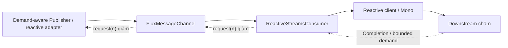
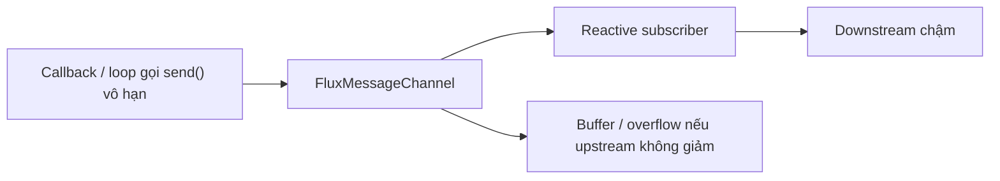

# Reactive backpressure với downstream chậm trong Spring Integration

## 1. Tình huống: producer nhanh, downstream xử lý chậm

Giả sử một ứng dụng Spring Integration nhận hàng nghìn sự kiện từ upstream, chuyển qua các `MessageChannel`, rồi gọi một dịch vụ lưu trữ hoặc API đối tác. Khi downstream chỉ xử lý được 100 sự kiện/giây nhưng upstream tiếp tục đẩy 400 sự kiện/giây, phần công việc chưa xử lý sẽ **tích lũy** ở đâu đó: memory buffer, hàng đợi, broker, connection pool, các request đang chờ hoặc ở chính nguồn.

Nếu không có chính sách kiểm soát, hệ thống có thể gặp:

- Heap tăng nhanh do buffer không giới hạn và cuối cùng `OutOfMemoryError`.
- P95/P99 latency tăng, request gateway timeout dù CPU handler chưa cao.
- Executor queue phình to; threads bị chiếm bởi I/O hoặc retry.
- Poller tiếp tục hút message khỏi JDBC/broker nhanh hơn tốc độ xử lý.
- Retry sau timeout làm tăng tải cho downstream vốn đã nghẽn.
- Message bị drop, ném lỗi overflow, redelivery hoặc mất ordering khi chọn sai cơ chế.

**Reactive backpressure** là cơ chế để subscriber thể hiện lượng dữ liệu mà nó **sẵn sàng tiếp nhận** qua tín hiệu demand. Khi các thành phần upstream hỗ trợ Reactive Streams, downstream có thể giảm tốc việc phát dữ liệu từ nguồn, thay vì đẩy toàn bộ áp lực vào hàng đợi trong JVM.

Bài học **Reactive backpressure với downstream chậm** nằm trong chương **Hiệu năng** của module `SPRING_INTEGRATION_RUNTIME`. Chúng ta dùng Spring Integration 6.5 và Project Reactor để gắn backpressure với channel, endpoint, consumer, poller, executor, vòng đời `IntegrationFlow`, transaction, retry, message store, error và correlation — tức những yếu tố thực sự quyết định hiệu năng runtime.

### Kết quả học tập

Sau bài này bạn có thể:

1. Giải thích `Publisher → Subscriber → Subscription.request(n)` và phân biệt demand với throughput thực tế.
2. Nhận biết nơi backpressure **đi xuyên được** và nơi nó **bị đứt** trong Spring Integration.
3. Dùng `FluxMessageChannel`, `ReactiveStreamsConsumer`, `handleReactive()` và `fluxTransform()` đúng vai trò.
4. Giới hạn số request downstream đang chạy bằng `flatMap(maxConcurrency, prefetch)`, dùng `concatMap()` khi cần thứ tự.
5. Thiết kế buffer hữu hạn, chính sách overflow, retry, timeout và dead-letter mà không giấu nguy cơ mất message.
6. Kiểm thử demand bằng `StepVerifier`, đo số tác vụ đồng thời và chẩn đoán hàng đợi/phần chờ ở runtime.

> **Phiên bản minh họa:** Spring Integration 6.5, Spring Framework 6.x, Project Reactor và Java 17 (ví dụ với Spring Boot 3.x phù hợp phiên bản dependency). Reactive không tự biến JDBC/blocking HTTP thành non-blocking; mọi bảo đảm phụ thuộc cả nguồn và đích thực tế.

## 2. Mô hình Reactive Streams: subscriber yêu cầu bao nhiêu thì producer phát bấy nhiêu

Reactive Streams có bốn khái niệm chính:

| Thành phần | Trách nhiệm |
|---|---|
| `Publisher<T>` | Cung cấp dòng dữ liệu khi subscriber yêu cầu. |
| `Subscriber<T>` | Nhận `onSubscribe`, `onNext`, `onError`, `onComplete`. |
| `Subscription` | Kết nối subscriber với publisher, hỗ trợ `request(n)` và `cancel()`. |
| **Demand** | Số phần tử subscriber còn cho phép upstream phát; phải lớn hơn 0 để nhận phần tử theo contract. |

```mermaid
sequenceDiagram
    participant S as Subscriber (downstream)
    participant P as Publisher (upstream)
    S->>P: subscribe()
    P-->>S: onSubscribe(subscription)
    S->>P: request(2)
    P-->>S: onNext(M1)
    P-->>S: onNext(M2)
    Note over P,S: Không có demand mới: upstream tạm ngừng phát
    S->>P: request(1)
    P-->>S: onNext(M3)
    S->>P: cancel()
    Note over P,S: Dừng subscription; xử lý ack/durable source riêng
```

Dòng dữ liệu thường được thiết lập ở bước **assembly** rồi thực thi khi có **subscription**. Với publisher phù hợp, downstream `request(n)` được truyền ngược qua operators lên upstream. Đây là cơ chế **flow control bằng số phần tử**, không phải giới hạn tốc độ theo giây.

### 2.1. Demand không phải “100 request mỗi giây”

- `request(10)` nghĩa là subscriber cho phép tối đa **10 phần tử tiếp theo**, không phải 10 phần tử/giây.
- `request(Long.MAX_VALUE)` được coi là nhu cầu không giới hạn; nhiều biến thể `subscribe()` tiện dụng trong Reactor yêu cầu gần như không giới hạn.
- `limitRate(10)` chia yêu cầu lớn thành những đợt nhỏ; nó **không** đặt tốc độ chính xác 10 messages/giây.
- `flatMap(..., 8)` giới hạn số publisher con được subscribe đồng thời; nó **không tự** khống chế RPM của HTTP API.
- `cancel()` hủy subscription, nhưng **không đồng nghĩa** broker record đã ack, transaction đã rollback hoặc một external side effect đã bị đảo ngược.

### 2.2. Bài toán cân bằng tốc độ

Ký hiệu:

- `λ`: arrival rate từ nguồn (messages/giây).
- `μ`: tốc độ downstream xử lý thành công (messages/giây).
- `B`: backlog chưa xử lý.

Nếu `λ > μ` duy trì đủ lâu, thì backlog sẽ tăng xấp xỉ `(λ - μ) × thời gian` nếu không có giới hạn, drop, reject hoặc throttle. Với ví dụ 400 vào/giây và 100 xử lý/giây, hệ thống tích lũy thêm khoảng 300 messages/giây. Trong một phút là khoảng 18.000 messages chưa xử lý, **chưa tính** message đang in-flight.

Các cơ chế chính có ba lựa chọn: **giảm tốc upstream**, **giữ backlog có giới hạn/bền vững**, hoặc **từ chối/đánh dấu mất có chủ đích**. Không có toán tử nào làm một downstream cố định tự xử lý nhiều hơn năng lực thực của nó.

## 3. Spring Integration: channel quyết định kiểu flow control

Spring Integration có thể dùng cùng một business handler nhưng đặt giữa những loại channel khác nhau. Việc lựa chọn channel quyết định cách xử lý thread, buffer và phản ứng trước downstream chậm.

| Channel/boundary | Cách hoạt động | Điều xảy ra khi downstream chậm |
|---|---|---|
| `DirectChannel` | Gọi handler đồng bộ trong thread sender | Sender có thể **bị block** cho tới khi handler kết thúc; đây là blocking push, không phải Reactive Streams demand. |
| `ExecutorChannel` | Dispatch handler qua `TaskExecutor` | Hàng đợi executor có thể tăng; khi đầy thì reject hoặc chạy theo rejection policy. Transaction/MDC caller không tự truyền. |
| `QueueChannel` | Giữ message cho poller hoặc `receive()` | Backlog tăng tới capacity hoặc giới hạn store; sender có thể block/timeout/reject tùy cấu hình. |
| `FluxMessageChannel` | `MessageChannel` đồng thời là `Publisher<Message<?>>`/`ReactiveStreamsSubscribableChannel` | Kết nối publisher và subscriber reactive; **không đảm bảo** một nguồn imperative gọi `send()` dồn dập sẽ tự biết giảm tốc. |
| `PublishSubscribeChannel` | Fan-out tới nhiều subscribers, có thể async | Một nhánh chậm ảnh hưởng hành vi tùy executor, error và buffer; không phải một queue backpressure duy nhất. |
| Broker/JDBC source adapter | Quyết định poll, prefetch, ack, commit | Cần cấu hình flow control/ack ở **nguồn**; downstream Reactor demand không tự điều khiển mọi driver. |

**Sai lầm thường gặp:** Đổi `DirectChannel` thành `FluxMessageChannel` rồi kết luận đã có backpressure end-to-end, trong khi upstream vẫn là một callback hoặc vòng lặp liên tục gọi `channel.send(message)`. Khi nguồn không hỗ trợ `Publisher`/demand, channel có thể phải buffer hoặc báo overflow; nó không thể tự buộc producer ngoài framework dừng phát.

### 3.1. Flow thực sự có backpressure



Nguồn, channel, consumer và downstream đều phải tuân thủ demand, kể cả những operator trung gian. Nếu một đoạn chuyển về blocking hoặc push không kiểm soát, cơ chế phản hồi áp lực có thể **dừng tại đoạn đó**.

### 3.2. Flow chỉ có vẻ reactive



Một publisher từ `Flux.range()` có thể tôn trọng `request(n)` rất tốt; nhưng một callback UDP/file watcher hay message listener tự phát hàng triệu event **có thể không có API để tạm dừng**. Lúc đó cần một boundary với capacity, chính sách reject/durable queue hoặc flow control của protocol.

## 4. Cặp API trung tâm: FluxMessageChannel và ReactiveStreamsConsumer

### 4.1. FluxMessageChannel làm gì?

Theo API Spring Integration 6.5, `org.springframework.integration.channel.FluxMessageChannel`:

- Kế thừa `AbstractMessageChannel` và thực thi `MessageChannel`.
- Đồng thời là `org.reactivestreams.Publisher<Message<?>>`.
- Thực thi `ReactiveStreamsSubscribableChannel`: có `subscribeTo(Publisher<? extends Message<?>>)` để nhận một **upstream publisher**.
- Có `start()`, `stop()`, `isRunning()` và lifecycle subscription.
- **Không phải** `SubscribableChannel` hay `PollableChannel` kiểu truyền thống.

Ví dụ dựng channel:

```java
import org.springframework.context.annotation.Bean;
import org.springframework.integration.channel.FluxMessageChannel;

@Bean("jobs.reactive")
FluxMessageChannel reactiveJobsChannel() {
    return new FluxMessageChannel();
}
```

Nếu source có `Publisher<Message<Job>>` thực sự, channel có thể nối demand từ downstream tới publisher bằng contract `subscribeTo(...)`. Với path `send()` nhận message từ imperative producer, Spring Integration dùng internal hot Flux/sink; phải kiểm tra giới hạn và xử lý overflow theo version/backend thay vì giả định không có buffer hoặc send sẽ block theo `request(n)`.

### 4.2. ReactiveStreamsConsumer

Khi input là `FluxMessageChannel` hoặc một publisher tương thích, Spring Integration có thể dùng `ReactiveStreamsConsumer` thay cho conventional `EventDrivenConsumer` để điều phối handler theo cơ chế Reactive Streams. Ở đây message processing đi từ imperative push sang reactive pull trong phạm vi có thể.

Từ 5.5, `ConsumerEndpointSpec.reactive()` cho phép yêu cầu endpoint reactive ngay cả khi input channel không trực tiếp là `FluxMessageChannel`. Một function tùy chọn có thể biến đổi nguồn `Flux<Message<?>>` bằng các operator như `publishOn()`, `doOnNext()`, `retry()`. Với annotations, `@Reactive` cho phép ý tưởng tương tự.

Nhưng **làm endpoint reactive không làm một nguồn ngoại vi không hỗ trợ demand trở thành demand-aware**. Cần phân tích từ nguồn tới đích chứ không chỉ xem một flag `reactive()`.

### 4.3. ReactiveMessageHandler và handleReactive()

Spring Integration hỗ trợ `ReactiveMessageHandler` với một `Publisher<Void>`/`Mono<Void>` để biểu diễn **thời gian hoàn thành xử lý**. Với consumer reactive, framework có thể compose handler vào reactive stream; với imperative flow, handler có thể được bọc và **subscribe ngay** nên không còn khả năng điều phối demand xuyên cả flow.

Từ 6.1, Java DSL có terminal operator `handleReactive(ReactiveMessageHandler)`. Ví dụ:

```java
@Bean
IntegrationFlow auditFlow() {
    return IntegrationFlow.from("audit.in")
            .handleReactive(message ->
                    Mono.fromRunnable(() ->
                            System.out.println(message.getPayload()))
                        .then());
}
```

Đây là handler terminal **không trả reply message**. Nó không có nghĩa `.handleReactive()` tự đặt `maxConcurrency=1` hay tạo queue bền vững. Nếu method trong `fromRunnable()` thực hiện blocking I/O, sự blocking vẫn xảy ra trên thread chạy subscription trừ khi scheduler phù hợp được chọn.

### 4.4. Reactive reply payload

Service activator/gateway có thể trả `Mono<T>` hoặc `Flux<T>`. Khi output channel là `ReactiveStreamsSubscribableChannel` như `FluxMessageChannel`, framework có thể flatten publisher theo demand. Trong một imperative channel, publisher có thể chỉ trở thành **payload chứa publisher** hoặc được subscribe theo chế độ async; đừng mặc định `Mono<T>` sẽ được chờ hoàn thành trước khi method call return.

Khi thiết kế request–reply, xác nhận ba điều: (1) ai subscribe kết quả, (2) channel nào giữ `replyChannel`, (3) timeout/cancel được ánh xạ vào trạng thái nghiệp vụ ra sao.

## 5. Ví dụ chạy được: nguồn reactive và downstream giả lập chậm

Bài thực hành dùng Java 17, Spring Boot 3.x có Spring Integration 6.5 phù hợp, Reactor và `spring-boot-starter-integration`.

### 5.1. Dependencies

```groovy
dependencies {
    implementation 'org.springframework.boot:spring-boot-starter-integration'
    implementation 'org.springframework.boot:spring-boot-starter-webflux'

    testImplementation 'org.springframework.boot:spring-boot-starter-test'
    testImplementation 'io.projectreactor:reactor-test'
}
```

Spring Boot dependency management nên chọn các version Reactor/Spring Integration tương thích; tránh tự pin `reactor-core` khác major hoặc API không tương thích.

### 5.2. Model và downstream contract

```java
public record WorkItem(String id, int priority) {
}
```

```java
import reactor.core.publisher.Mono;

@FunctionalInterface
public interface ReactiveDownstreamClient {
    Mono<Void> submit(WorkItem item);
}
```

Một fake client mô phỏng I/O không blocking:

```java
import java.time.Duration;
import org.springframework.context.annotation.Bean;
import org.springframework.context.annotation.Configuration;
import reactor.core.publisher.Mono;

@Configuration
class DemoDownstreamConfig {
    @Bean
    ReactiveDownstreamClient downstreamClient() {
        return item -> Mono.delay(Duration.ofMillis(100)).then();
    }
}
```

`Mono.delay()` minh họa độ trễ bằng scheduler của Reactor, **không** gọi HTTP hoặc DB thật. Với production, thay bằng WebClient/R2DBC/reactive driver phù hợp.

### 5.3. Source publisher → IntegrationFlow → reactive handler

```java
import org.springframework.context.annotation.Bean;
import org.springframework.context.annotation.Configuration;
import org.springframework.integration.dsl.IntegrationFlow;
import org.springframework.messaging.Message;
import org.springframework.messaging.support.MessageBuilder;
import reactor.core.publisher.Flux;

@Configuration
class ReactiveJobFlowConfig {

    @Bean
    IntegrationFlow reactiveJobFlow(ReactiveDownstreamClient client) {
        Flux<Message<WorkItem>> source = Flux.range(1, 1_000)
                .map(n -> MessageBuilder
                        .withPayload(new WorkItem("job-" + n, 1))
                        .setHeader("businessId", "job-" + n)
                        .build());

        return IntegrationFlow.from(source)
                .handleReactive(message -> {
                    WorkItem item = (WorkItem) message.getPayload();
                    return client.submit(item);
                });
    }
}
```

**Giải thích:**

1. `Flux.range()` là publisher demand-aware, không tạo sẵn một danh sách 1.000 message trong RAM.
2. `IntegrationFlow.from(Publisher<Message<T>>)` là điểm vào reactive; Spring Integration dùng cơ chế dựa trên `FluxMessageChannel`.
3. `handleReactive()` kết thúc flow bằng handler trả `Mono<Void>`; kết quả subscription biểu diễn xử lý đã hoàn thành hoặc lỗi.
4. Nếu client chậm, backpressure có thể truyền ngược tới source trong phần pipeline hỗ trợ demand.
5. Không dùng kết quả của ví dụ để suy ra concurrency cụ thể của internal `flatMap`, throughput hay mức buffer. Muốn ràng buộc số I/O đang chạy, **cấu hình rõ concurrency** như ví dụ kế tiếp.

**Cảnh báo vòng đời:** Publisher được subscribe khi flow/consumer sẵn sàng; việc một `Flux` finite kết thúc, flow stop/start hay resubscribe có thể phát lại dữ liệu tùy định nghĩa source. Với `Flux.range()` là cold publisher, mỗi subscription mới có thể phát lại 1.000 item; downstream cần business idempotency. Không dùng source demo này như persistent event queue.

## 6. Giới hạn số tác vụ downstream đang chạy

Reactive Streams điều tiết số phần tử được yêu cầu, nhưng mỗi phần tử có thể kích hoạt một I/O kéo dài. Nếu một downstream chỉ chịu được tối đa 8 request đang chạy, hãy đặt giới hạn **đúng tại operator tạo request đó**.

### 6.1. flatMap với maxConcurrency và prefetch

```java
import reactor.core.publisher.Flux;
import reactor.core.publisher.Mono;

Flux<WorkItem> jobs = Flux.range(1, 1_000)
        .map(n -> new WorkItem("job-" + n, 1));

Flux<WorkItem> completed = jobs.flatMap(
        job -> client.submit(job)
                .timeout(java.time.Duration.ofSeconds(3))
                .thenReturn(job),
        8,  // tối đa 8 inner Publishers đang được subscribe
        1   // prefetch cho mỗi inner Publisher
);
```

Ở đây, mỗi `client.submit(job)` là một `Mono<Void>`. `flatMap(..., 8, 1)` giới hạn số **inner subscriptions** đồng thời về 8; nó không đảm bảo downstream có SLA 3 giây, cũng không khống chế QPS tuyệt đối.

**Điều kiện:** mỗi `Mono` phải thực sự đại diện cho một request/I/O có lifecycle gắn với subscription. Nếu `client.submit()` tự gọi một API fire-and-forget bên ngoài rồi trả `Mono.empty()` ngay, giới hạn 8 không còn tương đương 8 request thực tế.

### 6.2. Đưa bước giới hạn vào Spring Integration bằng fluxTransform()

Spring Integration Java DSL có `fluxTransform()` để chèn một đoạn Reactor giữa các bước message flow:

```java
@Bean("jobs.flux.in")
FluxMessageChannel jobsFluxIn() {
    return new FluxMessageChannel();
}

@Bean
IntegrationFlow boundedJobFlow(ReactiveDownstreamClient client) {
    return IntegrationFlow.from("jobs.flux.in")
            .<WorkItem, Message<WorkItem>>fluxTransform(source ->
                    source.flatMap(message ->
                            client.submit(message.getPayload())
                                    .timeout(Duration.ofSeconds(3))
                                    .thenReturn(message),
                            8, 1))
            .handleReactive(message ->
                    Mono.fromRunnable(() ->
                            System.out.println("done="
                                    + message.getPayload()))
                        .then());
}
```

Các imports cần có: `java.time.Duration`, `org.springframework.integration.channel.FluxMessageChannel`, `org.springframework.integration.dsl.IntegrationFlow`, `org.springframework.messaging.Message`, `reactor.core.publisher.Mono` và Spring configuration annotations.

**Ý nghĩa:** `fluxTransform()` nhận dòng `Flux<Message<WorkItem>>`, gọi reactive client theo giới hạn 8 rồi đưa `Message<WorkItem>` đã hoàn thành sang downstream endpoint. Code dùng `FluxMessageChannel` ở input để giữ cách tiếp nhận reactive; producer bên ngoài nếu chỉ gọi `send()` liên tục **vẫn phải** tuân thủ capacity hoặc admission control.

Trong production, thay `System.out.println` bằng observable downstream/success sink có contract rõ, và xác nhận business idempotency khi cancel/retry. Không nên coi terminal logging là acknowledgment của broker.

### 6.3. flatMap, concatMap và flatMapSequential

| Operator | Tính chất | Dùng khi |
|---|---|---|
| `flatMap(mapper, concurrency, prefetch)` | Có thể xử lý đồng thời; output theo thứ tự hoàn thành | Nhiều request độc lập, ưu tiên throughput |
| `concatMap(mapper)` | Chờ publisher trước xong rồi mới xử lý publisher sau | Bắt buộc giữ thứ tự và một công việc in-flight |
| `flatMapSequential(mapper, concurrency, prefetch)` | Có thể chạy nội bộ song song nhưng phát output theo thứ tự nguồn | Cần output có thứ tự; chấp nhận buffer chờ tác vụ chậm |
| `limitRate(highTide, lowTide)` | Điều chỉnh batch demand lên upstream | Tinh chỉnh tốc độ **request**, không phải rate limiter theo thời gian |

**Trade-off:** `concatMap` giúp bảo toàn thứ tự nhưng một request chậm ngăn toàn bộ các request sau; `flatMapSequential` có thể phải **giữ kết quả đã hoàn thành** để chờ phần tử chậm trước. Cần đo memory khi có chênh lệch latency lớn.

### 6.4. Concurrency khác parallel threads

`flatMap(8)` không bắt buộc có 8 Java threads. Với reactive non-blocking HTTP, có thể có nhiều request in-flight trên một số nhỏ event-loop threads. Ngược lại, dùng `subscribeOn(Schedulers.boundedElastic())` cho mỗi blocking JDBC call vẫn chiếm threads/queue riêng và không biến I/O thành non-blocking.

## 7. Bộ đệm và overflow: không được ngụy trang mất message

Khi upstream không thể ngừng phát, vấn đề trở thành lựa chọn buffer và chính sách overflow. **Không có một operator backpressure nào tự sinh ra dung lượng RAM vô hạn mà vẫn an toàn.**

| Chính sách | Khi buffer đầy | Phù hợp |
|---|---|---|
| **Block producer với timeout** | Sender chờ hoặc nhận lỗi | Imperative source chịu được chậm và có timeout |
| **Reject/admission control** | Từ chối request với mã lỗi/retry-after | HTTP/gateway, thao tác có caller điều khiển retry |
| **Bounded in-memory buffer** | Báo overflow, drop hoặc fail theo policy | Dữ liệu có thể tái tạo/không bắt buộc bền vững |
| **Durable broker/JDBC queue** | Broker/store giữ backlog theo capacity/retention | Không được mất message, cần ack/redelivery/idempotency |
| **Coalesce/latest** | Gộp hoặc chỉ giữ trạng thái mới nhất | Telemetry/state snapshot, không dùng cho giao dịch chính xác |
| **Drop** | Bỏ phần tử có chủ đích và đo số bị bỏ | Chỉ khi nghiệp vụ **cho phép mất** từng sample |

### 7.1. onBackpressureBuffer không tự an toàn

```java
Flux<WorkItem> protectedStream = source
        .onBackpressureBuffer(
                256,
                item -> metrics.incrementOverflow(item.id()),
                reactor.core.publisher.BufferOverflowStrategy.ERROR);
```

Đây là đoạn **minh họa** (giả định `source` là `Flux<WorkItem>` và `metrics` có method tương ứng). Reactor có các overload giới hạn buffer và chính sách overflow. Luôn kiểm tra phiên bản API chính xác, vì tham số và cách overflow propagate tùy overload.

Nếu source là hot producer không tôn trọng demand, buffer có thể đầy và stream fail. Lúc đó cần xác định ai bắt lỗi, nguồn có replay được không và message có bị mất không. Không cấu hình `onBackpressureDrop()` cho đơn hàng/thanh toán rồi nghĩ là một cơ chế tối ưu an toàn.

### 7.2. Sinks với hàng đợi hữu hạn

Reactor cho phép tạo một sink `Sinks.many().unicast().onBackpressureBuffer(queue)` với queue bounded. Khi queue đầy, `tryEmitNext()` có thể trả mã thất bại như `FAIL_OVERFLOW`. Điều này **khác** với bảo đảm của Spring Integration `FluxMessageChannel`; đừng áp đặt cấu hình sink tự tạo lên internal implementation của framework.

```java
import java.util.concurrent.ArrayBlockingQueue;
import reactor.core.publisher.Sinks;

Sinks.Many<Integer> sink =
        Sinks.many().unicast()
                .onBackpressureBuffer(new ArrayBlockingQueue<>(2));

Sinks.EmitResult first = sink.tryEmitNext(1);
Sinks.EmitResult second = sink.tryEmitNext(2);
Sinks.EmitResult third = sink.tryEmitNext(3);

if (third.isFailure()) {
    // Từ chối / báo lỗi / persist để retry;
    // KHÔNG giả định phần tử đã được nhận an toàn.
}
```

Bộ đệm chỉ là 2 phần tử và vẫn **trong RAM**. Restart JVM sẽ mất phần tử chưa tiêu thụ. Với dữ liệu nghiệp vụ quan trọng, dùng broker hoặc persistent store và cơ chế retry/ack thích hợp.

## 8. Khi nào FluxMessageChannel chưa đủ?

Có hai ranh giới cần kiểm tra.

### 8.1. Imperative producer liên tục gọi send()

```java
for (int i = 0; i < 1_000_000; i++) {
    boolean accepted = channel.send(
            MessageBuilder.withPayload("event-" + i).build());
    if (!accepted) {
        // Xử lý rejection theo business policy.
    }
}
```

Code này không có `request(n)` từ upstream; producer chủ động push. Không được khẳng định reactive consumer sẽ tự buộc vòng `for` giảm tốc. Thực tế phụ thuộc giới hạn internal sink, trạng thái subscriber và xử lý overflow. Nếu dùng Imperative API, cần admission control, bounded queue hoặc một `Publisher` demand-aware thay thế.

### 8.2. Blocking handler trong reactive flow

```java
// KHÔNG đưa blocking JDBC trực tiếp vào Reactor event loop:
Mono.fromCallable(() -> jdbcTemplate.queryForObject(...))
    .subscribe(); // Fire-and-forget còn làm mất quyền kiểm soát completion!
```

`block()` hoặc JDBC blocking trong handler reactive có thể chiếm event-loop thread, gây latency tăng ở **nhiều requests không liên quan**. Nếu chưa thể thay bằng reactive driver, cách ly bằng `Schedulers.boundedElastic()`:

```java
Mono<Result> databaseCall = Mono.fromCallable(
                () -> blockingRepository.loadById(id))
        .subscribeOn(Schedulers.boundedElastic());
```

Điều này chỉ chuyển blocking work sang scheduler có giới hạn; **không tự đảm bảo** connection pool DB đủ hoặc queue của boundedElastic không tăng. Cần đặt timeout, concurrency/admission, sizing pool và đo queue wait. Với dữ liệu quan trọng, phải giữ đúng transaction boundary; Spring JDBC transaction thread-bound không tự theo qua scheduler khác.

## 9. Backpressure khác timeout, retry, circuit breaker và rate limit

Những cơ chế này thường đi cùng nhau, nhưng giải quyết các vấn đề khác nhau:

| Cơ chế | Kiểm soát gì? | Sai lầm phổ biến |
|---|---|---|
| **Backpressure** | Số phần tử được demand-aware upstream phát | Tưởng là giới hạn số requests/giây |
| **Timeout** | Thời gian một operation được phép kéo dài | Tưởng timeout rollback mọi side effect đã xảy ra |
| **Retry** | Số lần thử lại lỗi tạm thời | Retry storm làm downstream nghẽn hơn |
| **Circuit breaker** | Cho phép/thôi gọi downstream khi tỷ lệ lỗi cao | Tưởng có thể thay buffer hoặc durable replay |
| **Rate limiter** | Số operation theo thời gian (RPS/tokens) | Chỉ dùng `limitRate(n)` rồi gọi đó là RPS limit |
| **Bulkhead** | Số tác vụ/connection được phép đồng thời | Chỉ tăng thread count mà không giới hạn outstanding work |
| **Queue/broker** | Lưu phần việc chưa xử lý | Tưởng queue vô hạn không tốn tài nguyên |

### 9.1. Retry với downstream chậm

Nếu downstream mất 5 giây để trả kết quả nhưng timeout là 1 giây, mỗi event có thể bị thử lại 3 lần trong khi request cũ vẫn có khả năng đã được thực hiện. Hệ thống tự tăng tải và làm nghẽn nghiêm trọng hơn.

Một policy thực tế:

1. Timeouts dựa vào latency budget và đặc tính downstream.
2. Chỉ retry **transient errors**, có giới hạn attempts và exponential backoff với jitter.
3. Không retry validation errors hoặc schema errors một cách vô hạn.
4. Sử dụng business idempotency key ở downstream để bảo vệ khi kết quả lần trước chưa rõ.
5. Theo dõi tổng số attempts, pending retries và DLQ rate, không chỉ throughput thành công.

### 9.2. Reactor retry là resubscribe

```java
Mono<Void> call = client.submit(item)
        .timeout(Duration.ofSeconds(3))
        .retryWhen(
                reactor.util.retry.Retry.backoff(
                        2, Duration.ofMillis(200))
                .filter(this::isTransient));
```

Đoạn này minh họa trong một service có method `isTransient(Throwable)`. Reactor `retryWhen` thường **resubscribe** vào source publisher khi lỗi; nếu method `client.submit` thực thi side effect ngay tại thời điểm gọi thay vì subscription, semantics khác. Với work bên ngoài như thanh toán, luôn xem idempotency và trạng thái lần thử trước.

## 10. Poller, broker, ack và transaction với downstream chậm

### 10.1. Reactive source polling

Theo Spring Integration, khi `SourcePollingChannelAdapter` gửi tới một `ReactiveStreamsSubscribableChannel`, runtime có thể tạo `Flux` dựa trên trigger và poll theo demand thay vì chỉ schedule các lần pull kiểu imperative. `ReactiveMessageSourceProducer` cũng có thể chuyển `MessageSource.receive()` sang dạng publisher với scheduler phù hợp khi source blocking.

Điều này hữu ích, nhưng **mỗi adapter có contract riêng**. Một source không hỗ trợ pause/seek/ack đúng cách không thể nhận bảo đảm end-to-end chỉ vì đầu ra là `FluxMessageChannel`.

### 10.2. Poller thường: maxMessagesPerPoll và queue depth

```text
Pollable source -> SourcePollingChannelAdapter
     -> QueueChannel / ExecutorChannel / Reactive boundary
     -> Slow downstream
```

Nếu poller đọc `maxMessagesPerPoll` lớn, `fixedDelay` ngắn và executor queue rộng, producer có thể hút message vào JVM nhanh hơn downstream xử lý. Hãy đo số message nhận mỗi chu kỳ, queue depth, độ trễ poller, worker saturation và khả năng rollback source. Điều chỉnh poll frequency không thay thế demand-aware source, nhưng có thể là một cơ chế admission hữu ích ở legacy adapter.

### 10.3. Broker prefetch và acknowledgment

Với JMS, AMQP hoặc Kafka, backpressure trong Reactor **không tự động** đồng bộ với prefetch, partition, offset commit hay ack mode của broker. Cần đối chiếu driver/adapter:

- Bao nhiêu message broker có thể giao trước khi consumer ack?
- Khi reactive handler chưa hoàn tất, nguồn đã ack/commit hay chưa?
- Nếu subscription cancel, record chưa xử lý quay lại source hay mất?
- Có giới hạn in-flight theo partition/consumer và DLQ cho lỗi xác định không?
- Khi restart, message đã được commit trước hay sau business side effect?

**At-least-once** vẫn là thực tế phổ biến khi ghép broker với business database bên ngoài. Backpressure làm giảm tải, không tự tạo exactly-once transaction.

### 10.4. Transaction không tự đi qua async boundary

```text
Thread poller:
  begin TX -> receive broker/JDBC -> enqueue async work -> commit TX

Thread reactive worker:
  perform business operation later -> error / success
```

Nếu poller commit trước khi asynchronous Mono hoàn tất, failure downstream **không làm rollback** transaction đã commit. Cần thiết kế ack khi completion được xác nhận, dùng business inbox/outbox, hoặc lựa chọn boundary synchronous khi cần một local transaction bao cả receive và handler. Với R2DBC reactive transaction, dùng mechanism reactive transaction context phù hợp, không dựa vào thread-local của `DataSourceTransactionManager`.

## 11. Chẩn đoán bottleneck trước khi chỉnh operator

Khi P99 latency tăng, không nên lập tức tăng `flatMap` concurrency hoặc số threads. Trước hết xác định bottleneck thật.

| Triệu chứng | Khả năng | Kiểm tra |
|---|---|---|
| CPU thấp, nhiều HTTP call pending | Downstream network/I/O chậm | Latency phía đối tác, active connection, timeout |
| Heap/GC tăng | Buffer, queues hoặc batch lớn | Buffer occupancy, `publishOn` prefetch, executor backlog |
| CPU cao | Serialization, transform CPU-bound | CPU profiler, queue wait, event-loop utilization |
| HTTP 429/503 tăng khi tăng concurrency | Vượt giới hạn downstream | RPS và max in-flight, retry amplification |
| `FluxMessageChannel` overflow | Producer push nhanh, thiếu downstream demand | Nguồn có thật sự dùng Publisher? Kích thước buffer? |
| Kafka partition lag tăng | Consumer/ack chậm hoặc retry | Prefetch, offset, request completion |
| QueueChannel backlog sâu | Poller hoặc handler chậm | Poller started, maxMessagesPerPoll, JDBC locks |
| Một phần tử chậm giữ tất cả | `concatMap` hoặc ordered output | Ordering contract và completion timestamps |
| Retry attempts tăng mạnh | Retry storm | Timeout budget, backoff, circuit breaker |

Thời gian từ ingress tới completion có thể phân rã thành thời gian đợi source, đợi executor/buffer, xử lý, chờ downstream I/O, backoff và reply/ack. Khi throughput thành công không tăng, nâng số concurrent requests có thể chỉ làm mỗi request đợi lâu hơn.

### 11.1. Little's Law để ước lượng in-flight

Với một hệ thống ở trạng thái ổn định:

\[
L \approx \lambda W
\]

`L` là số công việc trung bình trong hệ thống, `λ` throughput trung bình (công việc/giây), `W` thời gian trung bình mỗi công việc ở trong hệ thống. Ví dụ 20 request/giây và 0,5 giây/request cho nhu cầu khoảng 10 công việc in-flight trung bình.

Công thức chỉ gợi ý **capacity** ở trạng thái ổn định, không chứng minh con số concurrency nào là tối ưu khi backlog tăng vô hạn, timeout/drop hoặc workload có burst. Cần đo cả P95/P99, không chỉ average.

## 12. Cách tuning maxConcurrency, prefetch và hàng đợi

Một baseline:

```java
static final int MAX_IN_FLIGHT = 8;
static final int PREFETCH = 1;

Flux<WorkItem> completed = source.flatMap(
        job -> client.submit(job)
                .timeout(Duration.ofSeconds(3))
                .thenReturn(job),
        MAX_IN_FLIGHT,
        PREFETCH);
```

Chạy workload có kiểm soát với `MAX_IN_FLIGHT=1,4,8,16`, giữ nguyên điều kiện downstream và đo:

- Throughput **thành công**, không chỉ số requests đã khởi phát.
- P50/P95/P99 latency; timeout và HTTP 429/503.
- Active connections, in-flight requests, executor/scheduler queue.
- Heap, garbage collection, số buffer elements, overflow/reject count.
- Broker lag, source acknowledgments, retry/DLQ rate.
- Độ trễ từ lúc source nhận message tới business commit.

**Tăng concurrency** có thể che giấu chờ I/O nhưng cũng dễ đè downstream. **Tăng prefetch** có thể giảm overhead request batches nhưng tăng pending elements. **Tăng queue capacity** hấp thụ burst nhưng tăng queue wait và memory.

### 12.1. Hidden queues trong Reactor

Ngay cả khi không có `QueueChannel`, phần tử có thể tích lũy trong:

- `publishOn()` prefetch queue khi chuyển scheduler.
- `flatMap` inner subscriptions/prefetch queues.
- `flatMapSequential` buffer để phát output đúng thứ tự.
- `groupBy()` nhiều nhóm đang mở, mỗi nhóm có state.
- `buffer(n)`, `window(n)` khi downstream yêu cầu một batch.
- Hot source sink, callback bridge hoặc pending retry/backoff.

Một pipeline "100% reactive" vẫn cần ngân sách memory rõ ràng. Đừng mặc định tên operator không có chữ queue nghĩa là không buffer.

### 12.2. Concurrency không phải time-based rate limit

Nếu API đối tác giới hạn 50 requests/giây và mỗi request hoàn thành trong 10 ms, 8 in-flight có thể gửi **hàng trăm request/giây**. Cần rate limiter theo thời gian kết hợp bounded concurrency. `limitRate(8)` không tạo chính sách 8 requests/giây.

## 13. Quan sát demand, cancellation và bottleneck

Tại operator đang nghi ngờ, có thể gắn hooks:

```java
Flux<WorkItem> observed = source
        .doOnSubscribe(s -> log.debug("reactive-subscribed"))
        .doOnRequest(n -> log.debug("requested={}", n))
        .doOnNext(job -> metrics.accepted(job.id()))
        .doOnError(ex -> metrics.failed(ex.getClass().getSimpleName()))
        .doOnCancel(() -> metrics.cancelled())
        .doFinally(signal -> metrics.terminated(signal.name()));
```

Đây là code minh họa với `log` và `metrics` của ứng dụng. Không log mỗi message ở mức INFO trong workload lớn. Log phải có `businessId`/`correlationId` ổn định, flow/component ID, instance và source partition nếu có; không log raw secrets/PII.

| Layer | Các metric có giá trị |
|---|---|
| Source | Arrival rate, requested(n), broker lag, poll count, ack/commit |
| Reactive operator | Inner active, pending demand, overflow/drop, cancellation, buffer size |
| Downstream | RPS, active requests, connection saturation, status 2xx/429/5xx, latency |
| Business | DB commit/rollback, idempotency conflicts, retry and DLQ count |

Các tên metric chi tiết là gợi ý instrumentation, không phải tất cả đều được Spring Integration/Micrometer tạo sẵn. Spring Integration management đo channel/handler theo cấu hình, còn demand của custom publisher thường phải đo riêng.

### 13.1. Phân biệt blocking và non-blocking I/O

- Thread `reactor-http-nio-*` block trên `Thread.sleep()` hoặc JDBC: event-loop starvation.
- Ít event-loop threads nhưng nhiều requests pending: có thể là non-blocking I/O đúng cơ chế, tuy nhiên downstream thực sự chậm.
- Nhiều `boundedElastic-*` threads chờ DB: đã chuyển blocking khỏi event loop nhưng connection pool vẫn là bottleneck.
- `taskScheduler-*` bị giữ bởi handler blocking: kiểm tra poller execution/thread.
- `DirectChannel` sender chờ handler: producer bị chậm do synchronous call, không phải tín hiệu Reactive Streams `request(n)`.

MDC là thread-local và có thể biến mất khi Reactor chuyển scheduler; message `requestId` header vẫn có thể được bảo toàn. Phân biệt **mất MDC** với **mất message**.

## 14. Dùng StepVerifier kiểm tra backpressure

### 14.1. Kiểm tra chính xác request(n) ở Reactor source

```java
import static org.junit.jupiter.api.Assertions.assertEquals;
import java.util.concurrent.atomic.AtomicLong;
import org.junit.jupiter.api.Test;
import reactor.core.publisher.Flux;
import reactor.test.StepVerifier;

class DemandTest {

    @Test
    void sourceEmitsOnlyWhenRequested() {
        AtomicLong requested = new AtomicLong();

        Flux<Integer> source = Flux.range(1, 5)
                .doOnRequest(requested::addAndGet);

        StepVerifier.create(source, 0)
                .expectSubscription()
                .thenRequest(2)
                .expectNext(1, 2)
                .thenRequest(3)
                .expectNext(3, 4, 5)
                .verifyComplete();

        assertEquals(5, requested.get());
    }
}
```

`initialRequest=0` nghĩa là subscriber chưa cấp demand. Sau `thenRequest(2)` mới nhận 1/2, sau `thenRequest(3)` nhận phần còn lại. Test này chứng minh `Flux.range()` tôn trọng demand, **không** chứng minh mọi Spring Integration inbound adapter/broker map demand đúng.

### 14.2. Kiểm tra số Mono đang chạy không vượt maxConcurrency

```java
import static org.junit.jupiter.api.Assertions.*;
import java.time.Duration;
import java.util.concurrent.atomic.AtomicInteger;
import org.junit.jupiter.api.Test;
import reactor.core.publisher.Flux;
import reactor.core.publisher.Mono;
import reactor.test.StepVerifier;

class MaxConcurrencyTest {

    @Test
    void atMostFourInnerPublishersRunTogether() {
        AtomicInteger active = new AtomicInteger();
        AtomicInteger peak = new AtomicInteger();

        Flux<Integer> completed = Flux.range(1, 20)
                .flatMap(id ->
                        Mono.defer(() -> {
                            int now = active.incrementAndGet();
                            peak.accumulateAndGet(now, Math::max);
                            return Mono.delay(Duration.ofMillis(20))
                                    .thenReturn(id)
                                    .doFinally(sig ->
                                            active.decrementAndGet());
                        }),
                        4, 1);

        StepVerifier.create(completed)
                .expectNextCount(20)
                .expectComplete()
                .verify(Duration.ofSeconds(5));

        assertTrue(peak.get() <= 4);
        assertTrue(peak.get() > 0);
    }
}
```

Đếm `active` khi inner `Mono.defer()` được **subscribe**, không khi xây publisher. Test bảo đảm giới hạn inner subscriptions, không ngụ ý số thread tương ứng cũng bằng 4. Sử dụng deadline ngắn và một downstream giả lập có thể tái tạo; load test thật nên bổ sung phân bố latency và fault injection.

### 14.3. Virtual time cho delay/retry

```java
import java.time.Duration;
import reactor.core.publisher.Flux;
import reactor.core.publisher.Mono;
import reactor.test.StepVerifier;

StepVerifier.withVirtualTime(() ->
        Flux.range(1, 3)
                .concatMap(i ->
                        Mono.delay(Duration.ofSeconds(1))
                                .thenReturn(i)))
        .expectSubscription()
        .thenAwait(Duration.ofSeconds(3))
        .expectNext(1, 2, 3)
        .verifyComplete();
```

Virtual time mô phỏng Reactor timers; không làm HTTP/JDBC thật chạy nhanh hơn. Nếu pipeline có custom schedulers bên ngoài virtual-time scope, phải cấu hình lại hoặc dùng integration test thời gian thực.

## 15. Kiểm thử tích hợp Spring Integration khi downstream chậm

Dùng một Spring context với `ReactiveJobFlowConfig` ở mục 5 và fake `ReactiveDownstreamClient` có thể điều khiển completion. Cần assert cả **source→sink semantics** và **tác động nghiệp vụ**.

| Scenario | Điều khiển | Kỳ vọng |
|---|---|---|
| 100 message hợp lệ, source demand-aware | Publisher hữu hạn, client trả Mono hoàn tất | 100 completion, không duplicate businessId |
| Downstream 10 lần chậm hơn | Delay cố định/biến thiên | In-flight không vượt bound, backlog/latency theo policy |
| Source callback gọi send() nhanh | Producer không có demand | Overflow/reject/buffer có giới hạn, không OOM |
| One permanent error | Client ném validation exception | Quarantine/DLQ hoặc dừng stream rõ, không retry vô hạn |
| Retry transient | Client lỗi 503 rồi thành công | Bounded retry, backoff và idempotency |
| Cancel với work đang chạy | Dispose subscription | In-flight cleanup theo client; nguồn ack/replay đúng contract |
| Restart trước downstream complete | Persistent source và process thật | Redelivery an toàn, không mất/double side effect |
| Gateway timeout sau business commit | Reply trễ | Caller retry được idempotent handling |
| Nhiều tenant, một tenant chậm | Quotas/bulkhead | Tenant nhanh không đói tài nguyên |

**Không dùng `QueueChannel` in-memory để chứng minh dữ liệu survive restart**. Với broker/JDBC source, dùng Testcontainers/nguồn thật và kiểm tra ack, transaction, redelivery.

### 15.1. Cẩn thận với test chỉ dùng handleReactive()

Một terminal `handleReactive(message -> client.submit(...))` tự compose/subscribe handler theo API, nhưng không đảm bảo một giá trị concurrency nhất định. Muốn assertion "max 8 in-flight" đáng tin, hãy đặt giới hạn ở `flatMap(...,8,1)` **bao đúng thao tác client.submit()` và test đoạn operator đó.

### 15.2. Không xem send() thành công là business đã commit

Nếu `MessageChannel.send()` trả `true`, điều đó nói rằng channel đã tiếp nhận/dispatch theo contract của nó, **không** chứng minh reactive Mono downstream đã hoàn thành hoặc broker đã acknowledge. Đối chiếu completion, error/ack và business state.

## 16. Fairness và bulkhead khi có nhiều tenant

Một tenant chậm có thể chiếm toàn bộ `flatMap(maxConcurrency=8)` chung, khiến tenant khác cũng bị trễ. Các giải pháp:

- **Per-tenant bulkhead:** giới hạn concurrent calls, buffer và connections theo tenant.
- **Bounded pending queue** theo tenant thay vì một queue vô hạn toàn cluster.
- **Rate limit** theo tenant và theo downstream endpoint.
- **Partitioning** theo tenant/key nếu cần ordering riêng.
- **Shared flow** cho nhiều tenant có cùng pipeline, hoặc flow/worker pool riêng cho tenant nặng.
- **Admission control** có trạng thái reject rõ, không tự động nuốt message.

`Flux.groupBy(tenantId)` tạo các nhóm reactive nhưng có thể gây memory/backpressure khi số lượng nhóm quá lớn hoặc group không được tiêu thụ. Không xem `groupBy` là scheduler công bằng miễn phí cho hàng trăm nghìn tenant; cần quản lý cardinality, cleanup và concurrency.

## 17. Khi nào dùng reactive, khi nào bounded blocking phù hợp hơn?

| Hoàn cảnh | Cách tiếp cận |
|---|---|
| Upstream/downstream có reactive driver, nhiều I/O đợi | `FluxMessageChannel`, Publisher và reactive consumer |
| JDBC blocking, legacy SDK | Bounded executor/`Schedulers.boundedElastic()`, transaction rõ; cân nhắc R2DBC nếu hợp lý |
| Callback source không pause được | Bounded buffer + reject/overflow hoặc durable queue |
| Broker cần giữ mọi event | Broker làm backlog, tune prefetch/ack/consumer concurrency |
| Thứ tự trong một partition bắt buộc | `concatMap` hoặc per-key ordered processor |
| API đối tác có RPS quota | Rate limiter theo thời gian + bounded in-flight |
| CPU-bound transformer | Giới hạn parallelism theo CPU, không kỳ vọng reactive I/O giúp CPU |
| Handler cực nhanh, không cần async | `DirectChannel` đồng bộ có thể đơn giản và ít overhead hơn |

Không có bảo đảm về throughput chỉ nhờ chuyển mọi channel sang `FluxMessageChannel`. Đo workload thực tế rồi mới chọn kiến trúc.

## 18. Runbook khi reactive flow chậm

1. Lấy `businessId`, flow ID, tenant/instance, timestamp và exception root cause.
2. Đo arrival rate (`λ`) so với successful completion (`μ`); backlog có tăng không?
3. Xác định producer là Publisher demand-aware hay callback/vòng `send()` imperative.
4. Đọc channel chain: `FluxMessageChannel`, `ExecutorChannel`, `DirectChannel`, `QueueChannel` và các broker boundaries.
5. Đo downstream latency, status, active connections và quota 429/503.
6. Instrument `doOnRequest` và active inner counts bằng sampling.
7. Kiểm tra `flatMap`, `publishOn`, `buffer`, `groupBy`, `retryWhen` và source prefetch.
8. Tìm blocking I/O trên reactor event loop bằng thread dump; tách blocking nếu cần.
9. Đọc transaction, ack và error handling: completion đã được chờ trước commit chưa?
10. Đặt maxConcurrency, bounded buffering, admission control và retry policy rõ.
11. Chạy load test với burst và downstream delay/failure injection.
12. Sau tuning, theo dõi P95/P99, DLQ, GC, queue age và throughput business thành công.

### Ma trận lỗi nhanh

| Hiện tượng | Nguyên nhân khả dĩ | Biện pháp |
|---|---|---|
| Producer `send()` liên tục, heap tăng | Hot source không tôn trọng demand | Admission/bounded queue/overflow |
| `limitRate(10)` nhưng >10 request/s | Không phải time-based limiter | Dùng rate limiter theo giây |
| `flatMap(8)` vẫn bị 429 | 8 concurrency vẫn vượt RPS quota | Rate limit + concurrency |
| One slow item giữ cả stream | `concatMap` / ordered output | Xem ordering contract và partitioning |
| `flatMapSequential` memory lớn | Output buffer đợi item cũ | Giảm concurrency hoặc đổi ordering policy |
| `publishOn` làm trễ hơn | Queue/scheduler mới | Đo prefetch và queue wait |
| Broker lag tăng | Poll/ack chậm | Tune consumer, downstream capacity, commit |
| Cancel mà message mất | Ack sớm / RAM buffer | Durable replay, idempotent processing |
| Retry càng làm downstream lỗi | Retry storm | Backoff, breaker, quota, DLQ |
| Gateway timeout dù DB đã ghi | Reply đến muộn, tx đã commit | Business idempotency + status query |

## 19. Câu hỏi tự kiểm tra

**1.** `request(10)` có nghĩa 10 messages/giây?  
**Đáp án:** Không. Đây là demand theo số phần tử, không phải rate/time.

**2.** Thay `DirectChannel` bằng `FluxMessageChannel` có tự điều tiết một `send()` loop không?  
**Đáp án:** Không bảo đảm. Upstream phải có demand-aware contract hoặc admission/overflow policy.

**3.** `flatMap(mapper,8,1)` kiểm soát gì?  
**Đáp án:** Tối đa 8 inner subscriptions cùng lúc, prefetch 1 cho mỗi inner; không phải 8 Java threads hay 8 RPS.

**4.** `limitRate(10)` có thay rate limiter không?  
**Đáp án:** Không. Nó chia demand thành batches, không giới hạn tốc độ đồng hồ.

**5.** Vì sao `concatMap()` có thể gây head-of-line blocking?  
**Đáp án:** Nó đợi inner trước hoàn thành rồi mới xử lý inner tiếp, giữ thứ tự nhưng hạn chế song song.

**6.** `onBackpressureDrop()` có phù hợp với message thanh toán?  
**Đáp án:** Không nếu nghiệp vụ không cho phép mất event; cần durable retry/ack/idempotency.

**7.** Dùng `boundedElastic` cho JDBC có làm JDBC non-blocking?  
**Đáp án:** Không. JDBC vẫn block threads; scheduler chỉ cách ly khỏi event loop.

**8.** `Mono<Void>` báo lỗi sau khi poller đã commit, Reactor cancel có rollback DB transaction không?  
**Đáp án:** Không. Cần thiết kế ack/transaction boundary và recovery phù hợp.

**9.** StepVerifier chứng minh `Flux.range()` tôn trọng demand đã chứng minh adapter JMS/Kafka cũng vậy?  
**Đáp án:** Chưa. Cần test actual adapter, broker prefetch, ack và cancel behavior.

**10.** Vì sao tenant chậm có thể làm tenant nhanh bị ảnh hưởng trong một shared `flatMap(8)`?  
**Đáp án:** Tenant chậm chiếm slots; cần per-tenant bulkhead/quotas hoặc partitioning.

**11.** `FluxMessageChannel.send() == true` có nghĩa downstream đã commit?  
**Đáp án:** Không. Channel acceptance/dispatch khác business completion và acknowledgment.

**12.** Downstream 50 RPS và request hoàn thành nhanh; đặt maxConcurrency=8 đã đủ?  
**Đáp án:** Chưa chắc. Cần time-based rate limit theo quota thực.

## 20. Tài liệu tham khảo chính thức

1. [Spring Integration 6.5 — Reactive Streams Support](https://docs.spring.io/spring-integration/reference/6.5/reactive-streams.html): `FluxMessageChannel`, `ReactiveStreamsConsumer`, reactive polling và `handleReactive()`.
2. [Spring Integration 6.5 API — FluxMessageChannel](https://docs.spring.io/spring-integration/docs/6.5.0/api/org/springframework/integration/channel/FluxMessageChannel.html): `Publisher<Message<?>>`, `subscribeTo()` và lifecycle.
3. [Spring Integration 6.5 API — BaseIntegrationFlowDefinition](https://docs.spring.io/spring-integration/docs/6.5.0/api/org/springframework/integration/dsl/BaseIntegrationFlowDefinition.html): `fluxTransform()` và `handleReactive()`.
4. [Spring Integration 6.5 — Reactive annotations](https://docs.spring.io/spring-integration/reference/6.5/configuration/annotations.html): `@Reactive` và reactive endpoint configuration.
5. [Spring Integration 6.5 — Messaging Channels](https://docs.spring.io/spring-integration/reference/6.5/channel.html): synchronous, executor, queue và flux channels.
6. [Spring Integration 6.5 — Transactions](https://docs.spring.io/spring-integration/reference/6.5/transactions.html): poller/transaction/thread boundaries.
7. [Spring Integration 6.5 — Error Handling](https://docs.spring.io/spring-integration/reference/6.5/error-handling.html): error flows, async handling.
8. [Project Reactor — Backpressure and Requests](https://projectreactor.io/docs/core/release/reference/subscribe-backpressure.html): `request(n)`, `limitRate`, demand/prefetch.
9. [Project Reactor — Sinks](https://projectreactor.io/docs/core/release/reference/coreFeatures/sinks.html): bounded sinks, overflow và `tryEmitNext()`.
10. [Project Reactor — Testing with StepVerifier](https://projectreactor.io/docs/test/release/reference/): controlling demand và virtual time.
11. [Project Reactor — Flux API](https://projectreactor.io/docs/core/release/api/reactor/core/publisher/Flux.html): `flatMap`, `concatMap`, `flatMapSequential` và buffer operators.
