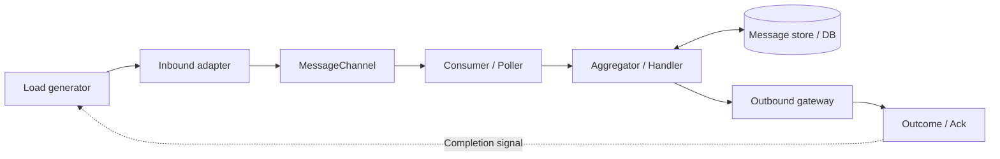
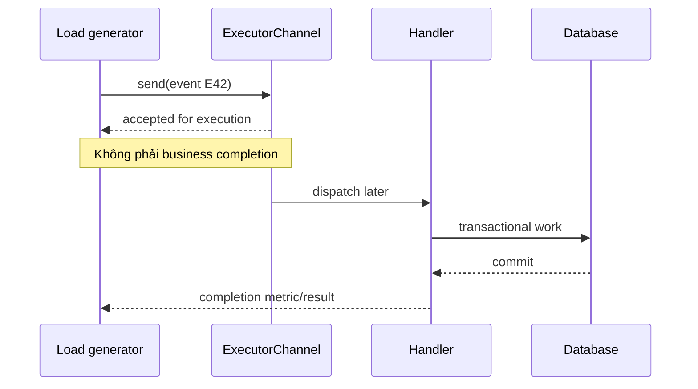
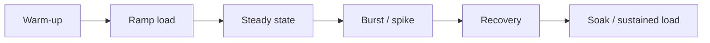
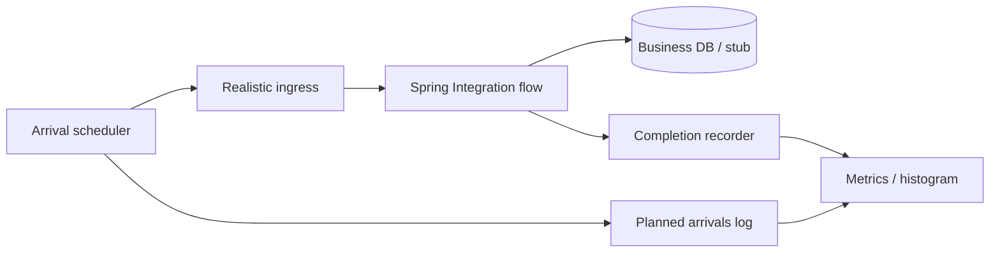
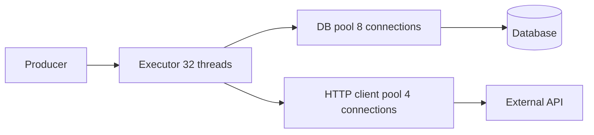
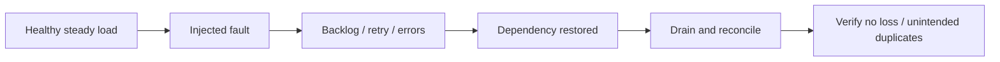
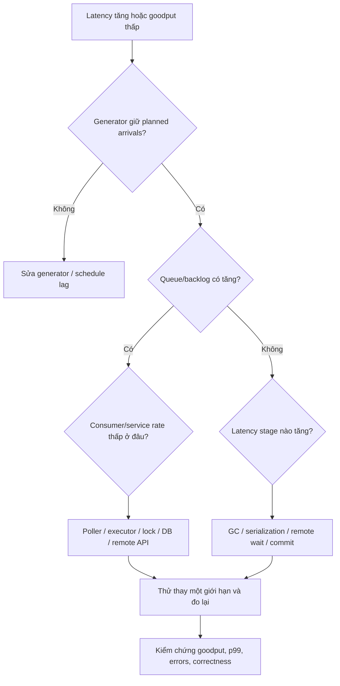

# Benchmark trên workload và topology đại diện

Trong **Spring Integration runtime**, một message có thể đi qua inbound adapter, `MessageChannel`, poller, executor, filter, transformer, aggregator, transaction, message store và outbound gateway. Mỗi thành phần đều ảnh hưởng đến **throughput, độ trễ, khả năng chịu tải, bộ nhớ và hành vi khi quá tải**. Benchmark chỉ gọi trực tiếp một handler với payload nhỏ thường có kết quả rất đẹp, nhưng không phản ánh hiệu năng khi phải chờ poller, tranh JDBC connection, đồng bộ group hoặc retry một API bên ngoài.

Bài thuộc chương **Hiệu năng** của module `SPRING_INTEGRATION_RUNTIME`. Trọng tâm là cách **thiết kế, thực hiện và đọc kết quả benchmark trên workload và topology đại diện**, thay vì tối ưu theo một phép đo nhân tạo. Các ví dụ đi từ đặc tả tải, chọn topology, xác định điểm đo, tổ chức thí nghiệm đến phân tích bottleneck và kiểm thử hồi quy hiệu năng.

> **Thông điệp chính:** kết quả benchmark chỉ có ý nghĩa với **workload, môi trường, topology, giới hạn tài nguyên và định nghĩa “xử lý xong” đã được mô tả rõ**. Không suy ra SLA production từ số message/giây của một benchmark chưa tính queue, retry, transaction và error recovery.

## 1. “Đại diện” nghĩa là gì?

Một workload đại diện mô phỏng tương đối trung thực **phân phối kích thước message, tốc độ đến, loại nghiệp vụ, khóa correlation, tỷ lệ lỗi, độ trễ dependency và các đợt burst** mà hệ thống thật phải đối mặt.

Một topology đại diện giữ đúng các thành phần tạo ra chi phí hoặc ranh giới đồng thời quan trọng: **channel type, consumer concurrency, poller, executor, serialization, transaction manager, JDBC/broker/message store, router, retry và outbound I/O**.



Trong topology trên, chỉ đo `AGG` mà bỏ `SRC`, `CH` và `ACK` sẽ bỏ qua đáng kể thời gian và các trường hợp lỗi của toàn flow.

### 1.1. Ba lớp benchmark khác nhau

| Lớp | Phạm vi đo | Có giá trị cho | Không được suy ra |
| --- | --- | --- | --- |
| **Microbenchmark** | Một phép transform, serializer hoặc function thuần | So sánh implementation, cấp phát bộ nhớ | End-to-end throughput của message flow |
| **Component benchmark** | Ví dụ `DirectChannel`, handler, `JdbcMessageStore` riêng | Hiểu một bottleneck cụ thể | SLA toàn hệ thống qua nhiều nguồn |
| **End-to-end benchmark** | Nguồn đến business commit/ack/reply với dependency tương ứng | Capacity, latency, stability của topology | Tính đúng đắn trong mọi kiểu tải chưa được test |

Một bộ benchmark tốt thường có **cả ba lớp**, nhưng báo cáo phải ghi rõ kết quả của lớp nào. Không lấy điểm số microbenchmark để công bố năng lực xử lý production.

## 2. Bắt đầu từ câu hỏi hiệu năng, không bắt đầu từ con số

Trước khi chỉnh `maxMessagesPerPoll` hay số thread, cần đặt một hypothesis đo được.

Ví dụ:
- “Với payload JSON từ 1–16 KiB, phiên bản B giảm p95 latency khi giữ cùng throughput và error rate.”
- “Khi 20% message cùng correlation key, lock contention ở aggregator khiến p99 tăng.”
- “`QueueChannel` JDBC giúp restart an toàn nhưng giảm goodput so với queue RAM bao nhiêu?”
- “Retry 3 lần trong lúc API downstream chậm có làm queue tăng vượt mức chấp nhận không?”

### 2.1. Những định nghĩa phải cố định

| Khái niệm | Định nghĩa nên dùng | Nhầm lẫn thường gặp |
| --- | --- | --- |
| **Offered load** | Số message được generator dự định gửi mỗi giây | Coi đây là throughput xử lý thành công |
| **Accepted rate** | Số message nguồn/channel chấp nhận mỗi giây | Bỏ qua message còn nằm trong queue |
| **Completed rate** | Số công việc đạt milestone completion đã quy định | Đếm `send()==true` như business success |
| **Goodput** | Số business event **duy nhất, hợp lệ, hoàn tất** trên đơn vị thời gian | Đếm cả retry, duplicate và output lỗi |
| **End-to-end latency** | Từ mốc arrival đã định đến business completion/reply/ack đã định | Chỉ đo thời gian handler chạy |
| **Queue wait** | Từ enqueue đến lúc consumer thực sự bắt đầu | Trộn lẫn với xử lý nghiệp vụ |
| **Service time** | Thời gian xử lý trong một stage xác định | Dùng làm latency toàn flow |
| **Error/drop rate** | Lỗi, reject, overflow, timeout, rollback theo mẫu số rõ | Chỉ tính exception đã log |

**Goodput** là chỉ số đặc biệt quan trọng khi retry hoặc redelivery: ba lần gọi handler cho một event không phải ba đơn hàng hoàn tất.

## 3. Xác định ranh giới “xử lý xong”

Một `DirectChannel.send()` đồng bộ có thể chỉ trở về sau handler. Ngược lại, `ExecutorChannel.send()` có thể trả sau khi executor chấp nhận task; `QueueChannel.send()` có thể chỉ enqueue.

```text
Event E42:
  t0 = load generator dự kiến phát
  t1 = inbound adapter nhận
  t2 = message vào queue
  t3 = handler bắt đầu
  t4 = business DB commit
  t5 = outbound reply/ack hoàn tất
```

Từ đó:

```text
Queue wait        = t3 - t2
Business duration = t4 - t3
E2E commit latency = t4 - t0
E2E ack latency    = t5 - t0
```

Chọn `t4` hay `t5` làm mốc hoàn thành tùy SLA. Nếu hệ thống là fire-and-forget, cần một **completion signal đáng tin** như business DB outcome hoặc audit record; không tự lấy `send()` làm mốc thay thế.

### 3.1. Những mốc có thể bị lẫn khi async



Trong một flow bất đồng bộ, completion metric phải được ghi **sau đúng milestone**. Nếu transaction commit nằm ngoài body method do proxy, log từ cuối body `@Transactional` vẫn có thể xuất hiện **trước khi commit thực sự hoàn thành**.

## 4. Mô tả workload bằng một bản hợp đồng có thể tái lập

Không dùng mô tả mơ hồ “gửi nhiều message”. Một benchmark cần bản đặc tả:

| Chiều workload | Ví dụ giả định | Vì sao quan trọng |
| --- | --- | --- |
| Message type | 70% create, 20% update, 10% cancel | Mỗi loại đi qua router/handler khác |
| Payload size | 50% 1 KiB, 40% 8 KiB, 10% 64 KiB | Serialization, allocation, network |
| Correlation cardinality | 10.000 groups cùng lúc | Memory/group store footprint |
| Hot key skew | 15% message rơi vào 1% keys | Lock contention, partition imbalance |
| Arrival distribution | Steady + burst ngắn | Capacity, queue và p99 |
| Dependency latency | Median 15 ms, p99 250 ms | Thread saturation và long tail |
| Error mix | 1% timeout, 0,3% retryable DB error | Retry amplification |
| Duplicates | 0,5% cùng business ID | Idempotency và business goodput |
| Group completion | 95% đủ phần, 5% thiếu/chậm | Expiry/reaper, pending state |
| Consumer count | 1, 4, 8 threads hoặc nhiều replica | Scaling, locking và DB pool |
| Runtime duration | Warm-up, steady, burst, soak | JIT/GC, leak, queue growth |

**Mọi con số trong bảng là ví dụ minh họa**, không phải benchmark thực tế hoặc số liệu của module này. Phải thay bằng phân phối từ production telemetry hoặc dự báo kinh doanh đáng tin.

### 4.1. Đừng chỉ dùng payload 1 byte

Một message có DTO lớn, nhiều headers hoặc file reference có hành vi khác `"hello"`. Cần cân nhắc:

- Serialization JSON/Java serialization theo adapter.
- Số header và kích thước header thực tế.
- Compression/encryption nếu production có.
- Object allocation, GC và copy payload qua channel/adapter.
- Payload mutable/binary/streaming nếu hệ thống xử lý.
- Cơ chế chunking, batch size, aggregator group size.
- Các validation rule khác nhau dẫn đến CPU và DB query khác nhau.

**Dữ liệu benchmark cần tổng hợp hoặc được khử định danh hợp lệ**. Không đưa raw credentials, PII hoặc thông tin khách hàng vào test logs hay repository.

## 5. Lấy workload từ telemetry mà không sao chép dữ liệu nhạy cảm

Có thể rút phân phối từ những dữ liệu tổng hợp:

1. Đo `message_size_bucket` ở inbound boundary.
2. Đo tỷ lệ event type và tuyến router.
3. Thu p50/p95/p99 của dependency latency.
4. Đếm active group và số thành viên/group ở aggregator.
5. Thu phần trăm retry/redelivery, timeout và business duplicate.
6. Quan sát burst theo phút/giây và theo tenant/partition.
7. Lưu **tham số phân phối** và seed ngẫu nhiên, không lưu raw payload.

Một mô hình synthetic nên bảo tồn **đặc tính gây chi phí**, chứ không cần tái tạo nội dung thực. Ví dụ JSON giả có số field, nesting depth và byte length tương đương; identifier giả với phân phối hot-key giống thật.

### 5.1. Tránh benchmark chỉ có happy path

Nếu production có retry hoặc expired groups mà benchmark chỉ gửi một message hợp lệ cho một handler nhanh, kết quả sẽ đánh giá thấp:

- Số lần gọi downstream.
- Tải ghi/read `MessageGroupStore`.
- Số transaction rollback.
- Queue backlog khi consumer chậm.
- Object còn giữ trong RAM do retry/pending groups.
- Thời gian phục hồi và độ trễ tail.

Đo riêng **normal load** và **fault-mixed load**, tránh trộn mọi nguyên nhân vào một điểm số khó giải thích.

## 6. Topology benchmark phải giống đường đi quan trọng

Một bản topology inventory cần ghi:

```text
Source: HTTP/JMS/Kafka/file/JDBC poller
  -> filters / routers
  -> DirectChannel / ExecutorChannel / QueueChannel
  -> transformer / validator
  -> aggregator / resequencer (nếu có)
  -> JDBC/Redis/message group store
  -> service activator / outbound gateway
  -> business DB commit
  -> error/recovery/ack/reply
```

Với mỗi hop, hãy ghi rõ:

| Thuộc tính | Ví dụ cần ghi |
| --- | --- |
| Dispatch | Đồng bộ caller thread, task executor hay poller |
| Buffering | Dung lượng queue, chính sách full/reject, durability |
| Concurrency | Số thread poller, executor, listener/container |
| Transaction | Bắt đầu và kết thúc ở đâu, resource nào được enlist |
| Retry | Số attempt, backoff, recovery và DLQ |
| Message store | RAM/JDBC/remote, schema, region, locking |
| Correlation | Distribution của keys, release/expiry policy |
| External dependency | DB pool, API connection pool, timeout |
| Ack | Sau receive, enqueue, handler hay commit tùy source |
| Error path | Exception quay về caller hay `errorChannel` |

Đây là **bản đồ nguồn lực** để biết benchmark cần giữ lại thành phần nào. Nếu production dùng một JDBC-backed queue, thay bằng `QueueChannel` RAM trong benchmark sẽ tạo kết quả về throughput khó dùng để capacity planning.

## 7. Ma trận topology nên so sánh

Không cần benchmark mọi tổ hợp tham số ngay từ đầu. Chọn vài biến thể có giả thuyết rõ:

| Kịch bản | Topology | Câu hỏi |
| --- | --- | --- |
| T0 — Baseline đồng bộ | `DirectChannel → handler` | Chi phí tối thiểu của handler và dispatch là bao nhiêu? |
| T1 — Executor | `ExecutorChannel → handler` | Có tăng throughput khi handler I/O-bound không? |
| T2 — Bounded queue + poller | `QueueChannel(capacity) → poller → handler` | Latency queue và tốc độ tiêu thụ là bao nhiêu? |
| T3 — JDBC channel store | Queue-backed JDBC + transactional poller | Đổi durability lấy độ trễ/IO thế nào? |
| T4 — Aggregator | Correlating endpoint + `MessageGroupStore` | Hot group và group size ảnh hưởng lock/store ra sao? |
| T5 — Retry | T4 + retry/backoff + failure mix | Attempt amplification và p99 tăng thế nào? |
| T6 — Multi-instance | N replicas + shared broker/store | Scale có tuyến tính hay bị shared bottleneck? |

Báo cáo cần tách **thay đổi topology** và **thay đổi workload**. Nếu vừa đổi từ RAM sang JDBC vừa tăng pool size và payload size, không biết đâu là nguyên nhân của chênh lệch.

## 8. Open-loop và closed-loop: hai cách tạo tải khác nhau

### 8.1. Closed-loop

Client gửi request mới **sau khi request trước hoàn thành**. Khi server chậm, tốc độ gửi tự giảm. Điều này phù hợp với một số workflow tương tác nhưng có thể **che giấu overload**.

```text
send -> wait response -> send next -> wait -> ...
```

Nếu một client đồng bộ đợi 500 ms/response, nó không thể gửi đều 100 requests/giây trên cùng luồng. Kết quả đo p99 có thể trông ổn vì load generator ngừng gây áp lực trong lúc hệ thống chậm.

### 8.2. Open-loop

Generator có **lịch arrival độc lập với thời gian hoàn thành**: ví dụ dự kiến tạo 500 event mỗi giây kể cả khi downstream đang chậm. Đây là cách quan trọng để kiểm tra capacity, queue buildup và overload behavior.

```text
scheduled arrivals: t0, t0+2ms, t0+4ms, ...
actual completion:  t0+X, t0+Y, ...
```

| Đặc điểm | Open-loop | Closed-loop |
| --- | --- | --- |
| Arrival rate | Đặt độc lập với response latency | Phụ thuộc completion |
| Phơi bày overload | Tốt hơn khi generator giữ đúng lịch | Có thể giảm tải ngay khi server chậm |
| Phù hợp | Event stream, broker ingress, fixed rate | User journey có think time và giới hạn client |
| Bẫy | Generator không đủ sức có thể bỏ lỡ lịch | Coordinated omission, báo latency thấp giả |
| Cần ghi | Scheduled arrival, actual send, completion, dropped schedules | Concurrency, think time, response time |

**Benchmark message-driven runtime thường cần ít nhất một bài đo open-loop**, vì source có thể tiếp tục tạo event dù consumer chậm.

## 9. Coordinated omission và cách tránh báo p99 đẹp giả

**Coordinated omission** xảy ra khi quá trình đo không ghi lại những khoảng thời gian request lẽ ra phải đến nhưng bị ngừng phát do hệ thống đo đợi completion hoặc do chính generator bị kẹt.

Ví dụ producer chỉ gửi lại sau mỗi response:
- Server bị đứng 5 giây.
- Producer cũng đứng theo.
- Kết quả có một lần đo 5 giây nhưng bỏ qua rất nhiều lượt arrival **đã không được phát**.
- Percentile tổng thể có thể đánh giá thấp độ trễ người dùng/event stream lẽ ra phải chịu dưới arrival rate cố định.

Để giảm sai lệch:

1. Định nghĩa **planned arrival timestamp** theo đồng hồ generator.
2. Tách planned send với actual send và completion.
3. Đo số scheduled arrivals bị trễ/bỏ khi generator quá tải.
4. Khi đọc latency theo SLA, tính từ **thời điểm event lẽ ra tới** nếu đó là hợp đồng của bài test.
5. Dùng load generator/histogram có khả năng xử lý corrected latency hoặc ghi nhận arrival độc lập.
6. Không tự sửa số liệu bằng một thuật toán chưa kiểm chứng; báo rõ công cụ và cách tính.

Không đồng nhất vấn đề này với **clock skew** giữa hai máy: cả hai đều có thể làm kết quả sai nhưng cần cách xử lý khác.

## 10. Throughput, goodput và backlog phải được đo cùng nhau

Giả sử producer đưa vào trung bình 600 event/giây và flow xử lý thành công 500 **business event khác nhau** mỗi giây ở cùng thời đoạn. Nếu không có reject/giảm tốc và tất cả được giữ lại, backlog sẽ có xu hướng tăng khoảng **100 event/giây**.

```text
arrival_rate       = 600 events/s
unique_goodput     = 500 events/s
backlog_growth     ≈ 100 events/s
available_capacity = 2,000 events
approx_fill_time   ≈ 20 s  (giả định rate ổn định)
```

Đây là phép tính minh họa, **không tính burst, retries, phân phối payload, nguồn đã chặn hoặc các điểm buffer khác**.

### 10.1. Little's Law là kiểm tra tính hợp lý

Ở trạng thái ổn định với những giả định phù hợp:

```text
L ≈ λ × W
```

Trong đó:
- `L` là số công việc trung bình đang ở trong hệ.
- `λ` là throughput hoàn tất/arrival hiệu dụng trong trạng thái ổn định.
- `W` là thời gian trung bình công việc ở trong hệ.

Nếu hệ thống duy trì 400 hoàn thành/giây và một message ở trong flow trung bình 0,2 giây, ta có khoảng 80 message in-flight/trong hệ ở trạng thái ổn định.

**Không dùng Little's Law để kết luận chính xác trong giai đoạn backlog tăng không ổn định.** Nó cũng không bảo đảm latency tail p99; cần phân phối thực đo.

## 11. Latency: đừng chỉ báo một con số trung bình

Để đánh giá hiệu năng message flow, tối thiểu nên có:
- p50: trải nghiệm điển hình.
- p95: phần chậm đáng kể.
- p99 hoặc p99.9 khi nghiệp vụ quan tâm tail.
- Max và timeout count.
- Queue wait vs service duration vs end-to-end duration.
- Error/retry latency phân biệt với thành công lần đầu.

```text
End-to-end latency =
    ingress wait
  + channel/queue wait
  + poller wait
  + handler work
  + dependency wait
  + transaction/commit wait
  + reply/ack delay
```

Không cộng các percentile từng stage thành “p99 toàn flow”. Ví dụ `p99(A)+p99(B)` **không bằng** `p99(A+B)` trong tổng quát. Muốn E2E p99 phải đo chính E2E durations cho cùng tập sự kiện; stage durations chỉ dùng để giải thích nguyên nhân.

### 11.1. Chú ý histogram và đơn vị

Khi dùng `Micrometer Timer` hoặc histogram tương đương:
- Công bố đơn vị hiển thị và conversion rõ ràng.
- Giữ histogram range phù hợp với SLA.
- Giải thích p99 là ước lượng từ histogram hay tính từ raw samples.
- Không gộp mọi tenant, flow type hoặc success/error vào một percentile duy nhất nếu chúng có phân phối khác nhau.
- Đặt time window đủ dài để sample có ý nghĩa; một percentile từ vài message có độ tin cậy thấp.

## 12. Workload profile: ramp, steady, burst, soak và failure



| Giai đoạn | Mục đích | Cần ghi |
| --- | --- | --- |
| Warm-up | Ổn định JIT, pool, cache, JVM | Không trộn vào kết quả chính nếu chưa chỉ định |
| Ramp | Tìm điểm thay đổi latency/throughput | Arrival, goodput, queue depth và error |
| Steady | So sánh hai topology ở cùng tải | p50/p95/p99, CPU, GC, resource wait |
| Burst | Kiểm tra hấp thụ spike | Queue max, overflow, recovery duration |
| Recovery | Đo hệ giải phóng backlog sau burst | Drain rate, time-to-recover |
| Soak | Phát hiện leak, fragmentation, group accumulation | Heap, old-gen, pending groups, pool stability |
| Fault injection | Mô phỏng DB/API chậm, retry storm, node restart | Loss, duplicate, recovery, SLO under failure |

Một benchmark chỉ kéo dài vài giây có thể đo chủ yếu thời gian warm-up; một soak test chỉ có steady traffic có thể bỏ qua lỗi do burst.

## 13. Chọn môi trường thử nghiệm có khả năng giải thích kết quả

Các thông tin tối thiểu cần ghi:

| Lớp | Những thông số nên cố định |
| --- | --- |
| Java | JDK version, VM flags, GC, heap max/min |
| Spring | Spring Boot/Integration version, profile, auto-config liên quan |
| Hardware | CPU model/cores, RAM, disk type, network, virtualization |
| Container | CPU quota, memory limit, replica count, throttling |
| Broker | Partition count, prefetch, retention, ack mode |
| Database | Version, schema/index, isolation, pool, storage, connection limits |
| Load generator | Số host, CPU/headroom, tool/version, arrival schedule |
| Dependency | Local stub hay remote service, latency/error distribution |
| Data | Dataset size, cache state, hot keys và payload distribution |
| Observability | Instrumentation bật/tắt, log volume, sampling |
| Clock | Đồng bộ đồng hồ nếu đo xuyên máy |

**Tính lặp lại quan trọng hơn việc tạo ra số throughput lớn nhất.** Nếu hệ test dùng một DB local RAM mà production phụ thuộc network + disk latency, cần ghi rõ độ lệch và không trình bày kết quả như capacity production chắc chắn.

### 13.1. Generator cũng có thể là bottleneck

Load generator quá tải có thể:
- Không phát đủ planned arrivals.
- Bị connection pool/chờ thread giới hạn.
- Tích tụ queue cục bộ.
- Báo latency thấp do không ghi những event không được tạo.
- Chiếm CPU trên cùng host với application.

Đo **generator CPU, schedule lag, actual offered rate và reject rate**. Nếu generator không giữ được target arrival rate, run đó không hợp lệ cho kết luận capacity ở mức tải yêu cầu.

## 14. Warm-up, JIT, cache và GC

JVM cần thời gian để compile/hotspot code; các pool và cache cũng cần khởi tạo. Một thí nghiệm lặp có thể khác nhau vì:
- Cold DB buffer cache.
- Connection pool chưa mở hết.
- Class loading và JIT compilation.
- GC chu kỳ dài/chậm.
- OS page cache và storage writeback.
- Broker partition assignment hoặc consumer rebalance.
- Garbage từ pending message/group store.

Một quy trình hợp lý:
1. Chạy warm-up workload tương tự workload chính.
2. Theo dõi throughput/latency/GC đến khi đủ ổn định.
3. Đặt ranh giới bắt đầu measurement rõ.
4. Chạy nhiều lần độc lập, đảo thứ tự A/B khi so sánh.
5. Giữ cả kết quả cold start nếu **cold start cũng là SLO riêng**.

Không tùy tiện xóa GC samples xấu khỏi report. Nếu đó là hành vi của JVM dưới tải, nó chính là một phần của hiệu năng cần đánh giá.

## 15. Đo một DirectChannel flow tối thiểu bằng Java

Đầu tiên có thể dùng một harness nhỏ để đo **chi phí send đồng bộ**; mục đích là xây baseline, **không phải benchmark production hoàn chỉnh**.

```java
import java.util.Arrays;
import java.util.concurrent.TimeUnit;
import java.util.concurrent.atomic.LongAdder;

import org.springframework.integration.channel.DirectChannel;
import org.springframework.messaging.support.MessageBuilder;

public class DirectChannelBaseline {
    public static void main(String[] args) {
        DirectChannel input = new DirectChannel();
        LongAdder completed = new LongAdder();

        input.subscribe(message -> {
            // Workload CPU rất nhỏ: chỉ truy cập payload.
            String payload = (String) message.getPayload();
            if (payload.isEmpty()) {
                throw new IllegalArgumentException("empty");
            }
            completed.increment();
        });

        final int warmup = 10_000;
        final int measured = 20_000;
        for (int i = 0; i < warmup; i++) {
            input.send(MessageBuilder.withPayload("event-" + i).build());
        }

        long[] elapsedNanos = new long[measured];
        long started = System.nanoTime();

        for (int i = 0; i < measured; i++) {
            var message = MessageBuilder
                    .withPayload("event-" + i).build();
            long start = System.nanoTime();
            if (!input.send(message)) {
                throw new IllegalStateException("send rejected");
            }
            elapsedNanos[i] = System.nanoTime() - start;
        }

        long totalNanos = System.nanoTime() - started;
        Arrays.sort(elapsedNanos);

        double seconds = totalNanos / 1_000_000_000.0;
        System.out.printf("send_rate=%.1f per second%n", measured / seconds);
        System.out.printf("p95_send_microseconds=%.3f%n",
                elapsedNanos[(int) Math.ceil(measured * 0.95) - 1] / 1_000.0);
        System.out.println("total_completed_including_warmup=" + completed.sum());
    }
}
```

**Giới hạn của ví dụ:**
- Không có broker, DB, JDBC store, network, retry hoặc executor.
- Payload nhỏ, cùng loại; JIT/GC có thể làm số liệu dao động.
- Thời gian `send()` ở `DirectChannel` đồng bộ có thể bao gồm handler trong caller thread, nhưng **không** phản ánh các tác vụ được khởi chạy bất đồng bộ bên trong handler.
- Lặp trong một thread là **closed-loop**, không kiểm tra offered load cố định.
- `long[]` chỉ phù hợp mẫu nhỏ; benchmark lớn nên dùng histogram/timer streaming.
- Không nên dùng kết quả này để tuyên bố “Spring Integration xử lý X messages/s trong production”.

Để đo microbenchmark của một function nhỏ, có thể dùng **JMH** với warm-up, forks và blackhole hợp lý. Đối với end-to-end capacity, ưu tiên generator riêng và completion measurement end-to-end.

## 16. End-to-end benchmark: mô hình test harness nên dùng



Một bộ harness thực tế cần:

1. **Workload generator** phát event có `eventId` và lịch arrival dự kiến.
2. **Ingress** giống production nhất có thể, ví dụ broker/HTTP/file/JDBC polling.
3. **Completion recorder** ghi một outcome **duy nhất cho mỗi business event ID**.
4. **Metrics collector** đo accept, start, commit, ack, retry, reject, timeout và queue depth.
5. **Run controller** quản lý warm-up, ramp, steady, burst, stop và drain.
6. **Validator** kiểm tra output cardinality, idempotency, không mất message ngoài policy.
7. **Report** ghi version, workload seed, topology config và resource metrics.

### 16.1. Không để logger thành bottleneck

Không tạo một dòng `INFO` có full payload cho mỗi message khi benchmark high throughput. Log có thể đốt CPU/network/disk, làm thay đổi chính đối tượng đo. Dùng structured metrics, sampling được kiểm soát và log an toàn theo sự kiện lỗi/boundary cần thiết.

Nếu production log per-message ở một số điểm, nên có **hai run**: baseline instrumentation giống production, và diagnostic run có thêm trace để điều tra bottleneck; không trộn chúng khi so sánh capacity.

## 17. Đo end-to-end đúng khi qua nhiều process

`System.nanoTime()` phù hợp đo khoảng thời gian **trong cùng một process/JVM**; không lấy nanoTime từ máy A trừ nanoTime ở máy B. Muốn đo E2E qua process:

- Generator giữ planned arrival và completion timestamp theo **đồng hồ của chính nó** nếu nhận được reply/completion.
- Hoặc dùng timestamps wall-clock đã đồng bộ, đo và công bố clock skew/uncertainty.
- Đưa `eventId` vào message để ghép ingress–outcome chính xác.
- Nếu completion chỉ có trong DB hoặc audit store, chọn một recorder có timestamp rõ ràng, tránh suy ra từ thời điểm poll report.
- Tracing giúp phân tích span theo stage, nhưng cần chú ý sampling, propagation và clock alignment.

### 17.1. Bằng chứng không mất message

Sau khi generator dừng, đợi **drain với deadline**. Kết thúc run khi:
- Không còn planned event chưa gửi ngoài những event reject đã được ghi.
- Không còn in-flight/backlog ngoài số được báo là pending/recovery.
- Tổng kết outcome per unique event ID khớp accepted/rejected/DLQ policy.
- Không còn retry đang thực thi mà chưa tính kết quả.

Một benchmark công bố throughput cao nhưng bỏ qua 2% message không có outcome là **không đạt** nếu SLO yêu cầu không mất dữ liệu.

## 18. Micrometer và structured instrumentation

Micrometer cung cấp `Timer`, `Counter`, `Gauge` hoặc `DistributionSummary` để quan sát runtime. Một ví dụ **chỉ đo synchronous handler invocation**, phù hợp làm stage metric:

```java
import io.micrometer.core.instrument.MeterRegistry;
import io.micrometer.core.instrument.Timer;
import org.springframework.messaging.Message;

final class ObservedHandler {
    private final MeterRegistry registry;
    private final Timer processingTimer;

    ObservedHandler(MeterRegistry registry) {
        this.registry = registry;
        this.processingTimer = Timer.builder("integration.handler.duration")
                .description("Synchronous handler invocation duration")
                .tag("flow", "orders")
                .tag("endpoint", "validate")
                .register(registry);
    }

    void handle(Message<?> message) {
        Timer.Sample sample = Timer.start(registry);
        try {
            validate(message);
        }
        finally {
            sample.stop(processingTimer);
        }
    }

    private void validate(Message<?> message) {
        // Workload thật của ứng dụng; không log payload raw.
    }
}
```

Ví dụ minh họa stage measurement, không tự đo queue wait, transaction commit ngoài method hay completion bất đồng bộ. Nếu handler trả `Mono` hoặc `CompletableFuture`, đặt recorder tại **terminal completion**, không phải ngay khi tạo Publisher/Future.

### 18.1. Tránh metric cardinality quá cao

Nên dùng tags hữu hạn như:
- `flow`, `endpoint`, `channel_type`;
- `outcome` (success, timeout, rejected, retried);
- `message_type` (enum allowlist);
- `dependency` (tên logic, không raw URL/tenant ID).

Không dùng từng `messageId`, `orderId`, `correlationId` làm metric tag. Chúng có thể tạo số lượng time series khổng lồ và làm lộ dữ liệu. Khi cần nối event, dùng log/trace có pseudonym hóa và retention phù hợp.

## 19. Benchmark DirectChannel, ExecutorChannel và QueueChannel

Các channel có semantics khác nhau; do đó kết luận “channel A nhanh hơn channel B” chỉ có nghĩa khi đặt **cùng mục tiêu**.

| Channel | Đặc tính | Điều benchmark phải tính |
| --- | --- | --- |
| `DirectChannel` | Dispatch đồng bộ trên caller thread | Send latency bao gồm handler synchronous; số caller threads |
| `ExecutorChannel` | Dispatch vào `TaskExecutor` | Queue wait, rejection, worker saturation, async completion |
| `QueueChannel` | Pollable channel | Capacity, poller frequency/concurrency, receive latency |
| Queue có `JdbcChannelMessageStore` | Backlog bền vững, thường có DB I/O | Schema/index, locks, transaction, disk/network |
| `FluxMessageChannel` | Bridge tới Reactive Streams | Demand, buffer, overflow, ingress push behavior |

### 19.1. Đo đủ ba chỉ số cho ExecutorChannel

Không chỉ đo `send_rate`. Cần:

1. **Accepted send rate** vào executor.
2. **Completed goodput** phía handler/DB.
3. **Executor queue depth và wait latency**.

Nếu accepted rate = 2.000/s nhưng completed = 700/s, một dashboard chỉ nhìn `send_rate` có thể báo “cải thiện 3 lần” trong khi backlog đang tăng và eventual failure ngày càng gần.

### 19.2. Bounded queue và rejection

Khi capacity đầy, executor/channel có thể reject, block hoặc báo lỗi theo implementation. Đo:
- Số lần reject/timeout/overflow.
- Thời gian sender bị chặn.
- Độ trễ queue p95/p99.
- Khả năng generator giữ arrival rate.
- Recovery rate sau burst.

Không dùng queue không giới hạn để né bài toán capacity. Nó có thể làm latency và memory tăng âm thầm trước khi OOM.

## 20. Poller: đừng quy đổi maxMessagesPerPoll thành throughput cứng

`maxMessagesPerPoll` giới hạn số lần poll/receive trong một vòng theo semantics endpoint; `fixedDelay`, `fixedRate`, số thread, thời gian handler và transaction cũng tác động.

```text
Poller A:
  maxMessagesPerPoll=10
  fixedDelay=100ms

Không thể suy ra chắc chắn 100 msg/s,
vì một vòng poll có thể mất thời gian và source có thể rỗng.
```

Các thông số nên biến thiên có kiểm soát:
- `maxMessagesPerPoll`;
- poll interval và jitter;
- số poller/scheduler threads;
- `receiveTimeout`;
- nguồn `PollableChannel` hay adapter có I/O;
- transaction/ack scope;
- downstream blocking duration.

### 20.1. Poller vs handler bottleneck

| Dấu hiệu | Khả năng |
| --- | --- |
| Queue backlog tăng, poller thread idle | Schedule/trigger, endpoint stopped, config receive |
| Poller thread busy, handler latency dài | Handler/downstream bottleneck |
| Poller chạy nhiều, nhận 0 | Source chưa có dữ liệu hoặc sai input |
| Receive thành công nhưng DB rollback lặp | Poison message/retry/recovery |
| Poller lag tăng theo kích thước payload | Serialization/storage/network |

Nên đo **poll attempts, receives, empty polls, handler completions và transaction rollbacks** riêng thay vì chỉ đếm tick scheduler.

## 21. Executor, thread pool và connection pool

Một số bài benchmark tăng `maxPoolSize` rồi thấy tốc độ không đổi. Nguyên nhân có thể là nguồn lực chia sẻ bên dưới:



Tăng threads từ 16 lên 64 không tạo thêm database connections hoặc API capacity. Nó có thể làm:
- Thread switching và memory tăng.
- DB wait time tăng.
- Lock contention cao hơn.
- Latency p99 xấu đi dù throughput không đổi.

Một ma trận tuning gợi ý:

| Biến | Chỉ đo một biến mỗi thí nghiệm | Kiểm chứng |
| --- | --- | --- |
| Executor concurrency | 4 → 8 → 16 | Completed goodput, queue wait, CPU |
| DB pool max size | 8 → 16 | Connection wait, DB CPU/locks |
| HTTP max connections | 8 → 16 | Timeout, request latency, remote saturation |
| Message group lock | Default/JDBC/Redis phù hợp | Lock wait, double release, throughput hot keys |
| Poller concurrency | 1 → 2 → 4 | Dequeue rate, transaction conflicts |

Không mặc định “càng nhiều thread càng nhanh”. Chọn ở vùng **latency và error vẫn đạt SLO**, không chỉ đỉnh throughput.

## 22. Transaction, JDBC store và durability có chi phí thật

Flow sử dụng `JdbcMessageStore` hoặc `JdbcChannelMessageStore` phải ghi/read state qua DB. Độ trễ chịu ảnh hưởng:
- Số round trip và batch SQL.
- Commit fsync/log flush, network.
- Index, row-lock và transaction isolation.
- Store region/schema, serialization.
- Connection pool wait.
- Cleanup/expiry của completed groups.
- Retry khi deadlock hoặc transient DB exception.

### 22.1. Benchmark đúng transaction boundary

Một benchmark gửi message vào `QueueChannel` RAM rồi đọc lại không thể đại diện cho transactional JDBC-backed queue. Cần đo cả:
- Enqueue commit.
- Dequeue under poller transaction.
- Business DB commit.
- Source/broker ack.
- Rollback và redelivery nếu handler lỗi.

**Không tắt transaction chỉ để đạt số message/giây cao rồi so sánh với cấu hình production cần durability.** Nếu thử một cấu hình không an toàn, phải tách thành *upper-bound experiment*, không gọi đó là capacity của production design.

### 22.2. Benchmark message group store

Với aggregator:
- Đo group add/update latency.
- Group size distribution và active group count.
- Lock wait per group.
- Release/expiry completion duration.
- Tỷ lệ complete vs expired groups.
- DB rows/bytes tăng theo soak.
- Time to recover group state sau restart.

Một benchmark luôn dùng correlation key duy nhất cho mỗi message có thể bỏ qua contention; ngược lại một benchmark dùng **tất cả message cùng key** có thể tạo điều kiện tệ hơn production. Phải dùng cả **phân phối keys đại diện** và một kịch bản hot-key stress riêng.

## 23. Correlation và skew: throughput toàn cục có thể đánh lừa

Ví dụ 80% message thuộc các key phân tán đều, nhưng 20% còn lại dồn vào một group hoặc một tenant nóng. Dù tổng CPU vẫn còn headroom, một `LockRegistry` có thể serialize các message của hot key.

```text
Cold keys:  K1 K2 K3 ... K999    -> xử lý song song
Hot key:    H H H H H H H ...    -> tranh group lock H
```

Cần đo:
- p99 latency **theo nhóm workload** (hot vs regular).
- Lock wait của correlating endpoint.
- Active groups và pending members.
- Time-to-release của nhóm.
- Expired/late-arrival/resequencer backlog.
- Fairness: cold keys có bị hot key ảnh hưởng không?

**Đừng tối ưu aggregator dựa vào throughput message/s mà bỏ qua output/group completion rate.** Một group nhận rất nhanh nhưng không bao giờ release có thể làm chỉ số ingest đẹp trong khi business goodput bằng không.

## 24. Retry, redelivery và failure amplification

Nếu một handler gửi API với tổng bốn attempts (1 lần đầu + 3 retry), số outbound calls có thể tăng rất mạnh khi API bắt đầu lỗi. Với retry bên trong message flow và broker redelivery bên ngoài, có thể có **nhiều tầng thử lại**.

```text
Delivery #1:
  handler attempts 1,2,3,4 -> fail
  broker nack/rollback
Delivery #2:
  handler attempts 1,2,3,4 -> success
```

Một business event trong ví dụ có thể tạo đến tám outbound attempts. Do đó benchmark cần đồng thời báo cáo:
- Unique events submitted/committed.
- Handler invocation count.
- Outbound call attempts.
- Retry backoff duration.
- Broker redelivery count.
- Error/DLQ/recovery outcomes.

### 24.1. Không benchmark retry chỉ bằng “success latency”

Nếu chỉ tính message eventually succeeded và bỏ timeout cuối cùng, p99 có thể thấp giả. Cần công bố **success/error timeout distributions**, tỷ lệ event thất bại và mẫu số. Một benchmark cấu hình retry không giới hạn có thể giữ backlog vĩnh viễn và che giấu thiếu capacity.

## 25. Backpressure và overload policy

Khi downstream chậm hơn nguồn, phải biết **hệ thống làm gì với phần tải vượt khả năng**.

| Chính sách | Outcome khi quá tải | Thước đo |
| --- | --- | --- |
| Block producer | Producer chờ | Producer wait latency, timeout |
| Reject/429/503 | Từ chối có phản hồi | Rejected rate, client retry |
| Bounded queue | Chấp nhận trong dung lượng | Queue depth, overflow |
| Broker durable backlog | Lưu ở broker | Lag, retention, storage và drain time |
| Drop telemetry | Bỏ theo policy | Drop count, ảnh hưởng đến phép đo |
| Reactive demand | Downstream xin thêm theo `request(n)` | Demand, buffer và boundary push/reactive |

**Backpressure không phải chỉ thêm `onBackpressureBuffer`**. Nếu bridge phía trước là push adapter, publisher ở phía sau giảm demand không nhất thiết làm broker/file adapter giảm tốc. Benchmark phải đo **chỗ nào backlog đang tích tụ** và chính sách quá tải thực tế.

## 26. Kiểm thử khả năng mở rộng qua nhiều instance

Một scale test điển hình chạy 1, 2, 4 replicas với cùng database/broker, sau đó so sánh:

| Chỉ số | Cần quan sát |
| --- | --- |
| Goodput tăng | Có gần tỷ lệ số replica không, hay gặp shared bottleneck? |
| p95/p99 | Tail có xấu đi khi thêm worker không? |
| CPU/GC mỗi node | Có phân phối tải đều không? |
| DB pool/locks | Tổng connections và contention có vượt ngưỡng không? |
| Broker partition/consumer | Có đủ partition/delivery concurrency cho replicas không? |
| Group state | Correlation key thuộc node nào, shared store/lock thế nào? |
| Duplicate/ordering | Thêm node có phá idempotency hoặc ordering theo key không? |

Không đòi scale tuyến tính tuyệt đối: việc điều phối, shared DB và network đều tạo overhead. Nhưng nếu tăng từ một lên bốn replica mà goodput không tăng, phải xác định bottleneck **ở đâu** trước khi tiếp tục scale.

### 26.1. Đừng thay hai thứ cùng lúc

Nếu khi tăng replica lại tự động tăng tổng DB connections, broker partitions và CPU quota, kết quả là **một hệ thống mới với nhiều biến cùng thay**, không riêng hiệu ứng scale-out. Có thể cần các thí nghiệm bổ sung để phân biệt giới hạn từng resource.

## 27. Failure benchmark: đánh giá phục hồi, không chỉ throughput

Thử trong môi trường cô lập và được phép:

1. API downstream tăng latency p99 hoặc timeout.
2. DB pool bị thu nhỏ/connection delay.
3. Một consumer/poller bị stop.
4. Broker tạm ngắt kết nối rồi khôi phục.
5. Một replica restart khi còn in-flight.
6. Message store lock contention/long transaction.
7. Một group thiếu phần cuối dẫn đến expiry.
8. Retry storm từ một lỗi tạm thời.
9. Dynamic `IntegrationFlow` cutover khi còn backlog.



Mục tiêu không chỉ là `time_to_recover`; phải kiểm tra **độ chính xác của business outcome**: event nào được commit, event nào có pending recovery, event nào rejected theo policy. Không dùng force-stop process hoặc xóa queue trong production để “test nhanh”.

## 28. Thống kê và cách so sánh hai bản triển khai

Nếu benchmark A và B cho ra chênh lệch nhỏ, một lần chạy chưa đủ. Nên:

- Thực hiện nhiều lần độc lập, cùng workload seed và môi trường.
- Randomize hoặc hoán đổi thứ tự chạy A/B để tránh drift cache/nhiệt/tài nguyên.
- Giữ version/config/data của các dependency tương đương.
- Báo số sample, median giữa các run, khoảng biến động hoặc confidence interval khi phù hợp.
- Đánh giá cả latency percentile, goodput, error rate và resource usage.
- Không loại run “xấu” chỉ vì nó làm kết quả khó nhìn; ghi nguyên nhân nhiễu và quy tắc loại run từ trước.
- Giữ raw metrics/report có phiên bản để tái kiểm chứng.

### 28.1. Ví dụ cách đọc một bảng kết quả

**Bảng sau hoàn toàn giả định để minh họa cách diễn giải, không phải số đo được thực hiện.**

| Kịch bản | Offered load | Goodput | E2E p95 | E2E p99 | Error | Queue cuối run |
| --- | ---: | ---: | ---: | ---: | ---: | ---: |
| A — Sync | 400/s | 398/s | 85 ms | 140 ms | 0,1% | 0 |
| B — Async bounded | 400/s | 399/s | 66 ms | 115 ms | 0,1% | 0 |
| B — Async overloaded | 700/s | 505/s | 1.800 ms | 3.100 ms | 1,4% | 8.500 |
| C — JDBC durable | 400/s | 385/s | 125 ms | 220 ms | 0,1% | 170 |

Không thể kết luận “B chịu được 700/s” từ hàng overloaded, vì goodput không bắt kịp offered load và backlog tăng nhanh. Phải xem **steady capacity đạt SLO**, chứ không chọn điểm có accept rate cao nhất.

Tương tự, C có thể chậm hơn nhưng đáp ứng yêu cầu durability. **Hiệu năng phải được đánh giá cùng tính đúng đắn và mục tiêu vận hành**, không chỉ xếp hạng message/s.

## 29. Thiết kế acceptance criteria trước khi chạy

Một benchmark có giá trị nên có tiêu chí pass/fail trước khi nhìn số. Ví dụ **đề xuất minh họa**:

```yaml
benchmark:
  scenario: order-ingress-steady-v1
  duration:
    warmup_seconds: 180
    measure_seconds: 600
    drain_timeout_seconds: 120
  workload:
    planned_arrival_per_second: 450
    payload_sizes_kib:
      small: 1
      medium: 8
      large: 64
    hot_key_fraction: 0.15
    transient_error_fraction: 0.01
  acceptance:
    minimum_unique_goodput_per_second: 440
    max_end_to_end_p95_ms: 250
    max_end_to_end_p99_ms: 650
    max_unintended_loss: 0
    max_unintended_duplicate_effect: 0
    backlog_must_drain: true
```

Đây là **mẫu cấu hình cho test harness tự xây**, không phải cấu hình Spring Integration có thể nạp trực tiếp. Các ngưỡng hoàn toàn giả định; trong dự án thật phải xuất phát từ SLO và tài nguyên hiện hữu.

### 29.1. Chú ý mẫu số khi nói “zero loss”

Nếu 100.000 event được planned mà generator chỉ phát được 98.000, không thể báo “zero loss” chỉ vì application xử lý đủ 98.000. Hãy reconciliation:

```text
planned_events
= successfully_sent
+ explicit_generator_failures
+ not_scheduled_due_to_generator_overload

accepted_events
= committed_unique_outcomes
+ known_rejects
+ pending_recovery
+ unresolved (must investigate)
```

Quan hệ trên chỉ là **mô hình kế toán sự kiện**; khi source có redelivery và duplicate cần group theo unique business event ID để tránh đếm hai lần.

## 30. Quy trình benchmark có thể lặp lại

### Trước thí nghiệm

1. Xác định **business SLO** và milestone completion.
2. Vẽ topology thực, chỉ rõ điểm bất đồng bộ và transaction boundaries.
3. Chọn workload phân phối giống nguồn thật, dùng dữ liệu synthetic.
4. Chuẩn bị môi trường, giới hạn CPU/RAM/network và dependency tương đương.
5. Cài instrumentation ở ingress, channel, queue, handler, commit, retry/error.
6. Kiểm tra generator có đủ headroom để tạo planned load.
7. Định nghĩa acceptance criteria và báo cáo mẫu.

### Trong thí nghiệm

8. Warm-up có giới hạn; ghi phiên bản/config và seed.
9. Ramp để tìm vùng capacity knee, theo dõi error/queue.
10. Steady run tại các điểm tải đã định.
11. Chạy burst và recovery, không kết thúc trước khi drain/reconcile.
12. Chạy fault-mixed và soak test nếu thuộc phạm vi SLA.
13. Không đổi cấu hình giữa run; nếu phải đổi, coi đó là scenario mới.

### Sau thí nghiệm

14. Reconcile planned/accepted/committed/failed/pending.
15. Tính E2E latency từ mốc hợp đồng, công bố p50/p95/p99.
16. Đối chiếu queue depth, resource saturation và stage latency.
17. So sánh nhiều run, báo variability, không cherry-pick.
18. Ghi lại bottleneck có bằng chứng; chỉ thay **một biến chính** cho run tiếp.
19. Lưu report, config, dashboard snapshot và commit/version để regression.
20. Chọn cấu hình đáp ứng **SLO + correctness + khả năng phục hồi**, không phải con số TPS lớn nhất.

## 31. Runbook: phát hiện bottleneck bằng dấu hiệu



| Triệu chứng | Không nên kết luận vội | Điều cần kiểm tra |
| --- | --- | --- |
| CPU thấp, throughput thấp | Spring Integration chậm | DB/network wait, lock, poller idle, producer throttle |
| CPU cao, GC pause nhiều | Chỉ tăng threads | Allocation, payload copy, message group retention |
| Queue tăng liên tục | Chỉ tăng queue capacity | Arrival > service rate, downstream bottleneck |
| p99 cao nhưng p50 bình thường | Median đủ tốt | Contention, GC, burst, retry tail |
| Send rate cao nhưng completion thấp | Capacity tăng | Executor enqueue vs actual commit |
| JDBC store chậm | JDBC không phù hợp | Index, lock, serialization, fsync, pool, retention |
| Aggregator chậm với một số keys | Tổng CPU thấp nên ổn | Hot-key lock contention, group skew |
| Timeout tăng lúc retry | Network yếu | Retry amplification, pool saturation, circuit/admission |
| Tăng replicas không tăng goodput | Cần thêm replicas nữa | Broker partition, DB locks/pools, shared bottleneck |
| Không thấy backlog trong app | Không có quá tải | Broker lag, generator schedule lag, remote queues |

## 32. Chỉ tối ưu sau khi có bằng chứng

Một workflow tối ưu đúng:
1. **Phát hiện:** p99 tăng khi offered load vượt một ngưỡng.
2. **Khoanh vùng:** queue wait chiếm phần lớn, handler service duration ổn định.
3. **Giả thuyết:** poller frequency/concurrency giới hạn dequeue.
4. **Thay đổi:** điều chỉnh duy nhất poller config.
5. **Đo lại:** so sánh p99, goodput, empty polls, DB locks và CPU.
6. **Kiểm chứng:** không gây duplicate, mất message, transaction mismatch.
7. **Quyết định:** giữ, rollback hoặc thử bottleneck kế tiếp.

Đừng đưa nhiều thay đổi cùng lúc vào production chỉ vì một run benchmark cho thấy “nhanh hơn”. Nếu tối ưu phá ordering, durability hoặc khả năng retry, đó không phải cải thiện hợp lệ.

## 33. Bài thực hành

### Bài 1 — Baseline DirectChannel và giới hạn kết luận

Dùng harness `DirectChannelBaseline`. Thay payload `String` bằng DTO có vài trường; đo p95 send và throughput. Giải thích vì sao kết quả chưa dự đoán được p99 khi thêm JDBC, broker và executor.

### Bài 2 — Open-loop vs closed-loop

Mô phỏng handler ngủ theo phân phối latency có tail. So sánh một client gửi `send → wait → send` với generator có lịch arrival độc lập. Ghi planned/actual arrivals, latency và schedule lag; phân tích coordinated omission.

### Bài 3 — ExecutorChannel overload

Đưa handler blocking vào `ExecutorChannel` với bounded executor queue. Tăng offered rate qua capacity. Đo accepted send, completed goodput, in-flight, queue depth và rejection. Giải thích vì sao `send_rate` tăng không phải capacity tăng.

### Bài 4 — Poller tuning

Dùng `QueueChannel` và consumer poller. Thay `maxMessagesPerPoll`/trigger interval từng biến một. Đo queue wait, receive rate, empty polls, CPU, error và p99 E2E; xác định vùng tối ưu.

### Bài 5 — JDBC durability cost

So sánh `QueueChannel` RAM với channel JDBC-backed được poll trong transaction. Dùng payload và arrival distribution giống nhau; kiểm tra cả restart/redelivery. Báo latency/capacity chênh lệch cùng độ bền state, không chỉ throughput.

### Bài 6 — Correlation hot key

Tạo aggregator với nhiều group key, rồi đưa 20% message vào một key nóng. Đo lock wait, pending groups, release success, group completion latency; so sánh phân phối đồng đều với skew.

### Bài 7 — Retry amplification

Tạo HTTP stub với 1% timeout và latency p99 lớn. Bật retry có giới hạn và backoff. Đếm outbound attempts, completed unique events, DLQ/recovery và queue backlog. Xác định khi nào retry làm quá tải dependency nặng hơn.

### Bài 8 — Burst và recovery

Chạy steady load dưới capacity, sau đó một burst cao hơn, rồi quay về steady. Đo backlog peak, overflow, recovery time và event loss. Không dừng báo cáo ngay khi burst kết thúc.

### Bài 9 — Soak test group retention

Tạo nhiều message groups complete và expired, chạy lâu với `JdbcMessageStore`. Quan sát DB table growth, cleanup, heap, GC và p99. Kiểm tra completed marker retention và late-arrival correctness.

### Bài 10 — Scale từ 1 lên 4 replicas

Dùng shared broker/database, giữ tổng offered load cố định và sau đó tăng dần. Đo scale efficiency, partition balance, DB connection wait và duplicate business effects. Ghi rõ môi trường để giải thích shared bottleneck.

### Bài 11 — Failure injection

Trong lúc benchmark steady, dừng một consumer hoặc mô phỏng DB slowdown rồi phục hồi. Chứng minh event nào committed, pending retry, rejected, và thời gian drain. Không coi auto-retry là bằng chứng exactly-once.

### Bài 12 — Regression report

Chạy ba lần cho baseline và candidate với cùng workload seed. Tạo report gồm median giữa các run, p95/p99, goodput, error, GC/CPU, queue max và resource config. Chọn phiên bản đáp ứng **đủ tất cả acceptance criteria**, thay vì chọn phiên bản có điểm throughput cao nhất.

## 34. Checklist trước khi công bố kết quả

- [ ] Có topology diagram và config của từng channel, poller, executor, store, transaction.
- [ ] Có workload profile về size, event mix, key skew, arrival và error.
- [ ] Phân biệt offered, accepted, completed và unique business goodput.
- [ ] Xác định E2E start/end đúng SLA, không đo nhầm enqueue thành commit.
- [ ] Đo queue wait, retry/redelivery, failure, timeout và backlog.
- [ ] Generator giữ được planned arrivals và có headroom.
- [ ] Warm-up, duration, seed, JDK/GC/hardware và dependency được ghi.
- [ ] Có p50/p95/p99 và sample count; không chỉ average.
- [ ] Có thử steady/burst/recovery và soak khi liên quan.
- [ ] Có nhiều run và xử lý biến động kết quả rõ.
- [ ] Không bỏ qua message không có outcome; đã reconcile event IDs.
- [ ] Có kiểm tra correctness, ordering, idempotency, durability.
- [ ] Có chính sách bảo mật payload/log/metrics.
- [ ] Mọi so sánh đều ghi giới hạn và khác biệt với production.
- [ ] Kết quả được giữ kèm commit/config và có khả năng chạy lại.

## 35. Sai lầm thường gặp

| Sai lầm | Hệ quả | Hướng khắc phục |
| --- | --- | --- |
| Dùng `"hello"` ở DirectChannel đại diện toàn bộ hệ | Bỏ serialization/DB/queue | Tạo workload và topology phù hợp |
| Chỉ đo `send()` thành công | Enqueue bị nhầm với commit | Completion/ack instrumentation |
| Chỉ báo số request/giây | Bỏ qua retry, duplicate, errors | Unique goodput và reconciliation |
| Chỉ đo latency của successful requests | Bỏ timeout/loss ở tail | Error/timeout distribution và accounting |
| Closed-loop generator cho bài toán event stream | Che overload/coordinated omission | Ít nhất một open-loop scenario |
| Không ghi scheduled arrival | Không thấy generator bị trễ | Planned vs actual arrival metric |
| Dùng queue vô hạn để tăng accepted TPS | OOM và tail latency tăng | Bounded queue + overload policy |
| Thêm thread vô hạn | DB/API pool vẫn nghẽn | Đo shared resource waits |
| Đổi nhiều tham số giữa hai run | Không xác định nguyên nhân | One-factor experiments |
| Chạy một lần rồi công bố tăng 5% | Noise/JIT/GC có thể lớn hơn khác biệt | Multiple runs, variability |
| Coi p99 của từng stage cộng lại là E2E p99 | Sai thống kê | Đo E2E trực tiếp |
| Bỏ qua lock contention của hot key | Throughput tổng cao nhưng một tenant chậm | Skew scenarios và latency theo cohort |
| Không benchmark lỗi/retry | Capacity bị đánh giá cao | Fault-mixed + recovery run |
| Test in-memory store cho topology JDBC | Không đo disk/commit/lock | Backend thật, transaction thật |
| Bỏ qua correctness khi tối ưu | Message mất/trùng dù tốc độ cao | Business outcome/idempotency assertions |
| Không tính cost của telemetry | Benchmark lệch production | Instrumentation baseline tương đương |
| Kết thúc run khi generator stop | Bỏ backlog chưa xử lý | Drain + event reconciliation |
| Log raw payload khi benchmark | Rò rỉ dữ liệu, bottleneck I/O | Synthetic payload + safe structured metrics |

## 36. Câu hỏi tự kiểm tra

1. **Workload đại diện phải mô tả những chiều nào?** Ít nhất type, size, arrival, key skew, burst, error/duplicate và dependency latency.
2. **Vì sao benchmark một handler không đại diện full flow?** Nó bỏ các chi phí channel, poller, transaction, store, I/O và ack.
3. **`send()==true` trên `ExecutorChannel` có chứng minh business commit không?** Không; task có thể mới được enqueue.
4. **Goodput khác throughput thông thường ở đâu?** Goodput đếm các business event duy nhất hoàn tất hợp lệ, loại trừ retry/duplicate không tạo công việc mới.
5. **Open-loop khác closed-loop như thế nào?** Open-loop giữ lịch arrival độc lập completion; closed-loop thường phát sau khi có kết quả.
6. **Coordinated omission khiến kết quả sai theo hướng nào?** Có thể bỏ qua những lượt lẽ ra đã đến khi server chậm và đánh giá thấp tail latency.
7. **Lấy tổng p99 các stage làm p99 end-to-end có đúng không?** Không, cần đo E2E durations trực tiếp.
8. **Nếu offered=600/s, goodput=500/s ở steady mà không reject, chuyện gì xảy ra?** Backlog có xu hướng tăng khoảng 100/s.
9. **Little's Law có nên áp dụng tùy ý khi backlog tăng liên tục không?** Không; cần giả định trạng thái ổn định và định nghĩa throughput phù hợp.
10. **Vì sao tăng executor threads có thể không tăng goodput?** DB/API pool, lock, CPU hoặc network có thể là bottleneck.
11. **`maxMessagesPerPoll=10` và fixedDelay 100 ms có bảo đảm 100 msg/s không?** Không; còn thời gian xử lý, source và scheduler.
12. **Tại sao cần benchmark hot correlation keys?** Chúng có thể tạo contention và tail latency riêng dù tổng CPU thấp.
13. **Vì sao cần đo attempts cùng unique outcomes khi bật retry?** Retry làm tăng tải nhưng không tạo thêm business events thành công mới.
14. **Một completed-group store có thể ảnh hưởng soak test ra sao?** Completed markers hoặc pending state giữ lâu làm DB/memory tăng và chậm dần.
15. **Một benchmark có backlog cuối run lớn có được gọi stable capacity không?** Không nếu không có cơ chế ổn định/recovery theo SLO.
16. **Khi nào cần benchmark trực tiếp JDBC backend?** Khi production phụ thuộc JDBC persistence/transactions/locking.
17. **Vì sao benchmark multi-replica không nhất thiết scale tuyến tính?** Shared DB, broker partitions, lock contention và coordination overhead.
18. **Một kết quả throughput đẹp nhưng có lost messages có đạt yêu cầu không?** Không nếu mất dữ liệu trái hợp đồng nghiệp vụ.
19. **Tại sao phải ghi JDK/GC/CPU quota và seed?** Để giải thích chênh lệch và tái lập thí nghiệm.
20. **Kết quả cuối nên tối ưu điều gì?** SLO latency, unique goodput, correctness, recovery và chi phí tài nguyên **cùng lúc**.

## 37. Nguồn tham khảo và giới hạn áp dụng

- [Spring Integration Reference Documentation](https://docs.spring.io/spring-integration/reference/): channel, endpoint/poller, executor, message store, transaction, metrics và error flow.
- [Micrometer Documentation](https://docs.micrometer.io/): timer, histogram, distribution statistics và tag cardinality.
- [OpenTelemetry Documentation](https://opentelemetry.io/docs/): distributed traces, context propagation và semantic instrumentation.
- [Java Microbenchmark Harness (JMH)](https://github.com/openjdk/jmh): microbenchmark JVM chính xác hơn vòng lặp tự viết.
- [Reactive Streams Specification](https://www.reactive-streams.org/): backpressure và demand cho topology reactive.

Các tên API, cấu hình actuator/observation và semantics queue, scheduler, transaction có thể khác theo phiên bản Spring Integration, Spring Boot, Reactor và loại adapter. Hãy đối chiếu với **phiên bản triển khai**; các con số trong ví dụ chỉ dùng để giải thích phương pháp, **không phải kết quả benchmark đã chạy**.

## 38. Tổng kết

**Benchmark trên workload và topology đại diện là kiểm thử hành vi toàn hệ thống dưới tải có kiểm soát, không phải cuộc thi một con số TPS.** Phải xác định workload mix và key skew, giữ đúng loại source/channel/poller/executor/store, đo từ arrival đến business completion, tách accepted rate khỏi **unique goodput**, và quan sát cả queue wait, transaction, retry, error, GC, lock contention cùng khả năng drain.

Một thí nghiệm đáng tin cần generator không tự nghẽn, có warm-up và lịch arrival rõ ràng, nhiều run, dữ liệu synthetic an toàn, tiêu chí pass/fail định trước và reconciliation không bỏ sót message. Khi tìm được bottleneck, chỉ thay đổi một yếu tố quan trọng, đo lại bằng cùng workload và kiểm tra không phá durability, ordering hoặc idempotency. **Cấu hình tốt nhất là cấu hình đáp ứng SLA và giữ đúng trạng thái nghiệp vụ dưới tải đại diện — không nhất thiết là cấu hình có message/giây cao nhất trong một microbenchmark.**
