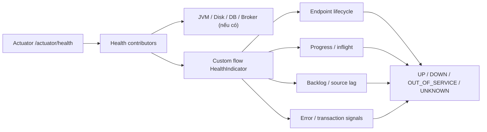
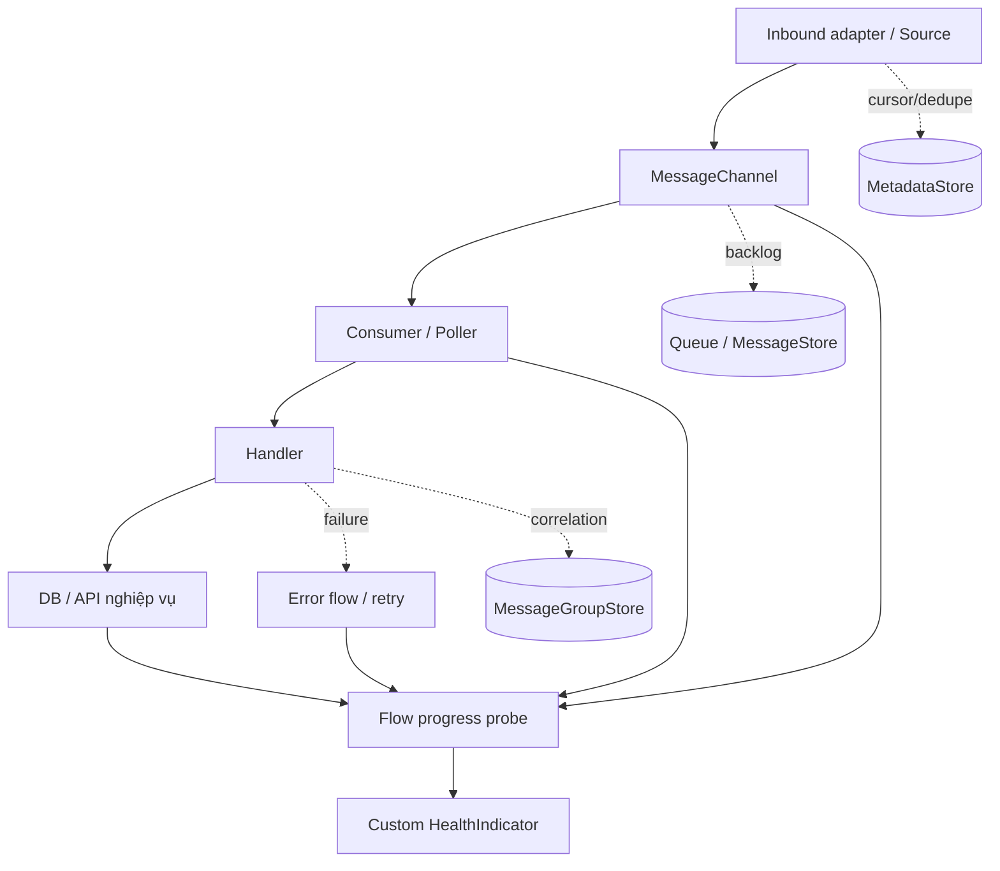
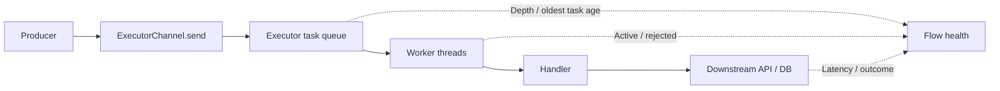

# Health indicator cho integration flow trong Spring Integration

## Mục tiêu học tập

Một ứng dụng có thể trả HTTP 200 từ `/actuator/health`, JVM vẫn chạy và Spring context đã khởi tạo, nhưng đơn hàng không đi qua integration flow nào trong 20 phút. Ở chiều ngược lại, một flow chỉ xử lý vào cuối ngày có thể không có output suốt buổi sáng mà vẫn hoàn toàn khỏe. Điều này đặt ra câu hỏi vận hành: **“IntegrationFlow khỏe” thực sự nghĩa là gì, đo bằng tín hiệu nào và có nên dùng tín hiệu đó để điều khiển readiness/liveness của ứng dụng không?**

Bài **Health indicator cho integration flow** thuộc chương **Vận hành** của module **SPRING_INTEGRATION_RUNTIME**. Bối cảnh là cách Spring Integration chạy và điều phối message qua channel, endpoint, consumer, poller và executor; bài kết nối quản lý lifecycle của `IntegrationFlow` với transaction, retry, message store, error channel, correlation, hiệu năng, trạng thái runtime và Spring Boot Actuator.

Sau bài này, bạn có thể:

- Phân biệt **liveness**, **readiness**, **startup**, **health theo flow**, **metrics** và **business outcome**.
- Giải thích vì sao `SmartLifecycle.isRunning()` là một tín hiệu cần thiết trong một số flow nhưng chưa đủ để chứng minh processing tiến triển.
- Xây `HealthIndicator` tùy biến cho một endpoint quan trọng, kết hợp lifecycle và tín hiệu in-flight có thời hạn.
- Đưa health component vào một **health group** phù hợp của Spring Boot Actuator mà không vô tình gây restart loop.
- Thiết kế thêm tín hiệu cho `DirectChannel`, `ExecutorChannel`, `QueueChannel`, poller, gateway, aggregator và reactive flow.
- Phân loại **IDLE hợp lệ** với **STALLED**, **BACKPRESSURED**, **STOPPED chủ đích**, **FAILED** và **DEGRADED**.
- Kiểm thử indicator theo thời gian giả lập, tình huống thiếu bean, endpoint dừng và handler không hoàn tất; tránh test dựa vào `Thread.sleep()`.
- Đặt alert, runbook, điều kiện khôi phục và cách phân tích lỗi theo `businessKey`/`correlationId` mà không ảnh hưởng dữ liệu.

> **Quy tắc:** Health indicator phải trả lời một **hợp đồng vận hành cụ thể**. Một cờ `UP` không chứng minh mọi business message đã commit, và một khoảng im lặng không tự chứng minh endpoint bị treo.

## 1. Health của ứng dụng và health của integration flow khác nhau

Spring Boot Actuator có cơ chế **`HealthIndicator`** để cung cấp trạng thái và chi tiết sức khỏe thông qua health endpoint. Spring Integration có các endpoint, channel, dispatcher, poller và handler riêng; không có lý do để mặc định một endpoint business bất kỳ sẽ được kiểm tra toàn diện chỉ vì Actuator đã được bật.



Có **ba lớp câu hỏi** không nên trộn:

1. **Process còn sống?** JVM, event loop/scheduler và ứng dụng có đủ khả năng hoạt động cơ bản không? Đây gần với *liveness*.
2. **Instance có thể tiếp nhận traffic thuộc trách nhiệm của nó?** Flow quan trọng đã start, subscriber tồn tại, downstream thiết yếu sẵn sàng theo mức chấp nhận? Đây gần với *readiness*.
3. **Message thực sự tiến triển tới kết quả nghiệp vụ?** Có source backlog, queue age, latency, error rate, business commit và correlation không? Đây là *flow health/SLO/observability*; không phải mọi tín hiệu đều nên chuyển trực tiếp thành readiness.

Một API server vẫn trả request khỏe có thể đồng thời có consumer Kafka lỗi. Một batch-only worker vẫn có thể lành mạnh khi không có input. Hợp đồng health phải phản ánh vai trò của **instance và flow**, không chỉ “có bao nhiêu handler gọi trong 5 phút”.

### 1.1. Trạng thái Actuator thường gặp

| Status | Ý nghĩa vận hành đề xuất | Khi phù hợp |
| --- | --- | --- |
| `UP` | Những điều kiện health của contributor đã thỏa | Endpoint cần thiết running và không có dấu hiệu stall đã xác minh |
| `DOWN` | Kiểm tra quan trọng thất bại | Không có bean endpoint cần thiết, không thể sử dụng tài nguyên bắt buộc |
| `OUT_OF_SERVICE` | Instance không nên nhận traffic thuộc trách nhiệm đang kiểm | Endpoint quan trọng bị stop, quiesce hoặc vi phạm health policy có ảnh hưởng tiếp nhận |
| `UNKNOWN` | Chưa đủ tín hiệu/kết quả để quyết định | Giai đoạn khởi tạo, dữ liệu metrics chưa sẵn hoặc trạng thái chưa thể diễn giải |

Spring Boot có thứ tự/tổng hợp status và ánh xạ HTTP theo cấu hình. Thông thường `DOWN` và `OUT_OF_SERVICE` có thể trả HTTP 503 từ health endpoint, còn `UP` trả 200; **không tự đoán HTTP status của trạng thái custom** nếu chưa cấu hình `status.http-mapping`. Một status `DEGRADED` tùy biến cần định nghĩa thứ tự và HTTP mapping nếu muốn dùng cho readiness.

Không nên đặt `DOWN` chỉ vì một event nghiệp vụ trả lỗi validation; điều đó là **kết quả xử lý dữ liệu**, không nhất thiết là tình trạng instance không thể phục vụ message hợp lệ.

## 2. Liveness, readiness và startup: đặt đúng trách nhiệm

Trong môi trường container như Kubernetes, tín hiệu probe có thể quyết định việc **restart process** hoặc **rút instance khỏi tuyến traffic**. Chọn sai probe có thể biến một sự cố downstream nhỏ thành vòng lặp restart kéo dài.

| Probe/góc nhìn | Câu hỏi nên trả lời | Nếu thất bại có thể dẫn đến | Không nên phụ thuộc trực tiếp |
| --- | --- | --- | --- |
| **Liveness** | Process vẫn có khả năng tiếp tục hoạt động? | Kubelet restart container | Tạm mất DB, HTTP đối tác 503, một order lỗi |
| **Readiness** | Instance có nên nhận **traffic mới** được quản lý bởi probe này? | Pod bị rút khỏi service endpoints | Business error đơn lẻ hoặc queue age bình thường trong một burst |
| **Startup** | Ứng dụng đã hoàn thành giai đoạn khởi tạo? | Bảo vệ thời gian khởi động chậm theo chính sách | SLA xử lý từng message sau khi start |
| **Flow operational health** | Flow cụ thể đang nhận/xử lý/commit như kỳ vọng? | Alert, dashboard, runbook, hoặc readiness nếu thật sự cần | Chỉ một biến `isRunning()` |

### 2.1. Vì sao tránh đưa phụ thuộc ngoài vào liveness?

Giả sử API vận chuyển tạm trả 503. Nếu liveness phụ thuộc trực tiếp vào API này, toàn bộ pod có thể bị restart dù JVM và integration consumers vẫn hoạt động đúng, dẫn tới reconnect/rebalance/redelivery, mất in-memory buffer và tăng tải API đang lỗi. Tệ hơn, mọi replica có thể restart đồng thời.

Thông thường nên để **liveness phụ thuộc tối thiểu vào khả năng sống của process**, còn lỗi downstream được giám sát bằng readiness riêng hoặc SLO/alert tùy việc rút pod khỏi service có thực sự giúp ích hay không. Nếu mọi pod dùng chung một API đang lỗi, rút hết pod khỏi service có thể khiến availability xấu hơn.

### 2.2. Readiness của một ứng dụng nhiều flow

Một application có hai flow:

```text
ordersFlow:    nhận đơn hàng trực tuyến, bắt buộc hoạt động
reportsFlow:   tổng hợp cuối ngày, có thể tạm dừng theo lịch

ordersFlow STOPPED    => có thể ảnh hưởng readiness của instance phục vụ orders
reportsFlow IDLE      => không nên ảnh hưởng readiness
reportsFlow STOPPED theo lịch => không phải lỗi readiness toàn process
```

Có thể dùng **health group riêng** để quan sát từng nhóm flow; chỉ đưa health của flow **thiết yếu cho traffic trên instance** vào readiness khi hạ tầng thực sự dùng tín hiệu đó để điều phối đúng. Với luồng chủ yếu nhận dữ liệu từ broker, Pod readiness không nhất thiết điều khiển việc broker đẩy message như HTTP service; có thể cần pause listener/container/consumer thay vì chỉ đặt readiness false.

## 3. Định nghĩa hợp đồng “khỏe” cho từng loại flow

Trước khi viết Java, xác định flow là **message-driven liên tục**, **polling**, **batch theo lịch**, **request/reply** hay **aggregator**. Một bộ quy tắc chung cho mọi flow sẽ tạo false positive.

| Dạng flow | Tín hiệu lifecycle | Tín hiệu tiến triển | Cảnh báo có giá trị | Điều dễ báo sai |
| --- | --- | --- | --- | --- |
| `DirectChannel` + handler | Consumer `isRunning`, subscriber | Started/completed/failure, latency | Invocation kẹt lâu hơn SLA | Không có message trong giờ thấp điểm |
| `ExecutorChannel` | Consumer/worker còn hoạt động | Queue depth, oldest age, active workers | Queue tăng và completion không tiến | `send() == true` bị coi là business success |
| `QueueChannel` + poller | Polling consumer + scheduler | Last poll, backlog, oldest age | Có backlog nhưng không có poll tiến triển | Queue rỗng và last completed cũ |
| Broker inbound adapter | Container running/partition assigned | Delivery/ack lag, redelivery, commits | Consumer lag tăng, lỗi liên tục | Topic không có message mới |
| Gateway request/reply | Endpoint/gateway còn phục vụ | Pending requests, timeout, reply latency | Request timeout kéo dài | Không có request đến |
| Splitter/aggregator | Endpoints và group store truy cập được | Pending group age, release count | Group chờ quá deadline nghiệp vụ | Nhóm hợp lệ đang chờ phần chưa đến |
| Reactive bridge | Subscription còn hoạt động | Demand, in-flight Mono, buffer, terminal errors | Subscriber chết khi upstream vẫn phát | Chưa subscribe trong phase startup |
| Flow động | `IntegrationFlowContext` registration/observed state | Active alias, in-flight và backlog theo version | Alias trỏ ID chưa READY | Version cũ đang drain có chủ đích |

### 3.1. Health predicate phải xét ngữ cảnh

Một điều kiện gợi ý:

```text
Nếu endpoint quan trọng không được kỳ vọng chạy:
    trạng thái PAUSED/MAINTENANCE, không tự xem là incident

Nếu endpoint quan trọng cần chạy nhưng không running:
    readiness = OUT_OF_SERVICE

Nếu running, không có work được mong đợi:
    UP / IDLE là bình thường

Nếu work đang chờ hoặc in-flight:
    kiểm tra oldestAge, completion, retries, error rate,
    nguồn ack và deadline nghiệp vụ

Nếu queue tăng và không có progress vượt ngưỡng:
    STALLED hoặc DEGRADED; quyết định ảnh hưởng readiness
    dựa trên traffic routing và khả năng recovery
```

Điều kiện này là **logic nghiệp vụ ứng dụng tự thiết kế**, không phải enum hay thuật toán mặc định của Spring Integration.

### 3.2. “Không có progress” phải được giải thích đúng

Chỉ số `completedPerMinute == 0` có thể là hợp lệ nếu `inputPerMinute == 0`. Ngược lại, với queue còn 10.000 message và không có handler completion trong thời gian dài, đó mới là dấu hiệu mạnh của stall.

```text
expectedWork = sourceHasAvailableInput
            OR queueDepth > 0
            OR inFlight > 0
            OR pendingGroupPastDeadline

possibleStall = expectedWork
            AND noBusinessProgressBeyondSLO
```

Nếu một flow có thời gian xử lý hợp lệ 30 phút, ngưỡng 10 giây sẽ báo sai. Health threshold cần lấy từ **SLO và workload thật**, không chỉ thời gian mặc định của Actuator.

## 4. Các tín hiệu gốc: từ channel đến business commit



### 4.1. Phân biệt năm thời điểm

1. **Received:** adapter nhận message nguồn.
2. **Accepted:** channel đã chấp nhận lời gọi `send()` theo contract.
3. **Started:** handler bắt đầu xử lý.
4. **Completed:** handler đã kết thúc, thành công hoặc thất bại.
5. **Business committed / acknowledged:** side effect thật đã được ghi nhận và source ack/offset phù hợp.

Một health indicator chỉ đếm `send()` có thể báo UP khi mọi handler worker đều kẹt. Một health indicator đếm `handler.completed` có thể báo khỏe dù source backlog tăng quá nhanh. Với nghiệp vụ quan trọng, nên đối chiếu **đầu vào, backlog, tiến triển và kết quả cuối**.

### 4.2. Error và retry là tín hiệu health, không chỉ lỗi nghiệp vụ

- `RetryAdvice` có thể giữ một handler invocation lâu hơn do backoff.
- `RequestHandlerCircuitBreakerAdvice` ở OPEN có thể từ chối nhanh mà không gọi API bên ngoài.
- Một error consumer có thể nhận `ErrorMessage` nhưng archive chưa commit; health không nên coi đó là recovery đã hoàn tất.
- Gateway timeout có thể xảy ra sau khi downstream side effect đã thành công.
- Redelivery/replay có thể tăng throughput số message nhận mà không tăng số business event duy nhất đã hoàn thành.

Vì vậy, metric nên tách `retryAttempt`, `deliveryCount`, `error.archive.committed` và `business.commit`. Nếu chỉ đếm exceptions, bạn sẽ khó phân biệt **lỗi tạm thời có hồi phục**, **poison message**, **breaker đang bảo vệ dependency** và **tắc nghẽn tài nguyên**.

## 5. Ví dụ triển khai: probe tiến triển cho một handler đồng bộ

Ta xây một ví dụ nhỏ, dễ kiểm thử: `DirectChannel` đưa message đến một event-driven endpoint; một probe ghi nhận công việc đang chạy, thời gian chờ của invocation lâu nhất và số lượt xử lý thành công/thất bại.

**Giới hạn rõ ràng:** probe này đo **phần việc trong handler**, không tự biết message còn đợi ở upstream/broker, không đo một transaction commit xảy ra bất đồng bộ sau khi method trả về và không thay thế một chỉ số business SLO end-to-end.

### 5.1. FlowProgressProbe tự chứa

```java
import java.time.Clock;
import java.util.concurrent.ConcurrentHashMap;
import java.util.concurrent.ConcurrentMap;
import java.util.concurrent.atomic.AtomicLong;
import java.util.concurrent.atomic.LongAdder;

final class FlowProgressProbe {
    private final Clock clock;
    private final AtomicLong sequence = new AtomicLong();
    private final ConcurrentMap<Long, Long> startedAt =
            new ConcurrentHashMap<>();

    private final LongAdder succeeded = new LongAdder();
    private final LongAdder failed = new LongAdder();

    FlowProgressProbe(Clock clock) {
        this.clock = clock;
    }

    // Mỗi invocation có token độc lập; không dùng message ID để
    // tránh xung đột nếu cùng message được xử lý đồng thời.
    long begin() {
        long token = sequence.incrementAndGet();
        startedAt.put(token, clock.millis());
        return token;
    }

    void success() {
        succeeded.increment();
    }

    void failure() {
        failed.increment();
    }

    void end(long token) {
        startedAt.remove(token);
    }

    Progress snapshot() {
        long now = clock.millis();

        long oldestAge = startedAt.values().stream()
                .mapToLong(start -> Math.max(0L, now - start))
                .max()
                .orElse(0L);

        return new Progress(
                startedAt.size(),
                oldestAge,
                succeeded.sum(),
                failed.sum());
    }

    record Progress(
            int inFlight,
            long oldestInFlightAgeMillis,
            long successCount,
            long failureCount) {
    }
}
```

**Ý nghĩa của thiết kế:**

- `begin()` tạo token riêng cho **mỗi invocation**, không phụ thuộc vào `MessageHeaders.ID`.
- `end()` phải chạy trong `finally` kể cả handler throw để không tạo “in-flight ma”.
- `snapshot()` chỉ đọc state; không gọi HTTP/DB hoặc tác động lên message.
- `LongAdder` thích hợp đếm dưới concurrency nhưng snapshot counters không phải một transaction atomic giữa nhiều biến.
- `Clock` giúp viết test deterministic bằng clock giả lập. Trong production, đo **elapsed time** bằng monotonic time source hoặc Micrometer `Timer` có thể tốt hơn đồng hồ wall-clock khi NTP chỉnh giờ.
- Ví dụ quét map để tìm invocation lâu nhất, phù hợp demo/tải nhỏ. Ở production có hàng nghìn invocation, health check nên dùng snapshot/metric tổng hợp với chi phí có giới hạn, tránh quét quá lớn mỗi lần HTTP health endpoint được gọi.

### 5.2. Bean IntegrationFlow và handler

```java
import java.time.Clock;

import org.springframework.context.annotation.Bean;
import org.springframework.context.annotation.Configuration;
import org.springframework.integration.channel.DirectChannel;
import org.springframework.integration.config.EnableIntegration;
import org.springframework.integration.dsl.IntegrationFlow;
import org.springframework.messaging.Message;
import org.springframework.messaging.MessageChannel;
import org.springframework.messaging.MessageHandler;

@Configuration
@EnableIntegration
class OrdersFlowConfiguration {

    @Bean
    Clock flowClock() {
        return Clock.systemUTC();
    }

    @Bean
    FlowProgressProbe ordersProbe(Clock flowClock) {
        return new FlowProgressProbe(flowClock);
    }

    @Bean("ordersInput")
    MessageChannel ordersInput() {
        return new DirectChannel();
    }

    @Bean
    IntegrationFlow ordersFlow(
            FlowProgressProbe ordersProbe,
            OrderProcessor processor) {

        MessageHandler tracedHandler = message -> {
            long token = ordersProbe.begin();
            try {
                processor.process(message);
                ordersProbe.success();
            }
            catch (RuntimeException failure) {
                ordersProbe.failure();
                throw failure;
            }
            finally {
                ordersProbe.end(token);
            }
        };

        return IntegrationFlow.from("ordersInput")
                .handle(tracedHandler, endpoint ->
                        endpoint.id("ordersHandlerEndpoint"))
                .get();
    }

    interface OrderProcessor {
        void process(Message<?> message);
    }
}
```

`OrderProcessor` là dependency ứng dụng phải triển khai hoặc giả lập trong Spring Test context; không phải interface sẵn có của Spring Integration. `ordersHandlerEndpoint` là ID của endpoint cần điều khiển/quan sát; dùng một tên cố định giảm nguy cơ đo nhầm handler bean khác. Khi flow ở ví dụ này chạy đồng bộ, `ordersProbe.success()` thể hiện **method `process()` đã trả bình thường**; nếu method chỉ enqueue việc khác rồi trả, bộ đếm **không** chứng minh business commit.

### 5.3. Những gì probe chưa đo

```text
ordersInput (DirectChannel)
   |
   |  Message đã được giao trực tiếp
   v
ordersHandlerEndpoint
   |
   +-- begin() ---------------------+
   |                                |
   +-- processor.process(message)   | Probe đo khoảng này
   |                                |
   +-- success/failure + end() -----+
   |
   v
Business completion (chỉ nếu process() hoàn tất thật)
```

Nếu thay `DirectChannel` bằng `ExecutorChannel`, message có thể nằm trong executor queue **trước khi `begin()` chạy**. Khi đó health indicator có thể báo UP trong khi queue backlog tăng. Để đo chính xác, bổ sung meter của executor (active, queued, rejected, oldest age) và ingress/source lag tại điểm thích hợp.

## 6. Tạo HealthIndicator tùy biến dựa trên endpoint và progress

Spring Boot Actuator cung cấp `HealthIndicator`, `Health` và `Status`. Dưới đây là một contributor có tên `ordersFlow` trong health tree, phát hiện endpoint thiếu/dừng và invocation vượt quá ngưỡng thời gian.

### 6.1. Java code

```java
import org.springframework.beans.factory.NoSuchBeanDefinitionException;
import org.springframework.boot.actuate.health.Health;
import org.springframework.boot.actuate.health.HealthIndicator;
import org.springframework.context.ApplicationContext;
import org.springframework.context.Lifecycle;
import org.springframework.stereotype.Component;

@Component("ordersFlowHealthIndicator")
final class OrdersFlowHealthIndicator implements HealthIndicator {

    private static final long MAX_INFLIGHT_AGE_MS = 30_000L;

    private final ApplicationContext applicationContext;
    private final FlowProgressProbe probe;

    OrdersFlowHealthIndicator(
            ApplicationContext applicationContext,
            FlowProgressProbe ordersProbe) {
        this.applicationContext = applicationContext;
        this.probe = ordersProbe;
    }

    @Override
    public Health health() {
        final Lifecycle endpoint;

        try {
            endpoint = applicationContext.getBean(
                    "ordersHandlerEndpoint", Lifecycle.class);
        }
        catch (NoSuchBeanDefinitionException missing) {
            return Health.down()
                    .withDetail("reason", "endpointBeanMissing")
                    .build();
        }

        if (!endpoint.isRunning()) {
            return Health.outOfService()
                    .withDetail("reason", "endpointStopped")
                    .build();
        }

        FlowProgressProbe.Progress progress = probe.snapshot();

        if (progress.inFlight() > 0
                && progress.oldestInFlightAgeMillis()
                        > MAX_INFLIGHT_AGE_MS) {

            return Health.outOfService()
                    .withDetail("reason", "inFlightOverThreshold")
                    .withDetail("inFlight", progress.inFlight())
                    .withDetail("oldestAgeMs",
                            progress.oldestInFlightAgeMillis())
                    .build();
        }

        return Health.up()
                .withDetail("inFlight", progress.inFlight())
                .withDetail("successCount", progress.successCount())
                .withDetail("failureCount", progress.failureCount())
                .build();
    }
}
```

Nếu Spring Boot Actuator được cấu hình theo convention đặt tên `...HealthIndicator`, component thường được trình bày dưới key `ordersFlow`. Để kiểm tra tên thực tế, xem health output/beans của **chính phiên bản Boot hiện dùng**; không suy từ tên class khi đã có custom bean name, custom contributor registry hoặc cấu hình grouping riêng.

**Điểm mạnh:** endpoint missing/stopped được nhận diện; invocation đang chạy quá lâu có thể phát tín hiệu bất thường. **Giới hạn quan trọng:**

1. Đây là mẫu cho **flow quan trọng, yêu cầu endpoint luôn running**. Nếu endpoint được stop có chủ đích trong maintenance, ứng dụng cần một maintenance/desired-state policy để không hiểu nhầm.
2. Ngưỡng 30 giây **chỉ là ví dụ**. Handler bình thường xử lý batch 2 phút sẽ bị báo false positive.
3. Một invocation chạy quá 30 giây có thể là nghiệp vụ hợp lệ hoặc đang backoff; chỉ nên chuyển thành `OUT_OF_SERVICE` nếu SLO và kiến trúc traffic cho thấy instance không nên nhận thêm message.
4. Không có in-flight không đồng nghĩa downstream khỏe: flow có thể bị upstream cắt nguồn, executor chưa dispatch, hoặc broker consumer không nhận partition.
5. Counter `successCount` chỉ ghi method trả bình thường. Nếu transaction commit sau thời điểm đó hoặc handler chỉ dispatch async, đây **không phải** business commit.
6. Phản hồi health chứa chi tiết vận hành; không đưa payload, business key, customer ID, token hoặc stack trace nhạy cảm vào `withDetail`.
7. Một health indicator nên **nhanh, side-effect-free và có chi phí giới hạn**. Không gọi `endpoint.start()` hoặc thử gửi business message thật từ `health()`.

### 6.2. Vì sao dùng ApplicationContext để tra endpoint?

DSL sinh một endpoint bean theo ID đã cấu hình. Lấy bean `Lifecycle` bằng `ApplicationContext.getBean(id, Lifecycle.class)` cho phép health check phát hiện thiếu bean; khi test có thể mock context dễ dàng. Tuy vậy, health method chạy thường xuyên nên ở production có thể cache bean đã xác thực hoặc inject một abstraction `EndpointStateProvider`. Nếu loại endpoint không triển khai `Lifecycle` như giả định, cần chọn API quản trị/metric phù hợp thay vì ép cast.

### 6.3. Tách trạng thái nghiệp vụ và trạng thái readiness

Một lựa chọn khác là report `UP` cho runtime sẵn sàng nhưng ghi `statusDetail="DEGRADED"`/metric và phát alert riêng khi một nghiệp vụ bị delay. Khi nào nên đưa delay thành `OUT_OF_SERVICE` phụ thuộc:

- Instance có nhận **traffic mới** thuộc flow đó không?
- Có pod khác healthy để nhận thay không?
- Đặt readiness false có khiến broker consumer ngừng nhận thật không, hay chỉ rút HTTP route?
- Downstream là dependency toàn hệ thống, có khiến mọi pod cùng mất readiness không?
- Sự cố quá tải ngắn hạn có tự phục hồi nếu không restart/điều chuyển không?

Health và traffic policy phải được thiết kế cùng nhau.

## 7. Cấu hình Spring Boot Actuator health groups

Khi dùng Spring Boot 3.x và Actuator tương thích, có thể bật probe và tạo health group riêng cho integration flow. Ví dụ cấu hình `application.yml`:

```yaml
management:
  endpoint:
    health:
      probes:
        enabled: true
      show-details: when_authorized
      group:
        liveness:
          include: livenessState
        readiness:
          include: readinessState,ordersFlow
        integration:
          include: ordersFlow
  endpoints:
    web:
      exposure:
        include: health,info
```

Với cấu hình phù hợp, các endpoint có thể gồm:

```text
GET /actuator/health
GET /actuator/health/liveness
GET /actuator/health/readiness
GET /actuator/health/integration
```

**Cần kiểm chứng trong ứng dụng thực:** component name `ordersFlow` phải tồn tại; một health group tham chiếu contributor không có có thể làm configuration bị từ chối tùy Boot/version. Probes `livenessState` và `readinessState` phụ thuộc cơ chế availability/probes của Spring Boot. Nếu dùng management port riêng, network/proxy và probe path của Kubernetes phải trỏ đúng cổng và endpoint.

### 7.1. Nên đưa ordersFlow vào readiness không?

Trong ví dụ, `ordersFlow` được include vào `readiness` **để minh họa** cách ảnh hưởng đến Pod readiness. Chỉ giữ cách cấu hình này khi:

- Instance thực sự có trách nhiệm nhận loại request mà `ordersFlow` phục vụ.
- Một instance khác có thể phục vụ traffic thay thế hoặc ngừng nhận mới là biện pháp đúng.
- Một trạng thái stall sẽ không tự gây vòng lặp trạng thái UP/DOWN trong vài giây.
- Monitoring/alerts vẫn tồn tại ngay cả khi pod bị rút khỏi service.

Nếu flow là một listener broker độc lập, hãy cân nhắc **chỉ đưa indicator vào health group `integration`**, còn readiness chính của Pod được quản lý riêng. Rút Pod khỏi HTTP load balancer không tự bảo đảm listener Kafka/RabbitMQ đã pause; consumer container phải được điều khiển theo contract của chính adapter.

### 7.2. Không cho health phụ thuộc tải lớn hoặc side effect

Sai lầm thường gặp là cho `HealthIndicator.health()` mỗi lần được gọi:

```java
// Anti-pattern: không chạy thao tác này trong health():
// endpoint.start();
// broker.receiveAndAck();
// jdbcRepository.deleteExpiredRecords();
// remoteOrderApi.createOrder("health-check");
```

Các hành động này làm health probe có side effect, có thể tạo message thật, xóa dữ liệu hoặc tranh tài nguyên ngay lúc hệ thống đang suy yếu. Nếu cần synthetic business transaction, dùng **canary riêng**, có business key phân biệt, sandbox hoặc cơ chế bù trừ theo hợp đồng; không đặt lệnh tạo đơn vào readiness request bị Kubelet gọi liên tục.

### 7.3. Bảo mật chi tiết health

`management.endpoint.health.show-details=when_authorized` yêu cầu cơ chế authorization tương ứng được cấu hình đúng. Đừng phơi bày exception messages, địa chỉ nội bộ, tenant, error payload hoặc credentials qua public management endpoint. Hãy bảo vệ management listener bằng network policies và authentication/authorization nếu có quyền truy cập từ ngoài; probe liveness/readiness dùng đường an toàn có thể đọc từ Kubelet theo thiết kế hạ tầng.

## 8. Phần khó nhất: poller và nguồn không có traffic

Một `SourcePollingChannelAdapter` có thể `isRunning() == true` nhưng không poll vì scheduler bị starve, trigger cấu hình sai, lock leader election bị giữ, hoặc metadata filter loại mọi file. Ở chiều ngược lại, poller có thể hoạt động đúng nhưng nguồn trống.

### 8.1. Nên đo bốn timestamp

```text
lastPollScheduledAt
lastPollStartedAt
lastPollFinishedAt
lastMessageAcceptedAt
```

Thêm `lastBusinessCommittedAt` nếu có tín hiệu commit thật. Với poll interval 1 phút, một khoảng 2 phút không thấy poll hoàn tất có thể đáng điều tra; với cron chạy 0h mỗi ngày, “không có poll trong buổi sáng” có thể bình thường. Đừng hard-code ngưỡng “không xử lý trong 5 phút = DOWN” cho mọi loại poller.

### 8.2. Poller health có thể dùng thời gian và input expectation

| Điều kiện | Diễn giải | Health/alert gợi ý |
| --- | --- | --- |
| Poller running, last poll gần đây, source rỗng | Idle hợp lệ | UP, không báo throughput |
| Poller running, last poll đứng nhiều chu kỳ kỳ vọng | Scheduler/poller stall | DEGRADED/alert, xét readiness nếu quan trọng |
| Poller stopped theo lịch | Maintenance | Status dựa desired state, không tự DOWN |
| Poller running, read có dữ liệu, handler fail liên tục | Processing failure | Alert retry/error, kiểm tra source ack |
| Poller running nhưng persistent filter chặn mọi file | Có thể đúng hoặc stale metadata | Tra `MetadataStore`, không tự xóa checkpoint |
| Poller mất leader lock | Một node không poll nhưng node khác poll | Đánh giá theo cluster ownership, không đánh dấu mọi pod DOWN |

### 8.3. Metadata checkpoint không phải progress counter

`MetadataStore` giữ checkpoint, accept-once marker hoặc dedupe key. Đọc checkpoint không thay đổi là hợp lệ khi source không có dữ liệu mới. Nếu nó đã advance **trước khi nghiệp vụ commit**, source có thể bỏ qua message sau restart. Health chỉ đọc `lastCursor` mà thấy nó tăng không chứng minh nghiệp vụ hoàn tất.

Để đánh giá flow, liên kết checkpoint/source delivery với **business commit** và error/recovery state. Không cho indicator tự reset cursor hoặc xóa metadata key khi thấy “đứng”.

## 9. Executor, queue và backpressure: isRunning vẫn có thể UP khi flow kẹt



`ExecutorChannel` có thể nhận task nhanh hơn worker xử lý. `send(true)` thể hiện kết quả dispatch/enqueue theo contract, **không** tương đương handler completion.

### 9.1. Một ví dụ xác định backlog

Nếu producer tạo 2.000 message/giây và consumer hoàn thành 1.200 message/giây:

```text
Backlog growth = 2.000 - 1.200 = 800 message/giây

Sau 3 phút:
800 x 180 = 144.000 message đang chờ (ước lượng)

Nếu mỗi task/message trung bình 3 KB:
144.000 x 3 KB = 432 MB trước overhead của JVM/queue
```

Đây là mô hình minh họa, không phải số đo của framework. `HealthIndicator` chỉ kiểm tra in-flight handler ở mục 6 **chưa phát hiện được backlog trước handler**. Ở production cần thêm queue depth, oldest waiting age, executor active/rejected và source lag. Với một queue unbounded trong RAM, nguy cơ OOM có thể xuất hiện trước khi operator thấy một exception nghiệp vụ.

### 9.2. Backpressure không đồng nghĩa health

Một hệ thống có policy đúng có thể chủ động giảm tốc producer, trả rejection hoặc pause consumer khi downstream suy yếu. Khi đó raw throughput giảm nhưng việc bảo vệ **đang hoạt động đúng**. Đánh giá:

- Queue có capacity, overflow policy và durability nào?
- Retry/backoff có khiến việc xử lý tạm dừng theo kế hoạch?
- Circuit breaker đang OPEN vì downstream 503 hay vì cấu hình sai?
- Nguồn có thể redeliver mà không mất message không?
- Có fallback/recovery đã commit chưa?

Không dùng health indicator để tự tăng executor pool/retry count; remediation cần runbook và quyền điều khiển riêng.

## 10. Correlation, aggregator và các nhóm đang chờ

Một aggregator có thể đang `isRunning() == true`, input vẫn đến nhưng không tạo output vì thiếu phần cuối hoặc correlation expression khác trước.

```text
workflow: tenant-a:ORD-42

PaymentConfirmed  -> group ORD-42
InventoryReserved -> group ORD-42
ShippingQuoted    -> error flow / DLQ (chưa vào group)

Aggregator:
  group size = 2
  required = 3 distinct parts
  no aggregate output
```

Health theo aggregator nên theo dõi **pending group count**, **oldest group age**, **release count**, **group timeout** và số group bị lỗi/quarantine. Nhưng một group thiếu phần trong 30 giây có thể hoàn toàn hợp lệ nếu SLA chờ 10 phút; không tự báo DOWN ngay khi pending > 0.

### 10.1. MessageGroupStore và correlation ID

`MessageGroupStore` giữ state nhóm theo group ID; `CorrelationStrategy` quyết định key, có thể lấy từ `headers['correlationId']` hoặc expression. `MessageHeaders.ID` của message instance không phải group key mặc định. Một pending group quá hạn có thể do message ở nhánh khác bị lỗi; cần tra `ErrorMessage`/DLQ theo `businessKey` và `correlationId` trước khi restart aggregator.

Nếu flow v1 và v2 dùng chung store mà đổi correlation key, message có thể bị chia thành hai group. Health indicator cần gắn **flow version**/group policy vào dữ liệu quan sát, không cố “chữa” bằng cách xóa group cũ.

### 10.2. Store bền vững không tự chứng minh flow khỏe

| State | Store | Vai trò health | Cạm bẫy |
| --- | --- | --- | --- |
| Message archive | `MessageStore` | Kiểm tra backlog/recovery theo UUID khi có worker đọc | Có record không nghĩa worker đang chạy |
| Pending group | `MessageGroupStore` | Phát hiện group quá hạn | Xóa group có thể làm mất phần message |
| Checkpoint/dedupe | `MetadataStore` | Biết adapter đã ghi offset/file state nào | Cursor đứng có thể do source trống |
| Error archive/DLQ | Kho lỗi/broker | Lượng retry, oldest recovery age | ErrorMessage nhận chưa chắc record đã commit |
| Business ledger | DB nghiệp vụ | Nơi xác nhận side effect đã ghi nhận | Không tự liên kết với broker ack |

## 11. Transaction, ack và health: phải nhìn kết quả cuối

Một flow có thể báo UP vì handler đã trả bình thường, nhưng một transaction JDBC bị rollback ở lớp ngoài hoặc nguồn ack sai. Vì vậy health tiến triển nên đo đúng **mốc hoàn tất**.

### 11.1. Các mốc quan trọng

```text
T0: source giao message
T1: channel chấp nhận message
T2: handler bắt đầu
T3: handler gọi API bên ngoài
T4: API trả success (có thể đã commit)
T5: ghi DONE tại DB nghiệp vụ
T6: commit transaction
T7: ack broker/advance checkpoint
```

`handler.completed` có thể được ghi trước T6/T7. Nếu crash giữa T4 và T5, source redelivery có thể tạo side effect lặp. Nếu ack tại T2 khi handler chạy async, crash có thể làm mất công việc chưa hoàn thành. Health indicator **không thay thế** quy trình transaction, durable handoff và idempotency.

### 11.2. “Business progress” là một phép đo theo hợp đồng

Trong một flow đặt hàng, có thể đo `orders.committed.count` từ repository/outbox sau commit, thay vì chỉ đếm handler returned. Nếu việc commit diễn ra bất đồng bộ, meter cần được cập nhật sau tín hiệu completion thực sự. Với các flow chỉ chuyển message sang broker durable, “thành công” có thể được định nghĩa là **đã được broker xác nhận persist**, không phải đơn hàng cuối đã hoàn tất; phải ghi rõ phạm vi.

### 11.3. Health của recovery flow

Một hệ thống có handler lỗi nhưng **error archive hoạt động và message có thể replay** có thể được xem là DEGRADED thay vì hoàn toàn DOWN tùy SLO. Ngược lại, nếu error archive cũng lỗi trong khi source vẫn ack, rủi ro mất message rất lớn.

Health nên theo dõi:

- `error.publish.failed` và số `ErrorMessage` đã đến error consumer.
- `error.archive.committed`, số bản ghi pending và tuổi bản ghi cũ nhất.
- `retry.exhausted` và tỷ lệ poison message.
- `source.ack/nack` hoặc redelivery theo contract adapter.
- Business idempotency/duplicate guard ở resource đích.

Chỉ thấy `errorChannel` có traffic không đủ để tuyên bố recovery khỏe; archive có thể chưa commit.

## 12. Dynamic IntegrationFlow và health theo phiên bản

Flow động có thể được đăng ký/gỡ bằng `IntegrationFlowContext`. Trong một JVM, `getRegistrationById(registrationId)` có thể trả một registration còn tồn tại hoặc `null` nếu chưa đăng ký/đã remove. Việc này không tự đồng bộ sang các pod khác.

### 12.1. Desired state và observed state

```text
Desired state (registry do ứng dụng quản lý):
  tenant-a.orders.active = orders-v2-r7
  orders-v1-r3 = DRAINING

Observed state (pod-a):
  orders-v2-r7 = registered, running, READY
  orders-v1-r3 = running, 2 in-flight

Observed state (pod-b):
  orders-v2-r7 = not registered
  orders-v1-r3 = running
```

Nếu health chỉ kiểm tra “có một flow đang running”, pod-b vẫn có thể báo UP dù **active route trỏ tới v2 chưa có**. Cần xác minh version đang được chọn, input channel/subscriber, active route/generation và backlog theo version.

### 12.2. Planned stop và draining

Một flow v1 ở trạng thái DRAINING không nên nhận message mới, nhưng còn cần chạy cho các message đã pin v1. Nếu chỉ thấy v1 `isRunning=true` mà đánh giá v1 là active, sẽ sai. Nếu remove v1 trong khi còn in-flight, có thể mất công việc hoặc replay vào v2 không tương thích.

Mô hình health hợp lý:

- **Active version:** phải READY và xử lý message mới.
- **Draining version:** có thể running nhưng không nhận message chưa pin; theo dõi in-flight, queue và pending group.
- **Retired/removed version:** không cần HEALTH UP, nhưng error archive/replay có thể còn phụ thuộc v1.
- **Unknown version on a node:** readiness hoặc routing rejection có chủ đích, tránh dispatch vào registration chưa tồn tại.

### 12.3. Health per-pod không tự tạo health toàn cụm

`HealthIndicator` chạy trong process của node cụ thể. Pod A báo UP không nghĩa pod B đã được cập nhật; nếu dùng shared broker/metadata store còn cần theo dõi consumer group lag, leader election và node ownership. Một dashboard tổng hợp cần chỉ rõ **logical flow, version, instance và desired generation**, tránh dùng một số “healthy flows = N” mà không biết N đang ở pod nào.

## 13. Kiểm thử HealthIndicator mà không ngủ chờ thời gian thật

Một health indicator là logic đọc trạng thái; phần lớn tình huống có thể test bằng JUnit/Mockito và clock giả lập, không cần khởi động broker.

### 13.1. Test STOPPED và UP/IDLE

Ví dụ kiểm tra đối tượng trong mục 6 qua `ApplicationContext` giả:

```java
import java.time.Clock;
import java.time.Instant;
import java.time.ZoneOffset;

import org.junit.jupiter.api.Test;
import org.springframework.boot.actuate.health.Status;
import org.springframework.context.ApplicationContext;
import org.springframework.context.Lifecycle;

import static org.junit.jupiter.api.Assertions.*;
import static org.mockito.Mockito.*;

class OrdersFlowHealthIndicatorTest {

    @Test
    void stoppedIsOutOfServiceAndRunningIdleIsUp() {
        ApplicationContext context = mock(ApplicationContext.class);
        Lifecycle endpoint = mock(Lifecycle.class);

        when(context.getBean("ordersHandlerEndpoint", Lifecycle.class))
                .thenReturn(endpoint);
        when(endpoint.isRunning()).thenReturn(false, true);

        FlowProgressProbe probe = new FlowProgressProbe(
                Clock.fixed(
                        Instant.parse("2026-11-22T00:00:00Z"),
                        ZoneOffset.UTC));

        OrdersFlowHealthIndicator health =
                new OrdersFlowHealthIndicator(context, probe);

        assertEquals(Status.OUT_OF_SERVICE,
                health.health().getStatus());

        // Không có input/in-flight; running + idle vẫn khỏe
        // theo hợp đồng của ví dụ.
        assertEquals(Status.UP,
                health.health().getStatus());
    }
}
```

Cần dependency JUnit Jupiter và Mockito ở test scope. Đây là **unit test** của indicator; để xác minh bean `ordersHandlerEndpoint` thực sự tồn tại, dùng thêm Spring integration test với flow fixture mục 5. Không lấy một mock `Lifecycle` làm bằng chứng endpoint ngoài đời đã được wire đúng.

### 13.2. Test vượt ngưỡng bằng một clock điều khiển được

Với `FlowProgressProbe` ở mục 5, muốn test in-flight lâu 31 giây mà không `Thread.sleep()`, tạo một `Clock` có thời gian điều chỉnh được:

```java
import java.time.Clock;
import java.time.Duration;
import java.time.Instant;
import java.time.ZoneId;
import java.time.ZoneOffset;
import java.util.concurrent.atomic.AtomicLong;

final class MutableClock extends Clock {
    private final AtomicLong epochMillis;

    MutableClock(Instant initial) {
        epochMillis = new AtomicLong(initial.toEpochMilli());
    }

    void advance(Duration duration) {
        epochMillis.addAndGet(duration.toMillis());
    }

    @Override
    public ZoneId getZone() {
        return ZoneOffset.UTC;
    }

    @Override
    public Clock withZone(ZoneId zone) {
        if (!ZoneOffset.UTC.equals(zone)) {
            throw new IllegalArgumentException("Test clock is UTC only");
        }
        return this;
    }

    @Override
    public Instant instant() {
        return Instant.ofEpochMilli(epochMillis.get());
    }
}
```

Dùng clock này làm dependency cho `FlowProgressProbe`, gọi `begin()`, sau đó `advance(Duration.ofSeconds(31))` mà không gọi `end()`. Với endpoint fake `isRunning()=true`, indicator phải trả `OUT_OF_SERVICE`. Gọi `end(token)` rồi kiểm tra trở lại `UP`. Với thời gian timestamp thật và năng lực production, cân nhắc monotonic timer như đã lưu ý ở mục 5.

### 13.3. Test integration với Spring context thật

Test unit không phát hiện việc tên bean endpoint sai. Một integration test nên:

1. Dựng `OrdersFlowConfiguration` với `OrderProcessor` fake trong Spring Test context.
2. Khởi tạo Spring Boot Actuator HealthEndpoint/HealthContributorRegistry phù hợp.
3. Lấy `ordersHandlerEndpoint` và xác minh `Lifecycle`.
4. Gửi message thử qua `ordersInput`, kiểm tra probe success/failure.
5. Dừng đúng endpoint rồi query health group, xác nhận status thay đổi.
6. Khôi phục endpoint trong `finally` hoặc context isolation.
7. Không chạy stop/start test này trên production, không tạo side effect lên hệ thống thật.

### 13.4. Test hàng đợi/executor cần probe riêng

Nếu flow có `ExecutorChannel`, fake handler có thể block trên latch; trong lúc đó gửi nhiều message để tạo backlog. Health cần nhận biết **queue age/capacity**, không chỉ in-flight của handler. Đặt timeout hữu hạn cho test và giải phóng latch trong `finally`. Dùng `CountDownLatch`/`Awaitility` hoặc probe sự kiện, không viết `Thread.sleep(1000)` rồi suy ra worker đã nhận hay chưa.

## 14. Tránh false positive, flapping và health check tự làm quá tải

### 14.1. Hysteresis và ngưỡng ổn định

Một lần poll chậm hơn 30 giây chưa đủ để loại pod khỏi readiness nếu SLA cho phép 2 phút. Một chính sách có thể yêu cầu **N lần kiểm tra liên tiếp** vi phạm hoặc **một cửa sổ rolling** trước khi báo unhealthy, rồi yêu cầu M lần tốt để quay về UP. Đó là hysteresis.

```text
Healthy -> Suspected (vi phạm threshold một lần)
Suspected -> Unhealthy (vi phạm kéo dài qua cửa sổ)
Unhealthy -> Recovering (có progress)
Recovering -> Healthy (progress ổn định qua cửa sổ)
```

State machine này thuộc ứng dụng/monitoring controller, **không phải các trạng thái mặc định của `HealthIndicator`**. Cần cân nhắc lưu state, reset sau restart và quyền sở hữu khi multi-pod.

### 14.2. Đặt timeout và giới hạn tải

Health probes bị gọi liên tục bởi Kubelet, load balancer, monitoring và operator. Vì vậy:

- Không quét toàn bộ `MessageStore`/`MessageGroupStore` trên mỗi request.
- Không lấy thread dump, gọi remote HTTP chậm hoặc bắt đầu một integration message trong health method.
- Không khóa đồng bộ với handler path trong thời gian dài.
- Nếu cần queue depth/lag từ broker, đo bằng metrics/background collector có timeout rồi health đọc **snapshot cached**.
- Khi metric đã stale hoặc unavailable, biểu diễn `UNKNOWN`/alert theo policy thay vì dùng dữ liệu cũ như mới.
- Tránh chi tiết health gây lộ thông tin nội bộ cho người chưa có quyền.

### 14.3. Staleness của metric cũng cần được kiểm tra

Một probe có thể đọc `lastPollAt` từ một object không còn được cập nhật vì collector chết. Lúc đó status UP là sai. Bên cạnh giá trị, cần timestamp `lastMeasuredAt` và độ mới của sample.

```text
queueDepth = 0
sampledAt = 3 giờ trước

=> Không đủ căn cứ để kết luận queue hiện đang rỗng.
```

Tuy nhiên, nếu không có input theo lịch, chính việc không đo mới có thể là bình thường; tách liveness của **collector** khỏi throughput của **source**.

## 15. Dashboard, metrics và cảnh báo theo flow

Tên metric dưới đây là **gợi ý để instrument**, không phải danh sách bảo đảm Spring Integration/Actuator đã cung cấp sẵn.

| Metric gợi ý | Ý nghĩa | Sử dụng |
| --- | --- | --- |
| `integration.flow.running` | Endpoint/registration đang running hay không | Lifecycle/desired-state drift |
| `integration.flow.inflight` | Số invocation chưa hoàn tất | Hung handler và khả năng drain |
| `integration.flow.oldest_inflight_age` | Invocation lâu nhất | Timeout/SLO violation |
| `integration.flow.input_rate` | Tốc độ message vào | Phân biệt idle và source problem |
| `integration.flow.success_rate` | Số lượt handler outcome thành công | Processing progress |
| `integration.flow.business_commit_rate` | Số outcome nghiệp vụ đã commit | SLO thực |
| `integration.flow.error_rate` | Lỗi theo loại/cause | Retry storm, poison data |
| `integration.flow.retry_attempts` | Retry nội bộ | Phân biệt redelivery |
| `integration.flow.backlog_depth` | Queue/broker backlog | Backpressure |
| `integration.flow.oldest_wait_age` | Message chờ lâu nhất | SLA xử lý, risk of stale work |
| `integration.flow.poll.last_success_age` | Tuổi của poll thành công gần nhất | Scheduler/poller stall |
| `integration.flow.group_pending` | Pending aggregator groups | Correlation/release issues |
| `integration.flow.error_archive_pending` | Lỗi chưa giải quyết | Recovery health |
| `integration.flow.active_version` | Flow version nhận traffic mới | Rollout/multi-pod drift |
| `integration.flow.metric_sample_age` | Độ mới của dữ liệu monitoring | Tránh đánh giá từ snapshot stale |

### 15.1. Alert nên tương quan nhiều điều kiện

Alert chỉ vì `successRate == 0` trong 1 phút sẽ ồn ào với luồng hiếm khi có dữ liệu. Một rule tốt hơn:

```text
IF expectedInput > 0 OR backlogDepth > 0 OR inflight > 0
AND noBusinessProgressBeyondSLO
AND not plannedMaintenance
THEN investigate stalled flow
```

Một rule khác cho `errorArchivePendingAge` vượt ngưỡng, hoặc `queueDepth` tăng nhanh dù throughput vẫn >0. Alert và health có thể có **mục đích khác**: một tình trạng DEGRADED nên page on-call nhưng chưa chắc cần rút Pod khỏi routing.

### 15.2. Cardinality và thông tin nhạy cảm

Tag metric theo `flowType`, `version`, `instance`, `environment` có thể hữu ích nhưng phải giới hạn số lượng version/tenant. **Không** dùng `messageId`, `orderId`, `correlationId` hay raw error string làm Prometheus/Micrometer tag cho mọi message: cardinality rất cao, dễ gây tốn memory/backend.

Để truy một message cụ thể, dùng structured logs/tracing với `businessKey`/`correlationId` có kiểm soát truy cập, retention và masking. Health output chỉ nên đưa những số tổng hợp an toàn.

## 16. Runbook khi flow health xuống OUT_OF_SERVICE

Health signal là **đầu mối điều tra**, không phải chẩn đoán cuối.

### Bước 1 — Xác minh contributor nào đánh giá xấu

Xem `/actuator/health/integration` hoặc readiness group trong quyền truy cập cho phép, ghi component name/status/reason, instance và timestamp. Phân biệt status của flow với status DB/broker/disk.

### Bước 2 — Kiểm tra expected/desired state

Endpoint được yêu cầu chạy hay đang maintenance? Flow v1 đang DRAINING hay v2 ACTIVE? Nếu đã stop có chủ đích, không tự start chỉ vì indicator báo OUT_OF_SERVICE.

### Bước 3 — Phân biệt IDLE và STALLED

Kiểm tra input, backlog, in-flight, last poll và last business commit trong cùng cửa sổ thời gian. Nếu không có work được mong đợi, đánh giá false positive threshold.

### Bước 4 — Xác định bottleneck theo topology

- `DirectChannel`: thread sender/handler blocking và exception propagation.
- `ExecutorChannel`: active workers, rejected task, queue age và downstream latency.
- `QueueChannel`/poller: scheduler, trigger, receive timeout, transaction và metadata filter.
- Aggregator: pending groups, correlation ID, release strategy, missing branch.
- Reactive bridge: subscription, terminal error, buffer/demand.
- Broker adapter: consumer assignment/ack/redelivery/lag.

### Bước 5 — Tra lỗi và khả năng recovery

Xem `errorChannel`, `ErrorMessage`, retry advice, breaker status, DLQ/error archive và transaction outcome. Một lỗi được log chưa có nghĩa đã được lưu bền vững.

### Bước 6 — Bảo vệ message trước thao tác

Xác định in-flight, queue/broker durability, checkpoint và business ledger. Nếu có side effect ngoài đã commit nhưng chưa ack, phải có idempotency trước replay. Không xóa stores để sửa health.

### Bước 7 — Thao tác tối thiểu được phép

Tùy root cause: sửa dependency, giới hạn input/prefetch, tăng timeout hợp lý, restart **đúng endpoint** theo phê duyệt, hoặc rollback flow version. Health indicator **không tự điều khiển `stop()/start()`** để tránh restart loop.

### Bước 8 — Xác minh kết quả

Theo dõi input-to-business-commit, backlog/age, error rate, retry, source ack và duplicate business key. Chỉ đóng incident khi trạng thái hoạt động ổn định; `isRunning=true` hay `HTTP 200` là bằng chứng cần nhưng chưa đủ.

## 17. Bảng chẩn đoán nhanh

| Triệu chứng | Nguyên nhân khả dĩ | Cần kiểm tra |
| --- | --- | --- |
| Health UP nhưng không có output | Source idle, probe chỉ kiểm tra lifecycle, backlog trước handler | Input expectation, oldest queue age, progress metrics |
| Health DOWN ngay sau deploy | Bean endpoint ID sai/không được tạo | Endpoint ID, bean type, application context |
| Health OUT_OF_SERVICE lúc bảo trì | Flow stopped có chủ đích nhưng policy chưa xét maintenance | Desired state, maintenance window |
| Health flapping mỗi 30 giây | Ngưỡng thấp, backlog biến động, thiếu hysteresis | SLO, rolling windows, active tasks |
| Health OUT_OF_SERVICE dù consumer vẫn chạy | Một invocation quá threshold | Trace invocation, retry/backoff, legitimate duration |
| Readiness 503 trên mọi pod | Shared downstream lỗi hoặc predicate quá nhạy | Probe grouping, dependency, traffic policy |
| Kubelet restart loop | Đưa lỗi external dependency vào liveness | Liveness group và restart reasons |
| Executor queue tăng nhưng health UP | Probe chỉ đo handler in-flight | Executor pending/rejected, queue age |
| Poller running nhưng không poll | Scheduler starved, lock, trigger sai | Last poll start/end, thread dump, leader |
| Poller output=0 nhưng khỏe | Source trống, file filter hợp lệ | Source backlog, metadata, poll count |
| Aggregator không tạo output | Correlation key sai, thiếu nhánh, group pending | Group ID, error flow, pending age |
| Health UP nhưng error DLQ tăng | Health không xét recovery SLO | Error archive pending, oldest error age |
| Health call chậm | Indicator gọi DB/API hoặc quét store lớn | Health latency, profiler, cached metrics |
| Status UNKNOWN vĩnh viễn | Probe chưa initialized, metrics collector chết | Sample age, initialization errors |
| Pod A UP, Pod B DOWN | Flow version/registration lệch hoặc local resource khác | Desired generation, per-pod observed state |
| Restart xong health UP nhưng duplicate xuất hiện | Ack/transaction/idempotency sai | Business key ledger, source redelivery |

## 18. Ma trận kiểm thử và diễn tập

| Kịch bản | Điều kiện | Kết quả indicator mong đợi | Test thêm |
| --- | --- | --- | --- |
| Endpoint không tồn tại | Bean ID sai | DOWN | Không lộ stack/secret |
| Endpoint stopped | `Lifecycle.isRunning=false` | OUT_OF_SERVICE | Có xét planned maintenance chưa? |
| Endpoint running, không có work | Inflight=0, queue/source rỗng | UP/IDLE | Không alert throughput=0 |
| Handler đang chạy 5 giây | Threshold 30 giây | UP trong demo | Chưa suy business commit |
| Handler chạy hơn 30 giây | Inflight còn, fake clock advance | OUT_OF_SERVICE | Khi kết thúc phải về UP |
| Handler throw | Probe `failure()` và `end()` | Không in-flight leak | Kiểm tra error flow/ack |
| Executor backlog lớn | Worker chậm, queue tăng | Cần mở rộng predicate | Health không false UP nếu policy yêu cầu |
| Poller không chạy | Scheduler không có progress | DEGRADED/alert theo SLO | Không nhầm source idle |
| Poller rỗng đúng lịch | Không có input, poll vẫn chạy | UP | Last poll vẫn tiến |
| Circuit breaker OPEN | Downstream được bảo vệ | DEGRADED theo policy | Không reset mù quáng |
| Error archive hỏng | Recovery không commit | Alert/health xấu nếu critical | Source ack/redelivery policy |
| Group chờ quá lâu | Missing part | DEGRADED/alert | Correlation và release strategy |
| Flow v1 draining | v2 active READY | Health theo desired state | V1 backlog được theo dõi riêng |
| Multi-pod mismatch | Pod B chưa đăng ký v2 | Pod B not READY nếu phục vụ v2 | Routing/grace period |
| Metrics collector stale | Last sample quá cũ | UNKNOWN hoặc alert | Không tin snapshot cũ |
| Health bị gọi 100 lần/s | Probe load test | Không gây DB/CPU spike | Không side effect |
| App restart giữa xử lý | In-memory state mất | Health chỉ phục hồi sau bootstrap | Broker/store/idempotency test |

### 18.1. Bài tập A — Indicator chỉ dùng lifecycle

Xây `HealthIndicator` đơn giản đọc `ordersHandlerEndpoint.isRunning()`. Gửi message qua `DirectChannel`, dừng endpoint trong Spring test context, kiểm tra `UP → OUT_OF_SERVICE → UP` sau start. Ghi rõ test này **chỉ xác minh lifecycle**, chưa đánh giá queue hoặc downstream.

### 18.2. Bài tập B — Progress và clock điều khiển

Dùng `FlowProgressProbe` và `MutableClock`. Bắt đầu một invocation, advance 31 giây, kiểm tra health `OUT_OF_SERVICE`; gọi `end(token)`, kiểm tra `UP`. Thêm một invocation khác đang chạy để thấy việc xác minh oldest in-flight.

### 18.3. Bài tập C — ExecutorChannel và backlog

Thay `DirectChannel` thành `ExecutorChannel` có một worker. Chặn handler bằng latch, gửi thêm 100 message, đo pending tasks, active workers và handler in-flight. Nâng indicator để xét queue age, nhưng không cho `health()` thực hiện bất kỳ thao tác enqueue/dequeue nào.

### 18.4. Bài tập D — Poller rỗng và poller bị treo

Tạo một fake message source không có dữ liệu nhưng poll thành công, và một source có message mà scheduler không chạy. Ghi `lastPollFinishedAt` và `sourceHasInput`; thiết kế health không đánh dấu trường hợp idle là DOWN.

### 18.5. Bài tập E — Retry và error flow

Cho handler throw transient exception hai lần, sau đó thành công. Quan sát `retry.attempts` và handler success. Tiếp theo cho handler luôn fail, error archive commit một record. Phân biệt `ErrorMessage` đã publish và lỗi đã được lưu bền vững; không ack source khi chưa có durable recovery theo policy.

### 18.6. Bài tập F — Aggregator và correlation

Gửi hai phần vào group cần ba phần, giữ phần thứ ba trong DLQ. Quan sát group age và error archive; quyết định ngưỡng cảnh báo theo deadline nghiệp vụ. Replay phần thứ ba đúng `correlationId` và kiểm tra group release. Không xóa group chỉ để indicator trở lại UP.

### 18.7. Bài tập G — Readiness, liveness và hỏng downstream

Trong môi trường Kubernetes test, cấu hình `liveness` chỉ dùng `livenessState`, còn `readiness` chỉ chứa những flow thiết yếu. Cho API ngoài trả 503; quan sát Pod có bị rút traffic/restart không. Thử loại `ordersFlow` khỏi readiness nếu flow đó chỉ là background broker worker; ghi giải thích dựa trên khả năng routing thật.

### 18.8. Bài tập H — Restart, ack và business idempotency

Dùng broker/queue durable, tạo message có `businessKey` ổn định. Cho handler ghi DB thành công rồi kill trước ack; khởi động lại, kiểm tra redelivery và unique business effect. Indicator có thể quay về UP nhưng bài test phải chứng minh dữ liệu không bị tạo trùng.

## 19. Câu hỏi tự kiểm tra

1. `HealthIndicator` trong Spring Boot Actuator trả lời câu hỏi gì, và khác với metrics/SLO thế nào?
2. Vì sao `isRunning() == true` không chứng minh một integration flow còn tiến triển?
3. Liveness và readiness có hậu quả khác nhau thế nào khi Kubernetes nhận status lỗi?
4. Vì sao lỗi HTTP 503 từ downstream thường không nên trực tiếp làm liveness thất bại?
5. Khi nào một flow STOPPED có thể là hành vi đúng theo maintenance?
6. Làm sao phân biệt một poller IDLE hợp lệ với poller đã ngừng chạy lịch?
7. `DirectChannel.send(true)` có nghĩa business commit đã thành công không?
8. `ExecutorChannel` tạo thêm ranh giới thời gian nào mà probe handler-only không nhìn thấy?
9. Vì sao queue depth tăng và handler started vẫn tăng có thể là dấu hiệu quá tải?
10. `oldestInFlightAgeMillis` và `oldestQueueWaitAge` khác nhau ở đâu?
11. Vì sao code mẫu dùng token riêng cho invocation thay vì chỉ dùng message UUID?
12. Nếu producer không gửi message trong 24 giờ, có nên báo DOWN vì success count không tăng?
13. Spring Boot health group `integration` khác với health group `readiness` ở mục đích thế nào?
14. Một custom status `DEGRADED` có tự tạo HTTP 503 nếu chưa cấu hình mapping không?
15. Health indicator có nên gọi `endpoint.start()` hoặc tạo một business order thật không?
16. Khi nào nên cache snapshot metrics thay vì query trực tiếp broker/DB trong health()?
17. Một `ErrorMessage` nhận được đã chứng minh recovery archive commit chưa?
18. Nếu retry advice làm handler chờ backoff lâu hơn SLO, làm sao tránh báo sai?
19. `MessageStore` và `MessageGroupStore` giúp đánh giá backlog/recovery nhưng không tự làm gì?
20. `MetadataStore` checkpoint không đổi có thể là hợp lệ khi nào?
21. Khi aggregator không release output, tín hiệu nào giúp tìm nhánh lỗi?
22. Một flow v1 đang DRAINING nên được đánh giá như thế nào so với v2 ACTIVE?
23. Vì sao health indicator của pod A không bảo đảm pod B đã nhận cùng flow registration?
24. Khi nào test unit indicator chưa đủ và phải chạy integration test có channel thật?
25. Vì sao `@Transactional` của caller không tự bao phủ handler chuyển sang executor?
26. Khi một process restart khiến indicator trở về UP, cần thêm bằng chứng gì để kết luận incident đã resolved?
27. Hysteresis giúp giảm flapping thế nào?
28. Vì sao message ID/correlation ID không nên là label metric cho từng event?
29. Một số `business.commit.count` bằng 0 có khi nào hoàn toàn khỏe không?
30. Runbook cần kiểm tra điều gì trước khi restart hoặc replay message sau health alert?

**Ghi nhớ:** **Health indicator cho integration flow** là một hợp đồng giữa **trạng thái runtime**, **tiến triển của message** và **quyết định vận hành**. Hãy dùng `HealthIndicator`/Actuator để công bố trạng thái đã kiểm chứng, đo thêm backlog, poller, executor, retry/error, transaction và correlation theo đúng flow. Tách **liveness** khỏi **readiness**, không cho health probe gây side effect hoặc restart loop, và chỉ kết luận phục hồi khi **message cùng kết quả nghiệp vụ** thật sự tiến triển an toàn.

