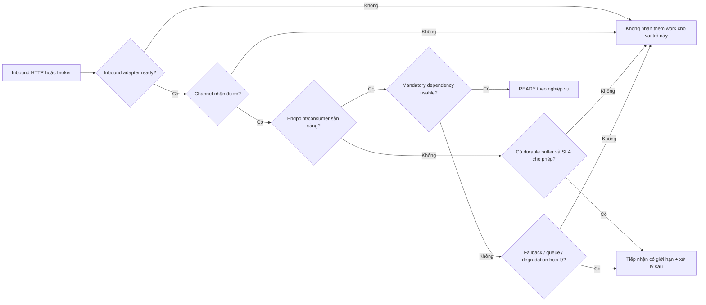
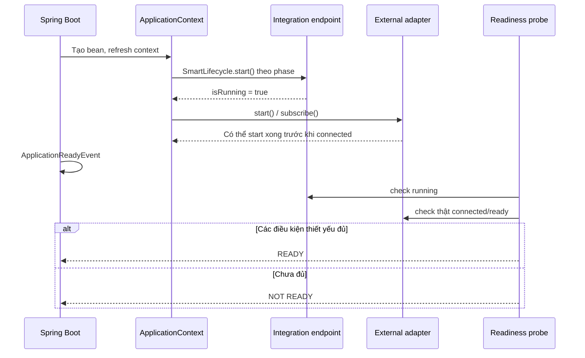
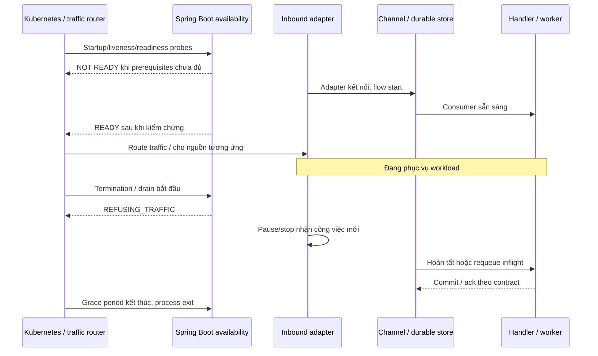

# Readiness khi channel, adapter và endpoint sẵn sàng trong Spring Integration

## 1. Readiness là lời hứa vận hành, không phải “ứng dụng đã khởi động”

Trong chương **Vận hành** của mô-đun `SPRING_INTEGRATION_RUNTIME`, Spring Integration điều phối message qua **channel, endpoint, consumer, poller và executor**, đồng thời quản lý vòng đời `IntegrationFlow`, transaction, retry, message store, lỗi, correlation và hiệu năng. Một dịch vụ có thể trả HTTP 200 từ controller trong khi source adapter chưa kết nối broker, một `DirectChannel` chưa có subscriber hoặc một polling endpoint đã bị dừng. Nếu bộ điều phối lập tức chuyển traffic vào pod đó, message có thể thất bại hoặc bị kẹt ngay trong thời gian khởi động.

**Readiness** trả lời câu hỏi có phạm vi nghiệp vụ:

> Instance này **đang sẵn sàng nhận thêm công việc thuộc vai trò của nó** và có đường xử lý đủ điều kiện để đưa công việc tiến triển, thay vì chỉ tồn tại như một tiến trình Java?

Câu hỏi này khác với “JVM còn sống?” và “Spring ApplicationContext đã tạo xong chưa?”. Nó còn khác việc “tất cả message trong backlog đã xử lý xong?”: một consumer vẫn có thể sẵn sàng khi đang có backlog hợp lệ.

Ví dụ một dịch vụ xử lý đơn hàng có:

```text
HTTP gateway -> ordersIn (DirectChannel) -> validateEndpoint
             -> ordersQueue (persistent) -> poller -> reserveStock
             -> outbound HTTP adapter -> payment service
```

Nếu `validateEndpoint` đang chạy nhưng poller `reserveStock` chưa start, có thể tiếp nhận message vào durable queue **nếu** dung lượng/backpressure và SLA cho phép. Nếu `ordersQueue` là queue trong RAM đang đầy, instance có thể không thể nhận thêm công việc an toàn. Nếu payment service tạm ngừng nhưng business cho phép queue chờ, quyết định readiness có thể khác với một API thanh toán đồng bộ bắt buộc trả kết quả ngay.

### Sau bài học, bạn có thể

1. Phân biệt **startup**, **liveness**, **readiness**, **dependency health** và khả năng **drain**.
2. Đánh giá readiness riêng cho `DirectChannel`, `QueueChannel`, `ExecutorChannel`, `FluxMessageChannel` và các kiểu adapter/endpoint.
3. Hiểu `SmartLifecycle`, `autoStartup`, phase, lifecycle của `IntegrationFlow` và giới hạn của `isRunning()`.
4. Cấu hình Spring Boot Actuator readiness probe cùng một `HealthIndicator` kiểm tra endpoint thực tế.
5. Xây cơ chế báo `REFUSING_TRAFFIC`/`ACCEPTING_TRAFFIC` khi có sự cố hoặc quá trình shutdown, nhưng không làm sai hợp đồng nhận message của adapter.
6. Thiết kế test khi khởi động, phụ thuộc chưa sẵn sàng, restart, executor quá tải, retry và rolling deploy.
7. Xây dashboard/runbook để không nhầm startup success với khả năng xử lý nghiệp vụ.

## 2. Phân biệt startup, liveness và readiness

| Tín hiệu | Câu hỏi | Ví dụ điều kiện thành công | Không nên dùng để kết luận |
|---|---|---|---|
| **Startup** | Ứng dụng đã hoàn tất pha khởi tạo cần thiết chưa? | Context được tạo, cấu hình hợp lệ, các bean/phụ thuộc thiết yếu khởi tạo | Broker đã giao partition hoặc adapter luôn có thể nhận message |
| **Liveness** | Process có nên tiếp tục chạy hay cần được khởi động lại? | JVM và thread quản trị còn tiến triển, không bị deadlock fatal | Database/Kafka tạm thời không kết nối |
| **Readiness** | Instance có nên nhận thêm công việc *ngay lúc này* không? | Các đường nhận/định tuyến/consumer thiết yếu sẵn sàng theo contract | Message đang chờ đã được xử lý hoặc không còn retry |
| **Dependency health** | Hệ thống phụ thuộc có hoạt động và sử dụng được không? | DB pool có connection khả dụng, broker client đã được cấp quyền | Mọi phụ thuộc, kể cả tùy chọn, đều bắt buộc làm readiness DOWN |
| **Drain/shutdown** | Có thể dừng nhận mới và hoàn tất/đưa lại công việc dở dang an toàn không? | Không nhận traffic mới, inflight đạt ngưỡng hoặc timeout, ack/replay rõ ràng | Set readiness DOWN là đủ để tự dừng Kafka listener/poller |

Một **liveness probe** thất bại có thể khiến Kubernetes restart pod. Vì vậy **không đưa một dependency tạm lỗi** như database outage vào liveness một cách tùy tiện: nhiều pod có thể cùng restart khi database ngừng, làm sự cố nghiêm trọng hơn.

Một **readiness probe** thất bại thường loại pod khỏi các endpoint sẵn sàng nhận traffic của Kubernetes Service, nhưng **không khởi động lại pod** chỉ vì readiness DOWN. Readiness là cơ chế **routing/control-plane**; nó không tự tạm dừng Kafka consumer, JMS listener, file poller hoặc một integration flow nhận message trực tiếp từ broker.

### Đặt mục tiêu theo vai trò

Hai instance cùng một ứng dụng có thể có vai trò khác nhau:

- **HTTP request–reply gateway:** phải có đường tạo reply hoạt động; thiếu consumer của `DirectChannel` hoặc service đích bắt buộc có thể làm readiness DOWN.
- **Background processor nhận từ Kafka:** khả năng xử lý phụ thuộc listener/container, assignment nếu nghiệp vụ yêu cầu, connection/auth và work capacity. Readiness HTTP không tự thay thế broker consumer control.
- **Durable queue ingester:** có thể sẵn sàng tiếp nhận khi worker phía sau đang chậm, **nếu** durable store còn chỗ và cho phép backlog theo SLA.
- **Leader-only scheduler:** pod standby không sở hữu lock/leadership có thể vẫn **healthy và ready cho vai trò standby**; không nên đánh dấu DOWN chỉ vì nó không chạy task của leader.

**Readiness phải có contract được viết ra**, không mặc định “mọi endpoint đều phải chạy, mọi downstream phải UP”.

## 3. Lập danh sách đường xử lý thiết yếu

Trước khi thêm `HealthIndicator`, xác định những điểm phải tồn tại để nhận một loại công việc.



Cần phân biệt **sẵn sàng nhận** và **sẵn sàng hoàn tất**:

- Một hệ thống command đồng bộ có deadline 2 giây thường không nên nhận việc nếu nó biết chính downstream bắt buộc đang mất kết nối lâu.
- Một hệ thống store-and-forward có durable queue và deadline nhiều giờ có thể tiếp tục nhận message, dù consumer đang tạm dừng.
- Nếu queue đầy hoặc không ghi được message bền vững, store-and-forward không còn bảo đảm đã nhận an toàn; readiness phải được đánh giá lại.

### Bảng kiểm kê

| Điểm trong flow | Tài nguyên / signal | Oracle thực tế |
|---|---|---|
| Inbound adapter | HTTP listener, Kafka listener, JMS, TCP, file source... | Adapter/container hoạt động theo contract và đã sẵn sàng nhận hoặc poll |
| Input channel | `DirectChannel`, `QueueChannel`, `ExecutorChannel`, `FluxMessageChannel` | Có cách chấp nhận message an toàn theo loại channel |
| Consumer endpoint | `EventDrivenConsumer`, `PollingConsumer`, `SourcePollingChannelAdapter` | Lifecycle và subscription/poller phù hợp |
| Scheduler/executor | `TaskScheduler`, `TaskExecutor` | Pool chưa cạn; queue/rejection policy được giám sát |
| Message store | JDBC/broker/metadata store | Có thể ghi/đọc state cần thiết, schema/credential hợp lệ |
| Mandatory downstream | DB nghiệp vụ, API bắt buộc | Có khả năng truy cập theo SLA mà không cần health probe làm side effect |
| Dynamic integration flow | `IntegrationFlowContext` registration | Flow bắt buộc đã được register và start đúng |
| Recovery/error path | Retry advice, `errorChannel`, DLQ | Đường cuối khi lỗi còn hoạt động theo yêu cầu bền vững |

Không cần biến **mọi chỉ số** thành điều kiện `DOWN`. Queue age, retry rate và error rate thường là **metric chẩn đoán**, chỉ trở thành readiness gate khi đã định nghĩa ngưỡng an toàn và chính sách ổn định.

## 4. Readiness của các loại channel

Channel là đường gửi message, không phải lúc nào cũng có trạng thái `isRunning()`. Kiểm tra **đúng contract** của từng loại:

| Loại channel | Readiness có thể dựa vào | Rủi ro bị bỏ qua |
|---|---|---|
| `DirectChannel` | Có consumer/dispatcher đang được đăng ký và handler thiết yếu chạy | Bean channel tồn tại nhưng **không có subscriber**, `send` có thể thất bại |
| `PublishSubscribeChannel` | Đủ subscriber theo nghiệp vụ, error handling rõ | Một subscriber lỗi/chậm; không phải mọi subscriber đều bắt buộc |
| `QueueChannel` trong RAM | Queue còn capacity, poller/consumer cần thiết có đường xử lý | `send` nhận vào queue dù không có poller; restart làm mất pending work |
| `QueueChannel` dùng persistent store | Store ghi bền được, pending backlog/retention trong giới hạn | Store sẵn nhưng consumer chưa chạy; throughput drain không đạt |
| `ExecutorChannel` | Executor nhận task, chưa saturation/rejection, consumer có handler | Queue executor trong RAM không tự durable và transaction không truyền qua thread |
| `FluxMessageChannel` | Có subscription/demand thật, source/consumer hỗ trợ backpressure | `send()` imperative không tự tôn trọng `request(n)`, buffer có thể tích tụ |
| `PriorityChannel` / `RendezvousChannel` | Capacity và hợp đồng send/receive của channel | Một receive đang chờ hoặc priority logic có thể khiến message bị trì hoãn |

### 4.1. DirectChannel không có subscriber

`DirectChannel` là bean có thể đã được khởi tạo nhưng endpoint chưa subscribe vì `autoStartup=false`, bean lifecycle lỗi hoặc consumer đã bị stop.

```text
ApplicationContext đã refresh
  ordersIn bean tồn tại
  ordersConsumer chưa start hoặc đã stop
  producer.send(message)
    -> không có subscriber phù hợp
    -> dispatch có thể fail
```

Do đó, **bean existence != subscriber readiness**. Với event-driven consumer, `EventDrivenConsumer.isRunning()` là một tín hiệu thực tế, vì endpoint subscribe/unsubscribe vào input channel theo lifecycle. Tuy nhiên vẫn chưa chứng minh handler không ném exception khi xử lý.

### 4.2. QueueChannel nhận được chưa có nghĩa xử lý được

Queue nhận message thành công trong khi polling endpoint đang stop có thể đúng **theo thiết kế** nếu nghiệp vụ chấp nhận backlog. Nhưng:

- Queue RAM có thể đầy/OOM và mất khi JVM restart.
- JDBC message store có thể lỗi ghi schema/connection.
- Poller có thể chạy nhưng không lấy message vì scheduler bị tắc hoặc transaction bị lỗi.
- Backlog tăng mãi dù `isRunning()==true`, nếu downstream chậm hơn incoming rate.

Readiness cần chọn **ngưỡng chấp nhận workload**, không chỉ kiểm tra queue size bằng 0. Queue có 10.000 message có thể vẫn ready nếu năng lực xử lý và SLA cho phép; queue còn 10 slot trống nhưng adapter đang ghi thất bại thì không ready.

### 4.3. ExecutorChannel cần giới hạn tải

Một executor có `activeCount` thấp không đủ chứng minh không quá tải nếu hàng đợi dài, worker bị block hoặc có chính sách rejection. Dùng bounded pool/queue, giám sát số task pending, rejected, task age và latency. Nếu executor bị saturate, producer có thể nhận `TaskRejectedException`/`RejectedExecutionException` ngay lúc dispatch; readiness có thể từ chối **công việc mới** sau khi ngưỡng vượt mức an toàn.

### 4.4. Reactive không có nghĩa lúc nào cũng ready

`FluxMessageChannel` có thể tồn tại nhưng upstream Publisher chưa subscribe hoặc downstream chưa request; hoặc một adapter reactive đã subscribe nhưng resource bắt buộc không có kết nối. Không dùng điều kiện `bean != null` làm readiness. Dùng subscription lifecycle, demand/inflight và trạng thái của source/downstream phù hợp; một `onError` terminal có thể chấm dứt đường xử lý dù bean channel vẫn còn.

## 5. Adapter readiness khác endpoint running

Spring Integration bao gồm nhiều inbound/outbound adapters. Khả năng kết nối thực tế thường nằm **ngoài** `SmartLifecycle.isRunning()`.

| Thành phần | `isRunning()` nói gì? | Điều cần kiểm chứng thêm |
|---|---|---|
| `SourcePollingChannelAdapter` | Endpoint/scheduler có lifecycle đang chạy | Source có dữ liệu/khả năng đọc, credential hợp lệ, poller thread tiến triển |
| Kafka inbound adapter/container | Container đang chạy theo lifecycle | Kết nối cluster, authorization, subscription/partition assignment theo contract |
| JMS/AMQP inbound listener | Listener container có lifecycle chạy | Broker connection, consumer registration, queue/exchange availability |
| TCP/HTTP inbound adapter | Server/listener đã start | Port accept traffic, route/auth/config đúng, downstream path sử dụng được |
| File inbound adapter | Poller và filter hoạt động | Thư mục mount, quyền đọc, marker/metadata store, nguồn có thể truy cập |
| Outbound HTTP/gateway | Endpoint sẵn sàng invoke | DNS/TLS/đích bắt buộc/thời hạn request và fallback |
| JDBC adapter | Bean/poller có thể đã chạy | Pool, query, schema, transaction manager và quyền DB phù hợp |

Ví dụ một Kafka listener có `isRunning()==true` nhưng **chưa được giao partition** ở một số giai đoạn startup/rebalance. Nếu pod chỉ xử lý khi có assignment, readiness cần dựa thêm vào tín hiệu từ listener/container. Tuy nhiên **0 partition** cũng có thể là trạng thái hợp lệ của một replica dư trong consumer group; không tự đánh dấu DOWN khi định nghĩa vai trò không đòi mỗi pod sở hữu partition.

Tương tự, một file poller không thấy file nào **không phải lỗi readiness**. “Không có công việc” khác “không thể xử lý công việc”.

### Tránh destructive health checks

Không nên dùng `source.receive()` trong readiness probe chỉ để xác minh “source đọc được”: việc nhận có thể **lấy message khỏi queue**, ghi metadata file filter hoặc bắt đầu transaction. Health probe chạy liên tục có thể thay đổi business state.

Thay vào đó, ưu tiên:

1. Callback/lifecycle event của adapter về connection, assignment hoặc listener readiness.
2. Health indicator của tài nguyên phụ thuộc nếu adapter và business dùng chung client thực.
3. Tín hiệu tiến triển đã được instrument (thời gian poll gần nhất, lỗi liên tiếp, queue lag) với ngưỡng hợp lý.
4. Health check read-only, hữu hạn và không tạo side effect.
5. Probe đặc thù được kiểm thử khi service vừa startup, reconnect, rebalance và graceful shutdown.

## 6. SmartLifecycle, autoStartup và thứ tự start/stop

Trong Spring, nhiều endpoint/adapters của Spring Integration triển khai `SmartLifecycle`. Framework lifecycle processor gọi `start()`/`stop()` dựa trên `autoStartup` và `phase`.

- `autoStartup=true` cho phép component được tự start khi context refresh theo lifecycle mặc định; `false` nghĩa là cần người điều phối start khi đã đáp ứng prerequisites.
- Khi **startup**, thành phần có phase thấp hơn thường được start trước.
- Khi **shutdown**, thành phần phase cao hơn thường stop trước.
- Nếu một component start bất đồng bộ hoặc adapter còn đợi broker sau khi `start()` trả về, trạng thái `isRunning` có thể chưa phản ánh **readiness của tài nguyên ngoài**.
- `ApplicationReadyEvent` của Spring Boot báo ứng dụng đã kết thúc khởi tạo theo lifecycle Boot; nó **không tự chứng minh mọi source adapter đã subscribe/assigned/connected**.



### 6.1. Khởi tạo động IntegrationFlow

Một `IntegrationFlow` đăng ký động qua `IntegrationFlowContext` có thể được tạo sau khi Boot phát `ApplicationReadyEvent`. Nếu flow ấy bắt buộc để nhận việc, readiness phải giữ **REFUSING_TRAFFIC** hoặc DOWN cho tới khi:

- Registration đã hoàn tất và ID đúng.
- Các channel/endpoint/adapters của flow được start theo contract.
- Subscription/connection/source cần thiết đã sẵn sàng.
- Không có lỗi startup đã bị che giấu trong callback/log.

Khi deregister một flow để bảo trì, readiness của **vai trò liên quan** phải được cập nhật; pod vẫn có thể ready cho những endpoint khác.

### 6.2. Không tạo phụ thuộc vòng

Nếu adapter chỉ được start sau khi readiness chuyển UP, nhưng readiness lại yêu cầu adapter đã start, hệ thống bị kẹt. Nên có pha **initialization/orchestration** chủ động start component, chờ tín hiệu sẵn sàng, rồi publish readiness. Readiness probe chỉ **đọc trạng thái**, không tự start/stop endpoint mỗi lần được gọi.

## 7. Spring Boot Actuator: readinessState và health group

Với Spring Boot có Actuator, `ApplicationAvailability` cung cấp `ReadinessState` và `LivenessState`; Boot có thể expose hai health groups qua:

```text
GET /actuator/health/liveness
GET /actuator/health/readiness
```

Theo hành vi thông thường của Boot, `ReadinessState.ACCEPTING_TRAFFIC` biểu thị ứng dụng sẵn sàng nhận traffic, còn `ReadinessState.REFUSING_TRAFFIC` biểu thị chưa/không nhận. Khi readiness group được bật, trạng thái refusing có thể được ánh xạ thành HTTP 503.

**Cảnh báo:** mặc định readiness group có thể **chỉ kiểm tra `readinessState`**. Nó không tự bao gồm mọi health indicator như datasource, Redis, Kafka hoặc custom flow indicator. Muốn readiness đại diện cho Spring Integration flow, phải **chủ động thêm health contributor thiết yếu** vào group.

### 7.1. Dependency và application.yml

Ví dụ Boot dùng Actuator:

```groovy
dependencies {
    implementation "org.springframework.boot:spring-boot-starter-integration"
    implementation "org.springframework.boot:spring-boot-starter-actuator"
}
```

Ví dụ `application.yml`:

```yaml
management:
  endpoint:
    health:
      probes:
        enabled: true
        add-additional-paths: true
      group:
        readiness:
          include: readinessState,ordersEndpoint
  endpoints:
    web:
      exposure:
        include: health,info
```

Ý nghĩa:

- `management.endpoint.health.probes.enabled=true` bật liveness/readiness probe ngay cả khi không chạy trong môi trường Kubernetes.
- `group.readiness.include` thêm custom health contributor `ordersEndpoint` cùng `readinessState`.
- `add-additional-paths=true` ở các bản Spring Boot hỗ trợ thêm các endpoint probe như `/readyz` và `/livez` **trên main server port**, hữu ích khi Actuator dùng management port riêng.
- Không expose tất cả Actuator endpoints ra mạng công khai; chỉ mở đường probe/management cần thiết và thiết lập security/network policy.

**Chú ý chính tả health ID:** bean tên `ordersEndpointHealthIndicator` sẽ xuất health contributor dưới ID `ordersEndpoint` theo quy tắc bỏ hậu tố `HealthIndicator` của Spring Boot. Nếu bean name khác, cấu hình group cũng phải đổi theo. Xác minh bằng phản hồi Actuator hoặc cấu hình health endpoint thực tế.

### 7.2. Không để liveness phụ thuộc vào database

Ví dụ không nên đưa `db` và `kafka` vào liveness group chỉ để “chắc chắn mọi thứ ổn”. Khi DB/Kafka outage diện rộng, Kubernetes có thể restart hàng loạt pod mà vẫn không giải quyết được nguyên nhân. Thường chỉ dùng trạng thái `livenessState` và những điều kiện fatal của process; kiểm tra dependency bắt buộc ở readiness hoặc metric/alert riêng.

## 8. Ví dụ Java hoàn chỉnh: endpoint thật và HealthIndicator

Ví dụ sau dùng Java 17+, Spring Boot có `spring-boot-starter-integration` và `spring-boot-starter-actuator`. Ta chủ động tạo một `EventDrivenConsumer` bean có tên ổn định để kiểm tra lifecycle. Đây là **một tầng readiness tối thiểu cho endpoint nội bộ**, chưa có broker/DB; muốn kết luận toàn flow nhận việc được, cần bổ sung adapter/dependency checks ở mục 9.

### 8.1. Payload và cấu hình Integration endpoint

File `OrderCommand.java`:

```java
package example.integration;

public record OrderCommand(String eventId) {}
```

File `OrdersFlowConfig.java`:

```java
package example.integration;

import org.springframework.beans.factory.annotation.Qualifier;
import org.springframework.boot.actuate.health.Health;
import org.springframework.boot.actuate.health.HealthIndicator;
import org.springframework.context.annotation.Bean;
import org.springframework.context.annotation.Configuration;
import org.springframework.integration.channel.DirectChannel;
import org.springframework.integration.config.EnableIntegration;
import org.springframework.integration.endpoint.EventDrivenConsumer;
import org.springframework.messaging.MessageHandler;

@Configuration
@EnableIntegration
public class OrdersFlowConfig {

    @Bean("ordersIn")
    public DirectChannel ordersIn() {
        return new DirectChannel();
    }

    @Bean("ordersHandler")
    public MessageHandler ordersHandler() {
        return message -> {
            if (!(message.getPayload() instanceof OrderCommand command)
                    || command.eventId() == null
                    || command.eventId().isBlank()) {
                throw new IllegalArgumentException("Invalid OrderCommand");
            }

            // Demo: handler đồng bộ. Không log payload hoặc PII.
            System.out.println("Accepted " + command.eventId());
        };
    }

    @Bean("ordersEndpoint")
    public EventDrivenConsumer ordersEndpoint(
            @Qualifier("ordersIn") DirectChannel input,
            @Qualifier("ordersHandler") MessageHandler handler) {
        return new EventDrivenConsumer(input, handler);
    }

    @Bean("ordersEndpointHealthIndicator")
    public HealthIndicator ordersEndpointHealthIndicator(
            @Qualifier("ordersEndpoint") EventDrivenConsumer endpoint) {

        return () -> endpoint.isRunning()
                ? Health.up().withDetail("endpoint", "ordersEndpoint").build()
                : Health.down().withDetail("endpoint", "ordersEndpoint").build();
    }
}
```

Ví dụ `OrdersApplication.java`:

```java
package example.integration;

import org.springframework.boot.SpringApplication;
import org.springframework.boot.autoconfigure.SpringBootApplication;

@SpringBootApplication
public class OrdersApplication {

    public static void main(String[] args) {
        SpringApplication.run(OrdersApplication.class, args);
    }
}
```

Đảm bảo `OrdersFlowConfig` cùng package hoặc package con được component scan. Sau startup, `EventDrivenConsumer` được lifecycle processor start và subscribe vào `ordersIn` theo contract. Nếu endpoint bị stop, bean `ordersIn` vẫn tồn tại nhưng không còn consumer của endpoint này, và health indicator sẽ phản ánh `DOWN`.

### 8.2. HealthIndicator này chứng minh được điều gì?

**Chứng minh được:** endpoint `ordersEndpoint` trong JVM hiện tại đang ở trạng thái `isRunning()`.

**Chưa chứng minh được:** nguồn đã kết nối broker, message vào được từ bên ngoài, DB sẽ commit, retry/ack đã đúng, downstream HTTP còn hoạt động hoặc queue có capacity. Nếu chỉ dùng sample này rồi ghi tài liệu “full flow ready”, đó là **kết luận quá mức**.

Cách nâng cấp là kết hợp:

```text
Readiness cho vai trò OrderWorker =
    readinessState ACCEPTING_TRAFFIC
    AND ordersEndpoint.isRunning()
    AND requiredInboundAdapterIsReady
    AND requiredStoreCanAcceptWork
    AND requiredDownstreamCanProgress
    AND NOT operationallyDraining
```

Không phải mọi điều kiện đều cần **ping network ngay lúc từng probe**; nên đọc các tín hiệu read-only được cập nhật bởi callback/monitor và có chính sách **staleness**.

### 8.3. Một test JUnit xác minh start/stop

Đoạn test dùng `AnnotationConfigApplicationContext` và Spring Boot Actuator classes sẵn trong test classpath:

```java
package example.integration;

import org.junit.jupiter.api.Test;
import org.springframework.boot.actuate.health.HealthIndicator;
import org.springframework.boot.actuate.health.Status;
import org.springframework.context.annotation.AnnotationConfigApplicationContext;
import org.springframework.integration.endpoint.EventDrivenConsumer;

import static org.junit.jupiter.api.Assertions.*;

class OrdersEndpointReadinessTest {

    @Test
    void healthReflectsEndpointLifecycle() {
        try (var context = new AnnotationConfigApplicationContext(
                OrdersFlowConfig.class)) {

            var endpoint = context.getBean(
                    "ordersEndpoint", EventDrivenConsumer.class);
            var indicator = context.getBean(
                    "ordersEndpointHealthIndicator", HealthIndicator.class);

            assertTrue(endpoint.isRunning());
            assertEquals(Status.UP, indicator.health().getStatus());

            endpoint.stop();
            assertFalse(endpoint.isRunning());
            assertEquals(Status.DOWN, indicator.health().getStatus());

            endpoint.start();
            assertTrue(endpoint.isRunning());
            assertEquals(Status.UP, indicator.health().getStatus());
        }
    }
}
```

Test này kiểm tra **tầng lifecycle** không cần broker hay network. Để kiểm chứng readiness HTTP group thật, cần thêm test với Spring Boot application context + Actuator (xem mục 12); unit test `HealthIndicator` không đủ xác nhận `/actuator/health/readiness` đã bao gồm đúng contributor.

## 9. Readiness adapter/source phải theo tín hiệu thật

Một source adapter đôi khi cần vài giây hoặc vài chục giây để kết nối, đăng ký consumer hay nhận partition sau khi endpoint đã start. Đừng lấy duy nhất `isRunning` làm tiêu chí.

### 9.1. Dùng trạng thái cập nhật bởi callback có chủ sở hữu

Một thiết kế thực tế thường có **tracker**:

```java
import java.time.Instant;
import java.util.concurrent.atomic.AtomicReference;

public final class AdapterReadinessSnapshot {

    public record State(
            boolean connected,
            boolean subscribed,
            Instant observedAt
    ) {}

    private final AtomicReference<State> current =
            new AtomicReference<>(
                    new State(false, false, Instant.EPOCH));

    public void update(boolean connected, boolean subscribed) {
        current.set(new State(
                connected, subscribed, Instant.now()));
    }

    public State snapshot() {
        return current.get();
    }
}
```

**Đây là tracker minh họa**, không phải API callback chung của mọi Spring Integration adapter. Ứng dụng phải gọi `update(...)` từ **sự kiện thật** của Kafka listener, JMS client, HTTP listener hoặc adapter tương ứng. Không cập nhật `connected=true` chỉ vì bean đã được tạo.

Một `HealthIndicator` có thể đọc snapshot và yêu cầu trạng thái không quá cũ so với chính sách:

```java
import java.time.Duration;
import java.time.Instant;
import org.springframework.boot.actuate.health.Health;
import org.springframework.boot.actuate.health.HealthIndicator;

HealthIndicator inboundHealth(AdapterReadinessSnapshot tracker) {
    return () -> {
        var state = tracker.snapshot();
        boolean fresh = Duration.between(
                state.observedAt(), Instant.now()).abs()
                .compareTo(Duration.ofSeconds(30)) <= 0;

        boolean ready =
                state.connected() && state.subscribed() && fresh;

        return ready
                ? Health.up().withDetail("source", "connected").build()
                : Health.down().withDetail("source", "unavailable").build();
    };
}
```

Method trên là **fragment**: tạo bean `@Bean("inboundHealthIndicator")` trong configuration và thêm `inbound` vào readiness group khi cần. Không log full exception/credential của source trong chi tiết health response. Hạn `30 seconds` chỉ là ví dụ; thay theo tần suất signal thật. Một adapter chỉ phát sự kiện `connected` **một lần** rồi không gửi heartbeat không nên bị đánh DOWN sau 30 giây chỉ vì thiếu event mới; phải phân biệt trạng thái kết nối dạng **event** với tín hiệu heartbeat/refresh.

### 9.2. Các tín hiệu cần riêng cho mỗi adapter

| Adapter | Có thể nghe sự kiện nào? | Khi nào chưa đủ |
|---|---|---|
| Kafka | Container start/stop, assignment/revocation, authentication/connection errors | “Assignment đang 0” có thể do rebalancing hoặc pod standby |
| JMS/AMQP | Consumer/listener lifecycle, connection/reconnect, recovery callbacks | Lifecycle running không nói broker đã nhận đăng ký |
| HTTP/TCP | Listener port bound, route registered, TLS/certificate availability | Endpoint sẵn nhưng downstream business DB không dùng được |
| JDBC/File poller | Kết quả poll gần nhất, lỗi đọc, permission/path/schema | Không có record/file là trạng thái idle hợp lệ |
| Gateway/outbound | Downstream request health được xác minh read-only, circuit breaker state | Không dùng một HTTP call tạo side effect làm probe |

Nếu một dependency là **tùy chọn** (ví dụ hệ thống gửi analytics), không để nó tự kéo toàn bộ readiness xuống khi đường xử lý chính vẫn hợp lệ. Nếu là dependency **bắt buộc để không mất message**, báo NOT READY và/hoặc stop source thích hợp.

## 10. ApplicationAvailability: báo refusing traffic đúng thời điểm

Spring Boot cung cấp `ApplicationAvailability` để đọc trạng thái hiện tại và `AvailabilityChangeEvent` để các thành phần công bố thay đổi.

Ví dụ một thành phần quản trị đã được xác thực:

```java
package example.integration;

import org.springframework.boot.availability.AvailabilityChangeEvent;
import org.springframework.boot.availability.ReadinessState;
import org.springframework.context.ApplicationEventPublisher;
import org.springframework.stereotype.Component;

@Component
public class ReadinessGate {

    private final ApplicationEventPublisher publisher;

    public ReadinessGate(ApplicationEventPublisher publisher) {
        this.publisher = publisher;
    }

    public void refuseNewTraffic() {
        AvailabilityChangeEvent.publish(
                publisher, ReadinessState.REFUSING_TRAFFIC);
    }

    public void acceptTrafficAfterValidation() {
        AvailabilityChangeEvent.publish(
                publisher, ReadinessState.ACCEPTING_TRAFFIC);
    }
}
```

**Không gọi `acceptTrafficAfterValidation()` ngay sau khi khởi tạo bean.** Boot quản lý readiness trong lifecycle startup; chỉ đưa trạng thái thành `ACCEPTING_TRAFFIC` khi các điều kiện của vai trò đã được xác minh. Nếu một adapter mất kết nối, logic nhận sự kiện có thể chuyển về refusing; khi adapter hồi phục phải kiểm tra lại **toàn bộ prerequisites** trước khi chấp nhận.

### Một cảnh báo quan trọng với message-driven consumers

Báo `ReadinessState.REFUSING_TRAFFIC` có thể loại pod khỏi Kubernetes Service endpoints, nhưng **Kafka/JMS/file poller không tự dừng**. Muốn ngừng nhận từ broker, cần gọi cơ chế pause/stop của adapter/container hoặc điều khiển endpoint theo contract riêng.

Ví dụ:

```text
Readiness DOWN
    != Kafka container.stop()
    != SourcePollingChannelAdapter.stop()
    != ExecutorChannel queue drained
    != Broker ack complete
```

Vì thế, quyết định drain cần một **controller phối hợp riêng** giữa readiness, adapter lifecycle, in-flight, transaction/ack và backpressure.

## 11. Startup probe, readiness probe và graceful shutdown

Đối với Kubernetes, thường dùng ba probe khác nhau:

```yaml
startupProbe:
  httpGet:
    path: /actuator/health/liveness
    port: 8080
  periodSeconds: 5
  failureThreshold: 24

livenessProbe:
  httpGet:
    path: /actuator/health/liveness
    port: 8080
  periodSeconds: 10
  failureThreshold: 3

readinessProbe:
  httpGet:
    path: /actuator/health/readiness
    port: 8080
  periodSeconds: 5
  failureThreshold: 2
```

Đây chỉ là **fragment** của container trong Pod spec, không phải manifest Deployment đầy đủ. Các ngưỡng là ví dụ và phải chọn theo thời gian startup tối đa, SLO, latency probe, chu kỳ reconnect và khả năng xử lý. Nếu đặt management port riêng, path/port tương ứng phải được sửa; có thể dùng `/livez` và `/readyz` trên main port khi bật cấu hình `add-additional-paths` tương thích.

### 11.1. Startup probe bảo vệ khởi động chậm

Một ứng dụng cần chạy migration, warm cache hoặc khởi tạo source adapter có thể chưa sẵn sàng trong nhiều chu kỳ. `startupProbe` giúp liveness/readiness được đánh giá **sau khi startup probe đã thành công**, tránh restart pod vì initialization bình thường. Không lạm dụng startup probe thành thời gian che lỗi vô hạn: nếu cấu hình sai hoặc dependency bắt buộc không hồi phục, cần có deadline/alert.

### 11.2. Readiness trong rolling deployment

Một quá trình mong muốn:



Readiness DOWN **không nhất thiết chặn traffic ngay lập tức**: routing updates, kube-proxy/load balancer, connection keep-alive và in-flight requests có độ trễ. Không chỉ dựa vào probe để tránh nhận công việc mới; khi cần, adapter/gateway phải tự thực hiện stop/pause có kiểm soát.

### 11.3. Dừng nhận rồi drain: phân biệt theo loại nguồn

| Nguồn | Khi từ chối traffic | Khi chờ drain |
|---|---|---|
| HTTP | Gỡ khỏi Service + app reject request mới theo policy | Chờ request đã vào, grace period và reply/DB commit |
| Kafka/JMS/AMQP | Pause/stop listener bằng API tương ứng, không chỉ readiness | Hoàn tất/requeue/unack work theo source contract |
| Poller JDBC/file | Stop `SourcePollingChannelAdapter` hoặc controller sở hữu poller | Đảm bảo message đã nhận có rollback/ack phù hợp |
| Durable QueueChannel | Dừng producer mới hoặc giới hạn enqueue | Consumer có thể xử lý backlog để giảm downtime |
| In-memory ExecutorChannel | Ngừng submit task mới | Chờ worker hiện có hoặc có policy mất/replay riêng |

**Không hứa “graceful shutdown = exactly-once”.** Crash vẫn có thể xảy ra sau business commit trước source ack. Idempotency ledger và nguồn durable/replay được thiết kế để xử lý sự không chắc chắn này.

## 12. Test readiness khi endpoint dừng, adapter mất kết nối và startup chậm

Một bài test readiness tốt phải kiểm tra cả **lifecycle**, **health group HTTP** và **thực tế chấp nhận workload**.

### 12.1. Test endpoint không chạy

Dùng `OrdersEndpointReadinessTest` ở mục 8:

- Sau context refresh, `ordersEndpoint.isRunning()` true → contributor `UP`.
- Gọi `endpoint.stop()` → contributor `DOWN`.
- Gọi `endpoint.start()` → contributor `UP`.

Nếu chạy trên Boot với `application.yml` ở mục 7, nên test thêm qua HTTP rằng `/actuator/health/readiness` trả non-2xx khi `ordersEndpoint` DOWN, và 2xx sau khi start lại. Đây là kiểm chứng **health group wiring**, không phải test nghiệp vụ có commit.

### 12.2. Test chưa có subscriber

Một test trong context cố ý cấu hình `autoStartup=false` hoặc dừng `EventDrivenConsumer` trước khi gửi. Dự kiến:

- Bean `DirectChannel` vẫn tồn tại.
- Send có thể báo không có subscriber/dispatch failure.
- Readiness indicator không được trả `UP` chỉ vì channel bean tồn tại.

Lỗi cần assert theo loại channel/dispatcher và version; đừng hardcode cả thông điệp exception vì wording có thể thay đổi.

### 12.3. Test adapter delayed readiness

Mô phỏng một callback kết nối tới broker được phát **sau** khi endpoint `start()`. Trước callback, health source phải DOWN dù endpoint đã chạy. Sau callback hợp lệ, health mới UP; khi mất connection, health phải DOWN trở lại. Với adapter cần partition, cần test cả giai đoạn rebalance và điều kiện pod standby hợp lệ.

Không dùng `Thread.sleep()` để đoán callback đã chạy: dùng `CountDownLatch`, `QueueChannel.receive(timeout)` hoặc polling assertion có deadline trên snapshot.

### 12.4. Test queue saturation

Tạo `QueueChannel` hoặc bounded executor có capacity nhỏ trong môi trường thử nghiệm, cho consumer chậm có chủ đích và gửi burst. Xác nhận:

1. Queue/pool đạt ngưỡng capacity thực.
2. Message gửi thêm bị block/reject theo hợp đồng đã cấu hình.
3. Health logic đổi DOWN nếu chính sách readiness bao gồm ngưỡng đó.
4. Khi backlog giảm dưới ngưỡng phục hồi, readiness trở lại UP.
5. Không có message mất hoặc duplicate ngoài contract.

Nên dùng **hysteresis**: ngưỡng chuyển DOWN và UP khác nhau để tránh readiness flapping khi queue depth dao động quanh một giá trị.

### 12.5. Test không có message

Cho source/poller hoạt động bình thường nhưng **không có file/broker record**. Readiness thường phải tiếp tục UP nếu khả năng nhận vẫn tồn tại; không đánh DOWN chỉ vì `lastMessageAt` quá cũ. Theo dõi “last successful poll” hoặc “last healthy heartbeat” thay vì “last non-null business message”.

### 12.6. Test restart và reprocessing

Giả lập crash sau nhận message nhưng trước ack, restart app rồi kiểm tra:

- Durable source hoặc message store vẫn có đường replay.
- Bean/flow đã start và readiness không bị bật sớm trước khi source/consumer cần thiết sẵn.
- Message phát lại được xử lý idempotent.
- Error channel/DLQ còn hoạt động nếu handler tiếp tục lỗi.
- Khi recovery bị kẹt, metric backlog/oldest message age được báo; readiness policy phản ánh đúng khả năng nhận **công việc mới**.

Một `QueueChannel` trong RAM và một `HealthIndicator` UP không đủ chứng minh persistence sau crash.

## 13. Readiness khi mất dependency: fail-fast hay degrade?

Quy tắc quyết định phải xuất phát từ **hợp đồng nghiệp vụ**, không từ sự tiện lợi của một health check.

| Sự cố | Trường hợp nên NOT READY | Trường hợp vẫn có thể READY |
|---|---|---|
| DB nghiệp vụ mất | API đồng bộ cần commit DB trước reply | Source có durable buffer, chỉ nhận trước và xử lý sau |
| Broker không kết nối | Instance chỉ có vai trò consume broker và không còn đường làm việc | Instance còn HTTP path độc lập không cần broker |
| Redis lock registry mất | Critical section yêu cầu distributed exclusivity để an toàn | Chức năng không dùng khóa này có thể tiếp tục |
| Downstream HTTP 503 | Request–reply không có fallback hợp lệ | Có circuit breaker/outbox/retry với SLA chấp nhận |
| Logging/metrics backend mất | Audit bắt buộc bị mất khả năng ghi bền | Logging diagnostic best-effort thất bại nhưng nghiệp vụ an toàn |
| Queue local gần đầy | Không thể nhận thêm mà không mất dữ liệu/vi phạm latency | Source tự backpressure, durable overflow path còn đủ |
| Một replica đang standby | Nó bắt buộc nhận traffic nhưng không có handler | Vai trò của nó chỉ là standby, không nhận phân vùng/leader work |

### Không dùng readiness làm circuit breaker của mọi lỗi

Nếu một request business thất bại đơn lẻ, lập tức đưa readiness DOWN có thể gây **cascading outage** và liên tục thay đổi pod endpoints. Ưu tiên đo **tỷ lệ lỗi**, **cửa sổ quan sát**, **độ bền của lỗi**, **ngưỡng bão hòa**, **timeout và recovery**. Khi vượt ngưỡng đã được chứng minh là không thể phục vụ an toàn, mới chuyển NOT READY.

Readiness có thể kết hợp với circuit breaker, nhưng hai cơ chế có vai trò khác nhau: breaker ngăn tiếp tục gọi dependency lỗi; readiness báo instance có nên nhận **công việc mới**. Một breaker OPEN có thể vẫn phù hợp với trạng thái READY nếu có fallback hợp lệ.

## 14. Observability: đo readiness có ý nghĩa

Không đủ chỉ lưu một gauge 0/1. Khi readiness bị từ chối, operator cần biết **tại sao**, **từ bao giờ** và **tác động tới message flow**.

| Chỉ số/log đề xuất | Mục tiêu |
|---|---|
| `readiness_state` (ready/refusing) | Trạng thái phục vụ hiện tại theo instance |
| `readiness_transition_total` theo reason | Tần suất chuyển trạng thái, phát hiện flapping |
| `readiness_refusing_duration_seconds` | Thời gian không nhận thêm workload |
| `integration_endpoint_running` | Endpoint bắt buộc có đang start không |
| `adapter_connection_state` / `assignment_state` | Phân biệt running và connected/assigned |
| `executor_active_threads` / `executor_rejected_total` | Nhận diện saturation và lỗi handoff |
| `queue_depth` / `oldest_message_age` | Đo backlog chứ không nhầm với readiness |
| `poller_last_successful_poll_timestamp` | Poller có tiến triển hay bị kẹt |
| `integration_message_send_failures_total` | Không có subscriber, timeout, store error |
| `business_commit_latency` / `error_channel_total` | Khả năng xử lý nghiệp vụ và lỗi cuối |
| `shutdown_inflight_work` / `drain_duration` | Kiểm chứng graceful shutdown |
| `readiness_probe_latency` | Health check có tự làm nghẽn thread/DB không |

Đây là **tên metric đề xuất cho ứng dụng**, không phải mọi meter có sẵn của Spring Integration/Micrometer. Đối chiếu theo version các metrics như `spring.integration.send`, `spring.integration.receive`, handler timers và Observation context.

### Health endpoint nên nhẹ và không rò dữ liệu

- Ưu tiên đọc `AtomicReference`/cached snapshot, bean lifecycle, gauge; không thực hiện mỗi lần probe một query nặng hoặc gọi external API gây side effect.
- Hạn chế detail trả về public: tránh credential, connection string, hostname nội bộ nhạy cảm hoặc payload.
- Probe phải có deadline; một health check treo vô hạn có thể làm cạn thread.
- Trên cluster, state là **per instance**. Pod A ready không chứng minh pod B ready hoặc tổng backlog broker được xử lý đúng.
- Phân biệt metric availability với metric **business completion**. Một endpoint running có thể tạo lỗi 100% message do schema thay đổi; dashboard cần báo điều đó.

## 15. Runbook khi readiness sai hoặc bị flapping

| Triệu chứng | Nguyên nhân có thể | Hành động chẩn đoán |
|---|---|---|
| Actuator readiness UP nhưng `DirectChannel` không gửi được | Endpoint chưa subscribe/stop; health group không include endpoint | Kiểm tra `EventDrivenConsumer.isRunning`, channel subscriber và `group.readiness.include` |
| Bean endpoint đang chạy nhưng broker vẫn chưa nhận message | Chưa connected/assigned hoặc auth lỗi | Xem adapter/container callbacks, broker connection, assignment và logs |
| Boot đã phát `ApplicationReadyEvent` nhưng flow động chưa đăng ký | `IntegrationFlowContext` registration xảy ra sau lifecycle Boot | Có gate đợi flow registration/start thực |
| Readiness DOWN dù không có message | Health dựa vào `lastMessageAt` thay vì khả năng poll/connection | Phân biệt idle bình thường với poller lỗi |
| Readiness UP trong khi executor liên tục reject | Health chỉ kiểm tra lifecycle mà không xét capacity | Đo queue, rejection, latency và ngưỡng overload |
| Readiness liên tục UP/DOWN | Threshold quá sát, dependency chập chờn, callback state stale | Hysteresis, debounce, backoff và phân loại essential/optional |
| Pod bị restart khi broker mất | Liveness phụ thuộc broker/DB | Tách liveness khỏi dependency bên ngoài |
| Readiness DOWN nhưng Kafka vẫn consume | HTTP readiness không điều khiển broker consumer | Pause/stop listener/adapter theo lifecycle |
| Khi stop, còn message bị mất | Queue/executor in-memory hoặc ack trước business commit | Kiểm tra source durability, transaction, shutdown drain và idempotency |
| Readiness HTTP 404/không thấy group | Actuator/probes chưa được bật, sai port/path/security | Kiểm tra dependency, `probes.enabled`, endpoint exposure, main/management port |
| Health indicator custom không xuất hiện | Bean name/suffix sai hoặc readiness group include sai | Kiểm tra contributor ID trong Actuator |
| DB health DOWN làm mọi pod NOT READY dù có fallback | Dependency tùy chọn bị include sai | Điều chỉnh readiness group theo role/fallback thực tế |

### Trình tự chẩn đoán

1. Xác nhận **đúng pod, port, path và thời điểm** đọc readiness.
2. Đọc trạng thái `ApplicationAvailability` và health group contributors.
3. Xem lifecycle của channel-consumer endpoint, `autoStartup`, phase và dynamic registrations.
4. Kiểm tra adapter readiness thật: connected/subscribed/assigned/poll progressing.
5. Kiểm tra queue, executor, message store và dependency bắt buộc.
6. Xem event/error flow, exception, retry và source ack/recovery khi lỗi.
7. Đánh giá policy: có cần NOT READY hay chỉ degraded với durable buffering?
8. Xác minh routing của Kubernetes và trạng thái flow sau recovery, không chỉ HTTP status.
9. Ghi lại root cause, time-to-ready, số message ảnh hưởng và business reconciliation.

## 16. Bài thực hành theo kịch bản

Dùng ứng dụng mẫu ở mục 8 và `application.yml` ở mục 7 trên môi trường thử nghiệm:

1. **Baseline:** chạy app; kiểm tra bean `ordersEndpoint` đang running và contributor `ordersEndpoint` UP. Gọi readiness URL và xác nhận contributor được include.
2. **Stop endpoint:** gọi `ordersEndpoint.stop()` trong test, kiểm tra health DOWN và message gửi qua `DirectChannel` không thể được dispatch như lúc có subscriber.
3. **Auto startup:** sửa endpoint `setAutoStartup(false)` trong biến thể thử, xem ứng dụng startup nhưng endpoint chưa running; readiness phải NOT READY nếu endpoint bắt buộc.
4. **Delayed adapter:** dùng tracker ở mục 9, cho callback connected/subscribed đến sau startup; xác minh readiness chỉ chuyển UP sau khi cả hai signal đủ.
5. **Source idle:** cho poller không trả message trong vài chu kỳ; xác minh không đánh DOWN nếu nguồn và scheduler vẫn hoạt động.
6. **Dependency outage:** đưa DB hoặc broker test ra khỏi trạng thái khả dụng; xem health group và policy có phản ứng theo vai trò.
7. **Executor saturation:** tạo bounded executor nhỏ; phát nhiều message, theo dõi rejection và thử ngưỡng DOWN/UP có hysteresis.
8. **Queue backlog:** dừng consumer tạm thời trong khi durable queue còn chỗ; xác định instance nên giữ READY hay từ chối theo hợp đồng store-and-forward.
9. **Rolling restart:** bắt đầu drain, chuyển readiness refusing, pause/stop adapter, đợi inflight/ack với deadline; xác minh message còn lại có thể replay.
10. **Dynamic flow:** tạo flow qua `IntegrationFlowContext` sau khi context đã chạy, kiểm tra readiness gate cập nhật khi đăng ký/start và khi remove flow.
11. **Multi-instance:** chạy hai replica, một replica mất connection; kiểm tra readiness từng pod và router loại đúng replica, không đánh đồng trạng thái toàn cluster.
12. **Security:** xác minh health endpoint không lộ secrets, chỉ mở network path cần thiết và không tạo side effect từ probe.

Bảng ghi kết quả:

| Trường | Ghi nhận |
|---|---|
| Instance, role, version | Pod/JVM nào; phục vụ traffic kiểu gì? |
| `ApplicationAvailability` | `ACCEPTING_TRAFFIC` hay `REFUSING_TRAFFIC`? |
| Health contributor | Component nào UP/DOWN, lý do ngắn gọn |
| Endpoint lifecycle | `isRunning`, `autoStartup`, phase |
| Adapter | Connected, subscribed, assignment hoặc successful poll |
| Channel/store/executor | Subscriber, capacity, queue age, task rejection |
| Dependency | Essential/optional, timeout, fallback |
| Source ack/retry | Message đã commit/ack hay có replay path? |
| Readiness HTTP | Status/latency và thời gian chuyển trạng thái |
| Business result | Có mất message, duplicate hoặc vi phạm SLO không? |

## 17. Quy tắc cần nhớ

- **Readiness không phải liveness:** dependency tạm lỗi không nên khiến mọi pod restart qua liveness; readiness biểu thị khả năng nhận workload của **vai trò cụ thể**.
- `ApplicationReadyEvent`, bean existence và `SmartLifecycle.isRunning()` là những **tín hiệu cần nhưng có thể chưa đủ**: adapter còn phải kết nối/subscribe/assigned, channel có consumer và store/executor có capacity phù hợp.
- `DirectChannel` có thể thiếu subscriber; `QueueChannel` có thể nhận vào backlog dù không xử lý; `ExecutorChannel` có thể reject; `FluxMessageChannel` cần subscription/demand. Đánh giá theo **contract của từng channel**.
- `@EnableIntegration` và `autoStartup` điều khiển lifecycle, **không chứng minh** đã kết nối tới broker hay xử lý được nghiệp vụ.
- Actuator `readinessState` không mặc định kiểm tra tất cả integration endpoints; thêm **HealthIndicator/health group** có chủ đích, giữ probe nhẹ và read-only.
- `REFUSING_TRAFFIC` **không tự pause Kafka/JMS/file poller**; graceful shutdown phải phối hợp routing, adapter stop, inflight drain, transaction/ack và replay.
- Backlog hợp lệ, source đang idle hoặc pod standby có thể vẫn READY; readiness không phải phép kiểm “queue phải rỗng”.
- Kiểm chứng bằng test start/stop, mất dependency, saturation, rolling restart, retry/idempotency và metric thực tế, không dựa vào HTTP 200 đơn lẻ.

### Tài liệu tham khảo chính thức

- [Spring Boot Reference — Kubernetes Probes](https://docs.spring.io/spring-boot/reference/actuator/endpoints.html#actuator.endpoints.kubernetes-probes): `ApplicationAvailability`, liveness/readiness groups và `/livez`, `/readyz`.
- [Spring Boot Reference — Application Availability](https://docs.spring.io/spring-boot/reference/features/spring-application.html#features.spring-application.application-availability): `ReadinessState`, `LivenessState` và `AvailabilityChangeEvent`.
- [Spring Boot Reference — Health Indicators](https://docs.spring.io/spring-boot/reference/actuator/endpoints.html#actuator.endpoints.health): `HealthIndicator`, health group và HTTP status.
- [Spring Framework Reference — Startup and Shutdown Callbacks](https://docs.spring.io/spring-framework/reference/core/beans/factory-nature.html#beans-factory-lifecycle-processor): `SmartLifecycle`, `phase`, `autoStartup` và trình tự start/stop.
- [Spring Integration Reference — Message Channels](https://docs.spring.io/spring-integration/reference/channel.html): `DirectChannel`, `QueueChannel`, `ExecutorChannel` và `FluxMessageChannel`.
- [Spring Integration Reference — Polling Consumer](https://docs.spring.io/spring-integration/reference/endpoint.html): `SourcePollingChannelAdapter`, poller, scheduler và lifecycle.
- [Spring Integration Reference — Dynamic Integration Flows](https://docs.spring.io/spring-integration/reference/dsl/java-runtime-flows.html): `IntegrationFlowContext`, đăng ký/start/stop flow ở runtime.
- [Spring Integration Reference — Orderly Shutdown](https://docs.spring.io/spring-integration/reference/shutdown.html): điều phối inbound adapters, channel và in-flight messages khi shutdown.
- [Spring Integration Reference — Metrics and Management](https://docs.spring.io/spring-integration/reference/metrics.html): Micrometer/Observation và khả năng quan sát channel, handler, source.
