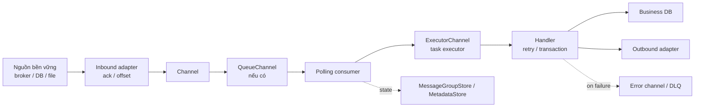
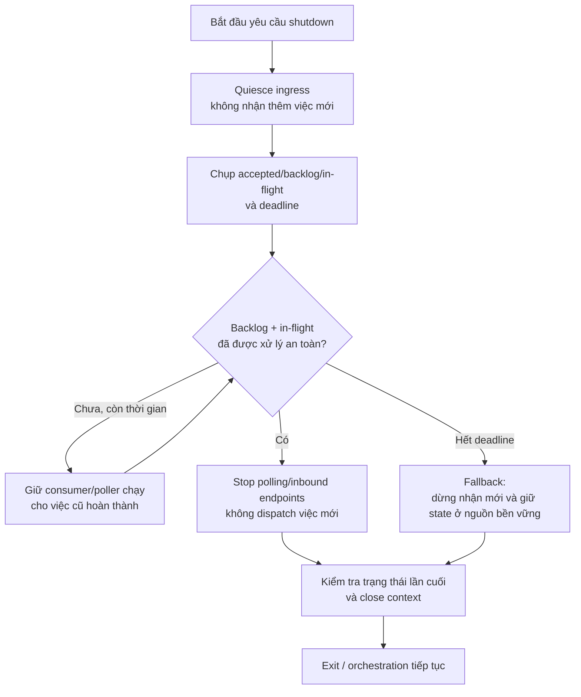
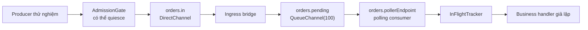
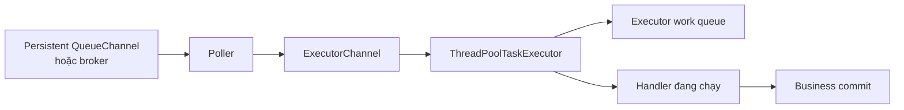
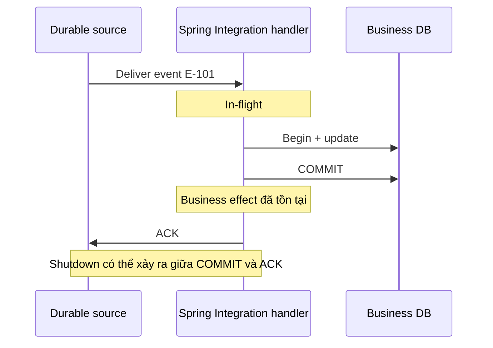
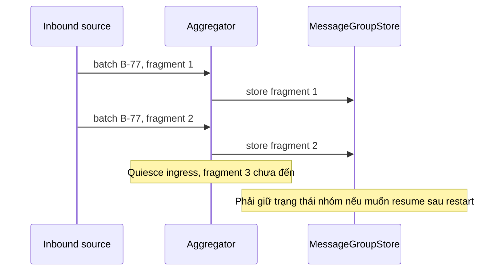
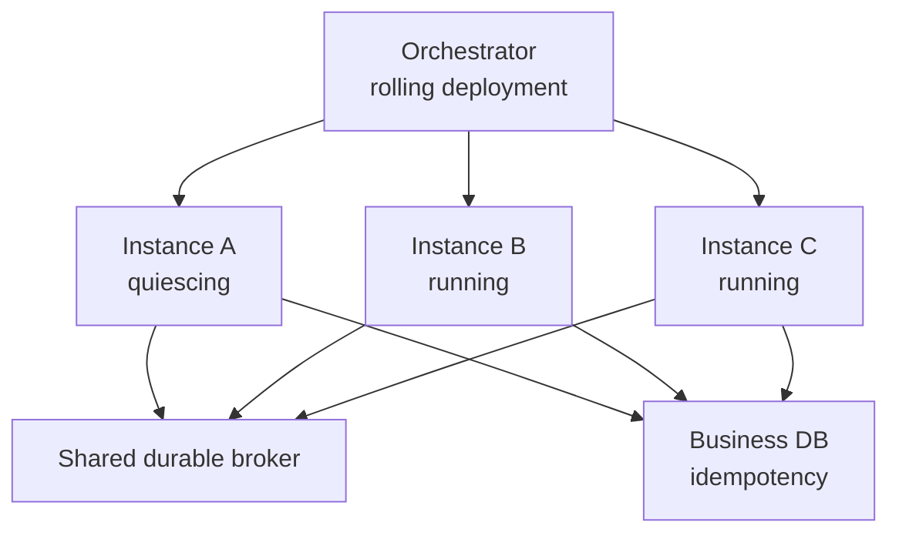

# Graceful shutdown và drain message

## 1. Vì sao graceful shutdown quan trọng với message flow?

Trong Spring Integration, một ứng dụng có thể liên tục nhận message từ HTTP gateway, Kafka/RabbitMQ/JMS adapter, file poller hoặc một `MessageChannel` nội bộ. Sau khi nhận, message có thể đang nằm trong `QueueChannel`, được dispatch qua `ExecutorChannel`, chờ một polling consumer, đang được aggregator giữ trong `MessageGroupStore`, hoặc đã gọi database/HTTP nhưng chưa acknowledgement nguồn.

Khi triển khai phiên bản mới, scale down pod, bảo trì database hoặc tắt một `IntegrationFlow` động, tiến trình không nên bị đóng một cách tùy tiện. Một shutdown sai thứ tự có thể gây:

- Message đã được nhận nhưng chưa xử lý xong bị mất do queue/task chỉ nằm trong RAM.
- Worker bị dừng giữa lúc transaction hoặc HTTP side effect đang thực hiện.
- Broker gửi lại message đã ghi DB thành công vì acknowledgement chưa hoàn tất.
- Producer tiếp tục gửi vào `DirectChannel` khi subscriber cuối đã dừng, dẫn tới lỗi phân phối.
- Executor không còn nhận task, gây `TaskRejectedException` hoặc mất task theo rejection policy.
- Aggregator còn nhóm message chưa đủ fragment nhưng `MessageGroupStore` không bền vững.
- Service bị đánh dấu “đã dừng an toàn” chỉ vì `isRunning() == false`, dù còn nhiều task hoặc message chưa có kết quả.

Bài **“Graceful shutdown và drain message”** thuộc chương **Vận hành** của module **SPRING_INTEGRATION_RUNTIME**. Ta sẽ thực hành điều phối vòng đời IntegrationFlow, endpoint, poller và executor, kiểm soát nhận mới và công việc đang chạy, phối hợp transaction, retry, message store, error channel, correlation và đo hiệu quả của quy trình dừng.

> **Phân biệt từ đầu:** graceful shutdown là một **quy trình có thời hạn và chính sách xử lý phần chưa hoàn tất**, không chỉ là gọi `ApplicationContext.close()` hoặc `SmartLifecycle.stop()`.

## 2. Định nghĩa chính xác: quiesce, drain, stop và terminate

| Thuật ngữ | Diễn giải | Phải kiểm chứng |
| --- | --- | --- |
| **Quiesce ingress** | Ngừng chấp nhận công việc **mới** vào phạm vi đang bảo trì | Không còn nguồn nào gửi thêm vào nhánh cần drain; các request đã chấp nhận được ghi nhận. |
| **Drain backlog** | Tiếp tục cho consumer xử lý các message **đang chờ** cho tới điều kiện mong muốn | Queue/broker backlog giảm, công việc hoàn tất hoặc được chuyển sang nơi giữ bền vững. |
| **Drain in-flight** | Chờ message đã được receive/dispatch hoàn thành, commit hoặc rollback theo hợp đồng | Số handler active và task pending được đo thực; không suy từ trạng thái lifecycle. |
| **Stop endpoint** | Yêu cầu một inbound adapter, poller hoặc consumer ngừng hoạt động | Endpoint không tạo công việc mới theo lifecycle; kiểm tra tác dụng với message in-flight. |
| **Stop executor** | Ngừng tiếp nhận task mới, xử lý/huỷ phần đã chờ theo shutdown policy | Không có task quan trọng bị mất im lặng; tài nguyên không bị shutdown khi flow khác còn dùng. |
| **Close application context** | Chạy trình tự dừng/huỷ Spring beans | Resource được đóng và quy trình không vượt quá ngân sách dừng. |
| **Hard kill** | JVM bị chấm dứt không cho cleanup hoàn tất | Chỉ có state đã lưu bền vững và redelivery/idempotency mới hỗ trợ phục hồi. |

**Drain không nhất thiết có nghĩa backlog bằng 0 trong mọi kiến trúc.** Có hai chính sách hợp lệ nhưng mục tiêu khác nhau:

1. **Drain-to-zero:** tạm ngừng đưa việc mới vào, **giữ consumer hoạt động** để xử lý hết backlog đã chấp nhận, đợi mọi side effect hoàn tất, rồi mới stop consumer.
2. **Preserve-and-resume:** ngừng nhận việc mới và dừng consumer theo quy trình, **để backlog còn lại ở broker/persistent message store** để một instance khác hoặc phiên bản mới xử lý. Tiêu chí đúng là “không mất message và còn khả năng redelivery”, không phải “queue rỗng”.

Không nên trộn hai chính sách. Ví dụ, tắt polling endpoint đầu tiên rồi đợi `QueueChannel` xuống 0 có thể **không bao giờ hoàn thành** vì không còn consumer đọc queue.

## 3. Mô hình các lớp đang giữ message



Mỗi lớp có **quy tắc sở hữu công việc** và **phương thức dừng** khác nhau.

| Vị trí của message | Khi dừng | Rủi ro nếu không kiểm tra |
| --- | --- | --- |
| Chưa được nguồn giao | Thường vẫn ở broker/nguồn | Có thể không còn nếu nguồn không bền vững hoặc đã commit offset sai. |
| Đã vào `DirectChannel` | Handler đồng bộ có thể đang chạy trên producer thread | Stop subscriber trước khi chặn producer làm các lần send tiếp theo thất bại. |
| Nằm trong `QueueChannel` RAM | Có thể còn nếu chỉ stop poller và JVM sống | Mất khi JVM crash; không mặc định được replay. |
| Nằm trong persistent channel store | Có thể nhận lại sau restart nếu thao tác lưu đã commit | Dequeue/ack ngoài transaction có thể khiến message biến mất dù storage bền vững. |
| Đang chờ trong executor work queue | Chưa bắt đầu handler; là `Runnable` trong RAM | Shutdown policy hoặc crash có thể huỷ/mất task. |
| Handler đang thực thi | Có thể đang giữ DB connection, lock, transaction | `stop()` không tự hủy/rollback side effect; cần deadline và timeout từng tầng. |
| Aggregator đang giữ 2/3 fragment | `MessageGroupStore` lưu các fragment/correlation | Group có thể mất qua restart nếu store in-memory. |
| Đã commit DB nhưng chưa ack broker | Nguồn có thể phát lại | Thiếu idempotency dẫn tới double business effect. |

**Message store khác executor queue.** Tăng `queueCapacity` của `ThreadPoolTaskExecutor` không tạo hàng đợi bền vững; tăng dung lượng `QueueChannel` RAM cũng không bảo đảm hồi phục sau `SIGKILL`.

## 4. Trình tự tổng quát: đóng cửa nhận, hoàn tất việc cũ, rồi dừng

Đối với chính sách **drain-to-zero**, quy trình điển hình là:



Các điểm quan trọng:

- **Đóng ingress trước:** không thể drain về 0 nếu producer vẫn liên tục thêm việc.
- **Không stop consumer quá sớm** nếu yêu cầu xử lý hết backlog tại instance hiện tại.
- **Chờ có deadline**, không chờ vô hạn; cuối cùng orchestrator có thể dùng `SIGKILL`.
- **Theo dõi cả backlog và in-flight**. Queue rỗng có thể do worker vừa dequeue message, không phải đã xử lý.
- **Không tự đánh dấu hoàn tất** khi chỉ thấy executor active = 0: task có thể đang nằm trong queue, còn retry callback, hoặc message nằm ở một endpoint khác.
- **Fallback phải có ý nghĩa nghiệp vụ:** với broker bền vững và ack hợp lý, có thể để redeliver; với queue chỉ ở RAM, kết quả timeout là một rủi ro mất việc cần báo rõ.

### Khi nào chọn preserve-and-resume?

Nếu backlog có hàng triệu message, deployment chỉ được phép dừng trong 60 giây và nguồn đã lưu bền vững, drain-to-zero có thể bất khả thi. Khi đó:

1. Ngừng nhận hoặc thay đổi trạng thái consumer để không có receive mới.
2. Chờ hoặc kết thúc **những message đang xử lý** theo deadline.
3. Bảo đảm những message chưa ack vẫn ở nguồn hoặc được rollback để redeliver.
4. Dừng endpoint và tiến trình.
5. Khởi động instance mới, xác minh consumer đã nhận lại backlog đúng policy.

**Không gọi đây là drain-to-zero.** Đây là shutdown có khả năng phục hồi, với công việc tiếp tục sau restart.

## 5. Tại sao `SmartLifecycle.stop()` chưa đủ?

Nhiều Spring Integration endpoint triển khai `SmartLifecycle`, cho phép `start()`, `stop()` và `isRunning()`. Khi ứng dụng dừng, Spring lifecycle processor còn xét `phase` và thời hạn chờ các component ở cùng phase; chi tiết thời gian và thứ tự phụ thuộc cấu hình và phiên bản.

Ví dụ lấy một polling endpoint theo bean ID:

```java
import org.springframework.context.ApplicationContext;
import org.springframework.context.SmartLifecycle;

SmartLifecycle worker =
    context.getBean("orders.pollerEndpoint", SmartLifecycle.class);

worker.stop();
boolean stillRunning = worker.isRunning();
```

`stillRunning == false` chỉ cho biết trạng thái lifecycle được endpoint báo cáo. **Không có đủ dữ kiện** để kết luận mọi task, transaction hoặc output đã hoàn tất.

Ngoài ra, không phải bean nào trong flow cũng triển khai lifecycle. `MessageChannel` thông thường không có API `stop()` tổng quát; một transformer hoặc handler thuần Java không tự start/stop. Phải xác định **endpoint/adapter/registration** cụ thể, không gọi nhầm vào bean channel.

### `SmartLifecycle.stop(Runnable)` và phase

Spring có API dừng bất đồng bộ theo callback. Component thực thi đúng hợp đồng sẽ gọi callback khi dừng hoàn tất; một cấu hình lifecycle processor có thể giới hạn thời gian đợi. Không tự dùng `stop()` đồng bộ để suy ra các tác vụ thực thi ngoài endpoint đã xong.

Về phase, lifecycle processor thường khởi động thành phần có phase thấp trước và dừng thành phần có phase cao trước. Nhưng **phase không tự giải quyết** chuyện một producer đang gửi request, queue có backlog hoặc transaction của worker. Cần kế hoạch quiesce/drain tường minh.

## 6. Thiết kế demo: ingress + queue + worker poller độc lập

Bài thực hành dùng một ứng dụng **một JVM** không có broker/database thật, nhằm quan sát chính xác thứ tự dừng. Topology:



`AdmissionGate` ngăn *các lần submit đi qua service này* sau khi quiesce. `QueueChannel` cho phép ingress và worker tách thành hai endpoint. `InFlightTracker` ghi lại số handler đang chạy và số lần handler hoàn tất **trong demo**.

**Giới hạn:** queue trong RAM không có durability; thống kê trong RAM không mang nghĩa “DB đã commit” hay “broker đã ack”; nếu một inbound adapter khác bypass gate và gửi thẳng tới `orders.pending` thì không có ranh giới quiesce an toàn. Code minh họa một quy trình **local** có thể kiểm thử, không tự động là shutdown protocol production hay distributed protocol.

## 7. Java DSL: hai flow tĩnh, một điểm có thể stop

Tạo một configuration tối thiểu gồm ingress và polling worker riêng. Ví dụ dùng Java 17+, Spring Integration và `@EnableIntegration`.

```java
package example.runtime.operations;

import java.time.Duration;

import org.springframework.beans.factory.annotation.Qualifier;
import org.springframework.context.annotation.Bean;
import org.springframework.context.annotation.Configuration;
import org.springframework.integration.channel.DirectChannel;
import org.springframework.integration.channel.QueueChannel;
import org.springframework.integration.config.EnableIntegration;
import org.springframework.integration.dsl.IntegrationFlow;
import org.springframework.integration.dsl.Pollers;
import org.springframework.messaging.MessageChannel;

@Configuration
@EnableIntegration
public class OperationsFlowConfig {

    @Bean("orders.in")
    MessageChannel ordersIn() {
        return new DirectChannel();
    }

    @Bean("orders.pending")
    QueueChannel pendingOrders() {
        return new QueueChannel(100);
    }

    @Bean
    InFlightTracker inFlightTracker() {
        return new InFlightTracker();
    }

    @Bean
    AdmissionGate admissionGate(
            @Qualifier("orders.in") MessageChannel input) {
        return new AdmissionGate(input);
    }

    @Bean
    IntegrationFlow ordersIngress() {
        return IntegrationFlow.from("orders.in")
            .bridge()
            .channel("orders.pending")
            .get();
    }

    @Bean
    IntegrationFlow ordersWorker(InFlightTracker tracker) {
        return IntegrationFlow.from("orders.pending",
                endpoint -> endpoint
                    .id("orders.pollerEndpoint")
                    .poller(Pollers.fixedDelay(Duration.ofMillis(100))
                        .maxMessagesPerPoll(1)))
            .handle(String.class, (payload, headers) -> {
                tracker.track(() -> {
                    // Chỉ là side effect minh họa.
                    System.out.println("Processed " + payload);
                });
                return null; // One-way handler.
            })
            .get();
    }
}
```

Trong topology này, một polling endpoint duy nhất tiêu thụ queue theo lịch. `DirectChannel` ở ingress gọi bridge đồng bộ, sau đó message vào `QueueChannel`. Poller là **consumer duy nhất** của queue trong demo. Đặt `id("orders.pollerEndpoint")` để control plane có thể lấy đúng bean `SmartLifecycle` khi cần stop.

**Không nên mặc định** `poller.stop()` sẽ chờ mọi task sau khi đã receive. Nếu thêm executor, retry advice, hoặc transaction ngoài, cần mở rộng cách quan sát và deadline.

## 8. `AdmissionGate`: chặn submit mới không có race kiểm tra–gửi

Một cách làm sai phổ biến là:

```java
// Dễ có race: quiesce xảy ra sau if nhưng trước send.
if (accepting.get()) {
    input.send(message);
}
```

Ở đây thread A đã đọc `accepting=true` rồi bị preempt; thread B chuyển sang `false`; A vẫn gửi message sau khi quy trình drain bắt đầu. Tùy SLA, điều đó khiến số accepted không ổn định.

Trong demo, dùng `ReentrantReadWriteLock` để serialize việc quiesce với những lời gọi gửi qua gate.

```java
package example.runtime.operations;

import java.util.Objects;
import java.util.concurrent.atomic.AtomicLong;
import java.util.concurrent.locks.Lock;
import java.util.concurrent.locks.ReentrantReadWriteLock;

import org.springframework.messaging.MessageChannel;
import org.springframework.messaging.support.GenericMessage;

public final class AdmissionGate {

    private final MessageChannel input;
    private final ReentrantReadWriteLock rw = new ReentrantReadWriteLock(true);
    private final AtomicLong accepted = new AtomicLong();

    private boolean accepting = true;

    public AdmissionGate(MessageChannel input) {
        this.input = Objects.requireNonNull(input);
    }

    public boolean submit(String jobId, long timeoutMillis) {
        Lock read = rw.readLock();
        read.lock();
        try {
            if (!accepting) {
                return false;
            }

            boolean ok =
                input.send(new GenericMessage<>(jobId), timeoutMillis);

            if (ok) {
                accepted.incrementAndGet();
            }
            return ok;
        } finally {
            read.unlock();
        }
    }

    public void quiesce() {
        Lock write = rw.writeLock();
        write.lock();
        try {
            accepting = false;
        } finally {
            write.unlock();
        }
    }

    public void resume() {
        Lock write = rw.writeLock();
        write.lock();
        try {
            accepting = true;
        } finally {
            write.unlock();
        }
    }

    public long acceptedCount() {
        return accepted.get();
    }
}
```

Quiesce lấy **write lock**, nên chỉ trả về sau các lời gọi `submit` đang giữ **read lock** đã kết thúc; từ đó, tổng `acceptedCount()` của chính gate này không còn tăng (cho tới khi resume). Đây là một ranh giới hữu ích để kiểm chứng drain.

Nhưng có các giới hạn phải công bố:

- Cơ chế này chỉ chặn **request đi qua `AdmissionGate`**. Một Kafka adapter hoặc inbound flow khác gửi thẳng vào `orders.in`/`orders.pending` sẽ bypass gate.
- `input.send() == true` chỉ xác nhận channel/bridge đã nhận message theo hợp đồng, **không** xác nhận business side effect thành công.
- Giữ read lock trong khi gửi có thể khiến quiesce chờ nếu queue đầy hoặc send bị block. Hãy đặt timeout gửi hữu hạn và kiểm soát capacity.
- Nếu chạy nhiều replica, mỗi JVM có gate riêng. Muốn dừng toàn cluster phải điều phối mọi instance hoặc điều khiển nguồn chung.

## 9. `InFlightTracker`: phân biệt đã dequeue với đã hoàn tất

`QueueChannel` rỗng không có nghĩa không còn việc: poller có thể vừa lấy message, handler đang chạy. Ta ghi đếm tại **ranh giới handler** và số lần handler hoàn tất.

```java
package example.runtime.operations;

import java.util.concurrent.atomic.AtomicInteger;
import java.util.concurrent.atomic.AtomicLong;

public final class InFlightTracker {

    private final AtomicInteger active = new AtomicInteger();
    private final AtomicLong completed = new AtomicLong();

    public void track(Runnable businessWork) {
        active.incrementAndGet();
        try {
            businessWork.run();
            completed.incrementAndGet(); // Thành công trong phạm vi demo.
        } finally {
            active.decrementAndGet();
        }
    }

    public int activeCount() {
        return active.get();
    }

    public long completedCount() {
        return completed.get();
    }
}
```

Nếu `businessWork.run()` ném exception, `completed` không tăng nhưng `active` vẫn giảm trong `finally`. Điều này cho phép drain coordinator **không báo thành công** khi một message accepted chưa có kết quả thành công.

Đừng dùng chính xác code này làm metric “transaction committed” trong production: nếu transaction bọc method ở advice **bên ngoài** tracker, `completed.incrementAndGet()` có thể chạy **trước khi transaction commit**. Muốn xác nhận business completion, đặt phép đo tại ranh giới commit/ack được kiểm chứng, hoặc đối chiếu durable marker ở database.

**Khoảng hở receive → handler:** giữa lúc message đã rời queue và trước khi tracker tăng `active` có thể tồn tại một khoảng rất ngắn. Vì vậy điều kiện “queue rỗng và active=0” **chưa đủ**. Trong demo, ta còn đối chiếu số **accepted** với số **completed** trước khi tuyên bố drain xong.

## 10. Điều phối drain có deadline và tiêu chí kiểm chứng

Một coordinator cục bộ có thể dùng các bean đã định nghĩa. Giả định duy nhất **một** polling consumer, tất cả lời gọi vào queue đi qua gate, không retry/duplicate ngoài phạm vi demo và handler thành công.

```java
package example.runtime.operations;

import java.time.Duration;
import java.util.Objects;

import org.springframework.context.SmartLifecycle;
import org.springframework.integration.channel.QueueChannel;

public final class DrainCoordinator {

    private final AdmissionGate admission;
    private final InFlightTracker tracker;
    private final QueueChannel queue;
    private final SmartLifecycle worker;

    public DrainCoordinator(
            AdmissionGate admission,
            InFlightTracker tracker,
            QueueChannel queue,
            SmartLifecycle worker) {
        this.admission = Objects.requireNonNull(admission);
        this.tracker = Objects.requireNonNull(tracker);
        this.queue = Objects.requireNonNull(queue);
        this.worker = Objects.requireNonNull(worker);
    }

    public boolean drainAndStop(Duration budget)
            throws InterruptedException {

        if (budget.isNegative() || budget.isZero()) {
            throw new IllegalArgumentException("Budget phai duong");
        }

        admission.quiesce();

        long deadline = System.nanoTime() + budget.toNanos();
        while (System.nanoTime() < deadline) {

            boolean allAccountedFor =
                tracker.completedCount() == admission.acceptedCount();
            boolean noHandlerRunning = tracker.activeCount() == 0;
            boolean queueEmpty = queue.getQueueSize() == 0;

            if (allAccountedFor && noHandlerRunning && queueEmpty) {
                worker.stop();

                // Kiểm tra lần cuối sau khi endpoint đã được yêu cầu dừng.
                return tracker.activeCount() == 0
                    && queue.getQueueSize() == 0
                    && tracker.completedCount() == admission.acceptedCount();
            }

            // Poll có thời hạn cho demo; production cần monitoring tốt hơn.
            Thread.sleep(25);
        }

        // Không đánh dấu thành công; worker có thể còn đang chạy.
        return false;
    }
}
```

Cách sử dụng:

```java
import java.time.Duration;

import org.springframework.context.SmartLifecycle;
import org.springframework.integration.channel.QueueChannel;

AdmissionGate admission =
    context.getBean(AdmissionGate.class);
InFlightTracker tracker =
    context.getBean(InFlightTracker.class);
QueueChannel queue =
    context.getBean("orders.pending", QueueChannel.class);
SmartLifecycle endpoint =
    context.getBean("orders.pollerEndpoint", SmartLifecycle.class);

DrainCoordinator coordinator =
    new DrainCoordinator(admission, tracker, queue, endpoint);

boolean drained =
    coordinator.drainAndStop(Duration.ofSeconds(10));

if (!drained) {
    System.err.println(
        "Drain chua dat: can fallback/recovery, khong duoc bao PASS");
}
```

**Giới hạn kỹ thuật của đoạn demo:**

- Deadline chỉ giới hạn **vòng đợi kiểm tra**, không tự giới hạn thời gian của `worker.stop()` nếu implementation stop có thao tác blocking; cần quản lý riêng ở orchestrator.
- Nếu worker đã được stop trước khi queue rỗng, vòng đợi sẽ timeout. Có thể phải start lại worker hoặc chọn preserve-and-resume.
- Nếu đã dequeue rồi xử lý lỗi, `completed < accepted` nên drain báo chưa đạt. Nó không tự trả message về `QueueChannel`; phải dùng transaction/ack phù hợp.
- Bộ đếm tổng số không bảo đảm **đúng từng eventId** nếu có duplicate, bỏ sót hoặc message ngoại lai. Production phải đối chiếu ID và durable state.
- Nếu có `ExecutorChannel` sau poller, task đã submit nhưng chưa bắt đầu handler có thể không xuất hiện trong `activeCount`; cần đo thêm **executor queue và submitted/completed**.
- Không dùng `Thread.sleep(25)` để giả định mọi lịch poll hoàn tất sau 25 ms. Đây chỉ là sampling có hạn; điều kiện quyết định nằm ở counters và trạng thái queue.

Đối với hệ thống production, nên có một **drain protocol có trạng thái** (`QUIESCING → DRAINING → STOPPING → STOPPED`), request ID, ngân sách thời gian, cách đánh giá mọi nguồn message và quyết định fallback rõ ràng.

## 11. Kiểm thử minh họa bằng JUnit 5

Ta chạy một Spring context rất nhỏ với `OperationsFlowConfig`, gửi năm job và gọi drain. Trong demo không có business exception hay inbound ngoài gate, do đó số accepted phải bằng số completed khi drain thành công.

```java
package example.runtime.operations;

import java.time.Duration;

import org.junit.jupiter.api.Test;
import org.springframework.context.SmartLifecycle;
import org.springframework.context.annotation.AnnotationConfigApplicationContext;
import org.springframework.integration.channel.QueueChannel;

import static org.junit.jupiter.api.Assertions.*;

class GracefulDrainTest {

    @Test
    void drainsAcceptedJobsThenStopsPollingEndpoint()
            throws Exception {

        try (var context = new AnnotationConfigApplicationContext(
                OperationsFlowConfig.class)) {

            AdmissionGate gate =
                context.getBean(AdmissionGate.class);
            InFlightTracker tracker =
                context.getBean(InFlightTracker.class);
            QueueChannel pending =
                context.getBean("orders.pending", QueueChannel.class);
            SmartLifecycle poller =
                context.getBean(
                    "orders.pollerEndpoint", SmartLifecycle.class);

            for (int i = 0; i < 5; i++) {
                assertTrue(gate.submit("J-" + i, 500));
            }

            DrainCoordinator coordinator =
                new DrainCoordinator(gate, tracker, pending, poller);

            assertTrue(coordinator.drainAndStop(
                Duration.ofSeconds(5)));

            assertFalse(poller.isRunning());
            assertEquals(0, pending.getQueueSize());
            assertEquals(0, tracker.activeCount());
            assertEquals(5, tracker.completedCount());
            assertEquals(5, gate.acceptedCount());

            // Gate đã quiesce, không cho thêm việc mới.
            assertFalse(gate.submit("J-late", 100));
        }
    }
}
```

Test này kiểm chứng thứ tự **quiesce → drain → stop** trong **một JVM** với handler đồng bộ và queue RAM. Nó chưa chứng minh crash recovery, acknowledgement broker, transaction DB hoặc shutdown của executor nhiều luồng.

Để kiểm thử message đã ở trong handler lúc shutdown, thay work giả lập bằng `CountDownLatch` cho phép chặn đúng thời điểm; từ thread quản trị gọi quiesce/drain, xác minh chưa báo PASS khi latch còn đóng, sau đó mở latch và assert drain hoàn tất. Không đồng bộ test bằng một lần `Thread.sleep` cố định.

## 12. Với `ExecutorChannel`: task accepted không đồng nghĩa hoàn tất

Khi thêm executor giữa poller và handler, topology có thể là:



Một poller có thể dequeue message rồi **submit task** rất nhanh. Lúc bạn thấy nguồn/`QueueChannel` rỗng, executor có thể còn hàng trăm task trong RAM chờ worker.

Để xác định drain, cần biết tối thiểu:

- **Accepted/submitted task count** từ ranh giới dispatch.
- **Executor queue size** và số task active.
- **Business completion count** hoặc commit marker.
- **Failed/rejected task count** và đường retry/recovery.
- Nguồn đã ack hay chưa; nếu đã ack trước worker hoàn tất thì có nguy cơ mất message sau crash.

Ví dụ quan sát `ThreadPoolTaskExecutor`:

```java
import org.springframework.scheduling.concurrent.ThreadPoolTaskExecutor;

ThreadPoolTaskExecutor executor =
    context.getBean("orders.executor", ThreadPoolTaskExecutor.class);

int active = executor.getActiveCount();
int queued = executor.getQueueSize();
int pool = executor.getPoolSize();

System.out.printf(
    "pool=%d active=%d queued=%d%n", pool, active, queued);
```

Đây là **snapshot**, không phải khẳng định mọi task đã commit. `active=0, queued=0` chưa chắc mọi HTTP request thành công, reply được publish hoặc business transaction đã commit. Cần metric và kết quả nghiệp vụ.

### Shutdown của executor không đồng nghĩa drain broker

Nếu một `ThreadPoolTaskExecutor` được cấu hình chờ task hoàn tất lúc shutdown, nó chỉ áp dụng cho những task mà executor đang quản lý và còn thời gian để chờ. Nó **không tự điều phối** broker ack, retry advice, transaction, task ở nguồn khác hay dynamic flow registration.

Ngược lại, nếu shutdown hủy các task chưa chạy, **task trong RAM có thể mất**. Không dùng chính sách shutdown của thread pool làm cơ chế đảm bảo delivery; đặt durable backlog ở nguồn phù hợp.

### Rejection khi đang shutdown

Một executor đang stop có thể từ chối task dù chưa quá tải. Nếu poller hoặc upstream endpoint vẫn gửi vào `ExecutorChannel`, có thể nhận `RejectedExecutionException` hoặc wrapper của Spring. Đó là **lỗi thứ tự shutdown**:

1. Ngừng tạo/submitting task mới theo policy.
2. Đợi accepted task hoàn tất hoặc bảo đảm redelivery.
3. Sau cùng mới shutdown executor dùng riêng.
4. Không shutdown executor shared khi một flow khác còn dùng.

## 13. Transaction và acknowledgment: cửa sổ nguy hiểm nhất

Chỉ dừng “êm” thread không bảo đảm không mất hoặc xử lý trùng message. Phải phân biệt thời điểm **business commit** và **source ack**.



| Điểm dừng | Hệ quả có thể xảy ra | Cách làm an toàn |
| --- | --- | --- |
| Trước receive | Message thường còn ở nguồn durable | Stop inbound/poller theo policy nguồn và kiểm tra backlog. |
| Sau receive, trước DB commit | Đã lấy message ra; nghiệp vụ chưa hoàn tất | Nếu transaction/ack đúng, rollback/nack/redelivery; nếu không, có nguy cơ mất. |
| Sau DB commit, trước ack | Nghiệp vụ đã thành công nhưng nguồn có thể giao lại | Idempotency key/unique constraint tại business DB hoặc API đích. |
| Sau ack, trước hoàn tất worker/outbound | Nguồn có thể không redeliver dù việc còn dang dở | Không ack sớm trừ khi đã durable handoff hoặc policy chấp nhận rủi ro. |
| Sau output API thành công, trước ghi marker | Có thể tạo external side effect trùng khi replay | API idempotency key, transactional outbox, reconciliation. |
| Sau stop mà queue RAM còn message | Dữ liệu chỉ tồn tại trong JVM hiện tại | Drain tới 0 hoặc bảo đảm chuyển sang nguồn bền vững trước khi terminate. |

**Transaction local** không tự bao đồng thời broker, database và HTTP API. Nếu poller nhận message rồi gửi vào `ExecutorChannel`, transaction context gắn thread của poller **không tự chuyển** sang handler chạy trên thread khác.

Đặt `@Transactional` lên một service không đảm bảo nguồn broker acknowledgement đã được phối hợp cùng commit. Cần kiểm tra chính sách acknowledgement của từng adapter và ngữ nghĩa transaction của message store đang dùng.

### Retry khi shutdown

Nếu message đang ở lần thử thứ ba trong retry advice:

- Dừng poller không nhất thiết hủy lần thử đang chạy.
- Nếu attempt đã commit DB nhưng chưa ack, redelivery có thể làm lại.
- Nếu retry context nằm trong RAM, restart có thể bắt đầu lại số lần thử theo policy.
- Nếu retry backoff giữ worker lâu, quỹ thời gian drain cần tính cả backoff hoặc chủ động chọn preserve-and-resume.

Không để retry vô hạn làm shutdown chờ mãi. Lỗi vĩnh viễn cần đường error/DLQ và chính sách giữ dữ liệu cho replay an toàn.

## 14. Error channel, poison message và công việc chưa có kết quả

Một message có thể rời khỏi queue mà vẫn chưa được xử lý thành công. Nếu handler ném exception, câu hỏi là **message đã được xử lý lỗi đến nơi an toàn nào?**

- Với `DirectChannel` đồng bộ, exception có thể quay về producer; bên gửi cần biết request đã được chấp nhận hay chưa.
- Với poller hoặc executor, exception có thể được đưa tới `ErrorMessage`/error channel tùy cấu hình. Nếu error channel không có subscriber hoặc handler lỗi thứ cấp, phải ghi nhận sự cố.
- Retry exhausted có thể chuyển tới DLQ/recovery flow; chỉ tính message là **đã giải quyết an toàn** khi có hợp đồng durable hoặc kết quả nghiệp vụ rõ ràng.
- `QueueChannel` in-memory đã dequeue message có thể không tự trả message về queue khi handler lỗi; cần poller transaction/store hỗ trợ rollback hoặc nguồn durable redelivery.

Đối với thống kê drain, nên phân loại:

| Trạng thái | Có được tính là đã kết thúc an toàn không? |
| --- | --- |
| Business transaction **committed** | Có, nếu downstream effect và ack/marker phù hợp. |
| Failed nhưng đã **durably moved to DLQ** | Có thể tính là resolved khỏi luồng chính, theo chính sách xử lý lỗi. |
| Đang retry trong worker RAM | Chưa. |
| Accepted vào executor work queue RAM | Chưa. |
| Message được gửi vào error channel nhưng chưa có consumer | Chưa. |
| Business commit rồi broker chưa ack | Cần idempotency/redelivery; chưa được xem “không trùng”. |
| Đang ở persistent broker và sẽ được tiêu thụ sau restart | Phù hợp với **preserve-and-resume**, không phải drain-to-zero. |

Không chỉ đếm handler completion; phải biết đâu là **terminal success**, **terminal recoverable failure** và **unresolved**. Những tổng này nên đối chiếu với danh sách event ID, không chỉ tổng số nếu có duplicate hoặc message tái xử lý.

## 15. Aggregator, correlation và message group khi dừng

Với một aggregator nhận ba fragment thuộc cùng `correlationId`, shutdown có thể diễn ra khi nhóm mới có 2/3 fragment. Không thể “drain group” theo nghĩa phải đợi đủ ba phần nếu fragment thứ ba sẽ không đến trong cửa sổ bảo trì.



Các lựa chọn theo policy:

1. **Preserve partial groups:** dùng `MessageGroupStore` persistent, giữ correlation/release configuration nhất quán và đợi fragment còn lại sau restart.
2. **Expire partial groups có kiểm soát:** có một timeout/expiry/reaper policy được công bố; gửi partial result hoặc discard theo hợp đồng nghiệp vụ.
3. **Quiesce theo batch:** ngừng nhận **batch mới** nhưng cho các batch đã bắt đầu nhận đủ fragment nếu nguồn hỗ trợ tách biệt; phải có chính sách khi không đủ fragment trước deadline.

Không tự đặt `sequenceSize=3` rồi cho rằng trạng thái group bền vững. Các fragment đã commit vào store, completion marker, output adapter và tình huống late arrival cần được kiểm thử riêng.

Nếu có nhiều instance, store và lock registry phải phù hợp để tránh hai worker cùng release một group. **Persistent group store một mình không bảo đảm exactly-once output**.

## 16. Rolling deployment và shutdown trên nhiều replica

Trong container orchestration, một service có thể có nhiều replica cùng tiêu thụ một broker. Một lệnh quiesce/stop trên instance A **không tự dừng B và C**.



Với rolling deployment, điều này có thể là **đúng mục tiêu**: A dừng nhận message và hoàn tất công việc đã nhận; B/C tiếp tục phục vụ. Nhưng cần xét:

- Broker consumer group, partition rebalance và redelivery có thể thay đổi quyền sở hữu message.
- Transaction/ack của A phải hoàn tất hoặc rollback đúng trước khi A chết.
- B/C phải chịu được event được giao lại và side effect idempotent.
- Nếu A chứa dynamic `IntegrationFlow` chỉ đăng ký trong RAM, phiên bản mới phải **tái tạo topology** từ cấu hình bền vững.
- Consumer nhiều instance có thể dùng shared `LockRegistry` hoặc metadata store cho tài nguyên chung, nhưng distributed lease cần xử lý stale owner/fencing.
- Readiness thay đổi không đồng nghĩa ngay lập tức mọi client đã ngừng gửi; phải tính in-flight connection và propagation delay.

### Kubernetes và ngân sách termination

Quy trình vận hành thông thường gồm tín hiệu dừng, ứng dụng quiesce, chờ in-flight và kết thúc trước khi orchestrator áp hard kill. Các điểm cấu hình cần kiểm tra ở deployment thực tế:

- `terminationGracePeriodSeconds` có đủ cho shutdown budget không?
- Readiness có hạ xuống trước khi kết thúc, và load balancer có độ trễ cập nhật không?
- Ứng dụng xử lý `SIGTERM` và shutdown hook theo phiên bản Spring Boot đang chạy như thế nào?
- Có cần `preStop` hook để giảm race ở ingress không, và hook đó có nằm trong tổng budget hay không?
- Có nên giảm consumer concurrency hoặc ngừng poller sớm thay vì chờ drain toàn backlog?
- Log và metric có được flush trước deadline mà không giữ shutdown vô hạn không?

Không đặt một con số cố định cho mọi hệ thống. Deadline tổng phải bao thời gian thông báo ngừng nhận mới, các request đang đến, drain worker, commit/ack và cleanup. **Không hứa SIGTERM luôn hoàn tất**: orchestrator vẫn có thể dùng hard kill khi hết hạn.

## 17. Quan sát trạng thái drain và định nghĩa SLO

Để có thể nói “đã drain”, mỗi công đoạn cần có tín hiệu đáng tin:

| Tín hiệu | Ý nghĩa | Cần lưu ý |
| --- | --- | --- |
| `ingress.accepting` | Gate đang cho phép nhận công việc mới không | Chỉ áp dụng cho những đường gửi thực sự đi qua gate. |
| `accepted` | Message đã được nhận vào nhánh theo hợp đồng | Không suy ra đã commit business effect. |
| `queueDepth` | Message còn chờ trong queue/broker | Một queue rỗng có thể có nhiều in-flight. |
| `executor.queued` | Task đang chờ worker trong RAM | Không trộn với số message còn trong broker. |
| `handler.active` | Handler đang thực thi | Có thể bỏ sót task đã dequeue nhưng chưa gọi handler. |
| `business.committed` | Business outcome đã commit | Phải đo tại transaction boundary phù hợp. |
| `retry.pending` / `failed.unresolved` | Công việc vẫn cần xử lý | Không tính đã giải quyết khi chỉ gửi vào error channel không có consumer. |
| `dlq.persisted` | Message lỗi đã được lưu bền vững vào đường recovery | Theo dõi replay, retention và ID. |
| `broker.unacked` | Message được giao nhưng chưa ack | Semantics tùy transport và chế độ consumer. |
| `drain.duration` | Thời gian từ quiesce đến kết luận | Chỉ gọi thành công khi đáp ứng invariant. |
| `shutdown.timeout` | Số lần vượt ngân sách shutdown | Phân biệt timeout có recovery với mất việc không được khôi phục. |

### Invariant đếm đơn giản

Trong một hệ thống kiểm thử không có duplicate và chỉ có một đường vào, có thể dùng:

```text
accepted
  = committed_success
  + durable_terminal_failure
  + unresolved

Khi drain-to-zero đạt:
  unresolved == 0
  AND no new accepted after quiesce
  AND no active/queued tasks
```

Trong hệ thống thật có retry, duplicate, fan-out, aggregator hoặc nhiều output, **đẳng thức đơn giản có thể không áp dụng trực tiếp**. Phải dùng event ID và state machine phù hợp, ví dụ `RECEIVED → PROCESSING → COMMITTED` hoặc `RECOVERABLE_FAILED`, và xác định chính xác số nào đại diện cho cùng một business event.

Đừng lấy duy nhất `isRunning()==false` hoặc `executor.activeCount==0` làm tiêu chí PASS.

## 18. Tính trước thời gian cần drain

Một ước lượng sơ bộ giúp chọn chính sách:

Giả sử tại thời điểm quiesce có **4.800 message** chưa hoàn tất. Toàn hệ thống xử lý ổn định **80 message/giây** và không nhận thêm việc:

```text
Thời gian drain lý tưởng ≈ backlog / throughput
                         = 4.800 / 80
                         = 60 giây
```

Đây là **cận ước lượng lý tưởng**, chưa tính p99 handler latency, transaction commit, retry, message trùng, batch chờ fragment, database slowdown và thời gian stop/cleanup. Nếu chỉ có **30 giây** termination budget, không thể mặc định drain-to-zero thành công. Cần dùng preserve-and-resume hoặc thay đổi chiến lược rollout.

Một ví dụ khác: ingress nhận **120 msg/giây** trong khi worker chỉ xử lý **100 msg/giây**. Nếu bạn không quiesce ingress, backlog sẽ **tăng khoảng 20 msg/giây**, không thể drain về 0. Thêm 30 giây chờ chỉ làm backlog tăng thêm khoảng 600 message trong điều kiện tốc độ giữ nguyên.

Những ước lượng này giúp phát hiện kế hoạch không khả thi trước khi triển khai, nhưng quyết định cuối phải dựa trên **throughput hoàn tất đã đo**, không phải công suất lý thuyết từ `maxPoolSize`.

## 19. Ma trận kiểm thử graceful shutdown

Một bài test tốt nên chủ động kiểm soát thời điểm shutdown và kết quả nghiệp vụ. Các case quan trọng:

| ID | Kịch bản | Assertion đúng |
| --- | --- | --- |
| G01 | Gửi 5 message, quiesce rồi drain | Không nhận message mới; cả 5 hoàn tất; poller dừng. |
| G02 | Quiesce khi một `send` đang block vì queue đầy | Quiesce đợi lời gọi gửi đang giữ gate hoặc có timeout; không tăng accepted sau khi quiesce trả về. |
| G03 | Stop poller trước khi xử lý hết queue | Drain-to-zero không thể hoàn tất; báo timeout, không ghi PASS. |
| G04 | Handler đang giữ transaction khi quiesce | Có thể hoàn tất/rollback theo policy; không suy từ `isRunning`. |
| G05 | Handler lỗi trước commit, message đã dequeue RAM | Test phát hiện unresolved; không tự coi queue rỗng là thành công. |
| G06 | Task accepted vào `ExecutorChannel` nhưng chưa chạy | Cần đo executor queue, không tuyên bố drain khi task chưa hoàn tất. |
| G07 | Executor shutdown trước poller | Có thể reject; chẩn đoán và sửa thứ tự stop. |
| G08 | Broker redelivery sau DB commit trước ack | Idempotency ngăn double business effect. |
| G09 | Queue in-memory còn backlog khi JVM bị SIGKILL | Phơi bày rủi ro mất message; không đánh dấu recovery đạt. |
| G10 | Durable source giữ backlog chưa ack | Sau restart/replica mới, công việc được xử lý theo policy. |
| G11 | Aggregator còn 2/3 fragment | Persistent group state còn nguyên và có thể tiếp tục theo correlation key. |
| G12 | Error handler chưa running | Message lỗi không được xem resolved; monitoring phát hiện. |
| G13 | Hai replica, quiesce một replica | Replica còn lại vẫn có thể consume; phạm vi lệnh rõ ràng. |
| G14 | Hết termination budget | Có fallback có kiểm soát, log unresolved IDs và không claim success. |
| G15 | Dynamic flow bị destroy trước khi drain | Phát hiện pending/in-flight và yêu cầu tái tạo flow khi restart. |
| G16 | Client tiếp tục gọi trong thời gian readiness đang hạ | Admission layer từ chối/điều phối an toàn; không mất request đã accepted. |

Trong các test bất đồng bộ, dùng `CountDownLatch`/barrier và timeout hữu hạn để đồng bộ; không chỉ `Thread.sleep(1000)` rồi đoán message đã hoàn tất. Với hard crash, cần **process-level test** và storage bền vững; không thể mô phỏng đầy đủ bằng một exception trong JVM.

## 20. Runbook vận hành theo từng giai đoạn

### Giai đoạn A — Trước khi dừng

1. Xác định **mục tiêu**: drain-to-zero hay preserve-and-resume.
2. Xác định **phạm vi**: một polling endpoint, một flow động, một JVM hay toàn cluster.
3. Kiểm kê nguồn ingress, channel, `QueueChannel`, executor, aggregator, error channel và store.
4. Đo backlog, active/queued tasks, retry, business completion rate và quỹ thời gian shutdown.
5. Xác minh nguồn có durability/ack policy phù hợp nếu không thể drain tới 0.
6. Chuẩn bị idempotency/replay và rollback khi triển khai phiên bản mới thất bại.

### Giai đoạn B — Quiesce

1. Hạ readiness và đóng admission ở ingress được quản lý, có tính đến propagation delay.
2. Ngừng nhận công việc mới từ các inbound adapter cần thiết theo policy.
3. Kiểm tra không còn source khác bypass gate.
4. Chụp accepted IDs/backlog/in-flight cùng `shutdownRequestId` và deadline.

### Giai đoạn C — Drain

1. **Nếu drain-to-zero:** giữ worker/poller cần thiết hoạt động cho tới khi các event cũ có terminal outcome.
2. **Nếu preserve-and-resume:** ngừng poll việc mới nhưng hoàn tất/rollback những message đã receive; để phần chưa nhận ở nguồn durable.
3. Đối chiếu transaction, ack, error/DLQ, retry và các group message chưa hoàn tất.
4. Quan sát `queueDepth`, executor queued/active, business committed, unresolved IDs.
5. Không kéo dài thời gian vô hạn khi lỗi downstream kéo dài.

### Giai đoạn D — Stop/terminate

1. Stop các consumer endpoint/flow registration theo phạm vi đã xác định.
2. Chỉ shutdown executor riêng khi không còn component cần gửi task vào đó; chú ý executor shared.
3. Flush log/metric/audit hợp lý; đóng connection pool và resource theo lifecycle.
4. Nếu còn unresolved do deadline, ghi rõ **fallback**, nơi lưu durable state và cách resume.
5. Để application context đóng theo quy trình; kiểm chứng process exit và restart trên phiên bản mới.

### Giai đoạn E — Sau restart

1. Xác nhận inbound adapters, pollers, error consumers và dynamic flows cần thiết đã start.
2. Xác minh persistent queues/groups/metadata còn đọc được; không xóa state để “sửa nhanh”.
3. Quan sát backlog giảm, redelivery và duplicate bị xử lý theo idempotency.
4. Đối chiếu số business event đã commit và kết quả downstream.
5. Chỉ kết luận deployment an toàn khi không có unresolved không được quản lý.

## 21. Chẩn đoán sự cố khi shutdown không hoàn tất

| Triệu chứng | Nguyên nhân khả dĩ | Bằng chứng / hướng xử lý |
| --- | --- | --- |
| Drain mãi không về 0 | Ingress còn gửi, poller đã stop, handler bị block hoặc message lỗi liên tục | Đo accepted theo thời gian, endpoint running, queue và retry state. |
| Queue rỗng nhưng còn message chưa xử lý | Dequeue rồi đang in-flight, task chờ executor hoặc đã mất do ack sai | So sánh event IDs, active/queued tasks, business marker. |
| Stop endpoint mất nhiều thời gian | Handler đang chờ DB/HTTP/lock hoặc lifecycle callback chậm | Thread dump, connection pool, timeout từng tầng. |
| `RejectedExecutionException` lúc rollout | Executor shutdown trước producer/poller | Kiểm tra thứ tự lifecycle, endpoint còn submit task không. |
| Message bị mất sau SIGKILL | RAM queue/task, nguồn đã ack sớm hoặc store chưa commit | Message store/broker state, ack timeline, transactional receive. |
| Message bị xử lý hai lần sau deploy | DB commit trước broker ack, redelivery khi rebalance | Business idempotency key, unique constraint, event IDs. |
| Aggregator không release sau restart | Group store in-memory, missing fragment hoặc correlation key thay đổi | Group store snapshot, headers, release strategy, expiry. |
| Error channel không có subscriber | Error flow stopped quá sớm | Error endpoint lifecycle, DLQ/recovery logs. |
| Một replica còn xử lý dù UI báo paused | Lệnh chỉ thực hiện trên một instance | Effective state từng replica, consumer group membership. |
| Readiness false nhưng vẫn nhận request | Load balancer chưa propagate, keep-alive hoặc adapter khác bypass | Ingress traces và admission gate. |
| Drain báo thành công nhưng DB chưa commit | Đếm handler return trước transaction commit | Transaction synchronization, committed marker/ack. |
| Context đóng rồi mà còn worker thread | Executor/resource không do Spring quản lý hoặc shutdown chờ sai | Thread dump, bean ownership, executor lifecycle. |

**Không khắc phục bằng cách kill liên tục** nếu nguồn đang không bền vững hoặc side effect chưa idempotent. Việc cần làm trước là biết message đang ở đâu và có thể khôi phục từ đâu.

## 22. Bài thực hành và câu hỏi tự kiểm tra

**Bài 1 — Drain-to-zero trong một JVM.** Dùng `OperationsFlowConfig`, `AdmissionGate`, `InFlightTracker` và `DrainCoordinator`. Gửi 20 job, quiesce, xác minh không nhận job mới và tất cả 20 job hoàn tất trước khi poller stop.

**Bài 2 — Stop sai thứ tự.** Đặt poller ở trạng thái stopped khi queue còn 10 message, rồi gọi drain với deadline ngắn. Vì sao không thể đạt điều kiện? Đề xuất cách resume poller hoặc chuyển sang preserve-and-resume.

**Bài 3 — Handler còn in-flight.** Dùng `CountDownLatch` giữ handler đầu tiên; yêu cầu drain trong thread quản trị khác. Xác minh không báo PASS khi latch chưa mở; sau khi release, kiểm tra thời điểm worker stop.

**Bài 4 — Quiesce có nhiều producer.** Tạo 10 thread cùng gọi `AdmissionGate.submit`, trong lúc đó có thread khác gọi `quiesce()`. Ghi accepted count tại thời điểm quiesce trả về và xác minh không tăng sau đó.

**Bài 5 — Executor work queue.** Thêm `ExecutorChannel` và `ThreadPoolTaskExecutor` với queue bounded; nhận nhiều message rồi quiesce. Đo `queueSize` và `activeCount`, giải thích vì sao chỉ quan sát `QueueChannel` không đủ.

**Bài 6 — Broker acknowledgement.** Dùng một nguồn durable test, kill tiến trình sau DB commit nhưng trước ack, restart và xác minh redelivery không gây duplicate business effect.

**Bài 7 — Poison message.** Cho handler luôn lỗi với một job. Kiểm tra drain không được báo thành công chỉ vì queue đã rỗng; chuyển job tới durable DLQ theo policy, xác minh trạng thái resolved được ghi nhận.

**Bài 8 — Aggregator 2/3 fragment.** Đăng ký persistent `MessageGroupStore`, nhận hai fragment rồi thực hiện preserve-and-resume. Sau restart, gửi fragment thứ ba; kiểm tra group release/correlation đúng và output không trùng.

**Bài 9 — Rolling deployment hai instance.** Cho A và B cùng tiêu thụ broker, quiesce A. Xác minh B tiếp tục xử lý, A không còn nhận việc mới và các message A chưa ack được redeliver theo contract.

**Bài 10 — Deadline thực tế.** Với backlog 6.000 message và completion throughput 75 msg/s, ước lượng thời gian drain tối thiểu. Nếu orchestrator chỉ cho 40 giây, viết kế hoạch fallback an toàn.

**Bài 11 — Dynamic flow.** Đăng ký một worker qua `IntegrationFlowContext`, quiesce và drain, rồi stop/destroy registration. Restart JVM và chứng minh cần tái tạo registration từ cấu hình bền vững.

**Bài 12 — Audit shutdown.** Thiết kế dashboard có `shutdownRequestId`, phase hiện tại, accepted, committed, DLQ, unresolved, queueDepth, executor queued/active và deadline. Xây điều kiện để phân biệt `DRAINED`, `TIMED_OUT_RECOVERABLE` và `FAILED_UNSAFE`.

### Câu hỏi tự kiểm tra

1. Graceful shutdown khác hard kill và chỉ gọi `ApplicationContext.close()` ở điểm nào?
2. Vì sao quiesce ingress phải xảy ra trước khi đợi backlog về 0?
3. Drain-to-zero khác preserve-and-resume như thế nào?
4. `SmartLifecycle.isRunning()==false` có chứng minh message đã commit hoặc ack không?
5. `QueueChannel` in-memory có giữ message qua JVM restart không?
6. Vì sao queue rỗng không đồng nghĩa không còn in-flight?
7. Khi có `ExecutorChannel`, những task nào chưa xuất hiện trong handler active counter?
8. Vì sao không nên shutdown executor trước khi ngừng poller submit task?
9. Nếu DB commit rồi broker chưa ack, shutdown/restart có thể tạo hiện tượng gì?
10. Điều kiện nào giúp một message lỗi được tính là resolved an toàn?
11. Vì sao aggregator có 2/3 fragment không thể buộc drain-to-zero mà không có policy cho missing fragment?
12. Một lệnh quiesce trên replica A có tác động tới B/C không?
13. Vì sao readiness false chưa chắc ngăn mọi request mới ngay lập tức?
14. Khi termination deadline ngắn hơn thời gian drain ước lượng, nên chọn chính sách nào?
15. Test dùng `CountDownLatch` có lợi thế gì so với `Thread.sleep` khi đo shutdown?
16. Những metric nào cần có để chứng minh không mất hoặc lặp business event?

**Nguyên tắc vận hành:** shutdown an toàn là một giao thức có thứ tự: **quiesce nguồn nhận mới → xác định backlog/in-flight → drain hoặc giữ công việc ở nguồn bền vững → stop consumer/executor theo đúng dependency → đối chiếu transaction, ack và side effect → terminate trong deadline**. Một flow “đã stop” không đồng nghĩa đã xử lý hết message; độ tin cậy phải được chứng minh bằng trạng thái durable, idempotency, error/recovery path và kết quả nghiệp vụ sau restart.
