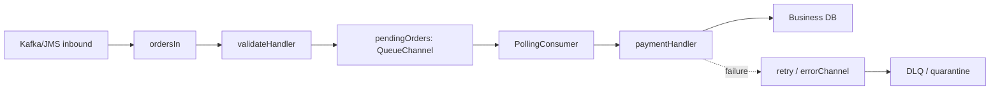
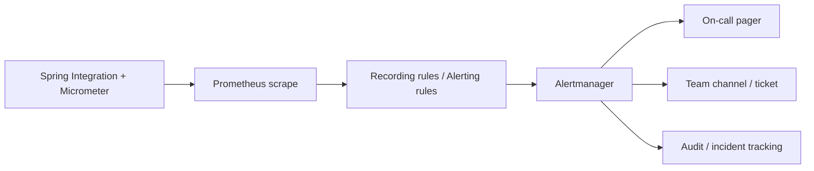

# Metrics, alert và ngưỡng lỗi khi vận hành Spring Integration

## 1. Mục tiêu và bối cảnh

Trong module **SPRING_INTEGRATION_RUNTIME**, các message flow được chạy qua channel, endpoint, consumer, poller và executor. Chúng có thể sử dụng transaction, retry, message store, correlation và error flow. Khi lưu lượng tăng hoặc downstream gặp lỗi, câu hỏi vận hành không còn chỉ là “code chạy đúng không?”, mà là:

- **Có bao nhiêu message được tiếp nhận, xử lý, retry, chuyển DLQ hoặc còn chờ?**
- **Luồng nào chậm, đang nghẽn tại channel, poller, executor, handler hay resource bên ngoài?**
- **Khi nào tình trạng đó đáng cảnh báo và khi nào nên đánh thức người trực hệ thống?**
- **Ngưỡng được chọn theo nhu cầu nghiệp vụ/SLO hay chỉ theo một con số tùy ý?**
- **Nếu metrics không xuất hiện thì flow khỏe mạnh, không có traffic hay monitoring bị hỏng?**

Chủ đề **“Metrics, alert và ngưỡng lỗi”** trong chương **Vận hành** giúp xây dựng quy trình từ đo lường → đặt ngưỡng → cảnh báo → điều tra → hành động → đánh giá lại ngưỡng.

Kết thúc bài, bạn có thể:

1. Chọn đúng **SLI/SLO** cho một flow Spring Integration, phân biệt *technical outcome* và *business outcome*.
2. Đọc direct Micrometer meters và Observation meters trong Spring Integration 6.x, không trộn tên/tag của hai chế độ.
3. Theo dõi throughput, failure ratio, handler latency, queue backlog, message age, retry, DLQ, poller progress và resource saturation.
4. Viết PromQL dùng `rate()`/`increase()`, dựng alert rules có `for`, ngưỡng số lượng mẫu, nhận diện zero traffic và missing series.
5. Thiết kế **multi-window multi-burn-rate alert** theo error budget của SLO, kèm cơ chế chống alert fatigue.
6. Xây runbook gắn với từng alert và chẩn đoán bằng `IntegrationGraphServer`, metrics, traces, logs, thread dump, store/broker.
7. Kiểm thử alert trên dữ liệu giả lập, rollback, retry storm, queue-full, endpoint stopped và restart.
8. Tránh tag cardinality cao, lộ dữ liệu nhạy cảm và tự động khắc phục gây mất message.

Ví dụ dùng Spring Integration **6.5.x**, Java 17+, Micrometer, Spring Boot Actuator 3.5.x, Prometheus và Alertmanager. Các chuỗi tên metric/label xuất bởi registry thực tế phải được kiểm tra vì phụ thuộc Micrometer exporter, naming convention, integration management config và phiên bản.

## 2. Bắt đầu từ business invariant, không từ dashboard

Một flow xử lý đơn hàng minh họa:



Nếu ứng dụng chỉ đo số lần `ordersIn.send()` thành công, dashboard vẫn có thể “xanh” khi payment handler đã ngừng hoạt động. Đo lường phải bám vào **kết quả mong muốn**:

> “99,9% các sự kiện đơn hàng hợp lệ được áp dụng vào business DB trong vòng 2 phút kể từ khi nhận, không tạo tác dụng phụ trùng, tính trên cửa sổ 30 ngày.”

Đây là **SLO ví dụ**, không phải SLA chung của Spring Integration. Để vận hành nó cần xác định:

- **Đơn vị đếm:** event ID duy nhất hay số lần delivery/retry?
- **Mẫu số:** những event hợp lệ được chấp nhận từ nguồn, không phải mọi lần poll rỗng.
- **Điều kiện thành công:** DB commit thành công và yêu cầu downstream bắt buộc hoàn tất.
- **Deadline:** 2 phút tính từ timestamp đáng tin cậy; phân biệt receive time và source event time.
- **Duplicate:** được tiếp nhận lại nhưng no-op idempotent có tính success hay không?
- **Đơn hàng lỗi nghiệp vụ hợp lệ:** ví dụ không đủ tiền là business rejection đúng quy trình, không nhất thiết lỗi availability.
- **Thời gian bảo trì và thiếu traffic:** có nằm trong SLO window không?
- **Nguồn dữ liệu:** metrics ephemeral, durable inbox/outbox, audit DB hay broker telemetry?

Nếu chưa có định nghĩa này, mọi “error rate 5%” chỉ là tỷ lệ kỹ thuật của một thao tác, chưa phải **business SLI**.

### Tầng đo cần tách riêng

| Tầng | Ví dụ | Có thể trả lời | Không tự trả lời |
|---|---|---|---|
| Channel send | `DirectChannel.send()`, enqueue | Send được accept hay exception? | Đơn hàng đã commit chưa? |
| Pollable receive | `QueueChannel.receive()` | Có nhận message hay không? | Handler đã hoàn thành chưa? |
| Handler | `ServiceActivator`, transformer | Invocation duration, exception | Task async đã kết thúc? |
| Poller/consumer | `PollingConsumer`, adapter | Source progress, scheduling, empty poll | Business event đã đúng một lần? |
| Message store | JDBC group/queue state | Backlog, oldest age, orphan | Remote side effect đã được commit? |
| Broker | Offset lag, redelivery, DLQ | Backlog và nguồn có cấp message? | Transaction DB đã commit? |
| Business | Order state, successful event IDs | Outcome thật, timeliness | Một tracing span kết thúc thế nào? |

Đường **data plane** xử lý messages; **control plane** bật/tắt flows, đăng ký endpoint và thay cấu hình. Cần đo cả hai, nhưng không dùng một loại metric thay thế loại kia.

## 3. Bộ SLI tối thiểu cho message-driven service

Với mỗi critical flow, ưu tiên một bộ nhỏ có định nghĩa chính xác.

| SLI | Công thức/nguồn | Ý nghĩa | Lỗi diễn giải |
|---|---|---|---|
| Business success ratio | Terminal success / terminal eligible outcomes | Tỷ lệ kết thúc đúng | Đếm từng attempt như event duy nhất |
| Timeliness ratio | Events hoàn tất trước deadline / events đến hạn | Đúng hạn | Chỉ đo handler latency, bỏ queue wait |
| Ingress rate | `rate(input events)` | Tải đến | Source ngừng phát khiến error rate thấp giả |
| Handler error rate | Failures / invocations | Lỗi kỹ thuật tại handler | Recovery biến exception thành result success |
| Queue depth | `queue.size`/store backlog | Mức tồn đọng | Depth=0 khi worker đang xử lý lâu |
| Oldest message age | Now − oldest uncompleted arrival | Có message bị kẹt bao lâu | Dùng average age che tail |
| Retry/redelivery rate | Attempts/retries/redeliveries | Bất ổn downstream | Coi retry là unique customer request |
| DLQ arrival & oldest age | Broker/DB quarantine | Công việc cần can thiệp | Alert mọi DLQ item vào ban đêm không xét severity |
| Poller no-progress | No completed work khi có input tồn | Consumer đứng hoặc blocked | Nhầm thời điểm không có event với outage |
| Resource saturation | Active/queued executor tasks, DB pool, locks | Hệ thống sắp nghẽn | Chỉ nhìn CPU khi nghẽn ở I/O/lock |

### Chọn “good event” và “bad event”

Trong payment flow, một payment **bị từ chối hợp lệ** theo quy tắc nghiệp vụ có thể là một **good processing event**: hệ thống đã trả kết quả đúng trong deadline. Một payment xử lý quá thời hạn hoặc tạo hai lần charge là bad event.

Do đó nên có hai metric tách biệt:

- **Technical:** handler attempts success/failure, network/DB exceptions, retries.
- **Business:** event completion đúng hạn, failed-to-process, duplicate-effect, compensation-required.

Không dùng mã HTTP 4xx, result `failure` của channel hoặc số lượng `ErrorMessage` để tự suy toàn bộ error budget nghiệp vụ.

## 4. Metrics có sẵn của Spring Integration: phải biết chế độ instrumentation

Spring Integration cung cấp Micrometer meters trực tiếp và Micrometer Observation. Hai cơ chế có thể dẫn tới **tên metric khác nhau**.

### 4.1. Direct Micrometer meters

Tài liệu Spring Integration 6.5 liệt kê:

| Metric name | Loại | Tags quan trọng | Đo điều gì? |
|---|---|---|---|
| `spring.integration.send` | `Timer` | `type=channel`, `name`, `result`, `exception` | Thời gian `channel.send` |
| `spring.integration.send` | `Timer` | `type=handler`, `name`, `result`, `exception` | Handler invocation |
| `spring.integration.receive` | `Counter` | `type=channel`, `name`, `result`, `exception` | Nhận tại pollable channel |
| `spring.integration.receive` | `Counter` | `type=source`, `name`, `result`, `exception` | Message source receive |
| `spring.integration.channel.queue.size` | `Gauge` | `type=channel`, `name` | Độ sâu `QueueChannel` được hỗ trợ |
| `spring.integration.channel.queue.remaining.capacity` | `Gauge` | `type=channel`, `name` | Sức chứa còn lại |
| `spring.integration.channels` | `Gauge` | metadata registry | Số channel |
| `spring.integration.handlers` | `Gauge` | metadata registry | Số handler |
| `spring.integration.sources` | `Gauge` | metadata registry | Số source |

**Cảnh báo quan trọng:** Trong direct mode, **handler Timer vẫn mang tên `spring.integration.send`**, khác bằng tag `type=handler`. Đừng nhầm `spring.integration.handler` là direct Timer.

Một channel `send` trả về thành công có thể chỉ nói rằng message **đã vào queue** hoặc **đã giao cho executor**, không phải business handler đã commit transaction.

`QueueChannel.receive()` là phép nhận từ channel; nó không phải Timer end-to-end latency. Một lần receive null/timeout và một lần nhận có dữ liệu cũng không được đánh đồng với kết quả business.

### 4.2. Micrometer Observation (Spring Integration 6.x)

Khi có `ObservationRegistry` và `@EnableIntegrationManagement` với `observationPatterns` phù hợp, framework có thể instrument components qua Observation API:

| Convention | Meter chính | Meter active | Low-cardinality keys |
|---|---|---|---|
| Producer/channel | `spring.integration.producer` | `spring.integration.producer.active` | `spring.integration.name`, `spring.integration.type=producer` |
| Handler | `spring.integration.handler` | `spring.integration.handler.active` | `spring.integration.name`, `spring.integration.type=handler` |
| Gateway | `spring.integration.gateway` | `spring.integration.gateway.active` | `spring.integration.name`, `spring.integration.type=gateway`, `spring.integration.outcome` |

`*.active` là long-task timer về những operation còn đang chạy; không phải số operation đã kết thúc. Ở handler convention mặc định, **không tự giả định có tag `result=failure`** giống direct mode.

Khi Observation được bật, meters có thể được sinh từ `ObservationHandler` thay vì bộ direct meters độc lập. Nếu dashboard đang dùng direct metrics, cần **di chuyển query** theo mode đã cấu hình; không cộng hai bộ series mù quáng.

### 4.3. Kiểm tra trên môi trường thật

Một số nguyên nhân phổ biến khiến panel trống:

- Chưa có `MeterRegistry` hoặc `ObservationRegistry` phù hợp.
- `@EnableIntegrationManagement`/`observationPatterns` không instrument component mong muốn.
- Component chưa xử lý message nào: meter có thể được đăng ký **lúc sử dụng đầu tiên**.
- `MeterFilter` lọc meter; exporter/prometheus endpoint chưa enabled.
- Tên component được framework auto-generated khác với tên dashboard kỳ vọng.
- Chuyển từ direct metrics sang Observation nhưng query chưa thay.

Đừng tạo alert trên một metric **chưa hề thấy xuất hiện từ runtime thật**. Khởi động test traffic, xem `MeterRegistry.getMeters()`, `/actuator/metrics` và raw `/actuator/prometheus` trước khi viết các expression.

## 5. Channel, handler, poller: ngưỡng nào có ý nghĩa?

### DirectChannel

`DirectChannel` thông thường dispatch consumer cùng caller thread. Timer send có thể **bao cả thời gian handler downstream**. Nếu `ordersIn.send` p95 là 800 ms, thủ phạm có thể là DB/HTTP call trong consumer, không nhất thiết channel infrastructure chậm.

**Alert hợp lý:** tăng latency send kèm handler latency, log/tracing, DB pool saturation. Không cộng send latency và handler latency thành một “request latency” vì chúng có thể **lồng nhau**.

### ExecutorChannel

`ExecutorChannel.send` có thể kết thúc khi task được giao cho worker. Một send Timer 2 ms không cho biết worker mất 8 giây xử lý.

**Alert hợp lý:** worker active count, executor queue saturation, completion rate, oldest uncompleted age; không lấy send latency làm E2E latency.

### QueueChannel và polling consumer

`QueueChannel.send` đo enqueue; `receive` đếm receive operation; backlog và độ tuổi chờ cần đo riêng. Poller có thể stopped, hết thread, blocking transaction hoặc retry backoff.

**Alert hợp lý:** backlog depth > threshold **đồng thời** oldest age cao hoặc completed-rate thấp, tránh cảnh báo vì một burst ngắn có thể tự giảm.

### Aggregator/Resequencer

Thời gian xử lý group có thể phụ thuộc các parts đến chưa đủ, `ReleaseStrategy`, `groupTimeout`, message group orphan, store transaction, expiry/reaper.

**Alert hợp lý:** oldest incomplete group, group count tăng, timed-out/discarded groups, release-to-business time. Chỉ đếm số message inbound không chứng minh aggregator đang hoạt động đúng.

### Error flow và retry

`RequestHandlerRetryAdvice` có thể gọi handler nhiều lần; recovery có thể trả bình thường sau khi publish `ErrorMessage`. Một retry storm làm `handler attempts/s` tăng nhưng **unique business events/s** không tăng.

**Alert hợp lý:** tỷ lệ retry/attempt, failed terminal operations, DLQ age và business error SLI. Không tính cùng một lỗi ở main handler, error channel và DLQ consumer thành ba business failures.

## 6. Từ số liệu đến ngưỡng: ba kiểu rule

### 6.1. Ngưỡng tuyệt đối

Ví dụ:

- `QueueChannel` size > 500 trong 10 phút.
- Oldest item > 120 giây.
- JVM heap usage > 85% và GC pause latency tăng.
- Không có một business completion nào trong 10 phút **khi hệ thống có backlog**.

Ưu điểm: dễ hiểu, phù hợp capacity và backlog. Hạn chế: queue capacity khác nhau, lưu lượng theo giờ khác nhau, burst ngắn dễ gây báo động giả.

### 6.2. Ngưỡng tỷ lệ

Ví dụ:

- Channel send failure / all channel sends > 5% trong 5 phút.
- Retried events / attempted events > 20%.
- Business terminal failure ratio > 0,5%.

Ưu điểm: so sánh tải khác nhau. Hạn chế: khi lưu lượng rất thấp, 1/2 lỗi = 50% không hẳn đáng page. Cần điều kiện **sample count tối thiểu** hoặc thiết kế low-traffic SLO.

### 6.3. Ngưỡng theo error budget/SLO

Nếu SLO success = 99,9% trong 30 ngày, error budget ratio:

```text
B = 1 − 0,999 = 0,001 = 0,1%

Burn rate = actual bad-event ratio / B
```

Ví dụ tỷ lệ bad events thực tế là 1,44%:

```text
Burn rate = 0,0144 / 0,001 = 14,4 lần
```

Burn rate 14,4 nghĩa là **đang tiêu error budget nhanh hơn 14,4 lần so với mức phân bổ đều trong SLO window**, không phải “14,4% event lỗi”.

Các cảnh báo **multi-window multi-burn-rate** thường dùng một cặp cửa sổ dài và ngắn để vừa nhận biết tác động kéo dài vừa xác nhận tình hình **vẫn đang xấu**:

| Mức | Cửa sổ dài | Cửa sổ ngắn | Burn rate | Với SLO 99,9%: bad ratio | Hành động ví dụ |
|---|---|---|---:|---:|---|
| Cao | 1 giờ | 5 phút | 14,4× | 1,44% | Page |
| Cao | 6 giờ | 30 phút | 6× | 0,6% | Page |
| Thấp hơn | 3 ngày | 6 giờ | 1× | 0,1% | Ticket/điều tra |

Đây là **ví dụ từ Google SRE Workbook cho SLO 99,9%/30 ngày**, không phải giá trị mặc định của Spring Integration. Với 99,95% hoặc low-traffic service, các tỷ lệ/ngưỡng cần tính và điều chỉnh lại.

### Alert nghiệp vụ khác alert cơ sở hạ tầng

- **Business SLO alert:** event không được hoàn tất đúng hạn hoặc terminal outcome không tốt.
- **Symptom alert:** oldest queue age cao và completion rate giảm.
- **Cause alert:** DB pool saturated, executor threads blocked, broker unreachable.

Nên page theo **symptom người dùng chịu ảnh hưởng**, còn root-cause alerts có thể route vào ticket/deduplicate. Nếu một database outage làm 20 handlers cùng báo lỗi, không cần 20 cuộc gọi paging riêng.

## 7. Thiết lập Spring Boot Actuator và Prometheus

Dự án Spring Boot có thể dùng dependencies:

```text
spring-boot-starter-integration
spring-boot-starter-actuator
micrometer-registry-prometheus
```

Phụ thuộc starter thực tế phải phù hợp các adapters đang dùng. Spring Boot BOM quản lý các version liên quan; đừng ép Spring Integration/Micrometer/Reactor khác major không tương thích.

Cấu hình minh họa:

```yaml
spring:
  application:
    name: orders-runtime

management:
  endpoints:
    web:
      exposure:
        include: health,info,metrics,prometheus
  metrics:
    tags:
      application: orders-runtime
    distribution:
      percentiles-histogram:
        spring.integration.handler: true
```

`spring.integration.handler` là tên Timer **Observation**; khi dùng direct mode, cần cân nhắc filter/metric name của **`spring.integration.send`** thay thế. Histogram làm tăng số series; chỉ bật cho các operation quan trọng và kiểm tra overhead.

**Bảo mật:** Chỉ expose Actuator endpoints qua management network/port và quyền thích hợp. Metrics tags, tên channel/topic/handler có thể tiết lộ kiến trúc nội bộ. Tránh cấu hình mọi endpoints công khai bằng `include: "*"`.

### Các lệnh xác minh

```bash
# Xem tên meter có thực sự tồn tại:
curl -s http://localhost:8080/actuator/metrics

# Direct mode:
curl -s "http://localhost:8080/actuator/metrics/spring.integration.send?tag=type:handler"
curl -s "http://localhost:8080/actuator/metrics/spring.integration.receive?tag=type:channel"

# Observation mode:
curl -s http://localhost:8080/actuator/metrics/spring.integration.producer
curl -s http://localhost:8080/actuator/metrics/spring.integration.handler

# Xem chính xác tên Prometheus series/labels:
curl -s http://localhost:8080/actuator/prometheus
```

Các URL trên là local demo mặc định; trong production management port/base-path, authentication và TLS có thể khác. Nếu nhận 404, kiểm tra dependency/exposure/mode/traffic trước, không tự coi 404 là lỗi flow.

## 8. PromQL: quy đổi Timer và Counter thành tín hiệu vận hành

Ví dụ Prometheus convention thường có:

```text
spring.integration.send (Micrometer Timer)
  → spring_integration_send_seconds_count
  → spring_integration_send_seconds_sum

spring.integration.receive (Counter)
  → spring_integration_receive_total

spring.integration.channel.queue.size (Gauge)
  → spring_integration_channel_queue_size

spring.integration.handler (Observation Timer)
  → spring_integration_handler_seconds_count
  → spring_integration_handler_seconds_sum
```

**Đây là quy ước ví dụ**; hậu tố `_total` và labels do Prometheus registry/Micrometer exporter quyết định. Phải xác minh raw exposition thay vì đoán.

### 8.1. Throughput: đếm số operation mỗi giây

```promql
# Channel send successful / second, tách theo channel:
sum by (job, name) (
  rate(
    spring_integration_send_seconds_count{
      type="channel",
      result="success"
    }[5m]
  )
)

# Pollable channel receive operations / second:
sum by (job, name, result) (
  rate(
    spring_integration_receive_total{
      type="channel"
    }[5m]
  )
)
```

`rate()` xử lý counter reset sau restart tốt hơn lấy chênh lệch mẫu tức thời, nhưng nó cần đủ mẫu trong cửa sổ. Đừng vẽ `spring_integration_send_seconds_count` thô làm “message/s”.

### 8.2. Channel error ratio (direct mode)

```promql
sum by (job, name) (
  rate(
    spring_integration_send_seconds_count{
      type="channel",
      result="failure"
    }[5m]
  )
)
/
clamp_min(
  sum by (job, name) (
    rate(
      spring_integration_send_seconds_count{
        type="channel"
      }[5m]
    )
  ),
  0.000001
)
```

Ý nghĩa: `failure send operations / all send operations` của cùng channel name/job. Giá trị 0,05 tương ứng 5%. **Không** diễn giải thành 5% business orders thất bại.

Lưu ý: nếu series failure **chưa từng được tạo**, biểu thức trên có thể không có kết quả dù thành công vẫn đang tăng. Có thể xây recording rule “zero-fill” ở tập channel đã biết, nhưng phải thiết kế vector matching cẩn thận. Tránh alert chỉ dựa vào ratio đó khi lỗi vắng series và không có zero initialization; test với cả **0 failures** và **có failure**.

### 8.3. Handler latency trung bình

Với Observation mode:

```promql
sum by (job, spring_integration_name) (
  rate(spring_integration_handler_seconds_sum[5m])
)
/
clamp_min(
  sum by (job, spring_integration_name) (
    rate(spring_integration_handler_seconds_count[5m])
  ),
  0.000001
)
```

Kết quả đơn vị thường là **giây**. Nếu không có traffic, denominator guard tạo giá trị ổn định về mặt tính toán nhưng không làm kết quả có ý nghĩa nghiệp vụ; dashboard nên phân biệt `no samples` với latency thấp.

### 8.4. p95/p99 với histogram

Chỉ khi đã bật histogram và exporter có buckets:

```promql
histogram_quantile(
  0.95,
  sum by (le, job, spring_integration_name) (
    rate(spring_integration_handler_seconds_bucket[5m])
  )
)
```

Không dùng `_max` như p95. Nếu không có `_bucket`, phải cấu hình histogram/distribution stats hoặc chọn phép đo phù hợp. Histogram aggregation có thể sai nếu gộp các bucket boundaries hay label sets không tương thích.

### 8.5. Queue capacity và backlog

```promql
# Queue depth của các QueueChannel được instrument:
max by (job, name) (
  spring_integration_channel_queue_size{type="channel"}
)

# Remaining capacity:
max by (job, name) (
  spring_integration_channel_queue_remaining_capacity{type="channel"}
)
```

Queue gauges thể hiện **local channel queue**; với JDBC queue, Kafka lag, broker DLQ hoặc outbox, cần metrics riêng. Nếu queue gauge bằng 0 nhưng consumer đã lấy message và đang block DB, latency đầu-cuối vẫn có thể rất cao.

**Capacity ratio** chỉ có ý nghĩa nếu queue có fixed positive capacity và có thể biết tổng capacity ổn định:

```text
occupancy = queue_size / (queue_size + remaining_capacity)
```

Không dùng công thức trên mù quáng với unbounded queue hoặc gauges không có ý nghĩa như một capacity hữu hạn.

## 9. Định nghĩa custom business metrics đúng ranh giới

Micrometer meters của Spring Integration **không chứng minh DB commit, broker ack hoặc remote side effect hoàn tất**. Đối với SLO, nên xuất một số metrics nghiệp vụ có contract rõ.

Ví dụ đề xuất:

| Metric | Type | Tags low-cardinality | Khi nào tăng/cập nhật? |
|---|---|---|---|
| `orders.processing.attempts` | Counter | `stage`, `result` | Một technical attempt hoàn thành |
| `orders.processing.terminal` | Counter | `outcome=success/failure`, `service` | Một event ID kết thúc thực sự theo policy |
| `orders.processing.duration` | Timer | `operation`, `outcome` | Toàn bộ processing duration mong muốn |
| `orders.inbox.pending` | Gauge | `service` | Số unique events chưa có terminal outcome |
| `orders.oldest.pending.age` | Gauge | `service` | Giây của event pending già nhất |
| `orders.dlq.items` | Gauge | `queue` | Số event đang chờ xử lý thủ công |
| `orders.last.success.timestamp` | Gauge | `service` | Unix seconds của business completion gần nhất |
| `orders.outbox.oldest.age` | Gauge | `topic` | Oldest undelivered business event |

Với exporter Prometheus, tên chuyển thành dạng `orders_processing_terminal_total`, `orders_oldest_pending_age_seconds`... nhưng cần kiểm tra naming rules và base unit của `Gauge`.

### 9.1. Ví dụ Java: technical attempts

```java
import io.micrometer.core.instrument.Counter;
import io.micrometer.core.instrument.MeterRegistry;
import io.micrometer.core.instrument.Timer;
import org.springframework.stereotype.Component;
import java.util.concurrent.TimeUnit;

@Component
public class PaymentAttemptMetrics {

    private final MeterRegistry registry;

    public PaymentAttemptMetrics(MeterRegistry registry) {
        this.registry = registry;
    }

    public <T> T recordAttempt(
            String operation,
            java.util.concurrent.Callable<T> action) throws Exception {

        long started = System.nanoTime();
        String result = "failure";

        try {
            T value = action.call();
            result = "success";
            return value;
        }
        finally {
            Counter.builder("orders.processing.attempts")
                    .tag("operation", operation)
                    .tag("result", result)
                    .register(registry)
                    .increment();

            Timer.builder("orders.processing.attempt.duration")
                    .tag("operation", operation)
                    .tag("result", result)
                    .register(registry)
                    .record(System.nanoTime() - started,
                            TimeUnit.NANOSECONDS);
        }
    }
}
```

Đoạn này **chỉ đo attempts**. Method `recordAttempt` không quyết định terminal business success và không biết một event sẽ retry sau đó hay không. `operation` phải là giá trị hữu hạn được cho phép, ví dụ `"charge"`, `"confirm"`, không phải order ID hay một URL tùy ý.

Cũng không nên đặt metrics update trong một transaction rồi coi counter sẽ tự rollback. Micrometer Counter nằm ngoài DB transaction; nếu DB rollback, counter đã tăng vẫn giữ nguyên. Với outcome **sau commit**, đo ở đúng lớp confirmation hoặc tính SLI từ durable records.

### 9.2. Business terminal outcome cần durable source of truth

Một cách đáng tin cậy hơn để tính số unique events thành công:

- Trong **cùng DB transaction**, cập nhật `orders` + `processed_event`/`inbox` + `outbox`.
- Sau commit, một worker/reconciler có thể phát metrics dựa trên durable rows.
- Hoặc metric counter ở tầng application chỉ là **near-real-time signal**; đối chiếu nó với bảng audit/outbox vì process có thể crash giữa commit và increment counter.

Một `@TransactionalEventListener(phase=AFTER_COMMIT)` giúp tránh ghi “success trước commit”, nhưng callback **không bền qua process crash**. Vì vậy không dùng một in-memory Counter để làm hệ thống sổ sách duy nhất cho SLO cần tính chính xác.

### 9.3. Tách duplicate khỏi failure

Ví dụ idempotency inbox phát hiện event `EV-12` đã commit và trả no-op thành công. Nếu callback nhận lại message rồi thấy duplicate, có thể tăng `orders.processing.attempts{result="duplicate"}`, nhưng **không** tăng thêm một `orders.processing.terminal{outcome="success"}` nếu terminal event đã được ghi từ lần đầu.

Quy tắc quan trọng: **một business event ID có tối đa một terminal outcome được đếm theo SLI định nghĩa**, dù số network deliveries lớn hơn một.

## 10. Prometheus recording rules: chỉ cảnh báo khi tín hiệu có ý nghĩa

Đối với hệ thống orders có một custom Counter `orders.processing.terminal` xuất Prometheus thành `orders_processing_terminal_total`, giả sử tag `outcome` chỉ chứa `success` và `failure`; có thể tính ratio từ các terminal events.

```promql
# Bad-event ratio 5 phút; kết quả là số 0..1.
sum by (service) (
  rate(orders_processing_terminal_total{outcome="failure"}[5m])
)
/
clamp_min(
  sum by (service) (
    rate(orders_processing_terminal_total{
      outcome=~"success|failure"
    }[5m])
  ),
  0.000000001
)
```

**Điểm cần sửa trong hệ thống ít lỗi:** failure series có thể không tồn tại trước lỗi đầu tiên. Do đó phải **khởi tạo trước các series success và failure** với tag sets ổn định, hoặc bổ sung phép gộp zero-fill có kiểm thử. Metric thiếu không thể coi mặc nhiên là tỷ lệ lỗi 0.

### Ví dụ Spring bean pre-register series

```java
@Bean
public ApplicationRunner registerBusinessOutcomeCounters(
        MeterRegistry registry) {

    return args -> {
        for (String outcome : java.util.List.of(
                "success", "failure")) {

            Counter.builder("orders.processing.terminal")
                    .tag("service", "orders")
                    .tag("outcome", outcome)
                    .register(registry);
        }
    };
}
```

Đoạn trên cần import `@Bean`, `ApplicationRunner`, `Counter` và `MeterRegistry`. Nó tạo series có cardinality cố định. Nó **không** sinh terminal events giả; Count ban đầu là 0. Nếu bạn dùng nhiều services, pre-register cho mỗi service label có số lượng hữu hạn.

### Recording rules minh họa

```yaml
groups:
  - name: orders-sli-recording
    interval: 30s
    rules:
      - record: orders:terminal_bad_ratio:5m
        expr: |
          sum by (service) (
            rate(orders_processing_terminal_total{outcome="failure"}[5m])
          )
          /
          clamp_min(
            sum by (service) (
              rate(orders_processing_terminal_total{
                outcome=~"success|failure"
              }[5m])
            ),
            1e-9
          )

      - record: orders:terminal_bad_ratio:1h
        expr: |
          sum by (service) (
            rate(orders_processing_terminal_total{outcome="failure"}[1h])
          )
          /
          clamp_min(
            sum by (service) (
              rate(orders_processing_terminal_total{
                outcome=~"success|failure"
              }[1h])
            ),
            1e-9
          )

      - record: orders:terminal_bad_ratio:30m
        expr: |
          sum by (service) (
            rate(orders_processing_terminal_total{outcome="failure"}[30m])
          )
          /
          clamp_min(
            sum by (service) (
              rate(orders_processing_terminal_total{
                outcome=~"success|failure"
              }[30m])
            ),
            1e-9
          )

      - record: orders:terminal_bad_ratio:6h
        expr: |
          sum by (service) (
            rate(orders_processing_terminal_total{outcome="failure"}[6h])
          )
          /
          clamp_min(
            sum by (service) (
              rate(orders_processing_terminal_total{
                outcome=~"success|failure"
              }[6h])
            ),
            1e-9
          )
```

Tập rules này phù hợp với **SLO business terminal failure ratio** khi service tương đối nhiều traffic. Nó chưa đo **timeliness** hoặc các pending events chưa terminal — một event treo vô hạn không làm terminal bad ratio tăng! Do đó phải có thêm alert về queue age, deadline missed và no-progress.

**Lưu ý khi vận hành:** Recording rule series thiếu hoặc tạm ngắt vì Prometheus scrape outage cần được kiểm tra riêng. Mọi biểu thức `rate` với cửa sổ dài có độ trễ xác định; cần đủ retention. SLO có ít traffic cần các chính sách riêng dựa trên **số sự kiện**, heartbeat hoặc synthetic probe, không chỉ áp dụng tỷ lệ phần trăm.

## 11. Multi-window multi-burn-rate alert cho SLO 99,9%

Với 99,9% SLO, error budget ratio = `0.001`. Những lựa chọn tham khảo từ Google SRE:

- Page nhanh nếu burn rate > `14.4` **trong cả** 1h và 5m.
- Page khi burn rate > `6` **trong cả** 6h và 30m.
- Ticket chậm hơn nếu burn rate > `1` trong cả 3d và 6h.

### Alert rule sử dụng recording series

```yaml
groups:
  - name: orders-error-budget
    interval: 30s
    rules:
      - alert: OrdersErrorBudgetFastBurn
        expr: |
          (
            orders:terminal_bad_ratio:1h{service="orders"} > 0.0144
            and on(service)
            orders:terminal_bad_ratio:5m{service="orders"} > 0.0144
          )
          or
          (
            orders:terminal_bad_ratio:6h{service="orders"} > 0.006
            and on(service)
            orders:terminal_bad_ratio:30m{service="orders"} > 0.006
          )
        for: 2m
        labels:
          severity: page
          team: integration-ops
          service: orders
        annotations:
          summary: "Business terminal failure đang tiêu error budget nhanh"
          description: "Kiểm tra lỗi business terminal, nguồn lỗi và DLQ."
          runbook_url: "https://runbooks.example.invalid/orders-error-budget"
```

YAML trên là **rule minh họa**, không tự kết nối Alertmanager và không thay quy định severity của tổ chức. `for: 2m` có thể giảm alert chớp nhoáng nhưng cũng kéo dài thời gian phát hiện; phải đo **MTTD** sau triển khai.

**Lưu ý về label:** `and on(service)` là vector matching giữ các sample tương ứng cùng `service`; ứng dụng nên bảo đảm recording rule output chỉ có đúng các labels cần thiết. Nếu cả stage, environment hoặc cluster cùng dùng service name, hãy phân tách SLI theo deployment/environment trước khi dùng alert cho production, tránh tổng hợp staging và production.

### Sai lầm thường gặp trong burn-rate alerts

- Nhầm 14,4× với “14,4% error rate”; ngưỡng với SLO 99,9% là **1,44%**.
- Chỉ nhìn cửa sổ 1h: có thể còn alert sau khi lỗi đã dứt; cửa sổ 5m giúp xác nhận hiện tại.
- Không có metric failure khi chưa từng lỗi: vector rỗng có thể khiến alert không phát.
- Không có terminal events khi consumer dừng: failure ratio trở thành 0/0 hoặc vắng series trong khi người dùng bị ảnh hưởng.
- Cộng retry attempts vào denominator thay vì unique business terminal outcomes.
- Page khi chỉ có một event fail ở service xử lý 1 event/ngày; low-traffic cần chính sách khác.
- Không xử lý sự phụ thuộc giữa alerts, khiến 3 rule của cùng outage cùng paging nhiều lần.

## 12. Cảnh báo backlog, tuổi message và no-progress

Tỷ lệ lỗi chỉ đo các operation đã kết thúc. Một queue tích tụ khiến **sự kiện chưa terminal** không xuất hiện trong mẫu số SLI terminal outcome.

### 12.1. Queue size ngưỡng cố định

Ví dụ cho một queue capacity được tính toán trước:

```yaml
groups:
  - name: orders-backlog
    rules:
      - alert: OrdersQueueBacklogSustained
        expr: |
          max by (job, name) (
            spring_integration_channel_queue_size{
              type="channel",
              name="pendingOrders"
            }
          ) > 500
        for: 10m
        labels:
          severity: warning
          team: integration-ops
        annotations:
          summary: "Queue pendingOrders tồn đọng trên 500 messages"
          description: "Kiểm tra poller, worker, retries và thời gian giữ queue."
```

Ngưỡng `500` chỉ hợp lý khi dựa trên capacity, arrival rate, service rate và deadline; không phải mặc định cho mọi `QueueChannel`. Nếu pendingOrders là JDBC channel không xuất gauge này, hãy lấy số liệu từ message store/DB hoặc custom gauge phù hợp, không coi absence là queue depth 0.

### 12.2. Oldest pending age quan trọng hơn depth khi traffic biến động

Giả sử việc xử lý phải hoàn tất dưới 2 phút, một message đã chờ 3 phút là tín hiệu xấu dù queue size chỉ 1.

```text
oldest_pending_age_seconds
    = now - min(accepted_at của unique event chưa terminal)
```

Đo tuổi oldest từ nguồn durable (inbox, queue store, broker timestamp đáng tin) và xem cả in-flight state. Không dùng `System.currentTimeMillis()` của hai JVM lệch giờ để đưa ra phán đoán tuyệt đối nếu không có đồng bộ clock.

Ví dụ Prometheus custom gauge:

```promql
orders_oldest_pending_age_seconds{service="orders"} > 120
```

Nên kết hợp `for: 2m` hoặc ngưỡng theo SLO. Nếu delay xảy ra ở broker trước khi vào app, một app-local gauge từ thời điểm receive có thể đánh giá thiếu latency E2E; dùng event acceptance timestamp rõ nguồn.

### 12.3. No-progress khi có backlog

```text
Backlog > 0
AND
completed business events không tăng trong 10 phút
AND
service hiện được kỳ vọng chạy
=> consumer/poller có thể không tiến triển
```

Đây là một **điều kiện tổ hợp** cần có gauges/series đã khởi tạo đúng. `No traffic` không phải `no progress` nếu không có message chờ. Mẫu PromQL phải xử lý missing series từ cold start và scrape outage riêng.

Ví dụ nếu service liên tục cập nhật `orders_last_success_timestamp_seconds` (Unix seconds), có thể kiểm tra:

```promql
(
  orders_oldest_pending_age_seconds{service="orders"} > 600
)
and on(service)
(
  time() - orders_last_success_timestamp_seconds{service="orders"} > 600
)
```

Metric last-success phải được khởi tạo có chủ đích; nếu service chưa xử lý event nào sau deploy, không được đưa giá trị timestamp “bây giờ” rồi coi đó là lần xử lý thành công. Có thể thay bằng success counter + no-progress recording rule có kiểm soát.

## 13. Thiết lập alert ratio kỹ thuật có ngưỡng số lượng mẫu

Một alert kiểu “channel failure ratio > 5%” trên một channel có 2 operations trong 5 phút có thể gây nhiễu. Nên thêm **sample count gate**.

Dựa vào `spring_integration_send_seconds_count`:

```promql
(
  sum by (job, name) (
    rate(
      spring_integration_send_seconds_count{
        type="channel",
        result="failure"
      }[5m]
    )
  )
  /
  clamp_min(
    sum by (job, name) (
      rate(
        spring_integration_send_seconds_count{
          type="channel"
        }[5m]
      )
    ),
    1e-9
  )
  > 0.05
)
and on(job, name)
(
  sum by (job, name) (
    increase(
      spring_integration_send_seconds_count{
        type="channel"
      }[5m]
    )
  ) >= 100
)
```

Điều kiện thêm: ít nhất 100 send operations trong 5 phút. **100 là tham số minh họa**; điều chỉnh theo lưu lượng và tác động khách hàng. Khi failure series vắng, biểu thức có thể không có output; cần xác minh hành vi “không lỗi”, “một lỗi”, “target down” và “series missing” trước khi đưa vào trực.

Không đặt cùng severity cho mọi channel. Failure ở channel debug/optional có thể chỉ cần ticket; failure ở inbound payment acceptance có thể cần page nếu SLO bị ảnh hưởng.

## 14. Missing data, low traffic và silent failure

Một trong những lỗi monitoring nghiêm trọng nhất là **không có series nên dashboard trống nhưng được hiểu là zero errors**.

| Trạng thái | Ví dụ | Phản ứng phù hợp |
|---|---|---|
| Traffic thực sự bằng 0 | Dịch vụ batch chỉ nhận event một lần/ngày | Không alert no-events ngoài lịch dự kiến |
| Không có failure series | Chưa từng có lỗi nên meter chưa đăng ký | Pre-register bounded outcome series hoặc zero-fill |
| Scrape target down | `up==0` | Hạ tầng monitoring alert, không suy business failure từ metric trống |
| Target biến mất khỏi service discovery | Pod đã bị xóa hoặc registry lỗi | Kiểm tra expected replicas/availability ở control plane |
| Producer ngừng phát | Không có input, nhưng có traffic dự kiến | Synthetic heartbeat/source freshness alert |
| Consumer ngừng poll | Backlog tăng hoặc oldest age cao | No-progress/queue-age alert |
| App start lại | Counter reset, uptime ngắn | Dùng `rate()`/`increase()`, xem restart indicators |
| Thay tên component | Old series hết, new series chưa được dashboard cập nhật | Nên có naming policy và metrics smoke test |
| Alert không được evaluate | Prometheus rule lỗi hoặc scrape timeout | Alerting pipeline health, `promtool`/rule tests |

### Monitor chính hệ thống giám sát

Chỉ đo `up==0` chưa đủ: khi target biến mất hoàn toàn khỏi service discovery, series `up` có thể **không còn**. Cần giám sát số expected targets/replicas, Prometheus/Alertmanager health, `scrape_samples_scraped`, notification delivery, và một alert “dead man's switch”/watchdog nếu hạ tầng yêu cầu.

### Chế độ traffic thấp

Service nhận 5 messages/ngày có thể có business failure ratio 20% khi 1 event thất bại, nhưng không nên tự động page theo một ngưỡng thiết kế cho service xử lý 1 triệu events/ngày. Có thể:

- Dùng **deadline missed** cho từng critical event thay vì một tỷ lệ 5 phút.
- Áp dụng ticket và retry/reconciliation nếu ảnh hưởng có thể xử lý trong giờ hành chính.
- Page theo “không có completion trong cửa sổ batch bắt buộc” hoặc tác động trực tiếp lên customer.
- Gắn minimum volume gate cho các ratio alerts, nhưng không để gate che một event đơn lẻ có giá trị cao (ví dụ thanh toán lớn).
- Dùng synthetic transaction hoặc canary event nếu nguồn có một hành vi thường xuyên kiểm tra được.

## 15. Alertmanager: phân nhóm, chống trùng và định tuyến

Prometheus **đánh giá điều kiện**, còn **Alertmanager** thường đảm nhiệm nhóm thông báo, route, inhibition và silences.



### Mức severity có mục đích

| Mức | Khi nào | Kênh ví dụ | Yêu cầu |
|---|---|---|---|
| `critical/page` | Mất SLO/không phục vụ, cần can thiệp ngay | On-call pager | Có runbook và action cụ thể |
| `warning` | Xu hướng backlog, DLQ hoặc retry tăng, chưa cấp cứu | Team channel | Có owner và thời hạn xử lý |
| `ticket` | Burn chậm, cleanup/optimization | Ticket backlog | Không đánh thức trực đêm |
| `info` | Deploy, restarts, scale-up | Dashboard/log | Không tự động page |

Đừng dùng `critical` chỉ vì HTTP 500 xuất hiện một lần nếu retry đã thành công và không có business impact.

### Alertmanager route ví dụ

```yaml
route:
  receiver: integration-team
  group_by: ['alertname', 'service', 'environment']
  group_wait: 30s
  group_interval: 5m
  repeat_interval: 4h
  routes:
    - matchers:
        - severity="page"
      receiver: oncall

receivers:
  - name: integration-team
    webhook_configs:
      - url: https://alerts.example.invalid/team

  - name: oncall
    webhook_configs:
      - url: https://alerts.example.invalid/oncall
```

Các URL `example.invalid` là placeholder, không phải webhook đang hoạt động. Tích hợp thực tế phải dùng endpoint do tổ chức cấp, có xác thực/bảo mật, timeout/retry phù hợp.

**Phân nhóm và inhibit:** Nếu một DB outage khiến hàng chục handlers lỗi, có thể group theo `service`/`environment` rồi inhibit root-cause alarms không cần thiết. Nhưng đừng inhibit alert **mất dữ liệu/duplicate charge** chỉ vì một alert hạ tầng đang firing — nó có thể cần phản ứng độc lập.

### Silences và maintenance

- Silence dựa trên labels có phạm vi/cửa sổ rõ ràng.
- Không silence mọi `severity=page` của toàn cluster trong một deploy nhỏ.
- Audit người tạo silence, lý do và expiry.
- Theo dõi alerts bị silence trong incident review.
- Đừng dùng silence để che một alert sai mãi mãi; phải sửa signal/ngưỡng.

## 16. Từ alert đến runbook có thể thực hiện

Một alert không có hành động có thể là **dashboard indicator**, không nhất thiết nên page.

### Runbook mẫu: OrdersQueueBacklogSustained

**Trigger:** `pendingOrders` queue depth > 500 trong 10 phút và/hoặc oldest age vượt deadline đã thống nhất.

**Mục tiêu:** khôi phục tiến độ xử lý mà không mất message, không tạo duplicate side effects.

1. **Xác minh alert:** metric có dữ liệu mới? Scrape target đang up? Component name/instance/environment đúng không?
2. **Đánh giá tác động:** bao nhiêu unique orders chậm, oldest age, tỷ lệ deadline missed, queue capacity và customer impact?
3. **Tìm điểm nghẽn:** ingress rate so với completion/receive rate; poller `isRunning()`; worker executor active/queue size; DB pool/locks; network timeouts; retry backoff.
4. **Đọc topology:** dùng `IntegrationGraphServer.getGraph()` hoặc `rebuild()` sau dynamic registration, xem các channel/endpoint/links. Graph có link không bảo đảm handler đang chạy.
5. **Đọc error path:** `errorChannel`, recovery callback, DLQ, exception type, attempts; tránh coi một failed send là unique order failure.
6. **Kiểm tra transaction/ack:** message đã dequeue nhưng DB rollback? Broker đang redeliver? Consumer có idempotency key không?
7. **Chọn hành động an toàn:** phục hồi downstream, tăng workers trong giới hạn DB, giải quyết hot key, restart poller theo thủ tục, backpressure producer hoặc tạm dừng intake.
8. **Xác nhận tiến bộ:** oldest age và backlog giảm, business completions tăng, không tăng DLQ/duplicates.
9. **Ghi nhận:** timeline, dashboards/screenshots, root cause giả thuyết/đã xác minh, remediation và kế hoạch phòng ngừa.

### Không tự động “sửa” bằng thao tác nguy hiểm

Những hành động có nguy cơ làm mất/nhân đôi business events:

- Xóa toàn bộ queue/JDBC message store để “hết backlog”.
- Reset Kafka offsets không có kế hoạch replay/idempotency.
- Gọi `IntegrationFlowRegistration.destroy()` khi vẫn còn messages đang xử lý.
- Tăng polling concurrency quá mức làm nghẽn DB và tạo duplicate race.
- Đổi `groupTimeout`/xóa incomplete message groups tùy tiện.
- Bật retry không giới hạn khi remote service đã quá tải.
- Bỏ unique constraint hoặc lock để tăng throughput.

Automation tốt cần guardrails: xác minh nguyên nhân, giới hạn số lần, canary, rollback, audit và owner. Khi không có bảo đảm an toàn, ưu tiên thông báo và hướng dẫn operator thay vì hành động tự động.

## 17. Chẩn đoán hệ thống chậm mà không tăng error rate

Một flow có thể “thành công” tất cả kỹ thuật nhưng vẫn vi phạm deadline:

```text
Input = 200 message/s
Business completions = 130 message/s
Chênh lệch = +70 message/s backlog

Sau 60 giây, backlog tăng khoảng 4.200 messages
(nếu không có drop/backpressure/in-flight thay đổi)
```

Đây không phải lỗi code ném exception. SLI về timeliness và backlog là thứ phát hiện sớm.

### So sánh throughput với capacity

Đơn giản hóa:

```text
λ = average ingress rate (messages/s)
μ = average completed throughput (messages/s)

Nếu λ > μ trong thời gian dài:
   backlog có xu hướng tăng.

Nếu λ ≈ μ:
   những burst vẫn có thể làm backlog spike.
```

Điều kiện ổn định dài hạn cần throughput phục vụ > arrival rate khi có buffer, nhưng không phải chỉ tăng thread là giải quyết: remote DB/HTTP và locks có thể là bottleneck thật.

### Sử dụng Little's Law đúng phạm vi

```text
L ≈ λ × W
```

Trong trạng thái tương đối ổn định, `L` là số công việc **trong hệ**, `λ` là throughput và `W` là thời gian **trong hệ**. Đừng dùng Little's Law một cách cứng nhắc cho queue đang tăng không ổn định hoặc service time distribution cực lệch. Nếu cần đo queue waiting time, hãy gắn timestamp và đo tại dequeue/terminal completion bằng công cụ phù hợp.

### Chỉ số saturation cho executor

Với `ExecutorChannel`/poller:

- Active threads / max pool.
- Tasks queued và queue capacity.
- Rejected task count.
- Thread blocked/waiting (DB lock, `ReentrantLock`, HTTP).
- Duration trong retry backoff.
- Pool thread leak và shutdown state.

Một metric `spring.integration.send` thấp không loại trừ executor đang bão hòa, vì nó có thể chỉ đo submit task. Ngược lại, `DirectChannel.send` cao có thể bao downstream blocking.

## 18. Theo dõi correlation, persistent state và restart

### Aggregator và orphaned groups

Một aggregator có group 2/3 parts chờ mãi có thể không sinh handler error. Alert nên đo:

- Số incomplete groups theo store.
- Tuổi group già nhất; phân biệt last modified và group creation.
- Số groups timeout/force-complete/discard.
- Tốc độ release group so với input groups.
- Message store database health, lock contention và cleanup/reaper status.

Khi persistent `MessageGroupStore` ở nhiều pods, cần shared lock/ownership/DB consistency; `DefaultLockRegistry` local không điều phối JVM khác. Không xóa group khi oldest age vượt ngưỡng mà chưa có nghiệp vụ partial-release/discard/retry.

### Restart và data durability

Counter trong process có thể reset sau restart. Nhưng message store/inbox/outbox records được persisted có thể tồn tại. Để đánh giá recovery:

1. Sau restart, kiểm tra số pending messages trong store/broker, oldest age.
2. Kiểm tra số group chưa complete và reaper/timeout scheduling.
3. Kiểm tra outbound outbox chưa gửi; dispatcher có đang chạy không.
4. Đối chiếu business terminal event IDs với durable audit.
5. Xác nhận không có missing segment do checkpoint/offset đã commit quá sớm.

**Đừng dùng aggregate counter reset** làm bằng chứng message bị mất. Counter có thể reset do pod mới, Prometheus target label đổi hoặc registry restart.

## 19. Context propagation, tracing và high-cardinality tags

Metrics nên có **low-cardinality tags**, còn truy vết một message cụ thể dùng logs/traces và correlation IDs.

### Nên dùng

| Metric tag | Ví dụ | Giới hạn nên đặt |
|---|---|---|
| `application` | `orders-runtime` | Tập bounded |
| `environment` | `prod`, `staging` | Tập bounded |
| `service` | `orders`, `billing` | Tập bounded |
| `name`/`spring.integration.name` | `paymentHandler` | Endpoint names ổn định |
| `result`/`outcome` | `success`, `failure` | Tập nhỏ |
| `exception` | `TimeoutException` | Theo dõi sự gia tăng custom types |
| `region` | `ap-southeast-1` | Tập bounded |
| `topic` | `orders-events` | Tập topic có hạn |

### Không nên dùng

- `messageId`, `orderId`, `correlationId` của từng event.
- Customer email/phone, JWT, PII hoặc raw payload.
- Stack trace hoặc exception message nguyên văn.
- Dynamic route name được tạo mới cho từng request.
- User ID/tenant ID không giới hạn.

Ví dụ 100 handlers × 3 outcomes × 10 exception types × 1.000 tenants = **3.000.000 tag combinations** trước khi thêm instance/region/histogram bucket. Dù chỉ vài phần trăm hiện hữu, đây vẫn là rủi ro memory/ingestion cost đáng kể.

### Tracing không thay SLO, SLO không thay tracing

Một trace cho biết message nào đi qua endpoint nào và spent time ở đâu. SLO cần số liệu tổng hợp, có định nghĩa mẫu số và chính sách retention. Log/tracing sampling có thể bỏ sót một số events; không coi sampled traces như toàn bộ denominator kinh doanh nếu không có phép hiệu chỉnh.

Với reactive execution, ThreadLocal/MDC không tự đi theo subscriber/thread mới. Dùng Reactor Context/`REACTOR_CONTEXT` header/Micrometer Context Propagation phù hợp nếu cần trace continuity, và kiểm tra header mapping qua broker/adapter. Không serialize nguyên `ContextView` vào persistent message store chỉ để có trace IDs.

## 20. Kiểm thử metrics và alert trước khi phát cho on-call

### 20.1. Smoke test Spring Integration meter registration

```java
import static org.assertj.core.api.Assertions.assertThat;

import io.micrometer.core.instrument.MeterRegistry;
import org.junit.jupiter.api.Test;
import org.springframework.beans.factory.annotation.Autowired;
import org.springframework.beans.factory.annotation.Qualifier;
import org.springframework.integration.channel.QueueChannel;
import org.springframework.messaging.MessageChannel;
import org.springframework.messaging.support.GenericMessage;
import org.springframework.test.context.junit.jupiter.SpringJUnitConfig;

@SpringJUnitConfig(OrdersMetricsFixture.class)
class OrdersRuntimeMetricsTest {

    @Autowired
    @Qualifier("ordersIn")
    MessageChannel input;

    @Autowired
    @Qualifier("ordersOut")
    QueueChannel output;

    @Autowired
    MeterRegistry registry;

    @Test
    void directMetersAppearAfterTraffic() {
        assertThat(input.send(new GenericMessage<>("ORD-1")))
                .isTrue();

        assertThat(output.receive(1_000)).isNotNull();

        var sendTimers = registry.find("spring.integration.send")
                .tags("type", "channel", "name", "ordersIn")
                .timers();

        assertThat(sendTimers)
                .anyMatch(timer -> timer.count() >= 1);
    }
}
```

`OrdersMetricsFixture` là fixture Spring cần tự tạo với `@EnableIntegration`, `@EnableIntegrationManagement`, `SimpleMeterRegistry`, channel `ordersIn`, `QueueChannel ordersOut` và handler nối chúng; đoạn trên là **class test minh họa**, không phải dự án tự biên dịch độc lập.

Test cho **direct metrics mode**. Nếu project dùng Observation mode, cần assert `spring.integration.producer`/`spring.integration.handler` và `spring.integration.name` key thay vì direct meter.

### 20.2. Kiểm thử Prometheus rules

Trước khi áp dụng rule vào production:

1. Dùng `promtool check rules <file>` để kiểm tra syntax.
2. Dùng `promtool test rules <testfile>` với dữ liệu mẫu cho mỗi scenario.
3. Xác nhận alert ở trạng thái **inactive → pending → firing** theo `for`.
4. Xác nhận **resolution** khi lỗi dứt, đặc biệt ở multi-window burn.
5. Test metric missing, target down, 0 traffic, low traffic, counter reset, high traffic.
6. Test labels `service`/`environment`/`instance` không merge nhầm deployment.
7. Kiểm tra Alertmanager grouping, inhibition, silence, routing, receiver thật và notification delivery.
8. Dùng canary/non-page receiver trước khi kích hoạt paging.

**Ví dụ test matrix:**

| Case | Tín hiệu | Expected |
|---|---|---|
| Healthy | 0 bad events, đủ traffic | Không page |
| Brief burst | 10% errors trong 1 phút rồi hồi phục | Không page nếu policy yêu cầu sustained impact |
| Sustained high errors | 2% errors trong 20 phút, đủ traffic | Có thể page theo burn-rate phù hợp |
| Slow burn | 0,2% kéo dài nhiều ngày | Ticket/điều tra theo SLO |
| Queue backlog spike | >500 trong 1 phút rồi tự giảm | Không page do `for:10m` |
| Long backlog | >500 trong 15 phút | Cảnh báo backlog |
| No traffic expected | Không messages trong giờ nghỉ | Không báo consumer outage vô căn cứ |
| Traffic expected but no progress | Pending age tăng, completion ngừng | Alert no-progress |
| Missing failure meter | Success series có, failure chưa được tạo | Rule vẫn nhận healthy state đúng |
| Monitoring down | Scrape targets/Prometheus bị lỗi | Monitoring-health alert riêng |
| Restart | Counters reset, state persisted còn | Không báo “traffic âm”/mất dữ liệu giả |
| Duplicate redelivery | Nhiều attempts, một unique business outcome | Attempt metric tăng, terminal unique vẫn một |

### 20.3. Kiểm thử runbook và alert hygiene

Một quy tắc hay về mặt toán học có thể là alert tệ nếu người trực không biết làm gì. Mỗi alert cần:

- Owner/primary on-call, backup và escalation path.
- Severity rõ ràng.
- Một câu mô tả symptom + phạm vi tác động.
- Dashboard link, query và runbook URL.
- Expected first response: kiểm tra gì trong 5 phút?
- Safe recovery actions và actions **không được làm**.
- Post-incident review: false positive, false negative, MTTD, MTTA, MTTR, pages per week.

Định kỳ xem lại ngưỡng theo traffic/capacity mới; một queue size threshold đúng ở 10 messages/s có thể vô nghĩa khi đã tăng lên 2.000 messages/s.

## 21. Ví dụ điều tra: handler timeout, queue tăng nhưng send vẫn success

**Bối cảnh:** `ordersIn → QueueChannel → poller → paymentHandler → HTTP API`.

```text
09:00 Ingress 120 msg/s; business completion 115 msg/s
09:05 Remote payment API tăng latency p95: 200 ms → 4 s
09:06 Handler threads gần cạn
09:07 Queue backlog bắt đầu tăng
09:09 Channel send vẫn báo success cho nhiều messages
09:10 Oldest pending age vượt deadline 120 s
09:12 Một số requests vào DLQ sau retry exhaustion
```

### Tín hiệu nào phát hiện sớm?

| Tín hiệu | Trạng thái | Diễn giải |
|---|---|---|
| Channel `send{result=success}` | Vẫn cao | Chỉ phản ánh enqueue/accept |
| Handler latency p95 | Tăng mạnh | Remote API chậm hoặc lock/DB |
| Executor active/queued | Gần saturation | Worker pool nghẽn |
| Queue oldest age | >120 s | SLO về timeliness bị tác động |
| Retry attempts | Tăng | Remote timeout/retry |
| DLQ items | Bắt đầu tăng | Có terminal failures |
| Business completions | Giảm | Người dùng chờ lâu |

Một alert chỉ dựa vào channel send failure sẽ **bỏ lỡ** vấn đề cho tới khi queue đầy. Alert **oldest pending age** hoặc **multi-window business SLO burn** thường có tín hiệu sát tác động hơn.

### Runbook an toàn

1. Xác nhận API downstream chậm qua tracing/HTTP client timing.
2. Kiểm tra retry backoff; nếu quá nhiều retries đang đè thêm tải, áp dụng retry budget/circuit breaker đã thiết kế.
3. Nếu cần tạm giảm ingress, dùng backpressure hoặc source pause theo giao thức không gây mất ack.
4. Không scale consumer vượt connection pool hoặc throughput thực của downstream.
5. Sau hồi phục, đo backlog-drain rate và số orders quá deadline.
6. Kiểm tra outbox/inbox/idempotency để bảo đảm retries không tạo double charge.
7. Điều chỉnh alert nếu phát hiện muộn và thêm capacity tests.

## 22. Ví dụ điều tra: không có failure ratio nhưng customer khiếu nại

**Triệu chứng:** `spring.integration.send` và handler Timer phần lớn thành công, nhưng khách hàng báo “đơn hàng đã nhận mà không cập nhật”.

Khả năng:

- Poller ngừng; không có receive/handler invocations mới, **failure rate không tăng**.
- `QueueChannel` đã nhận message, nhưng chưa có consumer.
- Recovery callback chuyển lỗi vào error channel rồi trả bình thường.
- DB transaction commit thất bại **sau** handler operation đã được instrument.
- Broker ack trước DB commit làm mất event.
- Aggregator group chưa đủ parts, không release.
- Producer ngừng xuất message hoặc source checkpoint sai.
- Event đã commit nhưng downstream outbox chưa dispatch.

### Điều tra theo bước

1. So sánh durable ingress count với terminal business records.
2. Kiểm tra event IDs chưa terminal và oldest pending age.
3. Xem lifecycle poller/endpoint `isRunning()` và `IntegrationGraphServer`.
4. Kiểm tra message group store, transaction, retry, DLQ/outbox state.
5. Dùng correlation/traces để phân biệt message chưa nhận, đang chờ và đã fail.
6. Tạo minimal reproducible flow/testcase giữ đúng thread/poller/transaction boundary.

**Kết luận:** Error rate là một SLI quan trọng nhưng **không thể thay thế timeliness, liveness và durability indicators**.

## 23. Checklist triển khai production

- [ ] Có business SLI/SLO rõ: event nào hợp lệ, thành công là gì, deadline bao lâu, cửa sổ quan sát nào.
- [ ] Tách attempts, deliveries, retry, terminal outcomes và unique events.
- [ ] Chọn direct Micrometer meters hoặc Observation và dùng đúng tên/tags của từng mode.
- [ ] Đã xác minh raw `/actuator/prometheus` trước khi viết dashboards/alerts.
- [ ] Channel send và handler duration được hiểu theo Direct/Executor/QueueChannel boundaries.
- [ ] Có backlog size và **oldest pending age**, không chỉ send success rate.
- [ ] Poller/consumer liveness có signal khi nguồn có traffic/backlog kỳ vọng.
- [ ] Có metrics cho DLQ, outbox, retry, redelivery và orphan groups nếu flow cần.
- [ ] Alerts có mục đích rõ, severity, owner, runbook và hành động an toàn.
- [ ] SLO burn rates được tính đúng từ error budget (không nhầm burn rate với % errors).
- [ ] High-traffic alerts cân nhắc multi-window và sample count tối thiểu.
- [ ] Low-traffic services có deadline/heartbeat hoặc chính sách riêng.
- [ ] Đã test healthy, failure, recovery, low/no traffic, missing series, counter reset và target down.
- [ ] Metrics không chứa messageId/orderId/correlationId/PII làm tags.
- [ ] Histogram, sampling và export overhead được đo/tối ưu theo thành phần quan trọng.
- [ ] Alertmanager có grouping/inhibition/silences với phạm vi và audit phù hợp.
- [ ] Không xóa queue, đổi offsets hay destroy flow tự động chỉ vì alert backlog.
- [ ] Khi incident xảy ra, có thể truy theo graph → handler → executor/poller → broker/DB.
- [ ] Có review định kỳ MTTD/MTTR, false positive và giá trị alert đối với người trực.
- [ ] Test nghiệp vụ/restart/transaction bảo vệ khỏi mất message và duplicate effect dù metrics là best-effort.

## Tài liệu tham khảo

- [Spring Integration Reference — Metrics and Management](https://docs.spring.io/spring-integration/reference/metrics.html): Micrometer direct metrics, channel send/receive, queue gauges, Observation conventions và `@EnableIntegrationManagement`.
- [Spring Integration Reference — Message Channels](https://docs.spring.io/spring-integration/reference/channel.html): `DirectChannel`, `QueueChannel`, `ExecutorChannel` và threading.
- [Spring Integration Reference — Endpoint and Poller](https://docs.spring.io/spring-integration/reference/endpoint.html): endpoint lifecycle, `PollingConsumer` và scheduler.
- [Spring Integration Reference — Error Handling](https://docs.spring.io/spring-integration/reference/error-handling.html): error flows, recovery và synchronous/async semantics.
- [Spring Integration Reference — Message Store](https://docs.spring.io/spring-integration/reference/message-store.html): durable queues/groups và restart.
- [Spring Integration Reference — Integration Graph](https://docs.spring.io/spring-integration/reference/graph.html): mapping runtime topology với metrics/traces.
- [Micrometer — Timers](https://docs.micrometer.io/micrometer/reference/concepts/timers.html): count, total time, distribution histograms và max.
- [Micrometer — Counters](https://docs.micrometer.io/micrometer/reference/concepts/counters.html): rate/increase thay vì cumulative counts.
- [Micrometer — Meter Filters](https://docs.micrometer.io/micrometer/reference/concepts/meter-filters.html): filtering và quản lý cardinality.
- [Spring Boot 3.5 — Actuator Metrics](https://docs.spring.io/spring-boot/3.5/reference/actuator/metrics.html): `MeterRegistry`, metrics endpoints và exporters.
- [Prometheus — Alerting Rules](https://prometheus.io/docs/prometheus/latest/configuration/alerting_rules/): `for`, `keep_firing_for`, alert labels/annotations và alert states.
- [Prometheus — Recording Rules](https://prometheus.io/docs/prometheus/latest/configuration/recording_rules/): dựng SLI series reusable.
- [Prometheus — Query Functions](https://prometheus.io/docs/prometheus/latest/querying/functions/): `rate`, `increase`, `histogram_quantile`, `absent`.
- [Prometheus — Unit Testing for Rules](https://prometheus.io/docs/prometheus/latest/configuration/unit_testing_rules/): `promtool test rules`.
- [Prometheus Alertmanager](https://prometheus.io/docs/alerting/latest/alertmanager/): grouping, inhibition, silences, notification routing.
- [Google SRE Workbook — Alerting on SLOs](https://sre.google/workbook/alerting-on-slos/): error budgets, burn rates, multi-window/multi-burn-rate alerts và low-traffic considerations.

**Ghi nhớ:** Trong vận hành Spring Integration, **“channel.send thành công” không đồng nghĩa “business event đã hoàn tất đúng hạn”**. Hãy đo từ ingress tới terminal outcome, bổ sung queue age, poller progress, retry/DLQ và transaction/resource signals. Dùng đúng metric names của Micrometer/Observation, kiểm tra missing series, chọn ngưỡng theo SLO và capacity, rồi gắn alert với một runbook có hành động an toàn. Một alert tốt phải phát hiện tác động thật, ít nhiễu và giúp người trực quyết định đúng — không chỉ là một đường đỏ trên dashboard.

