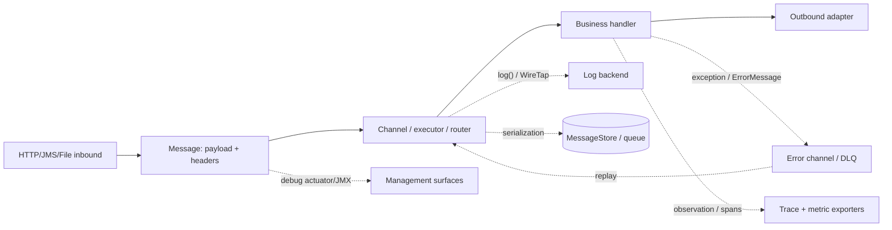
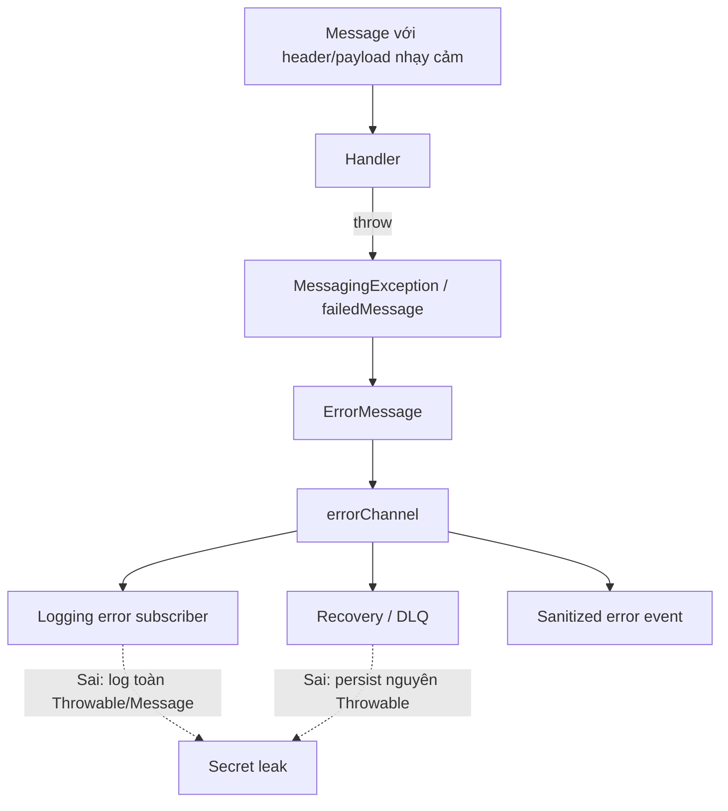
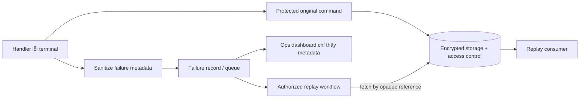

# Redaction credential, payload và header trong vận hành Spring Integration

## 1. Khi DEBUG trở thành rủi ro bảo mật

Một ứng dụng Spring Integration nhận yêu cầu qua HTTP inbound gateway, chuyển `Message<?>` qua `DirectChannel`, `ExecutorChannel`, bộ định tuyến, `ServiceActivator` và outbound adapter. Khi xảy ra timeout, kỹ sư bật DEBUG và thêm `WireTap` để tìm đường đi của message.

Giả sử inbound request chứa:

```text
Authorization: Bearer <ACCESS_TOKEN>
Cookie: session=<SESSION_VALUE>
X-API-Key: <API_KEY>
X-Correlation-Id: checkout-42

{
  "customerEmail": "customer@example.invalid",
  "cardToken": "<PAYMENT_TOKEN>",
  "orderId": "ORDER-42",
  "amount": 125000
}
```

Nếu log nguyên `Message.toString()`, một bản ghi có thể chứa **cả payload lẫn các header được map vào message**. Nếu handler ném exception, `ErrorMessage` hoặc dead-letter record có thể tiếp tục mang message gốc. Một bản sao khác có thể đã nằm trong persistent `MessageStore`. Việc chỉ xóa dòng log đã lộ sau sự cố **không làm dữ liệu biến mất khỏi các bản sao, queue và hệ thống lưu trữ đã nhận nó**.

Trong chương **Vận hành** của module **SPRING_INTEGRATION_RUNTIME**, bài **“Redaction credential, payload và header”** hướng dẫn bảo vệ dữ liệu nhạy cảm khi điều phối message qua channel, endpoint, consumer, poller, executor, retry, transaction, message store, error flow, correlation và các giao diện quan sát runtime.

**Mục tiêu** là vẫn chẩn đoán được sự cố mà không biến logs, metrics, tracing, error channel, DLQ hoặc management API thành nơi phát tán credential và dữ liệu cá nhân.

> **Nguyên tắc cốt lõi:** Chỉ ghi ra telemetry những trường đã được cho phép. Đừng tin rằng cấp log thấp, một regex che token ở cuối pipeline hay quyền truy cập dashboard sẽ thay thế việc giảm thiểu dữ liệu ngay tại nguồn.

## 2. Redaction, masking, tokenization và encryption khác nhau thế nào?

| Kỹ thuật | Cách hoạt động | Trường hợp phù hợp | Giới hạn |
| --- | --- | --- | --- |
| **Omit / allowlist** | Không đưa trường nhạy cảm vào log, trace, header outbound | Mặc định an toàn nhất cho credential | Mất một số ngữ cảnh nếu allowlist quá ít |
| **Redaction** | Thay toàn bộ giá trị bằng `[REDACTED]` | Token, password, cookie, Authorization | Không giữ khả năng so sánh giữa các bản ghi |
| **Masking** | Chỉ hiện một phần giá trị, ví dụ `****1234` | Dữ liệu mà nghiệp vụ cho phép hiển thị một phần | Có thể vẫn là dữ liệu nhạy cảm; dễ bị suy đoán |
| **Pseudonymization / HMAC** | Tạo mã định danh ổn định có khóa bí mật | Tra correlation qua nhiều logs mà không lộ email/user ID | Không phải ẩn danh tuyệt đối; phải bảo vệ khóa HMAC |
| **Tokenization** | Dùng reference ánh xạ trong vault/token service | Thay secret/PII bằng ID tra cứu được khi có quyền | Token/reference và kho ánh xạ vẫn cần bảo vệ |
| **Encryption at rest/in transit** | Bảo vệ dữ liệu khi lưu/truyền | Persistent store, DLQ, broker, backup, object storage | Người có quyền giải mã vẫn thấy bản gốc; không thay thế redaction log |

Đối với **password, bearer token, refresh token, cookie session, private key và API key**, cách tốt nhất là **không log bất kỳ phần nào**. Không dùng kỹ thuật “lấy 6 ký tự đầu” của access token để phân biệt request.

Với payload nghiệp vụ, chỉ ghi những trường được **phân loại và phê duyệt** như `flowName`, `schemaVersion`, `payloadType`, `byteLength`, `resultCategory` và một định danh đã được pseudonymize khi cần.

### Redaction ở đâu trong kiến trúc?

Có ba điểm khác nhau:

1. **Giảm dữ liệu trong message**: không đưa secret không cần thiết vào `MessageHeaders` hoặc payload.
2. **Sanitize trước khi xuất telemetry**: logger, wire tap, exception event, metric label, trace attribute, audit event và management response.
3. **Bảo vệ dữ liệu bắt buộc giữ lại**: encryption, access control, retention, replay/cleanup policy của broker/DB/DLQ.

Một message đôi khi bắt buộc mang payment token tới handler được ủy quyền. Khi đó phải giữ token trong **đường nghiệp vụ an toàn**, nhưng bảo đảm **mọi đường quan sát** chỉ nhìn bản tóm tắt đã loại bỏ token. Đừng tự xóa trường cần thiết trước khi business adapter có thể sử dụng.

## 3. Lập bản đồ nơi credential và payload có thể rò rỉ



Mỗi mũi tên chấm là một đường có thể sao chép hoặc công bố thông tin **khác với tuyến nghiệp vụ chính**. Một bộ lọc ở `.headerFilter(...)` phía cuối flow không làm sạch các bản sao đã sinh trước đó.

### Checklist dữ liệu nhạy cảm thường gặp

| Loại | Ví dụ | Chính sách telemetry |
| --- | --- | --- |
| Credentials | `Authorization`, `Proxy-Authorization`, `X-API-Key`, `password`, `access_token` | **Không bao giờ ghi giá trị** |
| Session/CSRF | `Cookie`, `Set-Cookie`, JWT, CSRF token | Omit/redact hoàn toàn |
| Keys/certificates | Private key, client secret, signing material, keystore passwords | Omit, không lưu trong Message |
| URL/connection | DSN có username/password, query `token=...`, Basic auth URL | Log scheme/host đã allowlist, bỏ userinfo/query |
| Personal data | Email, số điện thoại, địa chỉ, mã định danh cá nhân | Omit/mask/HMAC theo policy |
| Payment data | PAN, CVV, payment token, dữ liệu tài khoản | Không log; tuân thủ quy định domain |
| Business content | Nội dung hóa đơn, hồ sơ, attachment, file body | Chỉ metadata kỹ thuật được duyệt |
| Framework headers | `replyChannel`, `errorChannel`, routing, correlation, message history | Chọn lọc; không serialize/log bừa toàn bộ object |
| Operation IDs | `traceId`, `messageId`, `correlationId`, `businessId` | Có thể ghi nếu policy cho phép; không đưa định danh cá nhân thành metric tag |

**Header key không phải luôn cùng kiểu chữ.** `Authorization`, `authorization` và một `HttpHeaders` chứa danh sách header có thể được biểu diễn khác nhau. Phải kiểm tra dạng dữ liệu thực tế, nested map/header và adapter header mapper, không dùng một phép so sánh chữ hoa/thường đơn giản rồi mặc định đã sạch.

## 4. Threat model tối thiểu cho một message flow

Trước khi cấu hình log, xác định:

1. **Ai gửi dữ liệu?** HTTP client, broker, đối tác file, nội bộ trusted producer.
2. **Ai có thể đọc telemetry?** Developer, SRE, vendor APM, công cụ log SaaS, người có quyền JMX/Actuator.
3. **Dữ liệu sống ở đâu?** JVM heap, executor queue, JDBC store, broker, DLQ, log collector, trace backend, backup.
4. **Ai thực sự cần secret?** Ví dụ outbound client cần API key nhưng router và logging endpoint không cần.
5. **Retention là bao lâu?** Message pending và replay có thể sống vài giờ; log/backups có thể tồn tại nhiều tuần.
6. **Điều gì xảy ra khi exception?** `Throwable.getMessage()` hoặc `getFailedMessage()` có thể chứa payload/header.
7. **Điều gì xảy ra sau restart?** MessageStore/metadata/outbox đã lưu phiên bản chứa dữ liệu nhạy cảm hay chưa?

Những câu trả lời này tạo ra **chính sách dữ liệu theo từng boundary**. Không áp dụng “mask mọi header chứa chữ key” bằng regex rồi coi bài toán hoàn tất: một secret có thể nằm trong payload JSON, URL query, exception message hoặc custom object.

## 5. Giảm thiểu dữ liệu ngay từ ingress

**Tuyến phòng vệ mạnh nhất là không đưa secret vào message nếu downstream không cần.**

Với HTTP inbound gateway:

- Xác thực bearer/session **ở lớp bảo mật của HTTP** trước khi chuyển dữ liệu sang integration flow.
- Chỉ map các HTTP headers cần thiết vào Spring Message; kiểm soát `HeaderMapper` thay vì forward toàn bộ request headers.
- Nếu cần gọi downstream dưới một danh tính, cân nhắc service identity/credential từ secret manager thay vì chuyển nguyên inbound token.
- Chuyển request body vào một DTO đã được validate với schema rõ; không chuyển cả `HttpServletRequest` hoặc map không giới hạn.
- Không đính kèm raw request/response object vào `MessageHeaders` để “dễ debug”.

Một cách tổ chức:

```text
Client HTTP request
   |
   v
Authentication / validation
   |-- credential được xác minh ở security boundary
   |-- không copy Authorization vào MessageHeaders
   v
OrderCommand(orderId, itemsRef, schemaVersion)
   |
   v
Spring Integration flow
   |
   +-- safe diagnostic summary
   +-- business handler lấy outbound credential từ Secret Provider
```

### Header mapper là điểm kiểm soát, không phải lời hứa tự động

Nhiều adapter có cơ chế header mapping riêng (HTTP, JMS, AMQP, Kafka, TCP...). Tên thuộc tính và mặc định **không giống nhau**. Kiểm tra đúng version adapter và danh sách mapped headers, nhất là khi nâng phiên bản. Không giả định có một cài đặt `redactAllCredentials=true` dùng chung cho mọi protocol.

Khi payload chứa file lớn hoặc PII, có thể truyền **durable reference** tới object storage được bảo vệ thay vì copy toàn bộ nội dung qua nhiều channel. Reference vẫn phải có quyền truy cập/TTL đúng, không chứa signed URL có token dễ bị log.

## 6. HeaderFilter: loại bỏ header trước một trust boundary

Spring Integration có `HeaderFilter`/DSL `headerFilter(...)` để xóa những message headers không nên đi tiếp qua một boundary.

Ví dụ Java DSL:

```java
import org.springframework.context.annotation.Bean;
import org.springframework.integration.dsl.IntegrationFlow;

@Bean
IntegrationFlow outboundOrderFlow() {
    return IntegrationFlow.from("validatedOrders")
            .headerFilter(
                    "Authorization",
                    "authorization",
                    "Cookie",
                    "cookie",
                    "X-API-Key",
                    "x-api-key",
                    "accessToken")
            .handle(orderOutboundHandler);
}
```

`orderOutboundHandler` là một `MessageHandler` do ứng dụng cung cấp, cần bean và một cơ chế lấy credential outbound riêng. Ví dụ chỉ cho thấy **các header cụ thể bị loại khỏi message mới** khi nó đi qua filter. Nó không xóa credential khỏi:

- Message gốc nằm trong một channel upstream hoặc DLQ.
- Bản ghi debug/wire tap đã xuất trước filter.
- Payload JSON chứa `accessToken` dưới một field khác.
- Header lồng bên trong `Map`/`HttpHeaders` được giữ làm một giá trị.
- Bộ nhớ trong một object/copy khác đang được xử lý.

**Tốt hơn một denylist cố định** là một **allowlist thông tin được phép đi qua boundary**. HeaderFilter với các tên biết trước chỉ là một lớp phòng vệ bổ sung; tên header không được kiểm soát từ bên ngoài có thể đi đường vòng.

### Cách thiết kế allowlist

Một thông điệp đi qua từ **untrusted input → integration core** chỉ cần:

```text
messageId / correlationKey (đã phân loại)
eventType
schemaVersion
tenantInternalRef (nếu được phép)
retryContext theo contract
business payload đã validate
```

Không copy thêm `Authorization`, `Cookie`, raw response headers, connection password hoặc secret manager result chỉ vì framework cho phép message headers tùy biến.

## 7. Đừng log toàn bộ Message hoặc MessageHeaders

Các thao tác có nguy cơ rất cao:

```java
// KHÔNG DÙNG trong production với message không được phân loại.
log.debug("message={}", message);
log.debug("headers={}", message.getHeaders());
log.error("Processing failed: " + exception); // Có thể chứa message/URL/token.
```

Một số exception, kể cả `MessagingException`, có thể chứa `failedMessage`. Driver HTTP/JDBC cũng có thể đưa URL hoặc SQL/parameters vào exception message. Một `Throwable` được truyền trực tiếp vào logging framework để in stack trace có thể mang chi tiết nhạy cảm qua cause chain.

**Không in hết exception stack trace ra một sink không đủ tin cậy.** Trong trường hợp cần stack trace để debug sâu, lưu vào kênh được kiểm soát chặt hơn, đánh giá dữ liệu trong exception và áp dụng retention/incident controls. Redaction ở appender chỉ là phòng tuyến cuối, không thay thế chính sách ở nguồn.

### Một diagnostic record an toàn hơn

```json
{
  "event": "integration.handler.failed",
  "flow": "orders",
  "endpoint": "paymentOutbound",
  "messageId": "a150d2f4-...",
  "payloadType": "OrderCommand",
  "payloadSizeBucket": "1k-10k",
  "errorType": "DownstreamTimeout",
  "attempt": 2,
  "outcome": "retryable"
}
```

Đừng log `payload.toString()` để tính `payloadType` hoặc `size`. Với kích thước, dùng bytes do serializer đã tạo, content length được xác minh hoặc một bucket đo có giới hạn; không serialize lại toàn bộ dữ liệu nhạy cảm chỉ để log số bytes.

## 8. LoggingHandler và Java DSL log(): chỉ định expression an toàn

Spring Integration hỗ trợ `LoggingHandler` và DSL `.log(...)`. Mặc định việc ghi payload/header tùy cấu hình có thể tiết lộ nội dung. Hãy cung cấp một **biểu thức/hàm trả summary đã được allowlist**.

```java
import org.springframework.context.annotation.Bean;
import org.springframework.integration.dsl.IntegrationFlow;
import org.springframework.integration.handler.LoggingHandler;

@Bean
IntegrationFlow observedOrdersFlow() {
    return IntegrationFlow.from("ordersIn")
            .log(
                    LoggingHandler.Level.DEBUG,
                    "app.integration.orders",
                    message -> "event=order.received"
                            + " messageId=" + message.getHeaders().getId()
                            + " payloadType="
                            + message.getPayload().getClass().getSimpleName())
            .handle(orderService, "process");
}
```

`orderService` là bean ứng dụng; `ordersIn` là channel đã được cấu hình. Logging function không gọi `toString()` trên payload, không in header map và không giả định business ID luôn được phép log.

**Cảnh báo với WireTap:** DSL `log()` có thể hoạt động như một logging wire tap. Message vẫn tiếp tục đi trong flow; hàm log là nhánh quan sát, **không phải một interceptor làm sạch tất cả nhánh còn lại**. `WireTap` riêng hoặc các handler khác vẫn có thể log bản gốc nếu cấu hình sai.

### XML logging adapter

```xml
<int:logging-channel-adapter
    id="safeOrderLog"
    channel="orderLogChannel"
    level="DEBUG"
    logger-name="app.integration.orders"
    expression="'event=integration.message.observed'"/>
```

Ví dụ chỉ phát một chuỗi cố định, không lấy payload/header; trong thực tế có thể ghép các field đã allowlist và được kiểm soát. Đừng bật `log-full-message="true"` trên channel có secret/PII. Nếu expression tùy biến lấy dữ liệu từ message, cần test rằng giá trị được sanitize trước khi đưa vào log.

### Vì sao không dùng regex hậu xử lý làm biện pháp chính?

Một regex bắt `Authorization: Bearer ...` có thể bỏ sót:

- Token nằm trong JSON escape hoặc Base64.
- URL query `?access_token=...`.
- Header `X-Partner-Credential` mới được thêm.
- Exception message chứa chuỗi token không có tên trường.
- Payload bị split qua nhiều dòng log.
- Dữ liệu cá nhân không có pattern cố định.

**Allowlist là ưu tiên**, denylist/regex chỉ để phòng thủ thêm với nguồn legacy.

## 9. Java: tạo SafeMessageSummary để tái sử dụng

Một lớp utility tách dữ liệu quan sát khỏi dữ liệu nghiệp vụ. Ví dụ sử dụng **chỉ những trường metadata đã được phê duyệt**, không copy headers.

```java
import java.util.LinkedHashMap;
import java.util.Map;

import org.springframework.messaging.Message;

public final class SafeMessageSummary {

    private SafeMessageSummary() {}

    public static Map<String, Object> from(
            String flowName,
            String endpointName,
            Message<?> message) {

        Object payload = message.getPayload();
        Map<String, Object> out = new LinkedHashMap<>();

        // Tên flow/endpoint phải nằm trong registry tin cậy của ứng dụng.
        out.put("flow", flowName);
        out.put("endpoint", endpointName);
        out.put("event", "message.observed");
        out.put("messageId",
                message.getHeaders().getId() == null
                        ? "unknown"
                        : message.getHeaders().getId().toString());
        out.put("payloadType", payload.getClass().getSimpleName());

        if (payload instanceof byte[] bytes) {
            // Bucket hoặc số bytes được duyệt, không in byte[] content.
            out.put("payloadBytes", bytes.length);
        }

        // Không duyệt message.getHeaders().entrySet().
        // Không gọi payload.toString().
        return Map.copyOf(out);
    }
}
```

Với hệ thống có dynamic class loading hoặc tên payload type mang thông tin nội bộ nhạy cảm, thay `getSimpleName()` bằng **event schema name đã chuẩn hóa**, ví dụ `"order-command.v2"`. Ngay cả type name đôi khi cũng là metadata cần phân loại.

### Dùng trong handler

```java
import org.slf4j.Logger;
import org.slf4j.LoggerFactory;
import org.springframework.messaging.Message;

public final class SafeOrderConsumer {

    private static final Logger log =
            LoggerFactory.getLogger(SafeOrderConsumer.class);

    public void handle(Message<?> message) {
        log.debug("integration_event={}",
                SafeMessageSummary.from(
                        "orders", "orderConsumer", message));

        // Business handler dùng message gốc khi cần.
        businessProcessor.process(message);
    }
}
```

`businessProcessor` là một dependency ứng dụng. Utility tạo summary mới cho logging; nó **không sửa message gốc**, không can thiệp processing và không đảm bảo các logger khác tự dùng utility này. Muốn bảo vệ toàn diện cần rà soát mọi điểm xuất telemetry.

## 10. Redaction trong exception, ErrorMessage và failedMessage

Khi handler ném lỗi, Spring Integration có thể tạo `ErrorMessage`. Payload của `ErrorMessage` là một `Throwable`; nếu là `MessagingException`, nó có thể mang tham chiếu tới `failedMessage` với **payload và headers gốc**.



Một error handler an toàn có thể **trích xuất rất ít trường**, ví dụ loại exception, message ID và flow ID đã biết:

```java
import org.slf4j.Logger;
import org.slf4j.LoggerFactory;
import org.springframework.integration.annotation.MessageEndpoint;
import org.springframework.integration.annotation.ServiceActivator;
import org.springframework.messaging.Message;
import org.springframework.messaging.MessagingException;
import org.springframework.messaging.support.ErrorMessage;

@MessageEndpoint
public class SafeErrorEndpoint {

    private static final Logger log =
            LoggerFactory.getLogger(SafeErrorEndpoint.class);

    @ServiceActivator(inputChannel = "orderErrors")
    public void handle(ErrorMessage errorMessage) {

        Throwable failure = errorMessage.getPayload();

        Message<?> failed = failure instanceof MessagingException ex
                ? ex.getFailedMessage()
                : null;

        String messageId = failed != null
                && failed.getHeaders().getId() != null
                    ? failed.getHeaders().getId().toString()
                    : "unknown";

        log.error(
                "event=order.failed flow=orders messageId={} errorType={}",
                messageId,
                failure.getClass().getSimpleName());

        // Không log failure.getMessage(), Throwable hoặc failedMessage.
        // Một durable failure record riêng cần lưu các field đã duyệt.
    }
}
```

**Giới hạn:** code trên không bảo đảm mọi lỗi có `failedMessage`; đôi khi exception ở poller/adapter xảy ra **trước khi có message**, hoặc wrapper exception có cause sâu hơn. Đừng tự duyệt toàn bộ cause chain và log mọi message đính kèm.

Nếu cần stack trace để điều tra nội bộ, dùng một **restricted diagnostic sink** với chính sách bảo mật/retention và công cụ redaction chuyên dụng; không publish nguyên exception sang một shared log channel mở rộng.

## 11. Retry advice và RecoveryCallback: tránh nhân bản dữ liệu nhạy cảm

`RequestHandlerRetryAdvice` có thể gọi handler nhiều lần. Một message với token trong headers có thể được log **mỗi attempt**, khiến một secret xuất hiện hàng chục lần trong hệ thống log.

Hãy phân biệt:

- **Attempt log:** `flow`, `endpoint`, `attempt`, `errorCategory`; không chứa request body/token.
- **Terminal failure event:** một record tóm tắt khi retry cạn; không tự động ghi nguyên `Throwable`.
- **Durable retry item:** cần đủ dữ liệu để xử lý lại, nhưng phải được **mã hóa/bảo vệ**, không nhầm với debug log.
- **Business result:** ghi sau commit/outcome rõ ràng để tránh hiểu một recoverer đã “nuốt lỗi” là thành công nghiệp vụ.

Ví dụ log trong recoverer:

```text
INFO event=retry.exhausted flow=orders
     endpoint=paymentAdapter errorCategory=timeout attempts=4
     recoveryTarget=orderDeadLetters
```

Không log `recoveryContext.getLastThrowable()` nguyên vẹn ra console nếu payload/URL/secret có thể xuất hiện trong exception chain. Nếu recovery callback trả bình thường, transaction/ack của outer poller có thể commit; ghi failure record bền vững **trước khi coi là recovered** nếu nghiệp vụ yêu cầu.

## 12. Dead-letter queue: không biến DLQ thành kho secret không kiểm soát

Một DLQ cần giữ đủ thông tin để replay, nhưng **replayability** và **an toàn telemetry** là hai yêu cầu khác nhau.

Một cấu trúc DLQ nên tách:

```text
Failure envelope (cho monitoring):
  failureId
  eventType
  flowId / endpointId
  errorCategory
  firstSeenAt / lastAttemptAt
  attempts
  payloadRef (opaque, được phân quyền)
  replayPolicy

Protected original (cho replay):
  encrypted command payload, chỉ những field cần thiết
  minimal headers, schemaVersion, business idempotency key
  stored ở DB/object storage/secured broker topic
```



**Không gửi nguyên `ErrorMessage` hoặc `Throwable` vào một DLQ mà không xem xét serializer, quyền truy cập và retention.** `ErrorMessage` có thể chứa failed message với dữ liệu nhạy cảm; việc Java serialize Throwable có thể thất bại hoặc mang theo stack/context không phù hợp để replay.

### Replay không cần credential inbound cũ

Nếu message gốc chứa bearer token hết hạn, việc persist nó trong DLQ vừa rủi ro vừa không giúp replay. Hãy lưu **business command** đủ tái thực thi và để outbound adapter dùng credential hiện hành từ secret manager. Với dữ liệu không thể tái dựng, cần bảo vệ nội dung bền vững ở một kho được thiết kế cho nhạy cảm đó.

## 13. Persistent MessageStore, QueueChannel và MessageGroupStore

Redaction log **không bảo vệ dữ liệu được persist**. Nếu dùng `JdbcChannelMessageStore` cho `QueueChannel`, `JdbcMessageStore` cho aggregator/resequencer, hoặc một message store khác, payload và các header được serialize có thể nằm trong database.

Rủi ro:

- Backup hoặc replica chứa dữ liệu đã commit.
- DB admin, troubleshooting query và export có thể thấy blob/row.
- Message với token chưa hết hạn có thể bị truy xuất ngoài flow.
- Serializer có thể giữ cả custom header object, exception hoặc embedded secret.
- Nâng version có thể deserialize thất bại, khiến nhân viên vận hành in raw blob để debug.

Thiết kế cần:

1. **Không đưa credential không cần thiết vào stored message ngay từ ingress.**
2. Kiểm tra **những header nào thực sự được serializer/message store giữ**; loại bỏ header không thuộc contract nghiệp vụ trước **durable boundary**.
3. Dùng at-rest encryption, key management, least privilege, access audit và giới hạn export/backup.
4. Xác định retention của pending queue, completed group, failed message và checkpoint.
5. Dùng versioned command schema và idempotency key; tránh lưu raw HTTP request/security context.
6. Với các dữ liệu rất lớn/nhạy cảm, cân nhắc claim check/object storage có ACL và TTL phù hợp.

### Một ví dụ đáng chú ý: headerFilter đặt quá muộn

```text
Inbound message (Authorization header)
      |
      v
Persistent QueueChannel [đã serialize Authorization]
      |
      v
PollingConsumer
      |
      v
.headerFilter("Authorization") [QUÁ MUỘN để bảo vệ bản lưu]
      |
      v
Business handler
```

Chỉ khi đặt filter **trước enqueue** hoặc không map token vào message từ đầu mới tránh được bản ghi bền vững chứa token đó. Nếu handler cần credential outbound, cấp credential tại outbound adapter, không truyền token lâu dài qua toàn pipeline.

### MessageGroupStore có thể lưu lâu hơn dự tính

Aggregator giữ fragment trong `MessageGroupStore` tới lúc release/expiry và có thể giữ completed-group metadata để phát hiện late arrivals. Nếu payload chứa PII, retention của **group**, reaper/cleanup và backup cũng thuộc phạm vi chính sách dữ liệu. Một batch chưa đủ sequence có thể nằm trong DB rất lâu nếu release/timeout bị cấu hình sai.

## 14. MetadataStore và idempotency key cũng có thể là dữ liệu nhạy cảm

`MetadataStore` lưu chuỗi key/value nhỏ như file checkpoint, accept-once marker và idempotency state. Không nên dùng email, số điện thoại, access token hoặc tên file chứa PII làm **raw metadata key** nếu một operator có thể query toàn bộ table.

Ví dụ không tốt:

```text
metadata_key = "processed:alice@example.invalid"
metadata_value = "true"
```

Một lựa chọn phù hợp là key opaque/pseudonymous dựa trên định danh nội bộ hoặc HMAC có namespace:

```text
metadata_key = "processed:v1:9af3... (HMAC, minh họa)"
metadata_value = "COMPLETED"
```

**Không dùng SHA-256 đơn thuần** của một dữ liệu có entropy thấp như email hoặc số điện thoại để coi là ẩn danh: attacker có thể brute-force dictionary rồi đối chiếu hash. HMAC với khóa bí mật được quản lý tốt hạn chế kiểu suy đoán đó, nhưng output vẫn là pseudonymous identifier cần được bảo vệ.

Ngoài ra:

- `ConcurrentMetadataStore.putIfAbsent` giúp claim atomic, không tự đảm bảo retention hoặc confidentiality.
- `JdbcMetadataStore`/Redis backend lưu các key/value tới khi cleanup; xem ACL, replication và backup.
- Nếu đổi HMAC key, phải thiết kế versioning/migration idempotency marker; không mặc nhiên coi tất cả message cũ là mới rồi tạo side effect trùng.
- Không lồng secret vào message IDs hoặc correlation IDs chỉ để “truy vết nhanh”.

## 15. HMAC pseudonym để nối log theo nghiệp vụ

Khi cần tìm cùng một business command qua nhiều hệ thống nhưng không muốn lộ email/user ID, dùng **HMAC-SHA256** với secret key do hệ thống bảo mật cấp. Ví dụ Java độc lập:

```java
import java.nio.charset.StandardCharsets;
import java.security.GeneralSecurityException;
import java.util.Arrays;
import java.util.HexFormat;
import javax.crypto.Mac;
import javax.crypto.SecretKey;

public final class LogPseudonymizer {

    private final SecretKey hmacKey;

    public LogPseudonymizer(SecretKey hmacKey) {
        this.hmacKey = hmacKey;
    }

    public String fingerprint(String domain, String businessId)
            throws GeneralSecurityException {

        Mac mac = Mac.getInstance("HmacSHA256");
        mac.init(hmacKey);

        byte[] digest = mac.doFinal(
                (domain + ":" + businessId)
                        .getBytes(StandardCharsets.UTF_8));

        // Truncate chỉ để tạo nhãn troubleshooting gọn;
        // collision risk phải được đánh giá theo quy mô hệ thống.
        return "v1:" + HexFormat.of()
                .formatHex(Arrays.copyOf(digest, 16));
    }
}
```

Key phải đến từ KMS/secret manager; không hard-code key hoặc ghi key vào log, property file public hay message headers. Giữ một **domain prefix** để tránh cùng chuỗi xuất hiện giống nhau trong các nhóm ID không liên quan.

**HMAC pseudonym không phải business primary key.** Với ràng buộc unique/idempotency, dùng ID nghiệp vụ/internal ID phù hợp. Nếu xoay khóa HMAC, output khác đi; cần version/migration/dual-read theo policy. Đừng bỏ tiền tố `v1` rồi giả định tất cả giá trị có thể so sánh mãi mãi.

## 16. Tracing và baggage: đừng đưa token vào span attributes

Micrometer Observation/OpenTelemetry có thể ghi trace/span name, low/high-cardinality attributes và context propagation. Một số developer đưa `userEmail`, `Authorization` hoặc raw payload vào span attributes để dễ tra trên APM. Điều đó khiến dữ liệu nhạy cảm được **xuất tới một hệ thống khác**, có access/retention riêng.

Chính sách nên là:

- Span name: tên operation ổn định, ví dụ `integration.orders.process`.
- Low-cardinality attributes: `flow=orders`, `endpoint=paymentAdapter`, `outcome=timeout`.
- High-cardinality attributes: chỉ dùng identifier đã được cho phép/pseudonymize khi thực sự cần.
- Baggage: không đặt credential/PII; baggage có thể được propagate sang outbound HTTP headers và service khác.
- Exception events: hạn chế exception message/stack khi chúng có thể chứa URL, HTTP headers hoặc payload.
- Trace sample: sampling giảm volume **không phải** một cơ chế redaction; message bị sampled vẫn có thể chứa secret.

### Correlation across ExecutorChannel/poller

`ExecutorChannel` đổi thread, nên SLF4J `MDC` của producer không mặc nhiên tồn tại ở worker. Hãy mang **correlation ID đã được phân loại** qua message headers/tracing context, rồi tạo MDC cục bộ ở worker và dọn trong `finally`:

```java
import org.slf4j.MDC;
import org.springframework.messaging.Message;

public void processSafely(Message<?> message) {
    Object id = message.getHeaders().get("safeCorrelationRef");

    try {
        if (id != null) {
            MDC.put("correlationRef", id.toString());
        }
        handleBusiness(message);
    } finally {
        MDC.remove("correlationRef");
    }
}
```

`safeCorrelationRef` phải do ứng dụng tạo từ một ID được duyệt; không lấy nguyên inbound bearer token làm correlation key. Đối với tracing, dùng instrumentation/context propagation được framework hỗ trợ; copy MDC tùy tiện không thay thế việc propagate trace context chuẩn.

## 17. Metrics: không tạo high-cardinality labels từ payload hoặc header

Micrometer meter tags dễ bị lạm dụng:

```java
// SAI: Mỗi email tạo một time series; còn làm rò PII qua metrics.
registry.counter(
        "integration.orders.received",
        "email", customerEmail).increment();

// TỐT HƠN: Các label ít biến thiên, đã kiểm soát.
registry.counter(
        "integration.orders.received",
        "flow", "orders",
        "source", "http",
        "result", "accepted").increment();
```

Ngoài email, không đưa `accessToken`, `apiKey`, `businessId`, `correlationId` hoặc raw URL query vào tags. Kể cả UUID không nhạy cảm, tag có hàng triệu giá trị cũng gây **cardinality explosion** cho metrics backend.

Spring Integration có các meters như `spring.integration.send`/`receive` và Micrometer Observation theo phiên bản/cấu hình. Tag `spring.integration.name` hoặc tên component trong dynamic `IntegrationFlow` có thể chứa tenant ID hoặc dữ liệu do người dùng cung cấp; **không tạo bean/component ID từ secret/PII**. Chuẩn hóa các tên flow/endpoint, dùng mapping nội bộ và kiểm soát cardinality.

### Payload size metric

Đo `payloadBytes` bằng **distribution summary/histogram** hoặc bucket, không bằng label `size=123456` cho mọi giá trị. Chỉ ghi số bytes có ý nghĩa với codec thực tế; không ghi bytes hay payload content trong tag/log.

## 18. Message History, WireTap và logging channel

Spring Integration hỗ trợ `@EnableMessageHistory` thêm thông tin component path vào header. Header `history` có thể hữu ích để debug, nhưng không phải một cơ chế redaction, không phải business audit và có thể tiếp tục được serialize nếu message được persist/chuyển tiếp.

`WireTap` gửi một bản sao/reference message sang kênh quan sát. Nếu logging subscriber thực hiện `log.debug("{}", message)` thì **toàn bộ dữ liệu có thể lộ**, dù flow chính đã có một `HeaderFilter` ở bước sau.

Một quy ước phòng vệ:

1. **Chỉ wire tap một safe summary channel** hoặc dùng LoggingHandler expression allowlist.
2. Không đặt logging subscriber có `payloadExpression = payload` trên channel chứa credential.
3. Không tự động forward nguyên message history/error headers qua external adapter.
4. Kiểm soát dynamic flow registration: một admin có thể thêm wire tap/log handler ở runtime.
5. Với `MessageHistory`, dùng component ID không nhúng user PII; chỉ bật phạm vi cần thiết.

**Observability không nên thay đổi nghiệp vụ:** logging tap là side effect; nó không được trở thành nguồn xác nhận message đã commit. Nếu asynchronous log sink lỗi, business handler vẫn cần có semantics rõ; nếu log là audit bắt buộc theo pháp lý/nghiệp vụ, thiết kế durable audit riêng thay vì kỳ vọng DEBUG logging.

## 19. Management interface, Actuator và JMX có thể tiết lộ metadata

Một dashboard với `GET /actuator/integrationgraph`, JMX MBeans hoặc Control Bus có thể cho người vận hành biết tên endpoint, channel, adapter và trạng thái. Mặc dù những giao diện này **không mặc định dump mọi payload**, tên bean, cấu hình bổ sung hoặc phương thức tùy biến có thể chứa thông tin nhạy cảm.

Tránh:

- Đặt `password`, token hoặc private URL vào bean name, component ID, error description.
- Đưa raw credential vào property được JMX/graph additional-properties callback trả ra.
- Cho phép Control Bus gọi một method có thể log/return full secret config.
- Expose `/actuator/env`, `/actuator/configprops`, `/actuator/loggers`, `/control-bus` hoặc JMX remote rộng rãi mà không có bảo vệ.
- Ghi URL query chứa signed token trong log của management gateway/proxy.

Spring Boot có các cơ chế **sanitization** cho một số giá trị endpoint quản trị theo phiên bản và cấu hình, nhưng không coi chúng là sự bảo đảm che mọi secret tùy biến trong message, bean name hoặc error text.

**Phân biệt giao diện:** `POST /actuator/integrationgraph` dùng refresh graph, không phải lệnh start/stop. Control Bus/JMX có khả năng thay đổi runtime tùy các operations được expose; cần RBAC, network isolation và audit.

## 20. Bảo vệ outbound HTTP, broker và file adapter

Các adapter có định dạng header/protocol khác nhau; cần xét riêng.

| Boundary | Rủi ro | Biện pháp |
| --- | --- | --- |
| HTTP outbound gateway | Log raw request/response headers, URL query, body; token từ message header bị forward | Header allowlist; outbound credential từ secret provider; log request ID/status/latency |
| JMS/AMQP/Kafka | Framework headers/PII đi vào broker properties, DLQ hoặc topic nhiều consumer | Chỉ map các headers cần thiết; kiểm soát broker ACL/retention/encryption |
| SFTP/FTP | Password/private key trong adapter config hoặc URI/log stack trace | Secret provider, không log session config/URI có credential |
| JDBC | SQL bind values hoặc exception chứa PII; message blob trong DB | Parameterized SQL, giới hạn SQL logging, DB encryption và quyền |
| TCP/HTTP inbound | Raw frame/binary payload dump ở TRACE | Không bật payload dumps vô điều kiện; giới hạn capture |
| File/claim check | File path/tên file có dữ liệu cá nhân; nội dung nằm trong storage | Opaque references, path sanitization, ACL và cleanup |
| Mail | Địa chỉ email và body là PII | Log event category và internal ref, không log recipient/body khi không cần |

**Không cho rằng một header bị filter trong Spring Message thì adapter chắc chắn không tái tạo/ghi header khác.** Ví dụ outbound HTTP adapter có thể tự sinh `Authorization` từ client configuration; điều này là tốt cho kết nối, nhưng logs/proxy headers vẫn cần được kiểm soát.

## 21. Error flow và replay: tách thông tin điều tra khỏi dữ liệu cần phục hồi

Một failure record đủ để điều tra có thể **không đủ** để replay; một command đủ replay lại có thể **không an toàn để hiển thị** trong dashboard.

Ví dụ chính sách:

```text
Business source
   → validated command (minimal)
   → persistent inbox / queue (protected)
   → handler
      ├── success → business commit + outbox
      └── terminal failure
            ├── failure summary (safe for ops search)
            └── replay reference → protected original command
```

Điều kiện đúng:

- **Source of truth của replay:** protected command + schemaVersion + idempotency key.
- **Ops telemetry:** failure ID, category, flow/endpoint, attempt count, timestamps, trạng thái.
- **Recovery authorization:** chỉ role được phép mở/replay original; có audit người thực hiện.
- **Retention:** original có thể được dọn theo SLA/luật lệ phù hợp; summary có thể giữ lâu hơn hoặc ngược lại theo chính sách.
- **Idempotency:** message replay không tạo side effect trùng dù message ID mới, hoặc token đã hết hạn.

Không để một nút “Replay” trong dashboard vô tình in raw payload ra console hoặc tải toàn bộ original JSON về trình duyệt của mọi người có quyền xem metrics.

## 22. Bảo vệ persistence và backup khác bảo vệ telemetry

Hình thức redaction phải phù hợp nơi lưu:

| Nơi lưu | Mục tiêu | Giải pháp |
| --- | --- | --- |
| Application log | Không lộ dữ liệu nhạy cảm | Allowlist summary, không log raw Message/Throwable |
| Trace exporter | Không propagate secret/PII | Attribute/baggage allowlist, exception scrubbing |
| Metrics registry | Không lộ dữ liệu và tránh cardinality | Tags theo flow/outcome ổn định |
| In-memory queue | Giảm thời gian lưu dữ liệu nhạy cảm | TTL/timeout, bounded backlog, không tạo bản sao tùy tiện |
| JDBC MessageStore | Bảo vệ payload/header phải persist | Minimal command, DB ACL, encryption, retention |
| DLQ/retry store | Replay được nhưng giới hạn người đọc | Envelope + protected original, idempotency, audit |
| MetadataStore | Không lộ business identity qua keys | Opaque/HMAC keys, ACL và TTL |
| Object storage/backup | Không bị trích xuất khi snapshot | KMS, encryption, IAM/ACL, retention và key lifecycle |

**Khi đã có dữ liệu bị lộ ra log**, sửa code chỉ ngăn bản ghi mới. Dữ liệu cũ có thể tồn tại trong log backend, backup và cache. Phải có quy trình incident response, không coi việc thêm regex là remediation hoàn tất.

## 23. Kiểm thử redaction theo kiểu “tìm chuỗi sentinel”

Một cách kiểm thử thực tế là tạo **secret giả dành riêng cho test**, cho message đi qua các nhánh success, retry, exception và DLQ, rồi xác minh các kênh **được phép đọc** không có secret.

```text
TEST_AUTH_TOKEN_ABC_123
TEST_PASSWORD_DEF_456
TEST_EMAIL_XYZ@example.invalid
```

Đây là **dữ liệu giả**, không dùng production credentials. Đặt sentinel ở nhiều vị trí:

- Top-level `Authorization` header.
- Header viết thường và một custom header `X-Partner-Credential`.
- Nested JSON field và payload `toString()`.
- Query string trong một exception message giả.
- `ErrorMessage.failedMessage` sau handler failure.
- DLQ/failure envelope.
- Tracing attribute hoặc MDC nếu hệ thống có exporter thử nghiệm.

### Assertions cần có

| Kiểm thử | Điều kiện PASS |
| --- | --- |
| Safe LoggingHandler | Có messageId/type/outcome; không có sentinel |
| Exception handling | Error log không in Throwable message chứa sentinel |
| WireTap | Nếu bật tap, chỉ ghi safe summary |
| DLQ visible record | Không có raw token/password/payload nhạy cảm |
| Protected original | Nếu phải lưu, chỉ tài khoản được cấp quyền đọc được, có encryption |
| Trace exporter | Không có Authorization/Cookie/sentinel trong span attributes/baggage |
| Metrics | Không có message-specific ID/secret trong tags |
| Restart/replay | Replay dùng credential hiện hành; không phát tán token cũ |

**Đừng kiểm thử bằng credential thật.** Nếu test e2e dùng test token, vẫn không đưa token vào tài liệu, screenshot hay issue tracker.

## 24. Một đơn vị test Java cho safe summary

Ví dụ JUnit 5 xác minh utility phần 9 không đưa header/payload nhạy cảm vào summary:

```java
import static org.junit.jupiter.api.Assertions.*;

import java.util.Map;
import org.junit.jupiter.api.Test;
import org.springframework.messaging.Message;
import org.springframework.messaging.support.MessageBuilder;

class SafeMessageSummaryTest {

    @Test
    void doesNotExposePayloadOrCredentialHeaders() {
        String secret = "TEST_AUTH_TOKEN_ABC_123";
        String pii = "TEST_EMAIL_XYZ@example.invalid";

        Message<?> message = MessageBuilder
                .withPayload(
                        Map.of("email", pii, "accessToken", secret))
                .setHeader("Authorization", "Bearer " + secret)
                .setHeader("X-Partner-Credential", secret)
                .build();

        String summary = SafeMessageSummary
                .from("orders", "ordersConsumer", message)
                .toString();

        assertFalse(summary.contains(secret));
        assertFalse(summary.contains(pii));
        assertFalse(summary.contains("Authorization"));
        assertFalse(summary.contains("accessToken"));
        assertTrue(summary.contains("ordersConsumer"));
    }
}
```

Đây là một **unit test của utility**, không chứng minh cả logging pipeline an toàn. Cần thêm integration tests có **in-memory test appender/exporter** để quan sát các sinks được bật thực tế, kể cả lỗi retry/`ErrorMessage`/WireTap/management.

Nếu logger/trace exporter được cấu hình khác trong production, chạy kiểm thử cấu hình tương đương ở staging và kiểm soát drift.

## 25. Những lỗi redaction rất dễ bỏ sót

| Lỗi | Vì sao nguy hiểm | Khắc phục |
| --- | --- | --- |
| `log.debug("{}", message)` | Message.toString có thể bao gồm payload/headers | Safe summary allowlist |
| `log.error("failed", exception)` không kiểm tra nội dung | Throwable/causes có thể chứa token, SQL params, raw URL | Error category sanitized; secure diagnostic sink nếu cần stack |
| HeaderFilter sau persistent QueueChannel | Credential đã được serialize trước filter | Lọc trước enqueue hoặc không map từ ingress |
| Redact `Authorization` nhưng bỏ `authorization`/custom header | Case/nested structures khác nhau | Header mapper allowlist và tests với variants |
| Mask 4 ký tự cuối của access token | Vẫn lộ token fragment, có thể hỗ trợ tấn công | Omit toàn bộ token |
| SHA-256(email) trong log | Dễ dictionary attack | HMAC + quản lý key hoặc internal opaque ref |
| Gắn `businessId` vào Micrometer tag | Cardinality lớn, có thể rò PII | Tags ổn định, ID ở log/tracing được duyệt |
| Serialize nguyên `ErrorMessage` vào DLQ | FailedMessage/exception có thể chứa secret | Envelope + encrypted original reference |
| Dùng query string có token để làm endpoint ID | Lộ qua graph, log và metrics | Ổn định, opaque IDs |
| Chỉ redaction trong log collector | Raw secret đã đi qua network và buffer | Sanitize ở app trước exporter |
| Logging DEBUG trong incident rồi quên tắt | Chi phí và bề mặt lộ tăng | Time-box, audit, tự động revert theo quy trình |
| Message history giữ header quá lâu | Header bền vững khi message persist | Kiểm soát scope/history và retention |
| Stop/start flow để “xóa” secret khỏi RAM | Có thể còn queue, retry task, DB, logs | Kiểm kê mọi bản sao, rotate credentials, cleanup an toàn |
| Replay từ DLQ dùng bearer token cũ | Token hết hạn hoặc đã bị revoke | Rebuild outbound credential ở adapter |

## 26. Runbook vận hành khi nghi có secret trong log

Nếu phát hiện token, password, cookie hoặc dữ liệu nhạy cảm trong log/trace:

1. **Xác định phạm vi:** loại dữ liệu, endpoint, thời điểm bắt đầu, các loggers/collectors có thể nhận bản ghi và quyền của người xem.
2. **Giới hạn lộ tiếp:** tắt scoped DEBUG/log-full-message/wire tap không an toàn hoặc thay bằng summary, trong khi giữ error monitoring tối thiểu.
3. **Xử lý credential:** rotate/revoke token hoặc password bị lộ theo chính sách; không mặc định chỉ xóa log là đủ.
4. **Bảo vệ bằng chứng:** lưu những thông tin điều tra không chứa secret hoặc trong kho hạn chế quyền; tránh copy raw log sang chat/ticket.
5. **Quét các sink liên quan:** central logs, tracing, DLQ, persistent stores, metadata, dashboards, exported files và backup policies.
6. **Xác định nguyên nhân:** ingress header mapper, Message.toString, exception chain, `ErrorMessage`, wire tap, metrics label hay management response?
7. **Khắc phục ở nguồn:** loại bỏ dữ liệu không cần thiết, triển khai allowlist và tests cho các nhánh success/failure/retry/restart.
8. **Xử lý dữ liệu đã lưu:** theo quy trình xóa/quarantine/retention và các yêu cầu pháp lý hợp lệ; phải kể tới log replicas/backups.
9. **Kiểm chứng:** gửi sentinel giả qua chính flow; xác minh sinks hiện tại không còn xuất bản nội dung.
10. **Hậu kiểm:** thêm chính sách code review, test, giám sát hành vi logging/config và audit thay đổi management.

**Không purge queue/DLQ tùy tiện chỉ để xóa secret.** Các record đó có thể đang giữ công việc chưa hoàn thành; cần kế hoạch chuyển dữ liệu an toàn, giữ replayability/idempotency và xác nhận business state trước khi xóa.

## 27. Bài thực hành

### Lab A — Raw Message logging và safe summary

1. Tạo `Message<Map<String,Object>>` chứa token giả ở `Authorization` và nested payload field.
2. Ở môi trường test, dùng một unsafe logger để thấy secret **có thể xuất hiện**; không gửi log này tới collector production.
3. Thay bằng `SafeMessageSummary` và DSL `.log(...)` theo mục 8–9.
4. Dùng test appender kiểm tra không còn sentinel trong output.
5. Thêm một custom header chưa biết để thấy denylist không đủ.
6. Kết luận vì sao allowlist bền vững hơn regex.

**PASS:** Output telemetry chỉ chứa fields đã duyệt, không lộ raw payload/header.

### Lab B — HeaderFilter trước/sau persistent queue

1. Xây một flow có `QueueChannel` dùng `JdbcChannelMessageStore` trên DB test.
2. Gửi message có credential giả và quan sát dữ liệu/bytes chỉ trong môi trường test được bảo vệ.
3. Đặt `headerFilter("Authorization")` sau queue: chứng minh bản message đã persist vẫn chứa header nếu serializer lưu nó.
4. Đưa header filter **trước** queue và lặp test.
5. Giữ message đủ cho downstream bằng cách chuyển credential cần dùng sang outbound secret provider.
6. Restart app và xác minh dữ liệu đã commit không làm lộ credential cũ qua logs.

**PASS:** Secret không còn ở durable boundary mới, không phá semantics replay.

### Lab C — Exception, retry và ErrorMessage

1. Cho handler ném một exception giả có URL chứa `?token=TEST_AUTH_TOKEN_ABC_123`.
2. Tạo `ErrorMessage` phù hợp; kiểm tra `MessagingException.getFailedMessage()` có thể mang payload/header gốc.
3. Đưa qua `SafeErrorEndpoint`, không log raw `Throwable`/`failedMessage`.
4. Cấu hình retry nhiều attempts và đo tổng log volume.
5. Recovery vào durable failure sink chỉ có safe envelope.
6. Kiểm chứng không có sentinel ở error logs, metrics, tracing và visible DLQ metadata.

**PASS:** Nhiều attempts không làm nhân bản secret trong telemetry.

### Lab D — HMAC pseudonym và cardinality

1. Tạo vài email giả và HMAC key **chỉ dành cho test**.
2. Gọi `fingerprint("orders", email)` nhiều lần; cùng input/key phải có cùng output.
3. Đổi domain/key, xem output thay đổi; thiết kế version marker.
4. So sánh SHA-256 không khóa và HMAC ở góc độ dictionary risk.
5. Thử đưa 10.000 business IDs vào metric tags trên staging, quan sát cardinality; sau đó bỏ high-cardinality tags.
6. Kiểm tra output HMAC chỉ dùng log/correlation chứ không làm business uniqueness key.

**PASS:** Có correlation mà không để raw email thành log/metric label.

### Lab E — Tracing, MDC và ExecutorChannel

1. Gửi message qua `DirectChannel` rồi `ExecutorChannel`, log thread names.
2. Thêm `safeCorrelationRef` vào message, tạo MDC cục bộ trong handler worker.
3. Không dùng inbound Authorization làm correlation hoặc baggage.
4. Dùng test trace exporter xem span attributes/exception events có raw secret không.
5. Tạo một lỗi retry và xác nhận MDC được dọn trong `finally` giữa hai task.
6. Kiểm tra sampling không được dùng làm cơ chế redaction.

**PASS:** Trace/log nối được flow mà không propagate credential.

### Lab F — Management và DEBUG trong incident

1. Bật `integrationgraph`/loggers ở môi trường test có quyền quản trị.
2. Xác minh component IDs không chứa secret hoặc raw URL có token.
3. Chỉ bật DEBUG cho logger hẹp của một flow trong một khoảng điều tra.
4. Dùng logging handler safe summary; không bật log-full-message.
5. Kiểm tra graph/JMX/Control Bus chỉ expose operations/metadata đã duyệt.
6. Hoàn nguyên logging level, ghi audit thay đổi.

**PASS:** Quan sát runtime không cần tiết lộ payload hoặc secret config.

### Lab G — DLQ và replay có kiểm soát

1. Gửi một business command chứa payment reference (không chứa bearer token) vào durable queue.
2. Cho handler lỗi terminal, ghi safe failure envelope và protected original.
3. Kiểm tra dashboard chỉ thấy envelope, không tải được original nếu role không được phép.
4. Replay bằng command ID và credential outbound mới từ secret provider.
5. Kiểm tra business idempotency nếu command đã thực hiện một phần trước lỗi.
6. Dọn original theo policy nhưng giữ audit/tombstone khi cần.

**PASS:** Replay được công việc mà không biến DLQ thành kho lưu token không có kiểm soát.

### Lab H — Kiểm thử redaction sau restart

1. Persist message và group state trong database test, không chứa secret không cần thiết.
2. Restart application và chờ polling/recovery/reaper hoạt động.
3. Kiểm tra DEBUG/error logs trong quá trình replay không in các field nhạy cảm.
4. Cố ý thay serializer/schema version và quan sát deserialize error an toàn.
5. Kiểm tra DB backups/retention/cleanup trong runbook, không thử xóa raw rows khi consumer đang chạy.
6. Ghi lại các trường hợp giữ an toàn qua rolling deployment hai phiên bản.

**PASS:** Redaction và replay policy vẫn hoạt động xuyên restart, không chỉ trong một JVM.

## 28. Checklist production

- **Phân loại dữ liệu:** biết credential, PII, payload confidential, business ID và metadata nào được phép xuất telemetry.
- **Ingress:** HTTP/broker header mapping có allowlist; security context/token không bị copy bừa vào Message.
- **Outbound:** credential được nạp tại adapter từ secret provider; URL/header/query logging đã kiểm soát.
- **Logging:** không log toàn bộ `Message`, `MessageHeaders`, `Throwable`, `ErrorMessage` hoặc payload `toString()`.
- **WireTap/MessageHistory:** chỉ bật theo phạm vi; không thêm nhánh log raw message.
- **Error handling:** exception metadata đã sanitize, recovery/DLQ visible envelope an toàn.
- **Persistence:** MessageStore, MetadataStore, message group, DLQ và backup có ACL, encryption, retention.
- **Redaction:** ưu tiên omission/allowlist; HMAC có key/rotation policy khi cần pseudonym.
- **Observability:** metric tags cardinality thấp, tracing attributes/baggage không có secret, MDC dọn khi đổi thread.
- **Management:** Actuator/JMX/Control Bus/Integration Graph có xác thực, RBAC và không expose secret config.
- **Runtime:** retry/backoff, poller, executor và reactive publisher không vô tình lặp lại dữ liệu nhạy cảm trong logs.
- **Testing:** sentinel giả ở nested payload/header/exception, e2e error flow, DLQ, tracing, restart và version migration.
- **Incident response:** có runbook rotate/revoke, containment, audit và kiểm kê replicas/backups.

## 29. Kết luận

Redaction trong Spring Integration không phải một phép `replaceAll(...)` đặt ở cuối logging pipeline. Nó là **thiết kế luồng dữ liệu**: giảm dữ liệu nhạy cảm tại ingress, truyền credential qua đúng security boundary, dùng summary đã allowlist ở logging/metrics/tracing và bảo vệ original command được persist để xử lý/replay.

Trong runtime có channel, endpoint, poller, executor, retry, transaction, message store, correlation và error flow, cùng một dữ liệu có thể được sao chép ở nhiều đường. Vì vậy, **không log raw Message/Throwable**, không đưa credential vào headers/metric tags/span baggage, không dùng DLQ làm kho raw exception thiếu bảo mật và không đặt filter sau khi một bản copy đã persist. Khi cần điều tra, kết hợp **safe metadata + trace/correlation + protected business audit** để giữ khả năng chẩn đoán mà vẫn đáp ứng nguyên tắc tối thiểu hóa dữ liệu.

## Tài liệu tham khảo

- [Spring Integration Reference — Logging Channel Adapter](https://docs.spring.io/spring-integration/reference/logging-adapter.html)
- [Spring Integration Reference — Java DSL log()](https://docs.spring.io/spring-integration/reference/dsl/java-log.html)
- [Spring Integration Reference — Header Enricher and Header Filter](https://docs.spring.io/spring-integration/reference/content-enrichment.html)
- [Spring Integration Reference — Message Channels and Wire Tap](https://docs.spring.io/spring-integration/reference/channel/configuration.html)
- [Spring Integration Reference — Error Handling](https://docs.spring.io/spring-integration/reference/error-handling.html)
- [Spring Integration Reference — Message Store](https://docs.spring.io/spring-integration/reference/message-store.html)
- [Spring Integration Reference — Claim Check](https://docs.spring.io/spring-integration/reference/claim-check.html)
- [Spring Integration Reference — Message History](https://docs.spring.io/spring-integration/reference/message-history.html)
- [Spring Integration Reference — Metrics / Micrometer Observation](https://docs.spring.io/spring-integration/reference/metrics.html)
- [Spring Integration Reference — HTTP Header Mapping](https://docs.spring.io/spring-integration/reference/http/header-mapping.html)
- [Spring Boot Reference — Actuator Endpoints and Security](https://docs.spring.io/spring-boot/reference/actuator/endpoints.html)
- [OWASP Logging Cheat Sheet](https://cheatsheetseries.owasp.org/cheatsheets/Logging_Cheat_Sheet.html)

