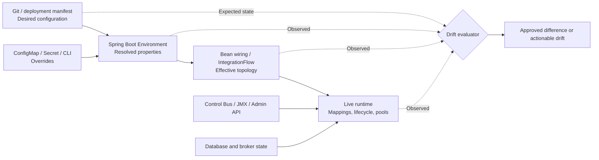
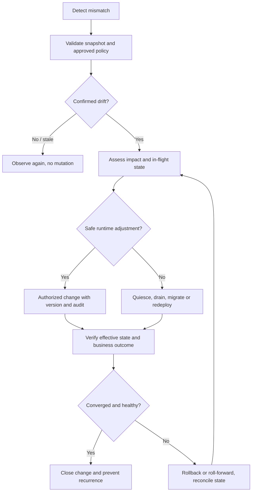

# Configuration drift giữa các môi trường trong Spring Integration runtime

## 1. Vấn đề: cùng một phiên bản ứng dụng nhưng flow hoạt động khác nhau

Một ứng dụng Spring Integration chạy tốt ở staging nhưng production liên tục backlog, hoặc một pod trong production xử lý message khác các pod còn lại. Mọi pod đều báo cùng Git commit và cùng tên Docker image. Vậy tại sao kết quả khác nhau?

Rất có thể **configuration drift**: cấu hình *thực tế đang có hiệu lực* không còn khớp với trạng thái mong muốn, hoặc khác nhau ngoài những chênh lệch được phép giữa môi trường và các instance. Ví dụ: staging có `maxMessagesPerPoll=20`, production chỉ có `1`; một pod sản xuất bật `channelKeyFallback=true`; một flow động đã bị dừng bằng Control Bus nhưng vẫn nằm trong danh sách cấu hình tĩnh; một worker trỏ sang `region` khác nên không còn đọc backlog cũ.

Đây là bài **“Configuration drift giữa các môi trường”** thuộc chương **Vận hành** của module **SPRING_INTEGRATION_RUNTIME**. Module tập trung vào message flow qua channel, endpoint, consumer, poller, executor; quản lý vòng đời IntegrationFlow; transaction, retry, message store, lỗi, correlation và trạng thái runtime. Vì thế, drift ở đây không chỉ là khác một biến môi trường: nó có thể làm thay đổi **đường đi, tốc độ, độ bền và tính đúng đắn của message**.

Sau bài này, bạn sẽ biết:

1. Phân biệt **khác biệt có chủ đích** giữa môi trường với **drift ngoài chính sách**.
2. Phân tích bốn lớp trạng thái: **desired configuration → resolved properties → wired components → live runtime state**.
3. Kiểm tra nguồn ưu tiên cấu hình Spring Boot, profiles, environment variables và các override bất ngờ.
4. Thiết kế **manifest cấu hình không chứa secrets**, fingerprint, so sánh theo policy và phát hiện drift giữa nhiều pod.
5. Dùng Actuator, Spring Integration graph, metrics và inspection có phân quyền để xác minh topology, lifecycle, thread pool, polling, route và persistent state.
6. Đề xuất runbook xử lý drift có **preflight, canary, drain/reconcile, rollback** và kiểm thử chống tái diễn.

> **Giới hạn phiên bản:** Ví dụ tham chiếu Spring Integration **6.5.x**, Spring Boot **3.5.x**, Spring Framework 6.x và Java 17+. Những key cấu hình bắt đầu bằng `app.integration.*` trong bài là **quy ước do ứng dụng tự định nghĩa**, không phải các property được Spring Integration tự nhận biết.

## 2. Định nghĩa drift bằng trạng thái mong muốn và trạng thái thực

Một hệ thống có thể cố ý dùng polling interval khác nhau ở dev và production, hoặc ghi vào database/schema riêng. Khác giá trị **không nhất thiết là lỗi**: chỉ khi cấu hình nằm ngoài quy tắc cho phép, khác giữa các node bắt buộc đồng nhất, hoặc sai so với manifest được phê duyệt thì mới là drift cần xử lý.



### 2.1. Bốn lớp cấu hình cần tách riêng

| Lớp | Nguồn và phạm vi | Ví dụ drift | Vì sao so sánh tệp YAML là chưa đủ? |
| --- | --- | --- | --- |
| **Desired** | Git, GitOps/Helm, approved deployment spec, policy theo env. | Production được phê duyệt 8 workers nhưng Helm release cũ vẫn khai báo 4. | Git là ý định; cluster chưa chắc triển khai bản mới. |
| **Resolved** | Spring `Environment` đã áp thứ tự `PropertySource`, profile, env var, system property, command line. | `APP_INTEGRATION_ORDERS_POLL_MAX_MESSAGES=1` ghi đè file YAML. | Tệp có giá trị đúng nhưng runtime nạp giá trị khác. |
| **Wired** | Spring beans/IntegrationFlow, channel types, endpoint IDs, advice chains, transaction manager. | Cùng property value nhưng cấu hình Java nhánh `@Profile` tạo `ExecutorChannel` ở một pod. | Giá trị trong Environment không chứng minh bean đã được tạo đúng. |
| **Live** | Router mappings, `SmartLifecycle.isRunning()`, `IntegrationFlowContext` registrations, pool size, subscribed consumers. | Operator đổi route qua Control Bus rồi quên trả lại. | Runtime có thể bị sửa sau khi context khởi tạo mà không sửa Environment. |

Ngoài ra còn **state phụ thuộc dữ liệu**: JDBC store region/table prefix, group ID, metadata marker, schema version, broker subscription/partition, retry cache. Một giá trị drift ở những định danh này có thể làm dữ liệu vẫn nằm trong backend nhưng flow mới **không tìm thấy**, hoặc nhiều flow xử lý cùng event theo nhầm namespace.

### 2.2. Ma trận sai lệch: hợp lệ hay nguy hiểm?

| Khác biệt | Có chủ đích? | Kiểm tra cần thiết |
| --- | --- | --- |
| Dev dùng queue RAM, production dùng JDBC queue | Có thể hợp lệ. | Test riêng durability và transaction ở production-like environment; không dùng kết quả dev để bảo đảm restart. |
| Dev poll mỗi 1 giây, prod poll mỗi 5 giây | Có thể hợp lệ. | So với SLO, throughput và expected policy của từng môi trường. |
| Production pod A `ordersPoller.isRunning=true`, pod B `false` | Có thể là sự cố hoặc maintenance có phê duyệt. | Kiểm tra desired replica/role, change window và owner của pod B. |
| Pod A `routeKey=VIP → channelBlue`, pod B `→ channelGreen` | Có thể là rollout canary có chủ đích. | Kiểm tra rollout generation, tỷ lệ traffic và deadline hội tụ. |
| Cùng một queue JDBC mà node A dùng region V1, node B dùng V2 | Nguy hiểm nếu cả hai dự kiến cùng tiêu thụ một backlog. | Đối chiếu table prefix, group ID, migration và kế hoạch drain/replay. |
| Một môi trường thiếu `errorChannel` / recovery policy | Thường nguy hiểm. | Đường lỗi, source ack/rollback, DLQ và alert. |
| Worker pool production có 16 threads thay vì 8 | Không tự kết luận tốt hơn. | Đo CPU, downstream limit, DB pool và p99 latency. |
| Một môi trường bật debug logs với payload nhạy cảm | Rủi ro dữ liệu và hiệu năng. | Logging policy, PII scrubbing và thời hạn điều chỉnh. |

**Nguyên tắc:** drift detector so theo **approved baseline có định nghĩa ngoại lệ**, không phải so mọi giá trị dev với prod rồi báo động hàng nghìn false positives.

## 3. Spring Boot nạp cấu hình theo thứ tự ưu tiên như thế nào?

Spring Boot cho phép tách cấu hình khỏi mã nguồn qua `application.yml`/`application.properties`, profile-specific files, cấu hình ngoài JAR, environment variables, JVM system properties, `SPRING_APPLICATION_JSON` và command-line arguments. Theo tài liệu Spring Boot 3.5, **nguồn cấu hình ở phía sau trong thứ tự ưu tiên có thể ghi đè nguồn trước**.

Một số nguồn thường quan trọng trong vận hành:

| Nguồn | Ví dụ | Bẫy drift |
| --- | --- | --- |
| Config data trong JAR | `application.yml`, `application-prod.yml` | Image cùng version nhưng active profile khác. |
| Config data ngoài JAR | `/config/application.yml`, mounted ConfigMap | ConfigMap/mount bị cập nhật riêng không theo Git commit. |
| OS environment variables | `APP_INTEGRATION_ORDERS_WORKER_POOL_SIZE=8` | Một pod còn override cũ trong Deployment/Secret. |
| JVM system properties | `-Dapp.integration.orders.worker-pool-size=4` | Launch script/Java tool options ghi đè config data. |
| `SPRING_APPLICATION_JSON` | JSON truyền qua env/system/CLI | Khó thấy nếu chỉ xem tên các biến “thông thường”. |
| Command-line arguments | `--app.integration.orders.poll-max-messages=1` | Có độ ưu tiên cao hơn config data thông thường. |
| Spring test overrides | `@DynamicPropertySource`, `@TestPropertySource` | Kết quả test khác production nếu quên nguồn override đặc thù. |

**Không nên rút gọn thứ tự ưu tiên thành “env var luôn thắng tất cả”.** JVM system property, command-line argument và test property sources có thể ưu tiên cao hơn tùy tình huống. Hãy đối chiếu danh sách đầy đủ trong tài liệu Spring Boot tương ứng phiên bản đang chạy.

### 3.1. Ví dụ cùng YAML nhưng kết quả khác

File cấu hình do ứng dụng sở hữu:

```yaml
# application.yml
app:
  integration:
    orders:
      poll-max-messages: 20
      poll-delay: 250ms
      receive-timeout: 0ms
      worker-pool-size: 8
      store-region: ORDERS_PROD_V1
```

Ở pod A, không có override, nên Spring Boot binding nhận `poll-max-messages=20`. Ở pod B, Deployment còn:

```text
APP_INTEGRATION_ORDERS_POLL_MAX_MESSAGES=1
```

và giá trị hiệu lực ở B có thể là 1, mặc dù hai pod dùng cùng `application.yml`. Đây là ví dụ về **property drift**, có thể làm throughput của hai poller rất khác nhau.

### 3.2. Profile và Config Data cũng có thể làm lệch

Kiểm tra:

- `spring.profiles.active`: danh sách profile thực tế, thứ tự và nhóm profile liên quan.
- `spring.config.location`: có thay các vị trí mặc định bằng danh sách khác không; khi muốn bổ sung, xét `spring.config.additional-location`.
- `spring.config.import`: file/config server/secret mount được import, chính sách `optional:` và xử lý khi nguồn vắng mặt.
- Nhiều file YAML/properties trùng tên/đường dẫn, hoặc file ngoài JAR có ưu tiên cao hơn nội bộ.
- Một property đã được bind vào bean khi startup có **tự cập nhật hay không** sau khi nguồn cấu hình thay đổi. Với Spring Boot thông thường, sửa file/ConfigMap không tự bảo đảm mọi bean đang chạy tự rebind; cần cơ chế refresh/restart có chủ đích.

Thay vì tin vào tên profile từ pipeline, hãy đọc **active profiles và nguồn property thực tế** ở tiến trình đang chạy, nhưng tránh in giá trị bí mật.

## 4. Những điểm cấu hình có ảnh hưởng lớn tới runtime

### 4.1. Message channel, dispatcher và subscriber topology

| Điểm thay đổi | Tác động trực tiếp | Dấu hiệu |
| --- | --- | --- |
| `DirectChannel` ↔ `ExecutorChannel` | Chuyển từ xử lý đồng bộ sang bất đồng bộ, đổi transaction/thread boundary. | Producer send latency giảm nhưng handler completion chưa chắc tăng. |
| `DirectChannel` ↔ `PublishSubscribeChannel` | Point-to-point thành fan-out; một event có thể đến nhiều handlers. | Business side effects hoặc calls tăng bất thường. |
| `QueueChannel` RAM ↔ persistent queue | Thay durability/rollback/serialization, latency I/O. | Behavior sau restart, backlog, DB metrics khác. |
| Executor core/max/queue capacity | Đổi concurrency, hàng đợi tasks và rejection. | p99, active threads, rejected tasks và throughput. |
| Router mapping/fallback | Đổi đích message, có thể tự-loop nếu key lạ trùng channel name. | Traffic sai flow; `getChannelMappings()` khác baseline. |
| Channel subscription count | Một endpoint có thể không còn subscriber hoặc đổi phân phối. | `MessageDispatchingException`, flow ngừng hoặc xử lý không dự kiến. |

### 4.2. Poller, consumer và lifecycle

Một poller khác `fixedDelay`, `maxMessagesPerPoll`, `receiveTimeout` hoặc `TaskScheduler` có thể tạo throughput và backlog khác hẳn. Đặc biệt:

- Một `PollingConsumer` có thể lấy nhiều message trong **một lượt poll**, nên `maxMessagesPerPoll=20` không đồng nghĩa 20 messages/giây.
- Tăng concurrent consumers không tự tăng throughput nếu DB/API/partition đã bão hòa; có thể tăng lock contention và redelivery.
- Endpoint có bean nhưng `isRunning() == false` **không nhận việc mới** theo lifecycle bình thường.
- `IntegrationFlowContext` cho phép đăng ký/dừng/hủy flow sau startup; drift ở registration ID không thể phát hiện chỉ bằng property list.
- `DirectChannel` giữ thread hiện tại, `ExecutorChannel` đổi thread: một drift channel type có thể làm transaction và exception handling thay đổi đáng kể.

### 4.3. Transaction, retry và đường lỗi

| Cấu hình lệch | Hậu quả có thể có |
| --- | --- |
| Poller thiếu `PlatformTransactionManager` hoặc dùng sai DataSource | `receive()` từ JDBC queue có thể commit riêng; handler lỗi không khôi phục message như mong đợi. |
| `RequestHandlerRetryAdvice.maxAttempts` khác giữa pod | Số handler invocations, latency và error amplification khác. |
| Recovery callback bị bỏ hoặc đổi đích | Lỗi có thể propagate/rollback khác hoặc bị nuốt rồi commit/ack sai. |
| `errorChannel` thiếu consumer, hoặc DLQ binding khác | Message lỗi không có đường hồi phục tin cậy. |
| Idempotency key strategy / metadata region khác | Event trùng có thể được xử lý lại, hoặc event mới bị coi là duplicate. |
| Aggregator correlation/release strategy khác | Group có thể kẹt hoặc phát hai lần sau cutover. |

**Đừng đo drift chỉ bằng chuỗi cấu hình như `transactional=true`**. Cần kiểm tra manager thực sự được gắn ở **đúng tầng** (poller hay handler) và các resource có cùng transaction không; `ExecutorChannel` tạo thread boundary mà một flag không diễn đạt hết.

### 4.4. Persistent store, schema và logical identity

Với Spring Integration JDBC:

- `JdbcChannelMessageStore` phù hợp channel, còn `JdbcMessageStore` phù hợp aggregator/claim-check.
- `tablePrefix` (mặc định `INT_`), `region` và logical group/channel ID quyết định **dữ liệu nào được đọc**.
- Query provider phụ thuộc RDBMS (PostgreSQL, Oracle, v.v.); dùng sai provider có thể làm poll lỗi hoặc lock behavior khác.
- DDL/schema version và serializer phải tương thích message đã ghi từ phiên bản cũ.
- Một số store từ Spring Integration 6.2 kiểm tra sự tồn tại bảng lúc start; **bảng tồn tại không bảo đảm format/codec, index và group state đều đúng**.

Nếu production có hai node dùng region khác nhau trong khi operator nghĩ chúng cùng một queue, backlog cũ có thể còn nằm ở vùng khác. **Không đổi region/groupId tùy tiện để “sửa drift”** nếu chưa kiểm kê message tồn và kế hoạch migration/replay.

## 5. Thiết kế baseline cấu hình theo môi trường

Một baseline tốt gồm **giá trị mong muốn**, **điều kiện ngoại lệ** và **dấu vết triển khai**. Nên version hóa nó cùng source code hoặc infrastructure repository, để khi một giá trị đổi có thể biết ai phê duyệt, lúc nào, ở rollout nào.

### 5.1. Ví dụ manifest mang tính minh họa

Tệp YAML dưới đây là **một manifest vận hành do đội ứng dụng định nghĩa**. Nó **không phải** định dạng mà Spring Boot hay Spring Integration tự đọc để tự áp các policy. Muốn tự động hóa, phải xây dựng parser/validator/control plane riêng.

```yaml
# expected-runtime.yml -- minh họa application-owned policy
service: SPRING_INTEGRATION_RUNTIME
release: 2026.11.1
schemaVersion: 1
environments:
  staging:
    expected:
      orders.pollMaxMessages: 5
      orders.workerPoolSize: 2
      orders.storeRegion: ORDERS_STAGING_V1
      orders.routerFallback: false
  production:
    expected:
      orders.pollMaxMessages: 20
      orders.workerPoolSize: 8
      orders.storeRegion: ORDERS_PROD_V1
      orders.routerFallback: false
    invariantAcrossPods:
      - orders.storeRegion
      - orders.routerFallback
      - orders.errorChannelName
    rolloutExceptions:
      - key: orders.routerMappingVersion
        allowedVersions: [17, 18]
        reason: approved-blue-green-cutover
        expiresAt: "2026-11-23T00:00:00Z"
```

Trong ví dụ, staging/prod được phép khác `pollMaxMessages` và `workerPoolSize`. Nhưng hai pod production không được khác nhau về store region hoặc policy fallback, trừ khi có ngoại lệ triển khai rõ. Ngoại lệ **phải có thời hạn**, owner/change ID và trạng thái đóng; nếu không, drift bị hợp thức hóa mãi mãi.

### 5.2. Những trường nên có trong mỗi bản snapshot

| Nhóm | Trường được khuyến nghị | Lý do |
| --- | --- | --- |
| Provenance | `service`, image digest, Git SHA, build version, Spring Integration/Boot versions | Biết so sánh đúng release; tên tag image có thể bị thay đổi. |
| Scope | Environment, region/zone, namespace, deployment, pod/node ID | Phân biệt khác biệt có chủ đích và pod drift. |
| Desired version | Config Git commit, Helm release, config generation, change ID | Truy nguyên nguồn sự thật và rollout. |
| Resolved config | Allowlisted bound properties và nguồn property nếu an toàn | So đúng giá trị hiệu lực, không chỉ file. |
| Wired topology | Channel types, endpoint IDs, poller/advice/transaction manager identity | Biết flow thực tế đã tạo ra gì. |
| Live mutable state | Running flags, router mappings/generation, dynamic flow IDs, executor pool core/max | Phát hiện thay đổi sau startup. |
| Persistence identity | Store type, logical region/table prefix/group ID, schema version | Giữ kết nối với backlog và metadata đã lưu. |
| Observation | Timestamp UTC, observation TTL, config fingerprint, health/backlog | Chống so ảnh chụp cũ với trạng thái mới. |

**Không lấy secrets làm nội dung so sánh trực tiếp.** Không đưa mật khẩu JDBC, OAuth token, private key, URL chứa credentials hoặc nguyên payload vào snapshot. Với secret rotation, có thể ghi **version/revision ID** do secret manager cung cấp cùng trạng thái đã áp dụng; không log plaintext hoặc hash tùy ý của token bí mật. Ngay cả hash cũng có thể rò thông tin nếu giá trị có entropy thấp.

### 5.3. Chính sách phân loại theo mức độ ảnh hưởng

Không phải mọi drift đều cần restart khẩn cấp:

- **Critical:** mismatch store region/table prefix khi các node dự kiến cùng đọc một queue, mất transaction quanh `receive()`, route tới handler không cho phép, endpoint lỗi mà vẫn ACK.
- **High:** error/recovery path khác baseline, retry vô hạn, pool bị giảm mạnh làm backlog bùng nổ, thiếu security policy ở control endpoint.
- **Medium:** poll interval/worker count khác kế hoạch nhưng business invariants vẫn giữ; cần điều tra SLO và lịch thay đổi.
- **Low/info:** khác biệt có chủ đích, đã phê duyệt, còn trong rollout window hoặc metrics/log level tạm thời.

Severity là **quy tắc của tổ chức và workload**, không phải phân loại có sẵn của Spring Integration. Một thay đổi `poolSize` có thể là Critical với flow đối soát real-time nhưng chỉ là Medium với batch offline.

## 6. Ngăn drift từ lúc bind cấu hình: typed properties và validation

Dùng `@ConfigurationProperties` để biểu diễn cấu hình có kiểu rõ ràng, tránh rải `@Value` mặc định ở nhiều bean. Với Spring Boot 3.5 và Java 17, record là một lựa chọn phù hợp cho **cấu hình cố định từ startup**.

### 6.1. Cấu hình kiểu mạnh

```java
import java.time.Duration;

import jakarta.validation.constraints.Max;
import jakarta.validation.constraints.Min;
import jakarta.validation.constraints.NotBlank;
import jakarta.validation.constraints.NotNull;
import org.springframework.boot.context.properties.ConfigurationProperties;
import org.springframework.validation.annotation.Validated;

@Validated
@ConfigurationProperties(prefix = "app.integration.orders")
public record OrdersRuntimeProperties(
        @Min(1) @Max(1000) int pollMaxMessages,
        @NotNull Duration pollDelay,
        @NotNull Duration receiveTimeout,
        @Min(1) @Max(128) int workerPoolSize,
        @NotBlank String storeRegion) {
}
```

Đăng ký properties bean và sử dụng trong cấu hình endpoint:

```java
import org.springframework.boot.context.properties.EnableConfigurationProperties;
import org.springframework.context.annotation.Bean;
import org.springframework.context.annotation.Configuration;
import org.springframework.integration.annotation.EnableIntegration;
import org.springframework.integration.channel.QueueChannel;
import org.springframework.integration.dsl.IntegrationFlow;
import org.springframework.integration.dsl.Pollers;
import org.springframework.messaging.PollableChannel;

@Configuration
@EnableIntegration
@EnableConfigurationProperties(OrdersRuntimeProperties.class)
class OrdersFlowConfiguration {
    @Bean
    PollableChannel ordersInputQueue() {
        return new QueueChannel(500);
    }

    @Bean
    IntegrationFlow ordersWorkerFlow(
            OrdersRuntimeProperties settings,
            OrderProcessor processor) {

        return IntegrationFlow.from("ordersInputQueue")
                .handle(processor, "process",
                        e -> e.id("ordersPollingEndpoint")
                                .poller(Pollers.fixedDelay(settings.pollDelay())
                                        .maxMessagesPerPoll(
                                                settings.pollMaxMessages())
                                        .receiveTimeout(
                                                settings.receiveTimeout()
                                                        .toMillis())))
                .get();
    }
}
```

Giả định `OrderProcessor` là một bean ứng dụng với `public void process(String payload)`. Ví dụ dùng `QueueChannel` **trong RAM**, vì vậy thuộc tính `storeRegion` chưa được gắn vào backing JDBC store; ở production phải cấu hình store riêng và kiểm tra identity thực tế. Tương tự `workerPoolSize` chưa được dùng để cấu hình scheduler/executor. **Một property được bind nhưng không được sử dụng không có tác dụng lên runtime.**

Nếu muốn ràng buộc `pollDelay` lớn hơn zero hoặc giới hạn timeout, hãy thêm validator/custom validation; `@NotNull Duration` chỉ ngăn `null`, không tự cấm `Duration.ZERO` hoặc giá trị âm. Để constraint được thực thi, cần Bean Validation provider (chẳng hạn `spring-boot-starter-validation`).

**Tại sao cách này giúp chống drift?** Một giá trị sai kiểu hoặc nằm ngoài phạm vi cho phép khiến startup fail sớm, thay vì chạy với pool size 0 hay một số attempts vô lý. Nhưng validation vẫn **không chứng minh** mọi pod dùng cùng giá trị, hoặc một operator chưa thay runtime state sau startup.

### 6.2. Ràng buộc cấu hình cần giữ cùng một transaction/flow

Một flow có thể cần nhiều property liên quan nhau:

```text
orders.pollMaxMessages       = 20
orders.pollDelay             = 250ms
orders.receiveTimeout        = 0ms
orders.workerPoolSize        = 8
orders.dbPoolSize            = 12
orders.maxHandlerAttempts    = 3
orders.storeRegion           = ORDERS_PROD_V1
orders.errorChannelName      = ordersErrorChannel
```

Ở đây `dbPoolSize` không nên thấp đến mức mọi worker đều chờ connection quá lâu; `maxHandlerAttempts` và retry backoff phải phù hợp với deadline của message; `errorChannelName` phải resolve được một channel có consumer. Các quy tắc **cross-field** nên được kiểm tra bằng custom validator hoặc integration test startup. Bản thân Spring Boot property binding không biết các quan hệ nghiệp vụ này.

### 6.3. Frozen configuration khác mutable runtime state

Trong Spring Boot thông thường, record `OrdersRuntimeProperties` được tạo khi bind config và **không tự đổi** khi ai đó sửa ConfigMap hoặc tệp YAML. Ngược lại, `ThreadPoolTaskExecutor.setCorePoolSize(...)`, `HeaderValueRouter.setChannelMappings(...)`, `IntegrationFlowRegistration.stop()` có thể đổi **runtime state** mà record ban đầu không phản ánh.

Do đó, cần hai nguồn quan sát:

1. **Resolved startup config:** những giá trị có hiệu lực khi context được khởi tạo.
2. **Observed live state:** thông tin trực tiếp từ các bean đang chạy, không chỉ in lại record properties.

Không giả định một endpoint luôn tự refresh khi property source thay đổi; nếu ứng dụng dùng Spring Cloud Config refresh hoặc watcher tùy chỉnh, phải kiểm thử chính xác **bean nào** được tạo lại và **component nào** thực sự chuyển trạng thái.

## 7. Chụp trạng thái runtime mà không làm lộ thông tin nhạy cảm

Một health endpoint tự tạo có thể cung cấp **snapshot tối thiểu** của các field quan trọng. Hãy sử dụng dữ liệu đọc từ bean thực tế, không gửi toàn bộ `Environment` hay các bean definitions ra Internet.

### 7.1. Ví dụ Java: so sánh resolved property với router/pool live state

Ví dụ giả định ứng dụng đã định nghĩa bean `ordersRouter` kiểu `HeaderValueRouter` và `ordersWorkerExecutor` kiểu `ThreadPoolTaskExecutor`. Đây là một **application-owned diagnostic service**, không phải actuator endpoint tự sinh:

```java
import java.time.Instant;
import java.util.Map;

import org.springframework.beans.factory.annotation.Qualifier;
import org.springframework.integration.router.HeaderValueRouter;
import org.springframework.scheduling.concurrent.ThreadPoolTaskExecutor;
import org.springframework.stereotype.Component;

record OrdersRuntimeSnapshot(
        Instant observedAt,
        int configuredWorkerPoolSize,
        int actualCorePoolSize,
        int actualMaxPoolSize,
        int activeWorkers,
        String configuredStoreRegion,
        Map<String, String> actualRouterMappings) {
}

@Component
final class OrdersRuntimeSnapshotService {
    private final OrdersRuntimeProperties settings;
    private final HeaderValueRouter router;
    private final ThreadPoolTaskExecutor executor;

    OrdersRuntimeSnapshotService(
            OrdersRuntimeProperties settings,
            @Qualifier("ordersRouter") HeaderValueRouter router,
            @Qualifier("ordersWorkerExecutor") ThreadPoolTaskExecutor executor) {
        this.settings = settings;
        this.router = router;
        this.executor = executor;
    }

    OrdersRuntimeSnapshot collect() {
        return new OrdersRuntimeSnapshot(
                Instant.now(),
                settings.workerPoolSize(),
                executor.getCorePoolSize(),
                executor.getMaxPoolSize(),
                executor.getActiveCount(),
                settings.storeRegion(),
                Map.copyOf(router.getChannelMappings()));
    }
}
```

**Giới hạn của snapshot này:**

- `actualCorePoolSize` và `actualMaxPoolSize` là cấu hình live của executor, còn `activeWorkers` là giá trị tải **thay đổi theo thời điểm**; không nên so equality `activeWorkers` giữa hai pod để đánh dấu drift.
- `configuredStoreRegion` chỉ phản ánh **giá trị đã bind**, **chưa chứng minh** `JdbcChannelMessageStore` thật dùng region đó. Nếu muốn kiểm chứng, inject store thật và đọc `getRegion()`; bổ sung backing resource identity phù hợp.
- Tên route có thể nhạy cảm vì tiết lộ topology; chỉ trả cho management endpoint đã xác thực và được phân quyền.
- Không lấy snapshot **tại hai thời điểm rất xa nhau** rồi quy mọi khác biệt vào drift.
- Các ví dụ này là các lớp độc lập để minh họa; cần khai báo bean router/executor và `OrderProcessor` ở ứng dụng thật trước khi biên dịch một configuration hoàn chỉnh.

### 7.2. Những giá trị không nên đóng fingerprint như cấu hình

| Giá trị | Lý do không so equality qua pod |
| --- | --- |
| `activeCount` / thread ID | Biến đổi theo traffic và scheduler. |
| Queue depth, in-flight tasks | Mỗi pod có tải khác nhau, không phải drift cấu hình. |
| Ước lượng age của message cũ nhất | Đặc trưng vận hành/backlog; dùng alert threshold thay equality. |
| HTTP/database latency | Cần SLO/benchmark, không phải expected static value. |
| Dynamic correlation ID, message ID | Unique theo event; không phải component config. |
| Password/token/secret | Nhạy cảm, không xuất ra snapshot hoặc log fingerprint thô. |

Ngược lại, `channel type`, `route policy`, `store region`, `poll max`, `pool core/max` và `registered flow IDs` thường thuộc danh mục có thể so với baseline, nhưng **registered flow IDs** có thể thay đổi có chủ đích khi scale tenant/blue–green.

## 8. Công cụ quan sát: Environment, Actuator, Integration Graph và JMX

Một dashboard tốt kết hợp **cấu hình được nạp** với **runtime topology** và **metric hành vi**. Không có endpoint duy nhất chứng minh mọi thứ đều khớp với desired state.

### 8.1. Các điểm kiểm tra của Spring Boot Actuator

Tùy dependency, exposure và security được cấu hình, Actuator có thể cung cấp:

| Endpoint thường gặp | Có ích để biết gì? | Giới hạn |
| --- | --- | --- |
| `/actuator/env` | Giá trị property từ Spring `Environment` và nguồn cấu hình/nguồn gốc khi có metadata. | Không bảo đảm bean đã áp đúng property; dữ liệu nhạy cảm phải được sanitize. |
| `/actuator/configprops` | Các giá trị `@ConfigurationProperties` đã bind. | Chỉ cho thấy record/config bean, chưa chắc live executor/router vẫn như startup. |
| `/actuator/beans` | Các bean đã khởi tạo, type và dependency. | Không hiển thị hết mọi thuộc tính và trạng thái luồng đang xử lý. |
| `/actuator/conditions` | Vì sao auto-configuration/conditional bean được bật hoặc không. | Không thay thế kiểm thử business flow. |
| `/actuator/integrationgraph` | Graph gồm những component Spring Integration và các liên kết đã được framework mô tả. | Không chắc bao gồm mọi semantic config, transaction hay trạng thái dữ liệu của store. |
| `/actuator/health` | Tình trạng tổng thể/component health theo indicator được khai báo. | `UP` chưa chắc đồng nghĩa không có drift hoặc queue không bị nghẽn. |
| `/actuator/metrics` | Metrics theo channel, handler, queue và tài nguyên nếu có instrumentation. | Metrics nói về hành vi/tải; không phải checksum manifest. |
| `/actuator/flyway` / `liquibase` | Migration database đã được áp dụng nếu có module tương ứng. | Version DB không tự chứng minh serializer/semantic state tương thích. |

**Bảo mật:** `env`, `configprops`, `beans` và `integrationgraph` có thể tiết lộ cấu trúc nội bộ; mặc định Actuator không expose tất cả qua HTTP. Spring Boot 3.5 **ẩn/sanitize** nhiều giá trị ở `env` và `configprops`; không bật `show-values=always` chỉ để debug production. Hãy giữ endpoints trong mạng quản trị, dùng authentication/authorization, TLS, audit và chỉ expose cái thực sự cần. Giá trị sanitized như `******` **không thể được dùng để kết luận hai secrets giống nhau**.

Spring Integration có thể có một `IntegrationGraphController` riêng với các URL như `/integration`; nó **không đồng nhất** với Boot Actuator endpoint `/actuator/integrationgraph`. Security và enablement của từng controller phải được kiểm kê riêng.

### 8.2. Quan sát trạng thái Spring Integration

Nên đọc từ các component/management APIs thực tế:

- **Router:** `AbstractMappingMessageRouter.getChannelMappings()`; phân biệt mapping tĩnh mong muốn và mapping đã đổi sau Control Bus/JMX.
- **Lifecycle:** `SmartLifecycle.isRunning()` của endpoint/channel adapter/poller; một component hiện diện trong graph chưa chắc đang chạy.
- **Dynamic flow:** `IntegrationFlowContext.getRegistry()` và `getRegistrationById(id)` trong **JVM hiện tại**; registration của pod khác không hiện diện tự động.
- **Executor:** core/max pool, active count, executor task queue, rejection; chú ý `maxPoolSize` không phải số thread đang chạy.
- **Poller:** trigger type, interval, `maxMessagesPerPoll`, receive timeout, advice chain; các field không có getter công khai đồng nhất, cần một diagnostics adapter từ cấu hình ứng dụng.
- **Persistent stores:** `JdbcChannelMessageStore.getRegion()` và prefix/schema cấu hình; đối chiếu database/table/group keys thực tế, không dựa vào cấu hình được bind nhưng chưa sử dụng.
- **Error/retry:** tên error channel, recovery handler, retry/backoff policy, source ack/transaction; kiểm tra topology và test thay vì chỉ đọc một Boolean.

**Mẹo vận hành:** thêm một **component inventory** của ứng dụng với endpoint ID ổn định. Không đặt ID sinh ngẫu nhiên cho các endpoint cần so drift, vì hai flow cùng nghĩa có thể tạo tên khác khiến dashboard báo false positive.

### 8.3. So sánh cấu hình và hành vi song song

Ví dụ một pod báo `pollMaxMessages=20` đúng baseline nhưng chỉ xử lý 1 message trong nhiều giây. Đừng kết luận “không drift” và dừng điều tra. Có thể:

1. Poller chưa chạy hoặc dùng một `TaskScheduler` khác bị nghẽn.
2. Source/queue rỗng hoặc message nằm ở region/group ID khác.
3. Handler lỗi liên tục, transaction rollback và redeliver cùng message.
4. DB connection pool/lock khiến handler không đủ throughput.
5. `maxMessagesPerPoll` là giới hạn **mỗi lượt**, không phải đảm bảo ít nhất 20 message.

Khi đó cấu hình có thể khớp desired state nhưng **runtime health/SLO** vẫn không đạt. Drift detection không thay thế monitoring chức năng.

## 9. Phát hiện drift tự động: so sánh có chuẩn hóa và version

Một drift evaluator cần nhận hai đối tượng:

1. **Expected snapshot:** baseline đã phê duyệt cho đúng service, môi trường, release và config generation.
2. **Observed snapshot:** dữ liệu có timestamp từ **đúng instance**, gồm những trường được phép so sánh và provenance.

### 9.1. Trước khi so sánh, chuẩn hóa

Hai giá trị có thể đồng nghĩa nhưng biểu diễn khác:

| Giá trị A | Giá trị B | Có thể chuẩn hóa thành |
| --- | --- | --- |
| `PT0.25S` | `250ms` | `250 ms` theo đơn vị chuẩn. |
| `false` | `FALSE` | Boolean `false`. |
| `4` | `04` | Integer 4 nếu key định nghĩa là số; **không** áp cho ID dạng chuỗi. |
| Map route có thứ tự key khác | Map route cùng cặp key/value | Sắp xếp key theo thứ tự cố định. |
| `ordersErrorChannel` | `ordersErrorChannel` | So chính xác string; đây là bean ID. |
| `ORDERS_PROD_V1` | `orders_prod_v1` | **Không** tự lower-case; region/key thường phân biệt chữ hoa/thường. |

Tốt nhất dùng **typed bound config** để so các giá trị kiểu `Duration`, `int` và `boolean` thay vì một bộ regex tự đoán. Những định danh như tenant, group ID, region, channel và schema version phải so đúng hợp đồng, không tùy tiện chuẩn hóa.

### 9.2. Ví dụ Java: diff chính xác trên allowlisted keys

Code sau **không đọc secrets** và không phụ thuộc Spring; nó minh họa phần lõi của drift evaluator. Các key đều do ứng dụng xác định trước:

```java
import java.util.ArrayList;
import java.util.List;
import java.util.Map;
import java.util.Objects;
import java.util.Set;
import java.util.TreeSet;

record Drift(String key, String desired, String observed) {}

final class ConfigDriftDetector {
    static List<Drift> compare(
            Map<String, String> desired,
            Map<String, String> observed,
            Set<String> allowedToDiffer) {

        TreeSet<String> allKeys = new TreeSet<>(desired.keySet());
        allKeys.addAll(observed.keySet());

        List<Drift> differences = new ArrayList<>();
        for (String key : allKeys) {
            if (allowedToDiffer.contains(key)) {
                continue;
            }

            String expectedValue = desired.get(key);
            String actualValue = observed.get(key);
            if (!Objects.equals(expectedValue, actualValue)) {
                differences.add(
                        new Drift(key, expectedValue, actualValue));
            }
        }
        return List.copyOf(differences);
    }
}
```

Sử dụng:

```java
import java.util.Map;
import java.util.Set;

Map<String, String> desired = Map.of(
        "orders.pollMaxMessages", "20",
        "orders.storeRegion", "ORDERS_PROD_V1",
        "orders.routerFallback", "false");

Map<String, String> podB = Map.of(
        "orders.pollMaxMessages", "1",
        "orders.storeRegion", "ORDERS_PROD_V1",
        "orders.routerFallback", "false");

var drift = ConfigDriftDetector.compare(desired, podB, Set.of());
// Một khác biệt: orders.pollMaxMessages (desired=20, observed=1).
```

**Thiếu key khác với giá trị null:** ví dụ trên dùng `Map.get` nên null có thể đại diện cả hai. Trong implementation production, giữ thêm trạng thái **MISSING/UNAVAILABLE/REDACTED** để không đánh đồng property không tồn tại với giá trị null hợp lệ, hoặc với lỗi collection. Nếu một snapshot hết hạn hoặc API trả 403, phải báo **không quan sát được**, không tự kết luận pod đã hết drift.

### 9.3. Fingerprint để so nhanh, diff để giải thích

Có thể lấy fingerprint từ các cặp key/value đã **allowlist và chuẩn hóa**, xếp thứ tự ổn định rồi tính SHA-256. Nhưng fingerprint một mình chỉ nói **khác hay giống** theo các field đã chọn, không cho biết nguyên nhân.

```text
orders.pollMaxMessages=20
orders.routerFallback=false
orders.storeRegion=ORDERS_PROD_V1
```

Trong control plane, lưu:

```text
service=SPRING_INTEGRATION_RUNTIME
environment=production
deploymentId=orders-worker
configGeneration=18
snapshotAt=2026-11-22T02:00:00Z
fingerprintSha256=<hex digest of canonical non-secret fields>
```

Với một hệ thống phân tán, đừng so hai fingerprint khi chúng thuộc **hai approved generations khác nhau trong rollout window** rồi coi ngay là incident. Trước tiên xác nhận phiên bản cấu hình mong muốn của từng node, sau đó đợi mức hội tụ theo SLA.

### 9.4. Drift đa node và tính nhất quán của việc đo

Giả sử ba pod A/B/C:

| Pod | Image digest | Desired config gen | Applied gen | Route VIP | Trạng thái |
| --- | --- | ---: | ---: | --- | --- |
| A | sha256:abc… | 18 | 18 | Green | Đúng. |
| B | sha256:abc… | 18 | 17 | Blue | Đang chờ rollout hoặc drift. |
| C | sha256:abc… | 18 | 18 | Green | Đúng. |

Nếu change window vẫn còn hiệu lực và B đang chủ động drain, trạng thái có thể là `ROLLING_OUT`. Nếu vượt deadline hoặc B chưa hề nhận generation mới, cần cảnh báo `CONFIG_DRIFT`. **Chỉ thay mapping trên pod A không cập nhật B/C**: Java object và Spring ApplicationContext là cục bộ theo process.

Với control plane tự triển khai, có thể ghi desired generation trong storage bền vững, cho từng pod apply, trả ACK và so sánh observed generation. Chấp nhận **eventual consistency** khi thiết kế cho phép; nếu cần chuyển đồng loạt tuyệt đối, phải **quiesce ingress/barrier** trước khi đổi.

### 9.5. Khi nào nên fail fast?

Khi một cấu hình thiếu làm mất tính đúng đắn (ví dụ transaction manager không tồn tại, store region sai bất biến đã được quản trị, timeout âm, route tới channel nội bộ không được phép), có thể:

- Từ chối startup của component/application bằng Bean Validation hoặc một `SmartLifecycle` startup check được thiết kế rõ.
- Đặt readiness `DOWN/OUT_OF_SERVICE` để load balancer/broker không cấp traffic mới.
- Giữ instance còn sống ở chế độ diagnosis **chỉ khi** state không gây xử lý sai, có quyền đọc thông tin an toàn.

Không fail toàn bộ ứng dụng chỉ vì một metric `activeWorkers` khác pod khác: đó là **load**, không phải config. Đồng thời, một `ConfigMap` không còn cập nhật không nhất thiết nên tự động restart mọi pod nếu gây mất in-flight jobs; cần policy rollout có drain.

## 10. Chẩn đoán drift từ triệu chứng runtime

Không nên bắt đầu bằng câu “thay YAML cho giống staging”. Trước hết phải xác định **tầng nào lệch** và **hậu quả của việc sửa**.

### 10.1. Thứ tự điều tra

1. **Định danh sự cố:** service, environment, namespace, pod, image digest, Git commit, thời điểm bắt đầu và business flow bị ảnh hưởng.
2. **Đối chiếu desired generation:** config/Helm/chart nào được phê duyệt; có rollout hoặc ngoại lệ còn hiệu lực không?
3. **Đọc resolved values:** profile, property sources và key được allowlist từ `env`/`configprops` hoặc diagnostics nội bộ; không xuất secrets.
4. **Xem wired topology:** channel type, subscribed endpoints, poller/source adapters, advice chain, error channel, transaction manager và graph.
5. **Đọc live mutable state:** `isRunning()`, dynamic flow registry, router mappings, executor core/max, các thay đổi qua Control Bus.
6. **Đối chiếu persistence:** logical queue ID, store region/table prefix, metadata keys, JDBC schema, serializer và broker consumer group.
7. **Tìm tín hiệu hành vi:** backlog, oldest message age, throughput đã commit, retry/rollback, p95/p99 và active threads; phân biệt drift với lỗi hạ tầng.
8. **Xác định blast radius:** chỉ một pod, một tenant, một route hay toàn fleet? Có in-flight message/transaction phải bảo vệ không?
9. **Chọn hướng sửa theo lớp:** redeploy config, runtime operation được audit hoặc data migration.

### 10.2. Bảng triệu chứng và phép đối chiếu

| Triệu chứng | Drift khả dĩ | Kiểm tra có tính quyết định |
| --- | --- | --- |
| Pod A xử lý chậm hơn B dù CPU còn rảnh | `maxMessagesPerPoll`, poll delay, endpoint stopped, scheduler pool. | Resolved config + poller live state + số poll/giây. |
| Một pod gửi VIP tới Blue, pod khác tới Green | Router mapping cập nhật không đồng bộ. | `getChannelMappings()`, applied generation, audit change ID. |
| Queue “trống” sau restart nhưng DB còn rows | Region/group ID/table prefix/channel name đổi. | So logical identity, truy vấn read-only theo region. |
| Partial aggregator group không hoàn tất | Correlation/release strategy hoặc serializer khác. | Group state, message IDs, completed marker, shared lock. |
| Duplicate business effects sau rollout | Dedupe key/metadata region đổi hoặc retry policy khác. | Business IDs, metadata state, transaction/rollback audit. |
| Handler error chỉ ở production | Error/recovery/advice, classpath hoặc downstream endpoint khác. | Bean graph/advice, root cause, resolved downstream config. |
| `send()` nhanh, business completion thấp | Channel đã đổi sang async, hoặc executor queue sâu. | Channel type, task queue, committed/s, handler latency. |
| Pod không có subscriber | Conditional bean/profile/feature flag khác hoặc flow bị destroy. | `conditions`, `beans`, flow registry và `isRunning()`. |
| Tăng workers làm throughput giảm | DB pool/lock, retry hoặc contention nặng hơn. | Active workers, DB wait, connection wait, rollback count. |
| Startup fail sau deploy | DDL/table prefix sai, validation fail, profile tạo bean khác. | Startup exception, migration history, config source origin. |
| `/actuator/env` giống nhau, route khác | Runtime mapping thay sau startup. | Router mapping **trực tiếp** tại từng process. |

### 10.3. Dùng metrics để phân biệt drift với tải

Spring Integration/Micrometer có thể cung cấp send/receive counters, handler timers, queue-size gauges và observations/tracing khi bật instrumentation. Chúng mô tả **hành vi**, không tự chứng minh nguyên nhân:

| Cùng cấu hình? | Cùng tải? | Hành vi khác? | Diễn giải ban đầu |
| --- | --- | --- | --- |
| Có | Không | Có | Có thể là load skew/partition hot key. |
| Không | Có | Có | Drift là một nghi vấn mạnh; vẫn cần phép thử nhân quả. |
| Không | Không | Có | Có thể do cả drift và tải; cần so workloads tương đương. |
| Có | Có | Có | Xem dependency, network, DB locks, JVM/GC và dữ liệu đầu vào. |
| Không | Có | Không | Drift có thể “ẩn”, vẫn cần sửa nếu vi phạm invariant/bảo mật. |

Ví dụ hai pods cùng `maxMessagesPerPoll=20` nhưng pod A chịu 80% traffic tenant hot, pod B chỉ 20%: backlog A tăng chưa phải bằng chứng drift. Ngược lại, cùng image digest không chứng minh cùng OS environment/startup arguments hoặc queue region.

### 10.4. Tùy chọn khi ứng dụng chạy Kubernetes

Có thể dùng công cụ read-only để đối chiếu Deployment template, ConfigMap revisions, image digest và pod status với GitOps state, rồi kiểm tra **effective Spring Boot properties** trong tiến trình:

```bash
# Minh họa; chỉ áp dụng trên namespace bạn được cấp phép.
kubectl -n orders-prod get deployment orders-worker -o yaml
kubectl -n orders-prod get pods -l app=orders-worker
kubectl -n orders-prod describe deployment orders-worker
```

**Lưu ý bảo mật:** manifest có thể chứa env variables nhạy cảm hoặc tham chiếu secrets; không copy raw output vào ticket/log công khai. Các lệnh trên không chứng minh router mapping trong JVM chưa bị sửa sau startup. Lựa chọn commands khác với bare credentials khi truy vấn container cũng phải tuân thủ chính sách tổ chức.

## 11. Runbook khắc phục drift an toàn

Một drift detector tốt không tự sửa mọi khác biệt mà không biết message đang xử lý tới đâu. Sửa poller, router hoặc store có thể gây **mất/trùng message** nếu thao tác khi transaction/backlog đang tồn tại.



### 11.1. Giai đoạn 1 — Confirm và chốt nguồn sự thật

Xác minh snapshot chưa quá hạn, manifest đúng môi trường và rollout window đã hết hoặc được phép xử lý. Ghi lại incident/change ID, owner, desired/observed versions, lớp cấu hình lệch, pods/tenants bị ảnh hưởng, backlog, in-flight, retries, group chưa release và kế hoạch rollback.

Không ghi plaintext secrets. Nếu pod khác biệt vì canary có phê duyệt, phân loại `ROLLING_OUT` thay vì ép nó về version cũ.

### 11.2. Giai đoạn 2 — Chọn phương án sửa đúng lớp

| Loại drift | Hướng sửa ưu tiên | Điều cần tránh |
| --- | --- | --- |
| Resolved property sai vì env/CLI/profile | Sửa **declarative deployment source**, rollout có kiểm soát. | Sửa YAML trong container rồi mong tồn tại sau redeploy. |
| Bean wiring sai vì conditional/profile | Sửa config/flag và restart/rollout đã test. | Chỉ đổi property mà không rebuild bean liên quan. |
| Router mappings lệch | Reapply approved mappings qua service có quyền, change ID và expectedVersion. | Dùng nhiều lệnh cập nhật từng key gây trạng thái trung gian. |
| Endpoint bị stop ngoài kế hoạch | Xem nguyên nhân và queue/transaction, start theo runbook. | Start lại vô hạn khi DB/downstream vẫn lỗi. |
| Dynamic flow bị thiếu | Đăng ký đúng flow ID/version, verify input route. | Đăng ký trùng ID hoặc destroy V1 khi còn in-flight. |
| Executor pool bị thay | Đọc current core/max và downstream quotas, reapply trong range an toàn. | Tăng threads vô hạn gây contention. |
| Store region/group/table prefix lệch | **Quiesce + kiểm kê dữ liệu**, xem lại migration và config. | Đổi region “cho khớp” rồi bỏ backlog ở vùng cũ. |
| Metadata key strategy drift | Dual-read/migrate marker, kiểm tra dedup/inbox và idempotency. | Xóa toàn bộ metadata rồi replay mù. |
| Retry/recovery/transaction policy sai | Cập nhật flow/bean cùng kiểm thử failure/rollback. | Chỉ test happy path hoặc bật retry vô hạn. |

Trong 6.5, `AbstractMappingMessageRouter.setChannelMappings(Map)` hỗ trợ thay cả bảng mapping trong **một router instance**; không phải atomic operation trên nhiều JVM. Mọi đường runtime control (JMX, Control Bus, Admin API) cần authentication, authorization và audit.

### 11.3. Giai đoạn 3 — Quiesce/drain khi có state

1. Tạm dừng **ingress mới** tại nơi kiểm soát, hoặc chuyển vào buffer bền vững khác.
2. Cho consumers xử lý đến checkpoint có thể kiểm chứng; kiểm tra cả queue, delayed messages, aggregator partial groups và executor tasks.
3. Xác minh transaction `receive + handler` đã commit/rollback, không chỉ `isRunning() == false`.
4. Ghi baseline row count, business IDs, schema/region/group, recovery/DLQ; sao lưu khi cần.
5. Áp rollout/migration có kiểm thử; resume canary rồi theo dõi duplicate effects và backlog cũ.
6. Mở lưu lượng đầy đủ chỉ sau khi observed state, business outcome và SLO đạt điều kiện.

**`QueueChannel` rỗng chưa chứng minh đã drain xong.** Aggregator giữ partial group, delayer còn message, broker có redelivery, gateway chờ reply và external API có thể đã tạo side effect nhưng caller chưa biết kết quả.

### 11.4. Giai đoạn 4 — Verify và đóng incident

Sau thay đổi cần kiểm tra **cả cấu hình lẫn outcome**:

- Desired generation == applied generation ở tất cả pods phải hội tụ.
- Resolved properties khớp baseline; wired bean types, endpoint IDs và channel graph đúng.
- Router mappings, flow registry, `isRunning()`, executor core/max và poller live khớp policy.
- Persistent store region/group và serializer đúng; backlog cũ có consumer đọc được.
- Business event được commit/ack đúng, retries/rollbacks và duplicate effects trở về mức chấp nhận.
- Queue depth/oldest age, p95/p99, throughput và audit trail sau cutover đều ổn.

Nếu không đạt, **rollback có điều kiện hoặc roll-forward**. Đổi route về V1 không tự đảo side effects V2 đã thực hiện. Rollback code khi store đã chứa payload schema mới có thể không đọc được dữ liệu. Khi config drift đã gây data inconsistency, phải reconcile state theo bằng chứng, không ép cấu hình cũ lên dữ liệu không còn tương thích.

## 12. Ngăn drift tái diễn bằng test và deployment gates

Drift không chỉ là sự cố cần sửa sau khi deploy. Ta có thể ngăn nhiều loại từ **CI, staging, canary và startup validation**, rồi kiểm tra tiếp **sau khi runtime đã được thay đổi**.

### 12.1. Test binding và validation trước khi tạo IntegrationFlow

Dùng `ApplicationContextRunner` của Spring Boot Test để kiểm tra kiểu, giới hạn và profile mà không phải khởi tạo toàn bộ inbound adapters. Ví dụ này kiểm thử record `OrdersRuntimeProperties` ở mục 6:

```java
import org.junit.jupiter.api.Test;
import org.springframework.boot.context.properties.EnableConfigurationProperties;
import org.springframework.boot.test.context.runner.ApplicationContextRunner;
import org.springframework.context.annotation.Configuration;

import static org.junit.jupiter.api.Assertions.*;

class OrdersRuntimePropertiesTest {

    @Configuration(proxyBeanMethods = false)
    @EnableConfigurationProperties(OrdersRuntimeProperties.class)
    static class PropertiesOnlyConfiguration {
    }

    private final ApplicationContextRunner runner =
            new ApplicationContextRunner()
                    .withUserConfiguration(PropertiesOnlyConfiguration.class);

    @Test
    void bindsApprovedValues() {
        runner.withPropertyValues(
                "app.integration.orders.poll-max-messages=20",
                "app.integration.orders.poll-delay=250ms",
                "app.integration.orders.receive-timeout=0ms",
                "app.integration.orders.worker-pool-size=8",
                "app.integration.orders.store-region=ORDERS_PROD_V1"
        ).run(context -> {
            assertNull(context.getStartupFailure());
            var props = context.getBean(OrdersRuntimeProperties.class);
            assertEquals(20, props.pollMaxMessages());
            assertEquals(8, props.workerPoolSize());
            assertEquals("ORDERS_PROD_V1", props.storeRegion());
        });
    }

    @Test
    void rejectsInvalidConsumerLimit() {
        runner.withPropertyValues(
                "app.integration.orders.poll-max-messages=0",
                "app.integration.orders.poll-delay=250ms",
                "app.integration.orders.receive-timeout=0ms",
                "app.integration.orders.worker-pool-size=8",
                "app.integration.orders.store-region=ORDERS_PROD_V1"
        ).run(context ->
                assertNotNull(context.getStartupFailure()));
    }
}
```

Test thứ hai cần Bean Validation provider trên test classpath để constraint `@Min(1)` hoạt động. Nếu thiếu, hãy kiểm tra lỗi startup (hoặc kết quả test) thay vì giả định constraint đã được áp dụng. Cũng cần test những **ràng buộc chéo** như `pollDelay > 0`, pool size và timeout phù hợp, không chỉ hợp lệ từng trường.

### 12.2. Test drift evaluator trên baseline cụ thể

```java
import java.util.Map;
import java.util.Set;
import org.junit.jupiter.api.Test;

import static org.junit.jupiter.api.Assertions.*;

class ConfigDriftDetectorTest {
    @Test
    void detectsUnexpectedPollLimitButAllowsIntentionalDifference() {
        Map<String, String> expected = Map.of(
                "orders.pollMaxMessages", "20",
                "orders.storeRegion", "ORDERS_PROD_V1",
                "orders.workerPoolSize", "8");

        Map<String, String> observed = Map.of(
                "orders.pollMaxMessages", "1",
                "orders.storeRegion", "ORDERS_PROD_V1",
                "orders.workerPoolSize", "4");

        var diffs = ConfigDriftDetector.compare(
                expected, observed, Set.of("orders.workerPoolSize"));
        assertEquals(1, diffs.size());
        assertEquals("orders.pollMaxMessages", diffs.get(0).key());
    }
}
```

Trong production, exception `workerPoolSize` ở ví dụ không nên là whitelist vĩnh viễn: nó cần scope, owner, hạn hết hiệu lực và lý do. Bộ so sánh trên chỉ minh họa **phần tính toán diff**, chưa thực hiện policy authorization hoặc expiration validation.

### 12.3. Integration test cần kiểm tra bean đã được wiring đúng

Test property binding chưa chứng minh flow dùng các giá trị đó. Một bộ kiểm thử startup nên:

1. Load cấu hình với profile production-like, các `@ConditionalOnProperty`/`@Profile` liên quan và fake external resources.
2. Kiểm tra channel đúng loại, endpoint đã xuất hiện với ID ổn định, subscriber/consumer đúng kỳ vọng.
3. Với poller, dùng `@SpringIntegrationTest(noAutoStartup=...)` cùng `MockIntegrationContext` để thay trigger/source, rồi chứng minh message được nhận với giới hạn cấu hình.
4. Với router, gửi message qua channel thật; xác nhận route đúng và fallback bị tắt nếu input không tin cậy.
5. Với retry/transaction, tiêm exception và assert business commit/rollback, không chỉ số lần handler được gọi.
6. Với JDBC store, thực hiện restart test trên database có schema/region giống production, xác minh không mất pending message hoặc metadata.

Nếu có nhiều deployment profiles, hãy chạy test **cho từng profile được hỗ trợ**. Một context dev chạy thành công không chứng minh production profile tạo đúng flow.

### 12.4. Canary verification sau deployment

Sau deploy, đánh giá một snapshot từ từng pod:

| Gate | Tiêu chí pass |
| --- | --- |
| Provenance | Image digest/release và approved config generation khớp kế hoạch. |
| Resolved config | Không có unexpected property overrides; values đã qua validation. |
| Wired runtime | Channel/endpoint types, advice chain, transaction manager và error channel đúng. |
| Live state | Desired router mappings, flow registrations, `isRunning()` và executor limits đúng. |
| Persistence | Region/table prefix/group ID, serializer và schema tương thích backlog. |
| Business outcome | Canary event thành công, idempotency/rollback và error recovery đúng. |
| Performance | Throughput, backlog growth, p95/p99, retry/rollback trong ngưỡng cho phép. |
| Fleet convergence | Tất cả node bắt buộc đồng bộ đã ACK generation trong deadline. |

**Điều kiện cuối không thể rút gọn thành “Deployment available”.** Có đủ số pod healthy nhưng một pod có mutable router mapping cũ vẫn là drift ảnh hưởng business flow.

### 12.5. Khi nào dùng tự động sửa, khi nào chỉ cảnh báo?

Có thể tự khắc phục đối với những thuộc tính **an toàn, idempotent, reversible** và đã được phê duyệt, ví dụ đồng bộ lại log level tạm thời hoặc mapping của một flow không state trong cửa sổ quản trị. Nhưng cần ràng buộc:

- Control action có xác thực/phân quyền, allowlist, expected generation và change ID.
- Có audit và khả năng xác minh postcondition, không chỉ nhận HTTP 2xx.
- Retry operation phải idempotent; timeout có thể xảy ra **sau khi lệnh đã thực thi**.
- Các thao tác ảnh hưởng persistent state/transaction/replay (store region, schema migration, dynamic flow destroy) yêu cầu runbook và thường phải có người kiểm soát.
- Không để auto-reconciler “đánh nhau” với một rollout canary: cả hai cùng thay mapping qua lại liên tục.

## 13. Tình huống điển hình: một pod âm thầm xử lý ít message hơn

### 13.1. Bối cảnh

Dịch vụ xử lý order chạy ba pod trong cùng production deployment. Manifest được phê duyệt:

```text
image digest             = sha256:abc...
config generation        = 18
poll max messages        = 20
poll delay               = 250ms
store region             = ORDERS_PROD_V1
worker pool              = 8
route VIP                = ordersGreen
```

Pod A và C có resolved `poll-max-messages=20`. Pod B còn một biến môi trường từ lần hotfix trước:

```text
APP_INTEGRATION_ORDERS_POLL_MAX_MESSAGES=1
```

Ba pod đều có image digest và Git SHA giống nhau. Trong cùng khoảng thời gian, message backlog ở khu vực chịu trách nhiệm của pod B tăng; không có exception rõ ràng. Đây là ví dụ **property drift** do nguồn override, nhưng phải kiểm chứng mức tải và topology trước khi khẳng định nó là nguyên nhân duy nhất.

### 13.2. Cách điều tra dựa trên bằng chứng

1. So desired generation 18 với resolved properties và property origin của từng pod (không lộ các key nhạy cảm).
2. Ở B xác nhận Environment/property binding ra `pollMaxMessages=1`, trong khi baseline là 20.
3. Xác nhận `ordersPollingEndpoint` ở B thực sự sử dụng giá trị đã bind và đang running; nếu endpoint đã bị stop qua control operation, đó là **một drift khác**.
4. So số poll cycles/s, message receives/s, handler completion/s, oldest backlog age; chuẩn hóa theo traffic và số queue/partition được mỗi pod xử lý.
5. Kiểm tra `storeRegion` và transaction manager khớp giữa pods để bảo đảm việc sửa không đẩy consumers sang dữ liệu khác.
6. Tìm audit/incident của hotfix đã để lại env variable; xác định nguồn authoritative deployment đang chứa override.

### 13.3. Sửa và xác minh

Sửa deployment manifest/GitOps config để xóa override không còn được phê duyệt, không sửa tạm trong container. Triển khai rolling/canary với readiness và chính sách xử lý in-flight. Đối với polling endpoint dùng store bền, xác minh transaction đang mở đã commit/rollback trước khi pod bị dừng; đối với queue trong RAM, cần quy trình drain/handoff để không mất backlog.

Sau rollout:

- Resolved `pollMaxMessages=20` trên A/B/C; applied generation 18, không còn override ngoài policy.
- Từng polling endpoint đã start, đúng backing queue/region, các message cũ vẫn có đường được xử lý.
- Business commits/s và backlog age cải thiện theo kỳ vọng; không chỉ số lần `receive()` tăng.
- Không có tỷ lệ retry, DB lock wait hoặc downstream rate-limit mới tăng quá ngưỡng sau khi poller lấy được nhiều message hơn mỗi lượt.
- Audit incident ghi rõ nguyên nhân, bản sửa và các kiểm tra. CI bổ sung gate từ chối biến môi trường override lẻ không nằm trong manifest.

**Bài học:** cùng image không có nghĩa cùng cấu hình; cùng resolved property không có nghĩa cùng runtime live state; sửa được property không có nghĩa backlog hoặc business outcome tự nhiên đã đúng.

## 14. Bài tập thực hành và câu hỏi tự kiểm tra

**Bài tập 1 — Phân loại khác biệt:** tạo baseline dev/staging/prod với poll interval, worker count và store region khác nhau có chủ đích. Viết rule phát hiện khi một production pod có `routerFallback=true` hoặc region khác các pod còn lại.

**Bài tập 2 — Property precedence:** cấu hình `poll-max-messages=20` trong `application.yml` rồi ghi đè qua OS env var hoặc command line trong test. Đọc bound value và xác định nguồn ưu tiên gây khác biệt.

**Bài tập 3 — Bean validation:** chạy `OrdersRuntimePropertiesTest`; bổ sung constraint với `pollDelay > 0`, `receiveTimeout >= 0` và giới hạn worker pool. Test startup fail cho các giá trị không hợp lệ.

**Bài tập 4 — Snapshot:** thêm `OrdersRuntimeSnapshotService` vào một ứng dụng có `HeaderValueRouter` và executor thật; thu resolved properties, mapping và pool core/max. Thay mapping runtime rồi xác minh snapshot live khác baseline dù bound config không đổi.

**Bài tập 5 — Dynamic flow:** đăng ký hai IntegrationFlows theo tenant, sau đó stop một flow bằng API quản trị được phân quyền. Chứng minh property list không đổi nhưng `IntegrationFlowContext.getRegistry()` và `isRunning()` phản ánh thay đổi.

**Bài tập 6 — Drift trên JDBC store:** chuẩn bị queue bền vững với region `ORDERS_PROD_V1`, gửi message rồi restart app với region V2. Quan sát backlog còn trong V1; lập quy trình khôi phục an toàn thay vì drop bảng.

**Bài tập 7 — Retry/transaction:** dùng hai test contexts, một có transaction bao `receive()`, một thiếu. Tiêm lỗi sau DB write và so rollback/redelivery. Giải thích vì sao hai contexts có YAML nhìn tương tự nhưng wired advice khác nhau.

**Bài tập 8 — Multi-pod rollout:** mô phỏng A/B/C với desired generation 18, applied generations lần lượt 18/17/18. Thiết kế timeout và trạng thái `ROLLING_OUT → DRIFT_CONFIRMED`; bảo đảm không có reconciler cố rollback canary hợp lệ.

**Bài tập 9 — Security:** chỉ cho admin/automation được quyền truy cập snapshot runtime và Control Bus. Kiểm tra viewer không thể thay mapping, và responses không chứa secrets hoặc toàn bộ environment variables.

**Bài tập 10 — Incident drill:** tái hiện tình huống pod B ở mục 13, hoàn thành timeline điều tra → bằng chứng → thay deployment → post-verification. Lập checklist gồm message loss/duplication, retry, backlog và audit.

### Câu hỏi tự kiểm tra

1. Tại sao cấu hình staging và production khác nhau chưa chắc là drift?
2. Bốn lớp desired, resolved, wired và live khác nhau như thế nào?
3. Tại sao một OS environment variable có thể làm kết quả khác `application.yml` dù image giống nhau?
4. `/actuator/env` và `/actuator/configprops` chứng minh được và không chứng minh được điều gì?
5. Vì sao phải đọc `getChannelMappings()` để biết một router đã bị sửa runtime?
6. Điều gì xảy ra nếu store region đổi giữa hai lần restart mà còn message chưa xử lý?
7. Tại sao không nên so `activeWorkers` hoặc queue depth giữa các pod như một fingerprint tĩnh?
8. Khi nào hai pod khác config generation được phép trong rolling deployment?
9. Vì sao lệnh `stop()` hoặc `destroy()` chưa chứng minh in-flight message đã hoàn tất?
10. Vì sao sửa một mismatch transaction manager cần test rollback, không chỉ test happy path?
11. Khi nào có thể tự động reconcile drift, và khi nào phải dùng quiesce/migration runbook?
12. Làm sao chứng minh sự cố đã được giải quyết mà không chỉ dựa vào checksum config?

## 15. Tài liệu tham khảo chính thức

- Spring Boot **3.5** — [Externalized Configuration](https://docs.spring.io/spring-boot/3.5/reference/features/external-config.html): property sources, precedence, profiles, config data, environment variables, command-line override.
- Spring Boot **3.5** — [Actuator Endpoints](https://docs.spring.io/spring-boot/3.5/reference/actuator/endpoints.html): `env`, `configprops`, `beans`, `conditions`, `integrationgraph`, endpoint exposure và sanitization.
- Spring Boot **3.5** — [Configuration Properties](https://docs.spring.io/spring-boot/3.5/reference/features/external-config.html#features.external-config.typesafe-configuration-properties): `@ConfigurationProperties`, relaxed binding và validation.
- Spring Integration **6.5** — [Message Channel Implementations](https://docs.spring.io/spring-integration/reference/6.5/channel/implementations.html): channel dispatch, threading và queue semantics.
- Spring Integration **6.5** — [Message Endpoints](https://docs.spring.io/spring-integration/reference/6.5/endpoint.html): polling consumer, maxMessagesPerPoll và transaction boundary.
- Spring Integration **6.5** — [Dynamic Routers](https://docs.spring.io/spring-integration/reference/6.5/router/dynamic-routers.html): runtime router mappings và `setChannelMappings(Map)`.
- Spring Integration **6.5** — [Dynamic and Runtime Integration Flows](https://docs.spring.io/spring-integration/reference/6.5/dsl/java-runtime-flows.html): `IntegrationFlowContext`, registration và lifecycle.
- Spring Integration **6.5** — [JDBC Message Store](https://docs.spring.io/spring-integration/reference/6.5/jdbc/message-store.html), [JDBC Metadata Store](https://docs.spring.io/spring-integration/reference/6.5/jdbc/metadata-store.html): region, table prefix, schema và transactional persistence.
- Spring Integration **6.5** — [Metrics and Management](https://docs.spring.io/spring-integration/reference/6.5/metrics.html), [Transaction Support](https://docs.spring.io/spring-integration/reference/6.5/transactions.html): observability và transaction semantics.
- Spring Integration **6.5** — [Control Bus](https://docs.spring.io/spring-integration/reference/6.5/control-bus.html): điều khiển managed components ở runtime.

**Kết luận:** Configuration drift trong Spring Integration phải được đánh giá từ **manifest được phê duyệt tới kết quả xử lý message thực tế**, không dừng ở tệp YAML hoặc image tag. Thiết kế vững cần typed config có validation, runtime snapshot không lộ secrets, versioned rollout, so sánh theo policy, security/audit cho mutable operations và runbook bảo toàn persistent state, transaction, retry và idempotency khi phục hồi.
