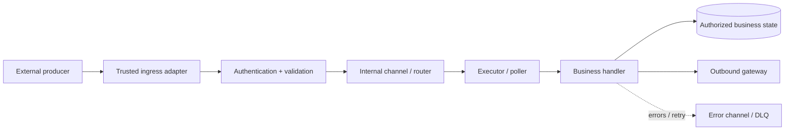
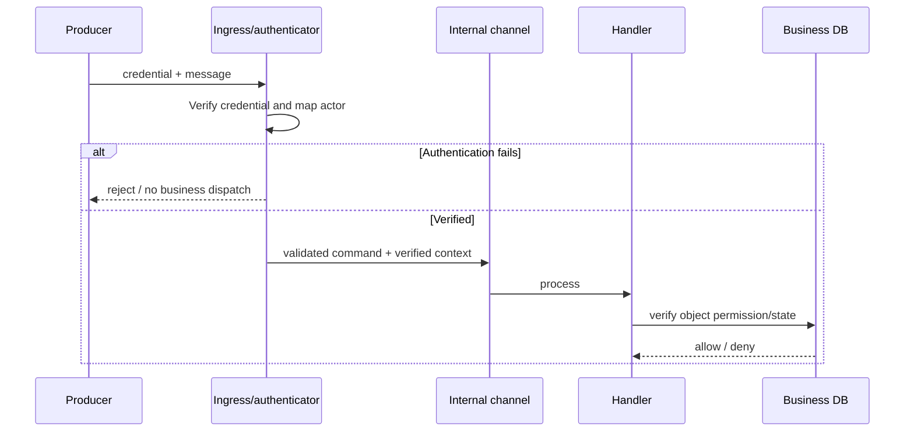
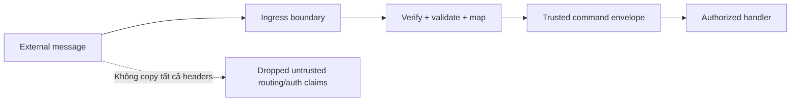
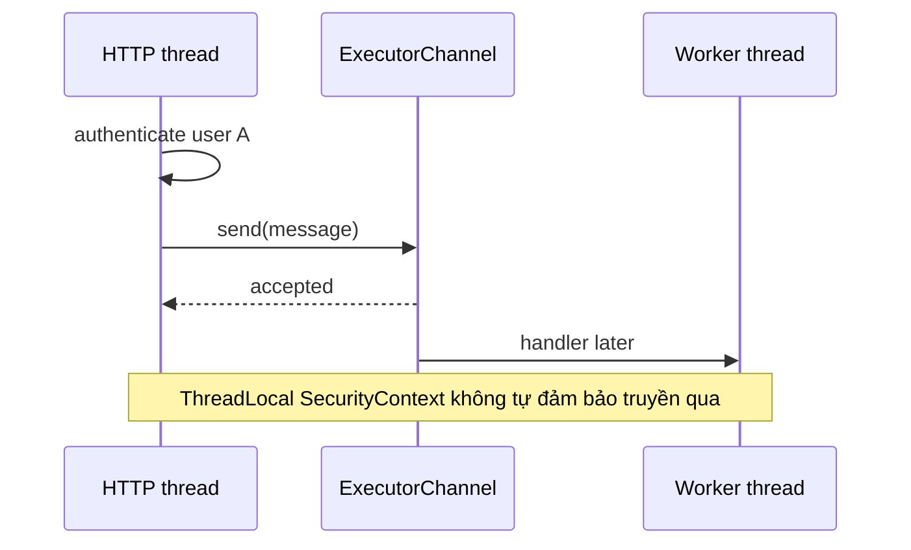
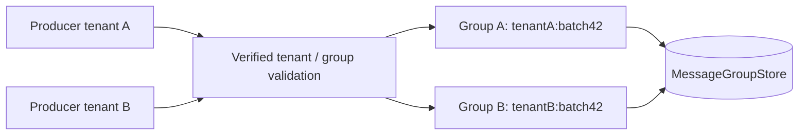
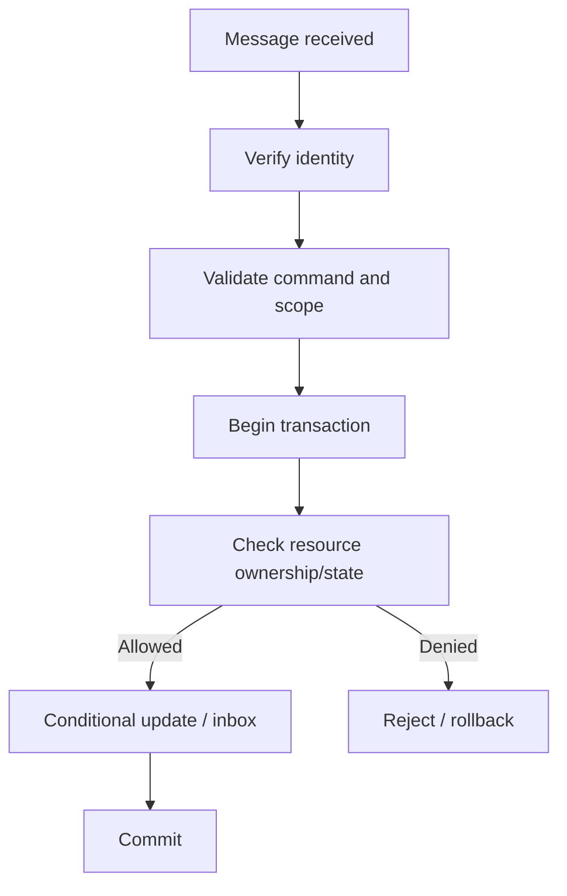
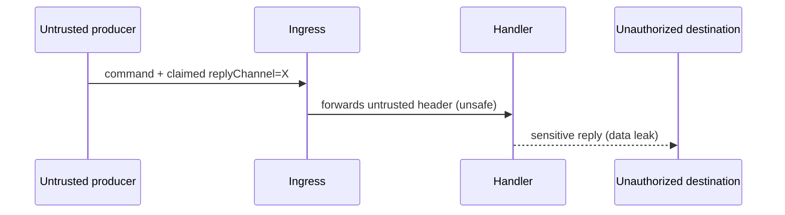

# Ranh giới tin cậy giữa message producer và handler

Trong **Spring Integration runtime**, producer có thể là một HTTP client, một dịch vụ gửi JMS/Kafka/AMQP, một file inbound adapter, một batch poller hoặc một thành phần Java khác. Message sau đó đi qua channel, router, transformer, executor, aggregator, retry advice, message store và handler. Nếu handler coi **payload hoặc headers do producer gửi** là bằng chứng xác thực, hệ thống dễ gặp lỗi **giả mạo danh tính, vượt quyền tenant, đổi tuyến trái phép, đọc/ghi nhầm tài nguyên hoặc lộ dữ liệu qua reply và error flow**.

Bài thuộc chương **Bảo mật runtime** của module `SPRING_INTEGRATION_RUNTIME`. Mục tiêu là xác định rõ **ranh giới tin cậy (trust boundary)** từ producer đến handler, đặt kiểm soát đúng nơi, hiểu ảnh hưởng của thread/transaction/retry và kiểm thử các đường đi bình thường lẫn bất thường. Nội dung tập trung vào bảo mật vận hành message flow; các quy tắc cụ thể về JWT, broker ACL, mã hóa hay lưu trữ phải đối chiếu với phiên bản, hạ tầng và mô hình đe dọa của hệ thống thật.

> **Nguyên tắc xuyên suốt:** một message được **nhận qua channel** không có nghĩa người gửi đã được xác thực hoặc có quyền thực hiện nghiệp vụ. **Payload, header và correlation key là dữ liệu đầu vào** cho đến khi được xác minh theo một hợp đồng tin cậy.

## 1. Trust boundary nằm ở đâu?

Một message flow có nhiều boundary, không chỉ một cổng HTTP:



| Boundary | Câu hỏi bảo mật | Không được giả định |
| --- | --- | --- |
| Producer → adapter | Ai được phép kết nối/gửi? Dữ liệu có xác thực nguồn không? | Kết nối thành công đồng nghĩa có quyền thao tác mọi tenant |
| Adapter → channel | Headers nào được tin, headers nào phải loại bỏ? | Mọi header do producer đặt đều an toàn |
| Channel → handler | Actor nào thực sự được xác thực, quyền gì? | Channel nội bộ tự bảo vệ khỏi tất cả caller |
| Thread/queue → consumer | Verified identity có sống qua thread, restart, redelivery không? | `ThreadLocal` tự đi qua `ExecutorChannel`/poller |
| Handler → database | Actor có quyền trên **bản ghi cụ thể** không? | `tenantId` trong payload là bằng chứng ownership |
| Handler → outbound | Đích nào được phép gọi? Credential nào dùng? | URL/destination do payload đề xuất có thể dùng trực tiếp |
| Error/DLQ/logging | Dữ liệu nhạy cảm bị copy sang đâu khi lỗi? | Lỗi chỉ nằm trong message flow chính |

**Hạn chế sự tin cậy theo từng boundary:** adapter có thể xác thực kết nối, nhưng handler vẫn phải kiểm tra quyền đối với hành động và đối tượng nghiệp vụ. Kẻ gửi hợp lệ cũng có thể gửi dữ liệu sai, replay event cũ hoặc cố lấy quyền ngoài phạm vi.

## 2. Xây threat model cho một flow nhận lệnh thanh toán

Giả sử service nhận `CapturePayment`:

```json
{
  "eventId": "E-42",
  "orderId": "ORDER-42",
  "tenantId": "tenant-A",
  "amountMinor": 149900
}
```

Producer đồng thời có thể đính kèm:

```text
headers:
  userId: "admin"
  role: "SUPER_ADMIN"
  tenantId: "tenant-B"
  correlationId: "ORDER-42"
  replyChannel: "someExternalDestination"
  retryCount: 0
```

Những câu hỏi phải trả lời:

1. Producer là ứng dụng hay người dùng nào? Bằng chứng xác thực lấy từ **đâu**?
2. `tenant-A` có được chứng minh từ identity đã verify hay chỉ xuất hiện trong JSON?
3. Actor có quyền `payments:capture` cho `ORDER-42` không?
4. `eventId=E-42` đã từng được xử lý chưa?
5. `amountMinor` có khớp với authoritative order state không?
6. Có cho phép producer chọn `replyChannel`/HTTP URL đích không?
7. Nếu handler lỗi, message gốc có bị lộ trong `ErrorMessage` hoặc DLQ không?
8. Nếu retry sau restart, quyền hạn còn hợp lệ và trạng thái nghiệp vụ có còn nhất quán không?

Một kiểm soát ở gateway có thể giải quyết câu 1 nhưng **không tự giải quyết câu 3–8**.

## 3. Tách danh tính, claims và dữ liệu nghiệp vụ

Nên phân biệt bốn loại thông tin:

| Loại | Nguồn | Có thể dùng làm bằng chứng bảo mật? |
| --- | --- | --- |
| **Verified identity** | Authenticator đáng tin đã kiểm tra chữ ký/token/session/mTLS hoặc identity của principal theo hạ tầng | Có, trong phạm vi audience, thời hạn, phương thức xác minh và chính sách |
| **Verified authorization claims** | Claims đã kiểm tra và mapping từ issuer đáng tin; có thể phải đối chiếu dữ liệu hiện hành | Có giới hạn; không thay thế resource-level authorization |
| **Untrusted message attributes** | JSON payload, producer headers, routing hints, trace baggage | Không; đây là input cần validate |
| **Authoritative business state** | DB/service quản lý quyền sở hữu và trạng thái đối tượng | Cơ sở để kiểm tra quyền trên order, invoice, account cụ thể |

### 3.1. Những phép suy luận sai

```text
header["authenticated"] == true          != authenticated
header["role"] == "ADMIN"                 != authorized admin
payload.tenantId == "tenant-A"           != caller owns tenant-A
message arrived on "adminChannel"        != caller may invoke admin action
broker delivered message successfully   != producer authorized for business object
```

Một broker có thể bảo đảm **consumer được phép đọc topic**, nhưng nếu nhiều service cùng có quyền produce vào topic đó, broker ACL chưa chắc chứng minh **user thực** hay quyền trên từng đơn hàng. Cần mô hình identity phù hợp cho từng loại message.

## 4. Phân loại trust level cho message sources

| Source | Authentication thường đặt ở đâu? | Cần làm thêm trong flow |
| --- | --- | --- |
| HTTP inbound gateway | TLS, Spring Security filter chain, JWT/OAuth2/mTLS tùy ứng dụng | Validate payload, actor, tenant và object permission |
| JMS/AMQP/Kafka consumer | Broker TLS/SASL/ACL, producer identity theo hạ tầng | Xác định nguồn nào được produce, kiểm tra business claims hoặc signed envelope nếu cần |
| SFTP/file polling | Identity của endpoint/host, filesystem permissions và cấu hình adapter | Validate file format, path, size, provenance, replay và content |
| JDBC poller | DB account/service identity và quyền SELECT/UPDATE | Chỉ đọc dữ liệu trong scope; kiểm tra trạng thái/ownership khi xử lý |
| Internal Java publisher | Code trong cùng process, bean/channel references | Phân quyền service nội bộ, không coi mọi plugin/module là trusted mặc định |
| Scheduler | Service identity của job | Authorization đối với job target và kiểm soát lease/replay |
| Reactive Publisher | Identity đã xác minh ở source trước khi phát | Context propagation, demand/cancel không thay đổi security semantics |

**Không phải mọi producer đều có end-user principal.** Một đợt batch có thể chạy bằng service identity và quyền tối thiểu. Đừng bịa “userId” từ header hoặc gán một admin identity mặc định để handler qua được authorization.

## 5. Nguyên tắc xác thực tại ingress

Một ingress đáng tin phải:
1. Được bảo vệ bởi kênh vận chuyển phù hợp (TLS/mTLS hoặc broker security).
2. Xác minh credential/token tại **điểm có trách nhiệm** và kiểm tra issuer, audience, expiration và các điều kiện cần thiết.
3. Ánh xạ identity sang **principal hoặc security context đã xác minh**.
4. Chỉ đưa thông tin được phép vào message nội bộ.
5. Từ chối đầu vào thiếu/sai credential bằng cơ chế lỗi thích hợp.
6. Không ghi credential/token vào log, trace hoặc DLQ.



**Ranh giới quan trọng:** nếu adapter chỉ nhận được chuỗi `"authenticated": true` do client tự thêm, đó **không phải** authentication. Ngược lại, một header hoặc context được **gắn bởi gateway đã xác minh credential** có thể là dữ liệu tin cậy **trong phạm vi lifecycle và provenance được bảo vệ**, nhưng phải chống spoof/overwrite từ nguồn ngoài.

## 6. Header là vùng tấn công phổ biến

Spring message có những header phục vụ runtime như `id`, `timestamp`, `correlationId`, `sequenceNumber`, `sequenceSize`, `replyChannel` và `errorChannel`. Adapter cũng có thể map HTTP/JMS/Kafka headers hoặc custom properties.

| Nhóm header | Rủi ro nếu tin trực tiếp | Chính sách khuyến nghị |
| --- | --- | --- |
| `role`, `userId`, `authenticated` | Identity/privilege spoofing | Không dùng để ra quyết định nếu do producer tự khai |
| `tenantId`, `accountId` | Cross-tenant access | Derive từ verified actor; đối chiếu resource ownership |
| `replyChannel`, `errorChannel` | Chuyển kết quả/lỗi tới đích trái phép | Chỉ giữ channel nội bộ do gateway/framework tin cậy tạo |
| `correlationId` | Trộn group, đoán ID, group poisoning | Validate scope, format, namespace và version |
| `sequenceNumber` / `sequenceSize` | Release sớm/trễ, memory exhaustion | Validate consistency và kích thước tối đa |
| `routingKey`, `destination`, `httpUrl` | Unauthorized routing hoặc SSRF | Map qua allowlist logic → endpoint tin cậy |
| `retryCount`, `priority` | Bypass retry, starvation, priority abuse | Runtime quản lý, giới hạn và validate |
| `traceparent` / baggage | Log injection, metadata leak, untrusted span context | Parse/validate, giới hạn, không coi là authentication |
| `contentType`, `typeId` | Chọn converter/class không an toàn | Allowed media/type mapping cố định |
| Raw file path / URL | Path traversal, internal network access | Không chuyển thẳng tới filesystem/HTTP client |

**Denylist header không đủ:** nếu chỉ chặn `Authorization` và `Cookie`, một attacker có thể đưa secret hoặc quyền giả vào `X-Role`, `X-User` hay custom header khác. Hãy chọn rõ các header được phép đi qua boundary và loại bỏ các trường không cần.

## 7. Tạo trusted internal envelope thay vì copy toàn bộ headers

Một flow có thể phân thành hai mô hình dữ liệu:

```text
Untrusted envelope:
  raw payload + external headers + transport metadata

Trusted internal command:
  parsed DTO + verified actor + validated business key
  + allowlisted technical metadata
```



Một điều kiện quan trọng là **trusted envelope phải được tạo bởi code có trách nhiệm**, không được deserialize thẳng từ untrusted JSON để client tự đặt `verified=true`.

### 7.1. Ví dụ xây message mới có header allowlist

```java
import org.springframework.messaging.Message;
import org.springframework.messaging.support.MessageBuilder;

record VerifiedActor(String subject, String tenantId) {}
record CreateOrder(String orderId, long amountMinor) {}

Message<CreateOrder> buildInternalCommand(
        CreateOrder command,
        VerifiedActor actor,
        String verifiedEventType) {

    // Actor đã được authenticator tin cậy xác minh.
    // Chỉ gắn metadata kỹ thuật tối thiểu.
    return MessageBuilder.withPayload(command)
            .setHeader("verifiedActor", actor)
            .setHeader("eventType", verifiedEventType)
            .build();
}
```

**Điều kiện bắt buộc:** đoạn code phải chạy ở **trusted ingress path** và `actor` phải được tạo từ bằng chứng đã verify. Không nhận `VerifiedActor` hoặc `verifiedEventType` do producer gửi rồi coi đã an toàn. Message object chứa principal cần được bảo vệ khi đi qua store hoặc broker vì nó có thể không serialize an toàn và là dữ liệu nội bộ nhạy cảm.

Đừng dùng `MessageBuilder.fromMessage(untrusted)` rồi thêm `verifiedActor` nếu không có quy tắc loại bỏ headers nguy hiểm; lời gọi đó có thể giữ lại nhiều trường không được phép.

### 7.2. Ngoại lệ: request–reply gateway có channel nội bộ hợp lệ

Một Spring Integration gateway có thể tự tạo `replyChannel` hoặc `errorChannel` trong nội bộ để nối request với response. **Không xóa bừa** các header này khi chúng là thành phần tin cậy của giao thức gateway.

Cách đúng là **phân biệt provenance**:
- Header reply được **framework/gateway tin cậy phát sinh**: có thể cần bảo toàn theo contract.
- Header reply được **producer bên ngoài tự nhập**: không được dùng để trỏ tới channel Java tùy ý.
- Khi rebuild message ở ingress: chỉ chuyển tiếp trusted reply context do gateway cung cấp bằng cơ chế có kiểm soát.

## 8. Validate payload: định dạng, kích thước và semantics

Authentication trả lời **“ai gửi?”**, validation trả lời **“dữ liệu có hợp lệ?”** và authorization trả lời **“người này được phép làm gì với tài nguyên này?”**. Ba câu hỏi không thể thay thế nhau.

| Lớp validation | Ví dụ | Tác hại nếu thiếu |
| --- | --- | --- |
| Byte/content size | Payload tối đa 1 MiB hoặc theo contract | OOM, CPU/GC lớn, broker/backlog |
| Structural schema | Field bắt buộc, type, nesting depth | Parse exception, deserialize sai |
| Domain ranges | `amountMinor > 0`, item count giới hạn | Business corruption |
| Identifier constraints | Order key có format/length hợp lệ | Log injection, key explosion |
| Temporal constraints | Event time/expiry/nonce đúng policy | Replay và stale commands |
| Cross-field constraints | Tenant, currency, amount, order state phù hợp | Logic bypass |
| Duplicate semantics | Event ID, business member ID ổn định | Idempotency failure |
| Resource reference | URL, file path, table/queue alias allowlist | SSRF/path traversal/unauthorized routing |

Giới hạn payload phải đặt **trước hoặc ngay khi parse/buffer** nếu có thể. Nếu parser đọc toàn bộ body 1 GiB vào heap rồi mới kiểm tra field `payloadSize`, kiểm soát này quá muộn.

## 9. Deserialization và message conversion là trust boundary

Một lỗ hổng có thể xuất hiện **trước khi handler được gọi**, tại JSON/XML/Java message converter.

Các nguyên tắc thiết kế:

1. Dùng **DTO schema cố định** và kiểu được phép; hạn chế polymorphic type resolution từ input không tin cậy.
2. Không cho producer tự chọn tên class Java để deserialize bằng metadata không xác thực.
3. Không deserialize object Java từ byte stream không tin cậy bằng cơ chế native serialization nếu chưa có bộ lọc và đánh giá rủi ro phù hợp.
4. Với JSON/XML, cấu hình giới hạn kích thước, độ sâu, field count và những tính năng parser không cần.
5. Tránh converter tự động chuyển input thành object có khả năng thực thi hành vi hoặc truy cập tài nguyên.
6. Kiểm tra version của schema, hỗ trợ backward compatibility có chủ đích.
7. Log **error code và message ID an toàn**, không dump raw body khi parse lỗi.

```text
Safer:
  bytes → validated media type → fixed DTO → business validation

Risky:
  bytes → user-chosen Java class → arbitrary object graph → handler
```

Chặn ở handler là cần thiết nhưng **không đủ** nếu payload đã bị deserializer khai thác trước khi tới handler.

## 10. Authorization phải kiểm tra action và object cụ thể

Một actor đã xác thực có thể hợp lệ để **xem order trong tenant A** nhưng không có quyền sửa order của tenant B.

```text
Verified actor:
  subject = service-orders
  tenant = tenant-A
  permissions = [orders:create]

Incoming payload:
  tenantId = tenant-B
  orderId = ORDER-999
```

Nếu handler chỉ kiểm tra `permissions.contains("orders:create")` rồi tin `payload.tenantId`, actor có thể thao tác nhầm tenant. Authorization phải xét **đối tượng nghiệp vụ cụ thể**:

- `subject` có quyền hành động này không?
- `tenant` của actor có trùng tenant sở hữu resource không?
- Order hiện tại có ở state cho phép cập nhật không?
- Event đã được xử lý chưa? Có bị replay không?
- Dữ liệu authoritative nằm ở DB/service nào và đã được kiểm tra tại commit boundary chưa?

### 10.1. Kiểm tra scope ngay ở truy vấn ghi DB

```sql
-- PostgreSQL/SQL minh họa; tham số được bind, không nối chuỗi.
UPDATE orders
SET status = 'CAPTURE_REQUESTED'
WHERE order_id = :orderId
  AND tenant_id = :verifiedTenantId
  AND status = 'READY_FOR_CAPTURE';
```

Nếu số hàng thay đổi bằng 0, có thể **không tồn tại**, **không thuộc tenant** hoặc **state không hợp lệ**. Không vội tiết lộ nguyên nhân chi tiết cho producer nếu điều đó tạo lỗ hổng enumeration; thông tin trả về phải theo API security contract.

Quan trọng: `:verifiedTenantId` phải lấy từ **verified identity**, không lấy trực tiếp từ payload/headers. Đây là **conditional state transition**, không phải chỉ một câu kiểm tra quyền đứng riêng dễ tạo race time-of-check/time-of-use.

## 11. Ví dụ Java: một endpoint có trust-boundary rõ

Ví dụ Java 17+ sau minh họa một **Spring Integration service activator** nhận message, ủy quyền cho bộ xác minh identity và kiểm tra scope trước khi gọi business service. `IngressAuthenticator` là **interface của ứng dụng**; việc xác thực JWT, mTLS identity hoặc signed event phải được triển khai thật ở adapter/verifier.

```java
import java.util.Set;

import org.springframework.integration.annotation.ServiceActivator;
import org.springframework.messaging.Message;
import org.springframework.security.access.AccessDeniedException;
import org.springframework.stereotype.Service;

record CreateOrderCommand(
        String orderId, String tenantId, long amountMinor, String eventId) {}

record VerifiedCaller(
        String subject, String tenantId, Set<String> permissions) {}

interface IngressAuthenticator {
    // Phải kiểm tra bằng chứng xác thực từ nguồn tin cậy
    // và từ chối credential sai, hết hạn hoặc không đúng audience.
    VerifiedCaller authenticateOrThrow(Message<?> inbound);
}

interface AuthorizedOrderService {
    // Business service vẫn phải enforce quyền/state trên DB.
    void createOrder(VerifiedCaller caller, CreateOrderCommand command);
}

@Service
public class SecureOrderEndpoint {
    private final IngressAuthenticator authenticator;
    private final AuthorizedOrderService orders;

    public SecureOrderEndpoint(
            IngressAuthenticator authenticator,
            AuthorizedOrderService orders) {
        this.authenticator = authenticator;
        this.orders = orders;
    }

    @ServiceActivator(inputChannel = "untrustedOrders")
    public void accept(Message<?> inbound) {
        VerifiedCaller caller =
                authenticator.authenticateOrThrow(inbound);

        if (!(inbound.getPayload() instanceof CreateOrderCommand command)) {
            throw new IllegalArgumentException("Unsupported command type");
        }
        if (command.orderId() == null || command.orderId().isBlank()
                || command.orderId().length() > 80
                || command.eventId() == null
                || command.eventId().isBlank()
                || command.amountMinor() <= 0) {
            throw new IllegalArgumentException("Invalid command");
        }

        if (!caller.permissions().contains("orders:create")
                || !caller.tenantId().equals(command.tenantId())) {
            throw new AccessDeniedException("Not allowed");
        }

        orders.createOrder(caller, command);
    }
}
```

**Ví dụ không phải authentication implementation hoàn chỉnh**. `authenticateOrThrow` tuyệt đối không được tin header `authenticated=true` hoặc `role=ADMIN`. Với HTTP inbound có Spring Security, việc xác minh thường nằm ở filter chain; ingress có thể nhận principal đã xác thực từ **security context đáng tin trên đúng thread**. Với broker, cần broker producer permissions và/hoặc signed envelope có xác minh crypto đúng contract.

`AuthorizedOrderService` còn phải kiểm tra **record ownership và state tại authoritative store**. Đoạn code kiểm tra `tenantId` chỉ là **hàng rào bổ sung**, không thay thế việc ràng buộc tenant vào SQL/transaction hoặc authorization service.

### 11.1. Phân biệt “bị từ chối” với “đã xử lý thành công”

Nếu thiếu quyền hoặc payload sai, exception phải đi tới **error/reject policy của nguồn** phù hợp. Tránh:

```java
// KHÔNG KHUYẾN NGHỊ: có thể ack message chưa xử lý.
if (!authorized) {
    log.warn("Denied");
    return;
}
```

Một return bình thường có thể khiến broker/listener/gateway cho rằng message hoàn tất. Điều đó **có thể là điều mong muốn** nếu hợp đồng là reject vĩnh viễn và đã ghi audit đúng, nhưng phải thiết kế rõ. Nếu không, cần phân loại `PERMANENT_REJECTION`/`RETRYABLE_FAILURE`/`DLQ` thay vì trả success giả.

## 12. Method security và internal handler

Spring Security method authorization, chẳng hạn `@PreAuthorize`, có thể hữu ích trên service boundary:

```java
import org.springframework.security.access.prepost.PreAuthorize;
import org.springframework.stereotype.Service;

@Service
public class SecuredBusinessActions {

    @PreAuthorize("hasAuthority('orders:create')")
    public void createAuthorizedOrder(CreateOrderCommand command) {
        // Không chỉ check authority toàn cục:
        // còn phải kiểm tra ownership/state của order ở business store.
    }
}
```

Để annotation có hiệu lực cần **method security được bật**, bean được gọi qua proxy hoặc cấu hình AOP tương ứng và `SecurityContext` được thiết lập đúng ở thread thực thi. **Self-invocation** như `this.createAuthorizedOrder(...)` thường không đi qua proxy-based interception, vì vậy không nên lấy annotation làm ranh giới bảo mật duy nhất nếu code gọi sai đường.

Một flow chạy từ poller không có end-user context như HTTP thread. `@PreAuthorize` ở đó có thể thấy anonymous/no authentication; **không sửa bằng cách gán admin principal mặc định cho mọi message**. Dùng service identity được xác thực và phân quyền hợp lệ cho workflow đó.

## 13. SecurityContext không tự xuyên qua ExecutorChannel và poller

Spring Security mặc định thường lưu authentication theo **thread-local context**. Nếu một HTTP request đã xác thực chuyển việc qua `ExecutorChannel` hoặc executor khác, worker thread có thể **không thấy** context ban đầu:



Giải pháp theo kiến trúc:

| Kiểu flow | Cơ chế cân nhắc |
| --- | --- |
| HTTP request xử lý đồng bộ | Context được Spring Security duy trì trên request thread |
| Submit task async trong cùng lifecycle | Dùng cơ chế `DelegatingSecurityContext*` của Spring Security hoặc `TaskDecorator` phù hợp |
| Poller hoặc scheduled job | Thiết lập service identity hợp lệ theo nguồn job, không vay mượn context của HTTP thread |
| Broker redelivery/restart | Không dựa vào ThreadLocal đã mất; dùng verified envelope/signed identity hoặc service auth |
| Reactor pipeline | Dùng reactive security context propagation tương ứng với Reactor; không coi ThreadLocal giống reactive Context |
| Long-running job | Xác định hết hạn/thu hồi quyền và chính sách kiểm tra lại tại lúc thực thi |

**Không lưu nguyên access token hoặc `Authentication` object vào một persistent message store mà không đánh giá kỹ.** Token có thể hết hạn, chứa secret, không serialize an toàn hoặc bị rò qua storage/log. Có thể cần lưu **subject tham chiếu, issuer, policy version**, rồi kiểm tra lại identity/authorization tại execution time.

### 13.1. Mô phỏng lỗi context khi debug

```text
[http-nio-1] authenticated actor=user-17
[executor-3] Authentication=null
[handler] authorization denied
```

Đây có thể là **mất context do chuyển thread**, không phải producer gửi credential sai. Nhưng **đừng giải quyết bằng cách tin `userId` header do producer đặt**: đó là chuyển một bug về context thành lỗ hổng spoofing.

## 14. Channel không tự là access-control boundary

`DirectChannel`, `ExecutorChannel`, `QueueChannel` và `FluxMessageChannel` chủ yếu điều phối **dispatch, buffering và threading**. Chúng không thay thế gateway authentication hoặc business authorization.

Một channel ID như `adminCommands` chỉ là tên kỹ thuật; bất kỳ code nào đủ quyền truy cập bean này trong cùng application context có thể tìm cách gửi message vào đó. Nếu nhiều module/plugin nội bộ có mức tin cậy khác nhau, cần **tách quyền truy cập hoặc process boundary** thích hợp thay vì chỉ dựa vào việc đặt tên channel “private”.

Một số phiên bản/module của Spring Integration cung cấp các cơ chế channel security/interceptor kết hợp Spring Security. Khi dùng, hãy xác nhận:
- Dependency và API đang có trong **phiên bản cụ thể**.
- Quy tắc được áp dụng ở `send`, `receive` hay invocation handler nào.
- Cách truyền `SecurityContext` qua poller và executor.
- Exception authorization đi tới đâu và nguồn ack/nack thế nào.
- Đường đi khác có bypass interceptor/secured channel không.

**Defense in depth:** kể cả khi channel security hoạt động, handler/business service vẫn phải enforce invariant và quyền trên tài nguyên.

## 15. Đừng dùng routing header từ client như một lệnh quản trị

Một producer không nên được tự chọn bất kỳ destination nội bộ nào:

```text
Unsafe:
  payload.targetChannel = "adminPayments"
  router routes directly to payload.targetChannel

Safer:
  payload.eventType = "ORDER_CREATED"
  trusted router maps approved event type → fixed processing channel
```

### 15.1. Allowlist destination

```java
import java.util.Map;

final class SafeRouteCatalog {
    private static final Map<String, String> ROUTES = Map.of(
            "ORDER_CREATED", "orderCreateInput",
            "ORDER_CANCELLED", "orderCancelInput");

    static String target(String eventType) {
        String target = ROUTES.get(eventType);
        if (target == null) {
            throw new IllegalArgumentException("Unsupported event type");
        }
        return target;
    }
}
```

`ROUTES` là danh mục **logic destination** được code/config kiểm soát. Nếu router chọn channel theo biểu thức, hãy đảm bảo **expression là cấu hình tin cậy**, không compile/evaluate SpEL do producer gửi.

**Không đồng nhất “dùng SpEL” với “bị injection”:** expression được khai báo cố định trong code/config và chỉ đọc thuộc tính đã validate có thể là hợp lệ. Nguy cơ phát sinh khi producer được cung cấp **source expression**, bean name, method name hoặc destination tùy ý để hệ thống thực thi.

## 16. SSRF, file traversal và outbound destination

Một handler gọi HTTP theo URL lấy từ payload có thể bị lợi dụng để truy cập các dịch vụ nội bộ không dành cho producer. Tương tự, SFTP/file adapter ghi theo đường dẫn do client điều khiển có thể dẫn đến ghi ngoài thư mục cho phép.

| Input do producer cung cấp | Rủi ro | Cách kiểm soát |
| --- | --- | --- |
| `callbackUrl` | SSRF, metadata service access, exfiltration | Không dùng trực tiếp; destination alias allowlist, egress policy |
| `filePath` | Traversal, path normalization, symlink issues | Sử dụng thư mục gốc và canonical path policy, giới hạn filesystem |
| `topicName` / `queueName` | Gửi dữ liệu sang topic/queue ngoài scope | Map qua broker destination catalog và ACL |
| `sqlFragment` | SQL injection | Query cố định, bind parameters |
| `className` / `expression` | Type/expression evaluation abuse | Không cho producer chọn type/expression runtime |
| `tenantDbSchema` | Cross-tenant access | Chọn schema từ verified tenant mapping, không raw input |

Cấu hình outbound credentials phải thuộc **service account/secret management**. Không để producer gửi credential đích và yêu cầu handler “dùng hộ” nếu không có nghiệp vụ ủy quyền được thiết kế rõ.

## 17. Replay, idempotency và giả mạo trạng thái “đã xử lý”

Kể cả một message được xác thực hợp lệ, nó vẫn có thể được **gửi lại**:

```text
T0: E42 được xác thực, business DB commit.
T1: Process crash trước broker acknowledgement.
T2: Broker redeliver E42.
T3: Handler nhận lại E42.
```

Authentication không ngăn replay. Một lock theo `orderId` chỉ giúp tuần tự hóa; nó **không ghi nhớ** rằng E42 đã commit.

### 17.1. Inbox/unique constraint theo đúng scope

Ví dụ dữ liệu nghiệp vụ có `eventId` được issuer hợp lệ cấp, dùng unique constraint để chống duplicate:

```sql
-- PostgreSQL, chạy trong CÙNG transaction với business update.
INSERT INTO processed_event(tenant_id, producer_id, event_id)
VALUES (:verifiedTenantId, :verifiedProducerId, :eventId)
ON CONFLICT (tenant_id, producer_id, event_id) DO NOTHING;
```

Nếu INSERT ảnh hưởng 0 hàng, event đã được ghi nhận theo key đó. Nếu thành công mới thực thi business update trong **cùng transaction**. Unique key phải khớp hợp đồng: `eventId` có thể chỉ duy nhất **theo producer/tenant**, không phải toàn cầu.

**Đừng tin `retryCount` hoặc `processed=true` do producer gửi.** Runtime/source cần ghi attempt/delivery state đáng tin riêng. Một marker `ACCEPTED` trong `MetadataStore` không chứng minh business handler đã hoàn tất.

### 17.2. Signature/time window và replay

Với signed event envelope, cần xác minh chữ ký bao phủ **payload quan trọng, issuer, audience, timestamp/nonce và event ID** theo protocol được chọn. Signature hợp lệ chưa tự ngăn bản tin cũ được phát lại; cần replay window/nonce store hoặc business idempotency tùy yêu cầu.

## 18. Correlation group poisoning từ dữ liệu bên ngoài

Aggregator/resequencer dùng `correlationId`, `sequenceNumber`, `sequenceSize` để gom hoặc phát nhóm. Nếu producer không được tin cậy hoàn toàn, một attacker có thể:

- Tạo vô số correlation IDs khác nhau → **group explosion** và tăng memory/DB.
- Dùng cùng key của tenant khác → **trộn message group**.
- Đặt `sequenceSize` rất lớn → group chờ lâu vô hạn.
- Gửi duplicate sequence với message ID mới → **release sai** nếu chỉ đếm size.
- Gửi trigger không được phép tới barrier → mở chặn sai workflow.
- Gửi late arrival sau completed group → tạo group lại hoặc gây duplicate.



Một group key nên phản ánh **verified tenant, business batch/run/version** nếu scope nghiệp vụ yêu cầu. Không cho producer tự chọn namespace chứa tenant của người khác. Nếu cả hai tenant có batch ID `42`, chúng phải nằm trong **hai nhóm độc lập**.

### 18.1. Giới hạn tài nguyên group

Thiết kế kiểm soát:
- Số group active tối đa theo tenant/source.
- Kích thước nhóm và `sequenceSize` tối đa.
- TTL/expiry/reaper policy cho group không đầy đủ.
- Tốc độ tạo group của producer.
- Duplicate/member validation.
- Message group store retention, cleanup và database quotas.
- Error/recovery policy khi từ chối group quá tải.

Một `MessageGroupStore` bền vững giúp sống qua restart nhưng **không tự bảo vệ khỏi resource exhaustion**. Cần vừa kiểm soát tính đúng nghiệp vụ vừa kiểm soát capacity.

## 19. Trust boundary trong split, transform và header enrichment

Một flow `split → transform → enrichHeaders → route → aggregate` có thể đổi payload/headers. Cần phân biệt:

| Operation | Dữ liệu có thể thay | Rủi ro |
| --- | --- | --- |
| `Splitter` | Message con, sequence/correlation headers | Trộn batch nếu header bị ghi đè hoặc bị copy từ nguồn sai |
| `Transformer` | Payload type/schema | Mất validation, field trust được nâng cấp giả |
| `HeaderEnricher` | Thêm/sửa header kỹ thuật | Ghi đè verified identity bằng untrusted value |
| `Router` | Destination selection | Bypass handler security nếu route được điều khiển từ ngoài |
| `Aggregator` | Group context/derived output | Gộp dữ liệu nhiều tenant nếu key sai |
| `ServiceActivator` | Business command execution | Thiếu resource-level authorization |
| `Gateway` | Request–reply channel mapping | Gửi response tới đích giả mạo |

Một header `trustedTenant` chỉ hợp lệ nếu **được tạo tại trusted ingress**, không bị producer tự ghi đè và mọi transform/enricher sau đó giữ provenance. Khi thay đổi topology động, cần kiểm tra mọi nhánh mới vẫn đi qua **cùng security boundary**.

## 20. Dynamic IntegrationFlow và rủi ro bypass

Với `IntegrationFlowContext`, ứng dụng có thể đăng ký flow mới khi runtime đang hoạt động. Nếu một flow mới trực tiếp gắn vào channel nguồn mà bỏ qua validation/authentication endpoint, nó có thể nhận message chưa được kiểm soát.

```text
Expected:
  external ingress → auth/validation → trustedCommands → handler

Dangerous dynamic route:
  external ingress ----------------------→ privilegedHandler
```

### 20.1. Policy khi đăng ký flow động

1. Chỉ control-plane đã xác thực/ủy quyền được phép register/start/stop/remove.
2. Flow mới phải sử dụng các **security gates** đã được công nhận.
3. Không cho tenant tự upload SpEL/script/class name để tạo handler tùy ý.
4. Đảm bảo flow/endpoint IDs không va chạm hoặc giả danh privileged channel.
5. Kiểm tra input/output và reply/error routing trước khi publish.
6. Có revision, audit operation và rollback có kiểm soát.
7. Khi retire flow, bảo vệ in-flight work, credential và secret của connector cũ.
8. Test lại authorization trên mọi route sau cutover.

Một stable ingress có kiểm soát giúp tránh việc producer thay đổi điểm nhận, nhưng **chuyển route an toàn về mặt concurrency** chưa chắc đã bảo đảm **mỗi handler mới đủ quyền bảo mật**. Hai điều kiện phải kiểm thử riêng.

## 21. Transaction không thay thế authentication và authorization

Transaction đảm bảo tính nguyên tử trong phạm vi resource/transaction manager, không chứng minh actor có quyền.



Cần xem thứ tự auth/validation và transaction boundary:
- Xác thực credential trước khi allocate resource đắt tiền khi có thể.
- Kiểm tra object authorization **cùng lúc với thao tác ghi** để tránh TOCTOU.
- Idempotency marker và business state nên commit cùng transaction khi cùng DB.
- Với external HTTP/payment effect, transaction DB không thể rollback việc bên ngoài đã thực hiện; cần idempotency key/outbox/reconciliation.
- Lỗi `AccessDeniedException` phải được phân loại với lỗi tạm thời của DB để tránh retry vô ích.

## 22. Retry, redelivery và poison message

Một message không hợp lệ hoặc bị từ chối vì thiếu quyền thường **không nên** được retry vô hạn. Ngược lại, DB timeout hoặc dependency 503 có thể là lỗi tạm thời.

| Kết quả | Ý nghĩa | Policy có thể phù hợp |
| --- | --- | --- |
| `AUTHENTICATION_FAILED` | Credential sai/hết hạn, nguồn không tin cậy | Reject, audit an toàn; không retry nóng |
| `AUTHORIZATION_DENIED` | Actor không đủ quyền trên resource | Permanent rejection, không ack success giả |
| `VALIDATION_FAILED` | Schema/size/type/range sai | Reject hoặc quarantine, không lặp vô hạn |
| `DUPLICATE_EVENT` | Event đã commit theo business key | Idempotent no-op có outcome rõ |
| `TRANSIENT_DB_ERROR` | DB connection/deadlock tạm thời | Bounded retry/backoff theo chính sách |
| `DEPENDENCY_TIMEOUT` | Không rõ side effect đã xảy ra | Retry có idempotency và reconciliation |
| `STORE_CORRUPTION` | Payload không deserialize được | Quarantine/incident, không poison loop |

**Từ chối vĩnh viễn** không nhất thiết phải phát exception ra broker để redeliver mãi. Có thể đưa vào DLQ hoặc ghi rejection record rồi acknowledge theo hợp đồng. Tuy nhiên, nếu chỉ bắt exception rồi return bình thường mà **không ghi outcome hoặc audit**, message có thể biến mất không giải thích được.

### 22.1. Error channel cũng là vùng dữ liệu nhạy cảm

`ErrorMessage` và các exception chứa `failedMessage` có thể giữ nguyên payload/headers. Khi lỗi authentication hoặc validation:
- Không log toàn bộ `ErrorMessage`.
- Không gửi raw token vào DLQ không được bảo vệ.
- Có error code, source alias, trace ID và business key pseudonym.
- DLQ cần ACL, retention, encryption và replay authorization riêng.
- Replay tool phải **tái áp dụng validation/authorization**, không được coi “đã nằm trong DLQ” là trusted.

## 23. Header spoofing có thể biến thành lộ dữ liệu qua reply

Một tình huống nguy hiểm là producer đặt `replyChannel` thành đích ngoài ý muốn, rồi handler trả kết quả chứa thông tin nhạy cảm. Trong một hệ thống nội bộ có hỗ trợ mapping tên channel, một cấu hình sai có thể tin header đó để chọn destination.



**Giải pháp:** inbound adapter phải kiểm soát reply destination theo **trusted gateway context**, không dùng producer-supplied channel object/tên channel tùy ý. Tương tự, error channel chỉ nên được xác định từ cấu hình nội bộ đáng tin.

Nếu API có callback URL do khách hàng cung cấp như một tính năng thật, nó phải được quản lý như **outbound destination được cấp phép**, có kiểm tra ownership, allowlist/network policy và giới hạn nội dung trả về; không đơn giản map thẳng sang `replyChannel`.

## 24. Egress security và least privilege

Một handler thường gọi DB, broker, HTTP API hoặc file storage. Dù ingress an toàn, side effect vẫn có thể vượt quyền nếu credential service quá mạnh.

Một số nguyên tắc:
- Credential theo **connector/destination** với quyền tối thiểu.
- DB user chỉ được thao tác schema/tables cần thiết.
- Producer và consumer dùng broker ACL riêng, không chia sẻ superuser.
- Secret lấy từ secret manager/environment được bảo vệ; không nhúng vào message/header/log.
- Đặt timeout, retry và egress network policy phù hợp.
- Validate destination alias; không dùng raw user URL cho HTTP outbound.
- Phân vùng tenant ở DB query/record, không chỉ ở tên channel.
- Kiểm soát output field để không phát sinh dữ liệu ngoài scope của caller.

**Không gửi toàn bộ identity/token gốc sang downstream chỉ vì handler có nó.** Nếu cần delegation, dùng protocol token exchange hoặc service-to-service authorization được thiết kế rõ, với audience/scope phù hợp.

## 25. Resource exhaustion: bảo mật cũng là bài toán hiệu năng

Một producer hợp lệ nhưng lỗi, hoặc bị lạm dụng, có thể gây từ chối dịch vụ (DoS) bằng:
- Payload quá lớn hoặc nested JSON sâu.
- Tạo vô số group keys trong `MessageGroupStore`.
- Gửi lượng lớn duplicates khiến inbox/metadata store tăng.
- Cố gửi tới `QueueChannel`/executor vượt capacity.
- Tạo retry storm qua timeout.
- Dùng high priority làm các tenant khác starvation.
- Gửi message gắn `sequenceSize` cực lớn, khiến group không bao giờ hoàn thành.

| Vùng runtime | Kiểm soát |
| --- | --- |
| Adapter/parser | Max payload size, parse depth/timeouts |
| Producer authorization | Quota/rate limit theo verified identity |
| Channel | Capacity, backpressure/reject policy |
| Poller/executor | Concurrency bound, queue limit, task timeout |
| Correlating endpoint | Max active groups, group size, expiry |
| Message store | Retention, storage quotas, cleanup |
| Retry | Bounded attempt/backoff, DLQ, circuit breaker khi phù hợp |
| Logging/tracing | Sampling sau redaction, cardinality control |

**Một queue không giới hạn không phải biện pháp bảo vệ chống quá tải.** Nó chỉ chuyển hậu quả từ rejection rõ ràng sang memory/latency tăng không kiểm soát.

## 26. LockRegistry và message store không phải authorization

`LockRegistry` giúp điều phối critical section theo key. `MessageGroupStore` lưu các thành viên correlation. `MetadataStore` có thể giữ marker idempotency/checkpoint. **Không thành phần nào tự xác định actor có quyền trên business resource.**

```text
lock("order:42") acquired          != actor can edit order 42
metadata["E42"] == "ACCEPTED"      != authorized business commit
group("tenantA:batch42").size=3   != every member is trusted
```

Phải xác thực nguồn, validate member, enforce tenant isolation và idempotent business effect. Nếu group store dùng chung giữa tenants, khóa phải có namespace đúng, nhưng **namespace string không phải boundary security** khi producer tự đặt key. Tenant phải được xác minh trước khi tạo group ID.

Đối với distributed locks có lease, worker cũ có thể tiếp tục sau khi hết hạn; bảo vệ authoritative state bằng conditional update/owner generation/fencing khi cần, **không chỉ bằng lock ownership**.

## 27. Truy vết an toàn qua threads, retry và correlation

Observability cần trả lời:
- Message do nguồn nào gửi, tại boundary nào được xác thực?
- Verified actor và tenant nào (ghi mã tham chiếu hoặc pseudonym khi nhạy cảm)?
- Handler quyết định allow/deny ở đâu?
- Message có bị retry/redeliver hay không?
- Business state có commit không?
- Có bị routed đến unexpected channel/group không?

Một log record an toàn:

```json
{
  "event": "command_rejected",
  "source": "orders-http",
  "flow": "orders-v42",
  "endpoint": "createOrder",
  "trace_id": "opaque-trace-123",
  "caller_ref": "hmac:example-actor-token",
  "tenant_ref": "hmac:example-tenant-token",
  "error_code": "TENANT_SCOPE_DENIED",
  "retryable": false
}
```

Đây là **định dạng gợi ý**, không phải exporter được Spring Integration tự tạo. Không log full payload, raw `Authorization`, cookies, `SecurityContext` hoặc toàn bộ `Message<?>`. `traceparent` từ producer có thể giúp liên kết trace nhưng **không là bằng chứng danh tính**.

### 27.1. Kết nối context qua thread

`ThreadLocal`/MDC/SecurityContext có thể mất khi đi qua `ExecutorChannel` hoặc poller. Cần kiểm tra cả:
1. Context có được truyền đúng tới task đang chạy không?
2. Context có được **xóa sau task**, tránh lẫn identity giữa hai message?
3. Với durable redelivery, identity có được **xác minh lại** theo policy không?
4. Logs có ghi verified principal ở đúng boundary hay chỉ ghi header người gửi tự khai?

## 28. Bảng phân quyền theo hành động

Một cách thiết kế rõ ràng là lập permission matrix:

| Actor / service identity | Action | Resource scope | Kết quả |
| --- | --- | --- | --- |
| `orders-reader` | `orders:read` | Tenant A | Allow cho order thuộc A |
| `orders-reader` | `orders:create` | Tenant A | Deny |
| `orders-writer` | `orders:create` | Tenant A | Allow nếu schema/state hợp lệ |
| `orders-writer` | `orders:update` | Tenant B | Deny |
| `billing-worker` | `payments:capture` | Những payment jobs được ủy quyền | Allow có idempotency và state checks |
| Unknown producer | Bất kỳ privileged action | Bất kỳ | Reject trước business handler |

Ma trận chỉ là ví dụ policy. “Allowed” vẫn phụ thuộc **tài nguyên cụ thể, business state và policy hiện hành**. Hãy kiểm tra cả positive và negative paths; chỉ chạy happy path cho actor hợp lệ sẽ không phát hiện lỗi privilege escalation.

## 29. Kiểm thử bảo mật ở đúng cấp

| Cấp test | Ví dụ | Bằng chứng |
| --- | --- | --- |
| Unit | Header spoofing, DTO validation, permission matrix | Business logic không tin raw claims |
| Integration flow | Message đi qua adapter/channel/handler thật | Bypass route và exception semantics được kiểm soát |
| Security integration | HTTP filter chain, JWT validator, broker identity/ACL | Authentication thật tại ingress |
| Async/restart | `ExecutorChannel`, poller, broker redelivery | Verified context không mất/không bị giả mạo |
| Multi-tenant | Hai tenants cùng order ID hoặc correlation ID | Không đọc/ghi/trộn state của nhau |
| Failure/recovery | DLQ, error channel, retry và replay | Không lộ credential; không retry vô hạn |
| Dynamic topology | Register flow version mới | Flow mới không bypass boundary |
| Performance/abuse | Payload lớn, nhiều groups, retry storm | Resource limits và overload policy |

Không nên dùng fake verifier `return VerifiedCaller("admin",...)` trong test rồi kết luận ingress an toàn. Một fake chỉ hữu ích để test **business authorization**; cần test riêng phần xác minh thật với input không hợp lệ.

## 30. Unit test: producer giả mạo role/tenant bị từ chối

Một test hướng invariant có thể cho producer đặt `role=ADMIN` trong header nhưng authenticator trả verified caller tenant A.

```java
import static org.junit.jupiter.api.Assertions.assertThrows;
import static org.mockito.Mockito.*;

import java.util.Set;

import org.junit.jupiter.api.Test;
import org.springframework.messaging.support.MessageBuilder;
import org.springframework.security.access.AccessDeniedException;

class SecureOrderEndpointTest {

    @Test
    void deniesUntrustedTenantEvenWhenHeaderClaimsAdmin() {
        IngressAuthenticator authenticator =
                mock(IngressAuthenticator.class);
        AuthorizedOrderService service =
                mock(AuthorizedOrderService.class);
        SecureOrderEndpoint endpoint =
                new SecureOrderEndpoint(authenticator, service);

        var command = new CreateOrderCommand(
                "ORDER-42", "tenant-B", 1000L, "E-42");
        var inbound = MessageBuilder.withPayload(command)
                .setHeader("role", "ADMIN")
                .setHeader("userId", "system")
                .setHeader("tenantId", "tenant-B")
                .build();

        when(authenticator.authenticateOrThrow(inbound))
                .thenReturn(new VerifiedCaller(
                        "user-17", "tenant-A",
                        Set.of("orders:create")));

        assertThrows(AccessDeniedException.class,
                () -> endpoint.accept(inbound));

        verifyNoInteractions(service);
    }
}
```

Test này chứng minh **endpoint không dùng header role/tenant giả** để cho phép thao tác. Nó **không chứng minh `IngressAuthenticator` đã triển khai crypto đúng**. Hãy thêm integration test cho token sai chữ ký, hết hạn, sai audience/issuer, không có credential và nguồn không được phép.

### 30.1. Test negative path quan trọng

- Client gửi `role=ADMIN` trong header khi principal chỉ là user thường.
- Client dùng `tenantId` của tenant khác.
- Event chứa `eventId` hợp lệ nhưng payload amount bị sửa.
- Routing hint trỏ tới privileged endpoint.
- `replyChannel` bị giả mạo thành destination khác.
- Replay cùng `eventId` sau commit.
- Message đến qua endpoint không có security gate.
- Header bị mất/ghi đè sau transformer/enricher.
- Async worker không có context hoặc giữ context của request trước.
- Producer tạo hàng nghìn group IDs để vượt quota.

## 31. Integration test: kiểm tra security boundary xuyên flow

Một test end-to-end hợp lệ nên có:
1. **Nguồn thật hoặc test adapter** với authentication mode được cấu hình.
2. Một lệnh hợp lệ từ actor A/tenant A.
3. Một lệnh giả mạo từ actor A nhưng payload/header chỉ tenant B.
4. Một lệnh thiếu credential hoặc sai credential.
5. Một message duplicate/replay sau successful commit.
6. Kiểm tra DB rows và tenant ownership sau khi xử lý.
7. Assert `errorChannel`/DLQ không chứa raw credentials trong logs.
8. Với async, assert business outcome sau executor và không leak identity.
9. Khi đổi flow version, assert mọi route đều áp dụng policy.

Đặc biệt, **đừng chỉ assert exception ở method call trực tiếp**. Nếu handler được gọi qua channel, adapter và retry advice, exception có thể được propagate hoặc đóng gói thành `ErrorMessage` tùy topology. Test phải kiểm tra **source acknowledgement, transaction rollback và recovery outcome** tương ứng.

### 31.1. Ma trận kiểm thử tối thiểu

| Kịch bản | Kết quả kỳ vọng |
| --- | --- |
| Credential hợp lệ, quyền phù hợp, record đúng tenant | Business command được xử lý |
| Credential sai signature | Reject tại ingress, không gọi handler |
| Credential hết hạn/sai audience | Reject, không silently downgrade |
| Claim `role=ADMIN` tự khai trong payload/header | Không nâng quyền |
| Tenant A sửa order tenant B | Deny, DB không đổi |
| Lệnh đúng nhưng state không hợp lệ | Business validation/conditional update từ chối |
| Message replay cùng event ID | Không nhân đôi side effect |
| Rộng `sequenceSize`/group key explosion | Từ chối/quota/expiry có kiểm soát |
| `ExecutorChannel` đổi thread | Verified context còn hợp lệ, không lẫn actor |
| DLQ chứa failedMessage | ACL, redaction và replay authorization đúng |
| Dynamic flow bỏ qua gate | Test fail, không được publish |
| Outbound URL lạ | Không gọi endpoint không thuộc allowlist |

## 32. Incident runbook: nghi ngờ producer vượt quyền

```mermaid
flowchart TD
    A["Nghi ngờ unauthorized message"] --> B{"Ingress có xác minh identity?"}
    B -->|Không| C["Cô lập source/adapter, khôi phục auth gate"]
    B -->|Có| D{"Handler dùng verified claims hay raw headers?"}
    D -->|Raw| E["Sửa mapping/authorization, review impact"]
    D -->|Verified| F{"Đã check resource ownership/state?"}
    F -->|Không| G["Bổ sung conditional authorization"]
    F -->|Có| H["Kiểm tra retry/replay, group, output và logs"]
    C --> I["Reconcile business effects và audit"]
    E --> I
    G --> I
    H --> I
```



Các bước vận hành:

1. Chọn `eventId`, trace ID và nguồn nghi vấn; dùng **log đã redaction**.
2. Xác định producer nào có quyền publish ở broker/adapter.
3. Kiểm tra authentication policy tại ingress và version triển khai.
4. Xem identity được handler dùng thực sự là gì, đến từ đâu.
5. So sánh tenant trong verified identity với tenant sở hữu resource ở DB.
6. Kiểm tra các đường route/transform/retry/DLQ bypass validation.
7. Kiểm tra duplicate/replay và correlation group poisoning.
8. Khoanh vùng các side effect đã commit; đừng mặc định rollback đủ.
9. Cân nhắc revoke credential/khóa producer theo quy trình incident của tổ chức.
10. Sửa boundary, bổ sung negative tests và quan sát sau deploy.

**Không xóa message store, force-release nhóm hoặc replay DLQ hàng loạt** khi chưa xác minh quyền và idempotency. Những thao tác đó có thể nhân đôi side effect hoặc làm mất bằng chứng điều tra.

## 33. Bài thực hành

### Bài 1 — Header spoofing

Tạo một message với `role=ADMIN`, `userId=system` và `tenantId=tenant-B`. Authenticator ở test trả actor tenant A. Assert handler từ chối và business service không bị gọi. Sau đó kiểm tra permission matrix với actor hợp lệ.

### Bài 2 — Xây trusted envelope

Tạo DTO từ dữ liệu giả và actor đã xác thực, dựng message bằng `MessageBuilder.withPayload` và allowlist headers. So sánh với `MessageBuilder.fromMessage` mang toàn bộ external headers; phát hiện `replyChannel`, `errorChannel` và routing hint không mong muốn.

### Bài 3 — Resource-level authorization

Tạo orders cùng `orderId` logic ở hai tenant (khóa composite phù hợp). Dùng SQL conditional update theo `verifiedTenantId`. Chứng minh tenant A không thể sửa row của tenant B dù payload đặt tenant B.

### Bài 4 — Async security context

Cho một message từ HTTP thread đi qua `ExecutorChannel`. Quan sát context ở handler. Áp dụng context propagation đúng chuẩn đang dùng và assert context được clear khi executor thread phục vụ message kế tiếp.

### Bài 5 — Broker producer identity

Cấu hình hai producer test với broker ACL khác nhau. Producer không được cấp quyền phải bị từ chối publish. Với producer có quyền publish, vẫn kiểm tra signed envelope/claims và object permission khi nghiệp vụ cần danh tính người dùng cuối.

### Bài 6 — Replay và inbox

Gửi cùng event `E-42` hai lần, cố ý dựng message mới với `MessageHeaders.ID` khác. Dùng inbox unique key theo verified producer/tenant và business transaction, assert một business effect duy nhất.

### Bài 7 — Correlation group poisoning

Gửi message có `sequenceSize` bất thường, sai correlation key và group ID thuộc tenant khác. Xác minh validator/quota từ chối; không có cross-tenant group merge hoặc pending group vô hạn.

### Bài 8 — SSRF và outbound allowlist

Tạo input đề xuất callback URL ngoài danh sách cho phép. Kiểm tra router/gateway từ chối thay vì gửi request; bảo đảm các mục tiêu hợp lệ chỉ được chọn từ catalog đáng tin.

### Bài 9 — Error flow và DLQ

Cho parser/handler ném exception chứa marker credential giả. Quan sát `ErrorMessage`, log và DLQ. Kiểm tra không có marker trong log/export; chỉ người có quyền mới được replay và replay phải qua validation.

### Bài 10 — Dynamic flow cutover

Đăng ký flow B động và cho producer thử gửi vào handler B qua một route mới. Test rằng B vẫn dùng cùng trusted ingress/authz logic, không nhận raw `userId` header như verified actor.

### Bài 11 — Resource exhaustion

Tạo nhiều business keys giả, payload lớn và burst trong môi trường test. Đo queue depth, active groups, retry và reject rate; xác nhận giới hạn capacity và recovery hoạt động mà không mất message trái policy.

### Bài 12 — Threat modeling workshop

Vẽ flow thực có HTTP inbound, queue, executor, aggregator, JDBC store và outbound HTTP. Tại mỗi boundary, ghi **nguồn identity, dữ liệu chưa tin cậy, kiểm soát, exception/recovery và assertion test**. Đề xuất ít nhất ba kịch bản abuse có thể kiểm chứng.

## 34. Anti-pattern thường gặp

| Sai lầm | Hậu quả | Hướng sửa |
| --- | --- | --- |
| Tin `headers["role"]` từ producer | Privilege escalation | Verified principal và permission checks |
| Tin `payload.tenantId` để truy cập DB | Cross-tenant access | Derive tenant từ verified actor, SQL scoped update |
| Có TLS nên bỏ authorization | Client hợp lệ vẫn có thể vượt scope | Action + resource-level authz |
| Broker ACL nghĩa là user được phép mọi order | Business authorization bị bỏ qua | Phân biệt producer identity và end-user scope |
| Copy tất cả headers vào internal message | Header spoofing và reply leak | Allowlists, trusted provenance |
| Dùng raw `replyChannel` do client gửi | Exfiltration kết quả/lỗi | Gateway-generated reply context |
| Dùng producer-supplied SpEL/class name | Runtime evaluation abuse | Expressions/classes chỉ do code/config tin cậy |
| Dùng raw URL/path làm outbound destination | SSRF/path traversal | Destination catalog, egress/file policies |
| Đưa access token vào persistent group store | Token leak/expiry, deserialize problems | Verified identity reference và re-check khi execute |
| `@PreAuthorize` nhưng self-invocation | Proxy interception bị bỏ qua | Gọi qua đúng service boundary, test integration |
| Tưởng `SecurityContext` tự qua executor | Handler thiếu identity hoặc dùng context sai | Context propagation và cleanup |
| Gán admin identity cho poller để qua security | Overprivileged background work | Service identity least privilege |
| Retry mãi khi access denied | Poison loop, tốn resource | Permanent reject/quarantine có audit |
| Chỉ dùng lock để ngăn replay | Duplicate side effect sau unlock | Inbox/idempotent transaction |
| Tin correlation key do producer chọn | Cross-tenant group poisoning | Verified namespace + validation/quota |
| Message được enqueue thì coi thành công | Async handler có thể chưa commit | Completion/ack đúng boundary |
| Log nguyên `ErrorMessage`/failedMessage | Rò payload, credential | Safe error code và log projection |
| Dynamic flow không qua security gate | Bypass bằng topology mới | Admission/policy validation trước publish |
| Chỉ test happy path actor hợp lệ | Không phát hiện privilege escalation | Negative tests, replay và async |
| Coi tên internal channel là security boundary | Trusted code/module khác vẫn có thể gọi | API boundary và service authz |

## 35. Tự kiểm tra kiến thức

1. **Producer gửi header `role=ADMIN` có nghĩa đã là admin không?** Không; phải có identity/claims được xác minh từ nguồn đáng tin.
2. **TLS chứng minh user có quyền sửa order không?** Không; TLS bảo vệ/kết nối, resource authorization là lớp riêng.
3. **Broker ACL có thay thế business authorization không?** Không; nó không tự bảo đảm quyền trên từng tenant/order.
4. **`tenantId` trong payload có thể dùng trực tiếp làm DB scope không?** Không; phải đối chiếu/derive từ verified caller.
5. **Vì sao cần tạo trusted envelope?** Để phân biệt verified identity với external headers chưa tin cậy.
6. **Có nên copy tất cả headers từ inbound sang handler không?** Không; cần allowlist và provenance.
7. **`replyChannel` bị producer giả mạo có rủi ro gì?** Kết quả có thể bị route tới destination trái phép nếu cấu hình sai.
8. **Authentication có đảm bảo payload hợp lệ không?** Không; schema, type, size và business validation là lớp riêng.
9. **Deserialization có thể tạo lỗi trước handler không?** Có; converter là trust boundary.
10. **`@PreAuthorize` có luôn áp dụng khi self-invocation không?** Không với proxy-based interception thông thường.
11. **`SecurityContextHolder` có tự truyền qua `ExecutorChannel` không?** Không được mặc định như vậy; cần propagation phù hợp.
12. **Một poller không có user identity phải làm gì?** Dùng service identity có quyền tối thiểu theo hợp đồng.
13. **Một message đã được xác thực có thể bị replay không?** Có; cần idempotency hoặc replay protection.
14. **Lock trên order ID có chứng minh event đã commit không?** Không.
15. **Vì sao correlation key cần verified tenant scope?** Để tránh trộn group giữa tenants và key collisions.
16. **`sequenceSize` cực lớn có thể gây vấn đề gì?** Group tồn lâu, resource exhaustion.
17. **SpEL có luôn là injection không?** Không; nguy hiểm khi producer có thể điều khiển expression/source execution tùy ý.
18. **Xác thực thành công có loại bỏ nhu cầu kiểm tra record ownership tại DB không?** Không.
19. **Vì sao error channel cần kiểm soát bảo mật?** Nó có thể mang failed message và dữ liệu nhạy cảm.
20. **Return bình thường từ handler khi từ chối có an toàn không?** Chỉ khi rejection/ack semantics đã được thiết kế rõ; không nên làm mất message âm thầm.
21. **Dynamic IntegrationFlow có thể tạo security bypass không?** Có, nếu route mới bỏ qua trusted gate.
22. **Định nghĩa least privilege cho outbound connector là gì?** Chỉ cấp quyền đích/thao tác cần thiết, không dùng superuser.
23. **Vì sao HMAC group/actor ID hữu ích trong log?** Giúp correlation mà không lộ raw ID, khi key và retention được quản lý.
24. **Kiểm thử tốt nhất để phát hiện cross-tenant bug là gì?** Gửi input actor A trỏ tới resource B, assert deny và DB của B không đổi.

## 36. Tài liệu tham khảo để đối chiếu theo phiên bản

- [Spring Integration Reference Documentation](https://docs.spring.io/spring-integration/reference/): channel, endpoint, adapter, gateway, message store, error handling và dynamic flow.
- [Spring Security Reference Documentation](https://docs.spring.io/spring-security/reference/): authentication, authorization, method security, concurrency/context propagation và reactive security.
- [Spring Integration Security](https://docs.spring.io/spring-integration/reference/security.html): tính năng bảo vệ channel/message flow, kiểm tra URI và API theo phiên bản.
- [OWASP Cheat Sheet Series](https://cheatsheetseries.owasp.org/): input validation, authorization, SSRF prevention, deserialization và logging guidance.
- [Apache Kafka Security](https://kafka.apache.org/documentation/#security): bảo vệ broker/producer/consumer và ACL khi dùng Kafka.
- [Reactive Streams Specification](https://www.reactive-streams.org/): demand, cancellation và giới hạn khi dùng reactive boundary.

Các class, overload DSL, cấu hình channel security và cách truyền `SecurityContext` có thể khác theo **phiên bản Spring Integration, Spring Security, Spring Boot, loại adapter và transport**. Những interface ứng dụng như `IngressAuthenticator`, `AuthorizedOrderService` là **mẫu thiết kế**, không phải Spring API dựng sẵn; phải có implementation thực và test xác thực thật trước khi triển khai.

## 37. Tổng kết

**Ranh giới tin cậy giữa message producer và handler phải được xác định rõ ở từng bước của runtime.** Producer có thể được phép gửi message nhưng **không mặc nhiên được quyết định danh tính, role, tenant, routing, reply destination hay kết quả nghiệp vụ**. Hãy xác thực tại ingress, validate payload/header, dựng trusted command context có provenance, thực hiện authorization theo **action + resource ownership/state** tại handler và authoritative DB, rồi quản lý retry/replay, error/DLQ và side effects phù hợp.

Với Spring Integration, cần đặc biệt chú ý các ranh giới **channel → executor/poller → handler**, nơi `SecurityContext` có thể mất; **correlation → message group store**, nơi dữ liệu sai có thể làm kẹt hoặc trộn group; và **transaction/retry → acknowledgement**, nơi message được redeliver hoặc bị đánh dấu thành công không đúng. Một flow an toàn là flow mà **mọi đường đi — kể cả lỗi, retry, restart và topology động — đều không thể biến dữ liệu producer tự khai thành quyền đã được xác minh**.
