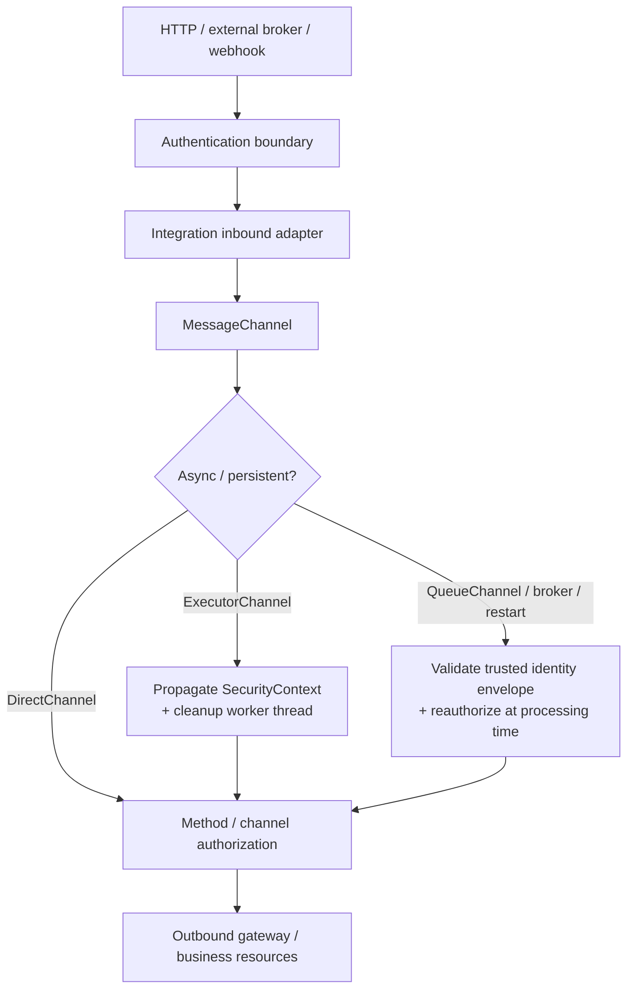
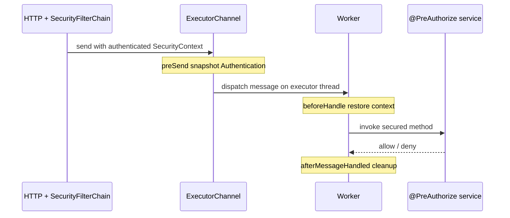
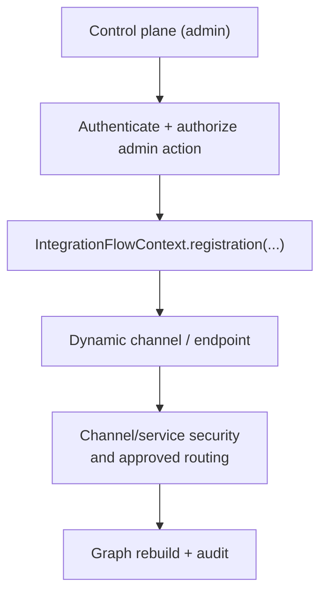

# Xác thực và authorization tại gateway trong Spring Integration Runtime

## 1. Bài toán bảo mật ở điểm vào message flow

Một `IntegrationFlow` có thể bắt đầu từ HTTP inbound gateway, WebSocket, JMS/AMQP/Kafka adapter, scheduler, file inbound adapter hoặc một interface `@MessagingGateway` được mã Java trong ứng dụng gọi. Sau điểm vào, message có thể đi qua `DirectChannel`, `ExecutorChannel`, `QueueChannel`, router, transformer, splitter, aggregator, service activator và outbound gateway. **Mỗi ranh giới đó có mức tin cậy và ngữ cảnh bảo mật khác nhau**.

Ví dụ dịch vụ xử lý lệnh thanh toán nhận HTTP request, xác thực Bearer JWT, phân quyền `orders:write`, kiểm tra tenant của đơn hàng rồi gửi message vào flow:

```mermaid
flowchart LR
    CLIENT["Client / partner"] -->|HTTPS + Bearer JWT| WEB["Spring Security<br/>SecurityFilterChain"]
    WEB -->|authenticated request| IG["HTTP Inbound Gateway"]
    IG --> CH["orders.secured.input<br/>MessageChannel"]
    CH --> AUTH["Business authorization<br/>tenant + resource"]
    AUTH --> WORK["Handler / DB transaction"]
    WORK --> REPLY["Reply / HTTP response"]
    WEB -. "401 / 403 khi bị từ chối" .-> CLIENT
```



Các câu hỏi phải trả lời:

1. **Ai gọi?** Token, client certificate hoặc cơ chế ingress nào chứng minh danh tính?
2. **Có quyền gọi chức năng không?** Vai trò/scope/authority có cho phép truy cập endpoint?
3. **Có quyền trên tài nguyên cụ thể không?** Principal này có được sửa đơn hàng thuộc tenant được nêu?
4. **Quyền có còn đúng sau khi đổi thread không?** `SecurityContext` phải được truyền/khởi tạo đúng ở executor/poller.
5. **Quyền có được kiểm tra lại sau khi vào queue lâu hay restart không?** Token và roles có thể hết hạn/thay đổi.
6. **Lỗi bảo mật đi đâu?** HTTP 401/403, error channel hay retry/DLQ? Có lộ thông tin nhạy cảm?
7. **Ai có thể tạo message từ nơi khác?** Một HTTP filter bảo vệ đường HTTP không tự bảo vệ adapter broker, flow nội bộ hay gateway khác.

Bài **Xác thực và authorization tại gateway**, thuộc chương **Bảo mật runtime** của `SPRING_INTEGRATION_RUNTIME`, đặt trong bối cảnh điều phối channel, endpoint, consumer, poller, executor, lifecycle `IntegrationFlow`, transaction, retry, message store, lỗi, correlation, threading, hiệu năng và quan sát trạng thái vận hành.

**Mục tiêu học tập:** phân biệt authentication/authorization; bảo vệ HTTP inbound gateway bằng Spring Security 6; thực hiện phân quyền theo resource/tenant; dùng `AuthorizationChannelInterceptor` ở channel; truyền security context khi đổi thread; không tin headers từ message/broker; bảo vệ outbound gateway; kiểm thử các đường 401/403, async và multi-tenant; chẩn đoán quyền bị mất khi retry/restart.

**Phiên bản:** Ví dụ tham chiếu **Spring Integration 6.5.x**, **Spring Security 6.5.x**, Spring Framework 6.x, Java 17+. Các class bảo mật của Spring Integration 5.x/đầu 6.x không được tự sử dụng cho ứng dụng 6.5.

## 2. Phân biệt authentication, authorization và trust boundary

### 2.1. Authentication không phải authorization

| Thuật ngữ | Câu hỏi | Ví dụ |
|---|---|---|
| **Authentication** | Chủ thể thực sự là ai? | Xác minh chữ ký, issuer, expiry của JWT |
| **Authorization** | Chủ thể được làm gì? | Có `SCOPE_orders.write` để gửi lệnh? |
| **Resource authorization** | Chủ thể được thao tác lên bản ghi nào? | Chỉ sửa order thuộc tenant A |
| **Service identity** | Ứng dụng/consumer nào đang gọi? | Service account của adapter |
| **Message provenance** | Message từ nguồn đáng tin cậy nào? | Broker/topic, ingress authenticated, chữ ký envelope |
| **Delegation** | Một service có được làm thay người dùng không? | On-behalf-of token hoặc ủy quyền có scope |
| **Audit** | Quyết định cho phép/từ chối xảy ra ở đâu? | Event với principal ID, action, tenant, outcome |

`authenticated()` chỉ đảm bảo có một `Authentication` được framework coi là authenticated; nó không đảm bảo người dùng có quyền xử lý **mọi** đơn hàng. Tương tự, authority `SCOPE_orders.write` thường diễn tả một quyền chung, **không** thay quy tắc sở hữu tài nguyên/tenant.

### 2.2. Tài nguyên thuộc tenant là dữ liệu cần xác minh

Một request:

```json
{
  "tenantId": "tenant-B",
  "orderId": "ORD-101",
  "operation": "APPROVE"
}
```

Client có thể đổi `tenantId` hay `orderId`. Do đó **không** cho phép thao tác chỉ vì HTTP header/body khai báo `tenant-B` hay vì request đã có một JWT hợp lệ. Quyết định phải đối chiếu **danh tính đã xác thực + quyền + quyền sở hữu tài nguyên trong nguồn tin cậy** (ví dụ database, ACL, policy service, tenant membership).

Kể cả khi token có claim `tenant_id`, phải xác minh issuer/audience, việc claim có được hệ thống tin cậy cấp, và đơn hàng thực sự thuộc tenant được cấp quyền. Tránh IDOR/BOLA (*broken object-level authorization*).

### 2.3. Trust boundary ở runtime



**Quy tắc quan trọng:** tin cậy ở chặng trước **không tự đi theo message mãi mãi**. Một `Authentication` trong `SecurityContextHolder` thường chỉ gắn với thread. Một message persisted không phải người dùng đăng nhập đang có mặt, và custom header `roles=ADMIN` do producer gửi không phải bằng chứng quyền.

## 3. “Gateway” có nhiều nghĩa: bảo vệ đúng điểm vào

### 3.1. HTTP inbound gateway

`HttpRequestHandlingMessagingGateway` tiếp nhận HTTP request, chuyển thành message và chờ reply từ Spring Integration flow. Với ứng dụng Servlet, Spring Security's `SecurityFilterChain` được thực thi **trước** endpoint HTTP trong request pipeline khi cấu hình đúng.

Có thể đặt chính sách:

- `POST /api/orders` yêu cầu JWT có scope `orders.write`.
- `GET /api/orders/{id}` yêu cầu `orders.read`.
- Các API admin yêu cầu quyền riêng, không được thừa hưởng “authenticated = admin”.
- Các URL không được định nghĩa rõ bị deny.
- HTTPS được thực thi qua ingress/load balancer và hop nội bộ theo kiến trúc.

### 3.2. Interface @MessagingGateway không phải HTTP endpoint

`@MessagingGateway` trong Spring Integration là **Java proxy** biến method invocation thành message, hỗ trợ request/reply. Ví dụ:

```java
import org.springframework.integration.annotation.Gateway;
import org.springframework.integration.annotation.MessagingGateway;

@MessagingGateway
interface OrderGateway {
    @Gateway(requestChannel = "orders.secured.input")
    String submitOrder(String command);
}
```

Method `submitOrder()` có thể được gọi từ controller, scheduled job hoặc một bean nội bộ. Bản thân annotation **không thêm authentication hoặc authorization**, và `SecurityFilterChain` chỉ bảo vệ request web tương ứng chứ **không** tự bảo vệ mọi lời gọi Java tới gateway.

Do đó nên phân lớp:

- Security filter cho **HTTP transport**.
- Method security/service authorization cho **nghiệp vụ**.
- Channel authorization cho **message ingress hoặc nơi cần một policy xuyên callers**.
- Authentication/authorization phù hợp cho **non-HTTP ingress**.

### 3.3. Outbound gateway cũng cần security

`Http.outboundGateway`, JMS/Kafka outbound gateway hoặc một adapter gọi hệ thống bên ngoài là **điểm ra**. Nó cần chính sách credential, TLS/mTLS, tenant routing, secret rotation và quyền được phép gọi endpoint; không tự động gửi lại bearer token của end user.

**Không có một “gateway filter” chung bảo vệ mọi loại gateway.** Hãy xác định adapter nào đang nhận từ ngoài, ai là caller và chính sách được áp tại đâu.

## 4. HTTP JWT Resource Server: xác thực ở biên

### 4.1. Phụ thuộc và cấu hình issuer

Đối với Spring Boot Servlet resource server, thường cần:

- `spring-boot-starter-security`.
- `spring-boot-starter-oauth2-resource-server` (bao gồm các phần tương ứng của `spring-security-oauth2-resource-server` và `spring-security-oauth2-jose`).
- `spring-integration-http` cho HTTP inbound gateway, cùng `spring-integration-core`.
- Spring Integration Java DSL/Boot config tùy dự án.

Ví dụ application configuration của **môi trường phát hành token giả lập**, không phải secret thật:

```yaml
spring:
  security:
    oauth2:
      resourceserver:
        jwt:
          issuer-uri: https://identity.example.com/issuer
```

Resource server xác minh JWT bằng cấu hình decoder/trust của issuer: chữ ký, `iss`, `exp`, `nbf` và map scopes sang authorities `SCOPE_*` theo mặc định. **Nên cấu hình/kiểm tra audience (`aud`) phù hợp API**, policy thuật toán được phép, key rotation, clock skew và cache JWKS. Không chấp nhận `alg=none` hoặc tự “decode” JWT thành JSON rồi tin claims.

`issuer-uri` ở ví dụ là placeholder; thay bằng nhà phát hành token được tổ chức phê duyệt. Không ghi client secret vào YAML được commit lên repository.

### 4.2. SecurityFilterChain cho endpoint cụ thể

```java
import org.springframework.context.annotation.Bean;
import org.springframework.context.annotation.Configuration;
import org.springframework.http.HttpMethod;
import org.springframework.security.config.annotation.web.builders.HttpSecurity;
import org.springframework.security.config.annotation.web.configuration.EnableWebSecurity;
import org.springframework.security.config.http.SessionCreationPolicy;
import org.springframework.security.web.SecurityFilterChain;

@Configuration
@EnableWebSecurity
class GatewayHttpSecurityConfig {

    @Bean
    SecurityFilterChain apiFilterChain(HttpSecurity http) throws Exception {
        return http
                .csrf(csrf -> csrf
                        .ignoringRequestMatchers("/api/orders", "/api/orders/**"))
                .sessionManagement(session -> session
                        .sessionCreationPolicy(SessionCreationPolicy.STATELESS))
                .authorizeHttpRequests(auth -> auth
                        .requestMatchers(HttpMethod.POST, "/api/orders")
                            .hasAuthority("SCOPE_orders.write")
                        .requestMatchers(HttpMethod.GET, "/api/orders/**")
                            .hasAuthority("SCOPE_orders.read")
                        .anyRequest().denyAll())
                .oauth2ResourceServer(oauth2 -> oauth2.jwt(jwt -> {}))
                .build();
    }
}
```

**Giải thích:**

- `SecurityFilterChain` từ chối request **trước khi** HTTP gateway phát message nếu authentication/authorization không đạt.
- Scope `orders.write` trong JWT thường trở thành `SCOPE_orders.write`, không phải `ROLE_orders.write`. `hasRole("ADMIN")` kiểm tra quy ước `ROLE_ADMIN`, là một hệ quyền khác.
- `anyRequest().denyAll()` là chiến lược chặn những URL chưa được kiểm kê. Nếu ứng dụng có health endpoints/public docs, khai báo ngoại lệ **tường minh** với giới hạn tương ứng, không mở `permitAll()` cho toàn bộ ứng dụng.
- Đoạn `csrf.ignoringRequestMatchers` chỉ phù hợp khi **những endpoint này thực sự dùng Bearer token qua Authorization header, không nhận authentication dựa trên cookie/browser session**. Nếu hỗ trợ browser login/cookie, cần giữ CSRF protection và token phù hợp; không tắt CSRF toàn ứng dụng để làm một test POST đi qua.
- `STATELESS` không thay thế xác thực JWT hay CSRF policy; nó chỉ ảnh hưởng cách server quản lý HTTP session.
- Nếu triển khai sau API gateway/proxy, cần chính sách forwarded headers, HTTPS redirect và trust proxy chặt chẽ để tránh giả mạo scheme/host.

### 4.3. 401 và 403 khác nhau

| Tình huống | Phản hồi HTTP thường mong đợi | Nguyên nhân |
|---|---|---|
| Không có Bearer token với endpoint protected | **401 Unauthorized** | Không có authentication hợp lệ |
| Token hết hạn/chữ ký sai | **401 Unauthorized** | Authentication thất bại |
| JWT hợp lệ nhưng thiếu `SCOPE_orders.write` | **403 Forbidden** | Đã authenticated nhưng không được phép |
| Scope đủ nhưng order thuộc tenant khác | **403 Forbidden** hoặc **404 Not Found** theo anti-enumeration policy | Resource authorization từ chối |
| Payload/JSON schema sai | **400 Bad Request** | Input validation/conversion |
| Rate limit/queue overload | **429**/**503** theo hợp đồng | Không phải lỗi authentication |
| Handler/network/database lỗi sau khi đã nhận | **5xx** hoặc response nghiệp vụ | Không tự biến thành 401/403 |

Status thực tế của Spring Integration HTTP inbound gateway khi handler throw có thể phụ thuộc gateway error flow, reply mapping và `ResponseStatusException`, không mặc định mọi `AccessDeniedException` ném ở **worker thread** sẽ quay lại `ExceptionTranslationFilter` của HTTP request thread. Xem phần xử lý lỗi và async bên dưới.

### 4.4. Đặt HTTP gateway vào IntegrationFlow

Ví dụ Java DSL cho một HTTP inbound gateway gửi vào handler có phương thức xử lý:

```java
import org.springframework.context.annotation.Bean;
import org.springframework.context.annotation.Configuration;
import org.springframework.http.HttpMethod;
import org.springframework.integration.dsl.IntegrationFlow;
import org.springframework.integration.http.dsl.Http;

@Configuration
class OrderHttpGatewayFlow {

    @Bean
    IntegrationFlow orderApiFlow(OrderGatewayHandler handler) {
        return IntegrationFlow
                .from(Http.inboundGateway("/api/orders")
                        .requestMapping(mapping ->
                                mapping.methods(HttpMethod.POST))
                        .requestPayloadType(String.class))
                .handle(handler, "handle")
                .get();
    }
}
```

Trong đó `OrderGatewayHandler` là một Spring-managed bean và `handle` phải có signature mà service activator adapter có thể gọi, chẳng hạn `String handle(Message<String> message)`. `Http.inboundGateway` ánh xạ HTTP request thành message và reply từ handler thành HTTP response. Kiểu String ở đây chỉ để minh họa đường đi; ứng dụng thật nên dùng **DTO + validation + JSON converter** thay vì parse body bằng chuỗi hoặc tin các giá trị tự khai báo.

**Lưu ý:** `SecurityFilterChain` thuộc **Servlet HTTP pipeline**. Nếu dùng Spring WebFlux reactive stack, cấu hình tương ứng phải là `SecurityWebFilterChain`/`ServerHttpSecurity`, không dùng class Servlet cho reactive server.

## 5. Phân quyền sâu tại service: tenant, object và action

### 5.1. Vì sao check URL chưa đủ?

Bảo vệ `POST /api/orders` bằng scope `orders.write` chỉ ngăn người không có scope gửi lệnh. Nó không ngăn người dùng tenant A gửi payload nói `tenantId=B` hay `orderId` thuộc tenant B. Nếu flow còn nguồn Kafka nội bộ, HTTP filter còn **không chạy** trên Kafka message.

Cần một phương thức được bảo vệ ở **service layer** mà mọi đường vào nghiệp vụ đều gọi. Spring Security 6 dùng `@EnableMethodSecurity` và `@PreAuthorize` trên **Spring-managed proxied beans**.

### 5.2. Ví dụ @PreAuthorize kết hợp policy bean

```java
import org.springframework.context.annotation.Configuration;
import org.springframework.security.config.annotation.method.configuration.EnableMethodSecurity;

@Configuration
@EnableMethodSecurity
class OrderMethodSecurityConfig {}
```

Bean tính policy:

```java
import org.springframework.security.core.Authentication;
import org.springframework.security.oauth2.server.resource.authentication.JwtAuthenticationToken;
import org.springframework.stereotype.Component;

@Component("tenantPolicy")
public class TenantPolicy {

    public boolean canWrite(
            Authentication authentication, String tenantId) {

        if (!(authentication instanceof JwtAuthenticationToken jwtAuth)
                || !authentication.isAuthenticated()) {
            return false;
        }

        Object claimedTenant =
                jwtAuth.getToken().getClaims().get("tenant_id");

        return tenantId != null
                && tenantId.equals(claimedTenant);
    }
}
```

Service nghiệp vụ:

```java
import org.springframework.security.access.prepost.PreAuthorize;
import org.springframework.stereotype.Service;

@Service
public class OrderCommandService {

    private final OrderRepository repository;

    public OrderCommandService(OrderRepository repository) {
        this.repository = repository;
    }

    @PreAuthorize("hasAuthority('SCOPE_orders.write') "
            + "and @tenantPolicy.canWrite(authentication, #p0)")
    public String approve(String tenantId, String orderId) {

        // Authorization theo tenant trong JWT chỉ là một điều kiện.
        // Còn phải xác nhận order thực sự thuộc tenantId trong DB.
        Order order = repository.findByTenantIdAndOrderId(
                tenantId, orderId)
                .orElseThrow(() -> new ResourceNotFoundException());

        order.approve();
        repository.save(order);

        return order.getId();
    }
}
```

`OrderRepository`, `Order` và `ResourceNotFoundException` là các **kiểu ứng dụng** chưa được triển khai trong đoạn học tập. `#p0` tham chiếu parameter đầu để không phụ thuộc metadata tên parameter; nếu dùng `#tenantId` cần đảm bảo có parameter name information. Chỉ gọi `approve` qua **Spring proxy**, không dùng `this.approve(...)` từ method cùng bean (self-invocation có thể bỏ qua AOP interception).

**Điểm bảo mật quan trọng:** dù `tenantId` khớp claim, vẫn bắt buộc query theo **tenant ID + order ID** thay vì query order theo ID rồi chỉ tin body. Nếu token cho phép nhiều tenants/roles phức tạp, policy phải tham chiếu membership/ACL đáng tin cậy (không so đơn giản một claim).

### 5.3. Handler Spring Integration gọi bean có method security

```java
import org.springframework.messaging.Message;
import org.springframework.security.access.AccessDeniedException;
import org.springframework.security.core.Authentication;
import org.springframework.security.core.context.SecurityContextHolder;
import org.springframework.security.oauth2.server.resource.authentication.JwtAuthenticationToken;
import org.springframework.stereotype.Component;

@Component
class OrderGatewayHandler {

    private final OrderCommandService service;

    OrderGatewayHandler(OrderCommandService service) {
        this.service = service;
    }

    public String handle(Message<String> message) {

        // DirectChannel: SecurityContext vẫn ở thread HTTP đã xác thực.
        Authentication identity =
                SecurityContextHolder.getContext().getAuthentication();
        if (!(identity instanceof JwtAuthenticationToken jwtAuth)) {
            throw new AccessDeniedException("Trusted JWT principal required");
        }

        // Không tin tenantId từ header/body do client tự khai báo.
        String tenantId = jwtAuth.getToken().getClaimAsString("tenant_id");
        if (tenantId == null || tenantId.isBlank()) {
            throw new AccessDeniedException("Missing tenant claim");
        }

        // Production: parse DTO + Bean Validation và kiểm tra resource.
        String orderId = message.getPayload();

        return service.approve(tenantId, orderId);
    }
}
```

**Cảnh báo:** ví dụ lấy `tenantId` từ **JWT đã được resource server xác minh**, không từ header/body. Nó giả định đường gọi HTTP → `DirectChannel` còn giữ `SecurityContext` trên cùng thread. Với `ExecutorChannel`/poller, cần propagation hoặc reauthorization theo mục 7–8. `@PreAuthorize` kiểm tra claim một lần nữa, còn repository buộc truy vấn resource theo tenant. Với DTO production, vẫn cần validate payload và đối chiếu quyền trên từng order.

### 5.4. Quy tắc cho multi-tenant runtime

- Không tin `X-Tenant-Id`, `role`, `permissions` trong inbound message chỉ vì chúng tồn tại.
- Không dùng `tenantId` từ payload làm tên database schema, file path hoặc URL trước khi validate/allowlist.
- Không lọc `orders` theo ID rồi kiểm tra quyền sau khi đã sửa bản ghi.
- Không dựa trên một route canary/version để cấp thêm quyền.
- Không dùng business correlation ID làm danh tính hoặc bằng chứng authentication.
- Với batch/splitter, kiểm tra quyền trên **từng resource** nếu các parts có thể thuộc những entities khác nhau.
- Với retry, không cho phép một role/tenant thay đổi ngẫu nhiên theo thread reuse; chính sách authorization phải được đánh giá ở thời điểm đã định và có audit.

## 6. Authorization tại MessageChannel: lớp phòng vệ bổ sung

### 6.1. Phiên bản 6.5: spring-security-messaging

**Đặc biệt quan trọng:** từ **Spring Integration 6.3**, module cũ `spring-integration-security` đã **bị loại bỏ**. Những class/config như `org.springframework.integration.security.channel.ChannelSecurityInterceptor`, `@SecuredChannel` và XML `<secured-channels>` thuộc các phiên bản cũ; **không** dùng cho Spring Integration 6.5.

Dùng `org.springframework.security.messaging.access.intercept.AuthorizationChannelInterceptor` từ `spring-security-messaging` cùng `AuthorizationManager<Message<?>>`. Hướng dẫn Spring Integration 6.5 có ví dụ `@GlobalChannelInterceptor` sau:

```java
import org.springframework.context.annotation.Bean;
import org.springframework.context.annotation.Configuration;
import org.springframework.integration.config.GlobalChannelInterceptor;
import org.springframework.security.authorization.AuthorityAuthorizationManager;
import org.springframework.security.messaging.access.intercept.AuthorizationChannelInterceptor;

@Configuration
class SecureChannelsConfig {

    @Bean
    @GlobalChannelInterceptor(patterns = "orders.secured*")
    AuthorizationChannelInterceptor authorizeOrdersChannels() {

        return new AuthorizationChannelInterceptor(
                AuthorityAuthorizationManager.hasAuthority(
                        "SCOPE_orders.write"));
    }
}
```

**Hiệu lực:** interceptor này đưa ra quyết định trên thao tác **`preSend`** của channel phù hợp. Nó không tự biến thành bộ xác thực JWT; tại điểm gọi phải có `SecurityContext` đã được thiết lập hợp lệ. Đồng thời nó không thay thế policy tenant/resource ở service.

### 6.2. Cẩn trọng với pattern và chiều send/receive

`@GlobalChannelInterceptor(patterns="orders.secured*")` áp dụng cho các channel **có bean name khớp pattern**; không tự động bảo vệ tất cả channel tùy ý hoặc outbound adapters. Kiểm tra tên thật được Spring Integration tạo khi dùng Java DSL và `IntegrationFlowContext`.

Với `QueueChannel`, `AuthorizationChannelInterceptor` kiểm soát `preSend`, không phải “mọi receive và business operation”. Nếu producer đã được phép send, một poller có thể xử lý về sau trên thread khác; cần method-level authorization và nguồn identity phù hợp.

Một số policy cần phân biệt:

| Ranh giới | Policy đề xuất |
|---|---|
| HTTP inbound gateway | `SecurityFilterChain` xác thực và check scope |
| Public-facing input channel | `AuthorizationChannelInterceptor` cho `preSend` |
| Service nghiệp vụ | `@PreAuthorize` hoặc policy service cho tenant/resource |
| Queue/poller consumer | Xác minh context/ủy quyền hợp lệ tại thời điểm xử lý |
| Admin/control channel | Authority quản trị riêng, không gộp với client business permissions |
| Error/DLQ channel | Không cho client tùy ý tạo/xem error payload |
| Outbound gateway | Credential riêng và ACL hệ thống đích |

### 6.3. Channel security không thay web/transport security

Nếu một malicious client gọi HTTP gateway, HTTP filter phải chặn **trước khi** payload vào flow. Nếu một internal component gửi trực tiếp vào channel, channel interceptor bảo vệ theo current `Authentication`. Nhưng nếu một broker consumer đọc message có header giả `authentication=ADMIN`, bạn **không** được coi header đó là một principal đã được xác thực.

Đừng áp `Authentication` vào message rồi tin nó là sự thật tại một trust boundary mới. Header authentication chỉ là dữ liệu khi không có cơ chế đảm bảo provenance.

### 6.4. Fail closed và hiệu năng

Một channel bị từ chối có thể ném `AccessDeniedException` ngay tại `send()` (đồng bộ). Nếu catch error rồi route message sang một channel **không được bảo vệ** hoặc auto-retry vô hạn, bạn có thể tạo bypass hoặc retry storm.

Đối với policy service, **deny by default** khi thiếu principal, thiếu tenant, token không hợp lệ hay không đủ permission. Việc đánh giá `AuthorizationManager` trong channel có chi phí, nhưng rẻ hơn nhiều so với nguy cơ unauthorized processing; không bỏ interceptor để giảm vài microseconds khi chưa thiết kế được policy thay thế.

## 7. SecurityContext qua ExecutorChannel, poller và gateway bất đồng bộ

### 7.1. Khi đổi thread, SecurityContextHolder có thể rỗng

Spring Security giữ `SecurityContext` theo thread bằng `SecurityContextHolderStrategy` (thông thường là `ThreadLocal`). Trên `DirectChannel`, downstream thường được gọi ngay trên thread của request, nên context hiện tại vẫn tồn tại. Nhưng:

```text
HTTP request thread:
    Authentication = user A
    HTTP inbound gateway -> ExecutorChannel.send()

Worker thread:
    handler @PreAuthorize(...)
    SecurityContextHolder.getContext().getAuthentication() = ?
```

Nếu không cấu hình propagation, worker thread có thể không thấy principal, dẫn đến `AccessDeniedException`/`AuthenticationCredentialsNotFoundException` hoặc một lỗi policy. Cách **sai** là chuyển `SecurityContextHolder` sang chế độ `MODE_INHERITABLETHREADLOCAL` để “tự giải quyết” với thread pool: worker threads được tái sử dụng, ngữ cảnh có thể không được copy đúng ở thời điểm submit và có nguy cơ lẫn identities.

### 7.2. SecurityContextPropagationChannelInterceptor

Trong Spring Security 6.x, class đúng là `org.springframework.security.messaging.context.SecurityContextPropagationChannelInterceptor` (module `spring-security-messaging`), không phải package của `spring-integration-security` đã bị loại bỏ.

Ví dụ channel chuyển thread:

```java
import org.springframework.context.annotation.Bean;
import org.springframework.context.annotation.Configuration;
import org.springframework.integration.channel.ExecutorChannel;
import org.springframework.integration.config.GlobalChannelInterceptor;
import org.springframework.messaging.MessageChannel;
import org.springframework.scheduling.concurrent.ThreadPoolTaskExecutor;
import org.springframework.security.messaging.context.SecurityContextPropagationChannelInterceptor;

@Configuration
class AsyncSecurityContextConfig {

    @Bean("orders.workerExecutor")
    ThreadPoolTaskExecutor workerExecutor() {
        ThreadPoolTaskExecutor executor = new ThreadPoolTaskExecutor();
        executor.setCorePoolSize(4);
        executor.setMaxPoolSize(8);
        executor.setQueueCapacity(100);
        executor.setThreadNamePrefix("orders-secure-");
        return executor;
    }

    @Bean("orders.async.input")
    MessageChannel asyncOrdersInput(ThreadPoolTaskExecutor workerExecutor) {
        return new ExecutorChannel(workerExecutor);
    }

    @Bean
    @GlobalChannelInterceptor(patterns = "orders.async.input")
    SecurityContextPropagationChannelInterceptor propagateContext() {
        return new SecurityContextPropagationChannelInterceptor();
    }
}
```

Interceptor lấy `Authentication` trong `preSend()` khi caller còn context; sau đó thiết lập context trong `beforeHandle()` (ExecutorChannel) hoặc `postReceive()` (pollable channel) và dọn khi handling kết thúc. Chính **cleanup** sau khi xử lý mới ngăn worker B vô tình nhìn thấy danh tính của request A.

**Phạm vi:** đây là propagation **trong runtime ứng dụng với nguồn message được tin cậy**; interceptor thêm một `Authentication` vào header. Không nên persist/header-map nguyên đối tượng đó sang broker hoặc mở cho client gửi header giả có cùng tên. Kiểm tra các header mappers và channel interceptors trước khi dùng trong flow có producer bên ngoài không tin cậy.

### 7.3. Khác biệt trước và sau khi gắn interceptor



Test cần xác nhận cả hai phía:

- Handler thấy đúng `Authentication.getName()` và authorities khi nhận request A.
- Nếu handler ném exception, context vẫn được dọn.
- Request B khác principal trên **cùng worker thread** không thấy identity A.
- Message không có context hợp lệ bị deny.
- Channel không có interceptor không được lặng lẽ mặc định cho phép.

### 7.4. Asynchronous @MessagingGateway và executor của chính gateway

Ngoài channel worker, một `@MessagingGateway` trả `Future<?>`/async result có thể tạo executor cho **lời gọi gateway**. Spring Integration reference khuyến nghị Spring Security Concurrency Support như `DelegatingSecurityContextAsyncTaskExecutor` để propagate context qua ranh giới này:

```java
import java.util.concurrent.Future;
import org.springframework.context.annotation.Bean;
import org.springframework.core.task.AsyncTaskExecutor;
import org.springframework.integration.annotation.Gateway;
import org.springframework.integration.annotation.MessagingGateway;
import org.springframework.scheduling.concurrent.ThreadPoolTaskExecutor;
import org.springframework.security.task.DelegatingSecurityContextAsyncTaskExecutor;

@Bean("gateway.secure.executor")
AsyncTaskExecutor gatewaySecureExecutor() {
    ThreadPoolTaskExecutor delegate = new ThreadPoolTaskExecutor();
    delegate.setCorePoolSize(2);
    delegate.setMaxPoolSize(4);
    delegate.setThreadNamePrefix("secure-gateway-");
    delegate.initialize();

    return new DelegatingSecurityContextAsyncTaskExecutor(delegate);
}

@MessagingGateway(asyncExecutor = "gateway.secure.executor")
interface AsyncOrderGateway {
    @Gateway(requestChannel = "orders.secured.input")
    Future<String> submit(String payload);
}
```

Đoạn này minh họa Spring bean method và gateway interface nằm trong cấu hình/lớp tương ứng; ứng dụng cần `@EnableIntegration` và đăng ký gateway component scan. Khi triển khai thật, quản lý lifecycle/delegate executor như Spring bean riêng để đóng sạch khi shutdown.

**Đừng trộn hai mục đích:**

- `DelegatingSecurityContextAsyncTaskExecutor` bao việc **task chạy trên executor**.
- `SecurityContextPropagationChannelInterceptor` bao việc **message qua channel đổi thread**.

Tùy topology có thể cần cả hai, hoặc chỉ một. Không tạo nhiều lớp context propagation mà không kiểm tra order/cleanup; tránh kết hợp `SecurityContextPropagationChannelInterceptor` và `SecurityContextChannelInterceptor` trên cùng channel như Javadoc cảnh báo.

## 8. Persistent QueueChannel và broker: phải xác thực lại theo ranh giới

### 8.1. Không serialize SecurityContext tùy tiện

Một HTTP request có JWT hợp lệ tại `t0`. Message sau đó đi vào `QueueChannel` backed bởi `JdbcChannelMessageStore` hoặc broker và được xử lý sau 20 phút. Trong khoảng này:

- JWT có thể hết hạn hoặc bị thu hồi.
- Người dùng có thể bị xóa khỏi tenant.
- Resource đã chuyển chủ sở hữu.
- Chương trình đã deploy phiên bản mới với chính sách quyền khác.
- Message đã được redeliver hoặc bị một process khác deserialize.

**Bất kỳ `Authentication` nào được lưu trong message header cũng không tự là một phiên đăng nhập còn hợp lệ tại thời điểm xử lý**. Thực tế còn có vấn đề serialize complex principal, chứa credentials/tokens hoặc bị bên gửi giả mạo.

### 8.2. Hai mô hình được phép cân nhắc

| Chính sách | Cách xử lý | Đánh đổi |
|---|---|---|
| **Reauthorize at processing time** | Lưu stable subject/tenant/action/resource ID từ ingress đáng tin, xác minh authenticity/provenance và query policy mới | Quyền bị thu hồi có hiệu lực; job có thể bị deny sau khi đã accepted |
| **Authorized command snapshot** | Ingress thực hiện kiểm tra đủ quyền, ghi một command đã được hệ thống tin cậy xác nhận/phê duyệt với TTL, scope và audit | Xử lý được long-running jobs; phải thiết kế tính bất biến, chống giả mạo/replay và chính sách hủy job |

**Không chọn một trong hai một cách ngầm định.** Đơn hàng đã được chấp thuận xử lý nền có thể cần hoàn thành ngay cả khi người dùng đăng xuất; trong khi truy vấn thông tin nhạy cảm sau 20 phút có thể phải kiểm tra quyền lại.

### 8.3. Trusted command envelope thay vì raw role headers

```json
{
  "commandId": "CMD-19",
  "action": "order.approve",
  "subjectId": "user-7",
  "tenantId": "tenant-A",
  "resourceId": "ORD-101",
  "requestedAt": "2026-11-22T02:00:00Z",
  "authorizationVersion": "policy-v5",
  "idempotencyKey": "PAYMENT-19"
}
```

Đây là **một schema minh họa**: chỉ đáng tin nếu message được tạo bởi một ingress đã xác thực, broker/topic/connection có ACL, và có bảo vệ integrity (ví dụ chữ ký/HMAC của envelope hoặc ràng buộc end-to-end bằng service identity + storage ACL). Một attacker không được phép tự publish JSON trên vào cùng queue.

Không cần lưu Bearer token gốc trong payload, log hoặc message store. Nếu consumer cần gọi downstream bằng quyền người dùng, sử dụng OAuth 2.0 token exchange/on-behalf-of theo chính sách hệ thống, với token ngắn hạn và scope tối thiểu; không dùng token cũ không giới hạn thời gian.

### 8.4. Consumer chạy dưới service identity khác user identity

Một polling consumer không có HTTP request thread; nó thường là một workload có **service principal**. Khi xử lý một command:

1. Xác thực **dịch vụ/broker connection** và chứng minh nguồn message.
2. Xác minh command ID, chữ ký/claim provenance, timestamp, audience và chống replay.
3. Tìm resource theo tenant và policy phù hợp.
4. Đối chiếu quyền đã được ủy quyền hoặc kiểm tra lại từ authoritative source.
5. Thực hiện operation với idempotency key và transaction hợp lệ.
6. Ghi audit: service principal thực thi, subject nguyên thủy là ai, resource nào và policy nào đã cho phép.

**Không gán `SecurityContextHolder` của HTTP user vào một poller sống hàng giờ**. Nếu cần principal đại diện, hãy tạo một context có nguồn tin cậy trong scope của lần xử lý và restore/clear nó ở cuối, không tái sử dụng từ worker trước.

### 8.5. Retry và dead-letter queue không được trở thành đường bypass

`RequestHandlerRetryAdvice`, poller retry hoặc broker redelivery có thể xử lý cùng command nhiều lần. Nếu authorization đã bị deny:

- Không retry vô hạn một `AccessDeniedException` như lỗi mạng tạm thời.
- Không gửi command đến DLQ rồi cho một “admin consumer” tự động xử lý với đặc quyền cao hơn.
- Không xem error recovery đồng nghĩa được bỏ qua authorization.
- Khi replay DLQ thủ công, revalidate provenance/tenant/policy và audit người thực hiện.
- Không coi `MessageHeaders.ID` là idempotency key duy nhất; redelivery có thể tạo message mới, cần stable `commandId`.

Một retry sau khi token hết hạn phải theo **chính sách long-running command**, không cố lén gia hạn principal cũ để vượt qua revocation.

### 8.6. MessageGroupStore và correlation cũng phải cách ly tenant

Aggregator/resequencer có thể lưu nhiều message từ các nguồn khác nhau trong cùng `MessageGroupStore`. Nếu `CorrelationStrategy` chỉ lấy `orderId`, hai tenants cùng có order `42` sẽ chung group. Khi đó một user đã xác thực ở tenant A có thể khiến data thuộc tenant B bị xử lý chung, dù HTTP gateway đã kiểm tra JWT ban đầu.

```text
tenant A, order 42, processingRunId=run-1
tenant B, order 42, processingRunId=run-2

KHÔNG DÙNG: correlationKey = orderId
CÂN NHẮC:   correlationKey = tenantId + ":" + stage + ":" + processingRunId
```

Mọi phần của cùng logical group phải có key ổn định; các groups độc lập phải khác nhau. `tenantId` trong group key phải lấy từ **nguồn đã xác minh**, không chỉ header untrusted. Khi nhiều JVM cùng dùng persistent store, phải kiểm tra namespace, `LockRegistry` phân tán, release/expiry policy, late arrivals và quyền đọc state qua admin endpoints. Lock và transaction giữ tính nhất quán kỹ thuật, **không thay kiểm tra authorization của từng resource**.

Test nên gửi xen kẽ các parts của hai tenants có cùng business ID, kiểm tra không trộn dữ liệu trong `MessageGroupStore`, không rò sang reply/error channel khác tenant và không có group cũ bị đọc bởi flow version mới ngoài chủ đích.

## 9. Error handling: 401/403 không được biến thành success hay retry storm

### 9.1. Đường lỗi tại HTTP boundary

Nếu token thiếu/không hợp lệ, `AuthenticationEntryPoint` của resource server xử lý HTTP **401**. Nếu đã xác thực nhưng không đủ quyền theo `authorizeHttpRequests`, `AccessDeniedHandler` xử lý **403**. Cả hai thường xảy ra **trước** Spring Integration inbound gateway nhận message.

Nếu method security trong flow **đồng bộ DirectChannel** ném `AccessDeniedException`, exception có thể lan theo request call stack; cách ánh xạ ra HTTP response phải được xác minh qua cấu hình filter/exception translation/gateway. Không giả định một custom `errorChannel` sẽ tự đổi mọi lỗi method security thành HTTP 403.

### 9.2. Async channel: HTTP request có thể đã kết thúc

```text
HTTP request -> Gateway -> QueueChannel -> accepted response
                                 |
                                 v
                        Poller -> @PreAuthorize throws
                                 |
                                 v
                            ErrorMessage
```

Lỗi xảy ra **sau** khi HTTP request trả kết quả không còn một kết nối caller để lập tức gửi 403. Thiết kế thường cần:

- Status business như `REJECTED_AUTHORIZATION`/`FAILED_POLICY` với stable request ID.
- Event/audit và thông báo cho caller qua kênh được kiểm soát.
- Error/recovery channel có consumer đúng quyền.
- Loại bỏ thông tin nhạy cảm khi trả status.
- Chính sách không retry tự động lỗi quyền cố định.

Chỉ khi gateway còn đợi reply và có error-to-reply mapping cụ thể mới có thể phản hồi cho caller; vẫn phải test timeout và kết nối đã đóng.

### 9.3. ErrorMessage có thể chứa dữ liệu nhạy cảm

`ErrorMessage` payload thường là exception; `MessagingException.getFailedMessage()` hoặc `ErrorMessage.getOriginalMessage()` có thể chứa toàn bộ payload/headers. Logging mặc định `toString()` ở error channel có thể làm lộ bearer token, internal endpoint URLs hoặc tenant data nếu upstream đưa chúng vào message.

Biện pháp:

- Không đưa JWT/raw credentials vào header message trước.
- Dùng `ErrorMessage` handler ghi các trường audit được phép: event ID, principal ID đã pseudonymize, tenant, endpoint, decision code.
- Giới hạn quyền đọc `errorChannel`/DLQ/monitoring.
- Không trả stack trace, roles, internal group IDs, SQL info hay toàn payload trong lỗi trả về client.
- Tách `Unauthorized`/`Forbidden` (kết quả policy) khỏi lỗi vận hành thật `5xx` để báo động đúng.

### 9.4. Bảng tình huống

| Sự kiện | Xử lý kỳ vọng | Tuyệt đối tránh |
|---|---|---|
| JWT không có/chữ ký sai | 401 tại HTTP ingress | Chuyển message xuống flow rồi thử authenticate từ payload |
| JWT hợp lệ, thiếu scope | 403 | Retry handler với service principal đặc quyền |
| Người dùng hợp lệ, tenant sai | 403/404 theo policy | Trả tên tenant/order khác trong lỗi |
| `@PreAuthorize` deny ở async worker | Business rejection, audit/error route | Cố gửi 403 tới HTTP connection đã đóng |
| Auth service/IdP tạm unavailable | 503 hoặc policy fail-closed phù hợp | Cho phép mặc định khi không xác minh được |
| Broker command thiếu provenance | Quarantine/reject, audit | Tin `roles=ADMIN` từ header |
| Error handler cũng lỗi | Alert quan sát hệ thống, safe fallback | Mất nguyên nhân lỗi hoặc tạo infinite loop |
| Gateway reply timeout | Đánh dấu outcome chưa rõ, kiểm tra side effects | Xem timeout là bằng chứng transaction rollback |

## 10. Dynamic IntegrationFlow và các đường truy cập mới

### 10.1. Tạo flow động có thể mở thêm attack surface

`IntegrationFlowContext` có thể đăng ký một flow mới khi runtime đang hoạt động. Một flow có inbound adapter, direct input channel hoặc outbound gateway mới là **một điểm truy cập mới** nếu không được bảo vệ đúng.



**Nguyên tắc:**

- Chỉ một service/controller quản trị được cấp quyền mới được gọi `registration()`/`remove()`.
- Không nhận raw SpEL expressions, class names, bean references hoặc arbitrary URLs từ user rồi dựng flow không qua allowlist.
- Nếu flow có tên channel động, xác minh các `@GlobalChannelInterceptor(patterns=...)` còn match đúng.
- Cần cấu hình HTTP filter cho endpoint vừa mở; một filter rule cho `/api/orders` không bảo vệ `/admin/flows` hay adapter mới tự động.
- Bảo vệ người gọi `getRegistry()`/`IntegrationGraphServer`: graph có thể tiết lộ topology và remote service names.
- Log đầy đủ ai đăng ký/xóa flow, version, reason, effective policy và rollback.
- Không tạo side effect từ flow mới cho tới khi kiểm tra policy/scope, input/output destinations và canary safety.

### 10.2. Global interceptor áp dụng cho flow động nhưng cần test

Từ Spring Integration 5.1, global channel interceptors có thể áp dụng cho channels được tạo động qua `IntegrationFlowContext`; tuy nhiên **pattern và lifecycle rất quan trọng**. Một flow mới tên `admin.controlQueue` sẽ không khớp `patterns="orders.secured*"`.

Bộ regression test nên:

1. Register flow mới với ID/version cụ thể.
2. Dò các channel/endpoint names đã tạo.
3. Gửi message giả từ principal không đủ quyền, xác minh bị deny.
4. Gửi với quyền hợp lệ, xác minh chỉ đi đúng authorized route.
5. Test đổi thread/stop/start/retry/error.
6. Destroy flow, xem graph `rebuild()` và xác nhận không còn đường bỏ qua policy.

### 10.3. Phân quyền vào control plane tách khỏi data plane

| Loại quyền | Ví dụ | Tách biệt để tránh |
|---|---|---|
| Data plane | `SCOPE_orders.write` | User gọi nghiệp vụ đúng chức năng |
| Read-only observability | `ROLE_OBSERVER` | Không được đổi routing |
| Operations | `ROLE_OPERATOR` | Start/stop một nhóm endpoint được phép |
| Security admin | `ROLE_SECURITY_ADMIN` | Quản lý policy, không tự động gọi nghiệp vụ |
| Break-glass | Quyền tạm, duyệt/audit riêng | Không tồn tại “admin vĩnh viễn” trên mọi flow |

Không cho một người có quyền xử lý một order đồng nghĩa có quyền gọi `IntegrationFlowContext.remove("...")` hoặc xem failed payload của tenant khác.

## 11. Outbound gateway: ai là người gọi downstream?

### 11.1. Dùng service credential hay token người dùng?

Một `Http.outboundGateway` có thể gọi API của dịch vụ khác. Ba kịch bản:

| Kịch bản | Identity phù hợp |
|---|---|
| Backend batch gọi API nội bộ | Service account/client credentials scope hẹp |
| API cần biết người dùng được ủy quyền | Token exchange/on-behalf-of từ trustable IdP |
| Internal messaging giữa pods | mTLS/workload identity + signed/verified messages |
| Gọi đối tác thứ ba | Credential riêng theo partner/tenant, secret manager |

Không gắn tất cả `Authorization` bearer tokens của client vào outbound header. Token dành cho audience A không nên được dùng làm token của audience B; forwarding mù tạo token leakage và confused deputy.

### 11.2. Credential, URL và header mapping

- Xác định `base URL` của outbound destination từ **allowlist cấu hình**, không lấy URL tùy ý từ `replyChannel`/payload/header người dùng để tránh SSRF.
- Inject token đúng audience/scope vào request ở client configuration.
- Dùng secret manager, short-lived credentials, TLS verification và rotation.
- Không cho payload override `Authorization`/`Host`/sensitive headers của outbound client.
- Cẩn trọng `MailHeaders.TO/CC/BCC`, `MqttHeaders.TOPIC`, `RedisHeaders.KEY`, `AvroHeaders.TYPE` và reply destinations: headers từ nguồn untrusted có thể định hướng dữ liệu ra ngoài.
- Với multi-tenant, tenant routing và credential selection phải dựa vào verified tenant membership, không phải chỉ custom `tenantId`.

### 11.3. Lỗi outbound authorization không luôn là lỗi client inbound

Một HTTP 401 từ **downstream partner API** nói **credential của service gửi đi** không hợp lệ, không có nghĩa token của user tại ingress sai. Không ánh xạ máy móc downstream 401 thành 401 cho caller nếu gateway đã xác thực user đúng; thường đây là lỗi dependency/credential cần alert và mapping `502`/`503` hoặc status nghiệp vụ tùy contract.

Với 403 từ downstream, phân biệt service principal thiếu scope, tenant mismatch và resource policy. Không retry vô hạn khi credential đã bị revoke hoặc scope sai; khắc phục secret/authorization trước.

## 12. Input validation và header spoofing: chặn dữ liệu nguy hiểm trước gateway

### 12.1. Authentication hợp lệ vẫn có thể gửi dữ liệu độc hại

Ngay cả một user đã xác thực hợp lệ có thể gửi input chứa:

- Payload quá lớn, JSON lồng sâu hoặc cấu trúc gây tốn CPU/heap.
- `tenantId`/`orderId` trỏ sang dữ liệu của khách hàng khác.
- `replyChannel` hoặc `errorChannel` giả để hướng kết quả ra nơi khác.
- `routingSlip`, `gatherResultChannel`, `originalErrorChannel` khiến framework có hành vi ngoài dự kiến.
- `mqtt_topic`, `kafka_topic`, `redis_key` hay `mail_to` nhằm gửi dữ liệu tới một topic/key/địa chỉ do attacker kiểm soát.
- File path, tên file, remote folder hoặc URI tạo path traversal/SSRF.
- Type headers gây unsafe deserialization hoặc chọn class không được phép.

Tài liệu bảo mật Spring Integration 6.5 nhấn mạnh **trusting data** và **sensitive metadata**: không chỉ có authentication/authorization mà còn phải lọc/validate payload và headers trước khi downstream sử dụng chúng.

### 12.2. Header mapper allowlist và HeaderFilter

Một strategy khuyến nghị:

```text
External HTTP/broker headers
    ↓ HeaderMapper chỉ nhận allowlisted names
Message headers chứa:
  businessRequestId (format validated)
  tenantClaimReference (được đối chiếu)
  eventType (enum / allowlist)
    ↓ HeaderFilter loại bỏ untrusted routing metadata
    ↓ Validate domain DTO và policy
Secured MessageChannel / Handler
```

Tại adapter, **không map tất cả headers** chỉ vì có tính năng header mapping. Khi chọn allowlist, liệt kê tên thuộc giao thức có nhu cầu thật; tránh đưa `Authorization`, `Cookie`, `Proxy-Authorization`, raw credentials và các header điều khiển routing vào persistent store.

Khi cần routing theo tenant/recipient, hãy tạo **header nội bộ đã được validate** từ trusted service/lookup, thay vì giữ một header bên ngoài mang cùng tên.

### 12.3. AllowListMessageHeaderSelector từ Spring Integration 6.5.9

Kể từ **6.5.9**, Spring Integration cung cấp `AllowListMessageHeaderSelector` kiểm tra giá trị header theo patterns. Ví dụ ý tưởng với message có `MqttHeaders.TOPIC`:

```java
import org.springframework.integration.channel.interceptor.MessageSelectingInterceptor;
import org.springframework.integration.mqtt.support.MqttHeaders;
import org.springframework.integration.selector.AllowListMessageHeaderSelector;

AllowListMessageHeaderSelector selector =
        new AllowListMessageHeaderSelector(
                MqttHeaders.TOPIC,
                "tenantA/*",
                "!tenantA/private/*");

selector.setAcceptNulls(false); // Mặc định null có thể được chấp nhận.

MessageSelectingInterceptor topicGuard =
        new MessageSelectingInterceptor(selector);
```

Gắn `topicGuard` vào đúng channel trước `MqttPahoMessageHandler` hoặc outbound endpoint liên quan. **Đây là mẫu bảo vệ theo giá trị header, không thay authorization của caller/tenant**. Nếu ứng dụng dùng **6.5.0–6.5.8**, API `AllowListMessageHeaderSelector` chưa có; dùng custom `MessageSelector`/`MessageFilter` tương thích phiên bản.

Lưu ý một pattern như `tenantA/*` chỉ kiểm tra hình thức; user tenant B không được phép gửi sang tenant A chỉ vì topic của họ “match” pattern chung. Cần **so khớp tenant đã xác thực và policy**.

### 12.4. Chống reply routing và deserialization attacks

Một `@MessagingGateway` có thể dùng `replyChannel` để trả response. Nếu client kiểm soát được header này, có nguy cơ đổi đích trả về hoặc chuyển lỗi tới channel không đáng tin cậy. Do đó:

- Không chấp nhận `replyChannel` hoặc `errorChannel` dạng arbitrary object/tên channel do client gửi.
- Đặt return address nội bộ ở gateway sau khi đã xác thực và đối chiếu topology.
- Không để custom message converter instantiate class tùy ý từ header `__TypeId__` hoặc tương đương.
- Giới hạn size/depth, file name/path và allowed content type trước khi deserialize.
- Validate destination topic/key/recipient trước khi outbound adapter thực hiện side effect.
- Với header cần bảo toàn qua store, chỉ persist metadata cần thiết, không serialize một object `MessageChannel` tạm hay `Authentication` chứa secret.

### 12.5. Rate limiting và tài nguyên runtime cũng là vấn đề security

Một user có scope hợp lệ có thể gửi quá nhiều requests, gây `QueueChannel` backlog, đầy `MessageStore`, CPU tăng do JWT validation/JSON parsing hoặc executor saturation. Bảo vệ hệ thống bằng:

- Rate limit theo principal/tenant/client, không chỉ IP.
- Bounded request size, concurrency và connection timeouts.
- Admission control khi `QueueChannel`/executor/store đạt capacity.
- Retry budget; không retry lỗi authorization.
- Giới hạn aggregator groups, group age, payload bytes và header cardinality.
- Bảo vệ health/management endpoints, actuator, integration graph và error channels.

Đừng sửa overload bằng cách bỏ authentication hoặc chuyển tất cả failed messages sang một queue không giới hạn; điều đó làm tăng bề mặt tấn công.

## 13. TLS, CSRF, CORS, secrets và hạ tầng API gateway

### 13.1. Transport security không thể bị thay bằng JWT

JWT chứng minh danh tính/chữ ký theo cấu hình, nhưng không tự mã hóa payload trên đường truyền. HTTP inbound và outbound cần HTTPS/TLS, xác thực certificate đúng, chính sách TLS phiên bản/cipher, và mTLS khi workload identity yêu cầu.

Nếu traffic đi qua load balancer/API gateway:

- Quy định điểm kết thúc TLS và yêu cầu TLS cho hop tiếp theo nếu có dữ liệu nhạy cảm.
- Chỉ tin các forwarded headers từ **trusted proxies**, không cho client tự quyết định Host/X-Forwarded-Proto.
- Kiểm tra URI/path normalization: URL pattern được bảo vệ phải khớp endpoint thật kể cả trailing slash/path encoding.
- Đặt security policy cả tại reverse proxy **và** ứng dụng khi cần defense in depth.
- Không tin `X-User`/`X-Roles` client gửi, trừ khi ingress đã loại bỏ header gốc, xác thực proxy và bảo vệ integrity/identity của metadata được inject.

### 13.2. CSRF và stateless API

Một API chỉ dùng Bearer token trong `Authorization` header, không xác thực bằng cookies tự động gửi, thường có thể được cấu hình bỏ kiểm tra CSRF cho **những endpoint cụ thể**. Tuy nhiên `SessionCreationPolicy.STATELESS` **không đủ** để suy ra không có CSRF: một ứng dụng có custom authentication cookie vẫn có thể bị CSRF dù không lưu server-side session.

Nếu API phục vụ browser với cookie/session-based auth, giữ CSRF protection, SameSite cookie và chính sách CORS phù hợp. Không đặt `Access-Control-Allow-Origin: *` cùng credentialed requests. Nhớ **CORS không phải authorization** và browser preflight không có nghĩa identity đã được xác thực.

### 13.3. Secret lifecycle

- Lấy OAuth client secrets, private keys và partner credentials từ secret manager/keystore.
- Rotate keys, kiểm tra JWKS cache/refresh và thay client credential khi nghi leak.
- Dùng access tokens ngắn hạn theo audience/scope tối thiểu.
- Không ghi `Authorization` headers, JWT, refresh token, signing key vào log/error channel/traces/message store.
- Hạn chế quyền người có thể xem heap dumps/thread dumps/config endpoints vì chúng có thể chứa token.
- Có kế hoạch khi IdP/JWKS endpoint unavailable: cache policy, bounded retry, fail closed và monitoring.

### 13.4. “Internal only” không phải cơ chế bảo mật

Một `@MessagingGateway` được gọi nội bộ, một queue nằm trong private subnet hay một admin endpoint ở trong Kubernetes cluster không tự an toàn. Cần xác thực service identity, network policy và authorization ở **trust boundary thực tế**. Nếu service compromised, private network không ngăn tự publish message giả tới channel/broker.

## 14. Observability và audit của quyết định authorization

### 14.1. Ghi đủ để điều tra nhưng không lộ secrets

Một audit record hợp lý:

```text
event=authorization_decision
requestId=REQ-42
traceId=4f6a...
principalIdHash=9c2d...
tenantId=tenant-A
action=order.approve
resourceType=Order
resourceIdHash=f3d0...
component=orders.secured.input
decision=DENY
reasonCode=TENANT_MISMATCH
policyVersion=policy-v5
flowVersion=v2
timestamp=2026-11-22T09:10:00+07:00
```

Đây là **schema audit gợi ý**, không phải event format Spring Integration mặc định. Không ghi JWT raw, password, `Authentication.toString()` hoặc toàn bộ principal claims. Một số identifier cần hash/pseudonymization và retention/access control phù hợp.

### 14.2. Correlation ID không phải bằng chứng authentication

`MessageHeaders.ID` nhận diện message instance; `CORRELATION_ID` nối các phần splitter/aggregator; `businessRequestId` nối các hành trình nghiệp vụ; `traceId` nối distributed spans. **Không ID nào trong số đó tự chứng minh quyền**.

Ví dụ request với `businessRequestId=REQ-42` đã authenticated tại gateway, nhưng hai message groups dùng cùng correlation key có thể thuộc hai tenants khác nhau nếu correlation strategy sai. Như vậy một **correlation key collision** vừa gây lỗi nghiệp vụ vừa có thể gây vi phạm isolation.

Bảo vệ bằng:

- Correlation key scoped theo tenant, workflow/stage và `processingRunId`.
- Identity/provenance được kiểm tra độc lập với correlation.
- Message store/group store có namespace/ACL đúng.
- Test hai tenants cùng business ID đi qua splitter/aggregator đồng thời.
- Audit trước và sau aggregator, không suy ra output group tenant chỉ từ first message.

### 14.3. Metrics theo outcome, không theo từng ID

| Metric gợi ý | Ý nghĩa |
|---|---|
| `security.authentication.failure.count` | Token thiếu/hết hạn/chữ ký sai |
| `security.authorization.denied.count` | Quyết định deny theo endpoint/reason |
| `gateway.request.duration` p95/p99 | Authentication + request/reply latency |
| `security.context.missing.count` | Worker thiếu Authentication ở điểm cần |
| `security.context.leak.detected.count` | Test/diagnostics phát hiện cross-request context |
| `security.policy.lookup.duration` | ACL/tenant check có làm chậm handler? |
| `security.retry.denied.count` | Auth denied bị retry không cần thiết |
| `broker.message.provenance.failure.count` | Message thiếu/không đúng chữ ký nguồn |
| `errorChannel.security.failure.count` | Error flow không được xử lý an toàn |
| `dynamicFlow.unauthorized.change.count` | Thao tác control-plane bị từ chối |

Những tên trên là **instrumentation đề xuất**, không phải danh sách metrics được Spring Security/Spring Integration xuất tự động theo tên đó. Không dùng raw `userId`, `orderId`, `correlationId` hoặc token làm metric labels vì cardinality và bảo mật. Dùng endpoint, decision, reason code, policy version và flow version có cardinality thấp.

### 14.4. Phân biệt vấn đề bảo mật và performance

Một policy check gọi DB/IdP chậm có thể làm `DirectChannel` block HTTP request thread hoặc làm `ExecutorChannel` workers bị giữ lâu, gây queue backlog. Cần đo:

```text
HTTP request -> JWT authentication -> HTTP scope check
             -> channel authorization
             -> tenant/resource policy lookup
             -> DB transaction / business handler
             -> reply
```

Nếu p99 tăng, tối ưu cache policy/DB access/connection pool hoặc giới hạn concurrency có kiểm chứng, **không bỏ kiểm tra quyền**. Cache quyền phải có TTL, invalidation và revocation semantics rõ; tránh cache “allow” quá lâu sau khi quyền bị thu hồi.

## 15. Kiểm thử bảo mật của HTTP gateway và message flow

### 15.1. MockMvc: 401 khi không có token, 403 khi thiếu scope

Với Spring Boot Servlet, `spring-security-test` và một test context chứa `GatewayHttpSecurityConfig` + HTTP inbound gateway, có thể dùng:

```java
import static org.springframework.security.test.web.servlet.request
        .SecurityMockMvcRequestPostProcessors.jwt;
import static org.springframework.test.web.servlet.request.MockMvcRequestBuilders.post;
import static org.springframework.test.web.servlet.result.MockMvcResultMatchers.status;

import org.junit.jupiter.api.Test;
import org.springframework.beans.factory.annotation.Autowired;
import org.springframework.boot.test.autoconfigure.web.servlet.AutoConfigureMockMvc;
import org.springframework.boot.test.context.SpringBootTest;
import org.springframework.http.MediaType;
import org.springframework.security.core.authority.SimpleGrantedAuthority;
import org.springframework.test.web.servlet.MockMvc;

@SpringBootTest
@AutoConfigureMockMvc
class OrderHttpGatewaySecurityTest {

    @Autowired
    MockMvc mvc;

    @Test
    void noTokenIsUnauthorized() throws Exception {
        mvc.perform(post("/api/orders")
                        .contentType(MediaType.TEXT_PLAIN)
                        .content("ORD-42"))
                .andExpect(status().isUnauthorized());
    }

    @Test
    void validPrincipalWithoutWriteScopeIsForbidden()
            throws Exception {

        mvc.perform(post("/api/orders")
                        .with(jwt().authorities(
                                new SimpleGrantedAuthority(
                                        "SCOPE_orders.read")))
                        .contentType(MediaType.TEXT_PLAIN)
                        .content("ORD-42"))
                .andExpect(status().isForbidden());
    }
}
```

**Điều kiện chạy:** `SecurityFilterChain` từ mục 4 đã đăng ký, endpoint `POST /api/orders` nằm trong mapping, `spring-security-test` đã được thêm, và security filters phải được gắn vào `MockMvc` (Spring Boot `@AutoConfigureMockMvc` thường thực hiện việc này). Test chỉ kiểm chứng **HTTP authentication/URL authorization**.

**Quan trọng:** `jwt()` của `spring-security-test` tạo một **test `JwtAuthenticationToken` trong SecurityContext**; nó **không kiểm tra chữ ký JWT thật**. Cần integration test khác với `JwtDecoder` và một signing/JWKS test fixture để kiểm tra token sai issuer, audience, expiry, signature và key rotation. Không coi hai test trên là bằng chứng resource server đã kiểm tra cryptography đúng.

### 15.2. Channel integration test: authorized send và denied send

Một phép thử Java không cần HTTP được dùng để kiểm tra `AuthorizationChannelInterceptor` ở message channel:

```java
import static org.junit.jupiter.api.Assertions.*;

import java.util.concurrent.atomic.AtomicInteger;
import org.junit.jupiter.api.BeforeEach;
import org.junit.jupiter.api.Test;
import org.springframework.beans.factory.annotation.Autowired;
import org.springframework.beans.factory.annotation.Qualifier;
import org.springframework.context.annotation.Bean;
import org.springframework.context.annotation.Configuration;
import org.springframework.integration.channel.DirectChannel;
import org.springframework.integration.config.EnableIntegration;
import org.springframework.integration.annotation.ServiceActivator;
import org.springframework.messaging.MessageChannel;
import org.springframework.messaging.MessageHandler;
import org.springframework.messaging.support.GenericMessage;
import org.springframework.security.access.AccessDeniedException;
import org.springframework.security.test.context.support.WithMockUser;
import org.springframework.test.context.junit.jupiter.SpringJUnitConfig;

@SpringJUnitConfig(classes = {
        SecureChannelsConfig.class,
        SecureChannelTest.TestConfig.class
})
class SecureChannelTest {

    @Configuration
    @EnableIntegration
    static class TestConfig {

        @Bean("orders.secured.input")
        DirectChannel secureChannel() {
            return new DirectChannel();
        }

        @Bean
        AtomicInteger handlerCalls() {
            return new AtomicInteger();
        }

        @Bean
        @ServiceActivator(inputChannel = "orders.secured.input")
        MessageHandler handler(AtomicInteger handlerCalls) {
            return message -> handlerCalls.incrementAndGet();
        }
    }

    @Autowired
    @Qualifier("orders.secured.input")
    MessageChannel input;

    @Autowired
    AtomicInteger handlerCalls;

    @BeforeEach
    void resetCalls() {
        handlerCalls.set(0);
    }

    @Test
    @WithMockUser(authorities = "SCOPE_orders.write")
    void authorizedUserCanSend() {
        assertTrue(input.send(new GenericMessage<>("ORD-42")));
        assertEquals(1, handlerCalls.get());
    }

    @Test
    @WithMockUser(authorities = "SCOPE_orders.read")
    void insufficientScopeCannotSend() {
        assertThrows(AccessDeniedException.class,
                () -> input.send(new GenericMessage<>("ORD-42")));
        assertEquals(0, handlerCalls.get());
    }
}
```

Ở đây `@WithMockUser` là **test Authentication**, không phải JWT thật; nó đủ để test policy `hasAuthority` ở channel. Test channel cũng không thay thế test tenant policy của service, vì `@PreAuthorize` trên `OrderCommandService` cần `JwtAuthenticationToken`/claims khác.

Khi thêm endpoint/flow động, test lại cùng chính sách với channel được tạo sau `ApplicationContext.refresh()`, không chỉ channel trong fixture tĩnh.

### 15.3. Test method security theo tenant và object

Bộ case:

| Authentication | Request | Expected |
|---|---|---|
| JWT có `SCOPE_orders.write`, tenant A | Order thuộc tenant A | Allow nếu business preconditions đạt |
| JWT tenant A, scope write | Order thuộc tenant B | **Deny** |
| JWT tenant B, scope read | Order thuộc tenant B, action approve | **Deny** |
| JWT tenant A, write | Client đổi `tenantId=B` | **Deny** |
| Service identity không được delegation | Request thay mặt user | **Deny** hoặc theo policy workload riêng |
| Principal thiếu, có raw header `roles=ADMIN` | Approve order | **Deny** |
| JWT hết hạn nhưng custom converter tạo principal không kiểm tra expiry | Approve | **Lỗi thiết kế xác thực**, test decoder/validator |
| Order đã chuyển tenant sau khi enqueue | Worker xử lý command cũ | Reauthorization/snapshot policy rõ |
| Nhiều order trong một batch | Trong đó một order tenant B | Không xử lý trái quyền chỉ vì các phần khác hợp lệ |

Test method security phải gọi vào **Spring proxy bean**. Nếu tạo `new OrderCommandService(...)` rồi gọi trực tiếp, `@PreAuthorize` sẽ không được AOP áp dụng. Dùng test context có `@EnableMethodSecurity` và fixture repository, hoặc gọi policy bean trực tiếp như unit test **và** thêm integration test proxy.

### 15.4. Test SecurityContext khi đổi thread

Một flow test:

```text
request A (principal=alice, scope=write)
  -> orders.async.input (ExecutorChannel)
  -> worker thread #1
  -> handler verifies principal=alice
  -> finally interceptor cleanup

request B (principal=bob, scope=read)
  -> same worker thread #1
  -> handler verifies principal=bob OR is denied by policy

request C (no auth)
  -> same worker thread #1
  -> handler must NOT see alice/bob
```

Nên dùng `ThreadPoolTaskExecutor` với một worker và `CountDownLatch`/`CompletableFuture` thay vì `Thread.sleep` để test không phụ thuộc lịch scheduling.

Bắt buộc kiểm tra cả đường handler **thành công** và **ném exception**; cleanup phải diễn ra ở cả hai. Nếu mất context do interceptor không được áp dụng, khắc phục đúng channel/async gateway executor, không bỏ `@PreAuthorize` để test xanh.

### 15.5. Kiểm thử persistent queue và broker boundaries

Các test cần chạy ở adapter/backend thực:

1. Gửi command từ ingress đã xác thực và commit vào persistent queue.
2. Cho consumer đọc trên một process/thread **không còn HTTP SecurityContext**.
3. Xác minh command provenance bằng chính sách đã chọn.
4. Thử message bị attacker giả subject/roles/tenant; bảo đảm không được xử lý.
5. Thu hồi quyền của user giữa enqueue và consume, kiểm tra behavior theo reauthorize/snapshot contract.
6. Replay message với cùng `commandId` và thử sửa payload; kiểm tra integrity/idempotency.
7. Test broker consumer authn/ACL, topic isolation, DLQ replay với service principal.
8. Restart consumer: không khôi phục user context từ object `Authentication` cũ mà không xác minh.

### 15.6. Test lỗi, headers và HTTP status

- Token không có, token sai chữ ký, `nbf` tương lai, `exp` quá khứ, issuer/audience sai.
- Scope read nhưng gọi POST write.
- User tenant A truy resource tenant B; test không lộ sự tồn tại của order B.
- Body với `tenantId` giả và header `X-Tenant-Id` khác claim.
- Custom `replyChannel`, `errorChannel`, `routingSlip`, `mqtt_topic` giả từ request.
- HTTP request vượt size/depth limit.
- IdP/JWKS không reachable, cache hết hạn.
- Authorization deny trong worker sau khi HTTP đã trả accepted.
- `errorChannel`/DLQ không expose token/headers.
- Dynamic `IntegrationFlow` mới không có interceptor đúng pattern.
- Client disconnect/`replyTimeout` không dẫn tới xử lý message bằng principal cũ.

## 16. Ma trận threat model cho gateway runtime

| Rủi ro | Kịch bản | Lớp bảo vệ chính |
|---|---|---|
| Missing authentication | Client gọi API không token | Spring Security filter |
| Token forgery | JWT signature/issuer không hợp lệ | JwtDecoder validation, issuer/JWKS |
| Wrong audience | Token của API khác bị đem dùng | Audience validator |
| Overprivileged endpoint | Chỉ check `authenticated()` cho thao tác ghi | Scope/authority rule |
| IDOR/BOLA | User A gửi `orderId` của user B | Resource-level/tenant authorization |
| Tenant spoofing | Client set `tenantId` trong payload/header | Trusted claims + DB policy |
| Message header spoofing | Inject `replyChannel`/`routingSlip`/topic | Header mapper, filter, allowlist |
| Context lost on executor | Worker không có user principal | Security context propagation/reauthorization |
| Context leak on worker reuse | Worker B nhìn thấy principal A | Interceptor cleanup, tests |
| Persisted stale auth | Token/revocation đổi trong queue | Reauthorization hoặc trusted command contract |
| Broker impersonation | Consumer tin `roles=ADMIN` trong message | Service identity + integrity + ACL |
| Internal gateway bypass | Bean gọi `@MessagingGateway` trực tiếp | Service/channel authorization |
| Dynamic flow bypass | Flow mới thiếu policy/interceptor | Control-plane auth + runtime tests |
| SSRF through outbound gateway | Client điều khiển URL/destination header | Destination allowlist, no raw URL routing |
| Credential leakage | Forward bearer token sai audience | Outbound credential isolation |
| Excessive retries | Deny/401 bị retry liên tục | Non-retriable classification + retry budget |
| Sensitive error disclosure | `ErrorMessage` dump token/payload | Redaction + DLQ access control |
| DoS via queues/groups | Authenticated producer gửi quá nhiều | Rate limit, capacity, expiry |
| Audit tampering/missing events | Error flow bỏ log deny hoặc bị quá tải | Structured audit, protected storage |
| CSRF in browser clients | Cookie credentials tự gửi cùng POST | CSRF protection, SameSite, CORS policy |

## 17. Runbook chẩn đoán sự cố authentication/authorization

### 17.1. Quy trình theo triệu chứng

1. **Xác định ranh giới:** HTTP inbound gateway, Java `@MessagingGateway`, message channel, poller hay broker consumer?
2. **Phân loại HTTP status:** 401, 403, 400, 429, 503, gateway timeout hay async `ErrorMessage`?
3. **Kiểm tra SecurityFilterChain mapping:** path, method, servlet path, order của nhiều filter chains và csrf config.
4. **Kiểm tra issuer/JWT:** signature/JWKS, `iss`, `aud`, `exp`, `nbf`, scopes/roles mapping, clock skew.
5. **Xác định principal thực:** `Authentication` có mặt ở thread đang kiểm tra không, authorities là gì, đã bị thay bằng anonymous chưa?
6. **Kiểm tra policy resource:** tenant trong token vs order owner từ DB, ACL/group membership, policy version.
7. **Tìm async boundary:** `ExecutorChannel`, `QueueChannel`, `PublishSubscribeChannel` với executor, `@MessagingGateway(asyncExecutor=...)`.
8. **Kiểm tra propagation và cleanup:** interceptor có gắn đúng channel không, có log principal cũ ở reused worker không?
9. **Kiểm tra message provenance:** header có đến từ untrusted broker/HTTP mapping không, có serialize Authentication vào persistent store không?
10. **Kiểm tra error path:** 403 ở filter hay `AccessDeniedException` từ worker, error handler có chuyển thành retry/accept sai không?
11. **Đối chiếu side effect và trạng thái message:** handler đã commit hay chưa, ACK/store/retry/correlation có hợp lệ không?
12. **Viết regression test đúng boundary**, sửa policy/propagation, rollout canary và quan sát audit/deny rates.

### 17.2. Bảng chẩn đoán

| Triệu chứng | Giả thuyết chính | Hành động |
|---|---|---|
| HTTP POST luôn 403 dù JWT có scope | CSRF chưa cấu hình phù hợp; scope mapping sai | Kiểm tra CSRF, authorities và filter order |
| HTTP 401 với JWT mới | Issuer/JWKS/clock skew/audience | Kiểm tra decoder và metadata IdP |
| Handler bị deny dù HTTP check pass | Resource policy/tenant mismatch hoặc mất context | Audit principal, tenant và thread boundary |
| DirectChannel pass, ExecutorChannel fail | SecurityContext không propagate | Gắn interceptor/executor wrapper đúng scope |
| Request B có quyền của A | ThreadLocal leak | Cleanup/restore sau handling và test 1 worker |
| Queue message sau restart không còn user auth | Authentication không serializable/expired | Dùng trusted command + policy recheck |
| Một message có `ROLE_ADMIN` trong header nhưng thiếu token | Header spoofing | Không tin unverified header; strip/allowlist |
| Method @PreAuthorize không chặn | Self-invocation, bean không proxy, chưa enable method security | Kiểm tra AOP proxy và annotation |
| 403 từ service downstream bị trả thành 401 cho user | Nhầm outbound auth với inbound auth | Mapping theo dependency error contract |
| Trên error channel xuất hiện bearer token | Headers chứa secret, logging quá rộng | Redact, xóa secret khỏi message, giới hạn quyền |
| Dynamic flow mới bỏ qua quyền | Global interceptor pattern không khớp | Rebuild graph, kiểm tra channel name/interceptors |
| Scope đúng nhưng ghi nhầm tenant | Chỉ check URL authority, thiếu object auth | Query tài nguyên theo tenant và policy |
| DLQ replay thực hiện dưới quyền admin | Recovery path elevated privilege | Revalidate identity/provenance, non-escalating replay |
| Gateway timeout dù auth thành công | Poller/handler latency | Điều tra queue wait/response timeout, không đổi auth |
| CPU cao do kiểm tra quyền liên tục | Policy lookup/IdP calls lặp | Đo p99, cache có TTL/revocation, admission |
| 403 xuất hiện sau khi thêm web path | Filter chain/requestMatcher order | Test từng HTTP method/path và default deny |

### 17.3. Incident ví dụ: cross-tenant command

```text
09:00  Tenant A gửi POST /api/orders với JWT hợp lệ
09:00  Payload chứa tenantId=tenant-B, orderId=B-101
09:00  HTTP filter chỉ check SCOPE_orders.write => pass
09:00  IntegrationFlow gửi message vào handler
09:00  Handler lấy order theo orderId (không lọc tenant) => sửa nhầm B-101
09:01  Audit phát hiện principal tenant A đã đổi order B
```

**Nguyên nhân:** authenticated + scope check **không thay** object/tenant authorization. Để khắc phục: đưa tenant check vào Spring-managed service proxy, query theo tenant+order ID, thêm database row-level security nếu phù hợp, audit outcome, truy ngược các commands cùng pattern và xác minh side effects. Không chỉ chặn client gửi `tenantId=B` vì attacker có thể đổi `orderId`.

### 17.4. Incident ví dụ: async bị thiếu principal

```text
Gateway có SecurityContext(user=alice)
     ↓
ExecutorChannel không có propagation interceptor
     ↓
Worker thread SecurityContextHolder.authentication=null
     ↓
@PreAuthorize deny
     ↓
ErrorMessage ở global errorChannel, caller đã timeout
```

**Nguyên nhân:** `SecurityContext` gắn theo thread. Thêm propagation interceptor đúng channel hoặc executor wrapper cho async gateway; test principal A/B/no-auth trên reused worker. **Không** sửa bằng cách bỏ `@PreAuthorize` hay đặt default admin principal trong worker.

## 18. Bài tập thực hành

### Bài 1 — Phân biệt authentication và authorization

Tạo HTTP inbound gateway `POST /api/orders` và `SecurityFilterChain`. Thử: không token, JWT read-only, JWT có write scope. Ghi trạng thái 401/403 và thời điểm handler thực sự được gọi.

### Bài 2 — Tenant resource authorization

Dùng một repository test chứa order A-1 thuộc tenant A và B-1 thuộc tenant B. Gọi `@PreAuthorize` service qua Spring proxy với user tenant A. Kiểm tra approve A-1 thành công, B-1 bị deny/404 theo policy. Thử client giả mạo tenant header.

### Bài 3 — AuthorizationChannelInterceptor

Gắn `@GlobalChannelInterceptor(patterns="orders.secured*")` vào `DirectChannel`. Tạo principal có `SCOPE_orders.read` và `SCOPE_orders.write`, kiểm tra handler chỉ chạy với người có quyền.

### Bài 4 — Mất context qua ExecutorChannel

Cho `ExecutorChannel` dùng một worker thread, gửi request với `Authentication` và gọi method security ở downstream. Chứng minh lỗi khi chưa cấu hình interceptor; sau đó dùng `SecurityContextPropagationChannelInterceptor` và kiểm tra A/B/no-auth liên tiếp.

### Bài 5 — Async @MessagingGateway

Tạo một `@MessagingGateway(asyncExecutor="gateway.secure.executor")`. Dùng `DelegatingSecurityContextAsyncTaskExecutor`, xác nhận context được truyền đúng. Tắt wrapper, quan sát failure mode và đặt regression test.

### Bài 6 — Persistent queue và revocation

Nhận command khi JWT hợp lệ, persist, sau đó thu hồi quyền trước khi poller xử lý. Viết policy rõ **reauthorize at processing time** hoặc **authorized command snapshot**, test cả happy path, expired command, forged command và replay.

### Bài 7 — Header spoofing

Gửi message có `replyChannel`, `errorChannel`, `routingSlip` hoặc `mqtt_topic` từ nguồn giả. Kiểm tra ingress HeaderMapper/HeaderFilter/selector có loại bỏ hoặc deny theo allowlist. Không để test gửi outbound traffic tới địa chỉ thật ngoài sandbox.

### Bài 8 — Outbound gateway credential

Mô phỏng service A gọi service B. Dùng service credential đúng `audience=B` thay vì forward token dành cho A. Kiểm tra token không xuất hiện trong logs/error messages. Thử downstream 401 và xác nhận không biến thành inbound 401 sai nguyên nhân.

### Bài 9 — Dynamic IntegrationFlow và interceptor pattern

Dùng `IntegrationFlowContext` register flow phiên bản v2 có channel name động. Test unauthorized send bị deny. Đổi tên channel để không còn match pattern và dùng test để phát hiện policy gap; sửa pattern/explicit interceptor.

### Bài 10 — Error mapping 401/403/500

Gây lần lượt auth missing, scope denied, tenant denied, outbound service timeout. Kiểm tra response HTTP và `ErrorMessage`/audit tương ứng; chứng minh unauthorized action không được retry vô hạn hoặc chuyển thành success.

### Bài 11 — Fault injection cho JWKS và broker

Trong staging, mô phỏng JWT signing key rotation, JWKS timeout, clock skew và broker reconnect. Kiểm tra fail closed, bounded retry, message provenance và không tồn tại fallback admin.

### Bài 12 — Threat modeling theo một sơ đồ thật

Vẽ topology có HTTP ingress, `ExecutorChannel`, `QueueChannel(JDBC)`, aggregator, outbound gateway và control plane. Tại mỗi node ghi ai xác thực, ai authorize, thông tin nào được tin, context được truyền thế nào, và audit/event nào chứng minh quyết định.

## 19. Checklist triển khai và tài liệu chính thức

### 19.1. Checklist trước production

- **Phân biệt gateway:** HTTP inbound gateway, `@MessagingGateway` Java proxy và outbound gateway có trust boundary khác nhau.
- **Xác thực tại ingress:** JWT signature/issuer/audience/expiry, TLS và IdP/JWKS policy.
- **Giới hạn URL và method:** `SecurityFilterChain` kiểm tra scope, deny những endpoint chưa được kê khai.
- **CSRF/CORS theo thực tế:** không tắt toàn hệ thống chỉ vì API “stateless”.
- **Service authorization:** Spring-managed bean + `@EnableMethodSecurity`, tenant/resource checks và DB filtering.
- **Channel defense in depth:** `AuthorizationChannelInterceptor` từ `spring-security-messaging`, pattern match thật.
- **Không dùng module legacy:** `spring-integration-security` đã bị loại bỏ từ Spring Integration 6.3.
- **Propagate đúng thread:** `SecurityContextPropagationChannelInterceptor`/`DelegatingSecurityContextAsyncTaskExecutor` tùy topology.
- **Cleanup đúng worker:** không để principal A sang task của B; test success và exception.
- **Không tin persisted Authentication:** dùng trusted command/provenance và chính sách reauthorization rõ.
- **Broker ACL và DLQ:** source/consumer identity, replay không được privilege escalation.
- **Input/header validation:** allowlist names/values, loại bỏ sensitive routing metadata, hạn chế deserialization.
- **Outbound credentials riêng:** đúng audience/scope, secret manager, mTLS/HTTPS; tránh token forwarding mù.
- **Error mapping:** phân biệt 401, 403, business rejection, 5xx và lỗi async sau khi caller đã đi.
- **Không lộ secrets:** payload/header/error/log/traces không chứa JWT/credentials.
- **Bảo vệ control plane:** dynamic flow registration, integration graph, actuator và admin routes có role riêng.
- **Giám sát security:** deny count, missing context, policy lookup latency, flow version, audit.
- **Kiểm thử âm tính:** missing token, wrong scope, cross-tenant, spoofed header, lost context, retry/DLQ bypass, key rotation.
- **Idempotency:** business command ID và transaction/retry state không bị nhầm thành authorization.
- **Có runbook:** xác định boundary, principal, claim, thread, policy, message provenance và side-effect outcome.

**Tổng kết:** bảo mật `SPRING_INTEGRATION_RUNTIME` không chỉ nằm ở một annotation của HTTP gateway. Cần **xác thực danh tính tại biên tin cậy**, **ủy quyền theo chức năng và từng tài nguyên**, **kiểm soát message headers**, **giữ context đúng khi đổi thread**, và **kiểm tra lại provenance/chính sách khi message được lưu hoặc phát lại**. Chỉ khi tất cả các lớp có test và audit phù hợp mới giảm rủi ro bypass, privilege escalation và cross-tenant access.

### 19.2. Tài liệu tham khảo chính thức

1. [Spring Integration 6.5 — Security in Spring Integration](https://docs.spring.io/spring-integration/reference/6.5/security.html): `AuthorizationChannelInterceptor`, `SecurityContextPropagationChannelInterceptor`, removal of `spring-integration-security`, message header trust boundary.
2. [Spring Integration 6.5 — HTTP Support](https://docs.spring.io/spring-integration/reference/6.5/http.html): `HttpRequestHandlingMessagingGateway`, HTTP inbound/outbound adapters/gateways và request/reply mapping.
3. [Spring Integration 6.5 — Java DSL](https://docs.spring.io/spring-integration/reference/6.5/dsl/java-dsl.html): `IntegrationFlow`, `Http.inboundGateway` và wiring.
4. [Spring Integration 6.5 — Messaging Gateways](https://docs.spring.io/spring-integration/reference/6.5/gateway.html): `@MessagingGateway`, async gateway, `replyTimeout`, `errorChannel`.
5. [Spring Security 6.5 — Authorize HttpServletRequests](https://docs.spring.io/spring-security/reference/6.5/servlet/authorization/authorize-http-requests.html): `SecurityFilterChain`, `authorizeHttpRequests`, `AuthorizationFilter`, deny-by-default.
6. [Spring Security 6.5 — OAuth 2.0 Resource Server JWT](https://docs.spring.io/spring-security/reference/6.5/servlet/oauth2/resource-server/jwt.html): signature/issuer/expiry validation, JWT scopes to `SCOPE_*`.
7. [Spring Security 6.5 — Method Security](https://docs.spring.io/spring-security/reference/6.5/servlet/authorization/method-security.html): `@EnableMethodSecurity`, `@PreAuthorize`, AOP/proxy.
8. [Spring Security 6.5 — AuthorizationChannelInterceptor Javadoc](https://docs.spring.io/spring-security/reference/6.5/api/java/org/springframework/security/messaging/access/intercept/AuthorizationChannelInterceptor.html): `preSend` authorization using `AuthorizationManager<Message<?>>`.
9. [Spring Security 6.5 — SecurityContextPropagationChannelInterceptor Javadoc](https://docs.spring.io/spring-security/reference/6.5/api/java/org/springframework/security/messaging/context/SecurityContextPropagationChannelInterceptor.html): `preSend`, `beforeHandle`, `postReceive`, `afterMessageHandled`.
10. [Spring Security — Concurrency Support](https://docs.spring.io/spring-security/reference/6.5/servlet/integrations/concurrency.html): `DelegatingSecurityContextAsyncTaskExecutor` và context management.
11. [Spring Security 6.5 — Testing OAuth2](https://docs.spring.io/spring-security/reference/6.5/servlet/test/mockmvc/oauth2.html): `jwt()` MockMvc post-processor và giới hạn của mock JWT.
12. [Spring Security 6.5 — Testing Method Security](https://docs.spring.io/spring-security/reference/6.5/servlet/test/method.html): `@WithMockUser` và test AOP authorization.
13. [Spring Security — CSRF](https://docs.spring.io/spring-security/reference/6.5/servlet/exploits/csrf.html): CSRF với browser/session và caveat về stateless cookie authentication.
14. [Spring Integration 6.5 — Dynamic Integration Flows](https://docs.spring.io/spring-integration/reference/6.5/dsl/java-runtime-flows.html): `IntegrationFlowContext` và runtime lifecycle.
15. [Spring Integration 6.5 — Message Store](https://docs.spring.io/spring-integration/reference/6.5/message-store.html): persistent queues/groups và serialized message headers.
16. [Spring Integration 6.5 — Error Handling](https://docs.spring.io/spring-integration/reference/6.5/error-handling.html): `ErrorMessage`, failed/original message, error channel và async behavior.
17. [OWASP API Security Top 10 (2023)](https://owasp.org/API-Security/editions/2023/en/0x11-t10/): BOLA, broken authentication, authorization và resource consumption.
18. [W3C Trace Context](https://www.w3.org/TR/trace-context/): `traceparent`/`tracestate` phục vụ tracing, không phải authentication.

Bài thực hành đạt yêu cầu khi có đủ **bằng chứng 401/403 và tenant isolation**, **kiểm thử context propagation/cleanup trên async threads**, và **xác thực provenance của message được persist/replay**. Nếu chỉ thấy HTTP filter chặn token thiếu mà chưa thử direct channel, broker hoặc dynamic flow, chưa thể kết luận gateway và toàn runtime đã được bảo vệ.
