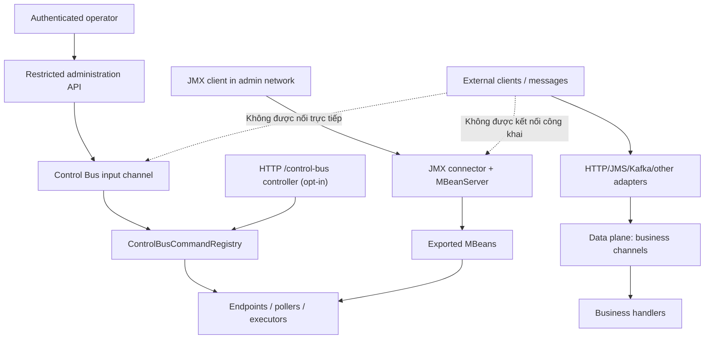
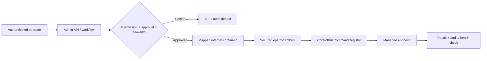
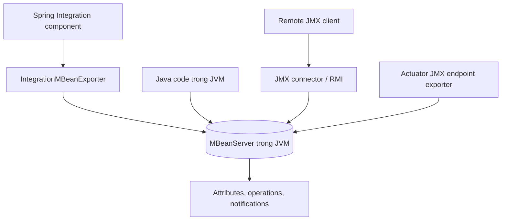

# Bảo vệ control bus và JMX trong Spring Integration Runtime

## 1. Control plane của message flow cũng là một bề mặt bảo mật

Một ứng dụng Spring Integration nhận đơn hàng từ JMS, dùng `SourcePollingChannelAdapter` đọc dữ liệu tồn kho và chuyển message qua `DirectChannel`, `ExecutorChannel` hoặc `QueueChannel` tới handler. Khi vận hành, người quản trị cần dừng poller, thay đổi routing, xem trạng thái queue và đôi khi khởi động lại endpoint **mà không restart JVM**. Hai cơ chế thường gặp là **Control Bus** và **Java Management Extensions (JMX)**.

Khả năng quản lý rất hữu ích nhưng cũng nguy hiểm: một lệnh quản trị có thể làm dừng consumer, thay đổi executor pool size, bật/tắt endpoint hoặc đọc dữ liệu về topology. Nếu nguồn message không được xác thực, hoặc cổng JMX/HTTP bị lộ, đối tượng không có quyền có thể làm gián đoạn luồng xử lý hoặc truy cập thông tin nhạy cảm.

Bài **“Bảo vệ control bus và JMX”** thuộc chương **Bảo mật runtime** trong module **SPRING_INTEGRATION_RUNTIME**. Phạm vi là bảo vệ **runtime control plane** trong hệ thống có channels, endpoints, consumers, pollers, executors, `IntegrationFlow` động, transaction, retry, message store, error channel và correlation.

Sau bài học, bạn có thể:

1. Phân biệt đường truyền message nghiệp vụ (*data plane*) và đường điều khiển runtime (*control plane*).
2. Hiểu lệnh Control Bus trên **Spring Integration 6.4+**, và không nhầm với cách thực thi biểu thức của phiên bản cũ.
3. Bảo vệ channel bằng `AuthorizationChannelInterceptor` và truyền `SecurityContext` đúng khi qua thread boundary.
4. Thiết kế **allowlist thao tác quản trị**, không nhận raw command từ nguồn không tin cậy.
5. Khóa chặt REST `/control-bus`, phân quyền đọc danh mục lệnh và gọi operation.
6. Phân biệt **JMX MBean export** với việc bật **remote JMX connector**, áp dụng least privilege, authentication, TLS và network isolation.
7. Nhận diện rủi ro khi JMX adapter lấy object/operation từ headers, hoặc khi management bean xuất hiện qua nhiều cơ chế.
8. Kiểm thử truy cập trái phép, audit hành động vận hành, failure recovery và ngăn thay đổi runtime ngoài ý muốn.

**Phiên bản và giả định:** các ví dụ trọng tâm dùng Spring Integration 6.4.x, Spring Security 6.x, Java 17+ và Spring Boot 3.x khi có Actuator. Chức năng trên Spring Integration 6.3 trở xuống và các bản 7.x cần đối chiếu riêng. Bài không giả định ứng dụng tự bật remote JMX hay công khai Control Bus theo mặc định.

## 2. Mô hình đe dọa: những ai có thể gửi lệnh?



Tách ba câu hỏi:

| Câu hỏi | Đối tượng cần bảo vệ | Ví dụ |
| --- | --- | --- |
| **Ai được nhận diện?** | Authentication ở ingress hoặc remote connector | Token operator, mTLS/JMX authenticated principal. |
| **Họ được làm gì?** | Authorization tại HTTP, channel, service hoặc JMX role | Operator A được xem health nhưng không được dừng poller. |
| **Tác động được ghi và khôi phục thế nào?** | Audit, change control, metrics, desired state | Ghi yêu cầu stop, kết quả, người phê duyệt, thời gian và flow ID. |

**Nguyên tắc deny by default:** không nối một inbound adapter nhận payload tùy ý tới input Control Bus, không cho phép mọi user nhập tên bean/method, không xuất mọi operation ra JMX chỉ vì dashboard cần xem số message.

### 2.1. Những thay đổi thực tế có thể xảy ra

| Khả năng quản trị | Tác động runtime | Rủi ro nếu bị lạm dụng |
| --- | --- | --- |
| `Lifecycle.stop()/start()` | Dừng/khởi động endpoint/poller | Gián đoạn nhận message, backlog hoặc mất SLA. |
| `Pausable.pause()/resume()` | Tạm ngừng/resume thành phần hỗ trợ | Message source không tiến triển hoặc bùng burst khi resume. |
| Cấu hình `TaskExecutor`/`TaskScheduler` | Điều chỉnh pool/threads/tần suất | Saturation, thread exhaustion hoặc làm lệch scheduling. |
| Router mappings hoặc configuration operations | Thay đổi message destinations | Chuyển message sang kênh không phù hợp hoặc làm mất đường xử lý. |
| JMX attribute/operation | Đọc trạng thái hoặc đổi state của MBean | Rò topology/metrics, thay đổi kết nối hoặc dừng service. |
| `IntegrationFlowContext` API tự xây | Đăng ký, stop, destroy flow động | Xóa nhầm flow tenant khác hoặc bỏ message in-flight. |

Một channel được bảo vệ không có nghĩa mọi đường tới operation tương ứng đều đã được bảo vệ. **JMX connector hoặc REST Controller có thể gọi management operations mà không gửi qua channel ứng dụng**. Cần áp dụng kiểm soát trên **từng bề mặt**.

## 3. Control Bus trong Spring Integration 6.4+: câu lệnh giới hạn

Spring Integration cho phép gửi một `Message<?>` tới Control Bus để gọi operation trên bean quản lý được. Ví dụ:

```text
ordersInboundAdapter.stop
ordersInboundAdapter.start
orderTaskExecutor.setMaxPoolSize
```

Từ dòng **6.4**, cơ chế Control Bus mới dùng `ControlBusCommandRegistry` để ánh xạ **tên bean và phương thức đã đủ điều kiện quản lý**. Payload lệnh là chuỗi dạng:

```text
beanName.methodName
```

Với phương thức có tham số, truyền danh sách qua header `IntegrationMessageHeaderAccessor.CONTROL_BUS_ARGUMENTS`. Registry dùng kiểu/số lượng tham số để chọn overload thích hợp. Chẳng hạn:

```java
import java.util.List;
import org.springframework.integration.IntegrationMessageHeaderAccessor;
import org.springframework.messaging.Message;
import org.springframework.messaging.support.MessageBuilder;

Message<?> changePool = MessageBuilder
        .withPayload("ordersTaskExecutor.setMaxPoolSize")
        .setHeader(IntegrationMessageHeaderAccessor.CONTROL_BUS_ARGUMENTS,
                List.of(12))
        .build();
```

Đây là ví dụ **hình dạng lệnh**, không phải hướng dẫn mở quyền tùy tiện để thay pool. Bean phải tồn tại, operation được phép bởi `ControlBusCommandRegistry` và caller phải được authorize. Không gọi các lệnh ví dụ lên hệ thống thật nếu chưa có phê duyệt vận hành.

### 3.1. Phương thức nào đủ điều kiện?

`ControlBusMethodFilter` trên bản 6.4 lọc các method như:

- Method được đánh dấu `@ManagedOperation` hoặc `@ManagedAttribute`.
- Các operation thuộc `Lifecycle` và `Pausable`.
- Một số setter/getter và method quản trị của `TaskExecutor`/`TaskScheduler` theo quy tắc framework.

**Được framework nhận diện** không có nghĩa **người dùng được phép gọi**. Đây chỉ là bộ lọc tính hợp lệ của lệnh; authorization vẫn phải đặt tại ingress/channel/service và các đường quản trị khác.

### 3.2. Không nhầm Control Bus 6.4 với legacy SpEL

Tài liệu Spring Integration cũ mô tả Control Bus nhận **biểu thức Spring Expression Language** và thực thi trong evaluation context. Spring Integration 6.4 giới thiệu `ControlBusCommandRegistry`/`ControlBusFactoryBean`, thay đổi mô hình sang chuỗi lệnh `beanName.methodName` với tham số được bind qua header.

| Phiên bản/mô hình | Cần lưu ý khi threat modeling |
| --- | --- |
| Control Bus truyền thống (các phiên bản cũ) | Có bề mặt **SpEL evaluation**; không bao giờ chấp nhận biểu thức từ client không tin cậy. |
| Control Bus 6.4+ với `ControlBusCommandRegistry` | Registry chỉ cho gọi method đủ điều kiện, **nhưng vẫn có thể dừng endpoint/đổi pool** nếu không phân quyền. |
| Ứng dụng tự dùng `ExpressionControlBusFactoryBean` hoặc expression processor tùy chỉnh | Cần review chính xác implementation; không được mặc định mọi flow đã chuyển sang mô hình registry mới. |

Đừng đưa payload kiểu `@bean.method(...)` từ hướng dẫn SpEL đời cũ sang hệ thống 6.4 rồi suy rằng nó hợp lệ/được lọc đúng. Cũng đừng dựa vào việc “không còn arbitrary SpEL” để bỏ kiểm soát authorization.

### 3.3. Mẫu khai báo Control Bus bằng Java DSL

```java
import org.springframework.context.annotation.Bean;
import org.springframework.context.annotation.Configuration;
import org.springframework.integration.channel.DirectChannel;
import org.springframework.integration.config.EnableIntegration;
import org.springframework.integration.dsl.IntegrationFlow;
import org.springframework.messaging.MessageChannel;

@Configuration
@EnableIntegration
public class InternalControlBusConfiguration {

    @Bean("opsControlBus")
    public MessageChannel opsControlBus() {
        return new DirectChannel();
    }

    @Bean
    public IntegrationFlow internalControlBusFlow() {
        return IntegrationFlow.from("opsControlBus")
                .controlBus()
                .get();
    }
}
```

Flow này chỉ **tạo control bus nội bộ**; đoạn code **chưa bảo vệ channel**. Phần 5 sẽ bổ sung authorization, và phần 6 sẽ tách một API quản trị an toàn khỏi raw Control Bus. **Không** nối trực tiếp `HttpInboundGateway`, `JmsMessageDrivenChannelAdapter` hay một channel business vào `opsControlBus` mà bỏ kiểm tra quyền.

### 3.4. Response và error không được bỏ quên

Control Bus cũng là một service-activating endpoint. Nếu operation trả về giá trị, có thể cấu hình output/reply channel theo flow; nếu operation throw, exception có thể đi ngược call stack đồng bộ hoặc vào `errorChannel` khi qua async boundary. Không trả raw exception message hay bean topology về API public. Ghi lại **outcome cuối cùng** của operation, không đánh dấu thành công chỉ vì `MessageChannel.send()` trả `true`.

## 4. Đặt ranh giới tin cậy trước Control Bus

**Kiến trúc khuyến nghị:** quản trị viên đăng nhập qua kênh chuyên dụng, gửi một **hành động cấp nghiệp vụ có allowlist**, ứng dụng xác thực/authorize/validate rồi mới phát **lệnh cố định** vào Control Bus.



Một request kiểu `{ "bean": "...", "method": "...", "args": [...] }` từ client rồi nối chuỗi thành command là **quá rộng quyền**. Nó biến bất kỳ command nào đủ điều kiện trong registry thành API công khai cho caller, gây khó khăn về tenant isolation, approval và audit.

### 4.1. Các lớp phòng vệ

1. **Network isolation:** admin network/ingress riêng; không mở Control Bus/JMX ra public Internet.
2. **Authentication:** danh tính operator hoặc workload được xác minh ở điểm nhập.
3. **Fine-grained authorization:** quyền đọc, start, stop, thay cấu hình hoặc orderly shutdown là các quyền khác nhau.
4. **Allowlist:** chỉ operation/target đã được duyệt; không chấp nhận raw command ngoài danh sách.
5. **Channel enforcement:** `AuthorizationChannelInterceptor` kiểm tra người có quyền gửi tới internal control channel.
6. **Audit:** ghi actor, action, target, correlation, thời điểm, approval, result.
7. **Operational guardrail:** rate limit, concurrency limit, health gate, cooldown và rollback/reconcile.
8. **Independent JMX protection:** vì channel interceptor không bảo vệ cuộc gọi JMX tới MBean.

Không dùng một header `"userRole": "ADMIN"` do client gửi làm bằng chứng quyền. Quyền phải xuất phát từ `Authentication` đã được xác minh và gắn với security context được kiểm soát.

## 5. Bảo vệ input channel bằng Spring Security Messaging

Từ **Spring Integration 6.3**, module `spring-integration-security` cũ đã được loại bỏ, thay bằng API của `spring-security-messaging`. Vì vậy code mới không nên sao chép `ChannelSecurityInterceptor` hoặc XML `int-security:secured-channels` từ tài liệu Spring Integration đời cũ vào dự án 6.4.

### 5.1. `AuthorizationChannelInterceptor`

Một channel có thể được bảo vệ bằng `org.springframework.security.messaging.access.intercept.AuthorizationChannelInterceptor`. Trong cấu hình Java, có thể áp interceptor trên một channel hoặc dùng `@GlobalChannelInterceptor` theo pattern tên channel.

Ví dụ bổ sung cho `InternalControlBusConfiguration` ở mục 3:

```java
import org.springframework.context.annotation.Bean;
import org.springframework.context.annotation.Configuration;
import org.springframework.integration.config.GlobalChannelInterceptor;
import org.springframework.security.authorization.AuthorityAuthorizationManager;
import org.springframework.security.messaging.access.intercept.AuthorizationChannelInterceptor;

@Configuration
public class ControlBusChannelSecurity {

    @Bean
    @GlobalChannelInterceptor(patterns = "opsControlBus")
    public AuthorizationChannelInterceptor opsChannelAuthorization() {
        return new AuthorizationChannelInterceptor(
                AuthorityAuthorizationManager
                        .hasAuthority("INTEGRATION_OPERATOR"));
    }
}
```

**Hợp đồng:** phía gửi lệnh phải có `Authentication` do Spring Security thiết lập, chứa authority `INTEGRATION_OPERATOR`. Nếu không có quyền, interceptor phải từ chối ở **message send boundary**, không chờ lệnh tới `ControlBusCommandRegistry` rồi mới phát hiện.

Lưu ý khi áp dụng:

- Pattern phải khớp **tên channel thực**. Nếu flow dùng `IntegrationFlowDefinition::controlBus` và auto-generated input `controlBus.input`, pattern `opsControlBus` không bảo vệ channel đó.
- Một `@GlobalChannelInterceptor` chỉ can thiệp channel thuộc phạm vi Spring Integration được framework quản lý và match; verify trong test thay vì tin bean đã xuất hiện.
- Nếu một route khác gọi managed method trực tiếp trong Java, interceptor của `opsControlBus` không chạy.
- Nếu JMX/HTTP Control Bus Controller gọi command registry qua con đường riêng, chặn input channel **không** tự áp lên con đường đó.
- Khi có nhiều application contexts, hãy xác định security config được apply ở đúng context quản lý channel.

### 5.2. `SecurityContext` không tự truyền qua mọi thread

`DirectChannel` xử lý đồng bộ trên thread sender, nên `SecurityContextHolder` thread-local thường còn khả dụng khi handler chạy. Nhưng các boundary sau có thể đổi thread:

| Boundary | Vấn đề |
| --- | --- |
| `ExecutorChannel` | Worker được executor chọn có thể không có authentication của HTTP request. |
| `QueueChannel` + poller | Consumer được poller gọi trên thread riêng, thường không mang security context từ sender. |
| `PublishSubscribeChannel` có executor | Mỗi subscriber chạy ở thread khác, có nguy cơ mất principal hoặc dùng nhầm context. |
| `CompletableFuture` / `Mono` / `Flux` | Async continuation có execution context riêng; `ThreadLocal` không tự truyền qua scheduler. |
| JMS/Kafka/SFTP inbound adapter | Message đến từ protocol bên ngoài; không tự được coi là authenticated principal của Spring Security. |

Spring Security Messaging cung cấp `SecurityContextPropagationChannelInterceptor` để hỗ trợ capture/restore security context qua channel boundary và dọn context sau khi handle. Ví dụ:

```java
import org.springframework.context.annotation.Bean;
import org.springframework.integration.config.GlobalChannelInterceptor;
import org.springframework.security.messaging.context.SecurityContextPropagationChannelInterceptor;

@Bean
@GlobalChannelInterceptor(patterns = "securedAsync*")
public SecurityContextPropagationChannelInterceptor securityContextPropagation() {
    return new SecurityContextPropagationChannelInterceptor();
}
```

Đây là **một fragment cấu hình**, cần đặt trong `@Configuration` và test với channel type cụ thể. Nó không có nghĩa “tự động ủy quyền mọi tác vụ sang principal của caller”: nguồn gốc principal phải đáng tin và lifecycle context phải được dọn sạch. Nếu một message đến từ broker không xác thực, gắn `Authentication` từ header tùy ý sẽ tạo lỗ hổng impersonation.

**Đặc biệt với Control Bus:** nếu lệnh đi qua `ExecutorChannel` hoặc được lưu vào `QueueChannel` trước `opsControlBus`, phải kiểm thử authorization xảy ra **ở đâu** và context được propagate thế nào. An toàn hơn thường là **authorize tại ingress/service trước khi enqueue**, ghi action có chữ ký/định danh workload, rồi xử lý các command được allowlist trong trusted executor. Đừng trì hoãn authorization tới điểm mà security context đã bị mất.

### 5.3. Không coi authorization tại channel là toàn bộ chính sách

Một principal có authority `INTEGRATION_OPERATOR` có thể vẫn không được phép dừng **mọi** flow:

```text
operator nhóm Order được:
  stop/resume ordersInboundAdapter

operator nhóm Finance không được:
  stop ordersInboundAdapter
  modify globalTaskExecutor
```

`AuthorizationChannelInterceptor` với một authority đơn thuần chỉ kiểm tra điều kiện tổng quát. Kiểm soát theo **target bean**, tenant, action và approval nên nằm tại một management service/authorization policy riêng. Không dùng một role ADMIN dùng chung cho mọi lệnh có mức độ tác động khác nhau nếu không thực sự cần.

## 6. Ví dụ service allowlist: client chọn hành động, không chọn method

Một hướng thiết kế chặt hơn là không đưa API “gửi command bất kỳ” cho người dùng. Ta chỉ cho phép hai hành động đã phê duyệt: dừng và chạy lại một poller nhất định.

```java
package demo.security;

import org.springframework.beans.factory.annotation.Qualifier;
import org.springframework.security.access.prepost.PreAuthorize;
import org.springframework.messaging.MessageChannel;
import org.springframework.messaging.support.MessageBuilder;
import org.springframework.stereotype.Service;

@Service
public class ApprovedPollingOperations {
    private final MessageChannel controlCommands;

    public ApprovedPollingOperations(
            @Qualifier("opsControlBus") MessageChannel controlCommands) {
        this.controlCommands = controlCommands;
    }

    public enum Action {
        STOP_ORDERS_POLLING,
        START_ORDERS_POLLING
    }

    @PreAuthorize("hasAuthority('INTEGRATION_OPERATOR')")
    public void execute(Action action) {
        String command = switch (action) {
            case STOP_ORDERS_POLLING -> "ordersInboundAdapter.stop";
            case START_ORDERS_POLLING -> "ordersInboundAdapter.start";
        };

        if (!controlCommands.send(
                MessageBuilder.withPayload(command).build())) {
            throw new IllegalStateException("Control Bus rejected command");
        }
    }
}
```

Trong ứng dụng dùng proxy-based method security, bật `@EnableMethodSecurity` để `@PreAuthorize` được áp dụng. Caller phải gọi qua **Spring proxy**; self-invocation vào cùng bean có thể bypass method security. Đồng thời giữ `AuthorizationChannelInterceptor` như tầng bảo vệ thứ hai tại channel.

Điều kiện sử dụng ví dụ:

1. `ordersInboundAdapter` là bean endpoint có lifecycle method phù hợp và đã được đăng ký.
2. API quản trị nhận `Action` như enum; không nhận bean name hay method string do client cung cấp.
3. Caller đã xác thực; permission còn có thể yêu cầu tenant ownership, break-glass approval hoặc change window.
4. Sau command, hệ thống cần kiểm tra **trạng thái thực** của endpoint, backlog và source ack để xác nhận thao tác vận hành đạt mục tiêu.
5. Nếu cần audit, ghi actor/action/target/result trong service/trước khi send và sau completion, tránh log raw bearer token.

### 6.1. Vì sao lệnh allowlist vẫn cần bảo vệ?

Ngay cả `STOP_ORDERS_POLLING` cũng có thể bị lạm dụng để làm gián đoạn tiếp nhận đơn. API cần **rate limit**, chống replay khi nhận request qua network, audit, quyền thao tác và có thể yêu cầu phê duyệt đối với hệ thống quan trọng.

Không để người dùng gửi:

```text
beanName.methodName = raw JSON field từ client
args = raw list lấy từ request không validate
```

Một allowlist thực sự phải map **action được khai báo sẵn → target/method cố định**, chỉ nhận giá trị tham số nằm trong tập được phép. Nếu cho phép thay pool size, validate min/max được phê duyệt và quyền cấp cao hơn, không chỉ parse được integer là cho phép.

### 6.2. Quyền chỉ xem và quyền thay đổi

| Role/authority ví dụ | Nên có | Không nên có |
| --- | --- | --- |
| `INTEGRATION_OBSERVER` | Xem health, metrics đã lọc, trạng thái endpoint | Gọi `stop`, `start`, thay router, đổi pool. |
| `INTEGRATION_OPERATOR` | Start/stop một tập endpoint được gán | Gọi operation không trong allowlist, thay secret, xóa flow tenant khác. |
| `INTEGRATION_ADMIN` | Thay cấu hình sau approval, có audit và quota | Bypass mọi xác minh/ghi log, công khai JMX và HTTP controller. |
| `BREAK_GLASS` | Khôi phục khẩn cấp có session ngắn, giám sát độc lập | Credential cố định hoặc dùng như tài khoản làm việc hàng ngày. |

Những authority trong bảng là **thiết kế ví dụ**, không phải role mặc định Spring Integration tạo.

## 7. HTTP Control Bus Controller từ Spring Integration 6.4

Module HTTP có annotation `@EnableControlBusController` (từ **6.4**) để đăng ký REST controller ở đường dẫn `/control-bus`. Đây là khả năng **opt-in**, không phải việc cứ khai báo `IntegrationFlow.controlBus()` là ứng dụng công khai một endpoint HTTP.

HTTP API tiêu biểu:

| Request | Chức năng | Rủi ro |
| --- | --- | --- |
| `GET /control-bus` | Danh sách bean và commands đủ điều kiện, gồm signatures/types | Lộ topology và những thao tác quản trị có thể gọi. |
| `POST /control-bus/{beanName.methodName}` | Gọi command; body tùy chọn chứa tham số/kiểu | Có thể dừng flow, thay pool hoặc router mapping. |

Khi bật controller, infrastructure sẽ cấu hình **eager command registry initialization** để API có thể liệt kê available commands. Điều này tạo ra một **danh mục capability** hấp dẫn cho người truy cập trái phép. Không coi GET là vô hại chỉ vì nó không sửa state.

### 7.1. Quy tắc mặc định tốt nhất

**Nếu ứng dụng không cần API này: không bật `@EnableControlBusController`.** Một internal Control Bus cùng channel đã bảo vệ thường đủ cho những trường hợp hiếm khi quản trị programmatically. Nếu API thật sự cần dùng, hãy đặt nó trên management ingress riêng, xác thực mạnh và giảm phạm vi command.

### 7.2. Ví dụ bảo vệ đường dẫn bằng Spring Security

Ví dụ dưới giả định ứng dụng chỉ nhận **machine-to-machine bearer JWT**, không dùng cookie-based browser session trên các đường dẫn này. Cần dependency Spring Security Resource Server, cấu hình JWT decoder/issuer và một security chain riêng cho các endpoint ứng dụng khác.

```java
package demo.security;

import org.springframework.context.annotation.Bean;
import org.springframework.context.annotation.Configuration;
import org.springframework.core.annotation.Order;
import org.springframework.http.HttpMethod;
import org.springframework.security.config.Customizer;
import org.springframework.security.config.annotation.web.builders.HttpSecurity;
import org.springframework.security.config.http.SessionCreationPolicy;
import org.springframework.security.web.SecurityFilterChain;
import org.springframework.integration.http.config.EnableControlBusController;

@Configuration
@EnableControlBusController
public class ControlBusHttpSecurity {

    @Bean
    @Order(1)
    public SecurityFilterChain controlBusChain(HttpSecurity http)
            throws Exception {
        return http
                .securityMatcher("/control-bus", "/control-bus/**")
                .authorizeHttpRequests(auth -> auth
                        .requestMatchers(HttpMethod.GET, "/control-bus")
                            .hasAuthority("SCOPE_integration.observe")
                        .requestMatchers(HttpMethod.POST, "/control-bus/**")
                            .hasAuthority("SCOPE_integration.manage")
                        .anyRequest().denyAll())
                .oauth2ResourceServer(resourceServer ->
                        resourceServer.jwt(Customizer.withDefaults()))
                .sessionManagement(session ->
                        session.sessionCreationPolicy(
                                SessionCreationPolicy.STATELESS))
                .csrf(csrf -> csrf.disable())
                .build();
    }
}
```

**Cảnh báo về CSRF:** việc tắt CSRF ở snippet **chỉ phù hợp** cho security chain *stateless*, dùng bearer token qua `Authorization` header, **không nhận cookie/session credentials từ trình duyệt**. Nếu endpoint được gọi từ browser và dùng session/cookie, **không tắt CSRF**; áp CSRF protection, SameSite cookies và các kiểm soát phù hợp. Không dùng `csrf.disable()` trên toàn ứng dụng chỉ để làm một POST quản trị hoạt động.

**Quan trọng hơn cả code:** cho dù hai role trên đã được xác thực, `SCOPE_integration.manage` có thể vẫn cho phép gọi **mọi method mà command registry coi là hợp lệ**. Authorization theo URL **không phải allowlist per-command**. Với quyền hạn mạnh hoặc nhiều tenants, **nên không expose controller chung**, thay bằng REST service hẹp gọi `ApprovedPollingOperations` như mục 6.

### 7.3. Test HTTP security phải bao gồm cả GET và POST

Với Spring Security MockMvc/WebTestClient phù hợp:

- Không có token → 401 (hoặc outcome tương ứng chain thực).
- Token có `integration.observe` → GET catalog được phép **nếu policy chấp thuận**, POST bị 403.
- Token có `integration.manage` nhưng không có `integration.observe` → POST theo policy, GET phải có outcome rõ ràng.
- Body với argument sai type/không trong allowlist của **custom admin service** → reject 400/403, không gọi method.
- Method/route ngoài GET/POST được định nghĩa → deny; tránh fallback rule công khai.
- Có valid authentication nhưng gửi command tới tenant khác → deny tại service/policy.
- Rate limit và audit phải ghi yêu cầu bị từ chối lẫn được duyệt.

Lưu ý rằng bare `/control-bus` và đường con `/control-bus/**` đều cần match đúng phiên bản Spring Security và servlet base path. Không chỉ bảo vệ một pattern rồi vô tình để lộ GET catalog.

### 7.4. Không đánh đồng REST controller với input channel

`AuthorizationChannelInterceptor` của `opsControlBus` bảo vệ **message gửi vào channel đó**. REST `ControlBusController` làm việc với `ControlBusCommandRegistry` và HTTP stack; nó **không nhất thiết đi qua channel `opsControlBus`**. Vì vậy:

```text
Channel secured = true
HTTP controller enabled + HTTP auth missing
=> Control Bus vẫn có đường quản trị không được bảo vệ đúng.
```

Đây là ví dụ điển hình về **multi-entry control plane**: muốn đạt an toàn phải inventory mọi route gọi management operation, không chỉ một chỗ.

## 8. JMX: MBean, MBeanServer và remote connector là các lớp khác nhau

**JMX** là hệ thống Java cung cấp `MBeanServer` để đăng ký các **Managed Beans (MBeans)**: có thể đọc attributes, gọi operations và nhận notifications. Spring Integration hỗ trợ xuất thông tin quản lý của channel/handler/source và có các JMX adapters tích hợp với hệ thống ngoài.



Phân biệt:

1. **Bean được export vào local `MBeanServer`:** làm MBean xuất hiện trong JVM; chưa có nghĩa mạng bên ngoài truy cập được.
2. **Remote JMX agent/connector:** cung cấp đường mạng tới `MBeanServer`; cần authentication, authorization, TLS và network policy riêng.
3. **Spring Boot Actuator endpoints qua JMX:** chỉ là một nhóm MBeans/endpoints khác; thiết lập exposure của Actuator **không bao trùm mọi MBean**.
4. **JMX integration adapters:** nhận/poll/invoke operations của MBeans qua message flow; chúng tạo thêm một đường vào JMX operations cần bảo vệ.

**Không mặc định JMX = monitoring read-only.** Một MBean có thể có method cập nhật state, dừng flow, đổi cấu hình hoặc can thiệp vào executor. Với quyền `readwrite`, remote JMX principal có khả năng rất lớn.

## 9. Export MBeans một cách có chọn lọc

Spring Integration cung cấp `IntegrationMBeanExporter`. Với dependency `spring-integration-jmx` và cấu hình thích hợp, có thể bật:

```java
import org.springframework.context.annotation.Configuration;
import org.springframework.integration.config.EnableIntegration;
import org.springframework.integration.jmx.config.EnableIntegrationMBeanExport;

@Configuration
@EnableIntegration
@EnableIntegrationMBeanExport(
        defaultDomain = "com.example.integration",
        managedComponents = {"ordersInboundAdapter", "ordersInput", "ordersValidator"})
public class InternalJmxExportConfiguration {
}
```

`@EnableIntegrationMBeanExport` có `managedComponents` để chọn theo **component-name patterns**, mặc định là `"*"`. Không để mặc định `"*"` trong một ứng dụng có hàng trăm endpoints mà chưa kiểm kê những operations sẽ được export.

### 9.1. Filter patterns giảm diện lộ, không phải ACL

`managedComponents` hỗ trợ tên/pattern và phủ định với tiền tố `!`. Các patterns được xét theo thứ tự; **match đầu tiên quyết định include/exclude**.

Ví dụ:

```java
@EnableIntegrationMBeanExport(
        managedComponents = {"!private*", "orders*"})
```

Nếu được áp dụng theo đúng naming contract của ứng dụng, config chỉ chọn một tập components thay vì tất cả. Nhưng đây **không phải cơ chế xác thực/ủy quyền**: bất kỳ principal nào có quyền invoke MBean được export thông qua connector tương ứng vẫn có thể tác động tới operation mà MBean cho phép.

Đặc biệt, `@EnableIntegrationMBeanExport` còn liên quan tới việc xuất các bean được đánh dấu `@ManagedResource`. Một bean có thể được export qua **Spring core `MBeanExporter`** hoặc một exporter khác. Vì vậy, cần xem **toàn bộ MBeans trong `MBeanServer`** thay vì suy luận từ một tập `managedComponents` rằng không có MBean nào khác.

### 9.2. `@ManagedOperation` tạo bề mặt quản trị ở nhiều nơi

`@ManagedOperation` và `@ManagedAttribute` hữu ích khi muốn cung cấp một operation quản trị chính thức:

```java
import org.springframework.jmx.export.annotation.ManagedAttribute;
import org.springframework.jmx.export.annotation.ManagedOperation;
import org.springframework.jmx.export.annotation.ManagedResource;

@ManagedResource(objectName = "com.example.integration:type=Ops,name=OrderStatus")
public class OrderStatusManagement {
    private volatile boolean accepting = true;

    @ManagedAttribute
    public boolean isAccepting() {
        return accepting;
    }

    @ManagedOperation(description = "Pause accepting new order work")
    public void pauseAccepting() {
        accepting = false;
    }
}
```

Đây chỉ là một **managed bean minh họa**, không có điều phối message nào thực sự dừng ở `accepting` nếu business handlers không đọc và áp dụng flag đó. Khi một method có annotation quản trị, nó **có thể** đủ điều kiện cả trong JMX MBean export lẫn `ControlBusCommandRegistry`. Tắt một giao diện **không mặc nhiên** tắt interface còn lại.

**Checklist review mỗi method được annotate:**

- Ai có thể gọi method qua JMX, Control Bus hoặc REST admin API?
- Method có side effect gì, có idempotent không?
- Có validation min/max, tenant/flow ownership, approval và audit không?
- Có thể gọi lặp/replay hoặc gọi đồng thời để tạo trạng thái không nhất quán không?
- Nếu method ném lỗi giữa chừng, state đã thay đổi tới đâu và khôi phục bằng cách nào?
- Có cần cung cấp operation này qua control plane hay chỉ cần export **read-only metric**?

### 9.3. Khả năng discovery qua `ObjectName`

Một MBean có `ObjectName` dạng domain + properties (ví dụ `com.example.integration:type=MessageChannel,name=ordersInput`). JMX client có quyền đọc có thể enumerate MBeans, attributes và operation signatures tùy quyền connector.

**Không coi tên MBean hay domain là bí mật để ngăn truy cập.** Đặt domain `private.management` không thay thế authentication. Ngược lại, đặt tenant email hoặc access token trong `ObjectName` có thể làm lộ thông tin trên JConsole/notifications/logs.

### 9.4. Không tắt metrics chỉ để giảm quyền JMX

Nếu ứng dụng chỉ muốn metrics, nên dùng **Micrometer/Observation** và exporter phù hợp, không nhất thiết bật mutable JMX operations. Việc tắt JMX export không bắt buộc làm mất các `MicrometerMetricsCaptor` timers/counters/gauges đang chạy qua `MeterRegistry`.

Sử dụng một kênh quan sát **read-only**, có nguồn truy cập hạn chế, giảm nhu cầu mở JMX remote chỉ để đọc `channel.sendCount` hoặc queue depth.

## 10. Bảo vệ remote JMX: mạng, authentication, authorization và TLS

**Phương án ít rủi ro nhất:** không bật remote JMX connector nếu không cần. Local `MBeanServer` vẫn có thể phục vụ các công cụ nội bộ và JMX adapters mà không mở cổng quản trị từ bên ngoài.

Nếu bắt buộc remote JMX:

1. Chỉ cho phép từ **mạng quản trị** hoặc qua VPN/SSH tunnel/bastion được giám sát.
2. Bật **authentication** mạnh; ưu tiên certificate/JAAS/provider quản lý danh tính thích hợp.
3. Bật **TLS** cho kênh quản trị, xác minh certificate và cách bảo vệ RMI registry.
4. Giới hạn quyền **read-only** cho monitoring; quyền invoke/write dành cho nhóm vận hành được phân quyền.
5. Tách credential/identity của operator khỏi service account xử lý message.
6. Audit connections, authentication failures, calls và thay đổi quản trị có ý nghĩa.
7. Chặn toàn bộ đường remote từ mạng không tin cậy, ngay cả khi đã bật mật khẩu.
8. Có quy trình xoay credential, thu hồi certificate và khẩn cấp đóng connector.

### 10.1. Ví dụ JDK remote management flags

Ví dụ **minh họa các tham số**, không phải cấu hình copy-paste hoàn chỉnh để triển khai Internet-facing:

```text
-Dcom.sun.management.jmxremote.port=9010
-Dcom.sun.management.jmxremote.rmi.port=9011
-Dcom.sun.management.jmxremote.authenticate=true
-Dcom.sun.management.jmxremote.ssl=true
-Djava.rmi.server.hostname=<internal-management-address>
```

Thay placeholder bằng hostname hợp lệ và cấu hình bổ sung **credential/certificate/keystore/truststore/JMX connector** theo tài liệu JDK, nền tảng hạ tầng và policy tổ chức. Chỉ mở các cổng cần thiết tới client được tin cậy; cổng RMI registry và RMI server có thể khác nhau. Khi chạy container/NAT/port-forward, phải kiểm tra địa chỉ RMI stub quảng bá thực tế, không chỉ cổng đầu tiên.

**Không triển khai như sau trong production:**

```text
-Dcom.sun.management.jmxremote.authenticate=false
-Dcom.sun.management.jmxremote.ssl=false
```

Các flags này vô hiệu cơ chế xác thực/mã hóa của remote JMX. Một kết nối trực tiếp có thể có khả năng đọc/ghi/invoke MBean với quyền mạnh và có thể dẫn tới những tác động vượt xa việc xem metrics.

### 10.2. JMX access levels

JDK có cơ chế `jmxremote.access` với quyền cơ bản:

```properties
# Minh họa JMX role mapping; tên account/credential là ví dụ.
monitorRole readonly
controlRole readwrite
```

`readonly` phù hợp hơn cho quan sát; `readwrite` cho phép update attributes/invoke operations và phải bị hạn chế. Cơ chế role file này **khá thô**, không thay thế ACL theo từng bean/method/tenant khi cần fine-grained authorization.

JDK hỗ trợ password files nhưng theo Oracle, file-based password chứa bí mật dạng clear text và không nên là phương án ưu tiên cho production. Sử dụng một cơ chế xác thực mạnh được vận hành bài bản (ví dụ TLS client certificate/JAAS integration), đảm bảo file permissions và không đưa mật khẩu vào Git, log hoặc JVM command line.

### 10.3. RMI registry và các lỗ hổng triển khai

Remote JMX có thể dùng **RMI registry** để trao connector stub. Oracle cảnh báo về tình huống RMI registry không được bảo vệ đúng: một registry giả mạo có thể lấy credential của client trong những cấu hình xác thực dựa vào password. Bật TLS ở một điểm nhưng **không xem xét toàn bộ đường registry → connector** là chưa đầy đủ.

Hãy kiểm tra:

- RMI registry có được bảo vệ và xác thực đúng không?
- Client có xác minh server certificate/hostname không?
- RMI connector được bind vào đúng interface/network không?
- Firewall có bao phủ **cả cổng registry và server RMI** không?
- Có NAT hoặc Kubernetes port-forward làm lộ hostname sai, dẫn client đi ra IP không mong muốn không?
- Có bắt buộc **mTLS** cho quản trị viên không?

Trong Kubernetes, một lựa chọn an toàn hơn cho nhiều tình huống là **không bật remote JMX**, chỉ thu Micrometer/Actuator metrics qua endpoint bảo vệ. Nếu cần JMX phục vụ điều tra sự cố, cân nhắc port-forward/bastion có kiểm soát theo phiên ngắn và audit.

### 10.4. JMX quyền local cũng phải kiểm soát

Một tiến trình cùng host/container có quyền attach hoặc đọc JVM có thể tiếp cận dữ liệu mà remote network ACL không ngăn được. Bảo vệ host, service account, container namespace, quyền attach/debug, secrets và file permissions. Không coi “JMX chỉ bind loopback” là đủ nếu tài khoản máy chủ bị chia sẻ hoặc container khác cùng network namespace có quyền truy cập.

## 11. JMX adapters của Spring Integration: vừa quan sát vừa có thể hành động

Module `spring-integration-jmx` chứa adapters cho:

- `notification-listening-channel-adapter`: nhận notifications từ MBeans.
- `notification-publishing-channel-adapter`: phát JMX notifications từ message.
- `attribute-polling-channel-adapter`: poll một attribute được quản lý.
- `tree-polling-channel-adapter`: đọc cây MBeans/object graph.
- `operation-invoking-channel-adapter` và outbound gateway: gọi operation được quản lý.

JMX adapter là **Integration endpoint**, nên vẫn chịu threading/poller/error/retry semantics. Nhưng vì có thể đọc hoặc gọi MBeans, nó cũng nằm trong control-plane threat model.

### 11.1. Rủi ro header chọn operation động

Theo JMX reference, operation-invoking adapter có thể lấy tên đối tượng và operation từ cấu hình **hoặc** từ các headers như `JmxHeaders.OBJECT_NAME` và `JmxHeaders.OPERATION_NAME`. Nếu một inbound HTTP/JMS/Kafka message có thể tự chọn hai headers này và được chuyển vào adapter, client có thể khiến ứng dụng gọi **operation khác với mục tiêu dự kiến**.

**An toàn hơn:**

- Cố định `object-name` và `operation-name` trong cấu hình cho adapter đơn nhiệm.
- Nếu bắt buộc dynamic target, chỉ map **logical action allowlist** sang `ObjectName`/operation từ dữ liệu trusted backend.
- Loại bỏ/overwrite JMX-specific headers đến từ nguồn bên ngoài trước routing.
- Dùng authorization riêng cho adapter channel và target operation.
- Xác minh argument types, number, ranges và side effects.
- Audit cả caller và effective target operation.

Không lấy ví dụ một adapter hard-coded rồi giả định cùng chính sách an toàn cho adapter nhận target qua message headers.

### 11.2. Polling JMX attributes cũng có thể rò dữ liệu

`attribute-polling-channel-adapter` và `tree-polling-channel-adapter` có thể đọc state của MBean. Một query pattern quá rộng như `*:type=*` có thể trả về topology, config, URI, class names hoặc dữ liệu mà không nên đưa vào message flow nghiệp vụ.

Hãy:

1. Giới hạn `ObjectName`/query patterns.
2. Lọc attributes bằng converter/filter cần thiết, không xuất mọi field.
3. Kiểm soát nơi gửi output: logs, tracing, queues, external brokers và HTTP replies.
4. Có quota cho polling frequency và size, tránh gây tải lên `MBeanServer` hoặc backend.
5. Không chứa secret hoặc credentials trong notification payload/userData.

Một message nhận từ JMX notification **không tự có danh tính được xác thực ở cấp business tenant**. Nếu nó có tác dụng kích hoạt downstream workflow, cũng phải đi qua validation và authorization theo nguồn.

## 12. Spring Boot Actuator qua JMX: giới hạn phạm vi cho đúng

Spring Boot Actuator có thể expose endpoint qua HTTP và JMX. Một cấu hình bảo thủ:

```yaml
management:
  endpoints:
    jmx:
      exposure:
        include: "health,info"
    web:
      exposure:
        include: "health,info"
```

Đây là cấu hình **Actuator endpoint exposure**, không điều khiển đầy đủ `IntegrationMBeanExporter`, MBeans do ứng dụng tự đăng ký hay remote JMX agent của JVM. Dòng Spring Boot và policy bảo mật có thể quy định endpoint access levels/role khác nhau; nên kiểm tra chính xác phiên bản Boot.

### 12.1. Ba thiết lập không tương đương

| Thiết lập | Tác dụng chính | Không làm gì |
| --- | --- | --- |
| `management.endpoints.jmx.exposure.include` | Chọn **Actuator endpoints** nào xuất qua JMX | Không khóa toàn bộ MBeans Spring Integration/Java. |
| `@EnableIntegrationMBeanExport(managedComponents=...)` | Chọn integration components được export theo pattern | Không bật authentication/TLS cho RMI connector. |
| `-Dcom.sun.management.jmxremote.port=...` | Bật JDK remote JMX connector | Không tự quyết định những app-specific MBeans nào được phép invoke. |

Ngoài ra, HTTP management port/path riêng của Actuator không tự bảo vệ JMX RMI đang mở. Một firewall rule cho `/actuator/**` không chặn một remote JMX client qua TCP.

### 12.2. Tắt thứ không cần

Nếu không có yêu cầu JMX:

- Không bật remote JMX agent/connector của JVM.
- Không import/bật exporters riêng chỉ vì từng ứng dụng mẫu có cấu hình đó.
- Giới hạn Actuator endpoints và quyền truy cập.
- Có thể dùng `spring.jmx.enabled=false` trong Spring Boot để tắt một phần auto-export JMX của Boot, nhưng phải **kiểm tra exporter/JVM flags khác** vẫn còn hoạt động hay không.
- Dùng `MeterRegistry`/Observation cho metrics phù hợp, có auth và network policy.

Việc tắt JMX không được làm mất runbook vận hành khi cần stop/restart poller: thay bằng admin API hẹp có audit, hoặc sử dụng deployment orchestration được kiểm soát.

## 13. Quản trị runtime mà không làm sai message delivery

Việc authorize đúng người gọi chỉ là bước đầu. Một lệnh `stop()` **hợp lệ** vẫn có thể gây mất availability hoặc ảnh hưởng transaction/ack nếu được gọi vào thời điểm không phù hợp.

### 13.1. Dừng endpoint không đồng nghĩa mọi việc đã hoàn tất

```text
Operator gửi: ordersInboundAdapter.stop

Poller:
  vừa receive message E-42
  → chuyển sang ExecutorChannel
  → stop() được gọi trên adapter

Worker:
  vẫn xử lý E-42
  → gọi downstream / commit DB / tạo reply
```

Trong ví dụ, stop signal có thể khiến poller không nhận message mới, nhưng **không mặc nhiên cancel** task đã được bàn giao cho executor. Tùy component implementation, poller có thể chờ/chạy hết một chu kỳ; một reactive subscription hoặc HTTP request cũng có semantics cancellation riêng.

**Runbook dừng flow an toàn**:

1. Chặn **ingress mới** ở router/source theo một trạng thái maintenance đã được duyệt.
2. Gửi lệnh stop/pause tới đúng endpoint qua control plane được bảo vệ.
3. Quan sát số in-flight, executor queue, `QueueChannel`/broker backlog và độ trễ completion.
4. Đợi drain với **deadline**, hoặc chuyển pending work sang durable retry/DLQ theo policy.
5. Chỉ destroy/reconfigure resources sau khi xác nhận điểm an toàn.
6. Khi resume, kiểm tra source checkpoint/ack và idempotency rồi theo dõi hồi phục.

Không xóa queue/message store để “giảm backlog” chỉ vì một operation đã dừng consumer.

### 13.2. Transaction và Control Bus có hai mục đích khác nhau

Một transaction bao quanh `SourcePollingChannelAdapter.receive()` hoặc handler DB update **không tự bao quanh** lệnh quản trị từ một thread khác. Control Bus thường làm thay đổi lifecycle/config, không thực hiện một giao dịch atomically với nguồn message và tất cả downstream resources.

| Lệnh | Có thể tác động | Cần kiểm tra ngoài xác thực |
| --- | --- | --- |
| Stop poller | Không nhận message mới | Message đang xử lý, source ack, transaction đang mở. |
| Start poller | Khôi phục polling | Credentials, checkpoint, stale locks, duplicate redelivery. |
| Thay executor size | Số concurrent tasks | Backpressure, queue/DB pool saturation, lock contention. |
| Thay router mapping | Đường đi các message tiếp theo | Messages đang ở channel trước mapping, tenant routing, replay. |
| Thay `IntegrationFlow` | Endpoints/beans/lifecycle | In-flight drain, persistent store, flow version và rollback. |
| Orderly shutdown qua JMX | Ngừng active components | Drain timeout, operational approval, backup node readiness. |

Với `ExecutorChannel` và Reactor, lưu ý transaction thread-local có thể không truyền qua async boundary. Một operation quản trị hợp lệ cũng không thể quay lại và sửa kết quả `commit` đã thành công.

### 13.3. Retry của lệnh quản trị phải có giới hạn

Nếu API quản trị timeout lúc gọi stop, không thể kết luận **stop chưa xảy ra**. Retry vô hạn có thể tạo chuỗi `stop/start/stop` khi các hệ thống automation tranh nhau điều khiển.

Thiết kế:

- Lệnh có **request ID** ổn định để audit/deduplicate ở tầng API.
- Hành động có desired state (ví dụ “polling should be stopped”), thay vì chỉ sự kiện “toggle”.
- Version/epoch của cấu hình tránh một yêu cầu cũ ghi đè cấu hình mới.
- Cooldown/rate limit, thời gian chờ hữu hạn, circuit breaker nếu phụ thuộc remote connector.
- Sau timeout, **read state** từ nguồn phù hợp trước khi quyết định retry.
- Mọi retry sau failure phải có owner/runbook và được ghi nhận.

`Lifecycle.start()/stop()` thường được thiết kế để có thể gọi lặp mà không gây sai state, nhưng **không vì thế** mọi managed method của custom bean đều idempotent. Ví dụ thay đổi routing và khởi tạo connection có thể có side effects khó đảo ngược.

## 14. `IntegrationFlowContext` động và tenant isolation

Trong dynamic runtime, ứng dụng có thể đăng ký/xóa `IntegrationFlow` dựa trên cấu hình tenant. `IntegrationFlowContext` có các `IntegrationFlowRegistration` cho phép `start()`, `stop()`, `destroy()` và tra cứu theo ID. Đây là **một control plane bổ sung**, không tự chạy qua `ControlBusCommandRegistry` hoặc JMX.

### 14.1. Đừng nhầm flow ID với quyền sở hữu

```text
flowId = tenant-acme-orders-v3
requestingPrincipal = tenant-beta-operator
operation = destroy
```

Nếu API chỉ kiểm tra “flow ID tồn tại” rồi gọi `destroy()`, một operator tenant beta có thể phá flow tenant acme. Phải kiểm tra ownership từ **trusted configuration DB/security policy**, không suy ra từ một chuỗi path/bean name client nhập.

### 14.2. Bảo vệ lifecycle của flow động

Một service quản trị flow nên:

1. Nhận **logical flow identifier** và action từ danh sách được cho phép.
2. Lấy tenant/role/approval từ authenticated principal.
3. Truy vấn trusted config để xác định owner, scope, flow version và desired state.
4. Dùng `getRegistrationById(...)` để tìm registration trong **đúng JVM**.
5. Serialize những lần `register/replace/remove` cùng flow ID để tránh race.
6. Stop/drain nếu thay hoặc xóa; audit cả lúc bắt đầu và kết quả.
7. Không thêm support bean chia sẻ vào dependent beans của một flow rồi destroy nhầm tài nguyên global.
8. Khi có nhiều replicas, phân biệt registry mỗi JVM với **cluster ownership/sharding**.

Một JMX/Control Bus operation có thể dừng endpoint do `IntegrationFlowContext` quản lý, nhưng việc đó **không cập nhật nguồn desired-state bền vững** nếu ứng dụng không có reconciler. Reconciler khác có thể khởi động lại endpoint ngay sau khi operator stop. Vì vậy cần phối hợp control-plane changes với configuration source of truth.

### 14.3. Command registry và tên beans sinh động

Với dynamic flows, các bean names có thể chứa prefix theo `flowId`. Không cho một request tùy ý lựa chọn bean nào trong command registry chỉ vì regex match `tenant-*`. Thay vào đó, map logical tenant/flow ID đã được xác thực sang target bean chính xác tại runtime, và chỉ cho gọi những operations được duyệt.

Nếu flow bị destroy rồi đăng ký lại với bean name khác, lệnh được queue trước đó có thể trở thành **stale command**. Mang config version/epoch qua policy và loại bỏ lệnh cũ, không phát raw command sau một khoảng delay không kiểm soát.

## 15. Phân quyền theo hành động và kênh vận hành

**RBAC** là điểm xuất phát, nhưng một permission “manage integration” toàn quyền thường quá rộng cho môi trường multi-tenant hoặc có endpoint nhạy cảm.

| Hành động | Đối tượng | Quyền ví dụ | Điều kiện bổ sung |
| --- | --- | --- | --- |
| Xem health/status | Flow đã được gán | `integration:observe` | Không tiết lộ secrets/topology cross-tenant. |
| Xem control bus command catalog | Quản trị viên nền tảng | `integration:inspect_commands` | Audit và có thể ẩn signatures nhạy cảm. |
| Pause/resume poller | Một source cụ thể | `integration:operate` | Tenant/owner match; cooldown; health check. |
| Điều chỉnh executor concurrency | Một task executor | `integration:tune` | Min/max, SLO và approval. |
| Đổi router mapping | Route cấu hình | `integration:route_edit` | Validate target channel, risk review, version check. |
| Destroy dynamic flow | Một flow cụ thể | `integration:flow_delete` | Drain, approval và kế hoạch rollback. |
| Orderly shutdown | Cấp JVM/node | `integration:shutdown` | Quorum/maintenance window và break-glass. |
| Invoke mutable MBean | MBean được allowlist | `jmx:write` | TLS, authenticated connector, scope và audit. |

Đây là một **policy minh họa**, không phải danh sách authority do framework định nghĩa. Với authorization đa tenant, cần kiểm tra cả **subject, action, resource và context** (tenant, environment, maintenance window, approval).

### 15.1. Ví dụ policy trước khi gửi command

```text
request: resume orders polling
subject: operator-17
resource: tenant-acme/ordersInboundAdapter

CHECK:
  authenticated subject has integration:operate
  subject assigned to tenant-acme
  resource belongs to tenant-acme
  flow version equals approved version
  no deployment/drain in progress
  action in enum allowlist
  operation not rate limited

THEN:
  audit attempt → send internal command
  await/read endpoint state → audit result
```

Không thay thế những checks này bằng `startsWith("tenant-acme")` trên string bean name chưa được chuẩn hóa. Một service call từ system actor cũng cần kiểm soát quyền/identity; “chạy bên trong JVM” không mặc định là nguồn tin cậy.

## 16. Audit và observability của control plane

Một command quản trị phải được theo dõi như **thay đổi trạng thái hệ thống**, không chỉ như một message thông thường. Các trường audit hữu ích:

| Trường | Mục đích |
| --- | --- |
| `requestId` / `changeId` | Tương quan các lần retry và yêu cầu phê duyệt. |
| `actorId` / `servicePrincipal` | Ai/cái gì đã yêu cầu operation. |
| `authority`/`policyDecision` | Quyền được kiểm tra và quyết định allow/deny. |
| `targetFlowId`, `targetBean`, `operation` | Tài nguyên và thao tác thực tế đã được resolve. |
| `environment`, `nodeId`, `flowVersion` | Tránh nhầm cluster/prod/staging hoặc stale command. |
| `startTime` / `finishTime` | Thời điểm yêu cầu và completion. |
| `outcome` / `exceptionClass` | Success, denied, timeout, unknown, partially applied. |
| `previousState` / `desiredState` | Giúp reconciliation và rollback. |
| `approvalId` / `breakGlassReason` | Truy vết thay đổi quan trọng. |

**Không log** bearer token, password JMX, cookie, raw security context, sensitive headers hoặc toàn bộ arguments nếu có secrets. Đối với các tham số cần audit như max pool size, chỉ lưu giá trị đã validate và không nhạy cảm.

### 16.1. Metrics nên có

- `control_command_attempt_total` — số lệnh theo action/target type/outcome.
- `control_command_denied_total` — số request bị policy/interceptor từ chối.
- `control_command_duration_seconds` — thời gian từ request tới xác nhận state.
- `control_command_timeout_total` — lệnh không biết kết quả trong deadline.
- `jmx_authentication_failure_total` — do connector/security infrastructure cung cấp nếu được instrument.
- `dynamic_flow_state_mismatch` — desired state và runtime state không khớp.
- `management_endpoint_inflight` — số operation quản trị chưa kết thúc.

Những tên trên là **đề xuất instrumentation của ứng dụng**, không phải Spring Integration tự xuất toàn bộ. Tránh gắn `requestId`/`userId`/`flowId` có cardinality cao vào metric tags; lưu chúng trong audit logs/traces được phân quyền.

### 16.2. Log theo flow không tự kéo theo security context

Qua `ExecutorChannel`, `QueueChannel` hoặc reactive continuation, `MDC`/`ThreadLocal` của operator có thể bị mất. Dùng context propagation tin cậy hoặc mang **correlation metadata đã xác thực** qua message và log; không dùng header tự khai báo từ client thay `Authentication`. Một error flow phát `ErrorMessage` sau khi caller đã timeout vẫn cần tìm được `changeId` để audit outcome cuối.

### 16.3. Không để error flow trở thành nơi rò quyền

Nếu command thất bại, `ErrorMessage` có thể chứa `MessagingException` hoặc `failedMessage`, bao gồm command payload và headers. Không publish error thô ra một shared broker/HTTP response cho user không có quyền. Cần redact, map exception thành mã lỗi an toàn và giữ chi tiết ở log bảo vệ. Một `errorChannel` bị expose hoặc người tiêu thụ đa tenant có thể làm lộ command names, arguments và topology.

## 17. Điều hành an toàn khi cần xử lý khẩn cấp

Khả năng dừng poller nhanh là cần thiết khi upstream gửi dữ liệu sai, nhưng **break-glass** cũng là một quyền nhạy cảm.

Quy trình:

1. **Xác định sự cố:** nguồn nào, flow ID nào, impact, message backlog và tình trạng downstream.
2. **Xác thực operator:** quyền phù hợp hoặc emergency elevation có thời hạn.
3. **Chọn thao tác nhỏ nhất:** pause một adapter thay vì shutdown JVM nếu đủ để cô lập lỗi.
4. **Ghi audit/phê duyệt:** actor, lý do, timeout và desired-state change.
5. **Thực hiện qua kênh bảo vệ:** internal admin service/Control Bus; JMX chỉ trong admin network.
6. **Xác minh kết quả:** endpoint running state, poller receive rate, in-flight và error count.
7. **Giám sát tác dụng phụ:** source ack, retry, transaction, queue age, broker lag.
8. **Resume có kiểm soát:** kiểm tra cấu hình và checkpoint; tránh bùng backlog gây overload.
9. **Kết thúc:** revoke elevated role/credentials, lưu incident timeline và cải tiến runbook.

Không sử dụng `kill -9`, tắt container hoặc xóa MBeans/locks như lựa chọn đầu tiên chỉ vì một lệnh stop không có phản hồi; phải xác định trạng thái giao dịch, listener và message đang chạy trước.

## 18. Kiểm thử bảo mật Control Bus trong Spring Test

Kiểm thử quan trọng nhất: một client **không có quyền** không được thực thi side effect, còn operator hợp lệ chỉ được dùng những commands đã phê duyệt. Test cần xác minh **state cuối cùng**, không chỉ mã HTTP hay một exception được ném.

### 18.1. Context test với managed operation nhỏ

```java
package demo.security;

import java.util.concurrent.atomic.AtomicInteger;
import org.springframework.context.annotation.Bean;
import org.springframework.context.annotation.Configuration;
import org.springframework.context.annotation.Import;
import org.springframework.jmx.export.annotation.ManagedOperation;
import org.springframework.jmx.export.annotation.ManagedResource;

@Configuration
@Import({
        InternalControlBusConfiguration.class,
        ControlBusChannelSecurity.class
})
public class SecureControlBusTestConfiguration {

    @Bean("testOpsTarget")
    public TestOpsTarget testOpsTarget() {
        return new TestOpsTarget();
    }

    @ManagedResource
    public static class TestOpsTarget {
        private final AtomicInteger calls = new AtomicInteger();

        @ManagedOperation
        public void markReady() {
            calls.incrementAndGet();
        }

        public int getCalls() {
            return calls.get();
        }
    }
}
```

Context sử dụng đúng channel `opsControlBus` có `AuthorizationChannelInterceptor` như mục 5. `@ManagedOperation` chỉ để minh họa cách một method đủ điều kiện trong registry; không khuyến khích đánh dấu các method nhạy cảm thật mà không có review.

### 18.2. Test unauthorized/authorized messages

```java
package demo.security;

import static org.junit.jupiter.api.Assertions.*;

import org.junit.jupiter.api.AfterEach;
import org.junit.jupiter.api.Test;
import org.springframework.context.annotation.AnnotationConfigApplicationContext;
import org.springframework.messaging.MessageChannel;
import org.springframework.messaging.support.MessageBuilder;
import org.springframework.security.access.AccessDeniedException;
import org.springframework.security.authentication.TestingAuthenticationToken;
import org.springframework.security.core.context.SecurityContextHolder;

class SecureControlBusTest {

    @AfterEach
    void clearSecurityContext() {
        SecurityContextHolder.clearContext();
    }

    @Test
    void viewerCannotInvokeButOperatorCan() {
        try (var context = new AnnotationConfigApplicationContext(
                SecureControlBusTestConfiguration.class)) {

            MessageChannel commands =
                    context.getBean("opsControlBus", MessageChannel.class);
            var target = context.getBean(
                    SecureControlBusTestConfiguration.TestOpsTarget.class);

            var viewer = new TestingAuthenticationToken(
                    "viewer", "unused", "INTEGRATION_OBSERVER");
            SecurityContextHolder.getContext().setAuthentication(viewer);

            assertThrows(AccessDeniedException.class,
                    () -> commands.send(MessageBuilder
                            .withPayload("testOpsTarget.markReady")
                            .build()));
            assertEquals(0, target.getCalls());

            var operator = new TestingAuthenticationToken(
                    "operator", "unused", "INTEGRATION_OPERATOR");
            SecurityContextHolder.getContext().setAuthentication(operator);

            assertTrue(commands.send(MessageBuilder
                    .withPayload("testOpsTarget.markReady")
                    .build()));
            assertEquals(1, target.getCalls());
        }
    }
}
```

Đoạn test minh họa cách dùng `SecurityContextHolder` để kiểm tra authorization tại channel **trên cùng thread**. `TestingAuthenticationToken` chỉ phù hợp test, **không phải** cơ chế xác thực production. Với Spring Security/framework version khác, exception có thể được wrap hoặc thay đổi subtype; vẫn phải assert **side effect không chạy khi bị deny**.

**Giới hạn của test:**

- Nó chưa kiểm tra HTTP JWT signature/issuer/audience hoặc JMX remote credentials.
- Nó chưa kiểm tra `ExecutorChannel`/`QueueChannel` propagation.
- Nó chưa kiểm tra custom admin service có ngăn operator chọn target ngoài tenant không.
- Nó chưa kiểm tra operation khi stop/start ảnh hưởng source/transaction.
- Nó không chứng minh security cho các bean quản trị **không dùng channel này**.

### 18.3. Test quyền không có `SecurityContext`

Trong một test bổ sung, gọi `SecurityContextHolder.clearContext()` rồi gửi lệnh. Kết quả phải bị từ chối theo policy. Tình huống thiếu authentication có thể phát `AuthenticationCredentialsNotFoundException` hoặc exception khác tùy configuration; test nên assert **không có operation execution** và nhận diện đúng nhóm lỗi authentication/authorization.

Ngoài ra, gửi một message có header:

```text
role = "INTEGRATION_OPERATOR"
```

nhưng **không có authenticated SecurityContext**; phải vẫn bị deny. Header này chỉ là dữ liệu do sender cung cấp, không phải security principal đã được xác minh.

### 18.4. Test async context leakage

Cho 2 người dùng gửi liên tục qua `ExecutorChannel` chung:

```text
Operator A: INTEGRATION_OPERATOR, action=stop
Viewer B:   INTEGRATION_OBSERVER, action=stop

Pool size = 1 (cố ý tái sử dụng thread)

Expected:
  A: authorized theo policy
  B: denied
  B không thừa hưởng SecurityContext của A trên worker thread
```

Test phải xác minh `SecurityContextPropagationChannelInterceptor` hoặc delegated executor dọn thread-local context sau handle (kể cả khi throw). Nếu người dùng B được phép chỉ vì worker thread còn principal A, đây là một **security leak nghiêm trọng**.

## 19. Kiểm thử HTTP/JMX bằng các lớp test độc lập

### 19.1. HTTP Controller: route-level không phải command-level

Với `@EnableControlBusController`, dùng `MockMvc` (Servlet) hoặc `WebTestClient` (WebFlux) cùng Spring Security testing support.

| Caller | Request | Kỳ vọng |
| --- | --- | --- |
| Không xác thực | GET `/control-bus` | 401/deny theo policy, không thấy catalog. |
| Không xác thực | POST một command | 401/deny, **operation không chạy**. |
| Viewer | GET catalog | Chỉ khi cấp quyền inspect; response không lộ secrets. |
| Viewer | POST một command | 403, side effect count không đổi. |
| Operator hợp lệ | POST method được cho phép ở service hẹp | Được nhận, có audit, endpoint state đúng. |
| Operator tenant B | POST target tenant A | 403 tại resource policy dù có authority chung. |
| Token hết hạn/sai audience | Mọi command | Authentication failure; không có operation. |
| Method sai hoặc unknown bean | POST | Không gọi fallback method; lỗi trả an toàn. |
| Request quá lớn/nhiều lần | GET/POST | Có body size/rate limit và alert phù hợp. |

Đừng chỉ assert `status().isOk()` cho command. Cần kiểm tra **operation trên bean có thực sự được chạy**, state cuối, audit event và error channel nếu execution async.

**Lưu ý:** nếu bật Controller chung `/control-bus`, một operator với quyền POST có thể gọi bất kỳ command registry method nào đủ điều kiện, trừ khi có một lớp restriction khác. Bài test “operator gọi đúng một method thành công” chưa chứng minh không thể gọi method **không được business policy cho phép**.

### 19.2. Kiểm kê MBeans local trong integration test

Với exporter được bật trong context, có thể truy vấn các `ObjectName` thực sự đã đăng ký:

```java
import java.lang.management.ManagementFactory;
import java.util.Set;
import javax.management.MBeanServer;
import javax.management.ObjectName;

MBeanServer server = ManagementFactory.getPlatformMBeanServer();
Set<ObjectName> exported = server.queryNames(
        new ObjectName("com.example.integration:*"), null);

for (ObjectName objectName : exported) {
    System.out.println(objectName.getCanonicalName());
}
```

Đây là **fragment kiểm kê trong test**, không phải một remote security test. Nó giả định exporter đã dùng đúng platform MBean server và domain. Các MBeans thuộc domain khác hoặc do exporter khác đăng ký cũng phải được xem xét. Một test bảo mật cần assert **danh sách được phép** thay vì chỉ in tên.

Kiểm thử thêm:

1. `@EnableIntegrationMBeanExport(managedComponents=...)` có thực sự loại components ngoài danh sách không?
2. `@ManagedResource`/Spring core exporter có đưa thêm operations không mong muốn vào `MBeanServer` không?
3. Attribute read-only có thật sự không cho invoke/write trong remote role `readonly` không?
4. Role `readwrite` chỉ cấp cho trusted operator, có network/TLS restrictions?
5. Đóng connector thì remote client không còn kết nối, nhưng local JMX vẫn có thể được dùng nếu được phép.
6. Tên `ObjectName` có chứa secret, tenant email hoặc payload nhạy cảm không?

### 19.3. Remote JMX security test phải trong môi trường cô lập

Không chạy test thử cổng JMX công khai từ production Internet như cách xác nhận bảo mật. Sử dụng một **test deployment cô lập** với cấu hình giống production và kiểm tra:

- Unknown source IP bị chặn bởi firewall/network policy.
- Missing/invalid credentials bị từ chối.
- TLS handshake và certificate validation hoạt động.
- Viewer có `readonly` không invoke được operations thay đổi state.
- Operator được cấp quyền riêng có thể thực thi đúng operation trong sandbox.
- RMI registry/server ports không tự mở rộng ngoài allowlist.
- Mọi kết nối/authentication/operation có log ở tầng phù hợp.
- Sau rollout, bảo mật không phụ thuộc một secret tĩnh trong image/container.

Với JMX adapters kết nối MBeans từ xa, cần test credential và TLS **của adapter client** tương tự; nếu remote MBean server không đáng tin, dữ liệu lấy về cần được validate trước khi đi vào business flow.

## 20. Các tình huống lạm dụng và biện pháp ngăn chặn

| Tình huống | Điểm yếu thiết kế | Biện pháp ưu tiên |
| --- | --- | --- |
| Input JMS nhận message tùy ý vào Control Bus | Không có trust boundary giữa business data và control | Tách management channel, authenticate source, allowlist + authorization. |
| Client POST một tên method bất kỳ | REST controller mở quá rộng, chỉ check role chung | Không expose controller chung hoặc áp command-level policy tại admin facade. |
| Người xem metrics dừng poller qua JMX | JMX credential `readwrite` được cấp quá rộng | Monitoring `readonly`, tách operator credential, chặn remote connector. |
| JMX mở public với authentication tắt | Không có auth/network isolation | Tắt remote, auth/TLS/mTLS, firewall và audit. |
| Token từ headers được tin là quyền admin | Client tự tuyên bố role | Dùng authenticated SecurityContext; strip untrusted headers. |
| Worker B dùng lại principal của worker A | ThreadLocal SecurityContext không được cleanup | Propagation/cleanup interceptor, test pool reuse. |
| Tenant B stop flow của tenant A | Chỉ kiểm tra bean/flow ID tồn tại | Resource ownership authorization từ trusted config. |
| `@ManagedOperation` mới làm lộ method nhạy cảm | Quên review hai bề mặt JMX/Control Bus | Management API inventory, review annotations/exporters/registry. |
| HTTP GET command catalog không bảo vệ | Coi read-only là public | Restrict `GET /control-bus` và không expose khi không cần. |
| Header JMX chọn ObjectName tùy ý | Dynamic target từ message không tin cậy | Fixed object/operation hoặc validated allowlist. |
| Router mapping thay đổi làm message đi nhầm tenant | Thiếu quyền/resource validation | Config version, mapping allowlist, test multi-tenant isolation. |
| Stop flow ở sai JVM | Registry/local JMX chỉ thuộc node hiện tại | Node identity, cluster ownership và desired-state reconciler. |
| Lệnh timeout bị retry nhiều lần | Không có request ID/desired state | Idempotency, read-back, bounded retry và audit outcome unknown. |
| Control command log lộ secret | Ghi toàn bộ request headers/args | Redact và hạn chế truy cập audit/log storage. |
| Actuator JMX config được xem như firewall | Lẫn endpoint exposure với remote connector | Kiểm tra JVM flags, MBeanServer exporters và RMI ports riêng. |

### 20.1. Bảng triệu chứng → điều tra

| Triệu chứng | Nguyên nhân có thể | Kiểm tra đầu tiên |
| --- | --- | --- |
| Viewer gọi Control Bus được dù không có quyền | Global interceptor pattern sai, đang gọi đường HTTP/JMX khác | Trace entrypoint và verify chính xác channel/HTTP chain/JMX connector. |
| `AccessDeniedException` sau `ExecutorChannel` | SecurityContext mất khi đổi thread | Propagation interceptor và authorization placement. |
| GET catalog trả danh sách nhiều method bất ngờ | `ControlBusCommandRegistry` eager load, nhiều `@Managed...` | Kiểm kê methods/beans, review controller exposure. |
| Tắt remote JMX nhưng MBeans vẫn còn | Local MBeanServer khác remote connector | Đúng semantics: remote port đóng, local export còn. |
| `management.endpoints.jmx.exposure.include` thu hẹp nhưng lộ MBean | IntegrationMBeanExporter hoặc custom exporter khác | Kiểm kê toàn MBeanServer và port/connector. |
| JConsole kết nối bị lỗi sau NAT | RMI advertised hostname/second port không đúng | Network policy, DNS, RMI registry/stub và TLS. |
| Một lệnh stop trả success nhưng consumer vẫn chạy | In-flight, async worker, khác endpoint/node | Source state, execution timeline, queues và node identity. |
| Flow stop rồi tự start lại | Reconciler dựa vào desired-state DB | Cập nhật approved desired state, không chỉ local lifecycle. |
| Bị spam start/stop liên tục | Thiếu cooldown/rate limit/approval | Audit actor, request IDs, per-target command rate. |
| Stop làm tăng DLQ/rollback | Transaction/ack/retry boundary bị tác động | Source state, in-flight, broker redelivery và error flow. |
| JMX operation không có trong danh sách | Exporter filter/annotation/version không phù hợp | Bean name pattern, `@ManagedOperation` và registration. |
| JMX operation bất thường từ adapter | Dynamic `JmxHeaders` do upstream kiểm soát | Fixed target, header mapper và channel auth. |
| Có audit “đã gửi lệnh” nhưng state không đổi | `send()` chỉ ack handoff, async operation lỗi | Read-back state, errorChannel, timeout và trace completion. |

### 20.2. Quy trình điều tra một lệnh không được phép

1. **Xác định entrypoint:** HTTP Controller, internal channel, JMX RMI, JMX adapter hay custom admin service?
2. **Giữ chứng cứ:** request ID, node, identity source, command ID/action, timestamps và endpoint/flow versions; không giữ raw tokens.
3. **Khóa ranh giới tin cậy:** tắt route/connector không cần thiết hoặc chặn network ở mức phù hợp.
4. **Kiểm tra auth:** token/JAAS/certificate/JMX access role; có principal nào bị spoof qua header không?
5. **Kiểm tra authorization:** route matcher, channel interceptor pattern, per-resource allowlist.
6. **Đối chiếu operation:** managed method có thật sự được gọi không; state trước/sau ra sao?
7. **Đánh giá tác động:** source polling, in-flight, transaction, broker ack, queue/DB state và duplicate events.
8. **Khôi phục có kiểm soát:** desired-state reconciliation, re-enable theo approval và đo backlog.
9. **Khắc phục lâu dài:** test hồi quy, bớt capabilities, audit và rotate credentials nếu cần.

## 21. Bài tập thực hành

### Bài A — Chứng minh Control Bus phải được bảo vệ từ channel

1. Tạo một `IntegrationFlow.from("opsControlBus").controlBus()` chạy trong test context.
2. Khai báo bean `testOpsTarget` có `@ManagedOperation` chỉ tăng một counter.
3. Trước khi thêm security interceptor, ghi nhận **mức độ rủi ro** của việc một sender bất kỳ trong JVM có thể gửi command tới input channel (chỉ thực hiện trong test).
4. Gắn `AuthorizationChannelInterceptor` yêu cầu `INTEGRATION_OPERATOR`.
5. Kiểm tra viewer/no-auth bị deny và counter không thay đổi; operator hợp lệ làm counter tăng đúng một lần.
6. Thử đổi tên input channel nhưng giữ interceptor pattern cũ; xác định vì sao phải test **đúng tên channel thực**.
7. Dọn `SecurityContextHolder` sau mỗi test, xác nhận không có test nào dùng lại principal trước đó.

**Tiêu chí đạt:** một request bị từ chối không tạo side effect; request hợp lệ chỉ gọi đúng operation đã đăng ký; các test không phụ thuộc thứ tự chạy.

### Bài B — API quản trị không cho phép chọn raw bean method

1. Tạo enum `Action` với `STOP_ORDERS_POLLING` và `START_ORDERS_POLLING`.
2. Viết service map enum sang lệnh Control Bus **cố định** và được bảo vệ bởi method security.
3. Xác thực operator qua Spring Security; không lấy role từ request body.
4. Thử request chỉ định một bean name không nằm trong allowlist; API phải từ chối trước khi gửi message.
5. Thử gọi stop 20 lần liên tục; thiết kế rate limit/cooldown và audit.
6. Thử timeout sau khi đã gửi lệnh; dùng read-back state để quyết định retry, không gửi `toggle` tùy tiện.
7. Tách quyền observer và operator, không để viewer thấy tất cả bean/method signatures.

**Tiêu chí đạt:** client không thể mở rộng tập operation bằng cách đổi JSON payload hoặc HTTP path; outcome có `changeId` và audit đúng.

### Bài C — Kiểm tra REST Controller và đường bypass channel

1. Bật `@EnableControlBusController` trong **test environment** có Spring Security chain riêng.
2. Xác nhận không token → deny cả GET catalog và POST.
3. Kiểm tra viewer token chỉ có quyền xem catalog nếu chính sách cho phép; POST bị deny.
4. Kiểm tra token có quyền manage: operation được gọi và có audit.
5. Chặn hoặc không bật controller khi dùng API allowlist hẹp.
6. Chứng minh việc bảo vệ `opsControlBus` **không thay thế** HTTP authentication của controller; test phải bao phủ đường HTTP riêng.
7. Nếu authentication dùng cookie/session, bật CSRF protection thay vì copy cấu hình stateless bearer.

**Tiêu chí đạt:** mọi route entrypoint có test quyền dương/âm và không có operation chạy khi request bị deny.

### Bài D — JMX exporter và inventory of exposed capabilities

1. Bật `@EnableIntegrationMBeanExport` trong test với một `managedComponents` allowlist nhỏ.
2. Truy vấn `MBeanServer.queryNames(...)`; ghi nhận MBeans hiện có.
3. Đọc operation/attribute metadata bằng `MBeanServer.getMBeanInfo(...)`.
4. Thêm `@ManagedOperation` vào một bean rồi kiểm tra bề mặt exposure thay đổi như thế nào.
5. Đổi pattern exporter và xác định MBeans nào còn hoặc bị loại; kiểm tra exporter khác vẫn có thể export bean.
6. Cố tình thêm một bean name dễ chứa dữ liệu nhạy cảm (chỉ trong test), đánh giá nguy cơ lộ `ObjectName`, rồi sửa thiết kế ID.
7. Không bật remote JMX trong bài thực hành nếu không thật sự cần.

**Tiêu chí đạt:** có inventory được review của MBeans và operations, không dùng `managedComponents="*"` vô điều kiện.

### Bài E — Remote JMX hardening trong sandbox

1. Tạo test deployment riêng, **không nối trực tiếp vào Internet**, chỉ cho management subnet.
2. Bật remote connector với authenticated principal và TLS/certificates phù hợp.
3. Dùng monitoring role `readonly` thử đọc một attribute không nhạy cảm.
4. Thử invoke managed operation bằng monitoring role: phải bị từ chối.
5. Dùng tài khoản vận hành được phê duyệt thử gọi một operation vô hại.
6. Xác minh firewall chặn cả RMI registry lẫn RMI server port từ mạng ngoài.
7. Tắt connector, kiểm tra remote không kết nối được và không ảnh hưởng message flow.
8. Rotate credentials và xác minh credential cũ không còn dùng được.

**Tiêu chí đạt:** authentication, authorization, TLS, network isolation và audit đều được kiểm chứng trên **connector thật**.

### Bài F — Stop flow khi đang có message in-flight

1. Tạo flow `poller → ExecutorChannel → handler → DB`, dùng handler có `CountDownLatch` để giữ một message đang xử lý.
2. Từ admin service gửi lệnh stop poller đã được authorize.
3. Chứng minh poller ngừng lấy message mới theo lifecycle nhưng worker đang xử lý vẫn có thể hoàn tất.
4. Release latch; kiểm tra DB commit, source ack và queue backlog đúng kỳ vọng.
5. Lặp lại với handler ném exception; kiểm tra retry/rollback/DLQ.
6. Thêm `IntegrationFlowContext` và thử stop/destroy khi flow có in-flight work; xác định drain policy rõ ràng.
7. Audit operator, flow ID, action, thời gian hoàn tất và trạng thái sau stop.

**Tiêu chí đạt:** control-plane operation không làm mất message hoặc báo “đã dừng sạch” khi vẫn có task chưa xử lý, theo contract được kiểm thử.

### Câu hỏi tự đánh giá

1. Vì sao Control Bus/JMX được coi là control plane chứ không phải một business message handler thông thường?
2. Spring Integration 6.4 xử lý lệnh Control Bus khác phiên bản dùng SpEL cũ ở những điểm nào?
3. `ControlBusMethodFilter` có tự quyết định quyền của từng người dùng không?
4. Vì sao `AuthorizationChannelInterceptor` trên input channel không tự bảo vệ `/control-bus` Controller?
5. Sự khác biệt giữa `Authentication` có thật trong `SecurityContext` và header `role="ADMIN"` do client gửi?
6. `DirectChannel` và `ExecutorChannel` khác nhau thế nào về propagation của security context?
7. Khi tái sử dụng worker thread, vì sao cần cleanup `SecurityContextHolder` sau handle?
8. Vì sao API raw `beanName.methodName` nguy hiểm ngay cả khi người gọi có role operator?
9. REST `GET /control-bus` có thể làm lộ thông tin gì?
10. Tại sao không nên tắt CSRF cho endpoint quản trị dùng browser cookies/session?
11. `@EnableIntegrationMBeanExport` có tự bật remote JMX RMI connector không?
12. `managedComponents` có phải ACL theo principal và operation không?
13. Một `@ManagedOperation` mới có thể mở rộng **hai bề mặt** quản trị nào?
14. JMX role `readonly` khác `readwrite` ở quyền invoke thế nào?
15. Vì sao cần kiểm tra cả RMI registry và RMI server port?
16. `management.endpoints.jmx.exposure.include` có chặn custom Spring Integration MBeans không?
17. Nếu JMX operation-invoking adapter đọc `JmxHeaders.OPERATION_NAME` từ message ngoài, rủi ro là gì?
18. Lệnh stop poller được chấp nhận có đồng nghĩa mọi downstream transaction đã commit không?
19. Vì sao `flowId` không đủ để chứng minh operator có quyền destroy flow đó?
20. Một request quản trị timeout sau khi gửi có nên retry ngay không? Bạn sẽ kiểm tra trạng thái nào trước?
21. Khi dynamic flow được reconciler tự start lại, vì sao stop cục bộ qua Control Bus có thể không bền?
22. Cần audit những trường gì để liên kết một lệnh quản trị với sự cố mất SLA mà không lộ credential?

## 22. Checklist triển khai bảo mật runtime

### Control Bus

- [ ] Dùng API Control Bus **đúng phiên bản**; phân biệt `ControlBusCommandRegistry` 6.4 và legacy expression mode.
- [ ] Không đưa business/external message payload trực tiếp vào Control Bus input.
- [ ] Có input channel riêng, tên ổn định, không được nối với adapter public.
- [ ] `AuthorizationChannelInterceptor` thực sự match channel và deny user không có quyền.
- [ ] Không tin principal/role do client ghi trong message headers.
- [ ] Method/role/tenant policy và allowlist được kiểm tra **trước khi gửi command**.
- [ ] `@ManagedOperation` được review trước khi thêm vì có thể mở rộng các control surfaces.
- [ ] SecurityContext propagation và cleanup được test qua executor/queue/reactive boundaries.
- [ ] Lệnh quản trị có request ID, audit, rate limit, timeout và read-back.

### HTTP

- [ ] Không bật `@EnableControlBusController` nếu không có yêu cầu rõ ràng.
- [ ] Nếu bật, bảo vệ **cả `/control-bus` và `/control-bus/**`** với authentication/authorization chặt.
- [ ] GET command catalog không công khai; POST cần quyền manage và chính sách theo resource/target.
- [ ] API hẹp ưu tiên hơn controller gọi mọi managed method.
- [ ] Chính sách CSRF phù hợp với browser cookie/session hay bearer-token stateless; không tắt CSRF toàn hệ thống.
- [ ] Admin endpoint chỉ mở trên network/ingress quản trị, có audit và rate limit.

### JMX

- [ ] Không bật remote JMX connector nếu không thật sự cần.
- [ ] `IntegrationMBeanExporter` có danh sách component cần thiết; không xuất tất cả do thuận tiện.
- [ ] Đã kiểm kê cả MBeans do Spring Integration, Spring core, Actuator và custom exporters tạo.
- [ ] Remote JMX dùng auth mạnh, TLS, certificate validation và network isolation.
- [ ] Monitoring role chỉ có quyền `readonly`; quyền `readwrite` cần approval và audit.
- [ ] Đã xét cả **RMI registry và server port**, hostname/stub, NAT/container/firewall.
- [ ] Credential/certificate có quy trình rotation; không lưu password trong Git/log/JVM args.
- [ ] JMX adapters không chấp nhận object/operation name tùy ý từ headers ngoài.
- [ ] Actuator endpoint exposure và JVM JMX connector được cấu hình/kiểm tra **riêng**.

### Vận hành và khôi phục

- [ ] Start/stop/pause/destroy đúng endpoint và đúng JVM/tenant/version.
- [ ] Có drain/in-flight/transaction/ack policy khi dừng hoặc thay flow.
- [ ] Desired-state reconciler không vô tình đảo ngược lệnh quản trị mới.
- [ ] ErrorMessage và audit payload có redaction và access control.
- [ ] Có test no-auth, viewer, operator, cross-tenant, async context và JMX readonly.
- [ ] Có incident runbook đóng connector/thu hồi credentials/khôi phục flow.

## 23. Tài liệu tham khảo

- [Spring Integration 6.4 Reference — Control Bus](https://docs.spring.io/spring-integration/reference/6.4/control-bus.html)
- [Spring Integration 6.4 Reference — Control Bus Controller](https://docs.spring.io/spring-integration/reference/6.4/http/control-bus-controller.html)
- [Spring Integration 6.4 Reference — Security in Spring Integration](https://docs.spring.io/spring-integration/reference/6.4/security.html)
- [Spring Integration 6.4 Reference — JMX Support](https://docs.spring.io/spring-integration/reference/6.4/jmx.html)
- [Spring Integration 6.4 Reference — Dynamic Runtime Flows](https://docs.spring.io/spring-integration/reference/6.4/dsl/java-runtime-flows.html)
- [Spring Integration API — ControlBusCommandRegistry](https://docs.spring.io/spring-integration/docs/6.4.2/api/org/springframework/integration/handler/ControlBusCommandRegistry.html)
- [Spring Integration API — ControlBusMethodFilter](https://docs.spring.io/spring-integration/docs/6.4.2/api/org/springframework/integration/support/management/ControlBusMethodFilter.html)
- [Spring Integration API — EnableIntegrationMBeanExport](https://docs.spring.io/spring-integration/docs/6.4.2/api/org/springframework/integration/jmx/config/EnableIntegrationMBeanExport.html)
- [Spring Security Reference — HTTP Authorization](https://docs.spring.io/spring-security/reference/servlet/authorization/authorize-http-requests.html)
- [Spring Boot Reference — Actuator Endpoints and JMX Exposure](https://docs.spring.io/spring-boot/reference/actuator/endpoints.html)
- [Oracle JDK 17 — Monitoring and Management Using JMX Technology](https://docs.oracle.com/en/java/javase/17/management/monitoring-and-management-using-jmx-technology.html)
- [Spring Integration Reference — Error Handling](https://docs.spring.io/spring-integration/reference/error-handling.html)
- [Spring Integration Reference — Transactions](https://docs.spring.io/spring-integration/reference/transactions.html)
