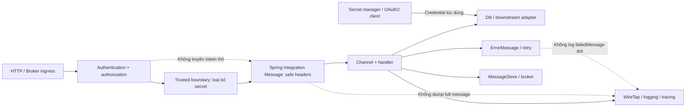
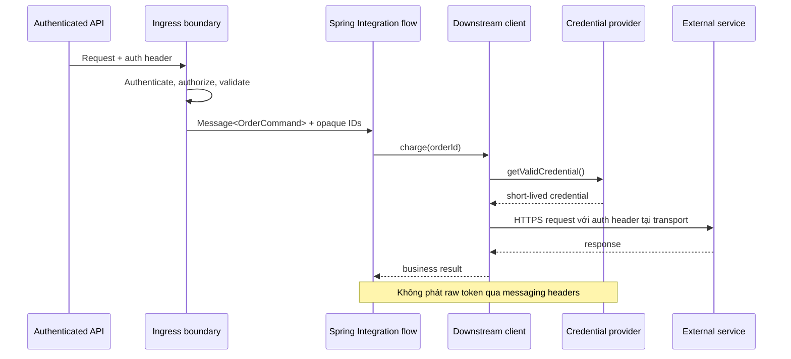
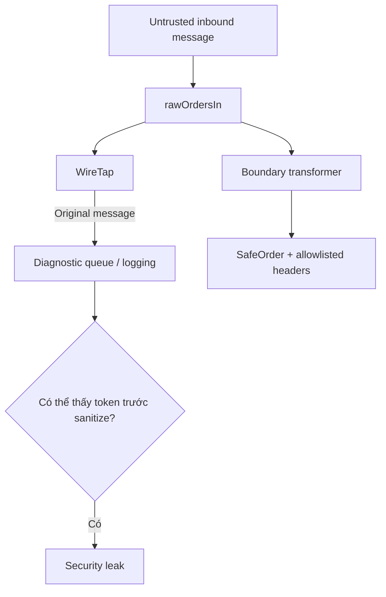
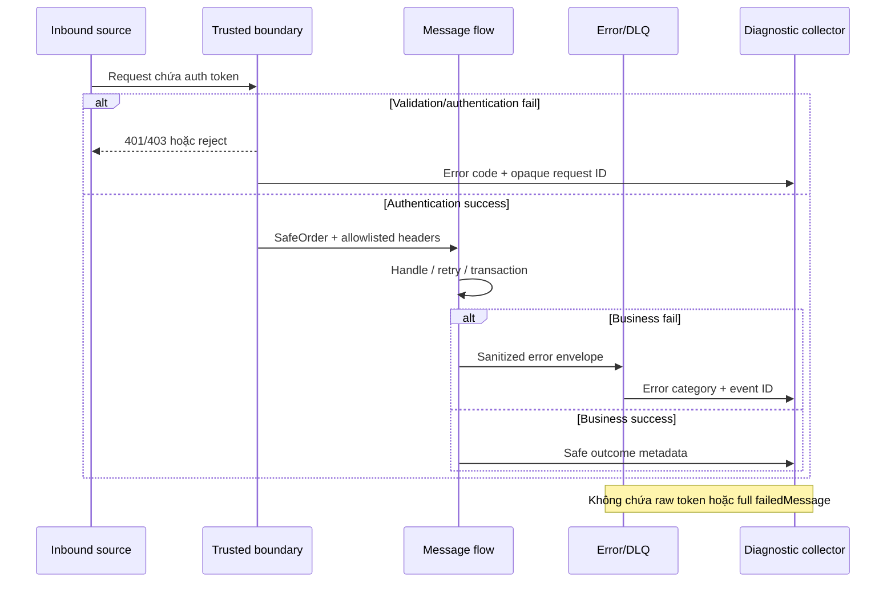

# Không đưa secret vào message header hoặc log trong Spring Integration

## 1. Vấn đề bảo mật thật sự: message đi xa hơn handler ban đầu

Trong chương **Bảo mật runtime** của mô-đun `SPRING_INTEGRATION_RUNTIME`, Spring Integration điều phối message qua **channel, endpoint, consumer, poller và executor**, kết hợp vòng đời `IntegrationFlow`, transaction, retry, message store, lỗi, correlation và quan sát runtime. Một message có thể trải qua nhiều thành phần, bị retry, đưa vào error channel, được ghi xuống JDBC message store hoặc chuyển qua broker. Vì vậy, một secret vô tình nằm trong `MessageHeaders` hay lời gọi `log.info(...)` có thể bị sao chép và lưu giữ ngoài nơi tạo ra nó.

Ví dụ giả định một HTTP inbound gateway nhận request có header HTTP `Authorization: Bearer ...`. Nếu ứng dụng lấy nguyên header đó đưa vào Spring Messaging message rồi gửi qua `ordersIn`:

- Một transformer tạo reply có thể **giữ lại inbound headers** nếu không được cấu hình loại trừ.
- Một `WireTap` hoặc logging adapter có thể nhìn thấy toàn bộ message, kể cả secret.
- `ErrorMessage`/`MessagingException` có thể giữ tham chiếu đến failed message khi handler lỗi.
- `QueueChannel` dùng persistent message store hoặc một outbound adapter có thể làm dữ liệu đi xa hơn JVM.
- Khi đổi thread bằng `ExecutorChannel`, người viết log có thể không biết header nhạy cảm bắt nguồn từ adapter nào.
- Trong lúc khắc phục sự cố, một log statement ngây thơ `log.error("Failed: {}", message)` có thể tạo sự cố rò rỉ thứ hai.

**Nguyên tắc xuyên suốt:** secret cần được lấy từ **nguồn quản lý credential** tại đúng điểm sử dụng, không dùng Spring Integration message như phương tiện chuyên chở credential. Ghi log nên theo **allowlist các trường an toàn**, không dump payload/headers/exception nguyên trạng.

> “Secret” gồm access token, refresh token, API key, password, private key, session cookie, client secret, chuỗi kết nối có mật khẩu và các dữ liệu xác thực tương tự. PII hay payment data không nhất thiết là credential nhưng cũng cần chính sách hạn chế riêng.

### Mục tiêu học tập

Sau bài này, bạn có thể:

1. Chỉ ra điểm rò rỉ qua `MessageHeaders`, header propagation, error path, logging adapter, WireTap, message store và outbound header mapper.
2. Phân biệt **HTTP transport header** cần cho xác thực với **Spring Messaging header** được dùng để xử lý và định tuyến nội bộ.
3. Thiết kế ingress boundary **không chuyển credential vào message**, tạo message mới từ allowlist an toàn.
4. Đặt credential trong client/adapter configuration và inject qua cơ chế secret management, không đưa vào payload, header hay log.
5. Viết diagnostic logger, error handler và log expression chỉ lấy **opaque event ID, trace ID đã kiểm soát, trạng thái và latency**.
6. Viết JUnit 5 kiểm tra secret giả lập không đi qua channel, không nằm trong output/error log và không có trong outbound mapping.
7. Đánh giá tác động của retry, executor, persistence, tracing, multi-instance và cleanup khi phát hiện secret leak.

## 2. Threat model: secret có thể bị lộ ở đâu?

`Message<?>` có payload và `MessageHeaders`. Hai phần này đều có thể bị các component đọc. Header không phải một vùng “riêng tư” hay credential vault; khi message được gửi tiếp, nhiều endpoint truyền lại headers theo hợp đồng Spring Integration.



| Bề mặt | Cách rò rỉ | Hậu quả có thể thấy |
|---|---|---|
| Inbound header mapping | Copy `Authorization`, `Cookie`, `X-Api-Key` từ HTTP headers sang `MessageHeaders` | Credential tồn tại trong memory và đi qua các endpoint sau |
| Header propagation | Handler/transformer trả payload mới nhưng framework giữ một số inbound headers | Secret vượt qua ranh giới mà người viết business code không nhìn thấy |
| `LoggingHandler` và DSL `.log()` | Log payload mặc định; bật full-message thì cả headers; expression không được kiểm soát | Token/PII vào stdout, hệ thống log tập trung, backup |
| `WireTap` | Gửi message sang nhánh diagnostic; không deep-copy/sanitize tự động | Nhánh debug, executor hoặc message store phụ có thể giữ secret |
| `ErrorMessage`/exception | Exception chứa failed message, payload hoặc message của thư viện có credential | Lộ qua stack trace, error channel, DLQ/quarantine |
| Persistent `MessageStore` | Serialize message và headers để giữ lại qua restart | Credential sống lâu hơn thời gian sống ban đầu của token |
| Broker / HTTP header mapper | Header nội bộ được ánh xạ ra transport headers | Credential phát tán sang hệ khác hoặc client không được phép |
| Metrics, tracing, baggage | Dùng token/customer ID làm tag, span attribute hoặc baggage | High cardinality, lộ trong telemetry và các collector |
| Heap dump, diagnostic endpoint, JMX | Có thể quan sát object/stack/metadata runtime | Secret có thể bị người có quyền vận hành đọc qua dump |
| Debugging trong incident | Bật `TRACE` và log “raw request” để tìm lỗi | Tạo dữ liệu nhạy cảm ngay thời điểm nhiều người truy cập |

**Không phải mọi component tự động log secret.** Rủi ro đến từ cách ứng dụng cấu hình message, logger, mapping, persistence và quyền truy cập. Mục tiêu là **ngăn secret vào vùng dữ liệu có thể bị lan truyền**, chứ không chỉ ẩn một câu log.

## 3. HTTP header cần xác thực khác Spring MessageHeaders

Trong một request HTTP, `Authorization` hoặc cookie có thể là cách client chứng minh danh tính. HTTP server và Spring Security nên kiểm tra credential **trước** khi tạo message xử lý nghiệp vụ.

Trong Spring Integration, `MessageHeaders` lại phục vụ định tuyến, reply, correlation, metadata protocol và nội dung do ứng dụng gắn. Đây là **vùng dữ liệu của message flow**, không phải kho credential.

| Vị trí | Dữ liệu nên có | Dữ liệu không nên để |
|---|---|---|
| Spring Security filter/authentication boundary | Credential tạm thời đủ để xác thực, theo cơ chế bảo mật của framework | Không giữ/log token lâu hơn cần thiết |
| Spring Integration business message | `businessEventId` opaque, `traceId` đã xác minh, loại sự kiện, schema version, correlation cần thiết | Raw bearer token, session cookie, password, API key |
| Outbound HTTP client | Header `Authorization` do OAuth2/client credential provider thiết lập ngay lúc gọi | Không lấy token từ `MessageHeaders` do caller không tin cậy gắn |
| Diagnostic log | Event type, opaque IDs, component name, outcome, latency | Header dump, full message `toString()`, raw request body hoặc error message |
| Durable message store/broker | Dữ liệu nghiệp vụ đã phân loại và được mã hóa/giới hạn retention phù hợp | Credential chỉ sống cho phiên làm việc hoặc có quyền truy cập rộng |

**Quan trọng:** “Không đưa secret vào Spring MessageHeaders” **không** có nghĩa mọi HTTP `Authorization` header đều phải biến mất trên đường truyền đến đối tác. Outbound HTTP client vẫn có thể phải gửi header chuẩn đó qua TLS. Khác biệt là **client tạo transport header tại điểm gửi**, không dùng messaging header để truyền token xuyên toàn flow.

### 3.1. Header điều khiển flow cũng là dữ liệu nhạy cảm

Ngoài credential, một số header có **tác dụng điều khiển**, ví dụ:

- `replyChannel` và `errorChannel` quyết định message/reply/error đi tới đâu.
- `routingSlip` ảnh hưởng tuyến xử lý.
- `kafka_topic`, `mqtt_topic` hoặc tên destination có thể ảnh hưởng nơi message được gửi.
- `file_name`, `file_remoteDirectory` hoặc expression về đích file có thể làm ghi file sai vị trí.
- `jmx_objectName`/`jmx_operationName` có thể ảnh hưởng operation quản trị được gọi.

Khi message đến từ **nguồn không tin cậy**, không chỉ loại secret mà còn **kiểm tra/ghi đè các routing metadata**. Một attacker không cần đưa mật khẩu vào header để gây vấn đề: chỉ cần điều khiển `replyChannel` hoặc destination name ở điểm không được kiểm soát.

Spring Integration có hỗ trợ các bộ chọn/kiểm tra header, nhưng **kiểm tra schema và quyền theo nghiệp vụ vẫn thuộc trách nhiệm của ứng dụng**. Không coi header tồn tại là bằng chứng header đó đã được kiểm chứng.

## 4. Header propagation: vì sao “xóa một lần ở cuối” không đủ?

Các message-producing endpoints của Spring Integration thường sao chép những inbound headers phù hợp khi tạo output message mới. Chẳng hạn transformer trả **chỉ payload** sẽ thường được framework bọc lại thành message có header được propagate. Khi transformer trả **một Message hoàn chỉnh**, ứng dụng chịu trách nhiệm nội dung headers trên message đó.

```text
HTTP request headers:
    Authorization = Bearer <redacted>
    X-Trace-Id    = trace-900

Message tại ingress (nếu copy thiếu kiểm soát):
    headers.Authorization = <credential>    <-- Không mong muốn
    headers.traceId       = trace-900

Transformer trả OrderCommand:
    framework có thể propagate các headers phù hợp
    => credential vẫn có thể tồn tại ở outbound message!
```

### Phương pháp bảo vệ theo lớp

1. **Ingress allowlist:** tạo message business mới, **chỉ** gắn những metadata cho phép; không `copyHeaders(request.getHeaders())` vô điều kiện.
2. **Không propagating ở endpoint cần thiết:** `setNotPropagatedHeaders(...)` hoặc DSL `notPropagatedHeaders(...)` cho handler hỗ trợ, nếu một header có thể xuất hiện từ nguồn cũ.
3. **Header filter:** `headerFilter(...)` xóa tên header đã biết tại ranh giới cụ thể.
4. **Outbound whitelist:** mapper từ message sang Kafka/AMQP/HTTP chỉ xuất các header protocol đã duyệt.
5. **Log allowlist:** logger sử dụng tập trường tường minh; không log raw message ngay cả khi tin rằng header đã bị xóa.

`headerFilter("Authorization", "Cookie")` là biện pháp **bổ sung**, không thể coi là đầy đủ nếu secret nằm dưới các tên khác như `jwt`, `credentials`, `oauth_access_token`, hoặc nằm trong payload. **Allowlist hơn denylist** khi chuyển sang vùng trust mới.

Ví dụ DSL có chủ đích xóa một số header ở một điểm:

```java
@Bean
public IntegrationFlow scrubKnownHeaders() {
    return IntegrationFlow.from("beforeBoundary")
            .headerFilter("Authorization", "Cookie",
                          "X-Api-Key", "access_token")
            .channel("afterBoundary")
            .get();
}
```

Fragment này cần bean/channel `beforeBoundary` và `afterBoundary`. Không phải mọi Spring Integration component tự propagate header theo đúng quy tắc của transformer; bridge, router, inbound adapter và mapper có cách xử lý riêng. Bảo vệ tốt nhất vẫn là ngăn credential **đi vào flow ngay từ đầu**.

## 5. Cấu hình bí mật ở client, không ở message

Trong sản phẩm thật, secret có thể được quản lý bởi:

- Secret manager/Kubernetes Secret được mount hoặc inject vào service theo kiểm soát truy cập và rotation.
- Spring Security OAuth2 Client/Authorized Client Manager cho access token ngắn hạn.
- Vault/KMS hoặc credential provider chuyên biệt.
- Managed identity/workload identity thay cho static API key khi hạ tầng hỗ trợ.

Không hardcode secret trong source code, `application.yml` commit vào git, test snapshot, exception message hay header business.

### Mô hình đúng



Ví dụ phân tách interface ở Java:

```java
package example.integration;

public record OrderCommand(String orderId, String traceId) {}
```

```java
package example.integration;

public interface BillingClient {
    void charge(String orderId);
}
```

```java
package example.integration;

import org.springframework.integration.annotation.MessageEndpoint;
import org.springframework.integration.annotation.ServiceActivator;

@MessageEndpoint
public class BillingHandler {

    private final BillingClient billingClient;

    public BillingHandler(BillingClient billingClient) {
        this.billingClient = billingClient;
    }

    @ServiceActivator(inputChannel = "billingCommands")
    public void handle(OrderCommand command) {
        // Credential thuộc BillingClient/OAuth2 provider,
        // KHÔNG thuộc OrderCommand hay MessageHeaders.
        billingClient.charge(command.orderId());
    }
}
```

Đây là sơ đồ code; ứng dụng phải cung cấp bean `BillingClient`, channel `billingCommands` và adapter/client implementation. Nếu dùng WebClient, credential provider có thể gắn `Authorization` khi tạo **HTTP request đến billing server**. Phần log ở HTTP client cũng phải có redaction hoặc tắt wire-level header dumps; **di chuyển credential khỏi message không đủ nếu HTTP wire logger lại in token**.

**Không giữ một secret trong một `String` của message và trông đợi GC lập tức xóa nó.** `String` immutable có thể tồn tại trong heap, thread dump hoặc serialized message lâu hơn dự kiến; giảm số bản sao là phòng ngừa đầu tiên.

## 6. Ví dụ chạy được: chuyển từ message đầu vào sang message an toàn

Mục này dùng một ví dụ Spring Integration tối giản, Java 17+, `spring-integration-core`, Spring Context. Một request ingress có thể mang metadata không tin cậy. Ta tạo **Message mới** từ allowlist; sau đó kiểm tra ở `QueueChannel` rằng secret không còn trong Spring message.

### 6.1. DTO đầu vào và payload business

File `OrderRequest.java`:

```java
package example.integration;

public record OrderRequest(String orderId, String customerRef) {}
```

File `SafeOrder.java`:

```java
package example.integration;

public record SafeOrder(String orderId) {}
```

`customerRef` ở ví dụ chỉ tồn tại ở ingress; nếu nó là dữ liệu cá nhân, không được đưa vào log hoặc header. Những nghiệp vụ cần `customerRef` phải dùng quyền truy cập và lưu trữ phù hợp, không mất dữ liệu cần thiết tùy tiện. Ở demo này, processing chỉ cần `orderId`.

### 6.2. Transformer xây message mới từ allowlist

File `TrustedBoundaryTransformer.java`:

```java
package example.integration;

import org.springframework.integration.annotation.Transformer;
import org.springframework.messaging.Message;
import org.springframework.messaging.support.MessageBuilder;

public class TrustedBoundaryTransformer {

    @Transformer(
            inputChannel = "rawOrdersIn",
            outputChannel = "safeOrdersOut")
    public Message<SafeOrder> sanitize(Message<OrderRequest> incoming) {
        OrderRequest request = incoming.getPayload();

        if (request.orderId() == null
                || !request.orderId().matches("[A-Za-z0-9_-]{1,80}")) {
            throw new IllegalArgumentException("Invalid order ID");
        }

        MessageBuilder<SafeOrder> builder = MessageBuilder
                .withPayload(new SafeOrder(request.orderId()));

        // Chỉ lấy opaque trace ID được validate theo dạng cho phép.
        Object candidateTrace = incoming.getHeaders().get("traceId");
        if (candidateTrace instanceof String trace
                && trace.matches("[A-Za-z0-9_-]{1,64}")) {
            builder.setHeader("traceId", trace);
        }

        // Không copyHeaders(incoming.getHeaders())!
        // replyChannel/errorChannel/Authorization/Cookie/API key không đi qua.
        return builder.build();
    }
}
```

**Tại sao transformer trả `Message<SafeOrder>` thay vì chỉ `SafeOrder`?** Khi trả `Message` hoàn chỉnh, ứng dụng kiểm soát các header được đặt trên output thay vì để framework propagate header gốc như khi trả payload. Trường `id`/`timestamp` chuẩn được tạo bởi `MessageBuilder`.

**Điều kiện áp dụng:** ranh giới này thiết kế cho **luồng một chiều**, không cần giữ reply channel tạm từ ingress. Nếu dùng request–reply gateway, không được âm thầm loại `replyChannel` rồi kỳ vọng caller nhận reply bình thường. Hãy thiết kế reply envelope/correlation được kiểm chứng và cơ chế gửi kết quả riêng, hoặc sử dụng gateway/mapping đã được harden để giữ đúng reply address nội bộ mà không nhận nó từ client ngoài.

**Chú ý:** regex không chứng minh `traceId` là do hệ thống trusted tạo. Nếu trace ID do client gửi đến, hãy kiểm tra nguồn và quyền; với các sự kiện nhạy cảm, tạo trace ID riêng tại gateway được tin cậy.

### 6.3. Channel và cấu hình test

File `SafeBoundaryConfig.java`:

```java
package example.integration;

import org.springframework.context.annotation.Bean;
import org.springframework.context.annotation.Configuration;
import org.springframework.integration.channel.DirectChannel;
import org.springframework.integration.channel.QueueChannel;
import org.springframework.integration.config.EnableIntegration;

@Configuration
@EnableIntegration
public class SafeBoundaryConfig {

    @Bean("rawOrdersIn")
    public DirectChannel rawOrdersIn() {
        return new DirectChannel();
    }

    @Bean("safeOrdersOut")
    public QueueChannel safeOrdersOut() {
        return new QueueChannel(32);
    }

    @Bean
    public TrustedBoundaryTransformer trustedBoundaryTransformer() {
        return new TrustedBoundaryTransformer();
    }
}
```

Ở ví dụ này, `QueueChannel` chỉ dùng như **đầu ra kiểm thử**, không chứa consumer tự chạy. Nó nằm trong RAM và **không** tự bền qua restart; thực tế nên dùng channel/handler phù hợp nghiệp vụ, có policy retention và error/recovery riêng.

Ở ví dụ này, `TrustedBoundaryTransformer` chỉ được đăng ký qua method `@Bean` trong `SafeBoundaryConfig`, **không** gắn thêm `@Component` trên class. Trong ứng dụng bật component scan, không khai báo trùng cả hai cách vì có thể tạo hai instance/endpoint transformer ngoài ý muốn.

### 6.4. JUnit 5 xác minh không truyền token

```java
package example.integration;

import org.junit.jupiter.api.Test;
import org.springframework.context.annotation.AnnotationConfigApplicationContext;
import org.springframework.integration.channel.QueueChannel;
import org.springframework.messaging.Message;
import org.springframework.messaging.support.MessageBuilder;

import static org.junit.jupiter.api.Assertions.*;

class TrustedBoundaryTest {

    @Test
    void excludesSecretHeadersFromOutputMessage() {
        try (var context =
                new AnnotationConfigApplicationContext(
                        SafeBoundaryConfig.class)) {

            var input = context.getBean("rawOrdersIn",
                    org.springframework.messaging.MessageChannel.class);
            var output = context.getBean("safeOrdersOut",
                    QueueChannel.class);

            String syntheticSecret =
                    "SYNTHETIC_TOKEN_DO_NOT_USE_IN_PRODUCTION";

            Message<OrderRequest> incoming = MessageBuilder
                    .withPayload(new OrderRequest("ORDER_901", "private-ref"))
                    .setHeader("Authorization", "Bearer " + syntheticSecret)
                    .setHeader("Cookie", "session=" + syntheticSecret)
                    .setHeader("X-Api-Key", syntheticSecret)
                    .setHeader("traceId", "trace_901")
                    .setHeader("replyChannel", "untrustedReply")
                    .build();

            assertTrue(input.send(incoming));

            Message<?> safe = output.receive(1_000);
            assertNotNull(safe);
            assertEquals(new SafeOrder("ORDER_901"), safe.getPayload());
            assertEquals("trace_901", safe.getHeaders().get("traceId"));

            assertFalse(safe.getHeaders().containsKey("Authorization"));
            assertFalse(safe.getHeaders().containsKey("Cookie"));
            assertFalse(safe.getHeaders().containsKey("X-Api-Key"));
            assertFalse(safe.getHeaders().containsKey("replyChannel"));
            assertFalse(safe.toString().contains(syntheticSecret));
        }
    }

    @Test
    void invalidTraceIdIsNotCopied() {
        var transformer = new TrustedBoundaryTransformer();
        var incoming = MessageBuilder
                .withPayload(new OrderRequest("ORDER_902", "not-used"))
                .setHeader("traceId", "bad\\ntrace")
                .build();

        var safe = transformer.sanitize(incoming);
        assertNull(safe.getHeaders().get("traceId"));
    }
}
```

Các giá trị secret trong test là **chuỗi giả lập**, không bao giờ dùng credential thật. Test kiểm tra cả **header presence** lẫn biểu diễn message đầu ra. Test này **chưa** khẳng định không còn secret trong input object đã được tạo hoặc heap dump: trong hệ thống production, tốt hơn xác thực HTTP trước và **không tạo `incoming` có secret header ngay từ đầu**.

### 6.5. Không nên coi sanitization cuối flow là đủ

Trong test, secret đã tồn tại trong `incoming` trước transformer. Nếu có `WireTap` hoặc `LoggingHandler` trên `rawOrdersIn`, dữ liệu có thể bị quan sát/lưu **trước** khi đến boundary. Bởi vậy:

- Đặt authentication và bỏ transport credential **trước khi tạo Spring message** nếu có thể.
- Nếu framework adapter tự ánh xạ header, cấu hình header mapper/exclude ở chính adapter.
- Nếu bắt buộc tồn tại một vùng ingress chứa dữ liệu chưa tin cậy, cô lập zone này: không wire tap, không persistence, không log payload/headers, ACL hẹp, transformer allowlist ở điểm đầu tiên.

## 7. Logging Channel Adapter: “mặc định” cũng có thể nguy hiểm

Spring Integration có `<int:logging-channel-adapter>` và `LoggingHandler`. Theo tài liệu, mặc định adapter log **payload**, và `log-full-message="true"` sẽ log cả message gồm headers. Như vậy:

- **Mặc định không log headers** không đồng nghĩa an toàn, vì **payload có thể chứa secret/PII**.
- Bật full-message logging có thể làm rò `Authorization`, `Cookie` hoặc routing metadata nhạy cảm.
- Một SpEL expression log `payload` hoặc `headers` nguyên vẹn có thể mang rủi ro tương tự.
- `.log()` trong Java DSL thực chất tổ chức một nhánh logging dựa trên wire tap; không xem là một logger “không ảnh hưởng flow” trong mọi topology.

### Phản mẫu không nên áp dụng

```xml
<!-- KHÔNG DÙNG trên message có thể mang token/PII -->
<int:logging-channel-adapter
        id="unsafeLogger"
        level="DEBUG"
        log-full-message="true"/>
```

Hoặc:

```java
// KHÔNG DÙNG trong production:
log.info("message={}", message);
log.error("failure={}", exception); // exception message có thể chứa secret.
```

Ngay cả khi `log.debug(...)` tắt theo level, giá trị được **tạo trước** khi gọi logger (ví dụ serialize toàn bộ payload vào một chuỗi) vẫn có thể chiếm CPU/heap, và khi bật debug lúc incident, dữ liệu trở nên hiện rõ.

### Thay bằng metadata tối thiểu

Java DSL có hỗ trợ logging expression theo message:

```java
@Bean
public IntegrationFlow safeLoggingFlow() {
    return IntegrationFlow.from("safeInput")
            .log(LoggingHandler.Level.INFO, "integration.safe",
                    m -> "eventType=order"
                       + " messageId=" + m.getHeaders().getId())
            .channel("businessChannel")
            .get();
}
```

Fragment cần import `IntegrationFlow`, `LoggingHandler` và khai báo `safeInput`/`businessChannel`. Ở đây logger **không lấy payload hay toàn bộ headers**. `MessageHeaders.ID` chỉ là message instance ID, không phải idempotency key nghiệp vụ. Nếu cần event ID/trace ID, chỉ log giá trị **được tạo hoặc đã qua validation tại trusted boundary**.

**Không dùng `message.getHeaders().toString()`, `message.toString()` hoặc `exception.getMessage()` trong expression**. Những thứ này có thể chứa secret hoặc dữ liệu người dùng kiểm soát.

### Logging cấu trúc có kiểm soát

Một logger nhận typed message an toàn:

```java
package example.integration;

import org.slf4j.Logger;
import org.slf4j.LoggerFactory;
import org.springframework.messaging.Message;

public final class SafeDiagnosticLogger {

    private static final Logger log =
            LoggerFactory.getLogger(SafeDiagnosticLogger.class);

    public void received(Message<SafeOrder> message) {
        String orderId = message.getPayload().orderId();

        // orderId ở demo là opaque, nhưng thực tế vẫn phải phân loại.
        log.info("eventType=ORDER_ACCEPTED orderId={} messageId={}",
                orderId, message.getHeaders().getId());
    }

    public void failure(String eventId, Throwable exception) {
        String category = exception.getClass().getSimpleName();

        // Không log exception object / getMessage() hoặc stack trace thô.
        log.warn("eventType=ORDER_FAILED eventId={} errorType={}",
                eventId, category);
    }
}
```

Ở production, `eventId`/`orderId` phải được sinh/kiểm tra theo chuẩn opaque và quyền xem log. Không mặc định một order ID hợp lệ cho SQL cũng là ID an toàn để mọi operator được thấy; nếu ID gắn với một khách hàng cụ thể, có thể dùng token hóa/HMAC với key quản lý riêng, tránh hash trần những giá trị PII đoán được.

## 8. WireTap: nguy cơ rò rỉ trước khi logger kịp redaction

`WireTap` là một `ChannelInterceptor` thực hiện nhánh quan sát ở `preSend`. Nó có thể gửi **cùng Message object** sang diagnostic channel; đây **không phải deep copy payload hoặc phiên bản đã được redact**.



**Nguyên tắc:** không gắn global wire tap hoặc `patterns="*"` vào vùng chứa message chưa qua trusted boundary. Nếu cần chẩn đoán ingress, tạo một **event diagnostic riêng** có allowlist field từ bên trong boundary, thay vì gửi nguyên message vào queue/log.

`WireTap` **không mặc định chạy bất đồng bộ**: nó gọi `send` sang channel phụ. Nếu channel phụ là `DirectChannel` với logger chậm, log I/O có thể kéo dài request chính; nếu là `ExecutorChannel`, queuing có thể giữ message (và mọi secret bên trong) lâu hơn. Tách thread giúp cách ly độ trễ **nhưng không khử dữ liệu nhạy cảm**.

Có thể dùng `MessageSelector` để chọn message cần tap, nhưng selector **chỉ lọc việc gửi**, không biến message thành sanitized DTO. Nếu cần đảm bảo diagnostic subsystem không bao giờ nhận secret, hãy đưa nó **sau** boundary hoặc dùng custom interceptor tạo payload diagnostic an toàn.

## 9. ErrorMessage, failedMessage, retry và dead-letter storage

Khi handler ném exception, một số error paths của Spring Integration phát `ErrorMessage`, có payload `Throwable`. Một `MessagingException` có thể giữ `failedMessage`; `ErrorMessage` có thể chứa `originalMessage` tùy nguồn phát. Vì vậy log:

```java
log.error("ErrorMessage: {}", errorMessage);
log.error("Exception", errorMessage.getPayload());
```

có thể chứa payload, headers hoặc exception message do thư viện bên ngoài tạo; không coi đây là an toàn chỉ vì logger đang ở `errorChannel`.

### Error handler chỉ log sự kiện đã phân loại

```java
package example.integration;

import org.slf4j.Logger;
import org.slf4j.LoggerFactory;
import org.springframework.integration.annotation.MessageEndpoint;
import org.springframework.integration.annotation.ServiceActivator;
import org.springframework.messaging.support.ErrorMessage;

@MessageEndpoint
public class SafeErrorObserver {

    private static final Logger log =
            LoggerFactory.getLogger(SafeErrorObserver.class);

    @ServiceActivator(inputChannel = "safeDiagnosticsErrors")
    public void observe(ErrorMessage error) {
        Throwable cause = error.getPayload();

        // Chỉ log loại lỗi, không log exception.getMessage()
        // hoặc failedMessage.toString().
        log.warn("failureType={} diagnosticEvent=HANDLER_FAILED",
                cause.getClass().getSimpleName());
    }
}
```

`safeDiagnosticsErrors` là **channel lỗi riêng** do ứng dụng cấu hình, không tự có chỉ vì đã bật `@EnableIntegration`. Nếu muốn xử lý global `errorChannel`, cần cấu hình đúng nguồn error publisher, consumer và logging/diagnostic policy trên **toàn bộ error path**. Không thay global error handler bằng một consumer chỉ log nếu điều đó làm mất chính sách retry/DLQ của hệ thống.

### Test phải tấn công cả đường lỗi

1. Tạo message test với secret giả lập ở ingress.
2. Làm transformer/handler ném exception trước và sau sanitize.
3. Thu log từ error handler, retry interceptor, adapter và root logger.
4. Kiểm tra secret giả lập **không** có trong log, error envelope persist hoặc DLQ được phép quan sát.
5. Kiểm tra business ID/loại lỗi vẫn đủ để đội vận hành điều tra.
6. Kiểm tra lỗi ở recovery sink không tự tạo log thô từ `failedMessage`.

**Retry không xóa thông tin nhạy cảm.** Khi một message lỗi bị thử lại ba lần, cùng token trong header có thể bị log ba lần, lưu trong queue ba lần hoặc xuất hiện trong DLQ. Đường giải quyết là **sanitize trước retry boundary** hoặc đổi kiến trúc để không tạo message chứa credential.

### Khi nào cần lưu raw failed message?

Một số nghiệp vụ phải lưu dữ liệu lỗi để replay, nhưng lưu raw payload/headers luôn cần đánh giá bảo mật. Ưu tiên:

- Error envelope chứa `eventId` opaque, `errorCode`, `schemaVersion`, timestamp và `payloadRef` đến store được phân quyền.
- Giữ dữ liệu nghiệp vụ ở store mã hóa với TTL và audit access; không giữ credential thực để replay.
- Khi replay, lấy **credential mới** từ provider tại thời điểm gửi, không sử dụng token trong message cũ.
- Thiết kế dead-letter retention theo chính sách dữ liệu, không giữ “vĩnh viễn để debug”.

## 10. Message store và header mapping qua boundary

### 10.1. Persistence làm leak trở thành leak kéo dài

`QueueChannel` với `JdbcChannelMessageStore`, `MessageStore`/`MessageGroupStore` hoặc một broker có thể lưu message và headers lâu dài qua restart. Nếu lưu `Authorization` vào đó:

- Token có thể tồn tại trong DB backups, replicas, debug SQL dumps và dead-letter records.
- Token có thể bị đọc lại khi schema/serializer nâng cấp.
- Key bị revoke rồi nhưng bản sao vẫn còn trong store.
- Quy trình xóa log không xóa các bản sao ở message store hay broker.

**Mã hóa lưu trữ không thay thế data minimization.** Mã hóa giúp bảo vệ dữ liệu khi mất thiết bị/quyền truy cập, nhưng secret không cần lưu thì nên **không được đưa vào bản ghi ngay từ đầu**.

### 10.2. Mapping ra HTTP/Kafka/AMQP

Spring Integration adapters có `HeaderMapper` riêng. Ví dụ HTTP header mapping có khả năng ánh xạ standard HTTP headers theo mặc định; khi tùy biến, pattern header quyết định dữ liệu nào chuyển sang transport.

Không nên bật wildcard kiểu `mapped-request-headers="*"` hoặc các cấu hình tương đương mà chưa hiểu whitelist. Khi adapter gửi message đến hệ khác:

- Chỉ allowlist transport headers thực sự cần, như content type, một opaque trace ID đã kiểm soát và schema ID.
- Không xuất internal routing headers như `replyChannel`, `errorChannel` hoặc business credentials không cần thiết.
- Không cho dữ liệu do client gửi quyết định `kafka_topic`/HTTP URL/recipient nếu chưa có authorization và validation.
- Với outbound HTTP, credential **được tạo bởi client security layer**, không được sao chép từ message.
- Dùng Integration Test kiểm tra actual headers ra HTTP mock server/broker test, không chỉ unit test mapper.

**Cẩn thận với header “vô hại” nhưng high cardinality hoặc PII:** customer email, IP address, device ID, ticket title hoặc số điện thoại có thể đi qua logging/tracing ngay cả khi chúng không phải secret xác thực.

## 11. SecurityContext propagation khi đổi thread: cần nhìn rõ ngoại lệ

Spring Security thường giữ `SecurityContext` gắn với thread hiện tại. Khi flow dùng `DirectChannel`, các bước đồng bộ trên cùng thread có thể truy cập context đó. Khi chuyển sang `ExecutorChannel` hoặc `QueueChannel`, thread xử lý mới **không tự kế thừa** `SecurityContext`.

Spring Security Messaging có `SecurityContextPropagationChannelInterceptor` để hỗ trợ truyền security context qua channel trong những tình huống phù hợp. Nhưng:

- Đây là **cơ chế framework dành cho luồng trusted**, không phải giấy phép đưa raw bearer token hay password vào application-defined headers.
- Context có thể chứa `Authentication` hoặc thông tin principal nhạy cảm; phải xem nó có bị wire tap, persistent store, broker mapper hoặc log nguyên trạng không.
- Không tự truyền `SecurityContext` qua trust boundary sang hệ khác và coi bên nhận đã xác thực.
- Nên giảm credential sau authentication, giới hạn quyền/identity và dọn ThreadLocal sau xử lý để tránh leak principal sang task tiếp theo.
- Nếu chính sách nội bộ **cấm bất kỳ credential-bearing object nào ở MessageHeaders**, thay vì propagate nguyên security context hãy dùng opaque identity/authorization claim đã ký hoặc **xác thực lại ở trusted worker**, có ràng buộc freshness.

Từ Spring Integration 6.3, module `spring-integration-security` cũ được loại bỏ; phần tích hợp channel security chuyển về `spring-security-messaging`. Khi đọc tutorial cũ, kiểm tra dependency/version và không copy class thuộc module đã bị bỏ.

**Thread-bound security và transaction là hai câu chuyện khác nhau.** Bật security context propagation không làm JDBC `@Transactional` của producer tự đi qua `ExecutorChannel`. Đồng thời một message không có secret vẫn có thể mang identity cần authorization; trách nhiệm phân quyền vẫn nằm ở boundary và các service nhạy cảm.

## 12. Observability: log, trace, metric đều có thể rò rỉ

Không chỉ log file mới lưu dữ liệu:

| Kênh | Phản mẫu | Phương án an toàn |
|---|---|---|
| Structured log | `log.info("headers={}", headers)` | Allowlist `eventType`, opaque ID, result, duration |
| SLF4J exception logging | `log.error("failed", exception)` với message chứa token | Error code/exception class; stack trace chỉ ở sink đã kiểm soát/redact |
| Micrometer metric tags | `tag("token", apiKey)` hoặc `tag("userEmail", email)` | Tag low-cardinality như component/result/error category |
| Distributed tracing | Span attribute/baggage chứa token hoặc PII | Trace IDs, safe operation names; baggage allowlist |
| Message history | Giữ metadata endpoint/channel để chẩn đoán | Không coi history là nơi để lưu credential/PII |
| JMX/Actuator | Expose bean properties/config/dump | Network/auth/role hạn chế, không xuất secret, hạn chế heapdump |
| Debug log của client HTTP | In Authorization header/wire bytes | Redact transport headers hoặc tắt wire logging |
| Dead-letter record | Lưu toàn bộ original headers | Sanitize envelope và retention mã hóa/ACL |

Metric tag chứa mỗi `eventId` cũng có thể làm tăng cardinality cực lớn. Không dùng secret hay PII làm label, ngay cả khi chỉ định lưu trong một `Prometheus` hoặc `OpenTelemetry` collector nội bộ.

### Gợi ý log schema

```text
event_type=ORDER_PROCESSED
trace_id=trace_901
component=billingHandler
outcome=SUCCESS
duration_ms=34
attempt=2
```

Không log:

```text
Authorization=Bearer ...
Cookie=session=...
customer_email=...
request_body=<full JSON>
failedMessage=GenericMessage[payload=..., headers=...]
```

Dù schema an toàn, vẫn cần phân quyền/retention. `trace_id` hoặc order ID do người dùng nhập có thể chứa dòng mới hoặc ký tự control gây log injection; validate, normalize và giới hạn độ dài trước khi ghi.

## 13. Testing: chứng minh “không lộ secret” theo lớp

Nên kiểm tra **từng boundary** thay vì tìm một string duy nhất ở log cuối.

### 13.1. Từ HTTP vào message

- Gửi request test có header `Authorization` và `Cookie` chứa secret giả lập.
- Dừng tại điểm message đầu tiên được tạo từ request; kiểm tra `MessageHeaders` **không chứa** credential raw.
- Nếu dùng HTTP inbound gateway/map headers, kiểm tra config mapper thực tế thay vì chỉ test POJO sanitizer.
- Kiểm tra header điều khiển như `replyChannel`, `routingSlip`, target topic bị loại bỏ/ghi đè đúng trust policy.
- Kiểm tra business ID và trace ID an toàn vẫn được giữ để hỗ trợ retry/correlation.

### 13.2. Qua transformer, aggregator và retry

- Gửi message đã sanitize qua transformer trả payload và transformer trả `Message<?>`.
- Assert rằng không có secret xuất hiện lại sau propagation hoặc enrichment.
- Nếu có splitter/aggregator, kiểm tra group store, correlation metadata và output message sau release.
- Inject exception để message bị retry; log của **mọi attempt** không chứa secret giả lập.
- Cho một work item vào DLQ/persistent queue test; đọc lại serialized message và headers.

### 13.3. Kiểm thử logger với OutputCaptureExtension

Dùng `spring-boot-starter-test` có `OutputCaptureExtension` ở classpath. Ví dụ này dùng logger từ mục 7; không cần mở endpoint HTTP:

```java
package example.integration;

import org.junit.jupiter.api.Test;
import org.junit.jupiter.api.extension.ExtendWith;
import org.springframework.boot.test.system.CapturedOutput;
import org.springframework.boot.test.system.OutputCaptureExtension;
import org.springframework.messaging.support.MessageBuilder;

import static org.junit.jupiter.api.Assertions.*;

@ExtendWith(OutputCaptureExtension.class)
class SafeDiagnosticLoggerTest {

    @Test
    void doesNotLogPayloadOrSyntheticToken(CapturedOutput output) {
        SafeDiagnosticLogger logger = new SafeDiagnosticLogger();
        String synthetic = "FAKE_SECRET_001";

        var safe = MessageBuilder
                .withPayload(new SafeOrder("ORDER_901"))
                .setHeader("traceId", "trace_901")
                .setHeader("Authorization", synthetic)
                .build();

        logger.received(safe);
        logger.failure("ORDER_901",
                new IllegalStateException("failure token=" + synthetic));

        String logs = output.getAll();
        assertTrue(logs.contains("ORDER_ACCEPTED"));
        assertTrue(logs.contains("ORDER_FAILED"));
        assertFalse(logs.contains(synthetic));
        assertFalse(logs.contains("Authorization"));
        assertFalse(logs.contains("failure token="));
    }
}
```

Đây là **kiểm thử logger an toàn**, không phải bằng chứng token được phép có trong message production. Ở bài test, cố tình gắn secret giả lập để chứng minh logger **không in nó**; trong hệ thống thật, vẫn phải dùng boundary mục 6 để **loại token trước khi sinh message**.

Khi dùng backend logging khác Logback hoặc có appender gửi tới hệ thống ngoài, `OutputCaptureExtension` có thể không bắt hết mọi sink. Với production, test integration và cấu hình appender/collector thật (dữ liệu giả lập) để chứng minh redaction theo sink.

### 13.4. Negative test cho error path

```java
@Test
void errorObserverDoesNotLogThrowableMessage(CapturedOutput output) {
    var observer = new SafeErrorObserver();
    var error = new org.springframework.messaging.support.ErrorMessage(
            new IllegalStateException("password=FAKE_SECRET_002"));

    observer.observe(error);

    assertTrue(output.getAll().contains("HANDLER_FAILED"));
    assertFalse(output.getAll().contains("FAKE_SECRET_002"));
}
```

Đoạn test này đặt trong test class có `@ExtendWith(OutputCaptureExtension.class)` hoặc cấu hình capture tương đương. Không chỉ test error observer; cần kiểm tra **root logger**, broker adapter và client thư viện không log cùng exception ở nơi khác.

### 13.5. Assert outbound mapping

Dùng HTTP mock server hoặc broker test, phát một `SafeOrder`, rồi xác minh request ra ngoài:

- Chỉ xuất `Content-Type`, correlation/trace đã kiểm soát và header protocol cần thiết.
- Outbound HTTP `Authorization` nếu cần được gắn từ **client credential provider**, không có cùng giá trị secret giả lập của inbound message.
- Không có `Cookie`/`X-Api-Key` inbound nếu nguồn không được phép forward.
- Không có routing slip hoặc tên internal error channel trong headers gửi ra ngoài.
- Không bị lộ qua HTTP request/response logs khi lỗi 401/5xx.

Để xác minh nguyên nhân, dùng ID opaque và checksum của test fixture; không lưu credential thật vào snapshot hay golden files.

## 14. Kịch bản runtime: retry, restart và incident response

### 14.1. Lỗi trước và sau sanitization



Nếu exception xảy ra **trước** boundary và chứa request raw, error logger của inbound web/server cũng cần redaction. Một flow Spring Integration chỉ bảo vệ đường **sau** boundary, không thể xóa dữ liệu đã bị log ở reverse proxy hoặc authentication filter.

### 14.2. Rolling restart và persistent backlog

Khi application restart, các `MessageStore` bền vững còn giữ message/headers đã được persist. Nếu version cũ lưu credential trong message, version mới chỉ sửa logger **không loại được dữ liệu cũ trong store**. Cần kế hoạch migration/quarantine và xử lý rotation:

1. Xác định các bản ghi có khả năng chứa credential bằng phương pháp hạn chế truy cập, không dump nội dung ra console.
2. Revoke/rotate token đã bị lộ, đánh giá thời điểm/vùng ảnh hưởng.
3. Thay logic ghi message và adapter header mapping trước khi phục hồi consumer.
4. Xử lý dữ liệu tồn dư theo policy: sanitize/migrate, re-enqueue envelope mới hoặc quarantine có kiểm soát.
5. Làm sạch log, DLQ, backups và telemetry theo chính sách retention/compliance, có audit.
6. Kiểm thử lại trên dữ liệu giả lập và xác nhận không có credential ở ranh giới mới.

### 14.3. Nếu đã phát hiện secret nằm trong log

Một sự cố lộ credential cần xử lý như security incident, không chỉ “xóa dòng log”:

- **Đánh giá loại secret và phạm vi:** token đã dùng, hạn sống, hệ thống nào có quyền đọc log, backup, exporters, snapshots.
- **Thu hồi/rotate:** ưu tiên vô hiệu hóa credential trước khi nó có thể bị dùng.
- **Giới hạn truy cập:** tạm giảm quyền xem log/telemetry, bảo toàn bằng chứng theo quy trình tổ chức.
- **Định vị nguồn phát:** raw message logging, HTTP wire logging, error stack trace, wire tap, broker DLQ, message history hoặc custom metrics tags.
- **Sửa tận gốc:** allowlist boundary, secret provider, logger an toàn, suppression ở mapper và regression tests.
- **Khôi phục và kiểm tra:** chỉ bật lại debug/tap khi có dữ liệu tối thiểu và thời hạn được phê duyệt.

**Không in lại secret trong ticket, chat, incident report hoặc unit test output.** Dùng token ID/fingerprint được quản lý an toàn thay cho raw value.

## 15. Policy nên được thực thi ở những điểm nào?

| Điểm kiểm soát | Điều kiện chấp nhận | Ví dụ assertion |
|---|---|---|
| HTTP ingress/security filter | Credential chỉ dùng để auth, không forward raw token vào SI headers | `message.getHeaders().containsKey("Authorization") == false` |
| Transformer/normalizer đầu flow | Chỉ allowlisted fields vào business message | Header set = framework headers + safe application headers |
| Channel interceptor/WireTap | Không quan sát message chưa sanitize | Vị trí tap sau boundary, diagnostic payload safe |
| Handler/retry advice | Error không log raw payload hoặc exception text | Synthetic secret vắng trong log mỗi attempt |
| MessageStore/broker | Record serialized không có secret transport | Kiểm tra header map của message đã persist |
| Outbound adapter | Mapper chỉ xuất transport fields cần thiết | HTTP mock xác nhận không forward inbound token |
| Logging/metrics/tracing | Event fields/tags được kiểm soát cardinality và PII | Snapshot allowlist, static errorCode thay throwable message |
| Management/JMX/Actuator | Không expose credential qua endpoint/dump; access restricted | Probe chỉ có health/status, không có config secrets |
| Rotation/incident | Có runbook revoke, cleanup và xác minh | Test revoke token cũ, regression tests pass |

Đặt các kiểm tra này vào code review checklist/CI để việc thêm `.log()`, `WireTap` hay adapter mới không vô tình mở lại đường leak.

## 16. Thực hành kiểm chứng theo từng ranh giới

Thực hiện trên môi trường test với **secret hoàn toàn giả lập**; không dùng token thật của công ty hoặc production.

1. **Header propagation:** đưa `Authorization=FAKE_SECRET_001` vào message tại test boundary, cho một transformer chỉ trả payload, quan sát các header được propagate; sửa bằng transformer trả full sanitized Message.
2. **Ingress mapper:** cấu hình HTTP inbound adapter, gửi request có fake auth header; xác minh message đầu tiên của flow **không** còn raw auth value.
3. **Null/empty values:** gửi header `Authorization` rỗng, bearer string sai, cookie lớn và value chứa newline; đảm bảo bị reject/loại bỏ theo policy, không log raw text.
4. **Gateway request–reply:** giữ correlation/reply route **nội bộ được tin cậy** trong khi không forward credential; kiểm tra không làm timeout gateway do xóa `replyChannel` thiếu thiết kế.
5. **Logging adapter:** so log khi bật/tắt `log-full-message` ở test và giải thích vì sao **không bật ở production**. Không dùng dữ liệu thật.
6. **WireTap:** gắn tap trước và sau boundary trên hai cấu hình test riêng; kiểm tra chỉ tap sau boundary được phép hoạt động ở production.
7. **Exception:** cho handler ném exception với fake secret trong `getMessage()`, kiểm tra error observer không log exception text, `failedMessage` hay header dump.
8. **Retry:** thử 3 attempts và đếm số lượt log; xác nhận mọi attempt chỉ xuất event type/error code, không có fake secret.
9. **Persistence:** ghi message đã sanitize vào JDBC/broker test, đọc lại sau restart; kiểm tra header persisted và dump được phép quan sát.
10. **Outbound HTTP:** cấu hình client credentials từ test provider, kiểm tra request headers qua mock server; credential nguồn test **không** được forward trực tiếp từ inbound message.
11. **Executor/thread:** đưa flow qua `ExecutorChannel`; kiểm tra ThreadLocal security, MDC và log context được dọn sau task, không lộ principal của message trước sang task sau.
12. **Tracing:** xem attributes/baggage của span khi error; kiểm tra không có email/token/URL query chứa secret.
13. **Unauthorized routing:** thử header `replyChannel`/`kafka_topic` do client điều khiển; đảm bảo bị bỏ qua hoặc bị validate tại trusted boundary.
14. **Incident drill:** giả lập secret leak trong log **cục bộ**, thực hiện runbook revoke/rotate/quarantine/cleanup và bổ sung regression test.

Mỗi test nên ghi:

| Bằng chứng | Giá trị cần quan sát |
|---|---|
| Trust boundary | Secret bị loại **trước hay sau** channel đầu tiên? |
| Headers trước/sau | Có giá trị nhạy cảm hoặc routing metadata không tin cậy? |
| Channel/endpoint | `DirectChannel`/`ExecutorChannel`/poller/adapter nào đã đi qua? |
| Log collector | Logger category, sink, level, số lần xuất hiện fake secret = **0** |
| Error/retry | Exception cause, failedMessage, error channel, DLQ envelope đã sanitize? |
| Persistent storage | Headers/payload nào còn sau restart? |
| Network outbound | Header nào thực sự được gửi ra ngoài? |
| Identity/context | Principal truyền qua thread nào, có bị rò sang task khác? |
| Cleanup | Retention, token rotation, access audit và bài regression |

## 17. Phản mẫu cần tránh

| Phản mẫu | Vì sao nguy hiểm | Cách thay thế |
|---|---|---|
| `MessageBuilder.setHeader("Authorization", token)` | Credential lan qua header propagation, persistence, tracing | Client/auth layer giữ token, flow chỉ mang business identity |
| `log.info("{}", message)` | `Message.toString()` có thể in payload/headers | Log allowlisted fields |
| `log.error("error", ex)` không kiểm tra nội dung | Exception message/cause có thể chứa token/raw request | Error category/code; stack trace chỉ ở vùng an toàn có redaction |
| `log-full-message="true"` | In cả headers | Log expression/typed logger chỉ metadata |
| `headerFilter` là hàng rào duy nhất | Không loại tất cả tên secret chưa biết, payload vẫn có thể mang token | Ingress allowlist + outbound mapping |
| `WireTap` trước validation | Nhánh debug thấy raw message | Chỉ tap vùng trusted sau sanitization |
| `QueueChannel` với persistent store giữ nguyên token | Bí mật tồn tại qua restart/backups | Lưu envelope không chứa token, lấy credential mới lúc gửi |
| Dùng client-provided `traceId` làm log raw | Log injection, spoofing, lộ PII | Validate/normalize/generate opaque trace ID |
| Đưa token vào metric tag | Leak telemetry + cardinality | Tag component/result/error category |
| Dùng MessageHeaders làm security principal store toàn tuyến | Principal/credential có thể serialize/propagate sai trust zone | Security context propagation có kiểm soát hoặc re-auth/opaque claim |
| Chỉ xóa log sau khi lộ credential | Token vẫn có thể bị khai thác; bản sao còn ở DLQ/backups | Rotate/revoke + kiểm soát phạm vi + xử lý retention và source leak |

## 18. Tổng kết

- Spring Integration `MessageHeaders` là **metadata xử lý message**, không phải nơi giữ credential; dữ liệu này có thể propagate qua nhiều endpoint và sang hệ bên ngoài.
- Secret phải được **xác thực/đọc ở điểm sử dụng** bằng client/security provider thích hợp, không đưa raw token vào message. HTTP transport `Authorization` tại outbound client là khái niệm khác.
- **Allowlist tại ingress** là biện pháp đầu tiên; `headerFilter` và `notPropagatedHeaders` là lớp bổ sung, không thay thế chính sách data minimization.
- `LoggingHandler` mặc định log payload, có thể đã nhạy cảm; `log-full-message=true` còn thêm headers. `.log()` và `WireTap` không tự sanitize.
- `ErrorMessage`/`MessagingException`/`failedMessage`, retry, message store, broker, DLQ và exception message là đường rò rỉ thường bị bỏ qua.
- Dùng **opaque event ID, trace ID được kiểm soát, error code, component, outcome và latency** cho log/metric; không log `message`, `headers`, full payload hoặc raw throwable.
- Với executor và security context propagation, phải phân biệt identity cần authorization với credential cần bảo vệ, giới hạn trust zone và dọn ThreadLocal.
- Bảo mật runtime cần **regression tests toàn đường đi**, kể cả logging, outbound mapping, error path và persistence, chứ không chỉ unit test một transformer.

### Tài liệu tham khảo chính thức

- [Spring Integration Reference — Message and Header Propagation](https://docs.spring.io/spring-integration/reference/message.html): header propagation, `notPropagatedHeaders` và semantics transformer trả payload so với Message.
- [Spring Integration Reference — Logging Channel Adapter](https://docs.spring.io/spring-integration/reference/logging-adapter.html): payload mặc định, `log-full-message`, `expression` và logger category.
- [Spring Integration Reference — Operator log()](https://docs.spring.io/spring-integration/reference/dsl/java-log.html): Java DSL logging qua WireTap/LoggingHandler.
- [Spring Integration Reference — Configuring Message Channels](https://docs.spring.io/spring-integration/reference/channel/configuration.html): WireTap, channel interceptors và điều kiện asynchronous.
- [Spring Integration Reference — Transformer / Header Filter](https://docs.spring.io/spring-integration/reference/transformer.html): `headerFilter` xóa các header đã biết.
- [Spring Integration Reference — Security](https://docs.spring.io/spring-integration/reference/security.html): security channel interceptor, propagation và sensitive metadata.
- [Spring Integration Reference — Error Handling](https://docs.spring.io/spring-integration/reference/error-handling.html): error channels, `ErrorMessage` và `MessagingException`.
- [Spring Integration Reference — HTTP Header Mapping](https://docs.spring.io/spring-integration/reference/http/header-mapping.html): cấu hình inbound/outbound transport header mapping.
- [Spring Integration Reference — Message Store](https://docs.spring.io/spring-integration/reference/message-store.html): message persistence và headers qua restart.
- [Spring Boot Reference — Externalized Configuration](https://docs.spring.io/spring-boot/reference/features/external-config.html): cấu hình runtime, tách secret khỏi source code.
