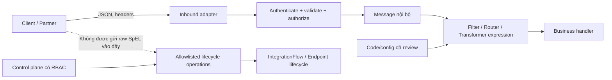
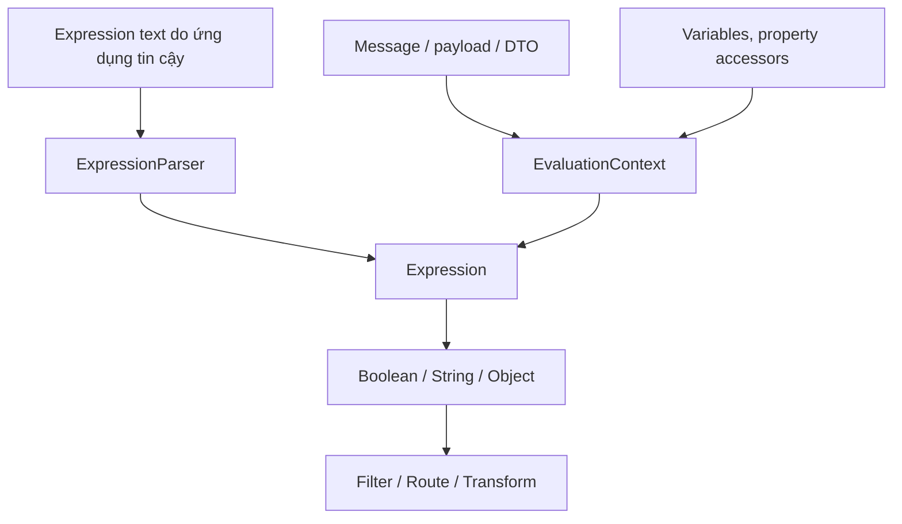
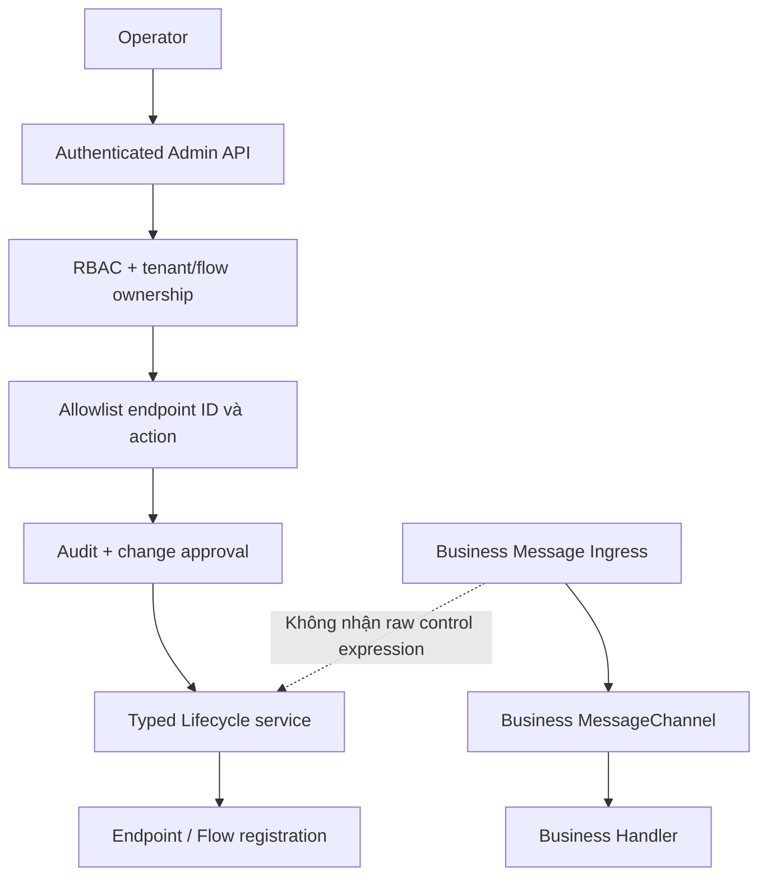
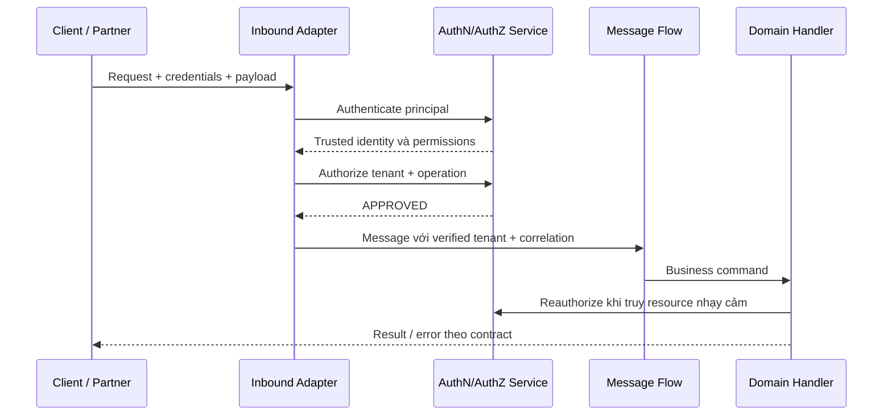
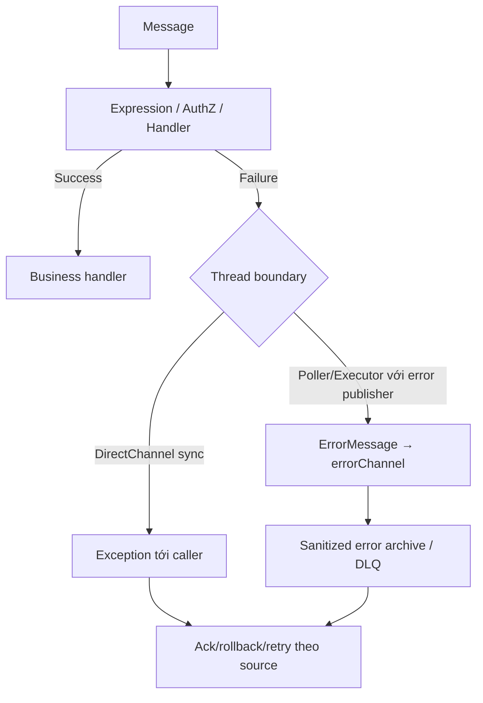

# Expression evaluation và quyền truy cập runtime trong Spring Integration

## Mục tiêu học tập

Spring Integration thường dùng expression để lọc message, quyết định route, lấy header, chuyển đổi payload hoặc thực hiện thao tác quản trị. Một expression cố định do lập trình viên viết như `headers['region'] == 'APAC'` có thể rất hữu ích. Nhưng nếu hệ thống cho phép người dùng gửi lên **nguyên chuỗi expression** để chạy trong runtime, hoặc cho một API bên ngoài gọi trực tiếp Control Bus, quyền xử lý message có thể bị biến thành quyền truy cập bean, dữ liệu và lifecycle của ứng dụng.

Bài **Expression evaluation và quyền truy cập runtime** thuộc chương **Bảo mật runtime**, trong module **SPRING_INTEGRATION_RUNTIME**. Nội dung đặt vấn đề bảo mật ngay tại nơi message thực sự chạy qua channel, endpoint, consumer, poller và executor; xem xét thêm vòng đời `IntegrationFlow`, transaction, retry, message store, error/correlation, threading, hiệu năng và các công cụ quản trị như Control Bus, Actuator và JMX.

Sau bài học, bạn có thể:

- Nhận diện **trust boundary** giữa một expression được kiểm duyệt trong cấu hình ứng dụng và một chuỗi/thuộc tính do người dùng hoặc đối tác cung cấp.
- Giải thích Spring Expression Language (SpEL) được dùng ở đâu, vai trò của `ExpressionParser`, `EvaluationContext`, root object, variables và bean resolution.
- Phân biệt `StandardEvaluationContext` với `SimpleEvaluationContext`; hiểu tại sao một context hạn chế **không được xem là sandbox tuyệt đối** cho mọi biểu thức không đáng tin.
- Thiết kế filter/router bằng quy tắc có kiểu, allowlist và cấu hình bất biến thay vì thực thi chuỗi SpEL tùy ý.
- Bảo vệ Control Bus và các API start/stop/register/remove flow theo nguyên tắc xác thực, phân quyền, least privilege, audit và không lộ biểu thức quản trị.
- Hiểu ranh giới `SecurityContext` khi message chuyển sang `ExecutorChannel`, poller, scheduler hoặc reactive flow; không nhầm header do client gửi với danh tính đã xác thực.
- Xây phương án bảo vệ phân vùng tenant, correlation, message store, metadata, retry và error archive.
- Viết kiểm thử tích cực/tiêu cực, xác minh không có quyền truy cập ngoài dự kiến, không gây mất hoặc phát trùng message khi thay đổi runtime.

> **Nguyên tắc cốt lõi:** **Dữ liệu người dùng không được tự trở thành chương trình hoặc lệnh quản trị.** Expression do ứng dụng định nghĩa chỉ nên đọc dữ liệu cần thiết; quyền start/stop flow, truy cập bean hoặc thay đổi state phải qua một đường điều khiển được xác thực, phân quyền và kiểm toán riêng.

## 1. Vì sao expression evaluation là ranh giới bảo mật?

Một message có thể chứa payload JSON do đối tác gửi, headers từ HTTP/Kafka/AMQP, thông tin tenant và correlation ID. Những giá trị này là **dữ liệu**. Trong khi đó, Spring Integration cho phép **cấu hình** nhiều thành phần bằng expression:

- Filter dùng điều kiện để chấp nhận hoặc loại message.
- Router tính ra channel name hoặc key định tuyến.
- Transformer lấy một phần payload và xây giá trị mới.
- Header enricher gắn giá trị header theo một biểu thức.
- Service activator/advice có thể sử dụng expression theo cấu hình.
- Control Bus có thể thực thi expression để gọi thao tác trên bean quản trị.

Sự khác nhau quan trọng nằm ở **ai quyết định mã expression**:

```text
An toàn hơn:
  Trusted code/config -> expression cố định
  Untrusted message   -> payload/header là dữ liệu
  Evaluation context  -> quyền tối thiểu cần để đọc dữ liệu

Nguy hiểm:
  Untrusted HTTP body / message header -> expression source
  Expression evaluation context        -> có quyền gọi bean/phương thức
  Kết quả                               -> điều khiển runtime ngoài dự kiến
```

Đặc biệt nguy hiểm nếu một ứng dụng đọc chuỗi expression từ database mà nhiều nhóm có thể sửa, hoặc từ cấu hình tenant do người dùng tự chỉnh, rồi thực thi trong `StandardEvaluationContext` rộng quyền. **Lưu vào database không làm dữ liệu trở thành đáng tin**.

### 1.1. Sơ đồ trust boundary



Luồng dữ liệu và luồng điều khiển phải được tách. Không để header `operation=stopAll`, `targetBean` hoặc một tham số từ client trở thành quyết định gọi phương thức trên Spring bean.

### 1.2. Threat model tối thiểu

| Tài sản cần bảo vệ | Đường tấn công/rủi ro | Hậu quả | Lớp bảo vệ |
| --- | --- | --- | --- |
| Bean của Spring context | Expression có khả năng resolve/invoke bean | Truy cập chức năng ngoài nghiệp vụ | Không evaluate expression tùy ý; context hạn chế |
| Lifecycle endpoint | Control Bus/API start/stop không kiểm soát | Dừng consumer, mất SLA hoặc trùng redelivery | RBAC, allowlist ID/action, audit, approval |
| Header tenant/principal | Tin header do client cung cấp | Đọc/ghi chéo tenant | Xác thực tại ingress; authz lại ở sink |
| Message store/DLQ | Quyền đọc/ghi/xóa quá rộng | Lộ payload, mất khả năng recovery | DB ACL, encryption, retention, isolation |
| Poller/metadata | Thao tác reset checkpoint thiếu quyền | Reprocess/skipping dữ liệu | API quản trị chuyên biệt, snapshot, idempotency |
| Executor/thread context | Giả định `SecurityContext` tự truyền | Mất identity hoặc dùng nhầm quyền | Explicit context propagation và reauthorization |
| Error/log/metric | Log expression, headers, secret | Lộ dữ liệu hoặc credential | Sanitize, masking, tag cardinality thấp |
| Dynamic flow registry | Cấu hình độc hại hoặc không có quota | Gửi data sai đích, tạo vô hạn endpoint | Schema, allowlist, quotas, signed config |

Không phải mọi sự cố do expression đều là một cuộc tấn công. Một typo trong route expression, method có side effect bất ngờ, một getter block I/O hoặc một biểu thức tốn CPU cũng có thể làm runtime bị gián đoạn.

## 2. SpEL trong Spring Integration hoạt động như thế nào?

Spring Expression Language (SpEL) được Spring sử dụng trong nhiều thành phần. Ở mức đơn giản, một `ExpressionParser` biến chuỗi biểu thức thành `Expression`, rồi một `EvaluationContext` cung cấp khả năng truy cập dữ liệu.



Ví dụ một filter có thể dùng:

```text
payload.status == 'READY'
headers['authenticatedTenant'] == 'tenant-a'
headers['priority'] > 5
```

Các biểu thức này **có nghĩa khi các kiểu dữ liệu và root object phù hợp**. Một chuỗi route expression không được đảm bảo trả ra channel bean; nhiều router cần ánh xạ kết quả sang channel name, bean hoặc channel mapping đã cấu hình.

### 2.1. Khả năng của SpEL phụ thuộc context

SpEL nói chung hỗ trợ truy cập property, indexer, method invocation, type references, constructor và bean references trong các điều kiện phù hợp. **Có hỗ trợ ở ngôn ngữ không có nghĩa mọi EvaluationContext đều cấp phép tất cả.**

| Khả năng | Ví dụ hợp lệ về ý tưởng | Rủi ro khi cấp cho input không đáng tin |
| --- | --- | --- |
| Đọc property | `payload.status` | Đọc sâu object graph, getter gây side effect |
| Truy cập map/list | `headers['region']` | Lộ dữ liệu header không thuộc quyền |
| So sánh/logic | `payload.amount > 0` | Expression phức tạp, lỗi kiểu và xử lý ngốn tài nguyên |
| Gọi method | `payload.isReady()` | Method có tác dụng phụ, không chỉ đọc |
| Bean reference | `@beanName` | Chạm service/repository/endpoint trong context |
| Type reference/constructor | Tham chiếu kiểu Java | Mở rộng bề mặt thực thi không cần thiết |
| Assign/modify state | Gán property khi context cho phép | Thay đổi message hoặc object dùng chung |
| Collections/projection | Chọn/lọc giá trị | Tốn CPU, memory khi input lớn |

Một expression có vẻ “chỉ đọc” nhưng gọi getter hoặc method của DTO không thuần túy vẫn có thể gây I/O, lock hoặc dữ liệu nhạy cảm. Chỉ nên expose **object đơn giản đã chuẩn hóa**.

### 2.2. Không nhầm parse-time với evaluation-time

```text
Parse:
  "payload.status == 'READY'" -> Expression được tạo

Evaluate:
  Expression + Message + EvaluationContext -> Boolean
```

Parse thành công **không có nghĩa biểu thức an toàn hoặc chạy được** trên mọi payload. Type mismatch, null, access denied, expression path sai hoặc runtime data quá lớn có thể làm evaluate ném exception. Trong flow đồng bộ, exception có thể trả về caller; qua executor/poller, lỗi có thể vào error handler, làm retry hoặc khiến một message bị đưa DLQ.

### 2.3. Message root và header gốc cần được hiểu đúng

Trong nhiều component của Spring Integration, expression được đánh giá với message làm root hoặc các helper liên quan. Cấu hình DSL có thể cho phép truy cập `payload` và `headers`. Khi bạn tự dùng `SpelExpressionParser` trong code ứng dụng, **root object do chính bạn truyền vào**, không tự có biến `payload` nếu bạn chỉ truyền một `OrderDto`.

```text
Spring Integration filter:
  root thường là Message
  expression = payload.amount > 0

Ứng dụng tự evaluate một OrderDto:
  root = OrderDto
  expression = amount > 0
```

Một test phải dùng đúng context/root được production dùng. Không copy expression từ DSL sang một parser tự tạo rồi suy luận kết quả phải giống hệt.

## 3. StandardEvaluationContext và SimpleEvaluationContext

### 3.1. StandardEvaluationContext: mạnh nhưng phải dùng đúng nguồn

`StandardEvaluationContext` là môi trường biểu thức đa năng, có thể tùy chỉnh property accessor, method resolver, type locator và bean resolver. Nó phù hợp với expression cấu hình **do lập trình viên kiểm duyệt**, nhưng không nên mặc định dùng để chạy một chuỗi do khách hàng nhập.

```java
import org.springframework.expression.Expression;
import org.springframework.expression.ExpressionParser;
import org.springframework.expression.spel.standard.SpelExpressionParser;
import org.springframework.expression.spel.support.StandardEvaluationContext;

ExpressionParser parser = new SpelExpressionParser();

OrderView order = new OrderView("tenant-a", true);
Expression expression =
        parser.parseExpression("tenantId == 'tenant-a'");

StandardEvaluationContext context =
        new StandardEvaluationContext(order);

Boolean matches = expression.getValue(context, Boolean.class);
```

`OrderView` trong ví dụ là một DTO chỉ chứa dữ liệu, sẽ được định nghĩa ở mục 3.2. Bản thân việc đặt root DTO không thay thế một kiểm tra authorization; và một StandardEvaluationContext không được coi là sandbox cho raw expression từ user.

### 3.2. SimpleEvaluationContext: ví dụ chỉ đọc property

Spring Framework có `SimpleEvaluationContext` để giới hạn một số khả năng expression so với context đầy đủ. Ví dụ dưới dùng property binding chỉ đọc trên DTO có getter không gây side effect:

```java
import org.springframework.expression.Expression;
import org.springframework.expression.ExpressionParser;
import org.springframework.expression.EvaluationContext;
import org.springframework.expression.spel.standard.SpelExpressionParser;
import org.springframework.expression.spel.support.SimpleEvaluationContext;

final class OrderView {
    private final String tenantId;
    private final boolean expedited;

    OrderView(String tenantId, boolean expedited) {
        this.tenantId = tenantId;
        this.expedited = expedited;
    }

    public String getTenantId() {
        return tenantId;
    }

    public boolean isExpedited() {
        return expedited;
    }
}

final class ReadOnlyRuleEvaluator {
    private final ExpressionParser parser = new SpelExpressionParser();
    private final EvaluationContext context =
            SimpleEvaluationContext.forReadOnlyDataBinding().build();

    boolean matches(OrderView view) {
        Expression rule = parser.parseExpression(
                "tenantId == 'tenant-a' and expedited == true");

        return Boolean.TRUE.equals(
                rule.getValue(context, view, Boolean.class));
    }
}
```

Ở đây **expression source là hằng số do code định nghĩa**. `SimpleEvaluationContext.forReadOnlyDataBinding()` hỗ trợ kiểu truy cập property dữ liệu hạn chế hơn; theo thiết kế, nó không cung cấp toàn bộ khả năng của `StandardEvaluationContext` như type references và bean references.

**Không xem SimpleEvaluationContext là chứng nhận “có thể chạy mọi SpEL người dùng gửi lên”.** Nó không tự giải quyết các vấn đề: getter có logic nguy hiểm, expression quá phức tạp, lộ property không nên đọc, DoS tính toán, input quá lớn hoặc thay đổi allowlist ngoài dự kiến. Mạnh nhất vẫn là **không nhận raw SpEL từ bên không đáng tin**.

### 3.3. Vì sao giới hạn EvaluationContext là defense-in-depth?

Nếu trong một phần hệ thống bạn **phải** chạy expression từ nguồn có quyền thấp hơn code ứng dụng, hãy sử dụng nhiều lớp:

1. Kiểu dữ liệu đầu vào tối giản, không cho root truy object graph của Spring context.
2. Chỉ cho phép grammar/feature thực sự cần (tốt nhất là DSL tự định nghĩa, không phải SpEL tổng quát).
3. Context chỉ đọc, không có bean resolver hoặc method resolver mạnh.
4. Giới hạn độ dài expression, số điều kiện, độ sâu và kiểu toán tử trong grammar của riêng ứng dụng.
5. Kiểm tra tên field dựa vào allowlist thay vì cho tự do đi qua property graph.
6. Quota request, thời gian xử lý và resource capacity ở tầng thực thi.
7. Audit ai tạo/thay đổi quy tắc, phiên bản, thời điểm activate.
8. Test với payload lớn, giá trị null, kiểu sai và các thao tác bị từ chối.

Không thể dựa vào một regex chặn vài token “nguy hiểm” để biến SpEL đầy đủ thành ngôn ngữ an toàn; cấu trúc ngôn ngữ và cách ghép expression quá phong phú.

## 4. Expression cố định trong filter/router: phạm vi tin cậy

Cách sử dụng SpEL thực tế và ít rủi ro là **expression nằm trong source code được review**, còn message chỉ cung cấp dữ liệu được validate.

### 4.1. Ví dụ một filter Spring Integration

```java
import org.springframework.context.annotation.Bean;
import org.springframework.integration.dsl.IntegrationFlow;

@Bean
IntegrationFlow validatedOrdersFlow() {
    return IntegrationFlow.from("orders.input")
            .filter("payload.amount > 0")
            .channel("orders.validated")
            .get();
}
```

Ví dụ giả định payload của message có property `amount` kiểu số và upstream đã xác thực/chuẩn hóa DTO. `orders.input` và `orders.validated` là những điểm channel trong flow đã cấu hình; cần consumer thật ở phía sau nếu muốn xử lý nghiệp vụ. `filter` chỉ kiểm tra một điều kiện, **không tự xác thực quyền đặt hàng**.

Nếu message có thể có nhiều kiểu payload không tương thích, validate schema trước; đừng để expression tự dò arbitrary object bằng reflection. Với quy tắc bảo mật quan trọng (tenant ownership, quyền truy dữ liệu), nên đặt logic trong service có kiểm thử và authorization rõ ràng thay vì rải nhiều expression khó audit.

### 4.2. Router mapping có thể an toàn hơn route bean tùy ý

Giả sử message đã xác thực được gắn header `trustedRoute` từ một allowlisted enum. Router không nên lấy nguyên header `targetChannel` do client tự đặt rồi gửi tới một bean/channel bất kỳ.

```text
Từ API bên ngoài:
  request.shippingTier = "GOLD"

Sau validation và authorization:
  internal trustedRoute = GOLD

Router:
  GOLD     -> validatedGoldOrders
  STANDARD -> validatedStandardOrders
  mọi giá trị khác -> reject/quarantine
```

Dùng một tập mapping cố định và chế độ từ chối route không biết. Bên trong message, header `trustedRoute` cũng cần được xem là **dữ liệu có nguồn gốc**: transformer hoặc adapter khác có thể sao chép/tạo lại headers. Đối với tài nguyên nhạy cảm, kiểm tra authorization ở **handler đích** chứ không chỉ router.

### 4.3. Filter bảo mật phải fail closed

```text
Nếu thiếu tenant, principal hoặc policy:
  reject/quarantine + báo lỗi rõ
  không route về channel mặc định có quyền rộng

Nếu expression lỗi kiểu/null:
  không tự cho phép message đi qua
  lưu thông tin lỗi an toàn, không dump secret
```

Mọi fallback như “không map được route thì gửi default channel” phải được review. Một default channel thường dùng cho nghiệp vụ có thể không phù hợp làm **đích xử lý dữ liệu chưa được xác thực**.

## 5. Anti-pattern: user-controlled expression và lựa chọn thay thế

### 5.1. Anti-pattern cần tránh

```java
// Không sử dụng mẫu này cho input từ client/tenant!
String expressionText = request.getRuleExpression();

var parser = new org.springframework.expression.spel.standard.SpelExpressionParser();
var expression = parser.parseExpression(expressionText);

// Nguy cơ: lấy raw expression và evaluate trong context quá rộng.
Object result = expression.getValue(runtimeContext, inputMessage);
```

Ở đây `request`, `runtimeContext` và `inputMessage` là biến minh họa, không phải đoạn code có thể copy chạy độc lập. Rủi ro nằm ở **việc chuyển dữ liệu người dùng thành expression source**, nhất là khi context có khả năng truy bean, method hoặc đối tượng nội bộ.

Không sửa bằng cách chỉ cấm vài chuỗi như “class”, “Runtime” hoặc ký tự đặc biệt. Đó không phải một parser/allowlist đầy đủ, và còn tạo cảm giác an toàn giả.

### 5.2. Thay raw expression bằng policy có kiểu

Ví dụ cho phép tenant chọn điều kiện định tuyến từ **các loại quy tắc đã định nghĩa**:

```java
import java.math.BigDecimal;
import java.util.Set;

enum OrderRule {
    POSITIVE_AMOUNT,
    EXPEDITED_ONLY,
    APPROVED_CURRENCY
}

record OrderFacts(
        BigDecimal amount,
        boolean expedited,
        String currency) {
}

final class ApprovedRuleEngine {
    private static final Set<String> CURRENCIES =
            Set.of("VND", "USD", "EUR");

    boolean evaluate(OrderRule rule, OrderFacts facts) {
        if (facts == null || rule == null) {
            return false;
        }
        return switch (rule) {
            case POSITIVE_AMOUNT ->
                    facts.amount() != null
                    && facts.amount().signum() > 0;
            case EXPEDITED_ONLY -> facts.expedited();
            case APPROVED_CURRENCY ->
                    CURRENCIES.contains(facts.currency());
        };
    }
}
```

Khách hàng chỉ được chọn `OrderRule` nằm trong một enum do server kiểm duyệt; dữ liệu `OrderFacts` đã được validate. Nếu cần kết hợp điều kiện, xây AST/DSL giới hạn có schema như `ALL/ANY/NOT`, số node tối đa, các field được phép và operator rõ ràng. Không phải biểu thức SpEL tổng quát.

**Lưu ý:** rule engine kiểm tra dữ liệu nghiệp vụ, chưa phải hệ thống authentication/authorization đầy đủ. Một tenant chỉ nên được cấp các rule, route và downstream destination đã được phân quyền.

### 5.3. Khi cần cập nhật policy không deploy code

Một registry cấu hình có thể lưu:

```json
{
  "policyId": "tenant-a-order-routing",
  "revision": 12,
  "rule": "APPROVED_CURRENCY",
  "enabled": true,
  "allowedDestinations": ["validatedGoldOrders"],
  "owner": "integrations-team"
}
```

Đây là **schema do ứng dụng tự thiết kế**, không phải object tự có của Spring Integration. Khi load, validate schema, owner, tenant, revision và allowlist; ghi audit rồi **activate một revision bất biến**. Người dùng không được đổi `rule` thành một đoạn Java/SpEL tùy ý hoặc thêm channel name chưa được review.

## 6. Control Bus: expression có thể trở thành thao tác quản trị

Spring Integration Control Bus hỗ trợ gửi message điều khiển và thực thi expression để làm việc với các bean/runtime component. Một cú pháp thường được dùng trong cấu hình quản trị là:

```text
@ordersHandlerEndpoint.isRunning()
@ordersHandlerEndpoint.stop()
@ordersHandlerEndpoint.start()
```

Các lệnh này mang tính **quản trị**, không phải message dữ liệu nghiệp vụ. Khi Control Bus được cấu hình với bean resolution phù hợp, expression có thể gọi phương thức đối tượng do Spring quản lý. Vì vậy, **không** nối một inbound HTTP/WebSocket/broker channel nhận input từ người dùng trực tiếp vào Control Bus.

### 6.1. Sơ đồ điều khiển an toàn



Nếu dùng Control Bus nội bộ thay typed service, vẫn cần một **cổng áp dụng policy trước khi tạo expression** và không để user quyết định bean/method name. Tuy nhiên, cách đơn giản hơn thường là **không expose Control Bus**, mà dùng một service Java gọi đúng những phương thức lifecycle được cho phép.

### 6.2. Control plane phải cách ly khỏi data plane

| Data plane | Control plane |
| --- | --- |
| Nhận và xử lý message nghiệp vụ | Start/stop endpoint, cập nhật route/version |
| Input có thể đến từ client/partner | Chỉ operator/service account được cấp quyền |
| Thường scale theo message rate | Rate limit rất chặt, bắt buộc audit |
| Lỗi có thể retry/redeliver | Thao tác cần approval, idempotency và change log |
| Headers phục vụ correlation | Identity/role/flow ownership được xác thực độc lập |
| Bảo vệ payload/business side effect | Bảo vệ quyền điều khiển runtime/metadata |

Không coi token truy cập API nghiệp vụ như mặc nhiên có quyền gọi Control Bus. Token/service account của job xử lý message chỉ nên có những quyền thật sự cần, không có quyền stop tất cả flows.

### 6.3. Tác động thật của start/stop/remove

- `Lifecycle.stop()` dừng endpoint theo contract, **không tự rollback** HTTP call hoặc DB transaction đã commit.
- `Lifecycle.start()` không tự phát lại message đã bị ack hoặc nằm trong queue RAM đã mất.
- `IntegrationFlowContext.remove(registrationId)` gỡ dynamic registration trong context hiện tại, không tự dọn broker, message store, metadata hoặc DLQ.
- Đổi active route/flow version có thể làm message đang retry đi sai schema nếu không có version pinning.
- Reset metadata checkpoint có thể làm reprocess dữ liệu cũ hoặc skip message chưa hoàn tất.

Vì vậy, phân quyền một thao tác start/stop không thể chỉ dựa trên “người dùng có role ADMIN”; cần biết **flow nào, tenant nào, thời điểm nào, nguồn message bền vững hay không, ai chịu trách nhiệm rollback**.

## 7. Thay raw Control Bus expression bằng typed management service

Một cách rõ ràng là giữ danh sách endpoint có thể điều khiển trong code hoặc registry đã được review. Admin API nhận **alias và enum action**, không nhận SpEL.

### 7.1. Ví dụ Java có allowlist

```java
import java.util.Map;

import org.springframework.context.ApplicationContext;
import org.springframework.context.Lifecycle;
import org.springframework.security.access.prepost.PreAuthorize;
import org.springframework.stereotype.Service;

enum EndpointAction {
    START, STOP, STATUS
}

@Service
final class ApprovedEndpointControl {

    private final Map<String, Lifecycle> endpoints;

    ApprovedEndpointControl(ApplicationContext context) {
        endpoints = Map.of(
                "orders-consumer",
                context.getBean("ordersHandlerEndpoint", Lifecycle.class),
                "inventory-consumer",
                context.getBean("inventoryHandlerEndpoint", Lifecycle.class));
    }

    @PreAuthorize("hasAuthority('integration:operate')")
    public boolean execute(String alias, EndpointAction action) {
        Lifecycle endpoint = endpoints.get(alias);
        if (endpoint == null || action == null) {
            throw new IllegalArgumentException(
                    "Unknown endpoint or action");
        }

        return switch (action) {
            case STATUS -> endpoint.isRunning();
            case START -> {
                if (!endpoint.isRunning()) {
                    endpoint.start();
                }
                yield endpoint.isRunning();
            }
            case STOP -> {
                if (endpoint.isRunning()) {
                    endpoint.stop();
                }
                yield !endpoint.isRunning();
            }
        };
    }
}
```

Ví dụ giả định cả hai endpoint đã tồn tại trong Spring context. Để `@PreAuthorize` thực sự được thực thi, ứng dụng cần **Spring Security method security** (ví dụ `@EnableMethodSecurity`), bean được gọi qua proxy và một cơ chế xác thực hợp lệ. **Self-invocation** trong cùng đối tượng có thể bỏ qua proxy; không coi annotation trên method là đủ nếu cấu hình security chưa hoạt động.

Đây mới là khung tối thiểu. Trong production cần thêm:

- Kiểm tra quyền **theo từng tenant/flow/instance**, không chỉ role chung `integration:operate`.
- Phân biệt quyền **read status**, **start** và **stop**, vì mức ảnh hưởng khác nhau.
- Xác minh desired state, planned maintenance, source/queue/in-flight trước khi stop.
- Audit actor, request ID, endpoint alias, old/new state, approval, timestamp và outcome.
- Rate limit và chống replay lệnh; không cho một request vô tình stop toàn cụm.
- Không trả bean name/path nội bộ hoặc exception stack ra public API.
- Kiểm tra `isRunning()` sau action, rồi tiếp tục xác minh business progress; trả về boolean không là SLA đã phục hồi.

### 7.2. Không được map alias từ client thành bean name tùy ý

Một anti-pattern là:

```java
// Không làm trong API nhận input không đáng tin:
String beanName = request.getTargetBean();
Lifecycle bean = applicationContext.getBean(beanName, Lifecycle.class);
bean.stop();
```

Dù yêu cầu có authentication, nó cho client chọn trực tiếp một bean. Một API quản trị phải **map alias đã review → endpoint allowlisted** và kiểm tra ownership. Một kiểu role đủ mạnh cũng không nên được sử dụng để bỏ qua audit/change safety.

### 7.3. Quản trị theo flow version

Khi dùng `IntegrationFlowContext`, ID nên bất biến, ví dụ `tenant-a.orders.v2-r7`. Chỉ allowlist **registration thuộc tenant** và đúng generation trong desired-state registry. Một lệnh remove v1 đang DRAINING có thể làm mất công việc v1 chưa hoàn tất; cần kiểm tra queue/backlog, in-flight, pending groups và error archive trước khi retire.

Nếu node A đã remove mà node B còn v1, request management phải trả trạng thái **per-instance**, không tự kết luận một lệnh đã tác động toàn cụm.

## 8. Xác thực ở ingress và authorization ở sink

Kiểm soát expression không thay thế xác thực request/message. Một inbound adapter có thể nhận message với header:

```text
headers:
  tenantId: "tenant-a"
  userRole: "ADMIN"
  route: "priorityOrders"
```

Nếu các header này đến từ client, chúng **không phải bằng chứng tenant hoặc quyền đã được xác thực**. Hệ thống cần xác thực từ kênh kết nối (mTLS/JWT/OAuth2 hoặc cơ chế nguồn phù hợp), kiểm tra claims và tạo trusted metadata nội bộ.

### 8.1. Quy trình xây message sau khi đã xác thực



Không tự động xem mọi header sau khi vào Spring Integration là an toàn. Transformer có thể copy header từ message nguồn, bridge có thể tạo lại message, adapter khác có thể gửi nội bộ một payload mới. Các endpoint nhạy cảm phải biết **nguồn gốc identity** và có authorization tại nơi thực hiện side effect.

### 8.2. Ví dụ kiểm tra tenant trước khi tạo message

```java
import org.springframework.security.access.AccessDeniedException;
import org.springframework.security.core.Authentication;
import org.springframework.messaging.Message;
import org.springframework.messaging.support.MessageBuilder;

record OrderCommand(String orderId, String tenantId, long amount) {
}

interface TenantAccessService {
    boolean canCreateOrder(Authentication actor, String tenantId);
}

final class AuthenticatedOrderMessageFactory {
    private final TenantAccessService access;

    AuthenticatedOrderMessageFactory(TenantAccessService access) {
        this.access = access;
    }

    Message<OrderCommand> create(
            Authentication actor, OrderCommand command) {

        if (actor == null
                || !actor.isAuthenticated()
                || command == null
                || !access.canCreateOrder(actor, command.tenantId())) {
            throw new AccessDeniedException(
                    "Not permitted to create order for tenant");
        }

        return MessageBuilder.withPayload(command)
                .setHeader("verifiedTenant", command.tenantId())
                .setHeader("businessKey",
                        command.tenantId() + ":" + command.orderId())
                .build();
    }
}
```

Ví dụ giả định `TenantAccessService` kiểm tra claims/quyền bằng nguồn tin cậy, không chỉ đọc một trường `tenantId` do client gửi. `Authentication.isAuthenticated()` riêng lẻ chưa đủ; quyền trên tài nguyên cụ thể do `canCreateOrder` quyết định. Không lấy `verifiedTenant` từ một HTTP header cùng tên rồi coi nó có tính xác thực.

### 8.3. Security header không phải cơ chế phân quyền duy nhất

Một message đã lưu trong DB, được replay từ DLQ hoặc gửi từ một adapter nội bộ có thể **không còn Authentication gốc**, hoặc có principal đã hết quyền. Vì vậy:

- Giữ thông tin phục vụ audit như `actorId`/`tenantId` đã được xác minh và nguồn cấp, không serialize bừa toàn bộ `SecurityContext`.
- Khi xử lý delayed/replayed work, kiểm tra lại **quyền hiện tại hoặc chính sách ủy quyền đã được ghi nhận** theo yêu cầu nghiệp vụ.
- Phân biệt message có thể xử lý theo **service identity** của worker với message phải tuân **end-user authorization**.
- Không biến `principalName` trong header thành một đối tượng `Authentication` có quyền cao mà không xác minh.

## 9. SecurityContext qua DirectChannel, ExecutorChannel và poller

Spring Security mặc định thường giữ `SecurityContext` qua `SecurityContextHolder` với chiến lược gắn với thread. Điều này tạo khác biệt quan trọng khi Spring Integration chuyển thread.

### 9.1. Cùng thread và đổi thread

| Thành phần | Thread thực thi thường gặp | Điều cần kiểm tra |
| --- | --- | --- |
| `DirectChannel` + handler | Thread gọi `send()` | SecurityContext có thể còn trong cùng call stack, nhưng phải xác thực nguồn |
| `ExecutorChannel` | Worker của executor | ThreadLocal SecurityContext **không tự truyền** |
| `QueueChannel` + poller | Poller/scheduler thread | Không giả định caller principal còn tồn tại |
| Broker inbound adapter | Thread/container của adapter | Identity là service hoặc claims được xác minh tại source |
| Reactive bridge | Reactor subscription/scheduler | Reactor Context và ThreadLocal khác nhau |
| Dynamic flow | Tùy channel/endpoint nội bộ | Không suy ra identity từ registration ID |
| Retry/recovery worker | Có thể chạy muộn/hệ thống khác | Identity/permissions có thể hết hạn hoặc thay đổi |

Nếu một request qua `DirectChannel` được chuyển sang `ExecutorChannel`, một `@PreAuthorize` ở handler worker có thể thấy không có người dùng, hoặc thấy identity do code truyền sai. **Không sửa bằng cách biến mọi worker thành SUPERUSER**.

### 9.2. Ví dụ propagation khi thật sự cần

Spring Security có wrapper executor để truyền `SecurityContext` tại ranh giới thực thi. Ví dụ áp dụng cho **công việc ngắn hạn cùng vòng đời request**, không phải message durable xử lý nhiều ngày sau:

```java
import java.util.concurrent.ExecutorService;
import java.util.concurrent.Executors;

import org.springframework.beans.factory.annotation.Qualifier;
import org.springframework.context.annotation.Bean;
import org.springframework.integration.channel.ExecutorChannel;
import org.springframework.messaging.MessageChannel;
import org.springframework.security.concurrent.DelegatingSecurityContextExecutor;

@Bean(name = "messageWorkers", destroyMethod = "shutdown")
ExecutorService messageWorkers() {
    return Executors.newFixedThreadPool(4);
}

@Bean("securedAsyncInput")
MessageChannel securedAsyncInput(
        @Qualifier("messageWorkers") ExecutorService workers) {

    return new ExecutorChannel(
            new DelegatingSecurityContextExecutor(workers));
}
```

Wrapper giúp thực thi task với context được cung cấp/capture theo hợp đồng constructor tương ứng, nhưng **không thay thế** authorization trên resource, không tự truyền transaction JDBC và không chứng minh end-user permissions vẫn hợp lệ sau một thời gian dài. Với inbound broker hoặc scheduler chạy độc lập, thiết kế service identity/verified claims và authorization thích hợp thay vì dựa vào ngữ cảnh HTTP request đã kết thúc.

### 9.3. Những rủi ro phải test

- Worker thread được tái sử dụng: SecurityContext có bị **rò từ message trước** sang message sau?
- Cùng lúc có tenant A/B: handler tenant B có nhận context của tenant A?
- Task bị retry sau một thời gian: token/claims gốc còn hợp lệ không?
- Consumer chạy với service account: có đang được cấp nhiều quyền hơn cần thiết không?
- Sau `publishOn` hoặc `subscribeOn` của Reactor: log/MDC có mất context và có ảnh hưởng quyết định authz không?
- Khi exception/recovery chạy trên worker khác: kho lỗi có dùng quyền thích hợp, không ghi sai tenant?

Không gửi thông tin mật hoặc bearer token vào `MessageHeaders` chỉ để “truyền context”, đặc biệt khi message có thể đi vào persistent store, DLQ hoặc log.

## 10. Ranh giới multi-tenant: route, store và correlation

Spring Integration thường định tuyến nhiều tenant qua cùng một application. Khi đó, cách đặt header và key quyết định một message có thể bị trộn hoặc phát nhầm sang tenant khác không.

### 10.1. Một routing key phải có nguồn tin cậy

```text
Không tin:
  headers['tenantId'] do client tự tạo

Tin có điều kiện:
  verifiedTenant do ingress authz gắn
  và handler đích xác minh quyền trên resource
```

Nếu router lấy `headers['tenantId']` để chọn channel, client có thể cố tình gửi tenant khác và khiến message đến một handler không dành cho mình. Một filter ở đầu flow chưa đủ nếu có những đường vòng, replay hoặc adapter nội bộ khác.

### 10.2. Tách key theo tenant và version khi cần

```text
businessKey:
  tenant-a:ORD-42

groupId (aggregator):
  tenant-a:orders-v2:workflow-run-42

metadata key:
  si:orders:tenant-a:checkpoint

error record:
  tenant=tenant-a
  flowVersion=orders-v2
  businessKey=tenant-a:ORD-42
```

Các chuỗi là ví dụ **logical key**, không phải row key mặc định của mọi store. Cần chuẩn hóa/validate ID; nếu tenant/order ID có thể chứa dấu phân cách, dùng encoding hoặc cấu trúc key không mơ hồ. Một unique constraint có scope chỉ theo `orderId` mà không chứa tenant có thể gây va chạm; ngược lại, một key chỉ có tenant mà không có event ID có thể chặn sai nhiều message khác nhau.

### 10.3. MessageGroupStore và correlation leakage

Một aggregator có thể dùng `correlationId` để gom message. Nếu hai tenant cùng phát `ORD-42` và group ID chỉ là `ORD-42`, các phần có thể bị ghép sai. Hãy bao gồm tenant/workflow scope trong group ID hoặc dùng store/region phân vùng phù hợp, đồng thời validate tất cả parts trước khi release.

**MessageHeaders.ID khác group ID.** UUID của một message cụ thể không đảm bảo ownership của nhóm hoặc tenant. Khi replay message từ DLQ, phải giữ correlation/verified tenant theo hợp đồng và không lấy message đã sửa header từ client làm nguồn xác thực.

## 11. Persistent store, metadata và quyền truy cập dữ liệu

### 11.1. Ba loại store, ba trách nhiệm

| Abstraction | Dữ liệu lưu | Rủi ro bảo mật | Phòng ngừa |
| --- | --- | --- | --- |
| `MessageStore` | `Message<?>` theo UUID | Payload/header chứa PII/credential; quyền đọc quá rộng | Encryption, DB ACL, retention, kiểm thử serializer |
| `MessageGroupStore` | Group theo correlation key | Trộn message giữa tenant/version, lộ nội dung nhóm | Group isolation, key strategy, authorization |
| `MetadataStore` | String key/value như checkpoint/dedupe | Reset key gây replay; key lộ tenant/file path | Namespace/ACL, guarded maintenance, audit |
| Error archive/DLQ | Payload tham chiếu + exception + retry state | Stack trace hoặc payload chứa bí mật | Sanitize, retention, replay permissions |
| Business ledger/outbox | Business key, trạng thái commit | Bypass idempotency/ghi chéo tenant | Unique constraints, transaction, resource authz |

Một message được persist không đồng nghĩa **quyền xử lý** được persist hợp lệ mãi mãi. User có thể bị thu hồi quyền giữa thời điểm message được tạo và lúc recovery worker phát lại. Cần quyết định hợp đồng: xử lý dưới service identity có ủy quyền hợp lệ, kiểm tra quyền hiện tại hay dựa trên một authorization decision đã được ghi bền vững theo policy.

### 11.2. Bảo vệ lifecycle của metadata

Những thao tác như “xóa hết accept-once marker”, “reset checkpoint về 0” hoặc “dọn group cũ” có thể làm hàng nghìn message được xử lý lại hoặc bị bỏ qua. Không expose chúng dưới dạng một expression quản trị tùy ý.

Mọi maintenance nhạy cảm cần:

1. Actor/service account có quyền trên **đúng flow, tenant và resource**.
2. Snapshot trạng thái trước thay đổi và khả năng rollback nếu kỹ thuật cho phép.
3. Xác định business idempotency/ack trước khi replay.
4. Giới hạn phạm vi key/region; không wildcard xóa dữ liệu tenant khác.
5. Audit số record dự kiến, số record thay đổi và error path.
6. Xác minh business outcome, queue lag và duplicate sau thao tác.

### 11.3. Retention và serialization

Headers có thể chứa channel reference hoặc object runtime khó serialize. Persist nguyên một `SecurityContext`, `Authentication` hoặc stack trace cùng payload rất dễ phát sinh vấn đề version/serialization và lộ dữ liệu. Chỉ lưu **identity metadata tối thiểu**, payload đã sanitize hoặc tham chiếu tới kho có phân quyền; đặt retention và quy trình xóa theo yêu cầu quản trị dữ liệu.

Đổi DTO/schema hoặc thay flow version phải có kế hoạch đọc message cũ và kiểm thử replay. Không ép message lưu từ v1 chạy v2 chỉ vì v2 đang ACTIVE, nhất là khi quy tắc authz hoặc tenant partition đã đổi.

## 12. Retry, transaction và error flow khi xảy ra lỗi bảo mật

Một biểu thức filter có thể throw khi field null/sai kiểu; một security handler có thể từ chối vì thiếu quyền; một downstream call có thể timeout. Cần **phân loại lỗi**, không retry tất cả như nhau.

### 12.1. Bảng phân loại lỗi

| Loại lỗi | Retry? | Đường xử lý gợi ý |
| --- | --- | --- |
| Validation/schema sai | Thường không | Reject/quarantine, trả lỗi rõ |
| Tenant không được phép | Không | Access denied, security audit |
| Expression không hợp lệ trong config | Không retry message vô hạn | Fail config/rollback version, alert owner |
| Thiếu bean/router mapping | Thường không | Sửa deployment/config, quarantine |
| DB/broker tạm unavailable | Có thể retry với backoff | Giới hạn attempts, durable source |
| API timeout sau side effect | Chỉ retry khi có idempotency | Kiểm tra status/unique business key |
| Control plane unauthorized | Không | Audit và trả kết quả từ chối |
| Error archive unavailable | Không tự ack nếu yêu cầu durable error | Pause/requeue/fail closed theo policy |

### 12.2. Exception và ErrorMessage



`ErrorMessage.getPayload()` là `Throwable`, không phải payload nghiệp vụ. Để lấy context cần `getOriginalMessage()` hoặc `MessagingException.getFailedMessage()` nếu publisher cung cấp. Không log nguyên `Throwable.toString()` hoặc payload nếu có secret từ auth token, URI có credential hoặc dữ liệu cá nhân.

Một `AccessDeniedException` trong handler synchronous có thể đi về caller; qua executor/poller, có thể được error handler publish nếu đã cấu hình. Việc **có một errorChannel** không tự đảm bảo mọi exception đều đến đó.

### 12.3. Recovery callback trả bình thường có thể đổi kết quả ack

Nếu một retry advice hết attempts, recovery callback chỉ log “permission denied” rồi trả về một kết quả bình thường, nguồn có thể coi message đã xử lý và ack tùy adapter/transaction. Đối với lỗi authorization vĩnh viễn, điều đó có thể là đúng **nếu** bạn đã ghi error/quarantine record theo policy; nhưng không đúng nếu message quan trọng bị bỏ đi không có dấu vết.

Đối với side effect đã commit trước khi lỗi xảy ra, retry/redelivery phải dùng business idempotency key; không dựa vào `MessageHeaders.ID` vì message mới có thể có UUID mới.

### 12.4. Transaction không tự đi theo SecurityContext

`DelegatingSecurityContextExecutor` truyền security context theo contract của wrapper nhưng **không truyền transaction JDBC imperative từ thread caller**. Một handler async có thể commit riêng trong khi source đã ack. Nếu muốn durable handoff, đặt một queue/broker/outbox có hợp đồng rõ rồi kiểm tra authorization/tenant và idempotency ở worker.

## 13. Dynamic IntegrationFlow: đừng biến registry thành nơi chạy code tùy ý

`IntegrationFlowContext` có thể đăng ký flow lúc ứng dụng đang chạy. Tính linh hoạt này cần một manifest được kiểm soát: dữ liệu cấu hình không thể tự chọn Java bean, expression, endpoint URL hoặc method name tùy ý.

### 13.1. Thiết kế manifest an toàn

```json
{
  "tenant": "tenant-a",
  "flowType": "ORDER_ROUTING",
  "version": "2.1.0",
  "revision": 7,
  "inputChannelAlias": "tenant-a-orders",
  "processingPolicy": "STANDARD",
  "destinationAlias": "approved-partner-a",
  "maxConcurrency": 4,
  "enabled": true
}
```

Các giá trị được kiểm tra theo allowlist trước khi build `IntegrationFlow`:

- `flowType` chỉ thuộc những loại đã được code hỗ trợ.
- `inputChannelAlias` và `destinationAlias` được map sang resource do hệ thống cấp, không trở thành bean name/URL trực tiếp.
- `maxConcurrency` có quota theo tenant và pool/resource budget.
- `processingPolicy` được map tới các filter/handler đã review, không parse thành expression.
- Identity thực thi không phải user header tùy ý; quyền truy downstream resource được kiểm soát.
- Revision/digest bất biến và audit mỗi lần register/start/route switch/stop/remove.

### 13.2. Rollout và rollback có yếu tố bảo mật

Một flow v2 có rule mới phải được validate trước khi ACTIVE. Các message đã pin v1 có thể còn nằm trong persistent queue hoặc error archive; khi retire v1 cần xử lý chúng theo version policy. Nếu v1 chứa lỗ hổng, có thể cần quarantine hoặc migrate thay vì cho tiếp tục chạy; nhưng không ép chúng qua v2 mà không kiểm tra schema, authz và idempotency.

Một orchestration controller cần điều phối trạng thái giữa nhiều pod; `IntegrationFlowContext` trong pod A không tự cấp/cấm các registration của pod B. Đừng coi đổi `AtomicReference` active alias trong một JVM là một policy enforcement point toàn cụm.

### 13.3. Giới hạn tài nguyên và biểu thức

Nếu hệ thống nhận nhiều flow config từ tenant, phải đặt giới hạn:

| Quota | Vì sao |
| --- | --- |
| Số flow/endpoint hoạt động mỗi tenant | Tránh cạn bean, subscriber, scheduler |
| Số worker và queue capacity | Chống thread starvation/OOM |
| Kích thước message và header | Chống memory pressure hoặc log flood |
| Số điều kiện trong rule AST | Chống evaluation chi phí cao |
| Rate tạo/cập nhật policy | Chống config churn và rollback storm |
| Retry/backoff | Chống gọi API lặp vô hạn |
| Số pending group và retention | Bảo vệ MessageGroupStore |
| Số error records và dung lượng DLQ | Bảo vệ kho lỗi/khả năng phục hồi |

Các quota nên được kiểm thử cả ở thời điểm **register** và khi **processing**, không chỉ khi form config được tạo.

## 14. Bảo vệ bề mặt quản trị: Actuator, JMX, log và secrets

Ngoài Control Bus, production có thể bật Spring Boot Actuator, JMX hoặc công cụ quản trị Spring Integration. Cần phân biệt các endpoint **chỉ đọc trạng thái** và các endpoint **có thể điều khiển runtime**.

### 14.1. Ma trận quyền quản trị

| Capability | Role gợi ý | Kiểm soát bổ sung |
| --- | --- | --- |
| Xem health tổng hợp | Monitoring reader | Giới hạn chi tiết, network scope |
| Xem metrics/graph | Operations reader | Không lộ topology nhạy cảm hoặc tenant |
| Xem error archive đã sanitize | Incident responder | Tenant scope, audit truy xuất |
| Replay một message | Recovery operator | Idempotency, approval, rate limit |
| Start/stop một endpoint | Integration operator | Alias allowlist, desired state, audit |
| Update active flow version | Release controller | Manifest digest, multi-node coordination |
| Reset checkpoint/cleanup group | Privileged maintenance | Snapshot, two-person approval nếu critical |
| Thay credential/broker connection | Infrastructure/security operator | Secret manager, rotation, không truyền qua message |

Không tự giả định `/actuator/health`, `/actuator/integrationgraph` hoặc một JMX MBean luôn tồn tại: availability phụ thuộc dependency, cấu hình và phiên bản. Khi bật, phải đặt trên management listener/mạng phù hợp, xác thực/ủy quyền và chính sách exposure có kiểm soát.

### 14.2. Ví dụ nguyên tắc exposure Actuator

```yaml
management:
  endpoints:
    web:
      exposure:
        include: health,info
  endpoint:
    health:
      show-details: when_authorized
```

Đây chỉ là ví dụ **thu hẹp surface**, không thay thế cấu hình security filter chain, network policy hoặc authorization cho management port. `show-details: when_authorized` cần authorization đúng; ngoài ra, endpoint health không nên vô tình trả secret trong `Health.withDetail(...)`.

Nếu cần Actuator metrics hay integration graph cho vận hành, hãy bổ sung chúng **theo kế hoạch và phân quyền**; không bật wildcard exposure hoặc đưa management interface ra Internet để dễ debug.

### 14.3. Audit và redaction

Log nên có:

```text
event=FLOW_CONTROL_REQUEST
  actorId=svc-release-controller
  action=STOP
  endpointAlias=orders-consumer
  tenant=tenant-a
  requestId=chg-2026-042
  allowed=true
  outcome=SUCCESS

event=EXPRESSION_POLICY_REJECTED
  actorId=tenant-a-config-editor
  policyRevision=13
  reason=UNSUPPORTED_RULE
  outcome=DENIED

event=MESSAGE_AUTHZ_FAILURE
  businessKeyHash=...
  flowVersion=orders-v2-r7
  reason=TENANT_NOT_ALLOWED
  errorArchiveCommitted=true
```

Đây là **log mẫu do ứng dụng tự instrument**. Không đưa raw expression không đáng tin, bearer token, nguyên payload hoặc exception stack có secret vào log; nếu cần phân tích một policy, có thể lưu digest và bản config đã sanitize ở kho có phân quyền. Mọi audit liên quan tới quản trị lifecycle phải ghi **cả thao tác bị từ chối**, không chỉ thao tác thành công.

## 15. Kiểm thử expression và quyền truy cập runtime

Bảo mật phải được kiểm chứng qua **test tích cực và tiêu cực**. Một test “expression hợp lệ trả true” là chưa đủ nếu cùng API vẫn cho truy cập bean ngoài phạm vi.

### 15.1. Test SimpleEvaluationContext chỉ đọc

```java
import org.junit.jupiter.api.Test;
import org.springframework.expression.EvaluationContext;
import org.springframework.expression.EvaluationException;
import org.springframework.expression.spel.standard.SpelExpressionParser;
import org.springframework.expression.spel.support.SimpleEvaluationContext;

import static org.junit.jupiter.api.Assertions.*;

class ReadOnlySpelTest {

    private final SpelExpressionParser parser =
            new SpelExpressionParser();

    private final EvaluationContext context =
            SimpleEvaluationContext.forReadOnlyDataBinding().build();

    @Test
    void evaluatesApprovedPropertyRule() {
        OrderView view = new OrderView("tenant-a", true);

        Boolean allowed = parser
                .parseExpression("tenantId == 'tenant-a' and expedited")
                .getValue(context, view, Boolean.class);

        assertEquals(Boolean.TRUE, allowed);
    }

    @Test
    void doesNotProvideBeanReferences() {
        OrderView view = new OrderView("tenant-a", true);

        assertThrows(EvaluationException.class, () ->
                parser.parseExpression("@sensitiveBean")
                        .getValue(context, view));
    }
}
```

Đây là test minh họa khả năng của context đã chọn. Nó **không chứng minh SpEL tự do an toàn trước mọi input độc hại**; cần kiểm tra grammar, DTO/field allowlist, ngân sách tài nguyên, quyền quản lý policy và các đặc tính của Spring Framework version thực tế.

### 15.2. Test authorization của management service

Giả sử `ApprovedEndpointControl` được gọi qua Spring proxy có `@EnableMethodSecurity`. Các ca cần có:

| Test | Input/actor | Kỳ vọng |
| --- | --- | --- |
| Operator hợp lệ | Có authority + đúng tenant/flow | Chỉ thao tác endpoint được allowlist |
| Người dùng nghiệp vụ | Thiếu `integration:operate` | Access denied, endpoint không đổi |
| Operator tenant A | Target thuộc tenant B | Denied dù role có tồn tại |
| Alias không biết | `endpointAlias=otherBean` | Rejected, không fallback sang bean resolver |
| Action không hỗ trợ | JSON enum không hợp lệ | Validation error, không parse thành SpEL |
| Lệnh stop lặp | Endpoint đã stopped | Hành vi idempotent, audit đủ |
| Flow còn in-flight | Stop khi có công việc chưa được bảo vệ | Từ chối hoặc yêu cầu drain/approval |
| Nhiều pod | Chỉ pod A nhận lệnh | Trạng thái per-instance được ghi đúng |
| Security annotation thiếu proxy | Self-invocation hoặc cấu hình sai | Test fail, không được coi đã bảo vệ |
| Audit backend lỗi | Lệnh nhạy cảm | Fail policy được quyết định rõ, không bỏ qua audit âm thầm |

### 15.3. Test ranh giới thread

Trong Spring Test context:

1. Tạo hai principal có quyền trên tenant A và B.
2. Cho `DirectChannel` gọi handler đọc identity theo đúng contract.
3. Chuyển cùng message sang `ExecutorChannel` với và không với propagation phù hợp.
4. Xác minh không có context leakage giữa hai worker tasks.
5. Khi context thiếu, handler phải **deny hoặc xử lý bằng service identity được cấp quyền rõ**, không tạo superuser ngầm.
6. Kiểm tra transaction của source không tự đi theo worker.
7. Gửi một message bị redeliver sau khi quyền đã thay đổi và kiểm tra policy reauthorization.

Không dùng test chỉ assert một header `principalName`, vì header có thể bị giả mạo và không chứng minh `SecurityContextHolder`/principal thực sự hợp lệ.

### 15.4. Test multi-tenant và correlation

- Hai tenant dùng cùng `orderId` không bị trộn ở aggregator group.
- Message thiếu `verifiedTenant` bị từ chối dù có `headers['tenantId']`.
- Message từ DLQ không được replay dưới quyền tenant khác.
- Error archive chỉ cho phép operator đọc record thuộc tenant được cấp quyền.
- Dedupe/idempotency key chứa đúng tenant và business event scope.
- Dynamic flow v1/v2 không dùng chung mutable security policy ngoài ý muốn.

## 16. Ma trận kiểm thử và mô phỏng sự cố

| Kịch bản | Thiết lập | Bằng chứng bắt buộc |
| --- | --- | --- |
| Expression cố định hợp lệ | Filter trên DTO đã validate | Đúng message được nhận, header vẫn nguyên |
| Expression đánh giá field thiếu | Payload null/sai schema | Reject/error flow theo policy, không default-allow |
| User gửi raw expression | API cấu hình chỉ nhận enum/AST | Validation từ chối, không evaluate |
| Context read-only | Expression tham chiếu bean | Không có bean resolution |
| Getter không thuần túy | DTO có getter gây side effect | Không expose object này cho rule evaluator |
| Rule quá lớn | Nhiều node/điều kiện | Quota từ chối trước khi chạy |
| Route không biết | Header route ngoài allowlist | Quarantine/reject, không dispatch vào privileged channel |
| Control Bus nhận input ngoài | Kết nối ingress sai topology | Không có đường từ client tới command processor |
| Admin thiếu quyền | Role không phù hợp | Access denied + audit |
| Admin đúng role sai tenant | Target tenant khác | Access denied, endpoint không đổi |
| Method security bị bypass | Self-invocation | Test phát hiện không có enforcement |
| DirectChannel cùng thread | Handler được gọi trên thread sender | SecurityContext theo contract, authz vẫn kiểm tra |
| ExecutorChannel khác thread | Hai principal xen kẽ | Không leak identity, worker reauthorization đúng |
| Poller không có end-user context | Source được xử lý muộn | Service identity policy rõ ràng |
| Replay sau thu hồi quyền | Message cũ từ DLQ | Kiểm tra quyền theo policy, không tin claim cũ mù |
| Group ID đụng tenant | Hai tenant cùng order ID | Không trộn group |
| Retry sau external commit | Client timeout | Idempotency ngăn side effect trùng |
| Error archive chứa header nhạy cảm | Message bị lỗi | Payload/log đã sanitize, chỉ operator đủ quyền đọc |
| Reset checkpoint trái phép | Operator không có maintenance permission | Denied, metadata không đổi |
| Dynamic flow cấu hình sai | Destination không allowlist | Không register/activate |
| Flow version rolling update | v1 đang DRAINING, v2 ACTIVE | Message pin version được xử lý đúng, không mất |
| Hỏng audit service | Admin gửi stop request | Theo policy fail-closed/escalation, không bỏ dấu vết |
| Health management public | Public client thử truy endpoint | Không thấy thông tin nhạy cảm hoặc control action |

**Điểm QA:** mọi test phải xác minh **outcome được bảo vệ** như trạng thái endpoint, DB row, queue, header, error archive hoặc audit; chỉ kiểm tra HTTP 403 không đủ nếu method đã thực thi trước khi bị chặn.

## 17. Runbook điều tra nghi ngờ lạm dụng expression/control plane

### Bước 1 — Xác định hiện tượng và phạm vi

Có endpoint tự stop? Một rule mới đột nhiên route message sai? Worker đang đánh giá expression quá lâu hoặc log chứa lỗi SpEL? Ghi nhận thời điểm, instance, logical flow, version/revision, actor, source và business key mẫu.

### Bước 2 — Phân biệt data plane với control plane

Tìm đường input: inbound HTTP/broker message đang đi vào business handler hay có đường tới Control Bus? Một header/payload từ user có được dùng làm expression source, target bean, channel name hoặc dynamic flow definition không?

### Bước 3 — Cô lập truy cập quản trị có rủi ro

Nếu có nghi ngờ một API điều khiển bị lộ, ưu tiên vô hiệu hóa **quyền thao tác hoặc đường ingress nguy hiểm** theo chính sách, không stop toàn bộ consumers mù quáng. Giữ nguồn message bền vững và trạng thái in-flight trước khi thay đổi topology.

### Bước 4 — Thu bằng chứng không làm lộ thêm bí mật

Lưu audit log, policy revision/digest, authenticated principal, registration ID, endpoint state, metrics, error flow và thread dump theo nhu cầu. Không đăng raw credential/token hoặc toàn bộ payload lên incident ticket. Kiểm tra log có dấu hiệu giả mạo identity từ header.

### Bước 5 — Kiểm tra execution context và policy

Expression đã được parse từ source nào? `StandardEvaluationContext` hay `SimpleEvaluationContext`? Root chứa những object nào? Có bean resolver/method access không? Có rule/route allowlist không? Có validation và quota trước evaluate không?

### Bước 6 — Đối chiếu message và business state

Kiểm tra đã có message bị xử lý sai tenant, được gửi đến channel ngoài dự kiến, hay đã gọi API ngoài trước khi lỗi. Đối chiếu `businessKey`, `correlationId`, source ack, idempotency ledger và error archive. Không replay ngay khi chưa xác minh side effect.

### Bước 7 — Chọn remediation nhỏ nhất

Tùy root cause: thu hồi credential, giới hạn management exposure, rollback policy revision, chặn rule ngoài allowlist, tách input channel, sửa authorization tại sink hoặc khôi phục flow registration từ manifest tin cậy. Không để health indicator tự gọi start/stop khi phát hiện lỗi.

### Bước 8 — Kiểm thử hồi quy trước mở lại

Chạy test positive/negative trên policy đã sửa; xác minh unauthorized actor không thao tác được endpoint, hai tenant không bị trộn, error/ack và retry vẫn đúng. Dùng canary không gây side effect thật để xác nhận routing.

### Bước 9 — Khôi phục traffic có kiểm soát

Mở lại từng flow/tenant hoặc từng pod theo rollout policy. Quan sát queue lag, in-flight, error rate, rejected requests, audit record và business duplicates. Đánh giá riêng các message đã xử lý trước khi lỗ hổng được khắc phục.

### Bước 10 — Kết thúc bằng postmortem

Ghi lại biểu thức/policy nào đã được activate, ai có quyền, vì sao kiểm thử/authorization thiếu, dữ liệu bị ảnh hưởng và lớp bảo vệ mới. Không đóng sự cố chỉ vì endpoint `isRunning=true` hoặc Actuator health trả `UP`.

## 18. Bài thực hành

### Bài A — So sánh evaluation context

Dùng `OrderView` và `ReadOnlyRuleEvaluator` ở mục 3. Xác minh điều kiện đọc thuộc tính trả đúng kết quả. Thử truy bean trong context đơn giản và kiểm tra bị từ chối. Đối chiếu phạm vi quyền của `StandardEvaluationContext` và ghi lại vì sao không dùng raw user expression.

**Kết quả mong đợi:** hiểu giới hạn ngôn ngữ và tính năng của context, không coi một phép kiểm thử thành chứng nhận sandbox tổng quát.

### Bài B — Thay user expression bằng policy có kiểu

Tạo API cho tenant chọn `OrderRule` thuộc enum thay vì gửi chuỗi SpEL. Thêm quy tắc kiểm tra số lượng, currency và điều kiện expedited. Test input null, giá trị ngoài allowlist và một cấu hình không thuộc tenant.

**Kết quả mong đợi:** dữ liệu client chỉ chọn các khả năng được lập trình viên review; không có evaluate arbitrary expression.

### Bài C — Bảo vệ Control Bus và endpoint lifecycle

Dựng một endpoint với ID rõ ràng. Triển khai `ApprovedEndpointControl`, bật method security qua Spring config và tạo các identity có quyền khác nhau. Test STATUS/START/STOP và kiểm tra audit, alias ngoài allowlist, wrong tenant, self-invocation.

**Kết quả mong đợi:** không ai có thể gọi stop một bean chỉ bằng cách biết tên bean; operation được xác thực, phân quyền, kiểm toán.

### Bài D — Tìm ranh giới SecurityContext

Gửi message từ một request đã xác thực qua `DirectChannel` rồi `ExecutorChannel`, dùng một executor test có thread tên cố định. So sánh khi không có wrapper và khi dùng `DelegatingSecurityContextExecutor`, kiểm tra quyền của tenant A/B và context cleanup.

**Kết quả mong đợi:** ThreadLocal không tự đi qua executor; propagation phải rõ ràng và không tạo cross-tenant leakage.

### Bài E — Router đa tenant

Gửi message từ tenant A và B có cùng `orderId=ORD-42`. Đặt verified tenant ở ingress sau authz, route theo mapping allowlist và dùng group key có tenant/version. Cố ý gửi header tenant giả.

**Kết quả mong đợi:** message bị giả header không vượt quyền; aggregator không trộn dữ liệu hai tenant; sink kiểm tra quyền trước side effect.

### Bài F — Replay sau lỗi và thay đổi quyền

Tạo một message hợp lệ được lưu vào durable error archive, sau đó thu hồi quyền actor gốc trước khi replay. Thiết kế chính sách service identity hoặc reauthorization phù hợp; thử retry sau khi API đã commit rồi timeout.

**Kết quả mong đợi:** có audit về người/đơn vị thực hiện replay, tránh sử dụng identity hết hiệu lực và duplicate side effect.

### Bài G — Dynamic flow manifest an toàn

Dựng registry cho hai flow version, dùng danh sách `flowType` và `destinationAlias` được allowlist; giới hạn concurrency và số registration. Thử manifest có bean name/URL ngoài danh sách. Activate v2 theo register → ready → switch → drain → retire.

**Kết quả mong đợi:** cấu hình mới không trở thành lệnh tùy ý, message cũ được pin đúng version và nguồn bền vững được bảo vệ.

### Bài H — Diễn tập incident về quyền điều khiển

Mô phỏng một tài khoản chỉ có quyền xem health nhưng gửi lệnh stop endpoint. Thu log denials và xem endpoint không đổi. Sau đó mô phỏng một rule cấu hình sai làm router từ chối mọi message: rollback revision, giữ error records, kiểm tra correlation và mở lại canary.

**Kết quả mong đợi:** runbook bảo vệ runtime lẫn dữ liệu; sau khắc phục có bằng chứng authorization, audit, business progress và không có side effect trùng.

## 19. Câu hỏi tự kiểm tra

1. Vì sao `payload`/`headers` của một message thường phải được xem là dữ liệu, không phải một phần của chương trình?
2. Expression được định nghĩa trong code đã review khác gì một expression do khách hàng tự gửi lên?
3. `ExpressionParser`, `Expression` và `EvaluationContext` có vai trò gì?
4. Vì sao root object của expression trong Spring Integration có thể khác với root khi bạn tự dùng `SpelExpressionParser`?
5. `StandardEvaluationContext` có những khả năng nào cần cân nhắc về bảo mật?
6. `SimpleEvaluationContext.forReadOnlyDataBinding()` giảm bề mặt quyền nhưng không giải quyết những rủi ro nào?
7. Tại sao chỉ chặn một vài token như “class” không tạo ra sandbox đáng tin cậy?
8. Vì sao DTO dùng cho evaluation nên có getter thuần túy, không truy DB hoặc gây side effect?
9. Một filter `payload.amount > 0` có tự chứng minh người gửi có quyền tạo order không?
10. Vì sao một router không nên lấy raw `targetChannel` từ client rồi route đến mọi bean/channel?
11. Khi route key không thuộc allowlist, fail-closed cần làm gì?
12. Control Bus khác data-plane channel ở quyền và hậu quả thế nào?
13. Biết endpoint bean name có nên đủ để gọi `stop()` không? Vì sao?
14. `@PreAuthorize` cần điều kiện gì để hoạt động qua proxy trong Spring Security?
15. Self-invocation ảnh hưởng method security ra sao?
16. Làm sao phân quyền operator tenant A không thể stop endpoint tenant B?
17. `Lifecycle.stop()` có tự rollback HTTP side effect hoặc xóa durable queue không?
18. `IntegrationFlowContext.remove(...)` có quản lý flow ở mọi pod cùng lúc không?
19. Tại sao message header `tenantId=tenant-a` không chứng minh người gửi thuộc tenant A?
20. Khi chuyển từ `DirectChannel` sang `ExecutorChannel`, `SecurityContextHolder` có tự truyền sang worker không?
21. `DelegatingSecurityContextExecutor` có tự truyền transaction JDBC không?
22. Vì sao replay message từ DLQ nhiều ngày sau không nên tin nguyên end-user authorization lúc nhập nguồn?
23. Group ID của aggregator cần chứa scope nào để tránh trộn message giữa tenant/version?
24. `MessageStore`, `MessageGroupStore` và `MetadataStore` cần biện pháp bảo mật khác nhau thế nào?
25. Vì sao reset accept-once metadata/checkpoint có thể tạo duplicate hoặc bỏ sót dữ liệu?
26. Một `ErrorMessage` chứa `Throwable`; đâu là nơi lấy original/failed message nếu có?
27. Tại sao authorization failure thường không nên retry vô hạn?
28. Nếu recovery callback nuốt exception rồi return bình thường, nguồn có thể xử lý ack thế nào?
29. Muốn quản lý dynamic flow do tenant cấu hình, nên giới hạn những trường và tài nguyên nào?
30. Khi Actuator trả `UP`, những bằng chứng nào vẫn cần để chứng minh xử lý nghiệp vụ an toàn?
31. Test security nào cần xác minh **không có side effect**, chứ không chỉ HTTP status?
32. Trong incident nghi ngờ lạm dụng Control Bus, nên bảo vệ message và thu bằng chứng theo thứ tự nào?

**Ghi nhớ:** **Expression evaluation là một ranh giới thực thi**, còn **quyền truy cập runtime là một ranh giới quản trị**. Giữ SpEL trong cấu hình được review, không chạy raw expression từ client/tenant; dùng allowlist và policy có kiểu để định tuyến, tách data plane khỏi control plane, áp dụng authn/authz tại ingress lẫn sink. Với `DirectChannel`, `ExecutorChannel`, poller, dynamic flow và retry/recovery, luôn kiểm tra identity, thread boundary, tenant/correlation, persistent state và transaction. Một hệ thống bảo mật tốt không chỉ chặn lệnh trái phép mà còn giữ **message, audit và kết quả nghiệp vụ** đúng khi runtime thay đổi.

