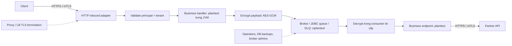
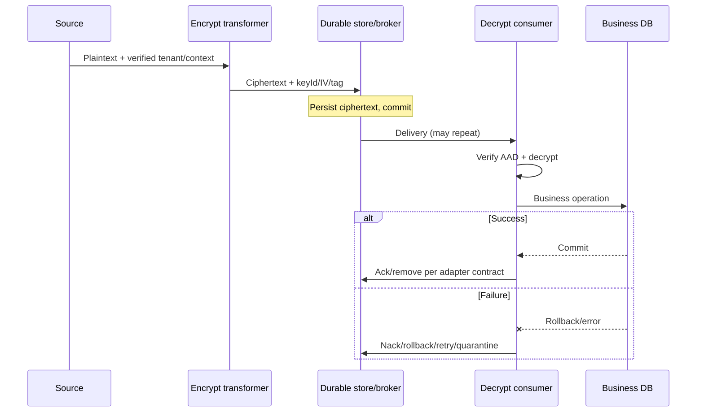

# Payload encryption và TLS ở adapter boundary trong Spring Integration

## 1. Vì sao phải bảo vệ payload và đường truyền riêng biệt?

Một `IntegrationFlow` có thể nhận thông tin qua HTTP, xử lý trên `DirectChannel`, gửi tới `QueueChannel`, lưu ở `JdbcChannelMessageStore`, rồi chuyển sang một outbound adapter HTTP/AMQP/TCP. Mỗi **adapter boundary** là điểm dữ liệu đi vào hoặc ra khỏi JVM/process/trust zone. Nếu payload chứa dữ liệu khách hàng, credential, lệnh thanh toán hay thông tin nội bộ, ta phải trả lời hai câu hỏi **khác nhau**:

1. **Dữ liệu có được bảo vệ khi truyền trên mạng không?** → TLS (hoặc SSH đối với SFTP), xác thực endpoint, chứng chỉ/host key và bảo vệ connection.
2. **Dữ liệu có còn bí mật khi đi qua broker, database, DLQ, file, log hoặc hạ tầng trung gian không?** → mã hóa payload ở **application/message layer**, quản lý khóa và phân quyền dữ liệu.

Trong chương **Bảo mật runtime** của module `SPRING_INTEGRATION_RUNTIME`, bài **Payload encryption và TLS ở adapter boundary** nghiên cứu cách áp dụng hai lớp bảo vệ trong môi trường Spring Integration thực tế: channel, endpoint, consumer, poller, executor, vòng đời `IntegrationFlow`, transaction, retry, message store, error và correlation.

**Mục tiêu học tập:**

- Phân biệt TLS/mTLS, mã hóa payload, mã hóa đĩa lưu trữ và chữ ký/MAC.
- Xác định vị trí mã hóa/giải mã trên message flow và những metadata cần bảo vệ.
- Cấu hình TLS cho HTTP server/outbound REST, TCP adapter; hiểu FTPS so với SFTP và broker-specific TLS.
- Triển khai AES-GCM với nonce/IV không lặp, authentication tag, AAD, version, key ID và key rotation.
- Xác định ranh giới transaction/retry/thread không làm rò plaintext hoặc đánh mất khả năng replay.
- Kiểm thử certificate validation, tampering, sai tenant, key rotation, restart và các đường DLQ/log.

> **Ngữ cảnh minh họa:** Java 17, Spring Boot 3.5.x với Spring Integration 6.5.x phù hợp dependency management. Đường dẫn API và cấu hình có thể khác ở Spring Boot 4 hoặc Spring Integration 7.x. Khóa/chứng chỉ trong ví dụ chỉ là **đường dẫn hoặc reference**, không chứa private key thực.

## 2. Threat model: bảo vệ cái gì khỏi ai?

### 2.1. Vẽ ranh giới tin cậy trước khi viết Java DSL



Hãy xác định **đối tượng cần bảo vệ**:

| Tài sản | Nơi xuất hiện | Rủi ro |
|---|---|---|
| Payload rõ (plaintext) | Handler, converter, debug log, heap, error flow | Insider hoặc lỗi logging làm lộ dữ liệu. |
| Ciphertext | Broker, JDBC store, DLQ, file, backup | Có thể bị sao chép/replay/tamper dù nội dung đã mã hóa. |
| Message headers | Tenant ID, request ID, reply channel, route, auth context | Rò metadata hoặc giả mạo routing, vượt ranh giới tenant. |
| Key material | KMS, Vault, HSM, keystore hoặc memory process | Nếu key lộ, dữ liệu lưu có thể bị giải mã. |
| TLS credential | Certificate, private key, trust roots | MITM khi bỏ host verification; lộ private key khi quản lý kém. |
| Business state | DB result, idempotency marker, transaction outbox | Encryption không ngăn xử lý trùng hoặc sai nghiệp vụ. |

Một thiết kế an toàn không chỉ bảo vệ đường HTTP ingress. Nó còn phải xét hop từ proxy tới application, từ application tới broker, từ retry/DLQ tới operator và từ JVM tới downstream.

### 2.2. TLS, payload encryption và disk encryption không thay thế nhau

| Cơ chế | Bảo vệ chủ yếu | Không tự bảo vệ |
|---|---|---|
| **TLS** | Kênh truyền giữa **hai điểm kết thúc TLS**; xác thực server, bí mật/toàn vẹn khi truyền | Dữ liệu sau TLS termination, queue/database và người có quyền trên endpoint. |
| **mTLS** | TLS cộng xác thực **cả client lẫn server** bằng chứng chỉ | Phân quyền nghiệp vụ theo tenant, mã hóa message khi đã lưu. |
| **AES-GCM payload encryption** | Nội dung payload khi đi qua nhiều hop, đồng thời phát hiện sửa ciphertext/AAD | Key bị đánh cắp, metadata không đưa vào AAD, plaintext trên endpoint được phép giải mã. |
| **Database/broker encryption at rest** | Đĩa, volume, backup tùy cấu hình storage | DBA/service có quyền đọc plaintext qua API/storage. |
| **Application signature/MAC** | Xác thực và toàn vẹn thông điệp | Giữ bí mật nội dung nếu không kết hợp mã hóa. |
| **Authorization** | Chỉ người/service hợp lệ được truy cập action/data | Không thay thế mã hóa và TLS. |

**Quy tắc:** TLS là điều kiện cần cho network hop, nhưng không phải end-to-end payload protection khi có proxy/broker/storage trung gian. Mã hóa payload bảo vệ dữ liệu ở những nơi ciphertext tồn tại, nhưng **không** thay thế TLS cho metadata, xác thực peer và ngăn man-in-the-middle.

## 3. Xác định điểm mã hóa và điểm giải mã

Ba cách đặt crypto transformer:

### 3.1. Mã hóa ngay trước outbound boundary

```text
Plaintext business processing
    -> encrypt transformer
    -> outbound adapter (HTTPS / AMQPS / TLS TCP)
    -> remote receiver
```

Phù hợp khi các bước nội bộ cần đọc payload rõ và downstream hỗ trợ nhận ciphertext. Mã hóa gần đích giúp giảm các thành phần phải làm việc với encrypted format, nhưng plaintext vẫn tồn tại ở các channel/store **trước** transformer.

### 3.2. Mã hóa trước khi persist vào message store

```text
Inbound adapter -> auth/validate -> encrypt -> persistent QueueChannel
                                             -> consumer -> decrypt -> business
```

Phù hợp khi database/broker/DLQ/backups không được phép thấy dữ liệu rõ. Bảo đảm converter/serializer của store chỉ nhận **ciphertext bytes**, không vô tình serialize cả object plaintext vào một header khác.

### 3.3. Mã hóa từ producer tới consumer cuối (end-to-end)

```text
Producer encrypts -> TLS hop -> broker -> TLS hop -> trusted consumer decrypts
                        ciphertext ở mọi hop trung gian
```

Phù hợp khi broker và transport intermediaries được xem là **không được phép đọc** dữ liệu. Yêu cầu hai đầu thống nhất schema envelope, key IDs, replay/idempotency và policy decrypt. Bất kỳ intermediate router nào cần inspect plaintext sẽ không còn làm được, trừ khi thiết kế tách metadata có kiểm soát.

### 3.4. Header nào cần mã hóa?

Payload trong `Message<?>` **không phải tất cả dữ liệu** của message. Headers có thể chứa:

- `tenantId`, `correlationId`, `replyChannel`, file paths, resource URI, request ID.
- Authentication/token nếu ứng dụng lạm dụng headers.
- Custom business fields, routing keys hoặc PII.

Nếu chỉ mã hóa payload, headers thường **vẫn lộ** trong broker, metrics/log hoặc message store, tùy serializer/adapter. Chỉ giữ các routing headers thật cần thiết; không đặt token/password vào header. Những trường phải để ngoài ciphertext nhưng phải chống bị sửa có thể đưa vào **AAD (Additional Authenticated Data)**; AAD xác thực dữ liệu, **không mã hóa** dữ liệu đó.

## 4. Chọn AES-GCM thay vì "tự chế" encryption

AES-GCM là thuật toán **Authenticated Encryption with Associated Data (AEAD)**. Với mỗi lần encrypt, nó tạo:

- Ciphertext: dữ liệu đã mã hóa.
- Authentication tag: phát hiện ciphertext/AAD bị thay đổi (thường 128 bit).
- Nonce/IV: giá trị duy nhất cho **mỗi lần encrypt với cùng một key**; thường dùng 12 byte cho GCM.
- AAD: metadata được xác thực nhưng không bí mật, ví dụ tenant, business ID, schema version, key ID.

### 4.1. Những điều tuyệt đối phải tránh

- **Không tái sử dụng cùng key + IV** cho AES-GCM: có thể phá nghiêm trọng tính bí mật/toàn vẹn.
- Không dùng ECB, static IV, cipher mode không có xác thực, hoặc chỉ AES-CBC không MAC.
- Không đưa password hoặc raw AES key vào Java source, YAML trong Git, debug log hay DLQ.
- Không dùng ciphertext bytes làm bằng chứng message đã được xử lý: encryption không giải quyết replay/idempotency.
- Không giải mã theo key ID đến từ untrusted header mà không kiểm tra tenant/key authorization.
- Không log exception kèm raw plaintext/ciphertext hoặc `Message<?>` đầy đủ.
- Không "cứ lỗi decrypt thì thử mọi key" không giới hạn, làm rò policy và gây tải lên KMS.

### 4.2. Định dạng envelope nên có version

Một encrypted payload đủ thông tin để replay sau restart nên có:

```text
formatVersion = 1
keyId         = key reference công khai, không phải secret
nonce         = 12 bytes, random cho mỗi lần encrypt
ciphertext    = encrypted payload || authentication tag
```

Các metadata `tenantId`, `businessId`, `schemaVersion` dùng làm AAD phải có **cùng giá trị ở phía decrypt**. Nếu chúng bị thay đổi, decrypt phải fail closed. Metadata riêng như một chuỗi `keyId` có thể lộ key naming convention; tránh nhúng tenant secrets vào key ID.

**Encoding:** dùng framing nhị phân có version, hoặc một JSON/CBOR envelope với Base64 cho bytes. Không nên persist Java serialization của `SecretKey`, `Cipher` hay một class không có migration policy.

## 5. Thực hành Java: AES-256-GCM với envelope, AAD và KeyResolver

Ví dụ tiếp theo dùng JCA chuẩn, độc lập với Spring Integration. Mỗi encrypt tạo một `Cipher` mới vì `Cipher` **không thread-safe**, phù hợp consumer/poller đồng thời.

### 5.1. Contract khóa từ KMS/Vault/HSM

```java
import javax.crypto.SecretKey;

public interface KeyResolver {
    // Encryption key hiện hành được cấp theo tenant & key reference.
    SecretKey encryptionKey(String tenantId, String keyId);

    // Key cũ vẫn phải đọc được trong rotation/grace period.
    SecretKey decryptionKey(String tenantId, String keyId);
}
```

Trong production, implement `KeyResolver` bằng KMS/HSM/Vault hoặc service quản lý secret có scope theo tenant. Interface **không** có phương thức cung cấp plaintext key ra log. Khi dùng KMS envelope encryption, ứng dụng thường mã hóa dữ liệu bằng một **data-encryption key (DEK)** rồi lưu DEK đã được KMS wrap cùng envelope; code minh họa dưới đây nhận `SecretKey` trực tiếp và **không triển khai** quy trình wrap DEK/KMS API.

### 5.2. Service JCA có framing byte[] tự chứa

Mã nguồn dưới đây minh họa một frame có:

```text
[version:1][keyIdLength:2][keyId UTF-8][IV:12][ciphertext + GCM tag]
```

Kích thước/key ID được validate trước khi cấp phát hoặc decrypt. AAD được mã hóa bằng **length-prefix**, tránh nhập nhằng chuỗi có dấu phân cách.

```java
import java.nio.ByteBuffer;
import java.nio.charset.StandardCharsets;
import java.security.GeneralSecurityException;
import java.security.SecureRandom;
import java.util.Objects;

import javax.crypto.Cipher;
import javax.crypto.SecretKey;
import javax.crypto.spec.GCMParameterSpec;

public final class GcmPayloadCrypto {

    private static final int VERSION = 1;
    private static final int IV_BYTES = 12;       // 96-bit nonce
    private static final int TAG_BITS = 128;      // 16-byte auth tag
    private static final int TAG_BYTES = 16;
    private static final int MAX_KEY_ID_BYTES = 128;
    private static final int MAX_CONTEXT_BYTES = 1_024;
    private static final int MAX_FRAME_BYTES = 10 * 1024 * 1024;

    private final SecureRandom secureRandom = new SecureRandom();
    private final KeyResolver keys;

    public GcmPayloadCrypto(KeyResolver keys) {
        this.keys = Objects.requireNonNull(keys);
    }

    public byte[] seal(byte[] plaintext,
                       String tenantId, String businessId,
                       String schemaVersion, String keyId)
            throws GeneralSecurityException {
        Objects.requireNonNull(plaintext);
        validateContext(tenantId, businessId, schemaVersion, keyId);

        byte[] keyName = keyId.getBytes(StandardCharsets.UTF_8);
        if (keyName.length == 0 || keyName.length > MAX_KEY_ID_BYTES) {
            throw new IllegalArgumentException("Invalid key ID size");
        }

        int overhead = 1 + Short.BYTES + keyName.length
                + IV_BYTES + TAG_BYTES;
        if (plaintext.length > MAX_FRAME_BYTES - overhead) {
            throw new IllegalArgumentException("Plaintext too large");
        }

        byte[] nonce = new byte[IV_BYTES];
        secureRandom.nextBytes(nonce); // MỚI cho từng lần mã hóa.

        SecretKey key = Objects.requireNonNull(
                keys.encryptionKey(tenantId, keyId), "Unknown key");

        Cipher cipher = Cipher.getInstance("AES/GCM/NoPadding");
        cipher.init(Cipher.ENCRYPT_MODE, key,
                new GCMParameterSpec(TAG_BITS, nonce));
        cipher.updateAAD(aad(
                tenantId, businessId, schemaVersion, keyId));
        byte[] encrypted = cipher.doFinal(plaintext); // Kèm GCM tag

        int size = 1 + Short.BYTES + keyName.length
                + IV_BYTES + encrypted.length;
        if (size > MAX_FRAME_BYTES) {
            throw new IllegalArgumentException("Encrypted frame too large");
        }

        return ByteBuffer.allocate(size)
                .put((byte) VERSION)
                .putShort((short) keyName.length)
                .put(keyName)
                .put(nonce)
                .put(encrypted)
                .array();
    }

    public byte[] open(byte[] frame,
                       String trustedTenantId, String businessId,
                       String schemaVersion)
            throws GeneralSecurityException {
        Objects.requireNonNull(frame);
        if (frame.length > MAX_FRAME_BYTES
                || frame.length < 1 + Short.BYTES + 1
                        + IV_BYTES + TAG_BYTES) {
            throw new IllegalArgumentException("Invalid frame size");
        }

        ByteBuffer buf = ByteBuffer.wrap(frame);
        int version = Byte.toUnsignedInt(buf.get());
        if (version != VERSION) {
            throw new IllegalArgumentException("Unsupported frame version");
        }

        int keyLen = Short.toUnsignedInt(buf.getShort());
        if (keyLen == 0 || keyLen > MAX_KEY_ID_BYTES
                || buf.remaining() < keyLen + IV_BYTES + TAG_BYTES) {
            throw new IllegalArgumentException("Malformed frame");
        }

        byte[] keyName = new byte[keyLen];
        buf.get(keyName);
        String keyId = new String(keyName, StandardCharsets.UTF_8);

        byte[] nonce = new byte[IV_BYTES];
        buf.get(nonce);
        byte[] encrypted = new byte[buf.remaining()];
        buf.get(encrypted);

        validateContext(trustedTenantId, businessId, schemaVersion, keyId);
        // KeyResolver PHẢI kiểm tra keyId thuộc tenant đã xác thực.
        SecretKey key = Objects.requireNonNull(
                keys.decryptionKey(trustedTenantId, keyId),
                "Key unavailable for tenant");

        Cipher cipher = Cipher.getInstance("AES/GCM/NoPadding");
        cipher.init(Cipher.DECRYPT_MODE, key,
                new GCMParameterSpec(TAG_BITS, nonce));
        cipher.updateAAD(aad(
                trustedTenantId, businessId, schemaVersion, keyId));

        // AEADBadTagException nếu nonce/AAD/ciphertext/key không khớp.
        return cipher.doFinal(encrypted);
    }

    private static void validateContext(
            String tenant, String business, String schema, String keyId) {
        for (String v : new String[]{tenant, business, schema, keyId}) {
            if (v == null || v.isBlank()) {
                throw new IllegalArgumentException(
                        "Crypto context is required");
            }
            if (v.getBytes(StandardCharsets.UTF_8).length
                    > MAX_CONTEXT_BYTES) {
                throw new IllegalArgumentException(
                        "Crypto context field too large");
            }
        }
    }

    private static byte[] aad(String tenant, String business,
                              String schema, String keyId) {
        String[] fields = {"v1", tenant, business, schema, keyId};
        byte[][] values = new byte[fields.length][];
        int length = 0;

        for (int i = 0; i < fields.length; i++) {
            values[i] = fields[i].getBytes(StandardCharsets.UTF_8);
            length += Integer.BYTES + values[i].length;
        }

        ByteBuffer encoded = ByteBuffer.allocate(length);
        for (byte[] value : values) {
            encoded.putInt(value.length);
            encoded.put(value);
        }
        return encoded.array();
    }
}
```

**Điểm an toàn của ví dụ:**

- `GCMParameterSpec(128, nonce)` yêu cầu tag 128 bit và nonce 96 bit.
- Mỗi lần gọi `seal()` tạo IV mới bằng `SecureRandom`, kể cả khi retry cùng event. **Không** đặt IV cố định theo business ID hoặc timestamp.
- `AAD` ràng buộc tenant, business ID, schema version và key ID với ciphertext. Đổi một trường sẽ làm xác thực thất bại.
- `KeyResolver` quyết định tenant nào có quyền truy cập key ID nào. Thay key ID trong envelope không được phép chọn key của tenant khác.
- Frame có version để hỗ trợ migration. Kiểm tra kích thước giúp hạn chế memory abuse.
- `Cipher` được tạo mỗi invocation nên không chia sẻ mutable crypto state giữa poller/executor threads.

**Giới hạn:** Code dành cho payload vừa phải, giữ byte arrays trong RAM và không xóa hoàn toàn dấu vết plaintext khỏi heap của JVM. Với object rất lớn, cần giới hạn kích thước, streaming/segmented AEAD được thiết kế đúng chuẩn, và tham khảo thư viện đã được review. Code không thay thế KMS/key rotation policy, signature nguồn gửi hoặc authorization.

### 5.3. Trách nhiệm phía ingress

Phía decrypt không được lấy `tenantId` chỉ từ một header khách hàng có thể tự ghi rồi coi đó là quyền giải mã. Tính toàn vẹn của AAD **không tự chứng minh** người gửi có quyền đối với tenant đó. Danh tính và tenant scope phải được xác thực từ HTTP principal, broker ACL/destination đáng tin hoặc identity mapping đã được kiểm soát.

## 6. Đưa crypto transformer vào IntegrationFlow

Spring Integration có interface `org.springframework.integration.transformer.Transformer` với method `transform(Message<?>)`. Ta có thể tạo transformer để thay payload bằng **ciphertext byte[]**, giữ lại những metadata được cho phép và điều chỉnh content type.

### 6.1. Outbound encryption transformer

```java
import java.security.GeneralSecurityException;

import org.springframework.integration.transformer.Transformer;
import org.springframework.messaging.Message;
import org.springframework.messaging.MessageHeaders;
import org.springframework.messaging.support.MessageBuilder;
import org.springframework.util.MimeTypeUtils;

public final class SealingTransformer implements Transformer {

    private final GcmPayloadCrypto crypto;
    private final String activeKeyId;

    public SealingTransformer(
            GcmPayloadCrypto crypto, String activeKeyId) {
        this.crypto = crypto;
        this.activeKeyId = activeKeyId;
    }

    @Override
    public Message<?> transform(Message<?> message) {
        if (!(message.getPayload() instanceof byte[] plaintext)) {
            throw new IllegalArgumentException(
                    "Expected byte[] plaintext payload");
        }

        String tenant = required(message, "tenantId");
        String event = required(message, "businessId");
        String schema = required(message, "schemaVersion");

        try {
            byte[] sealed = crypto.seal(
                    plaintext, tenant, event, schema, activeKeyId);
            return MessageBuilder.withPayload(sealed)
                    .copyHeaders(message.getHeaders())
                    .setHeader(MessageHeaders.CONTENT_TYPE,
                            MimeTypeUtils.APPLICATION_OCTET_STREAM)
                    .setHeader("cryptoFormat", "AES-GCM-v1")
                    .build();
        }
        catch (GeneralSecurityException e) {
            throw new IllegalStateException(
                    "Payload encryption failed", e);
        }
    }

    private static String required(Message<?> m, String name) {
        String value = m.getHeaders().get(name, String.class);
        if (value == null || value.isBlank()) {
            throw new IllegalArgumentException(
                    "Missing trusted crypto context: " + name);
        }
        return value;
    }
}
```

Ví dụ chỉ copy headers sẵn có để tiện theo dõi flow. **Production phải dùng allowlist headers** trước khi đẩy qua một trust boundary: không copy toàn bộ `replyChannel`, authentication, token, filesystem path hoặc PII ra broker/external adapter. Content type mới là binary ciphertext, không còn JSON plaintext.

### 6.2. Inbound decryption transformer

```java
import java.security.GeneralSecurityException;

import org.springframework.integration.transformer.Transformer;
import org.springframework.messaging.Message;
import org.springframework.messaging.MessageHeaders;
import org.springframework.messaging.support.MessageBuilder;

public final class OpeningTransformer implements Transformer {

    private final GcmPayloadCrypto crypto;

    public OpeningTransformer(GcmPayloadCrypto crypto) {
        this.crypto = crypto;
    }

    @Override
    public Message<?> transform(Message<?> message) {
        if (!(message.getPayload() instanceof byte[] ciphertext)) {
            throw new IllegalArgumentException(
                    "Expected byte[] encrypted frame");
        }

        // Các header này phải được xác minh ở ingress/auth boundary.
        String tenant = required(message, "tenantId");
        String event = required(message, "businessId");
        String schema = required(message, "schemaVersion");

        try {
            byte[] clear = crypto.open(
                    ciphertext, tenant, event, schema);
            return MessageBuilder.withPayload(clear)
                    .copyHeaders(message.getHeaders())
                    .setHeader(MessageHeaders.CONTENT_TYPE,
                            "application/json")
                    .build();
        }
        catch (GeneralSecurityException e) {
            // Không in payload/key/nonce hoặc full Message.
            throw new IllegalStateException(
                    "Payload decryption/authentication failed", e);
        }
    }

    private static String required(Message<?> m, String name) {
        String value = m.getHeaders().get(name, String.class);
        if (value == null || value.isBlank()) {
            throw new IllegalArgumentException(
                    "Missing verified context: " + name);
        }
        return value;
    }
}
```

Với payload có schema khác JSON, content type sau decrypt phải lấy từ **schema metadata đã xác thực/policy**, không cố định theo ví dụ. Không xem giải mã thành công là dữ liệu an toàn để deserialize: vẫn cần validate schema, kích thước, field values và authorization.

### 6.3. Hai flow tại boundary

```java
import org.springframework.context.annotation.Bean;
import org.springframework.context.annotation.Configuration;
import org.springframework.integration.dsl.IntegrationFlow;

@Configuration
public class CryptoBoundaryFlows {

    @Bean
    IntegrationFlow outboundEncrypted(SealingTransformer sealing) {
        return IntegrationFlow.from("orders.plain.out")
                .transform(sealing)
                .channel("partner.encrypted.out")
                .get();
    }

    @Bean
    IntegrationFlow inboundDecrypted(OpeningTransformer opening) {
        return IntegrationFlow.from("partner.encrypted.in")
                .transform(opening)
                .channel("orders.decrypted")
                .get();
    }
}
```

Một adapter thật sẽ tiêu thụ `partner.encrypted.out`, gửi bytes qua HTTPS/AMQPS/TCP TLS; một inbound adapter khác đẩy ciphertext vào `partner.encrypted.in`. **Hai flow trên chưa tự gửi network traffic**, chưa làm authentication hoặc tự tạo KMS key. Hãy đặt endpoint trên đúng channel và kiểm tra `QueueChannel`/consumer/transaction nếu muốn lưu và xử lý bất đồng bộ.

### 6.4. Thứ tự operations ảnh hưởng bảo mật

| Trình tự | Hệ quả |
|---|---|
| Validate identity → authorize tenant → encrypt → persist/route | Preferred khi store/broker không được phép đọc plaintext. |
| Persist plaintext → encrypt ở outbound adapter | DB/backup trước transformer vẫn giữ plaintext. |
| Decrypt → log full message → handler | Log có thể lộ plaintext dù TLS và crypto đúng. |
| Encrypt → compress | Ciphertext thường khó nén; thường không có hiệu quả. |
| Compress dữ liệu không tin cậy cùng secret → encrypt | Có thể tạo side channel theo kích thước; cần đánh giá protocol/threat model. |
| Decrypt → deserialize không giới hạn | Rủi ro resource exhaustion và deserialization attacks; validate size/schema. |

## 7. TLS cho HTTP inbound adapter bằng Spring Boot SSL bundle

Spring Integration HTTP inbound gateway/adapter chạy **trên HTTP server của ứng dụng** (Servlet hoặc WebFlux theo stack). TLS thường được cấu hình ở **web server / load balancer / ingress**, không phải bằng cách gọi `.encrypt()` trên `IntegrationFlow`.

### 7.1. HTTPS server với PEM certificates

Ví dụ Boot 3.5 dùng SSL bundle cho TLS server:

```yaml
spring:
  ssl:
    bundle:
      pem:
        inbound-api:
          keystore:
            certificate: "file:/etc/tls/server.crt"
            private-key: "file:/etc/tls/server.key"

server:
  port: 8443
  ssl:
    bundle: inbound-api
```

Đây là **đường dẫn file mount secret** — không đưa private key thật vào bài hoặc Git. Cần giới hạn quyền đọc file, phân quyền cấp/rotation chứng chỉ và tắt HTTP plaintext listener khi chính sách yêu cầu HTTPS-only.

### 7.2. mTLS cho inbound API

Để yêu cầu client certificate, bundle cần trust roots phù hợp:

```yaml
spring:
  ssl:
    bundle:
      pem:
        inbound-mtls:
          keystore:
            certificate: "file:/etc/tls/server.crt"
            private-key: "file:/etc/tls/server.key"
          truststore:
            certificate: "file:/etc/tls/client-ca.crt"

server:
  port: 8443
  ssl:
    bundle: inbound-mtls
    client-auth: need
```

**mTLS là xác thực ở transport layer.** Nó chỉ chứng minh client sở hữu private key tương ứng với chứng chỉ được trust. Ánh xạ certificate identity tới service/tenant/role vẫn cần security policy; không tự cho mọi client certificate quyền đọc dữ liệu của mọi tenant.

Nếu TLS kết thúc tại proxy, cấu hình mTLS ở **proxy** và đảm bảo đường proxy→app không cho client giả mạo những headers danh tính; lý tưởng dùng mTLS trên hop nội bộ hoặc cơ chế identity forwarding đáng tin. Đừng tin `X-Forwarded-Client-Cert` do Internet client tự gửi.

## 8. TLS cho outbound HTTP adapter: SSL bundle ở HTTP client

Nếu một Spring Integration handler gọi API đối tác, phần bảo vệ TLS thuộc về `RestClient`, `WebClient` hoặc HTTP client connector underlying; **message channel không tự quyết định truststore**.

### 8.1. Cấu hình truststore + client certificate khi đối tác yêu cầu mTLS

```yaml
spring:
  ssl:
    bundle:
      pem:
        partner-api:
          truststore:
            certificate: "file:/etc/tls/partner-ca.crt"
          keystore:
            certificate: "file:/etc/tls/partner-client.crt"
            private-key: "file:/etc/tls/partner-client.key"
```

Với outbound TLS thông thường không yêu cầu client cert, có thể bỏ phần `keystore` và chỉ cấu hình truststore/CA đáng tin.

### 8.2. RestClientSsl (Spring Boot 3.5)

```java
import org.springframework.boot.autoconfigure.web.client.RestClientSsl;
import org.springframework.context.annotation.Bean;
import org.springframework.context.annotation.Configuration;
import org.springframework.web.client.RestClient;

@Configuration
class PartnerClientConfig {

    @Bean
    RestClient partnerClient(RestClient.Builder builder,
                             RestClientSsl ssl) {
        return builder
                .baseUrl("https://api.partner.example")
                .apply(ssl.fromBundle("partner-api"))
                .build();
    }
}
```

Từ service activator một chiều, chỉ gửi **ciphertext byte[]** tới partner nếu hợp đồng phía nhận cho phép:

```java
import org.springframework.http.MediaType;
import org.springframework.integration.annotation.ServiceActivator;
import org.springframework.stereotype.Component;
import org.springframework.web.client.RestClient;

@Component
class EncryptedPartnerSender {
    private final RestClient client;

    EncryptedPartnerSender(RestClient client) {
        this.client = client;
    }

    @ServiceActivator(inputChannel = "partner.encrypted.out")
    public void send(byte[] sealedFrame) {
        client.post()
                .uri("/events")
                .contentType(MediaType.APPLICATION_OCTET_STREAM)
                .body(sealedFrame)
                .retrieve()
                .toBodilessEntity();
    }
}
```

Ví dụ method return `void` và không tạo reply. Nếu dùng outbound gateway request–reply, định nghĩa rõ reply type, timeout, idempotency và error channel. **TLS handshake thành công không chứng minh partner xử lý message thành công**; 202 Accepted hay network timeout vẫn cần giải thích theo HTTP/business contract.

**Lưu ý của Boot:** `RestClientSsl.fromBundle(...)` có thể thay request factory đang cấu hình; nếu cần pooling/timeouts/proxy cấu hình thêm, hãy dùng factory builder phù hợp và xác minh TLS vẫn áp dụng. Không dùng `TrustManager` chấp nhận mọi certificate hoặc tắt hostname verification để “sửa nhanh” lỗi certificate.

## 9. TCP/IP adapter: TLS tại connection factory

Spring Integration TCP hỗ trợ TLS theo hai hình thức:

- **Blocking socket:** sử dụng `SSLSocketFactory`/`SSLServerSocketFactory`.
- **NIO:** sử dụng `SSLEngine` thông qua `TcpNioConnectionSupport`.

### 9.1. Cấu hình TcpNioClientConnectionFactory

Đoạn này minh họa API Spring Integration 6.5 và truststore/keystore kiểu JKS (phù hợp default `DefaultTcpSSLContextSupport`). Password đi qua environment/secret provider — **không** hard-code trong Java.

```java
import org.springframework.beans.factory.annotation.Value;
import org.springframework.context.annotation.Bean;
import org.springframework.context.annotation.Configuration;
import org.springframework.integration.ip.tcp.connection.DefaultTcpNioSSLConnectionSupport;
import org.springframework.integration.ip.tcp.connection.DefaultTcpSSLContextSupport;
import org.springframework.integration.ip.tcp.connection.TcpNioClientConnectionFactory;

@Configuration
class TcpTlsConfig {

    @Bean
    TcpNioClientConnectionFactory secureTcpFactory(
            @Value("${TLS_KEYSTORE_PASSWORD}") String keyPassword,
            @Value("${TLS_TRUSTSTORE_PASSWORD}") String trustPassword) {

        var ssl = new DefaultTcpSSLContextSupport(
                "file:/etc/tls/tcp-client.jks",
                "file:/etc/tls/trusted-servers.jks",
                keyPassword, trustPassword);

        // true: KHÔNG vô hiệu hóa hostname verification.
        var nioSsl = new DefaultTcpNioSSLConnectionSupport(ssl, true);

        var factory = new TcpNioClientConnectionFactory(
                "tcp.partner.example", 7443);
        factory.setTcpNioConnectionSupport(nioSsl);
        factory.setSslHandshakeTimeout(10);
        return factory;
    }
}
```

**Điểm cần kiểm tra:**

- Truststore chứa CA/certificate đáng tin của server; hostname/SAN trên chứng chỉ phải khớp host thực đang kết nối.
- Không gọi `new DefaultTcpNioSSLConnectionSupport(ssl, false)` hoặc `new DefaultTcpSocketSupport(false)` ở production chỉ để lách hostname verification.
- Nếu TCP protocol cần mTLS, connection factory client phải có keypair/certificate hợp lệ; server phải yêu cầu client authentication.
- Trên NIO, handshake timeout giúp tránh connection chờ quá lâu; không thay business reply timeout.
- Cấu hình serializer/deserializer, frame boundaries, maximum message size và authentication của business protocol độc lập với TLS.

### 9.2. TCP server mTLS

Với NIO server, có thể custom `DefaultTcpNioSSLConnectionSupport` để yêu cầu client certificate thông qua `SSLEngine.setNeedClientAuth(true)` (theo tài liệu *Advanced Techniques*), rồi đưa support vào `TcpNioServerConnectionFactory`.

Quản trị chứng chỉ cần phân biệt:
- **Server identity:** chứng chỉ server + private key và truststore client.
- **Client identity (mTLS):** chứng chỉ client + private key và truststore server.
- **Authorization:** mapping certificate principal tới tenant/permission trong application, không chỉ `needClientAuth=true`.

TLS TCP không giải quyết framing: nếu serializer/decoder nhận một message nhị phân lớn hoặc sai định dạng, vẫn phải validate length và schema trước khi tạo object.

## 10. FTPS dùng TLS; SFTP dùng SSH, không phải TLS

Cả FTPS và SFTP đều chuyển file nhưng **khác giao thức và cơ chế bảo mật**:

| Adapter/protocol | Bảo vệ transport | Điều phải xác minh |
|---|---|---|
| **FTP plain** | Không mã hóa mặc định | Không dùng cho dữ liệu nhạy cảm qua mạng không tin cậy. |
| **FTPS** (FTP over TLS) | TLS cho control connection và data connection khi được cấu hình | Certificate trust/hostname, control + data protection, explicit/implicit mode. |
| **SFTP** (SSH File Transfer Protocol) | SSH transport và server host key | `known_hosts`/host-key verification, user authentication, cipher policy. |
| **HTTPS file upload** | TLS | Certificate validation, authentication/authorization và upload size. |

### 10.1. FTPS SessionFactory

Spring Integration 6.5 có `DefaultFtpsSessionFactory`. Ví dụ **explicit FTPS**, bảo vệ cả data channel:

```java
import org.springframework.integration.ftp.session.DefaultFtpsSessionFactory;

// passwordFromSecretProvider: secret đã được cấp theo policy.
// trustManager: TrustManager dựng từ truststore/CA đáng tin.
DefaultFtpsSessionFactory factory = new DefaultFtpsSessionFactory();
factory.setHost("ftps.partner.example");
factory.setPort(21);
factory.setUsername("service-transfer");
factory.setPassword(passwordFromSecretProvider);
factory.setProtocol("TLS");
factory.setImplicit(false);
factory.setProt("P"); // PRIVATE: bảo vệ data connection.
factory.setTrustManager(trustManager);
```

Đoạn trên minh họa cấu hình factory trong bean/method đã có secret và trust manager. **Không** dùng trust-all manager ở production. Cần kiểm tra client library có xác minh **hostname** trên control/data connections và server có yêu cầu TLS session reuse, passive mode hoặc firewall rule nào không. Nếu đối tác dùng implicit FTPS, port và `setImplicit(true)` phải khớp.

FTP/FTPS có **hai loại connection**: control và data. Chỉ mã hóa control chưa đủ bảo vệ file transfer bytes. `PROT P` cùng cấu hình data channel đúng là yêu cầu quan trọng.

### 10.2. SFTP SessionFactory và known_hosts

SFTP **không dùng TLS certificate/truststore**. Spring Integration `DefaultSftpSessionFactory` sử dụng Apache MINA SSHD với SSH host key:

```java
import org.springframework.core.io.FileSystemResource;
import org.springframework.integration.sftp.session.DefaultSftpSessionFactory;

DefaultSftpSessionFactory sftp = new DefaultSftpSessionFactory();
sftp.setHost("sftp.partner.example");
sftp.setPort(22);
sftp.setUser("service-transfer");
sftp.setPrivateKey(
        new FileSystemResource("/etc/ssh/transfer_id_ed25519"));
sftp.setKnownHostsResource(
        new FileSystemResource("/etc/ssh/known_hosts"));
sftp.setAllowUnknownKeys(false);
```

**Không dùng `setAllowUnknownKeys(true)` trong production** để bỏ qua host key không quen hoặc bị thay đổi. Khi host key đổi hợp lệ, phải xác minh fingerprint qua kênh độc lập trước khi cập nhật `known_hosts`. Với private key có passphrase, lấy passphrase từ secret manager.

### 10.3. File ở local cache không tự được mã hóa

FTPS/SFTP truyền an toàn không có nghĩa file được mã hóa ở local inbox, temporary directory, metadata store hoặc backup. Spring Integration inbound adapters có thể download vào local directory rồi phát `File` payload. Cần OS permissions, volume encryption, retention/cleanup; nếu partner yêu cầu end-to-end encrypted files, mã hóa **nội dung** trước khi upload ngoài transport protection.

## 11. TLS cho RabbitMQ, Kafka và các broker khác

Spring Integration adapter thường **dùng connection factory/client của thư viện protocol**, nên TLS nằm ở đó chứ không phải tại `IntegrationFlow.channel()`.

### 11.1. RabbitMQ / AMQP

Với Spring Boot 3.5, có thể tham chiếu SSL bundle:

```yaml
spring:
  ssl:
    bundle:
      pem:
        rabbit-broker:
          truststore:
            certificate: "file:/etc/tls/rabbit-ca.crt"
  rabbitmq:
    host: rabbit.internal.example
    port: 5671
    ssl:
      enabled: true
      bundle: rabbit-broker
```

Nếu broker yêu cầu **mTLS**, bổ sung certificate/private key client vào bundle và cấu hình broker verify client. Kiểm tra `CachingConnectionFactory` thực sự dùng TLS, server hostname verification và broker permissions theo vhost/queue/exchange. Listener acknowledgment policy vẫn độc lập với TLS.

**RabbitMQ TLS chỉ bảo vệ connection application↔broker.** Broker, queue store, DLQ và backup có thể đọc payload nếu producer không encrypt trước khi publish.

### 11.2. Kafka

Kafka clients sử dụng thuộc tính Kafka Client và `spring-kafka`. Ví dụ truststore cho TLS:

```yaml
spring:
  kafka:
    bootstrap-servers: "kafka.internal.example:9093"
    properties:
      security.protocol: SSL
      ssl.truststore.location: "/etc/tls/kafka-truststore.p12"
      ssl.truststore.type: PKCS12
      ssl.truststore.password: "${KAFKA_TRUSTSTORE_PASSWORD}"
```

Thêm `ssl.keystore.*` nếu broker yêu cầu client certificate. Giữ **endpoint identification/hostname verification** bật; không đặt `ssl.endpoint.identification.algorithm` rỗng để tắt hostname check. Kafka TLS không thay thế SASL/ACL khi cần identity và authorization.

`KafkaMessageDrivenChannelAdapter` chuyển record vào message flow nhưng source offset commit, retry, DLT vẫn cần được thiết kế theo **decrypt + business processing completion**. TLS handshake không có nghĩa record đã xử lý thành công.

### 11.3. JMS, MQTT, SMTP và các protocol khác

Với JMS (Artemis, ActiveMQ, IBM MQ...), TLS phụ thuộc provider-specific `ConnectionFactory`, truststore/certificate và broker configuration. Spring Integration JMS adapter sử dụng connection factory đã cấu hình; nó không tự chọn CA thay bạn.

MQTT, SMTP STARTTLS, WebSocket hoặc LDAP(S) cũng có transport security ở client/server library. SMTP STARTTLS phải yêu cầu upgrade **bắt buộc** nếu chính sách đòi encryption; cấu hình "dùng nếu có" có nguy cơ downgrade trong mạng không tin cậy.

## 12. Bảo vệ channel và security context ở runtime

TLS và payload encryption không thay thế authentication/authorization. Một inbound request HTTPS hợp lệ có thể được gửi qua `ExecutorChannel` và xử lý ở thread khác, nơi security context không còn mặc định.

### 12.1. Spring Integration 6.5 dùng spring-security-messaging

Từ Spring Integration 6.3, module `spring-integration-security` bị loại bỏ; API channel authorization chuyển sang `spring-security-messaging`.

Ví dụ kiểm soát channel theo pattern:

```java
import org.springframework.context.annotation.Bean;
import org.springframework.integration.config.GlobalChannelInterceptor;
import org.springframework.security.authorization.AuthorityAuthorizationManager;
import org.springframework.security.messaging.access.intercept.AuthorizationChannelInterceptor;

@Bean
@GlobalChannelInterceptor(patterns = "secured*")
AuthorizationChannelInterceptor securedChannels() {
    return new AuthorizationChannelInterceptor(
            AuthorityAuthorizationManager.hasRole("INTEGRATION"));
}
```

Ví dụ này minh họa **authorization**, không mã hóa message. Quyền `ROLE_INTEGRATION` chung chưa đủ ngăn cross-tenant access; phải kiểm tra tenant identity, resource scope và trust boundary ở ingress/handler.

### 12.2. SecurityContext khi chuyển thread

- `DirectChannel` thường chạy cùng thread, nên thread-bound `SecurityContext` còn truy cập được.
- `ExecutorChannel`, `QueueChannel` hoặc `PublishSubscribeChannel` chạy async có thể làm mất `SecurityContextHolder`.
- Spring Security cung cấp `SecurityContextPropagationChannelInterceptor` để propagate context qua message/channel theo framework semantics.
- Không chỉ copy header `Authentication` do một producer chưa tin cậy tự gửi rồi coi là principal có quyền.

Khi decrypt, xác minh tenant ID từ identity đáng tin. **AAD giúp chống sửa metadata đã xác thực; nó không tự cấp quyền business**.

## 13. Transaction, retry và message store sau encryption

Một flow mã hóa đúng vẫn có thể xử lý trùng, mất message hoặc không replay được:



### 13.1. Encrypt không phải một transaction

`Cipher.doFinal()` chỉ tính toán trong RAM; không commit/rollback cùng database. Nếu source redeliver, cùng event có thể được encrypt lần hai với **IV khác**, tạo ciphertext khác. Điều này đúng: dùng **business ID/idempotency key** để nhận diện cùng event, không dùng ciphertext hash.

Nếu business DB đã commit nhưng broker ack/reply lỗi, source có thể redeliver encrypted message. Handler sau decrypt cần idempotency; payload encryption và TLS không bảo đảm exactly-once.

### 13.2. Key rotation ảnh hưởng khả năng replay sau restart

Nếu ciphertext được lưu trong queue một tháng nhưng key bị xóa sau một ngày, consumer mới khởi động sẽ không decrypt được backlog/DLQ/backup. Rotation an toàn:

1. Tạo key version mới ở KMS/Vault/HSM.
2. Bắt đầu encrypt bằng key mới; vẫn **cho phép decrypt với key cũ** trong grace window.
3. Đếm record, message store, DLQ và backup còn tham chiếu key cũ.
4. Re-encrypt khi cần bằng **nonce mới**, lưu envelope/key ID mới.
5. Chỉ retire/destroy key cũ khi chắc không còn ciphertext phải replay theo chính sách retention.
6. Audit rotation, không log key bytes hay payload rõ.

**TLS certificate rotation khác AES key rotation**: hai loại credential có thời hạn/owner và quy trình compatibility khác nhau.

### 13.3. Phân loại lỗi decrypt

| Lỗi | Cách hiểu | Hướng xử lý |
|---|---|---|
| `AEADBadTagException` | Ciphertext/AAD/key/nonce không khớp hoặc bị sửa | Fail closed; quarantine ciphertext, không retry vô hạn. |
| Unknown key ID | Key mismatch, key retired hoặc dữ liệu giả | Kiểm tra tenant scope/key catalog; không thử mọi key. |
| KMS/Vault timeout | Hạ tầng có thể tạm thời lỗi | Bounded retry/backoff hoặc pause khi outage diện rộng. |
| Unsupported envelope version | Schema version chưa tương thích | Compatibility reader/migration, giữ dữ liệu. |
| Frame malformed/oversized | Dữ liệu sai hoặc tấn công | Reject/quarantine theo size policy trước deserialize. |
| Decrypt OK, business rule fail | Poison message nghiệp vụ | Áp dụng retry/DLQ policy của nghiệp vụ. |

Một `ErrorMessage` được gửi tới `errorChannel` rồi chỉ log/return **không chứng minh** broker/JDBC queue sẽ rollback. Source ack/commit phụ thuộc adapter và ranh giới transaction/error propagation.

### 13.4. Quarantine không nên tự tạo bản rõ

Một recovery record đủ dùng thường giữ encrypted frame (hoặc reference), trusted source/tenant mapping, business ID, schema version, key ID, mã lỗi, timestamp và attempts. Tránh ghi lại plaintext đã decrypt vào DLQ chỉ để tiện debug. Khi cần điều tra, decrypt qua công cụ có phân quyền, ghi audit và giữ retention ngắn.

## 14. TLS cert, secret rotation và lifecycle IntegrationFlow

### 14.1. Reload certificate không mặc nhiên xảy ra

Đổi file keystore/truststore trên disk **không bảo đảm** mọi connection hiện hữu dùng credential mới. Tùy client/server library:

1. Kiểm tra SSL bundle/connector có hỗ trợ reload cho connection type đó không.
2. Khởi tạo SSL context mới, recycle connection pool hoặc recreate connection factory theo tài liệu.
3. Stop/drain source trước khi đóng connection để không mất message đang in-flight.
4. Start lại endpoint có quản lý và thực hiện handshake kiểm tra certificate mới.
5. Giữ overlap trust roots khi rolling rotation; theo dõi expiry và xác thực identity.
6. Đo lỗi handshake/reconnect, poller lag và retry trong rollout.

**Không giả định** gọi `IntegrationFlowContext.stop()/start()` tự reload mọi secret hoặc keystore. SSL resources, connection factories và flow registrations có thể có ownership/lifecycle khác nhau.

### 14.2. Resource ownership theo tenant

Một `RestClient`/connection factory hoặc `SslBundle` có thể được nhiều tenant dùng chung. Khi destroy dynamic tenant flow, chỉ cleanup các bean do flow sở hữu; không đóng shared TLS pool làm tenant khác mất kết nối.

Key selection của AES-GCM phải dùng tenant đã xác thực; không dùng biến singleton mutable `currentTenant` có thể bị thay trong lúc concurrent requests đang chạy.

### 14.3. Bảo vệ secrets

- Dùng mounted secret/secret manager hoặc KMS/HSM; **không** nhúng PEM private key, password hay raw AES key vào source, Git, Docker image.
- Hạn chế OS permissions, container service account và quyền dùng encrypt/decrypt/unwrap theo tenant.
- Tránh log toàn bộ YAML, headers, `Message<?>` hoặc exception chứa credential.
- Đặt hạn mức KMS latency/concurrency; cache key material theo threat model, không vô hạn.
- Alert certificate expiry và chuẩn bị kế hoạch roll back/trust overlap có kiểm soát.

## 15. Quan sát lỗi bảo mật mà không lộ dữ liệu

Một sự kiện log nên nói **boundary nào**, **loại lỗi gì**, **correlation nào** — không được tự động dump payload và credential:

```text
event=TLS_HANDSHAKE_FAILED
component=partnerTcpConnectionFactory
destination=tcp.partner.example:7443
instanceId=worker-02
reasonCode=HOSTNAME_MISMATCH
traceId=req-456
```

```text
event=DECRYPT_FAILED
component=orders.decrypt
envelopeVersion=1
keyId=k2026-11
businessId=evt-456
reasonCode=AEAD_TAG_INVALID
attempt=1
traceId=req-456
```

Đây là **các trường log do ứng dụng đề xuất**, không phải log mặc định của Spring Integration. Chỉ ghi key ID nếu naming convention không tiết lộ thông tin nhạy cảm; **không** log secret, raw ciphertext, raw plaintext, JWT, private key hoặc toàn bộ `Message<?>`.

| Metric | Tác dụng |
|---|---|
| TLS handshake failures theo adapter/errorCode | Phân biệt trust, hostname, expiry, mTLS lỗi. |
| Certificate expiry horizon | Chủ động rotate trước hạn. |
| Decrypt/authentication failure count | Phát hiện schema, key hoặc tampering bất thường. |
| Envelope version distribution | Biết backlog còn phiên bản cũ. |
| KMS latency/errors | Xác định bottleneck hoặc outage tại key service. |
| Queue/DLQ oldest age theo key version | Quyết định retention của old decryption key. |
| Endpoint reconnect/start/stop | Giám sát certificate rollout. |
| Business retry/duplicate count | Tách transport/crypto error khỏi redelivery. |

Không đưa ciphertext, request ID cá biệt hoặc payload vào metric label có cardinality không giới hạn. Với JDK, `javax.net.debug=ssl,handshake` có thể giúp debug nhưng tạo log rất lớn, lộ nhiều chi tiết kết nối và overhead; chỉ bật tạm thời dưới quyền truy cập/log retention kiểm soát, không xuất session secrets.

## 16. Kiểm thử AES-GCM độc lập với Spring Integration

Dùng JUnit 5 với `GcmPayloadCrypto` ở mục 5. Chỉ tạo **AES key ngẫu nhiên dành cho test**, không dùng key production hay hard-code secret trong source.

### 16.1. Round-trip, tampering và sai AAD

```java
import static org.junit.jupiter.api.Assertions.*;

import java.nio.charset.StandardCharsets;
import javax.crypto.AEADBadTagException;
import javax.crypto.KeyGenerator;
import javax.crypto.SecretKey;

import org.junit.jupiter.api.BeforeEach;
import org.junit.jupiter.api.Test;

class GcmPayloadCryptoTest {

    private GcmPayloadCrypto crypto;

    @BeforeEach
    void setup() throws Exception {
        KeyGenerator generator = KeyGenerator.getInstance("AES");
        generator.init(256);
        SecretKey key = generator.generateKey();

        KeyResolver resolver = new KeyResolver() {
            @Override
            public SecretKey encryptionKey(String tenant, String keyId) {
                check(tenant, keyId);
                return key;
            }

            @Override
            public SecretKey decryptionKey(String tenant, String keyId) {
                check(tenant, keyId);
                return key;
            }

            private void check(String tenant, String keyId) {
                if (!"tenant-a".equals(tenant)
                        || !"test-k1".equals(keyId)) {
                    throw new IllegalArgumentException(
                            "Tenant/key not authorized");
                }
            }
        };

        crypto = new GcmPayloadCrypto(resolver);
    }

    @Test
    void roundTrip() throws Exception {
        byte[] clear = "{\"total\":123}".getBytes(
                StandardCharsets.UTF_8);

        byte[] frame = crypto.seal(clear,
                "tenant-a", "event-1", "order-v1", "test-k1");

        assertArrayEquals(clear, crypto.open(frame,
                "tenant-a", "event-1", "order-v1"));
        assertFalse(java.util.Arrays.equals(clear, frame));
    }

    @Test
    void rejectsCiphertextTampering() throws Exception {
        byte[] frame = crypto.seal("hello".getBytes(
                StandardCharsets.UTF_8),
                "tenant-a", "event-1", "order-v1", "test-k1");

        frame[frame.length - 1] ^= 1;

        assertThrows(AEADBadTagException.class,
                () -> crypto.open(frame,
                        "tenant-a", "event-1", "order-v1"));
    }

    @Test
    void rejectsChangedAad() throws Exception {
        byte[] frame = crypto.seal("hello".getBytes(
                StandardCharsets.UTF_8),
                "tenant-a", "event-1", "order-v1", "test-k1");

        assertThrows(AEADBadTagException.class,
                () -> crypto.open(frame,
                        "tenant-a", "event-OTHER", "order-v1"));
    }

    @Test
    void refusesAnotherTenantsKey() throws Exception {
        byte[] frame = crypto.seal("hello".getBytes(
                StandardCharsets.UTF_8),
                "tenant-a", "event-1", "order-v1", "test-k1");

        assertThrows(IllegalArgumentException.class,
                () -> crypto.open(frame,
                        "tenant-b", "event-1", "order-v1"));
    }
}
```

Trong `rejectsChangedAad()`, key hợp lệ nhưng event ID khác dẫn đến authentication tag mismatch. Trong `refusesAnotherTenantsKey()`, `KeyResolver` từ chối key **trước** khi gọi Cipher; hai lỗi cần có chính sách bảo mật và error handling thích hợp, không cung cấp quá nhiều thông tin cho nguồn chưa tin cậy.

### 16.2. Kiểm thử rotation và các bản ghi cũ

Khi thêm key `test-k2` vào resolver:

1. Encrypt event mới với `test-k2`, decrypt bằng đúng key/version.
2. Giữ khả năng decrypt event cũ dùng `test-k1` trong grace period.
3. Giả lập key cũ đã retire nhưng DLQ còn record → hệ thống phải báo key unavailable, **không xóa record**.
4. Re-encrypt qua quá trình migration được phân quyền, dùng nonce **mới**, kiểm tra checksum/business ID.
5. Replay một message cũ sau restart và xác nhận idempotency ở business handler.

Không dùng một assertion xác suất về IV như bằng chứng tuyệt đối rằng “hai lần encrypt **luôn** khác”; kiểm tra thiết kế cấp IV mới ở mỗi invocation và key usage/rotation policy.

## 17. Kiểm thử TLS/SSH trên adapter thật

Một unit test `Cipher.doFinal()` không chứng minh TLS hoặc certificate hostname verification có hiệu lực. Dùng integration test với **test CA** và một server/broker thực hoặc mô phỏng protocol tương thích.

| Scenario | Setup | Kết quả kỳ vọng |
|---|---|---|
| HTTPS với certificate hợp lệ | CA được trust, SAN đúng host | Handshake và HTTP request có phân quyền thành công. |
| Wrong CA | CA server không nằm trong truststore | Handshake thất bại, không fallback HTTP. |
| Hostname mismatch | SAN khác hostname thực kết nối | Client từ chối certificate. |
| Certificate hết hạn | Test cert expired | Handshake fail theo TLS policy. |
| mTLS không có client certificate | Server yêu cầu client auth | Connection bị từ chối. |
| mTLS cert hợp lệ, tenant sai | Transport pass, policy từ chối | Business authorization fail. |
| TCP NIO TLS | SSL engine/connection factory bật verify host | Giao tiếp frame thành công, peer giả bị từ chối. |
| FTPS | TLS control + `PROT P` | Data channel mã hóa, transfer đúng. |
| SFTP | known_hosts chuẩn và host key đổi | Host hợp lệ pass, key lạ fail. |
| RabbitMQ/Kafka | Broker TLS và ACL | TLS cert đúng chưa đủ nếu thiếu broker permission. |
| DLQ/store ciphertext | Lỗi business sau khi encryption | Storage không chứa plaintext; giữ recovery metadata. |
| Replay sau restart | Ciphertext cũ + old key hợp lệ | Decrypt/replay an toàn, không business duplicate. |

**Chú ý:**

- Test both positive/negative, không dùng trust-all manager để các test certificate “đều xanh”.
- Đọc dữ liệu broker/JDBC queue/DLQ từ client test độc lập để xác nhận ciphertext at rest.
- Kiểm tra AAD mismatch và authentication failure được đưa vào error/quarantine theo đúng transaction boundary.
- Khi `ExecutorChannel` chuyển thread, test security context/tenant propagation.
- Restart phải được kiểm chứng bằng process/kết nối store bền vững; `QueueChannel` in-memory không chứng minh độ bền.
- Test TLS handshake cùng TCP frame serializer/deserializer: bảo vệ connection không ngăn record quá lớn hoặc malformed protocol.

## 18. Runbook khi crypto/TLS flow lỗi

### 18.1. Bảng triệu chứng

| Triệu chứng | Nguyên nhân cần kiểm tra | Hướng xử lý |
|---|---|---|
| `SSLHandshakeException` | Certificate chain/trust hoặc client auth | Kiểm tra CA, expiry, client cert/keystore. |
| `No subject alternative names matching` | SAN/hostname mismatch | Kết nối đúng hostname hoặc cấp cert đúng; không tắt validation. |
| TLS `unknown_ca` | Trust roots không tương thích | Cập nhật truststore qua quy trình rotate. |
| SFTP host key changed | Known hosts lệch server | Xác minh fingerprint qua kênh độc lập trước khi update. |
| FTPS login OK nhưng transfer fail | Data channel `PROT P`, passive mode, firewall | Kiểm tra TLS trên cả control và data connections. |
| Kafka/RabbitMQ TLS OK nhưng publish bị cấm | Topic/vhost ACL | Phân biệt transport authentication với authorization. |
| `AEADBadTagException` | Key/AAD/nonce/ciphertext bị sai hoặc tampered | Fail closed, quarantine, bảo toàn evidence. |
| Decrypt lỗi sau restart | Old key bị retire, schema version/header thay đổi | Giữ compatibility reader/keys tới hết retention. |
| Handshake OK nhưng business timeout | Downstream chậm, reply/ack, retry | Đọc business transaction/idempotency/correlation. |
| JDBC store/DLQ chứa plaintext | Encrypt đặt sau persistence hoặc headers có PII | Dời boundary encrypt, sanitize headers. |
| Tenant A đọc dữ liệu tenant B | Auth/KeyResolver/tenant mapping sai | Kiểm tra policy và AAD, tách keys khi cần. |
| Cert rotate nhưng vẫn dùng cert cũ | Pool/SSL context chưa reload | Reconnect/recreate resource theo contract. |
| JSON conversion fail sau decrypt | Unsupported schema/contentType | Validate schema, size và version trước deserialize. |
| Error flow log rồi message biến mất | Nguồn đã ack/commit khi error handler return | Kiểm tra error propagation và source disposition. |

### 18.2. Trình tự xử lý incident

1. Xác định **adapter boundary**, chiều inbound/outbound, instance, tenant và destination.
2. Phân loại lỗi: **TLS/SSH**, **AEAD/key/AAD**, **authorization**, hay **business/transaction**.
3. Thu business ID, trace ID, key ID/version nếu an toàn; **không dump plaintext** từ `ErrorMessage`.
4. Với TLS: kiểm tra certificate chain, SAN, truststore, mTLS mapping, expiry và reload policy.
5. Với crypto: kiểm tra trusted tenant context, envelope version, key lifecycle, AAD và integrity.
6. Với message store: xác định ack/rollback, poison redelivery và DLQ record còn nguyên không.
7. Nếu lỗi TLS/KMS diện rộng, pause/throttle consumer; tránh retry storm và DLQ hàng loạt.
8. Kiểm thử sửa lỗi bằng certificates/keys test và dữ liệu cách ly; gồm cả failure cases.
9. Resume có giám sát backlog, decrypt errors, duplicates, latency và DLQ.
10. Ghi audit thay đổi certificate/key policies, cải tiến runbook và regression tests.

## 19. Checklist production

1. **Vẽ trust zones**: ingress, egress, proxy, broker, message store, DLQ và backup.
2. **TLS cho mọi network hop cần bảo vệ**, không chỉ user→ingress load balancer.
3. **Bật hostname/chain verification**, không trust-all hoặc disable TLS validation.
4. **mTLS khi cần xác thực service-to-service**, ánh xạ certificate identity tới tenant/permission.
5. **FTPS dùng TLS control + data**, SFTP dùng SSH known_hosts/host key, không nhầm giao thức.
6. **Mã hóa payload bằng AEAD** nếu có trung gian không được phép xem plaintext.
7. **AES-GCM nonce mới mỗi lần encrypt cùng key**, 96-bit IV và authentication tag 128 bit cho ví dụ scheme.
8. **AAD ràng buộc tenant/business ID/schema/key version**, không coi AAD là encryption hoặc authorization.
9. **KeyResolver kiểm tra tenant scope**, key ID chỉ là reference, không hard-code secret.
10. **Envelope versioned, bounded**, kiểm tra size trước decrypt/deserialize.
11. **Sanitize headers**: không lưu token, replyChannel, plaintext, private key trong broker/DLQ/log.
12. **Encrypt trước persistence** nếu muốn JDBC/broker/backup chỉ giữ ciphertext.
13. **Thiết kế retry, transaction, ack và idempotency**; encryption/TLS không tạo exactly-once.
14. **Retain old decrypt keys** trong replay/DLQ/backup retention và migration window.
15. **Rotate certificates an toàn**, kiểm tra SSL client pool và existing connections.
16. **Giới hạn plaintext ở runtime**, validate size/schema và bảo vệ error flow/log.
17. **Negative test TLS/SSH và tampering/wrong tenant**, không dựa vào unit crypto test đơn lẻ.
18. **Theo dõi TLS/KMS/decrypt errors và key retirement**, không gắn PII vào metric labels.
19. **Bảo vệ Control Bus/JMX/Actuator và flow management**, tránh bypass security.
20. **Stop/drain endpoint trước credential reload/offboarding** theo contract in-flight message.

## 20. Câu hỏi tự kiểm tra

**1.** HTTP request dùng HTTPS nhưng payload lưu vào JDBC queue plaintext. TLS có bảo vệ bản backup đó không?  
**Đáp án:** Không. TLS chỉ bảo vệ hop truyền; cần encrypt trước khi persist hoặc biện pháp storage security phù hợp.

**2.** mTLS có tự xác định caller được phép xử lý tenant nào?  
**Đáp án:** Không. Application còn phải ánh xạ certificate identity tới tenant/role và kiểm tra authorization.

**3.** Có được đặt IV GCM cố định theo `businessId` để retry tạo cùng ciphertext không?  
**Đáp án:** Không. AES-GCM phải tránh key + nonce reuse; mỗi encryption invocation tạo IV mới.

**4.** AAD có giữ bí mật tenant ID không?  
**Đáp án:** Không. AAD xác thực metadata nhưng không mã hóa nó.

**5.** Chỉ đọc `keyId` từ frame rồi lấy bất kỳ key tương ứng có an toàn?  
**Đáp án:** Không. KeyResolver phải kiểm tra key đó có thuộc tenant đã xác thực và được phép dùng hay không.

**6.** AES-GCM decrypt thành công đã chứng minh JSON bên trong hợp lệ chưa?  
**Đáp án:** Chưa. Vẫn phải validate schema/size/business rules.

**7.** SFTP dùng TLS truststore hay SSH known_hosts?  
**Đáp án:** SFTP dùng SSH server host key/known_hosts, không phải FTPS.

**8.** Vì sao FTPS phải kiểm tra `PROT P`?  
**Đáp án:** FTP có control và data connections; chỉ mã hóa control chưa chắc mã hóa file bytes.

**9.** TLS handshake thành công và HTTP trả 202 có nghĩa business đã commit?  
**Đáp án:** Không. Cần hợp đồng completion/status/correlation và idempotency.

**10.** Vì sao decrypt có thể thất bại sau restart dù encrypted frame không đổi?  
**Đáp án:** Old key bị retire, tenant/key mapping khác, envelope/schema version không tương thích hoặc AAD context đổi.

**11.** Có `ErrorMessage` ghi `AEADBadTagException` thì source chắc chắn redeliver?  
**Đáp án:** Không. Adapter ack/transaction và error flow return/throw quyết định.

**12.** Sau khi rotate certificate trên filesystem, các TLS connection hiện hữu tự dùng cert mới?  
**Đáp án:** Không bảo đảm; tùy reload support, pool và connection factory.

**13.** Security principal có tự đi qua `ExecutorChannel` sang worker thread?  
**Đáp án:** Không mặc nhiên; cần propagation hoặc xác thực context theo message/boundary.

**14.** AES payload encryption và TLS có làm broker delivery đúng một lần?  
**Đáp án:** Không. Cần broker/DB transaction, ack, retry/redelivery và business idempotency.

## 21. Tài liệu tham khảo chính thức

1. [Spring Integration 6.5 — Security in Spring Integration](https://docs.spring.io/spring-integration/reference/6.5/security.html): channel authorization, security context propagation và `spring-security-messaging`.
2. [Spring Integration 6.5 — TCP SSL/TLS Support](https://docs.spring.io/spring-integration/reference/6.5/ip/ssl-tls.html): `TcpSSLContextSupport`, keystore/truststore, host verification.
3. [Spring Integration 6.5 — TCP Advanced Techniques](https://docs.spring.io/spring-integration/reference/6.5/ip/tcp-advanced-techniques.html): custom SSL support và mTLS server.
4. [Spring Integration 6.5 API — TcpNioClientConnectionFactory](https://docs.spring.io/spring-integration/docs/6.5.0/api/org/springframework/integration/ip/tcp/connection/TcpNioClientConnectionFactory.html): `setTcpNioConnectionSupport()`.
5. [Spring Integration 6.5 — FTP Session Factory](https://docs.spring.io/spring-integration/reference/6.5/ftp/session-factory.html): `DefaultFtpsSessionFactory` và `PROT P`.
6. [Spring Integration 6.5 — SFTP Session Factory](https://docs.spring.io/spring-integration/reference/6.5/sftp/session-factory.html): SSH, known_hosts và private key.
7. [Spring Integration 6.5 API — DefaultSftpSessionFactory](https://docs.spring.io/spring-integration/docs/6.5.0/api/org/springframework/integration/sftp/session/DefaultSftpSessionFactory.html): `setKnownHostsResource()` và `setAllowUnknownKeys()`.
8. [Spring Boot 3.5 — SSL Bundles](https://docs.spring.io/spring-boot/3.5/reference/features/ssl.html): PEM/JKS SSL bundles.
9. [Spring Boot 3.5 — Embedded Server TLS](https://docs.spring.io/spring-boot/3.5/how-to/webserver.html): `server.ssl.bundle`.
10. [Spring Boot 3.5 API — RestClientSsl](https://docs.spring.io/spring-boot/3.5/api/java/org/springframework/boot/autoconfigure/web/client/RestClientSsl.html): `ssl.fromBundle(...)`.
11. [Spring Boot 3.5 — Application Properties](https://docs.spring.io/spring-boot/3.5/appendix/application-properties/index.html): AMQP SSL bundle và client TLS options.
12. [Spring Security 6.5 — Crypto Module](https://docs.spring.io/spring-security/reference/6.5/features/integrations/cryptography.html): authenticated AES-GCM primitives.
13. [Spring Integration 6.5 — Transaction Support](https://docs.spring.io/spring-integration/reference/6.5/transactions.html): transaction/poller/thread.
14. [Spring Integration 6.5 — Error Handling](https://docs.spring.io/spring-integration/reference/6.5/error-handling.html): error channel và exception propagation.
15. [NIST SP 800-38D — GCM and GMAC](https://csrc.nist.gov/pubs/sp/800/38/d/final): AEAD, nonce uniqueness và authentication tags.
