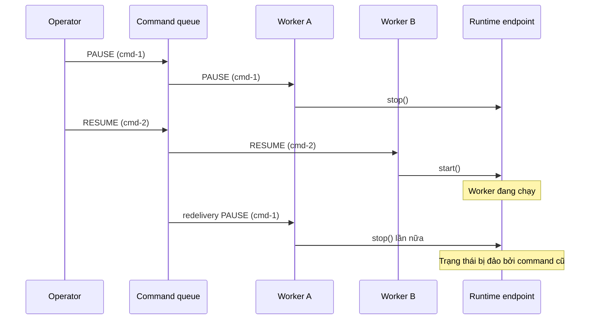
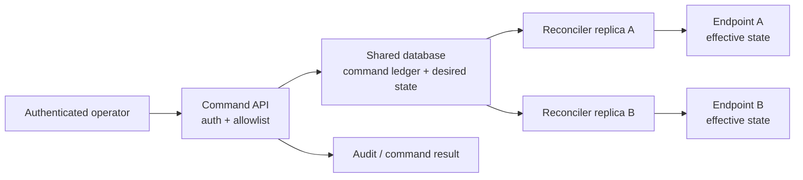
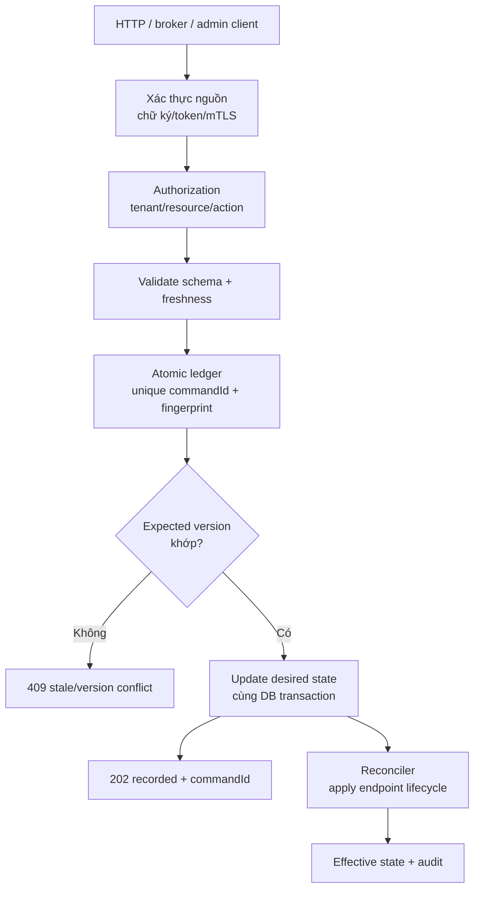
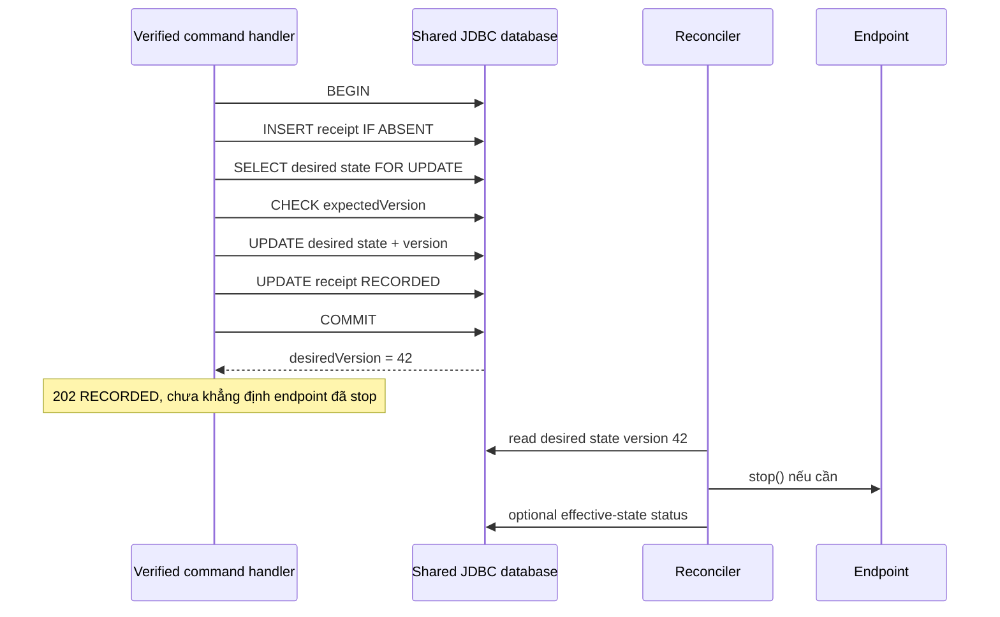
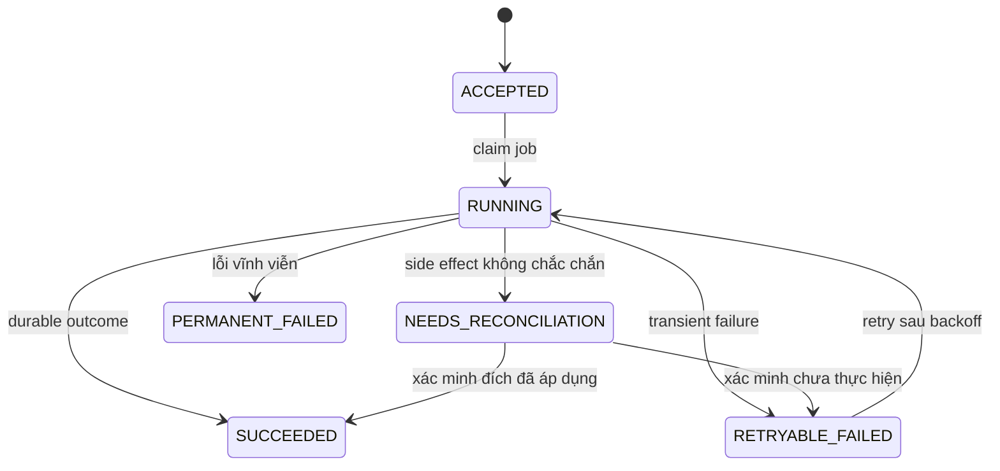
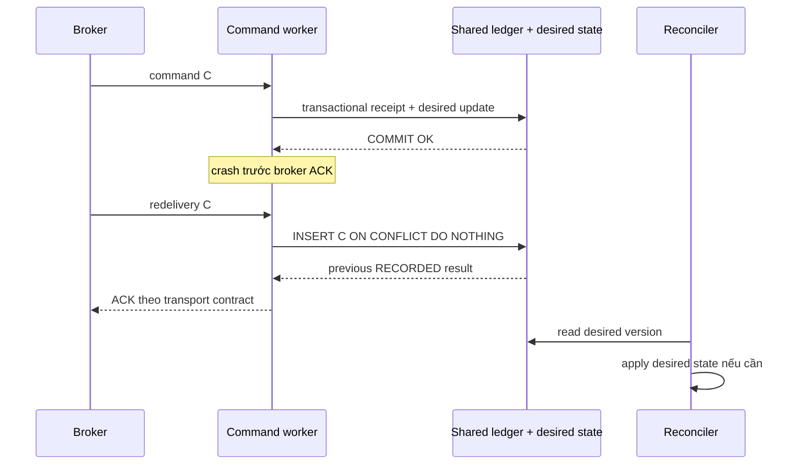

# Chống replay và duplicate command

## 1. Vì sao một command có thể bị thực thi nhiều lần?

Spring Integration thường vận chuyển **message nghiệp vụ** qua channel, endpoint, consumer, poller và executor. Nhưng hệ thống cũng có các **command điều khiển runtime**: `PAUSE` polling consumer, `RESUME` một IntegrationFlow, khởi chạy tác vụ reconciliation, thực hiện replay batch, hoặc thay đổi routing. Các lệnh này có thể làm thay đổi trạng thái của nhiều message khác.

Một lệnh quản trị có thể được gửi lặp vì những lý do khác nhau:

- **Retry hợp lệ:** HTTP client gửi `PAUSE`, máy chủ ghi nhận thành công nhưng phản hồi bị mất; client retry.
- **Redelivery hợp lệ:** broker giao lại command vì consumer chết sau khi cập nhật trạng thái nhưng trước khi ack.
- **Gửi song song:** hai thread hoặc hai replica cùng nhận một command ID.
- **Đảo thứ tự:** `PAUSE` đến trước, `RESUME` đến sau về mặt nghiệp vụ, nhưng hai message được xử lý theo thứ tự ngược.
- **Replay có chủ ý:** một bên giữ lại request đã xác thực trước đó rồi gửi lại để gây gián đoạn, kể cả khi request cũ từng hợp lệ.
- **Command ID bị tái sử dụng:** client gửi cùng ID với action, resource hoặc nội dung khác.

Nếu không kiểm soát, một lần retry có thể dừng endpoint hai lần, đăng ký trùng IntegrationFlow, mở lại consumer vốn đã bị pause, hoặc phát lại batch đã tạo side effect. Với lệnh phá hủy như purge queue hoặc reset metadata, hậu quả có thể nghiêm trọng hơn.

Chủ đề **“Chống replay và duplicate command”** thuộc chương **Bảo mật runtime** của module **SPRING_INTEGRATION_RUNTIME**. Mục tiêu là bảo vệ control plane nhưng vẫn giữ khả năng retry và recovery của message flow: xác thực, phân quyền, freshness, idempotency, durable command ledger, versioning, transaction, error/retry, multi-instance và quan sát trạng thái.

> **Nguyên tắc:** đừng cố ngăn **mọi lần giao lại message**. Hãy cho phép vận chuyển at-least-once khi cần, nhưng bảo đảm **một command hợp lệ chỉ tạo hiệu lực được phép**, lệnh cũ không đảo trạng thái mới và command không hợp lệ không đi qua ranh giới bảo mật.

## 2. Phân biệt replay attack, duplicate delivery và thao tác lặp hợp lệ

| Trường hợp | Bản chất | Cách phản ứng |
| --- | --- | --- |
| Cùng `commandId`, cùng actor/resource/action và nội dung | Thường là retry hoặc redelivery của **cùng một command** | Trả lại kết quả đã ghi nhận, **không tạo side effect mới**. |
| Cùng `commandId` nhưng nội dung khác | Xung đột identity hoặc hành vi giả mạo | Từ chối `CONFLICT`, không thay nội dung đã lưu. |
| Command cũ gửi lại sau khi hết thời hạn | Replay quá cửa sổ hợp lệ | Từ chối xử lý lại; nếu cần, cho tra cứu trạng thái qua API chỉ đọc có phân quyền. |
| Command ID mới nhưng `expectedVersion` cũ | Lệnh stale hoặc đến sai thứ tự | Từ chối bằng optimistic concurrency conflict. |
| Command ID mới, version hiện hành và quyền hợp lệ | Một thao tác quản trị **mới** | Có thể ghi nhận, không được từ chối chỉ vì giống action trước. |
| Broker redeliver message nghiệp vụ | Cơ chế bảo đảm delivery | Dedupe business event theo khóa nghiệp vụ và transaction; không dùng command ledger thay thế. |
| Replay batch do operator chủ động yêu cầu | Một hoạt động nghiệp vụ có quyền và phạm vi rõ | Cần **job ID, phê duyệt, phạm vi, giới hạn và idempotency** riêng. |

**Hai bài toán bảo mật và độ tin cậy bổ sung nhau:** replay prevention kiểm soát việc một yêu cầu cũ có còn được thực hiện không; idempotency cho phép retry/redelivery mà không làm lại hiệu lực. Chỉ dùng timestamp mà không có ledger vẫn không bảo vệ được request phát lại nhiều lần **trong cửa sổ timestamp còn hợp lệ**.

## 3. Một cuộc đua PAUSE/RESUME có thể đảo trạng thái như thế nào?

Giả sử người vận hành có quyền ra lệnh:

1. `PAUSE` worker lúc 10:00 để bảo trì.
2. `RESUME` worker lúc 10:03 khi bảo trì xong.

Nếu hai lệnh đi qua broker và nhiều executor, thời điểm **handler thực thi** có thể không trùng thứ tự operator gửi. Một bản sao `PAUSE` cũ có thể đến sau `RESUME`:



Dedupe theo `commandId` có thể chặn bản sao cuối cùng của `cmd-1`. Nhưng nếu client **cấp ID mới cho một PAUSE đã cũ**, dedupe theo ID không biết đó là lệnh stale. Vì vậy, lệnh thay đổi trạng thái cần thêm một cơ chế **thứ tự logic**, chẳng hạn `expectedVersion` hoặc sequence number được lưu và kiểm tra nguyên tử tại state store.

### Desired state, không phải lệnh “bắt đầu thực thi ngay”

Với `PAUSE/RESUME`, một mô hình thuận lợi là lưu **desired state có version** rồi để từng instance reconcile sang trạng thái đó.



Lệnh cũ không tự điều khiển endpoint một lần nữa; nó chỉ có thể tác động đến desired state nếu **được phép ghi version mới**. Sau crash, trạng thái mong muốn vẫn còn trong database để reconciler tiếp tục.

## 4. Bốn lớp bảo vệ cần phối hợp

Một thiết kế chống replay cần nhiều lớp; không có một header hoặc UUID nào tự giải quyết hết.

1. **Authentication:** xác định người hoặc dịch vụ gửi command bằng cơ chế đáng tin cậy như OIDC/JWT đã xác minh đúng chữ ký, issuer, audience, expiry, hoặc mTLS cho machine identity. Không tin `actorId`/`role` tự khai trong payload.
2. **Authorization + allowlist:** chủ thể được làm action nào trên resource nào, tenant nào và phạm vi nào. Không nhận biểu thức SpEL, bean name hoặc method name tùy ý từ client.
3. **Freshness + replay window:** kiểm tra thời gian phát hành/hết hạn, chính sách clock skew, token/nonce tùy loại client; request hết hạn không được tạo trạng thái mới.
4. **Durable idempotency + ordering:** ghi command ID và request fingerprint trong backend chung có uniqueness nguyên tử; kiểm tra version/CAS để chặn stale command.

Cần thêm **audit, rate limit, quota, alert và recovery** để phát hiện lạm dụng và đo trạng thái thực tế.

| Biện pháp | Chặn được | Không đủ để chặn |
| --- | --- | --- |
| TLS | Nghe lén/chỉnh sửa trên đường truyền theo phạm vi TLS | Client hợp lệ gửi lại cùng command. |
| JWT/mTLS authentication | Lệnh từ nguồn không có danh tính hợp lệ | Replay của một request/token còn hiệu lực nếu không có cơ chế ràng buộc/nonce phù hợp. |
| `commandId` ngẫu nhiên | Cho phép nhận diện một lệnh | Không có hiệu quả nếu không **lưu và kiểm tra nguyên tử**. |
| Timestamp/expiry | Lệnh quá cũ | Lệnh phát lại nhiều lần khi vẫn trong khoảng hợp lệ. |
| Unique constraint | Hai transaction cùng claim một ID | Command ID **mới** chứa lệnh cũ hoặc lệnh phá hủy không idempotent. |
| `expectedVersion` | Lệnh với version cũ không ghi đè version mới | Retry cùng ID và nội dung nhưng chưa có durable receipt, hay side effect ngoài DB. |
| Idempotent desired state | Lặp `PAUSE`/`RESUME` không tự tạo tác động bổ sung theo state | Không chứng minh mọi message in-flight đã commit/ack. |

## 5. Thiết kế command envelope có định danh ổn định

Command cần một hợp đồng dữ liệu rõ ràng, có phiên bản, không phụ thuộc vào message ID tự sinh của Spring.

```json
{
  "commandId": "57a7e6f7-4ee8-4df6-a24c-0183d427f116",
  "resourceId": "shipments-worker",
  "action": "PAUSE",
  "expectedVersion": 41,
  "issuedAt": "2026-11-22T02:10:00Z",
  "expiresAt": "2026-11-22T02:12:00Z"
}
```

Các trường nên được hiểu như sau:

| Trường | Ý nghĩa | Quy tắc |
| --- | --- | --- |
| `commandId` | Identity của một yêu cầu **logic** | Giữ nguyên khi retry; tạo ID mới khi thực sự gửi yêu cầu mới. |
| `resourceId` | ID logic thuộc allowlist | Không nhận tên bean tùy ý, SpEL hoặc path hệ thống. |
| `action` | Enum như `PAUSE` hoặc `RESUME` | Không nhận method name tùy ý. |
| `expectedVersion` | Version desired state client đã đọc | Phải so sánh nguyên tử với version hiện tại. |
| `issuedAt` | Thời điểm phát lệnh | Kiểm tra quá cũ hoặc lệch quá xa về tương lai. |
| `expiresAt` | Thời hạn còn cho phép tiếp nhận | Bị giới hạn theo policy server, không do client kéo dài vô hạn. |
| `tenantId` | Phạm vi tài nguyên | Lấy từ **authenticated context**, không tin tenant trong body. |
| `principalId` | Người/ứng dụng ra lệnh | Lấy từ identity đã xác minh, dùng trong authorization và audit. |
| `schemaVersion` | Phiên bản hợp đồng command | Hữu ích khi có nhiều phiên bản client/server. |

Hai trường cuối có thể nằm trong **envelope nội bộ đã xác minh**, không nhất thiết do client truyền trong body. Nếu HTTP/broker cho phép một producer tự đặt header `authenticated=true`, `role=ADMIN` hoặc `tenant=production`, các header đó **chỉ là dữ liệu** cho tới khi được một lớp tin cậy xác thực.

### Vì sao không dùng `MessageHeaders.ID`?

Spring Messaging có `MessageHeaders.ID` nhưng khi message được dựng lại qua transformer, adapter hoặc redelivery, ID có thể thay đổi. Một command logic được retry phải giữ **cùng `commandId`**, kể cả khi lớp vận chuyển tạo Message ID mới. `correlationId` dùng để liên kết trace hoặc message group, **không mặc nhiên là khóa chống replay**.

### Freshness không thay thế quyền

Một lệnh `PAUSE` còn hạn nhưng do user không có quyền gửi vẫn bị từ chối. Một lệnh cũ đã được ghi nhận thành công, khi được retry sau expiry, có thể bị từ chối vì hết hạn; client có quyền nên dùng một API **tra cứu receipt theo ID**, không phát lại body cũ vô hạn.

## 6. Threat boundary trong Spring Integration



**Không đi thẳng từ untrusted payload đến Control Bus.** Control Bus có thể đánh giá biểu thức để gọi phương thức trên bean; đưa trực tiếp payload HTTP hoặc message broker chưa kiểm soát vào đó tạo rủi ro thực thi lệnh quản trị không mong muốn. Với `PAUSE/RESUME`, ưu tiên **service nhận action đã validate và resource thuộc allowlist**, rồi gọi `SmartLifecycle` hoặc reconciler tường minh.

### Đường thread có thể làm mất giả định security context

Nếu một command đi từ HTTP thread qua `ExecutorChannel` hoặc poller, `SecurityContextHolder`/ThreadLocal của Spring Security **không tự động đi theo** worker. Đừng đọc một header `principal` do client đặt rồi cho rằng đã có quyền. Có hai hướng:

- Kiểm tra authentication và authorization tại ingress **trước** khi đưa vào async boundary; tạo một **internal verified envelope** do code tin cậy sinh ra, kèm audit identity đã xác minh.
- Khi worker cần thực thi phân quyền lại, dùng context propagation có kiểm soát hoặc một **service policy** xác minh lại resource/actor từ dữ liệu tin cậy; không mặc định mọi thread đều có Authentication đúng.

Ngay cả envelope nội bộ cũng không phải credential độc lập: nếu bất kỳ bean nào có thể tạo envelope rồi gửi vào channel, phải giới hạn producer và kiểm tra policy tại service ghi command.

## 7. Vì sao dedupe trong RAM không đủ?

Một bản demo đơn giản có thể dùng:

```java
Set<UUID> seen = ConcurrentHashMap.newKeySet();

if (!seen.add(commandId)) {
    return; // Duplicate trong JVM này.
}
applyCommand();
```

Nhưng nó có ít nhất bốn lỗ hổng vận hành:

1. JVM restart → set `seen` biến mất → lệnh cũ có thể chạy lại.
2. Nhiều replica → mỗi instance có set riêng → hai instance cùng áp dụng lệnh.
3. Crash sau `seen.add` nhưng trước `applyCommand` → lệnh bị đánh dấu đã thấy mà **chưa có side effect**.
4. Request cùng ID nhưng nội dung khác → set không biết body bị thay đổi.

`ConcurrentMetadataStore.putIfAbsent` có thể hữu ích cho atomic claim, nhưng nếu marker `DONE` không cùng transaction với hiệu lực nghiệp vụ, vẫn có crash window. Với tác vụ quản trị quan trọng, ưu tiên **durable ledger và state transition có điều kiện**, kết hợp unique constraint hoặc CAS thật ở backend chung.

## 8. Mô hình dữ liệu: receipt và desired state tách biệt

Với lệnh `PAUSE/RESUME`, ghi **ý định mong muốn** thành một row bền vững, không cố thực hiện `endpoint.stop()` ngay trong transaction ghi nhận command. PostgreSQL được dùng làm ví dụ; SQL và upsert syntax cần điều chỉnh cho database khác.

```sql
CREATE TABLE runtime_desired_state (
    tenant_id       VARCHAR(80) NOT NULL,
    resource_id     VARCHAR(120) NOT NULL,
    desired_state   VARCHAR(16) NOT NULL
        CHECK (desired_state IN ('RUNNING', 'PAUSED')),
    version         BIGINT NOT NULL CHECK (version >= 0),
    updated_at      TIMESTAMPTZ NOT NULL DEFAULT CURRENT_TIMESTAMP,
    PRIMARY KEY (tenant_id, resource_id)
);

CREATE TABLE runtime_command_receipt (
    tenant_id       VARCHAR(80) NOT NULL,
    command_id      UUID NOT NULL,
    principal_id    VARCHAR(160) NOT NULL,
    fingerprint     CHAR(64) NOT NULL,
    resource_id     VARCHAR(120) NOT NULL,
    action          VARCHAR(16) NOT NULL,
    expected_version BIGINT NOT NULL,
    desired_version BIGINT,
    outcome         VARCHAR(24) NOT NULL DEFAULT 'PENDING',
    received_at     TIMESTAMPTZ NOT NULL DEFAULT CURRENT_TIMESTAMP,
    PRIMARY KEY (tenant_id, command_id)
);

CREATE INDEX idx_runtime_receipt_resource
    ON runtime_command_receipt (tenant_id, resource_id, received_at);

INSERT INTO runtime_desired_state
    (tenant_id, resource_id, desired_state, version)
VALUES
    ('tenant-demo', 'shipments-worker', 'RUNNING', 41);
```

Giải thích:

- `(tenant_id, command_id)` unique, chặn hai transaction cùng ghi nhận một command logic cho tenant đó.
- `fingerprint` ràng buộc command ID với **đúng nội dung và identity**. Không chấp nhận cùng ID cho payload khác.
- `expected_version` ghi version mà client kỳ vọng; `desired_version` là version mới khi đã ghi nhận thành công.
- `runtime_desired_state` chứa **trạng thái mong muốn có version**. Reconciler đọc row này để thực hiện start/stop trên từng JVM.
- `outcome='RECORDED'` chỉ nghĩa là desired state đã được **commit vào database**, không có nghĩa endpoint ở mọi replica đã dừng/chạy.
- Các row desired state trong demo được provision trước. Nếu resource chưa tồn tại, không tự tạo nó từ một tên bean do client đưa vào.

### Vì sao không dùng một boolean `processed` duy nhất?

Một flag `processed=true` không cho biết đã xử lý nội dung nào, có thay đổi version không, có thất bại khi apply vào endpoint không và lệnh có được ghi khi database commit chưa. Tách **command receipt**, **desired state** và **effective runtime state** giúp kiểm toán và khôi phục sau crash.

## 9. Domain model Java: tách dữ liệu client khỏi identity được xác thực

Trong ví dụ, DTO không chứa `tenantId`/`role` lấy từ request. Caller đã xác thực phải được chuyển thành `OperatorIdentity` bởi lớp tin cậy, không phải do producer tự xây từ header không được kiểm tra.

```java
package example.runtime.security;

import java.time.Instant;
import java.util.Set;
import java.util.UUID;

public enum RuntimeAction {
    PAUSE, RESUME
}

public record RuntimeCommand(
        UUID commandId,
        String resourceId,
        RuntimeAction action,
        long expectedVersion,
        Instant issuedAt,
        Instant expiresAt) {}

public record OperatorIdentity(
        String tenantId,
        String principalId,
        Set<String> authorities) {}

public record CommandReceipt(
        UUID commandId,
        String outcome,
        long desiredVersion) {}
```

Đây là **các kiểu Java riêng**: trong project thật, mỗi `public` top-level type cần nằm trong file `.java` cùng tên; có thể giảm modifier `public` để viết cùng một file khi phù hợp. Ví dụ trình bày cạnh nhau để dễ xem hợp đồng.

### Authorization theo resource và action

```java
package example.runtime.security;

import org.springframework.security.access.AccessDeniedException;

public final class RuntimeCommandPolicy {

    public void requireManage(
            OperatorIdentity actor, String resourceId, RuntimeAction action) {

        if (actor == null || actor.tenantId() == null ||
                actor.principalId() == null ||
                actor.authorities() == null) {
            throw new AccessDeniedException("Unauthenticated operator");
        }

        // Allowlist endpoint logic; không nhận bean name từ client.
        if (!"shipments-worker".equals(resourceId)) {
            throw new AccessDeniedException("Resource not permitted");
        }

        if (!actor.authorities()
                .contains("integration:manage:shipments")) {
            throw new AccessDeniedException("Permission denied");
        }
    }
}
```

Code này là **một lớp policy minh họa**, chưa phải cấu hình xác thực hoàn chỉnh. `OperatorIdentity` phải được dựng từ SecurityContext/JWT đã xác minh đúng và chính sách tenant ở ingress đáng tin cậy; nếu một API cho user tùy ý khai `authorities`, kiểm tra trên mất giá trị. Production còn cần chính sách tenant/resource chi tiết, không chỉ một resource cố định.

## 10. Fingerprint: cùng ID phải gắn cùng payload

Chỉ so sánh `commandId` là chưa đủ. Nếu cùng UUID lần đầu mang `PAUSE` và lần thứ hai mang `RESUME`, trả lại receipt cũ một cách im lặng sẽ che giấu lỗi client hoặc attempt giả mạo.

Fingerprint nên phản ánh **toàn bộ trường quyết định ý nghĩa command**, bao gồm scope và actor tin cậy. Với Java 17+, có thể dùng SHA-256 trên chuỗi canonical được tạo **theo thứ tự cố định và độ dài từng trường**.

```java
package example.runtime.security;

import java.nio.charset.StandardCharsets;
import java.security.MessageDigest;
import java.security.NoSuchAlgorithmException;
import java.util.HexFormat;
import java.util.List;
import java.util.stream.Collectors;

public final class CommandFingerprint {

    private CommandFingerprint() {}

    public static String of(RuntimeCommand c, OperatorIdentity identity) {
        List<String> fields = List.of(
            identity.tenantId(),
            identity.principalId(),
            c.commandId().toString(),
            c.resourceId(),
            c.action().name(),
            Long.toString(c.expectedVersion()),
            c.issuedAt().toString(),
            c.expiresAt().toString()
        );

        // Length-prefix tránh nhập nhằng khi field chứa ký tự phân cách.
        String canonical = fields.stream()
            .map(s -> s.length() + ":" + s)
            .collect(Collectors.joining("|"));

        try {
            byte[] digest = MessageDigest.getInstance("SHA-256")
                .digest(canonical.getBytes(StandardCharsets.UTF_8));
            return HexFormat.of().formatHex(digest);
        } catch (NoSuchAlgorithmException impossible) {
            throw new IllegalStateException("SHA-256 unavailable", impossible);
        }
    }
}
```

**Fingerprint không phải chữ ký số.** Hash giúp phát hiện **một command ID bị dùng lại với nội dung khác** trong ledger. Nó không chứng minh ai đã gửi request; authentication, transport security và kiểm tra quyền vẫn bắt buộc. Với một hệ thống cần chữ ký request (ví dụ webhook), cần xác minh chữ ký/HMAC, key rotation, freshness và binding riêng tại ingress trước khi ghi command.

Không đưa access token hay secret vào fingerprint/log. Nếu JSON có nhiều cách biểu diễn tương đương, nên chuẩn hóa dữ liệu thành các trường typed như ví dụ thay vì hash raw JSON có thứ tự field hoặc whitespace tùy ý.

## 11. Kiểm tra thời gian hiệu lực và clock skew

Một request cũ có thể vẫn có token truy cập hợp lệ nhưng đã hết **thời hạn command**. Server phải tự kiểm tra:

- `issuedAt` không quá xa tương lai, có tính đến clock skew hữu hạn.
- `issuedAt` không cũ hơn cửa sổ cho phép, ví dụ 2 phút trong bài lab.
- `expiresAt > issuedAt`, không kéo dài hơn giới hạn server quy định.
- `expiresAt > serverNow` tại thời điểm tiếp nhận.
- Không cho caller tự chọn expiry nhiều giờ/ngày chỉ để vượt replay window.

```java
package example.runtime.security;

import java.time.Clock;
import java.time.Duration;
import java.time.Instant;

public final class CommandFreshness {

    private static final Duration MAX_AGE = Duration.ofMinutes(2);
    private static final Duration MAX_FUTURE_SKEW =
        Duration.ofSeconds(30);

    private final Clock clock;

    public CommandFreshness(Clock clock) {
        this.clock = clock;
    }

    public void validate(RuntimeCommand c) {
        if (c == null || c.commandId() == null ||
            c.action() == null || c.resourceId() == null ||
            c.issuedAt() == null || c.expiresAt() == null) {
            throw new IllegalArgumentException("Invalid command envelope");
        }

        Instant now = clock.instant();

        if (c.issuedAt().isAfter(now.plus(MAX_FUTURE_SKEW)) ||
            c.issuedAt().isBefore(now.minus(MAX_AGE)) ||
            !c.expiresAt().isAfter(c.issuedAt()) ||
            c.expiresAt().isAfter(c.issuedAt().plus(MAX_AGE)) ||
            !c.expiresAt().isAfter(now)) {
            throw new IllegalArgumentException("Stale/invalid command");
        }
    }
}
```

**Giới hạn quan trọng:** client có credential hợp lệ nhưng bị chiếm quyền vẫn có thể tạo **command mới với timestamp mới**. Timestamp không chống được điều đó; cần phân quyền tối thiểu, mTLS hoặc cơ chế proof-of-possession khi phù hợp, rate limit, audit và khả năng revoke. Đồng thời đồng hồ giữa các hệ thống phải được đồng bộ; đừng giải quyết clock skew bằng cách mở replay window vô hạn.

### Nonce và token `jti`

`commandId` có thể đóng vai trò nonce duy nhất của **command logic** nếu được sinh đủ ngẫu nhiên và lưu bền vững. JWT `jti` là định danh token, **không nhất thiết là định danh command**; một token có thể hợp lệ cho nhiều lệnh. Nếu threat model yêu cầu một token dùng đúng một lần hoặc request-bound proof, cần một nonce store/protocol phù hợp, không lạm dụng `commandId` làm mọi loại identity.

## 12. Transactional ledger: claim ID và cập nhật desired state nguyên tử

Điểm dễ sai nhất là làm hai thao tác tách rời:

```text
insert receipt(COMPLETED)
-- JVM crash --
endpoint.stop()   // Chưa thực hiện
```

Khi message được giao lại, receipt đã hoàn tất nên command bị skip mãi. Ngược lại:

```text
endpoint.stop()
-- JVM crash --
insert receipt(COMPLETED)  // Chưa ghi
```

Khi giao lại, side effect có thể chạy lần nữa. Với `PAUSE/RESUME`, giải pháp tốt hơn là **ghi desired state và receipt trong cùng transaction database**, rồi reconciler thực hiện lifecycle idempotently.



Với đường này, **crash sau DB commit nhưng trước khi gọi `stop()`** không làm mất ý định: reconciler sẽ đọc desired state sau restart. Cùng ID redeliver sau commit sẽ trả lại receipt. Nếu DB transaction rollback, cả receipt và desired state đều không được commit, nên retry vẫn có thể tiếp nhận lệnh.

## 13. Java service: xử lý duplicate, conflict và stale version

Giả sử dùng Spring JDBC, Spring Transaction Management và PostgreSQL. Đoạn dưới đây tập trung vào **atomic acceptance**, không thực hiện lifecycle trong transaction.

```java
package example.runtime.security;

import java.time.Clock;
import java.util.Objects;
import java.util.UUID;

import org.springframework.jdbc.core.JdbcTemplate;
import org.springframework.stereotype.Service;
import org.springframework.transaction.annotation.Transactional;

@Service
public class RuntimeCommandService {

    private final JdbcTemplate jdbc;
    private final RuntimeCommandPolicy policy;
    private final CommandFreshness freshness;

    public RuntimeCommandService(
            JdbcTemplate jdbc,
            RuntimeCommandPolicy policy,
            Clock clock) {
        this.jdbc = jdbc;
        this.policy = policy;
        this.freshness = new CommandFreshness(clock);
    }

    @Transactional
    public CommandReceipt accept(
            RuntimeCommand command, OperatorIdentity actor) {

        // Identity phải được xác minh ở trusted ingress trước khi tới đây.
        Objects.requireNonNull(actor, "actor");
        freshness.validate(command);
        policy.requireManage(actor, command.resourceId(), command.action());

        String fingerprint = CommandFingerprint.of(command, actor);

        int inserted = jdbc.update(
            "INSERT INTO runtime_command_receipt " +
            "(tenant_id, command_id, principal_id, fingerprint, " +
            " resource_id, action, expected_version) " +
            "VALUES (?, ?, ?, ?, ?, ?, ?) " +
            "ON CONFLICT (tenant_id, command_id) DO NOTHING",
            actor.tenantId(), command.commandId(),
            actor.principalId(), fingerprint,
            command.resourceId(), command.action().name(),
            command.expectedVersion());

        if (inserted == 0) {
            StoredReceipt previous = jdbc.queryForObject(
                "SELECT fingerprint, outcome, desired_version " +
                "FROM runtime_command_receipt " +
                "WHERE tenant_id = ? AND command_id = ?",
                (rs, n) -> new StoredReceipt(
                    rs.getString("fingerprint"),
                    rs.getString("outcome"),
                    rs.getLong("desired_version")),
                actor.tenantId(), command.commandId());

            if (previous == null ||
                !fingerprint.equals(previous.fingerprint())) {
                throw new IllegalArgumentException(
                    "Command ID reused with different content");
            }
            // Không tạo side effect mới. Trả cùng kết quả đã ghi.
            return new CommandReceipt(
                command.commandId(),
                previous.outcome(),
                previous.desiredVersion());
        }

        Long version = jdbc.queryForObject(
            "SELECT version FROM runtime_desired_state " +
            "WHERE tenant_id = ? AND resource_id = ? FOR UPDATE",
            Long.class, actor.tenantId(), command.resourceId());

        if (version == null ||
            version.longValue() != command.expectedVersion()) {
            // @Transactional rollback cả INSERT receipt ở trên.
            throw new IllegalStateException(
                "Stale command version; refresh state");
        }

        String desired = switch (command.action()) {
            case PAUSE -> "PAUSED";
            case RESUME -> "RUNNING";
        };

        int updated = jdbc.update(
            "UPDATE runtime_desired_state " +
            "SET desired_state = ?, version = version + 1, " +
            "    updated_at = CURRENT_TIMESTAMP " +
            "WHERE tenant_id = ? AND resource_id = ? AND version = ?",
            desired, actor.tenantId(), command.resourceId(), version);

        if (updated != 1) {
            throw new IllegalStateException("Concurrent state conflict");
        }

        long newVersion = version + 1;

        jdbc.update(
            "UPDATE runtime_command_receipt " +
            "SET outcome = 'RECORDED', desired_version = ? " +
            "WHERE tenant_id = ? AND command_id = ?",
            newVersion, actor.tenantId(), command.commandId());

        return new CommandReceipt(
            command.commandId(), "RECORDED", newVersion);
    }

    private record StoredReceipt(
        String fingerprint, String outcome, long desiredVersion) {}
}
```

### Vì sao trình tự trong service quan trọng?

1. **Validate và authorize trước**, không để người không có quyền tra cứu receipt của command khác.
2. `INSERT ... ON CONFLICT DO NOTHING` cùng unique key giúp xử lý đồng thời cùng `commandId` trên nhiều replica. Trong PostgreSQL, transaction thứ hai có thể đợi transaction đầu hoàn tất để xác định conflict; nếu transaction đầu rollback, request hợp lệ có thể được insert.
3. Nếu duplicate, kiểm tra **fingerprint bằng nhau**, trả lại **outcome đã commit**, không gọi lifecycle.
4. Với ID mới, khóa row desired state bằng `FOR UPDATE` và kiểm tra `expectedVersion`; chỉ cập nhật khi version khớp.
5. Ghi `outcome='RECORDED'` và desired version **trong cùng transaction**; transaction commit thành công rồi mới trả kết quả qua proxy.
6. Một exception runtime khiến transaction rollback, gồm cả receipt insert và desired state update.

**Tiền điều kiện:** bean `RuntimeCommandService` phải được gọi qua Spring transaction proxy với `PlatformTransactionManager` đúng `DataSource`, chứ không qua `new RuntimeCommandService(...)` hoặc self-invocation bypass AOP. Resource row phải được provision trước và schema PostgreSQL đã có. Cần phân loại `IllegalStateException`/`IllegalArgumentException` thành HTTP `409`/`400` phù hợp trong adapter thực tế; demo không cung cấp controller/security filter hoàn chỉnh.

**Chú ý response sau commit:** nếu HTTP response bị mất, client retry cùng `commandId` và cùng envelope, receipt đã commit sẽ được trả về. Nếu retry sau hết expiry, server có thể từ chối replay body nhưng cho query read-only `GET /commands/{id}` theo quyền riêng.

### Không đánh đồng outcome

`RECORDED` nghĩa là **đã commit desired state**. Nó **không** nghĩa endpoint trên mọi replica đã vào trạng thái mong muốn. Cần một metric hoặc store riêng cho `EFFECTIVE_APPLIED`/`PENDING`/`FAILED` và thông tin từng instance.

## 14. Kết nối service vào Spring Integration flow

Một entrypoint nội bộ nên nhận dữ liệu **đã đi qua authentication và authorization**. Ví dụ Java DSL sau chỉ minh họa cách một message kiểu dữ liệu rõ ràng đi qua `DirectChannel` tới transactional service.

```java
package example.runtime.security;

public record VerifiedRuntimeCommand(
    RuntimeCommand command, OperatorIdentity operator) {}
```

```java
package example.runtime.security;

import java.time.Clock;

import org.springframework.context.annotation.Bean;
import org.springframework.context.annotation.Configuration;
import org.springframework.integration.channel.DirectChannel;
import org.springframework.integration.channel.QueueChannel;
import org.springframework.integration.config.EnableIntegration;
import org.springframework.integration.dsl.IntegrationFlow;
import org.springframework.messaging.MessageChannel;
import org.springframework.messaging.PollableChannel;

@Configuration
@EnableIntegration
public class SecureCommandFlowConfig {

    @Bean
    Clock commandClock() {
        return Clock.systemUTC();
    }

    @Bean
    RuntimeCommandPolicy commandPolicy() {
        return new RuntimeCommandPolicy();
    }

    @Bean("ops.command.in")
    MessageChannel commandInput() {
        return new DirectChannel();
    }

    @Bean("ops.command.receipts")
    PollableChannel commandReceipts() {
        return new QueueChannel(100);
    }

    @Bean
    IntegrationFlow secureCommandFlow(RuntimeCommandService service) {
        return IntegrationFlow.from("ops.command.in")
            .handle(VerifiedRuntimeCommand.class,
                (envelope, headers) ->
                    service.accept(
                        envelope.command(),
                        envelope.operator()))
            .channel("ops.command.receipts")
            .get();
    }
}
```

**Cảnh báo bảo mật:** record `VerifiedRuntimeCommand` **không tự có tính xác thực**. Chỉ những producer tin cậy sau xác minh danh tính mới được tạo và gửi record đó; service vẫn kiểm tra policy. Không nối inbound HTTP/broker nhận payload tùy ý thẳng vào `ops.command.in` rồi tin trường `operator.authorities()` do client gửi.

Trong thực tế, controller/adapter nên lấy `OperatorIdentity` từ `Authentication` đã verify, chuyển qua gateway nội bộ hoặc gọi service trực tiếp; không build identity từ `@Header("role")`/`@Header("tenant")` tự khai. Nếu chuyển qua `ExecutorChannel`, cần đảm bảo identity/provenance được xác minh ở ingress và policy enforcement không dựa vào ThreadLocal mất qua ranh giới async.

`QueueChannel(100)` output ở đây là công cụ minh họa để đọc receipt, **không phải một kho audit bền vững**. Receipt bền vững đã được ghi trong JDBC. Với HTTP request/response thật, nên dùng gateway/reply channel phù hợp và không để queue output đầy; nếu queue full sau DB commit, command vẫn có thể đã được ghi nhận dù caller thấy lỗi, cần truy vấn receipt để đối chiếu.

## 15. Reconciler: áp dụng desired state an toàn trên từng JVM

Một API đã ghi `PAUSED` vào DB nhưng JVM crash ngay sau commit. Khi restart, một reconciler đọc desired state và áp vào đúng endpoint, thay vì phụ thuộc vào một task điều khiển chỉ nằm trong memory.

```java
package example.runtime.security;

import org.springframework.context.ApplicationContext;
import org.springframework.context.SmartLifecycle;
import org.springframework.jdbc.core.JdbcTemplate;
import org.springframework.scheduling.annotation.Scheduled;
import org.springframework.stereotype.Component;

@Component
public class ShipmentLifecycleReconciler {

    private final JdbcTemplate jdbc;
    private final ApplicationContext context;

    public ShipmentLifecycleReconciler(
            JdbcTemplate jdbc, ApplicationContext context) {
        this.jdbc = jdbc;
        this.context = context;
    }

    @Scheduled(fixedDelay = 1_000)
    public void reconcile() {
        // Demo một tenant/resource cố định. Không nhận bean name từ client.
        String desired = jdbc.queryForObject(
            "SELECT desired_state FROM runtime_desired_state " +
            "WHERE tenant_id = ? AND resource_id = ?",
            String.class, "tenant-demo", "shipments-worker");

        SmartLifecycle worker = context.getBean(
            "shipments.pollerEndpoint", SmartLifecycle.class);

        if ("PAUSED".equals(desired) && worker.isRunning()) {
            worker.stop();
        } else if ("RUNNING".equals(desired) && !worker.isRunning()) {
            worker.start();
        }
    }
}
```

Muốn scheduler này chạy, cần bật Spring scheduling bằng `@EnableScheduling` trong cấu hình thích hợp. Endpoint `shipments.pollerEndpoint` phải tồn tại, triển khai `SmartLifecycle` và chỉ được reconciler/control plane quản lý trong phạm vi dự định. Với desired state `PAUSED`, cân nhắc `autoStartup(false)` để worker **không tự chạy ngắn ngủi khi context vừa khởi động** trước lần reconcile đầu tiên.

**Phân biệt trạng thái:**

- `desiredState`: giá trị đã commit trong database.
- `effectiveState`: worker thực sự đang running/stopped trên từng instance, được xác minh sau lệnh lifecycle.
- `drainedState`: message backlog/in-flight/transaction đã đạt điều kiện dừng an toàn hay chưa.

`isRunning()==false` không chứng minh message đã được ack hay business transaction đã rollback. Một lệnh `PAUSE` có thể cần **quiesce + drain** trước khi stop theo chính sách; reconciler production phải phối hợp quy trình vận hành đó và báo `PENDING` nếu chưa hoàn tất, thay vì gọi `stop()` một cách mù quáng.

### Concurrency và reconcile

Nếu nhiều thread cùng điều khiển một endpoint, hoặc có scheduler cũ đang áp version 41 sau khi version 42 đã được ghi, cần serialize thao tác reconciliation trên từng resource và kiểm tra version mới nhất. Đọc desired state trước mỗi lần áp, tránh dùng snapshot cũ tồn tại lâu. Trong multi-instance, mỗi replica thực hiện reconciliation theo identity/resource riêng và xuất effective status để control plane tổng hợp.

## 16. Lệnh không idempotent: RESTART, REPLAY, PURGE cần mô hình khác

Không phải mọi command đều giống `PAUSE/RESUME`. Một số hành động là **edge-triggered**: mỗi lần gọi có thể tạo side effect mới.

| Command | Có thể dùng desired state đơn giản? | Yêu cầu bổ sung |
| --- | --- | --- |
| `PAUSE worker` | Thường có, chuyển về `PAUSED` | Version/CAS, quiesce và in-flight policy. |
| `RESUME worker` | Thường có, chuyển về `RUNNING` | Version/CAS và readiness. |
| `SET_CONCURRENCY 4` | Có thể, nếu cấu hình/runtime hỗ trợ | Version, bounds, ảnh hưởng executor/poller. |
| `RESTART flow` | Không đơn giản là một trạng thái tĩnh | Job/generation ID, phase STOPPING/STARTING, timeout/recovery. |
| `REPLAY batch` | Không, có thể phát lại nhiều business event | Replay job ID, phạm vi, approval, durable progress và downstream idempotency. |
| `PURGE queue` | Không, có tính phá hủy | Quyền mạnh, xác nhận, audit, snapshot/backup, chống thao tác trùng. |
| `RESET metadata` | Không, có thể thay đổi hành vi redelivery | Schema, blast radius, replay strategy và phê duyệt. |

Với lệnh edge-triggered, nên có **durable job record** với idempotency key, state machine và worker có thể resume:



Nếu command gọi HTTP API ngoài và API **đã thành công** nhưng JVM chết trước khi đánh dấu `SUCCEEDED`, một worker khác có thể thực hiện lại. **Command ledger duy nhất không tạo exactly-once side effect liên hệ thống**. Cần idempotency key tại tài nguyên đích, transactional outbox/inbox khi phù hợp hoặc reconciliation dựa trên trạng thái thực tế trước khi retry.

## 17. Crash windows: ghi gì trước, áp gì sau?

| Điểm crash | Nếu dùng desired state + ledger cùng DB transaction | Điều cần test |
| --- | --- | --- |
| Trước `INSERT receipt` | Chưa có thay đổi | Retry có thể nhận command hợp lệ còn hạn. |
| Sau `INSERT` nhưng trước commit | Transaction rollback; receipt chưa durable | Retry không bị skip do marker chưa commit. |
| Sau update desired state nhưng trước commit | Cả receipt và desired state rollback | Không có state nửa vời. |
| Sau commit nhưng trước HTTP response | Receipt và desired state tồn tại | Retry cùng ID trả kết quả cũ, không bump version. |
| Sau commit nhưng trước reconciler start/stop | Desired state tồn tại | Reconciler sau restart vẫn áp trạng thái. |
| Reconciler đang stop endpoint thì JVM chết | Có thể effective state chưa đạt | Lần reconcile sau kiểm tra và áp lại an toàn. |
| Đã stop endpoint nhưng message chưa hoàn tất | Desired state PAUSED, nhưng còn in-flight | Drain/ack/retry riêng, không coi receipt là business completion. |
| Đã gọi external API edge-triggered, chưa ghi kết quả | Không thể kết luận chỉ từ ledger | Reconciliation/idempotency tại đích trước khi làm lại. |



Đây là một mô hình thuận lợi cho control-plane state. **Ack của broker và database transaction thường không nằm trong cùng transaction**; at-least-once delivery cộng durable dedupe là một lựa chọn thực tế. Phải kiểm tra từng inbound adapter và cơ chế nack/requeue thật, không suy từ sơ đồ.

## 18. Multi-instance, distributed lock và fencing

Trong nhiều replica, in-memory `ConcurrentHashMap` hoặc `DefaultLockRegistry` **không tự điều phối xuyên JVM**. Giải pháp ledger cần dùng **shared database** hoặc backend có unique insert/CAS thực sự, với namespace tenant phù hợp.

### Race của hai bản sao cùng ID

Giả sử A và B cùng nhận `cmd-77`:

1. A bắt đầu transaction và insert row với primary key `(tenant, cmd-77)`.
2. B cũng thử insert row đó.
3. Database phân giải uniqueness: một transaction có thể ghi nhận; bên còn lại thấy conflict và đọc receipt đã commit (hoặc sẽ tiếp tục nếu bên đầu rollback).
4. Chỉ transaction mới **được phép** cập nhật desired version.

Không dùng chuỗi `SELECT xem command có tồn tại? → nếu chưa thì INSERT` mà thiếu unique constraint. Hai worker có thể cùng đọc “chưa tồn tại” và cùng áp side effect.

### `LockRegistry` không thay thế CAS version

Một distributed lock có thể giúp tuần tự hóa thực thi, nhưng nếu lease hết hạn khi worker bị GC pause, worker cũ có thể vẫn tiếp tục. Với desired state, version tăng đơn điệu trong DB giúp ngăn lệnh cũ **ghi đè version mới**. Với side effect tới hệ thống ngoài, có thể cần **fencing token** được đích kiểm tra; không mặc định `LockRegistry` nào cũng tự cấp fencing token.

### Global pause cần global control plane

Một lệnh `PAUSE shipments-worker` có thể chỉ nhằm instance A hoặc toàn cluster. Phải định nghĩa rõ `scope`/tenant/resource, lưu desired state ở đúng phạm vi và theo dõi effective state **từng replica**. Chỉ nhận được response từ A không chứng minh B và C đã dừng. Instance mới phải đọc desired state trước khi nhận công việc.

## 19. Retention, TTL và việc quên command ID

Ledger không thể tăng vô hạn mà không có kế hoạch lưu trữ. Nhưng xóa receipt quá sớm có thể làm một command cũ được xem là lệnh mới.

Một số mốc thời gian cần phân biệt:

- **Command acceptance window:** khoảng request còn được tiếp nhận, ví dụ tối đa hai phút.
- **Broker retry/redelivery horizon:** một message có thể đến lại sau nhiều giờ/ngày nếu DLQ/replay.
- **Audit retention:** thời gian lưu để điều tra theo quy định.
- **Idempotency retention:** thời gian phải nhớ ID cũ để không tạo hiệu lực lần nữa.
- **Business side effect lifetime:** có thể dài hơn tất cả các khoảng trên.

Nếu ledger TTL chỉ 10 phút nhưng message từ DLQ có thể replay sau ba ngày, dedupe theo ID không còn hiệu lực sau TTL. Có thể xử lý bằng policy:

1. Không cho request command cũ hết hạn **thực thi lại**; chỉ cho tra cứu kết quả.
2. Giữ receipt/tombstone đủ lâu theo threat model và cửa sổ redelivery thực tế.
3. Dùng version/CAS hoặc state machine bền vững để stale command **không đảo trạng thái**, kể cả khi ID đã bị dọn.
4. Với edge-triggered job, giữ idempotency key tại side-effect sink hoặc durable job record phù hợp vòng đời nghiệp vụ.
5. Cleanup qua quy trình có audit và cutoff đã kiểm chứng; không xóa `PENDING`/`NEEDS_RECONCILIATION` mà không giải quyết.

**Không dùng expiry JWT làm TTL duy nhất cho idempotency:** thời hạn token xác thực và thời hạn nhớ một command logic là hai thứ khác nhau.

## 20. Retry, error channel và HTTP/broker response

Một request có thể thất bại ở các giai đoạn khác nhau:

| Lỗi | Đường phản ứng nên thiết kế |
| --- | --- |
| Không có authentication | Từ chối trước khi vào command flow, không tạo receipt. |
| Có identity nhưng thiếu quyền | Từ chối và audit denied, không tiết lộ trạng thái command của người khác. |
| Schema/enum/resource sai | `400` hoặc validation error, không tạo desired state. |
| Command hết hạn/lệch thời gian | Từ chối stale; hướng dẫn tra cứu receipt nếu cần. |
| Cùng ID, fingerprint khác | `409 conflict`; không cập nhật state. |
| `expectedVersion` không khớp | `409 version conflict`; client đọc state rồi tạo **lệnh mới có ID mới** nếu vẫn muốn thao tác. |
| DB connection timeout/trục trặc tạm thời | Có thể retry **cùng ID và cùng payload**, với backoff và hạn mức. |
| DB commit thành công, HTTP response mất | Retry cùng ID nhận receipt đã commit. |
| Reconciler chưa áp được lifecycle | Command vẫn `RECORDED`, effective status `PENDING/FAILED`; có retry và alert riêng. |
| Broker redelivery sau DB commit | Handler kiểm tra receipt và ack theo transport contract. |

### Error channel không tự thay thế ledger

Với `DirectChannel`, exception có thể trả về caller đồng bộ. Với `ExecutorChannel` hoặc polling consumer, lỗi có thể xuất hiện ở `ErrorMessage`/error channel theo cấu hình. Nếu command đi qua retry advice và phát lại, **idempotency vẫn phải đặt tại state store**, không chỉ trong error handler.

Đặc biệt, không nên đưa raw exception chứa thông tin nhạy cảm của actor/token hoặc SQL vào response HTTP. Trả mã lỗi có cấu trúc và `commandId`/trace ID, còn stack trace chi tiết nằm trong log được kiểm soát.

### Retry có giới hạn

Không retry tức thì vô hạn khi DB hoặc executor full. Dùng backoff, jitter, retry budget và DLQ/recovery thích hợp. Với command nguy hiểm, replay từ DLQ phải kiểm tra **quyền, expiry, current state/version và receipt** theo policy; không giả định việc từng được xác thực trong quá khứ đủ để thực thi hôm nay.

## 21. Audit, observability và privacy

Một command ledger vừa là cơ chế idempotency vừa là bằng chứng vận hành, nhưng không thay thế hệ thống audit có kiểm soát. Audit record nên có:

| Trường | Ví dụ | Dùng để |
| --- | --- | --- |
| `commandId` | UUID ổn định | Nối request, retry, broker delivery và receipt. |
| `tenantId`/`resourceId` | `tenant-demo/shipments-worker` | Xác định phạm vi ảnh hưởng. |
| `principalId`/authn mechanism | Operator từ token đã xác minh | Điều tra ai thực hiện, không suy từ header tự khai. |
| `action` và `fingerprint` | `PAUSE` / SHA-256 | Xác nhận nội dung cố định cho cùng ID. |
| `expectedVersion`/`desiredVersion` | 41 → 42 | Điều tra stale/reordering. |
| `receivedAt`/`expiresAt` | UTC timestamps | Xác định replay window và clock issues. |
| `receiptOutcome` | `RECORDED`/`CONFLICT` | Phân biệt nhận command với áp runtime. |
| `effectiveState`/`instanceId` | `PAUSED` / instance-A | Đối chiếu từng replica đã áp hay chưa. |
| `traceId`/`deliveryAttempt` | Trace, attempt count | Nối log Spring Integration và broker. |

Các metric nên có: số command mới được ghi, duplicate cùng fingerprint, conflict khác fingerprint, stale version, expired request, unauthorized attempts, DB transaction retry, thời gian từ `RECORDED` tới effective apply, số replica chưa reconcile và số command edge-triggered cần đối soát.

**Không log:** JWT, API key, secret, toàn bộ request raw chứa dữ liệu nhạy cảm hay stack trace lộ thông tin xác thực. Fingerprint dùng để so nội dung và audit không phải bằng chứng xác thực; phải bảo vệ quyền đọc bảng ledger, đặc biệt nếu nó chứa actor/resource.

### Khi `RECORDED` nhưng endpoint chưa dừng

Chẩn đoán theo thứ tự: desired row có đúng tenant/resource/version không? Reconciler có đang chạy không? Endpoint bean `SmartLifecycle` có đúng ID và đã đăng ký chưa? Có worker khác/replica khác vẫn chạy không? Có message in-flight chưa drain không? Error handler có thấy lỗi lifecycle không? **Không** phát lại `PAUSE` với command ID mới chỉ vì một metric chưa đổi, khi chưa xác định nguyên nhân.

## 22. Kiểm thử replay và concurrency có kiểm soát

Các test quan trọng cần sử dụng **database chung thật hoặc database test có hỗ trợ unique constraint/row locks tương đương**, không chỉ mock `JdbcTemplate`. Với PostgreSQL, có thể dùng môi trường integration test riêng; schema và data được reset giữa các test.

| ID | Tình huống | Kỳ vọng |
| --- | --- | --- |
| R01 | Gửi command mới hợp lệ `PAUSE` version 41 | Một receipt `RECORDED`, desired `PAUSED` version 42. |
| R02 | Retry cùng commandId và cùng envelope trong hạn | Trả receipt version 42; **không tăng version lần nữa**. |
| R03 | Retry cùng commandId nhưng action `RESUME` | `409 conflict`, desired state giữ nguyên. |
| R04 | Retry cùng commandId nhưng actor khác | Không tiết lộ receipt của actor trước; policy/fingerprint chặn. |
| R05 | Command khác ID nhưng `expectedVersion=41` sau khi version 42 | `409 stale`; không ghi desired state mới. |
| R06 | Command mới hợp lệ `RESUME` expectedVersion 42 | Desired `RUNNING` version 43. |
| R07 | PAUSE cũ tới sau RESUME | Receipt duplicate hoặc version conflict, không đảo `RUNNING`. |
| R08 | Hai thread cùng submit **một** command ID | Một transaction tạo receipt; transaction kia đọc cùng kết quả. |
| R09 | Hai command ID khác nhau cùng expectedVersion | Tối đa một command cập nhật version; command kia conflict. |
| R10 | DB exception sau insert receipt trước commit | Không còn receipt/desired state nửa vời; retry xử lý được. |
| R11 | Crash sau DB commit, trước response/ack | Retry không tạo update thứ hai; reconciler áp desired state. |
| R12 | Request hết hạn hoặc issuedAt lệch quá mức | Bị từ chối; state không đổi. |
| R13 | HTTP header tự khai `role=admin` | Không được coi là quyền; authentication/authorization từ trusted context. |
| R14 | Nội dung là SpEL/bean name ngoài allowlist | Bị reject schema/resource; không chạm Control Bus. |
| R15 | Replica A đang áp v42, DB đã có v43 | Reconciler theo version mới, không để snapshot cũ ghi đè. |
| R16 | Reconciler thất bại hoặc không start | Desired state vẫn bền vững; effective state có cảnh báo/pending. |
| R17 | Broker giao lại từ DLQ sau expiry | Không thực thi command cũ; có đường tra cứu/troubleshoot có quyền. |
| R18 | Lệnh edge-triggered gọi API thành công rồi crash | Dùng job ID/reconciliation/idempotency tại sink để tránh tác dụng trùng. |
| R19 | Command thuộc tenant khác nhưng trùng UUID | Khóa/authorization theo tenant; không đọc nhầm receipt. |
| R20 | Restart JVM khi desired state `PAUSED` | Endpoint không tự nhận công việc trái desired policy trước reconciliation. |

### Test double-submit cùng ID

Đoạn trích JUnit sau dùng **Java 17**, `ExecutorService` và `CountDownLatch`; `service` phải là bean Spring được inject qua proxy, còn `command`/`actor` là fixture hợp lệ. Khi chạy trong test thực, import `assertEquals` từ JUnit:

```java
var pool = java.util.concurrent.Executors.newFixedThreadPool(2);
try {
    var gate = new java.util.concurrent.CountDownLatch(1);
    var a = pool.submit(() -> {
        gate.await();
        return service.accept(command, actor);
    });
    var b = pool.submit(() -> {
        gate.await();
        return service.accept(command, actor);
    });
    gate.countDown();

    var ra = a.get(5, java.util.concurrent.TimeUnit.SECONDS);
    var rb = b.get(5, java.util.concurrent.TimeUnit.SECONDS);
    assertEquals(ra.desiredVersion(), rb.desiredVersion());
} finally {
    pool.shutdownNow();
}
```

Các biến `service`, `command`, `actor` và `assertEquals` là fixture/import từ JUnit test. Không dùng test chạy nhiều thread trên **chính một transaction do test method mở và roll back ở thread test**; transaction của Spring gắn thread, cần đảm bảo các lời gọi từ worker thực sự đi qua Spring proxy với transaction độc lập, và query state sau khi futures hoàn tất.

## 23. Anti-pattern và cách thay thế

| Anti-pattern | Vì sao sai | Cách thay thế |
| --- | --- | --- |
| Dedupe bằng `ConcurrentHashMap` cục bộ | Mất khi restart, mỗi replica có state riêng | Shared durable ledger/unique constraint. |
| `get` rồi `put` metadata không nguyên tử | Hai worker có thể thấy “chưa có” cùng lúc | `putIfAbsent`/CAS hoặc DB unique insert. |
| Ghi `DONE` trước side effect | Crash làm command bị skip dù chưa tác dụng | Transactional desired state/outbox/recoverable state machine. |
| Side effect trước khi ghi receipt | Crash làm retry tạo side effect trùng | Idempotent sink hoặc reconciliation; tránh giả định exactly-once. |
| Chỉ dùng timestamp mà không nhớ ID | Replay trong cửa sổ còn hạn vẫn chạy | Ledger + freshness. |
| Mỗi lần retry sinh UUID mới | Dedupe không nhận ra cùng command logic | Giữ nguyên commandId và payload khi retry. |
| Cùng UUID nhưng thay body | Kết quả không còn gắn với identity cố định | Fingerprint, trả conflict. |
| Nhận bean name/SpEL từ client | Cho quyền điều khiển bean tùy ý | Enum action, resource allowlist và service lifecycle tường minh. |
| Tin `role`/`tenant` từ message header | Header do client/producer tự đặt có thể bị giả mạo | Trusted authentication context + server-side policy. |
| `stop()` ngay trong JDBC transaction | DB rollback không undo được lifecycle | Desired-state reconciliation sau commit. |
| Không có `expectedVersion` | PAUSE cũ với ID mới có thể đảo RESUME mới | CAS/version hoặc sequence/fencing. |
| Lưu receipt vài phút rồi xóa hết | DLQ/replay muộn có thể lọt dedupe | Retention theo threat model và policy expired/version. |
| Trả `SUCCESS` ngay khi ghi desired state | Effective worker có thể chưa dừng/chạy | Phân biệt `RECORDED` và `EFFECTIVE_APPLIED`. |
| Retry liên tục khi DB/executor full | Tăng tải, dễ race và mất quan sát | Backoff, quota, rate limit, durable retry. |
| Dừng replica A rồi báo đã pause toàn cluster | B/C có thể còn consume | Shared desired state + effective status từng replica. |

## 24. Runbook ứng phó khi nghi có command replay

1. **Xác định phạm vi:** command ID, tenant, resource, action, actor và tất cả instance nhận message.
2. **Đối chiếu ledger:** có receipt không, fingerprint có trùng không, outcome/desiredVersion là gì.
3. **Đối chiếu desired/effective:** worker nào thực sự paused/running, version mới nhất và backlog/in-flight ra sao.
4. **Kiểm tra authentication:** request gốc/được lặp đến từ credential nào, token còn hạn không, có dấu hiệu mất key hoặc lạm dụng service account không.
5. **Kiểm tra đường vận chuyển:** HTTP retry, broker redelivery, DLQ replay, message ID và delivery attempts; phân biệt hoạt động bình thường với lạm dụng.
6. **Chặn đường lạm dụng** có kiểm soát: revoke credential/route không an toàn, giới hạn tốc độ và vô hiệu raw Control Bus nếu được expose sai; không tự dừng error/monitoring flow trọng yếu.
7. **Bảo toàn bằng chứng:** audit, ledger, log transaction/ack, trace ID; không ghi hoặc chia sẻ token/secret.
8. **Khôi phục đúng version:** nếu cần `RESUME`, tạo command **mới** với expectedVersion hiện hành và quyền hợp lệ; không sửa trực tiếp receipt cũ.
9. **Đánh giá side effect:** message đã xử lý trong lúc worker bị mở lại không mong muốn, có cần replay/reconciliation/idempotency không.
10. **Bổ sung regression test:** thử same-ID duplicate, reused-ID khác body, stale command mới ID, crash và multi-instance race.

Nếu command đã gây side effect ở nguồn ngoài, chỉ “đổi desired state về như cũ” có thể **không đảo ngược được** kết quả; cần quy trình xử lý dữ liệu nghiệp vụ và audit riêng.

## 25. Bài thực hành và câu hỏi tự kiểm tra

**Bài 1 — Thiết kế khóa idempotency.** Phân tích vì sao `commandId` phải giữ ổn định khi HTTP client retry và vì sao `MessageHeaders.ID` không đủ để chặn redelivery. Viết một rule xác định identity/tenant/resource của command.

**Bài 2 — Dựng schema.** Tạo hai bảng `runtime_command_receipt` và `runtime_desired_state` ở database test. Gửi `PAUSE` version 41, kiểm tra receipt `RECORDED` và desired state version 42 trong cùng transaction đã commit.

**Bài 3 — Duplicate cùng nội dung.** Gửi lại cùng envelope trong cửa sổ hợp lệ. Xác minh row receipt không tăng, desired version vẫn 42 và kết quả trả về khớp lần đầu.

**Bài 4 — Cùng ID nhưng đổi body.** Giữ UUID nhưng đổi action `PAUSE` thành `RESUME`. Test trả conflict, state không đổi. Giải thích vì sao im lặng trả kết quả lần trước không phù hợp.

**Bài 5 — Stale version.** Sau khi version 42 đã commit, tạo command UUID mới có `expectedVersion=41`. Xác minh không thể đảo desired state; đọc version mới rồi tạo command mới khi thật sự muốn thao tác.

**Bài 6 — Two-thread race.** Dùng `CountDownLatch` cho hai worker cùng submit một command ID vào shared PostgreSQL. Đối chiếu cả hai receipt, số row và version; so sánh với implementation dùng `SELECT` rồi `INSERT` không có unique constraint.

**Bài 7 — Crash injection.** Dùng môi trường test điều khiển failpoint sau `INSERT receipt` nhưng trước commit, và sau commit trước HTTP response. Xác minh rollback/duplicate handling, không khẳng định transaction commit chỉ vì handler đã chạy SQL.

**Bài 8 — Freshness + clock skew.** Dùng `Clock.fixed(...)` trong test để gửi request issuedAt quá cũ, quá xa tương lai, expiresAt quá dài và request còn hạn. Viết các assertion cho từng trường hợp.

**Bài 9 — Authorization xuyên async boundary.** Cho HTTP request đã xác thực vào `ExecutorChannel`. Chứng minh rằng việc đọc SecurityContext trên worker không tự an toàn; dùng typed verified envelope từ trusted ingress và recheck policy mà không tin header `role=ADMIN`.

**Bài 10 — Reconciler sau restart.** Commit desired state `PAUSED` rồi giả lập JVM chết trước khi apply lifecycle. Restart instance, đọc desired state và bảo đảm worker không mở lại trái policy; đo thời gian từ `RECORDED` tới effective state.

**Bài 11 — Hai replica.** Cho A và B cùng đọc desired state. Xác minh mỗi instance reconcile đúng version, và báo cáo `PARTIAL` khi một instance chưa áp; không coi một lệnh pause local là pause toàn cluster.

**Bài 12 — Edge-triggered replay.** Thiết kế lệnh `REPLAY_BATCH` với job ID, progress state, quota, approval và idempotency tại đích. Mô phỏng external API đã thành công rồi app chết; giải thích vì sao ledger trong DB không tạo exactly-once tự động.

**Bài 13 — Retention.** Giả định command TTL hai phút nhưng broker DLQ replay sau bảy ngày. Đề xuất chính sách expiry, receipt retention, version kiểm tra và tra cứu kết quả phù hợp.

**Bài 14 — Operational audit.** Xây dashboard hiển thị duplicate/expired/stale/conflict/unauthorized, desired/effective version và in-flight message. Viết quy trình xử lý khi có nhiều `PAUSE` lặp sau `RESUME`.

### Câu hỏi tự kiểm tra

1. Replay attack khác duplicate delivery hợp lệ ở điểm nào?
2. Vì sao timestamp không đủ chống một request bị phát lại khi còn hiệu lực?
3. `commandId` có vai trò gì khác `MessageHeaders.ID` hoặc `correlationId`?
4. Vì sao cùng commandId nhưng khác action cần trả conflict?
5. Vì sao phải kiểm tra authentication/authorization **trước** khi tiết lộ receipt?
6. `expectedVersion` giải quyết điều gì mà dedupe theo commandId không giải quyết?
7. Vì sao `INSERT ... ON CONFLICT DO NOTHING` cần unique constraint trong database?
8. Điều gì xảy ra nếu receipt `DONE` được commit trước khi `endpoint.stop()`?
9. Desired state và effective state khác nhau ở điểm nào?
10. Reconciler giúp gì khi JVM chết sau DB commit nhưng trước khi apply lifecycle?
11. Với command gọi API bên ngoài, ledger có đảm bảo exactly-once không?
12. Vì sao không được tin `role=ADMIN` từ message header hoặc request body?
13. `SecurityContextHolder` có tự truyền qua `ExecutorChannel` không?
14. Vì sao không thể đặt TTL receipt dựa duy nhất vào expiry của access token?
15. Hai replica dùng `ConcurrentHashMap` riêng có chặn duplicate toàn hệ thống không?
16. Nếu worker đã stop nhưng còn transaction in-flight, có thể báo “drained” không?
17. Làm thế nào phân biệt lỗi submit/retry của command flow với lỗi lifecycle ở reconciler?
18. Trong trường hợp nào `CallerRunsPolicy`/retry storm ảnh hưởng độ trễ và hiệu lực command?
19. Một command `REPLAY_BATCH` cần cơ chế gì ngoài `PAUSE/RESUME`?
20. Khi phát hiện một PAUSE cũ bị replay, phải đối chiếu các bằng chứng nào trước khi phát RESUME mới?

**Nguyên tắc vận hành:** chống replay bằng một hợp đồng command **có định danh ổn định, quyền và phạm vi đã xác minh, thời hạn hữu hạn, fingerprint gắn nội dung và durable ledger kiểm tra nguyên tử**. Dùng **expectedVersion/CAS** để ngăn lệnh cũ đảo trạng thái mới; với `PAUSE/RESUME`, commit desired state và receipt cùng transaction rồi reconcile lifecycle sau commit. Khi có retry, executor, broker, nhiều replica hoặc side effect ngoài database, phải bảo vệ thêm **acknowledgement, idempotency tại đích, reconciliation, audit và quan sát effective state**; không bao giờ coi việc đã ghi nhận command là bằng chứng mọi message hoặc endpoint đã hoàn tất.
