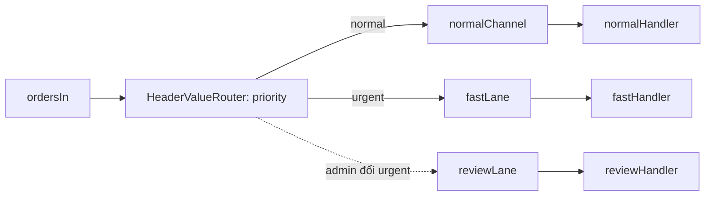
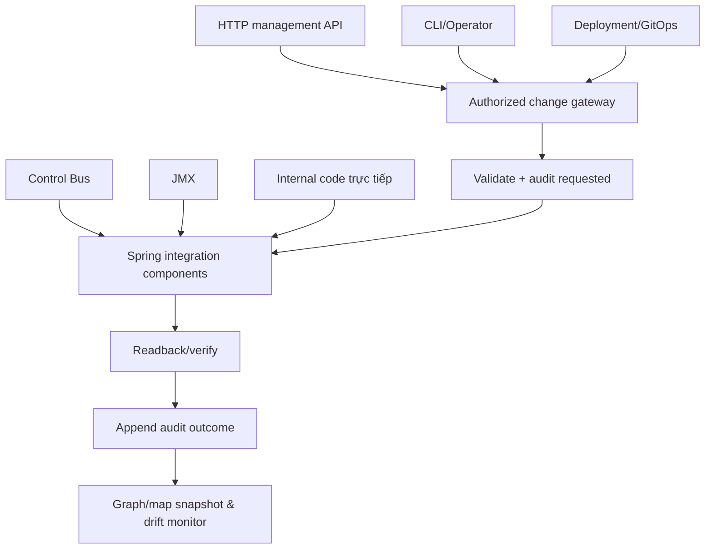
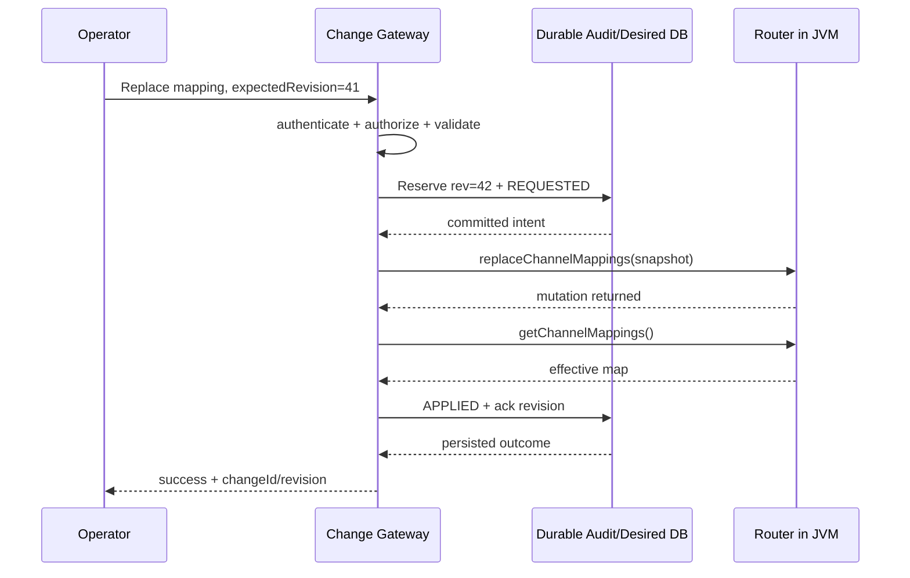
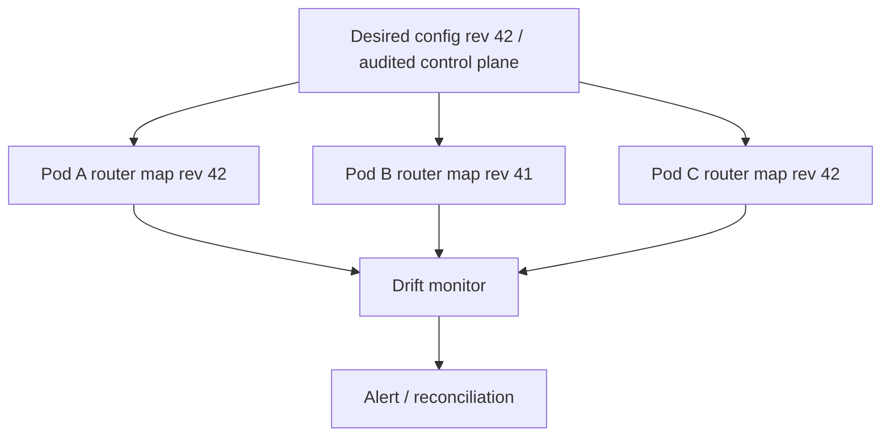
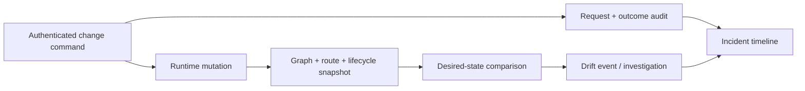
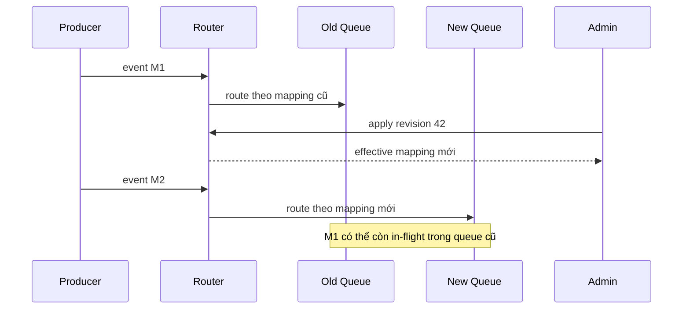

# Audit thay đổi topology hoặc route trong Spring Integration runtime

## 1. Vì sao cần audit thay đổi runtime?

Trong **SPRING_INTEGRATION_RUNTIME**, một message flow có thể nhận dữ liệu từ broker, HTTP hoặc file, đi qua `MessageChannel`, `Router`, `ServiceActivator`, `PollingConsumer`, `ExecutorChannel` và cập nhật business resource. Nhiều ứng dụng còn cho phép **đăng ký, start, stop hoặc xóa `IntegrationFlow`**, hoặc **đổi mapping của router khi JVM vẫn chạy**.

Đó là khả năng vận hành hữu ích, nhưng cũng là một bề mặt rủi ro: một thay đổi route có thể đưa payment sang handler khác; dừng consumer có thể làm message tích tụ; xóa dynamic flow có thể ngắt đường xử lý đang hoạt động. Những sự cố này không nhất thiết sinh ra exception lúc thao tác quản trị.

Bài thuộc chương **Bảo mật runtime** và trả lời:

> Khi topology hoặc bảng định tuyến thay đổi trong lúc chạy, làm sao biết **ai yêu cầu**, **được phép hay không**, **định thay đổi gì**, **thực tế đã thay đổi gì**, **trên instance nào**, **có ảnh hưởng đến message đang xử lý không**, và **có thể truy vết/khôi phục thế nào**?

**Audit log** không chỉ là một dòng `logger.info("route changed")`. Audit có mục đích bảo vệ tính giải trình, điều tra sự cố, phát hiện thay đổi trái phép và kiểm soát drift giữa các instance. Nó không tự bảo đảm mọi message được route đúng hoặc một operation đã commit trên resource bên ngoài.

Sau bài học, bạn có thể:

- Phân biệt **desired configuration**, **runtime topology**, **dynamic route mapping**, **lifecycle state**, **control-plane command** và **audit event**.
- Nhận diện những API có thể làm đổi runtime: `IntegrationFlowContext`, `IntegrationFlowRegistration`, router management, `Control Bus`, JMX và management endpoints.
- Thiết kế một cổng thay đổi tập trung với authentication/authorization, validation, change ID, before/after snapshot, outcome và append-only audit.
- Hiểu ranh giới tính nguyên tử: router mappings có thể đổi theo một lệnh, nhưng **in-memory mutation không cùng DB transaction với audit record**; nhiều JVM còn không cùng một atomic commit.
- Sử dụng `IntegrationGraphServer.getGraph()`/`rebuild()` để tạo snapshot topology và so sánh có kiểm soát, không nhầm graph với history.
- Thực hành quản lý router `setChannelMapping`, `removeChannelMapping`, `replaceChannelMappings`, `getChannelMappings` và giữ `channelKeyFallback=false` khi cần allowlist.
- Bảo vệ `Control Bus`, Spring Boot Actuator và những quản trị API khác khỏi thao tác trái phép, route injection và privilege escalation.
- Xây test audit cho authorized/denied requests, before/after, failed changes, concurrence, restart, dynamic flow removal và reconciliation.
- Kết hợp audit với metrics, traces, business correlation, incident runbook và retention/redaction policy.

Ví dụ dùng Java 17+, Spring Integration **6.5.x**, Spring Framework 6.x; Spring Security, JDBC và Spring Boot Actuator là những thành phần tùy tình huống. Bài đưa ra **thiết kế minh họa** chứ không giả định Spring Integration tự lưu audit history mỗi khi thay đổi topology.

## 2. Phạm vi: “thay đổi topology” khác “thay đổi route”

Trước hết cần phân biệt các sự kiện kỹ thuật:

| Hoạt động | API/nguồn thay đổi | Thực thể bị đổi | Có nên audit? |
|---|---|---|---|
| Đăng ký flow khi ứng dụng đang chạy | `IntegrationFlowContext.registration(...).register()` | Bean/endpoints/channels mới | Có |
| Start/stop flow động | `IntegrationFlowRegistration.start()/stop()` | Trạng thái lifecycle | Có |
| Hủy đăng ký flow | `IntegrationFlowRegistration.destroy()` | Registration và dependent beans | Có |
| Start/stop endpoint tĩnh | `SmartLifecycle.start()/stop()`, Control Bus/JMX | Consumer/poller activity | Có |
| Thêm/sửa một route key | `setChannelMapping(key, channel)` | Router lookup map | Có |
| Xóa route key | `removeChannelMapping(key)` | Router lookup map | Có |
| Thay nguyên bảng mapping | `replaceChannelMappings(Properties)` hoặc API programmatic phù hợp | Một snapshot mapping | Có |
| Đổi cấu hình executor/poller được quản lý | Control Bus/JMX/custom management | Runtime capacity/timing | Có khi ảnh hưởng vận hành |
| Gọi `IntegrationGraphServer.rebuild()` | Graph management/Actuator POST | **Cached graph model**, không tự đổi flow | Audit quản trị tùy policy, **không gọi là topology mutation** |
| Message được router chọn một branch | Router khi xử lý data | Đường đi của một message | Thuộc **trace/business log**, không phải config-change audit |
| Thay source code rồi deploy | GitOps/CI-CD | Desired config + process instance mới | Có audit deployment/change request |

Điểm đặc biệt: **route mapping có thể thay đổi dù node/link graph ít hoặc không thay đổi**. Một router vẫn cùng tên, vẫn nối vào các channels, nhưng key `"priority"` đã chuyển từ `fastLane` sang `manualReview`. Vì vậy, audit route phải lưu **mapping before/after** từ router API; không chỉ diff graph.

Ngược lại, `IntegrationFlowRegistration.stop()` có thể để topology tồn tại nguyên vẹn trong graph: thay đổi chủ yếu là lifecycle, không phải xóa node. Audit cần trường `operation=STOP` và kết quả `isRunning()` thực tế.

### Ví dụ topology



Một quản trị viên đổi mapping từ `urgent → fastLane` sang `urgent → reviewLane`. Sau đó:

- Message **đã được route** trước thời điểm đổi có thể vẫn ở executor/queue cũ.
- Message đi vào router sau thời điểm đổi có thể được route sang destination mới.
- Các messages xử lý **đúng vào lúc đổi** cần được đánh giá theo concurrency semantics của implementation.
- Không có bằng chứng rằng các business transactions của message trước đó được rollback.
- Một graph rebuild sau khi đổi mapping **không** chứng minh tất cả messages đã đi theo cấu hình mới.

## 3. Threat model cho control plane

Một endpoint quản trị thường ít traffic nhưng có quyền lực lớn. Một thao tác thay đổi route có thể làm gián đoạn hoặc chuyển dữ liệu sang nơi không mong muốn.

### Các tác nhân và rủi ro

| Tác nhân hoặc điều kiện | Nguy cơ | Biện pháp |
|---|---|---|
| Anonymous caller | Gọi endpoint đổi route | Deny by default, authn/authz |
| Người dùng đã đăng nhập nhưng thiếu quyền | Escalate bằng management API | RBAC/ABAC và least privilege |
| API key bị lộ | Thay topology hàng loạt | Secrets hygiene, short-lived credentials, rotation |
| Producer tự gửi header `routeKey` | Router fallback tới channel ngoài allowlist | `setChannelKeyFallback(false)`, mapping allowlist |
| Operator dùng Control Bus trực tiếp | Bỏ qua audit wrapper | Khóa nguồn tiếp cận; bắt mọi mutations qua cổng quản trị |
| JMX/Actuator bị expose rộng | Sửa trạng thái bean từ xa | Bind management private interface, auth, TLS, firewall |
| Nhiều admin cùng đổi router | Lost update/overwrite | Revision/CAS, serialization, conflict policy |
| Hai pods có mappings khác nhau | Message đi hai đường tùy pod | Desired-state store + per-instance reconciliation |
| Audit DB lỗi nhưng runtime đổi thành công | Không có record kết quả chắc chắn | Durable intent + reconciliation; fail-safe procedure |
| Audit record chứa payload/secret | Rò rỉ PII/token/URL có credentials | Strict schema/allowlist/redaction/encryption |
| Người vận hành xóa logs | Mất bằng chứng điều tra | Append-only storage, RBAC, retention, central shipping |

### Phân chia quyền theo hành động

- **VIEW_TOPOLOGY:** xem graph và route mappings đã lọc thông tin nhạy cảm.
- **CHANGE_ROUTE:** thay mapping theo router/channel allowlist.
- **MANAGE_FLOW:** register/start/stop/destroy dynamic flow, scope theo application/instance.
- **MANAGE_CONTROL_BUS:** quyền nhạy cảm cao để gọi những operations được cho phép.
- **AUDIT_READ:** đọc audit log theo phạm vi và retention policy.
- **AUDIT_ADMIN:** quản trị lưu trữ/retention, nên tách khỏi người được quyền sửa route.

Chỉ cần có `ROLE_ADMIN` trong một service khác **không** mặc định cho phép mọi thao tác control plane. Quyền và mục đích cần được ràng buộc với **target resource** cụ thể.

## 4. Các nguồn tạo thay đổi cần theo dõi

Một hệ thống có thể có nhiều cách sửa runtime cùng lúc.



Để audit toàn diện, **mọi đường thay đổi** phải được kiểm soát hoặc phát hiện:

1. Ưu tiên một **central change gateway** trong ứng dụng; chỉ wrapper này có quyền gọi các API mutable.
2. Khóa hoặc giới hạn `Control Bus`/JMX/Actuator/private management endpoints để không có đường vòng.
3. Với code nội bộ vẫn có thể gọi thẳng router, bổ sung **drift detection**: so sánh desired state và live state theo chu kỳ/sau deploy.
4. Thu thập Git/CI-CD audit cho các thay đổi **khi build/deploy**, vì không phải mọi cấu hình được đổi qua runtime API.
5. Ghi rõ thao tác do **operator** hay **reconciler tự động** khởi tạo; automation identity cũng phải kiểm tra quyền.

**Không mặc định** Spring Integration phát một event chuẩn kiểu `RouteMappingChangedEvent` hoặc `IntegrationFlowChangedEvent` cho mọi thay đổi. Những events trong bài là **ứng dụng tự định nghĩa**, không phải contract của framework.

## 5. Audit event tối thiểu cần chứa gì?

Một record tốt cho phép trả lời 7 câu: **ai, ở đâu, khi nào, vì sao, thay đổi gì, kết quả ra sao, kiểm tra thế nào**.

| Field | Ví dụ | Ý nghĩa |
|---|---|---|
| `auditId` | `aud-01J...` | Định danh một audit record |
| `changeId` | `chg-2026-0142` | Gom các records của cùng request |
| `operation` | `ROUTE_REPLACE` | Loại thao tác |
| `actorType`/`actorId` | `HUMAN/alice` hoặc `SERVICE/reconciler` | Identity từ authenticated boundary |
| `authorizationDecision` | `ALLOW`/`DENY` | Quyết định policy |
| `targetType`/`targetId` | `ROUTER/ordersRouter` | Resource bị tác động |
| `application`/`instance` | `orders-runtime/pod-a` | Phạm vi JVM/replica |
| `occurredAt` | Timestamp UTC | Thời điểm ghi sự kiện |
| `requestedRevision` | `42` | Desired revision trước khi đổi |
| `expectedRevision` | `41` | CAS/precondition chống lost update |
| `beforeHash`/`afterHash` | SHA-256 of canonical route map | Phát hiện drift/tamper |
| `changedFields` | `urgent:fastLane→reviewLane` | Chỉ những cấu hình đã đổi |
| `outcome` | `REQUESTED`, `APPLIED`, `REJECTED`, `FAILED`, `UNKNOWN` | Kết quả có thể kiểm chứng |
| `reason`/`ticket` | `INC-2417` | Business reason/approval |
| `traceId` | `abcd...` | Liên kết traces khi có |
| `errorCode` | `CONFLICT_REVISION` | Phân loại lỗi, không log secret |

### Các outcome nên được định nghĩa chặt

- **REQUESTED:** đã ghi nhận ý định, chưa chứng minh runtime đổi.
- **REJECTED:** policy, validation hoặc revision check từ chối; không gọi mutation.
- **APPLIED:** mutation trả về và readback phù hợp **trên target instance được kiểm tra**.
- **FAILED:** mutation không hoàn thành theo contract hoặc readback không khớp.
- **UNKNOWN:** đã có dấu hiệu mutation nhưng không thể xác nhận hiệu lực/audit commit; phải reconcile.
- **RECONCILED:** qua kiểm tra lại, trạng thái thực đã được đồng bộ với desired state.

Đừng gắn `APPLIED` khi chỉ gửi HTTP 202 hoặc khi `send()` vào management channel trả true. Một command có thể được queue rồi xử lý bất đồng bộ; audit phải phân biệt **accepted** và **effective**.

### Không nên lưu gì?

- Raw Spring `Message<?>`, payload, message-group contents hay business PII.
- Authorization header, JWT, password, OAuth client secret, broker credentials.
- Full SpEL command string nhận từ người dùng nếu có thể chứa dữ liệu nhạy cảm.
- Nguyên `SecurityContext`, `Reactor ContextView` hoặc các object bean.
- Stack traces đầy đủ trong audit DB chính nếu không có chính sách bảo mật/retention.
- Toàn graph JSON không được lọc, vì custom properties có thể chứa nội dung nhạy cảm.

Nếu cần chứng cứ chi tiết hơn, lưu artifact đã **redact** ở kho bảo mật và chỉ lưu digest/reference trong audit record.

## 6. Phân biệt request log, audit log và message trace

| Dữ liệu | Ví dụ | Thời hạn và mục đích |
|---|---|---|
| Application log | “router initialized”, exception stack | Chẩn đoán kỹ thuật; có thể sampled |
| HTTP access log | POST /admin/routes, latency, status | Theo dõi truy cập; không đủ before/after |
| Audit event | actor=alice, mapping urgent→review, APPLIED, revision=42 | Truy vết thay đổi quản trị, không nên sampled |
| Distributed trace | Controller → validation → router update → DB audit writer | Tương quan/latency, có thể sampled |
| Message history | Event M12 đi qua handler A/B/C | Dòng xử lý data plane |
| Desired-state record | Revision 42: route map toàn ứng dụng | Nguồn cấu hình để khôi phục |
| Runtime snapshot | Graph + live mappings trên pod A | Bằng chứng trạng thái tại một thời điểm |

Một operator có thể hỏi “**ai đã đổi route?**” — message history không trả lời được. Ngược lại, audit event `ROUTE_REPLACE` không cho biết “**message M12 đã chạy qua channel nào?**” nếu không có tracing/business evidence.

Dùng `changeId` liên kết operation, còn `eventId`/`correlationId` dành cho business event. Không dùng business event ID làm Prometheus metric label vì cardinality cao.

## 7. Dynamic router: API và lỗ hổng fallback

Các router dựa trên `AbstractMappingMessageRouter` (trong đó có `HeaderValueRouter`) có những methods quản trị:

```java
router.getChannelMappings();

router.setChannelMapping("urgent", "reviewLane");
router.removeChannelMapping("urgent");

// Thay snapshot mapping qua Properties:
Properties next = new Properties();
next.setProperty("normal", "normalLane");
next.setProperty("urgent", "reviewLane");
router.replaceChannelMappings(next);
```

`router` trong ví dụ là một bean kiểu `MappingMessageRouterManagement`/`HeaderValueRouter` đã được inject. `Properties` thuộc `java.util.Properties`. Các methods này thay đổi **cấu hình runtime**, không phải business transaction.

### Chọn thao tác theo tính nguyên tử

| API | Đặc điểm | Tình huống |
|---|---|---|
| `setChannelMapping(key, name)` | Thêm/ghi đè một key | Đổi một route |
| `removeChannelMapping(key)` | Xóa một key | Hủy một route |
| Gọi remove rồi set | **Hai thao tác không nguyên tử** | Nguy cơ trạng thái trung gian |
| `replaceChannelMappings(Properties)` | Thay cả bảng mappings theo thao tác quản trị nguyên tử được document | Đổi đồng thời nhiều routes |
| `setChannelMappings(Map<String,String>)` | API programmatic type-safe cho mapping set | Đổi mapping bằng code; kiểm tra semantics version |
| `getChannelMappings()` | Lấy bản unmodifiable view/map của mappings | Before/after snapshot |

Theo tài liệu Spring Integration, **remove một mapping rồi add mapping mới là hai operations, không atomic với nhau**. `replaceChannelMappings(Properties)` hỗ trợ cập nhật nguyên bảng. “Atomic map replacement” chỉ nói về việc cập nhật **mapping table** trong router, **không** nói toàn bộ flows/DB/brokers đã đổi trong cùng transaction.

### Route key fallback có thể mở đường không mong muốn

Mặc định, khi không tìm thấy mapping, router có thể dùng chính channel key như channel name. Nếu message producer kiểm soát header định tuyến, nó có thể thử đi tới một channel nội bộ không được thiết kế để nhận input.

Ví dụ:

```text
Input header routeKey = "ordersRouterInput"

Không có mapping cho key này
Nếu channelKeyFallback=true:
    router thử resolve channel name="ordersRouterInput"
    có thể loop trở lại input router hoặc lộ path không mong muốn
```

Đối với route do input không đáng tin quyết định, nên:

- `setChannelKeyFallback(false)` hoặc DSL `channelKeyFallback(false)`.
- Chỉ cho phép key/channel thuộc danh sách được kiểm soát.
- Đặt default output channel an toàn cho unknown key, hoặc fail closed.
- Kiểm tra loop, sensitive channels, dead-letter paths và phản ứng khi destination chưa tồn tại.
- Audit mọi thay đổi allowlist/mapping, không chỉ successful sends.

**Audit không thay authorization.** Một record “anonymous đã đổi route” là bằng chứng hậu kiểm, không phải cơ chế ngăn thay đổi.

## 8. Ví dụ Java: một change gateway có audit before/after

Đây là **mẫu ứng dụng minh họa** cho Spring Integration 6.5. API router là của framework; `AuditStore`, `ChangeRequest` và policy trong ví dụ là lớp nghiệp vụ **tự xây**, không phải Spring Integration tự cung cấp.

### 8.1. Khai báo immutable command và outcome

```java
package example.audit;

import java.util.Map;

public record RouteChangeRequest(
        String changeId,
        String routerId,
        long expectedRevision,
        Map<String, String> desiredMappings,
        String reason) {
}

public record RouteChangeResult(
        String changeId,
        String routerId,
        long newRevision,
        Map<String, String> effectiveMappings) {
}
```

Trong Java thật, mỗi public top-level record cần đặt trong tệp nguồn đúng tên. `desiredMappings` là dữ liệu request; service phải **copy, validate và normalize** trước khi sử dụng, không giữ tham chiếu đến một mutable `Map` do caller có thể sửa.

### 8.2. Contract của audit store và revision store

```java
package example.audit;

import java.time.Instant;
import java.util.Map;

public interface RouteAuditStore {

    void append(
            String changeId,
            String stage,
            String actorId,
            String routerId,
            Map<String, String> before,
            Map<String, String> after,
            Instant occurredAt,
            String reason);

    long currentRevision(String routerId);

    // Compare-and-set trên persistent desired-state revision.
    // Cần một DB/registry triển khai đảm bảo concurrency.
    long reserveRevision(
            String routerId, long expectedRevision, String changeId);

    void markRevisionApplied(String changeId);
}
```

Đây là **interface demo**, chưa có implementation; khi dùng production cần DB schema, unique constraints, transaction management, idempotency và consistency policy. `reserveRevision` nên là thao tác atomic/CAS trên durable store, không phải `get() + set()` không khóa.

### 8.3. Service quản lý thay đổi

```java
package example.audit;

import java.time.Instant;
import java.util.Map;
import java.util.Properties;
import java.util.TreeMap;

import org.springframework.beans.factory.ListableBeanFactory;
import org.springframework.integration.support.management.MappingMessageRouterManagement;
import org.springframework.messaging.MessageChannel;
import org.springframework.security.access.prepost.PreAuthorize;
import org.springframework.stereotype.Service;

@Service
public class AuditedRouteManager {

    private final MappingMessageRouterManagement router;
    private final RouteAuditStore audit;
    private final ListableBeanFactory beans;

    public AuditedRouteManager(
            MappingMessageRouterManagement router,
            RouteAuditStore audit,
            ListableBeanFactory beans) {
        this.router = router;
        this.audit = audit;
        this.beans = beans;
    }

    @PreAuthorize("hasAuthority('INTEGRATION_ROUTE_WRITE')")
    public RouteChangeResult replace(
            RouteChangeRequest request,
            String verifiedActorId) {

        // verifiedActorId được tầng authentication/authorization
        // tin cậy cung cấp, KHÔNG lấy nguyên văn từ request header.
        if (!"ordersRouter".equals(request.routerId())) {
            throw new IllegalArgumentException("Router không được phép");
        }

        Map<String, String> desired =
                Map.copyOf(request.desiredMappings());

        for (var entry : desired.entrySet()) {
            String key = entry.getKey();
            String channel = entry.getValue();

            if (!java.util.Set.of("normal", "urgent").contains(key)) {
                throw new IllegalArgumentException(
                        "Unknown route key");
            }
            if (!java.util.Set.of("normalLane", "reviewLane")
                    .contains(channel)) {
                throw new IllegalArgumentException(
                        "Destination not allowed");
            }

            // Fail closed nếu bean không tồn tại hoặc sai type.
            beans.getBean(channel, MessageChannel.class);
        }

        // Bắt buộc các callers trên cùng JVM đi qua gateway
        // hoặc có một change coordinator serialize mutations.
        Map<String, String> before =
                new TreeMap<>(router.getChannelMappings());

        // Chỉ một method reserveRevision là atomic,
        // KHÔNG bao luôn mutation trong RAM.
        long revision = audit.reserveRevision(
                request.routerId(),
                request.expectedRevision(),
                request.changeId());

        audit.append(
                request.changeId(),
                "REQUESTED",
                verifiedActorId,
                request.routerId(),
                before,
                desired,
                Instant.now(),
                request.reason());

        try {
            Properties mappings = new Properties();
            desired.forEach(mappings::setProperty);

            // Một thao tác thay cả bảng mapping.
            router.replaceChannelMappings(mappings);

            Map<String, String> effective =
                    new TreeMap<>(router.getChannelMappings());
            if (!effective.equals(desired)) {
                throw new IllegalStateException(
                        "Runtime mapping mismatch");
            }

            audit.append(
                    request.changeId(),
                    "APPLIED",
                    verifiedActorId,
                    request.routerId(),
                    before,
                    effective,
                    Instant.now(),
                    request.reason());

            audit.markRevisionApplied(request.changeId());
            return new RouteChangeResult(
                    request.changeId(),
                    request.routerId(),
                    revision,
                    Map.copyOf(effective));
        }
        catch (RuntimeException failure) {
            // Trong production, cần try/catch riêng cho audit
            // failure và ghi trạng thái UNKNOWN nếu không xác
            // nhận được mutation. Không làm giả việc rollback.
            audit.append(
                    request.changeId(),
                    "FAILED_OR_UNKNOWN",
                    verifiedActorId,
                    request.routerId(),
                    before,
                    new TreeMap<>(router.getChannelMappings()),
                    Instant.now(),
                    request.reason());
            throw failure;
        }
    }
}
```

**Phạm vi của code:** đây là mẫu thiết kế để minh họa từng bước, **không phải một service đã đảm bảo atomicity end-to-end**. Chưa có implementation cho `RouteAuditStore`, thiếu cơ chế serialize concurrent mutations đa thread/đa pod, và `@PreAuthorize` chỉ có hiệu lực khi Spring Method Security được enable và method được gọi qua proxy. Tầng API phải lấy actor ID từ authentication đã xác minh, không truyền tùy ý từ JSON.

Cần cải thiện trước production:

1. **Authorization trước cả validation có thể lộ tên router/channel**; Spring Method Security giúp deny nhưng mọi ingress phải dùng đúng bean proxy.
2. **Validate reason, changeId, request size, key/value length** và chống replay.
3. **Serialize mutations trên từng router**. `reserveRevision` kiểm soát revision, nhưng không tự khóa việc update in-memory nếu nhiều requests cùng tiến hành; cần per-router lock/queue/coordinator.
4. **Ghi durable intent trước apply**. Trong snippet `reserveRevision` và `append REQUESTED` không nằm trong cùng DB transaction; implementation production nên gộp chúng thành một thao tác bền vững, hoặc có recovery cho reservation treo.
5. **Audit write sau mutation có thể fail**. Khi đó runtime đã đổi, nhưng không có `APPLIED`; phải đánh dấu `UNKNOWN` qua cơ chế độc lập và reconcile.
6. **Không gắn `@Transactional` để suy ra router mutation rollback theo DB**: runtime mappings là in-memory state không tham gia local JDBC transaction.
7. **Không ghi raw secret/PII** trong `desiredMappings`/`reason`; chỉ cho phép các channel IDs nghiệp vụ đã phê duyệt.
8. **Không cho đường vòng** như Control Bus/JMX trực tiếp sửa `ordersRouter` mà không qua gateway và audit/reconciliation.
9. **Verification là point-in-time**: sau readback, một flow khác vẫn có thể thay route; cần continuous drift detection và revision checks.

### 8.4. Cấu hình router và đầu vào

```java
package example.audit;

import org.springframework.context.annotation.Bean;
import org.springframework.context.annotation.Configuration;
import org.springframework.integration.router.HeaderValueRouter;

@Configuration
public class RouterConfig {

    @Bean("ordersRouter")
    public HeaderValueRouter ordersRouter() {
        HeaderValueRouter router =
                new HeaderValueRouter("priority");

        router.setChannelKeyFallback(false);
        router.setChannelMapping("normal", "normalLane");
        router.setChannelMapping("urgent", "reviewLane");
        return router;
    }
}
```

Ví dụ trên chỉ tạo router bean. Để router thật sự nhận Spring Messages cần **endpoint/IntegrationFlow** gắn router với input channel và có các channel beans `normalLane`/`reviewLane`. Không gọi nó là runnable flow độc lập khi chưa nối vào message pipeline.

Nếu có nhiều router triển khai `MappingMessageRouterManagement` trong context, constructor injection của `AuditedRouteManager` phải có `@Qualifier("ordersRouter")` hoặc cấu hình injection theo tên; ví dụ chỉ giả định một bean router phù hợp.

## 9. Audit theo nhiều bước và giới hạn transaction

Thiết kế quản trị cần phân biệt ba mốc:



Nếu JVM crash sau `REQUESTED` nhưng trước `replaceChannelMappings`, audit vẫn có ý định chưa hoàn tất. Nếu crash sau runtime mutation nhưng trước `APPLIED`, record chưa có outcome chắc chắn. Đây không phải lý do bỏ audit, mà là lý do cần **reconciliation**.

### Failure windows

| Điểm crash/lỗi | Durable audit | Runtime mapping | Điều cần làm |
|---|---|---|---|
| Trước REQUESTED commit | Không có intent | Chưa đổi | Caller retry với idempotency key |
| Sau REQUESTED, trước mutation | Intent tồn tại | Chưa đổi | Reconciler kiểm tra và tiếp tục/hủy |
| Trong mutation | Intent tồn tại | Chưa xác định | Readback, xác định effective state |
| Sau mutation, trước APPLIED | Intent còn pending | Có thể đã đổi | Reconcile, ghi outcome thật |
| Sau APPLIED | Applied record bền | Đã kiểm tra tại thời điểm đó | Theo dõi drift/restart |
| Audit sink lỗi sau mutation | Có thể thiếu outcome | Có thể đã đổi | Fail-safe: UNKNOWN + alert + reconcile |
| Pod A đổi, Pod B chưa đổi | Có applied ở A | Cluster không đồng bộ | Per-instance rollout/acks |

Một local `@Transactional` không biến DB audit và in-memory router thành một atomic transaction. Dùng pattern **desired state + intent/audit + applied acknowledgment + periodic drift reconciliation**, chọn một nguồn sự thật cho revision.

### Không tự rollback route tùy tiện

Nếu audit write failed sau khi route đã đổi, việc cố gọi `replaceChannelMappings(before)` có thể làm tệ hơn:

- Trong lúc đó admin B có thể vừa áp dụng revision mới.
- Messages đã được route theo mapping tạm thời; rollback không lấy chúng về.
- Một rollback tự động có thể làm mất một thay đổi hợp lệ hơn.

Muốn rollback phải dùng **compare-and-set theo revision**, xác minh current state và tạo một **change request riêng có audit**, chứ không làm một mutation bí mật.

## 10. Audit start, stop, register, destroy của IntegrationFlow

`IntegrationFlowContext` cho phép đăng ký flow khi đang chạy:

```java
IntegrationFlow flow = ...;

IntegrationFlowContext.IntegrationFlowRegistration registration =
        flowContext.registration(flow)
                .id("orders-runtime-v2")
                .autoStartup(false)
                .register();

registration.start();
registration.stop();
registration.destroy();
```

Các API này thuộc Spring Integration; `flowContext` là bean đã inject và `flow` là DSL flow phù hợp. Code cần bảo đảm registration ID duy nhất và đặt đúng lifecycle scope.

### Sự kiện audit cho từng hành động

| Operation | Before snapshot | After snapshot | Kết quả cần xác minh |
|---|---|---|---|
| `REGISTER` | Không có registration ID; graph chưa có nodes mới | Registration ID, nodes/links mới | Bean/endpoint được đăng ký đúng |
| `START` | `registration.isRunning=false` | `isRunning=true` | Lifecycle đổi; test message flow nếu cần |
| `STOP` | `isRunning=true` | `isRunning=false` | Không nhận work mới theo contract |
| `DESTROY` | Registration còn tồn tại | Registration biến mất | Dependent beans/graph được refresh |
| `REPLACE_FLOW` | Flow version A | Version B | Traffic cutover/rollback plan được theo dõi |

**Sự thật quan trọng:** `STOP` không chắc làm mọi handler đang in-flight dừng ngay. Một task đã submit qua `ExecutorChannel` có thể vẫn chạy. `DESTROY` không tự xóa messages khỏi external broker/JDBC store, không rollback remote HTTP và không đảm bảo drain queue.

Vì vậy audit nên ghi:

- `requestedAt`, `effectiveAt` và `observedAt`.
- `drainPolicy`: stop intake trước, chờ in-flight, timeout, rồi stop consumers.
- `pendingMessageCount` tại thời điểm đo, nếu biết.
- `instanceId` và `registrationId`.
- `flowVersion/hash` hoặc reference tới signed deployment manifest.

### Pseudocode wrapper cho dynamic registration

```java
// Pseudocode: AuditWorkflow, guard và registry là lớp ứng dụng.
// Không có transaction tự động giữa FlowContext và Audit DB.
auditWorkflow.authorizedChange(
        actor,
        "FLOW_REGISTER",
        "orders-runtime-v2",
        changeId,
        () -> {
            var reg = flowContext
                    .registration(flowFactory.build(version))
                    .id("orders-runtime-v2")
                    .autoStartup(false)
                    .register();

            try {
                graphServer.rebuild();
                verifyRegistration(reg);
                reg.start();
                verifyFlowReady(reg);
                return reg.getId();
            }
            catch (RuntimeException ex) {
                // Chính sách cleanup/compensation cần được định nghĩa.
                reg.destroy();
                graphServer.rebuild();
                throw ex;
            }
        });
```

`verifyFlowReady` là kiểm tra riêng theo flow, không chỉ `isRunning()`. Đừng tự gửi một business payment message thật như health probe; dùng canary/synthetic message được đánh dấu, hoặc kiểm tra wiring/lifecycle an toàn.

### Hai bản flow cùng chạy

Trong rolling upgrade, flow cũ A và flow mới B có thể tồn tại đồng thời. Audit phải trả lời **từ thời điểm nào traffic chuyển**, **có message nào duplicate/lost trong cutover**, **flow A đã drain chưa**. Một `REGISTER/APPLIED` log không đủ để bảo đảm exactly-once business effect.

## 11. Control Bus: kênh quản trị mạnh, cần khóa kỹ

Spring Integration có `Control Bus` để gọi các operations quản trị qua message channel. Theo tài liệu 6.5, command thường ở dạng `beanName.methodName`; arguments nằm trong header `IntegrationMessageHeaderAccessor.CONTROL_BUS_ARGUMENTS`.

Ví dụ quản lý router mapping:

```java
import java.util.List;
import java.util.Properties;

import org.springframework.integration.IntegrationMessageHeaderAccessor;
import org.springframework.messaging.Message;
import org.springframework.messaging.support.MessageBuilder;

Properties mappings = new Properties();
mappings.setProperty("normal", "normalLane");
mappings.setProperty("urgent", "reviewLane");

Message<?> command = MessageBuilder
        .withPayload("'ordersRouter'.replaceChannelMappings")
        .setHeader(
                IntegrationMessageHeaderAccessor.CONTROL_BUS_ARGUMENTS,
                List.of(mappings))
        .build();

// Chỉ gửi nếu có một management channel đã được
// bảo vệ, authorized, audit đầy đủ.
// operationChannel.send(command);
```

Tên bean thực tế của router management có thể là endpoint/handler bean khác tùy cách đăng ký. Command payload là **một chuỗi quản trị**, không phải message nghiệp vụ thông thường.

### Vì sao Control Bus nhạy cảm?

- Có thể gọi các `@ManagedOperation`/`@ManagedAttribute` phù hợp hoặc các lifecycle operations được framework cho phép.
- Có thể start/stop components, thay mappings hoặc cấu hình executor/scheduler ở những API được expose.
- Nếu một `MessageChannel` cho Control Bus có thể nhận messages từ user/producer không tin cậy, đó là đường tác động lên hệ thống mà không cần đi qua HTTP admin API.

Spring Integration có cơ chế kiểm soát danh sách commands/methods đủ điều kiện, **nhưng điều đó không thay authentication/authorization của người gửi**.

### Mẫu phòng thủ

1. Chỉ expose Control Bus trên management ingress được bảo vệ, không nối vào business input channel.
2. Áp dụng authentication/authorization trước khi gửi command.
3. Ưu tiên một **allowlisted management facade**, không cho operator gửi arbitrary bean/method string.
4. Áp dụng channel security interceptor hoặc policy enforcement phù hợp nếu dùng Spring Integration Security.
5. Audit `actor, action, target, arguments đã lọc, outcome` tại lớp facade; không chỉ log message payload.
6. Không cho anonymous/untrusted producer tự chọn `CONTROL_BUS_ARGUMENTS`.
7. Kiểm soát JMX và bất kỳ interface quản trị khác để không bypass audit path.
8. Bảo vệ management network bằng TLS, private routing, firewall và short-lived identity.

**Không coi Control Bus payload là chuỗi SpEL tùy ý không giới hạn**; các phiên bản mới có command registry/allowed methods. Nhưng một method được phép vẫn có thể gây tác động rất lớn, nên cần authorization theo resource và audit.

## 12. Router mapping thay đổi nguyên tử không có nghĩa toàn cluster đổi đồng thời

`replaceChannelMappings(Properties)` cho phép một router thay đổi bảng mapping trong một thao tác thay vì tuần tự remove/add. Nhưng bối cảnh triển khai thường là nhiều JVM hoặc pods.



**Không có distributed atomicity mặc định** giữa `HeaderValueRouter` của các pods. Một thay đổi được applied trên A không đồng nghĩa B đã thay đổi. Cần chiến lược:

- Tạo revision duy nhất ở một **desired-state registry** (database/GitOps/config service).
- Từng instance nhận revision, validate, apply và đọc lại effective mappings.
- Ghi **APPLIED ack theo instance** và timestamp.
- Chỉ công bố rollout completed khi đạt điều kiện quorum/all-instances phù hợp nghiệp vụ.
- Nếu một pod offline, audit `PENDING` và tiếp tục reconcile sau khi nó quay lại.
- Dùng canary/blue-green route cutover hoặc stop intake nếu cần tránh hai phiên bản định tuyến cùng tồn tại.

### Drift detection

```text
desiredRevision = 42
desiredHash     = sha256(canonical map rev42)

pod-a: effectiveHash = desiredHash  -> IN_SYNC
pod-b: effectiveHash = oldHash      -> DRIFT
pod-c: not reachable                 -> UNKNOWN
```

Hash phải được tính trên cấu trúc canonical ổn định: sorted keys, encoding UTF-8, escape/length rõ, versioned serialization. `Map.toString().hashCode()` không phải một digest audit đáng tin cậy.

### Concurrency trên một instance

Hai admin cùng sửa mapping có thể race:

```text
Admin A đọc revision 41, muốn map X
Admin B đọc revision 41, muốn map Y
A reserve rev42 và apply X
B nếu không có CAS/coordinator sẽ apply Y sau đó
A trả về thành công nhưng route đã không còn X
```

Phải có CAS trên revision và **serialize mutation theo router**, hoặc route updates qua một single-threaded reconciliation pipeline. Chỉ đồng bộ `getChannelMappings()` lúc đọc không đủ.

## 13. IntegrationGraphServer: snapshot, không phải audit log

`IntegrationGraphServer` dựng runtime object model:

```java
IntegrationGraphServer graphServer = ...;

Graph cached = graphServer.getGraph();
Graph current = graphServer.rebuild();
```

`getGraph()` trả graph cached, `rebuild()` quét lại các integration components để có nodes/links mới sau khi thêm/xóa flow. Nó **không** có API “ai đã thay đổi route lúc 13:32” hoặc tự lưu các revision history.

### Một graph snapshot gồm gì?

- `Graph.getContentDescriptor()`: provider, version, application name...
- `Graph.getNodes()`: integration nodes với `nodeId`, name, component type và properties.
- `Graph.getLinks()`: những links `from/to/type` giữa nodes.

Snapshot sau `rebuild()` có thể khác dù không có change request, ví dụ dynamic component do code khác đăng ký. Ngược lại, dynamic router mapping có thể đổi mà graph link representation không đủ để ghi nhận mọi key/value cụ thể.

### Tránh diff sai do nodeId

`nodeId` là định danh dùng **trong graph snapshot**, không nên coi stable giữa rebuild/restart. Khi diff:

1. Map `nodeId → stable name/type` trong cùng snapshot.
2. Chuẩn hóa links thành `sourceStableName + linkType + targetStableName`.
3. So sánh sets nodes/links và xác minh component names không bị trùng/auto-generated khó hiểu.
4. Tạo hash snapshot canonical, kèm application/instance/version.
5. **Bổ sung route mappings riêng** từ `MappingMessageRouterManagement.getChannelMappings()`.
6. Với lifecycle thay đổi, đọc `SmartLifecycle.isRunning()` thay vì coi graph presence là đang chạy.

### Pseudocode canonical link diff

```java
Graph graph = graphServer.rebuild();

Map<Integer, String> byId = graph.getNodes().stream()
        .collect(java.util.stream.Collectors.toMap(
                node -> node.getNodeId(),
                node -> node.getName()
                        + "#" + node.getComponentType()));

Set<String> links = graph.getLinks().stream()
        .map(link -> byId.get(link.getFrom())
                + "|" + link.getType()
                + "|" + byId.get(link.getTo()))
        .collect(java.util.stream.Collectors.toCollection(
                java.util.TreeSet::new));
```

Đây là code minh họa cần imports cho `Map`, `Set`, `Graph`. Trong môi trường production, tên có thể không unique toàn cluster; thêm namespace/bean registration ID/instance version trước khi hash. Không dùng code này để audit route mapping chi tiết nếu router map không nằm trong link metadata.

### Actuator integrationgraph

Spring Boot có `GET /actuator/integrationgraph` để xem graph và có thể hỗ trợ `POST` để yêu cầu rebuild khi có quyền write. **POST rebuild không làm mutate flow topology**; audit nó là management read/refresh operation nếu policy cần, không ghi thành `FLOW_REGISTER`/`ROUTE_UPDATE`.

Cần bảo mật Actuator exposure, đặc biệt management endpoints có hành động write. `management.endpoint.integrationgraph.access=read-only` trong Boot hỗ trợ access control giúp giới hạn thao tác, nhưng không tự xác thực user khi application có cấu hình Spring Security tùy chỉnh.

## 14. Audit topology bằng hai lớp: command audit + snapshot diff

Chỉ ghi commands có thể bỏ sót người/cơ chế thay đổi trực tiếp; chỉ diff snapshots lại không biết ai gây ra thay đổi. Vì vậy nên kết hợp:



**Audit command** trả lời *ai yêu cầu và vì sao*. **Snapshot diff** trả lời *cấu hình thực tế đã khác gì giữa hai thời điểm*. **Trace/log/message history** giúp điều tra *các messages nào bị ảnh hưởng*.

### Nên chụp snapshot khi nào?

- Sau `ApplicationContext` start, trước khi nhận critical traffic.
- Trước/sau một thay đổi management được phê duyệt.
- Sau register/destroy dynamic flow, trước khi đánh dấu operation applied.
- Sau deploy/rolling restart và khi một pod quay lại.
- Theo lịch với tần suất có giới hạn để phát hiện direct mutation chưa audit.
- Khi có incident “traffic đi sai route” hoặc “endpoint bị dừng”.

Không gọi `graphServer.rebuild()` mỗi khi xử lý một message: graph refresh là công việc control plane. Không lưu raw graph liên tục nếu quá lớn và chứa nội dung nhạy cảm; dùng digest + snapshot đã lọc.

### So sánh route đúng nguồn

```text
Graph diff:
    handler A + channel X có còn nối với nhau không?

Mapping diff:
    route key "urgent" hiện trỏ tới channel nào?

Lifecycle diff:
    endpoint có running không?

Deployment diff:
    instance/pod nào dùng code/config revision nào?
```

Cần cả bốn khi điều tra incident đa phiên bản.

## 15. Lưu audit event bền vững: schema minh họa

Một bảng PostgreSQL có thể được thiết kế:

```sql
-- Minh họa: kiểu JSONB/timestamptz thuộc PostgreSQL.
CREATE TABLE integration_control_audit (
    audit_id          UUID PRIMARY KEY,
    change_id         VARCHAR(80) NOT NULL,
    event_sequence    INTEGER NOT NULL,
    operation         VARCHAR(48) NOT NULL,
    stage             VARCHAR(32) NOT NULL,
    actor_type        VARCHAR(24) NOT NULL,
    actor_id          VARCHAR(128) NOT NULL,
    application_id    VARCHAR(128) NOT NULL,
    instance_id       VARCHAR(128),
    target_type       VARCHAR(48) NOT NULL,
    target_id         VARCHAR(160) NOT NULL,
    expected_revision BIGINT,
    resulting_revision BIGINT,
    before_hash       CHAR(64),
    after_hash        CHAR(64),
    diff_redacted     JSONB,
    reason_code       VARCHAR(64),
    ticket_id         VARCHAR(80),
    occurred_at       TIMESTAMPTZ NOT NULL,
    CONSTRAINT uq_audit_change_seq
        UNIQUE(change_id, event_sequence)
);

CREATE INDEX idx_audit_target_time
    ON integration_control_audit (
        application_id, target_type, target_id, occurred_at
    );
```

Schema này chỉ là **một lưu trữ audit event**; phải bổ sung desired-state/revision table, index/retention/partition strategy, constraints về stage transition và quyền DB nếu triển khai thật.

### Append-only phải được thực thi, không chỉ đặt tên

- Role ứng dụng chỉ có `INSERT`/`SELECT` cần thiết; không có `UPDATE`/`DELETE` trên audit table cho account thông thường.
- Retention/purge được thực hiện bằng quy trình có phê duyệt và lịch sử riêng.
- Có backup, quyền truy cập tách biệt, encryption at rest và TLS.
- Đối với yêu cầu tamper-evidence cao, có thể dùng hash chain/signed digests/WORM storage ở hệ lưu trữ độc lập.
- Audit pipeline nên có alert khi append failure, lag hoặc storage gần đầy.
- Không được “fix” thiếu record bằng cách tự phát minh actor/outcome khi reconcile.

Nếu app có quyền sửa hoặc xóa mọi record, bảng audit đơn thuần **không bảo đảm chống sửa lịch sử**.

### Đảm bảo idempotency change request

Một HTTP client có thể timeout sau khi runtime đã đổi; gửi lại cùng `changeId` không được áp dụng revision hai lần mà không kiểm tra.

```text
POST changeId=chg-42, expectedRevision=41

Lần 1:
   reserve+apply -> rev42
   client timeout trước response

Lần 2 (cùng changeId):
   tra record/desired state
   trả effective result hoặc reconciliation status
   không lặng lẽ tạo rev43
```

Áp dụng unique constraint vào `changeId`/target/operation theo contract; cố định content hash để phát hiện client dùng lại cùng key cho **nội dung khác**.

## 16. Actor identity: security context không tự đi qua async boundary

Trong Spring MVC imperative request, authentication có thể được truy cập qua `SecurityContextHolder`. Nhưng khi management command được gửi qua `ExecutorChannel`, `QueueChannel` hoặc một broker, `ThreadLocal` của HTTP request **không tự lan tới worker**.

Sai lầm nguy hiểm:

```java
// Trong một worker bất đồng bộ:
Authentication auth =
        SecurityContextHolder.getContext().getAuthentication();

// auth có thể null hoặc không còn là principal của người
// đã yêu cầu change, nếu không có propagation phù hợp.
```

Cách làm đúng:

1. Xác thực request tại **trusted ingress** (API gateway/app controller).
2. Authorize actor theo action và target resource.
3. Tạo `AuthorizedChangeCommand` bất biến, chứa `actorId` đã xác minh, `scopes` cần thiết, `changeId`, revision và expiry.
4. Khi chuyển sang worker, bảo đảm command không thể bị user tự sửa; nếu qua network, dùng authenticated transport/signature hoặc kiểm tra lại ở consumer.
5. Ở worker, **re-check policy** cần thiết nếu thực thi muộn hoặc scope/revision đã thay đổi.
6. Audit với actor identity từ trusted context/verified command; không lấy `"actor"` từ body/header do anonymous producer đặt.

### Reactive security context là một cơ chế khác

Spring Security reactive dùng `ReactiveSecurityContextHolder` qua Reactor `Context`; imperative `SecurityContextHolder` thường gắn với thread. Spring Integration `REACTOR_CONTEXT` header có thể hỗ trợ khôi phục Reactor Context trong một số bridges, nhưng:

- Context propagation **không** tự cấp quyền.
- Một header do bên ngoài tạo không được dùng thay authentication.
- Không persist nguyên `SecurityContext`, bearer tokens hoặc Reactor `ContextView` vào audit/event store.
- Mỗi management ingress phải enforce authentication/authorization ở boundary thực.

### Mô hình ủy quyền khi job chạy lâu

Một change request có thể được phê duyệt lúc 10:00 nhưng worker chỉ áp dụng lúc 10:30. Chính sách phải xác định:

- Phê duyệt còn hiệu lực bao lâu?
- Role của actor có bị thu hồi không?
- Target vẫn thuộc allowed scope?
- Expected revision có còn mới?
- Có cần approval hai người cho route đưa vào financial/sensitive branch?
- Một service account chạy reconciliation có quyền gì, và ai phê duyệt desired revision gốc?

Không dùng một opaque “đã từng được phép” làm quyền vĩnh viễn cho control plane.

## 17. Bảo vệ admin API, Control Bus, JMX và Actuator

### Defense in depth

```text
Operator / CI/CD
  -> Identity provider (MFA / short-lived token)
  -> Gateway authentication
  -> Action + target authorization
  -> Approval/change ticket
  -> Validation/CAS
  -> Durable audit intent
  -> Serialized mutation executor
  -> Runtime readback
  -> Durable audit outcome
  -> Drift monitoring / alert
```

Đối với Spring Security Web/MVC có thể dùng method authorization:

```java
@EnableMethodSecurity
@Configuration
class ManagementAuthorizationConfig {
    // SecurityFilterChain và authentication provider được cấu hình riêng.
}

@Service
class FlowAdminFacade {

    @PreAuthorize("hasAuthority('INTEGRATION_FLOW_MANAGE')")
    public void stop(String registrationId) {
        // Validate target, audit REQUESTED, apply,
        // verify isRunning=false, audit outcome.
    }
}
```

Snippet minh họa, cần imports Spring Security và triển khai đầy đủ security chain, CSRF policy, audit persistence, error handling. **Method security không bật chỉ vì thêm `@PreAuthorize`**; phải có `@EnableMethodSecurity` hoặc cấu hình tương ứng. Self-invocation có thể bỏ qua proxy interception.

### Không expose Actuator mặc định toàn bộ

Ví dụ `/actuator/integrationgraph` có thể tiết lộ tên endpoints và topology. Các management operations có khả năng write cần quyền riêng, và đôi khi không cần expose qua HTTP.

- Chỉ expose các Actuator endpoints thật sự cần.
- Bound management interface vào private network, cấu hình TLS/auth.
- Tách quyền GET graph và POST refresh nếu framework/version hỗ trợ.
- Không cấp HTTP request quyền gửi trực tiếp mọi Control Bus command.
- JMX remote thường cần policy riêng, firewall và encryption; không coi “không có HTTP endpoint” là an toàn mặc định.
- Audit cả **access denied** và **successful privileged mutations**, với rate limiting để không tạo log storm.

### Chống route injection

Khi message headers có thể quyết định destination:

- Disable fallback từ key sang channel name nếu untrusted input.
- Allowlist channel names theo business route semantics.
- Đánh giá cả default/discard channels; unknown key không được tự vào sensitive handler.
- Kiểm tra vòng lặp route và hop-count/timeout nếu flow có thể quay lại input.
- Không cho caller chỉ định tên bean/expression arbitrary trong management request.
- Dùng router config revision để phát hiện “một mapping đã bị thay ngoài quy trình”.

## 18. Audit kết quả thay đổi topology dưới tải

Khi đổi route/flow đang có traffic:



Một audit event `APPLIED rev42` không bảo đảm **tất cả messages sau timestamp do client quan sát** đều dùng rev42 nếu có message đang đồng thời route, async queue, clock skew hoặc nhiều pods.

Để điều tra message cụ thể:

- Gắn **business correlation ID** và trace context vào message ở mức an toàn.
- Nếu yêu cầu pháp lý/nghiệp vụ cần biết **route revision từng message**, truyền version/hop marker do trusted router cung cấp hoặc audit data-plane riêng.
- Không tự suy route revision từ `event.occurredAt` gần nhất vì message có thể được lấy từ queue sau thời gian dài.
- Tránh đặt một tag `messageId` mới vào Micrometer meter vì cardinality cao.
- Nếu cần cutover có thứ tự chặt, dùng source pause/quiesce, drain, barrier/offset checkpoint và restart theo quy trình có audit.

### Test message trong lúc thay đổi

Một test cần ít nhất ba cases:

1. Message trước khi đổi → destination cũ.
2. Message sau khi readback và xác định cấu hình mới → destination mới.
3. Message concurrent với mutation → outcome thuộc tập hợp policy được phép; không bị silently dropped hoặc đi channel ngoài allowlist.

Trường hợp (3) phải dựa trên semantics được framework bảo đảm và test có concurrency controls, không mặc định một transaction DB bao cả route lookup.

## 19. Test authorization và audit correctness

### Test matrix

| Case | Hành động | Kỳ vọng |
|---|---|---|
| Anonymous đổi route | Gọi management API | 401/403 tùy authentication setup, không mutation |
| User thiếu quyền | `CHANGE_ROUTE` | DENY audit, mapping giữ nguyên |
| Authorized đổi một key | Mapping valid | Requested + Applied events, before/after chính xác |
| Destination ngoài allowlist | `urgent→sensitiveAdminChannel` | Reject, mapping cũ không đổi |
| Channel bean không tồn tại | `urgent→missingChannel` | Reject trước mutation |
| Expected revision cũ | A/B concurrent requests | CAS conflict, không lost update |
| Duplicate changeId cùng payload | Client retry | Idempotent result, không thêm revision |
| Reused changeId payload khác | Request replay collision | Reject/conflict |
| Audit DB unavailable trước intent | Change request | Không apply; trả lỗi hoặc queue durable theo policy |
| Audit DB unavailable sau apply | Outcome append thất bại | UNKNOWN/reconciliation, không báo success chắc chắn |
| Direct Control Bus bypass | Gửi command từ business channel | Rejected/không có đường vào |
| Dynamic flow register/start | Registration mới | Audit IDs/revision/instance, graph xuất hiện sau rebuild |
| Dynamic flow stop/destroy | Stop/quiesce/destroy | Lifecycle và graph readback đúng |
| Restart application | Desired state rev42 | Reconcile runtime map với desired; audit restart/applied |
| Two pods drift | A rev42, B rev41 | Alert/queued reconciliation, per-instance evidence |
| Log chứa secret | Change reason/diff | Redaction, schema reject sensitive values |

### Ví dụ JUnit: route before/after

```java
import static org.assertj.core.api.Assertions.assertThat;

import java.util.Map;
import org.junit.jupiter.api.Test;

class AuditedRouteManagerTest {

    // Pseudocode fixture: tạo HeaderValueRouter thật, in-memory
    // AuditStore fake với revision/CAS, MessageChannels trong
    // Spring context, authorized method invocation qua Spring proxy.

    @Test
    void allowedChangeProducesAppliedAuditAndEffectiveMap() {
        RouteChangeRequest request = new RouteChangeRequest(
                "chg-42",
                "ordersRouter",
                41L,
                Map.of(
                    "normal", "normalLane",
                    "urgent", "reviewLane"),
                "INC-2417");

        RouteChangeResult result =
                authorizedManager.replace(request, verifiedActorId);

        assertThat(result.newRevision()).isEqualTo(42L);
        assertThat(router.getChannelMappings())
                .containsEntry("urgent", "reviewLane");
        assertThat(fakeAudit.eventsFor("chg-42"))
                .extracting("stage")
                .contains("REQUESTED", "APPLIED");
    }
}
```

Đây là **pseudocode JUnit fixture**, không phải test độc lập có thể compile ngay: `authorizedManager`, `verifiedActorId`, `router` và `fakeAudit` là các dependencies phải dựng trong test context; `RouteAuditStore` cần implementation fake và revision initialization. Test policy phải gọi Spring proxy nếu dùng `@PreAuthorize`, không gọi trực tiếp `new AuditedRouteManager(...)` để kết luận method authorization đã được áp dụng.

### Concurrent updates

Có thể dùng hai `CountDownLatch`/`CyclicBarrier` và `ExecutorService` để khởi tạo hai change requests cùng `expectedRevision=41`:

- Một request được cấp revision 42.
- Request còn lại nhận conflict.
- Router mapping cuối khớp với **người thắng theo policy**, không xuất hiện trạng thái trộn.
- Audit có một APPLIED, một REJECTED/CONFLICT.
- Mọi future/await có timeout hữu hạn và cleanup trong `finally`.

Không dùng `Thread.sleep(100)` để “tạo race”; scheduler và CI load làm test thiếu ổn định.

### Test control-plane bypass

Đừng chỉ test HTTP security filter rồi coi hệ thống an toàn. Thử:

- Gửi message vào Control Bus channel từ một channel có thể nhận business input.
- Gọi JMX managed operation dưới identity không đủ quyền.
- Gọi management facade qua self-invocation/proxy bypass.
- Một plugin/internal bean trực tiếp gọi `setChannelMapping` không qua audit; xem drift detector có nhận ra không.
- Khởi động lại pod với stale config; desired-state reconciliation có sửa lại map không.

## 20. Kiểm thử drift detector và graph snapshot

### Graph diff test

1. Đọc `graphServer.getGraph()` ban đầu.
2. Đăng ký dynamic flow bằng `IntegrationFlowContext`.
3. Gọi `graphServer.rebuild()` rồi xác minh nodes/links mới theo stable names.
4. Stop flow, kiểm tra `isRunning()` đổi nhưng topology có thể còn.
5. Destroy flow; rebuild và xác nhận nodes/links của flow đã biến mất.
6. Ghi audit events cho các commands trong test và so sánh với effective snapshot.

Đừng assert `nodeId` giữ nguyên sau rebuild. Nếu một flow tự động sinh bean names, dùng explicit flow/endpoint IDs khi thiết kế test.

### Mapping diff test

1. Chụp `new TreeMap<>(router.getChannelMappings())`.
2. Áp dụng mapping mới qua audited gateway.
3. Chụp mapping mới.
4. Tính diff chỉ gồm key thêm/xóa/thay destination.
5. Bảo đảm audit event chứa đúng diff đã **được chấp thuận**.
6. Nếu thử mutation trực tiếp ngoài gateway, drift detector phải sinh sự kiện **UNAUTHORIZED_DRIFT/UNKNOWN_ACTOR** thay vì tự gán nhầm actor của change gần nhất.

### Ranh giới của test

Một JUnit test một JVM không chứng minh cluster-wide atomicity, process crash recovery hay log tamper resistance. Các yêu cầu này cần integration/process tests với DB/audit sink thật, nhiều app instances và authorization/network config như production.

## 21. Metrics, alert và forensic timeline

Metrics phù hợp với những signal có cardinality nhỏ:

| Metric đề xuất | Loại | Tags | Ý nghĩa |
|---|---|---|---|
| `integration_control_change_requests_total` | Counter | `operation`, `decision` | Requests quản trị |
| `integration_control_change_outcomes_total` | Counter | `operation`, `outcome` | Kết quả apply/unknown |
| `integration_control_change_duration_seconds` | Timer | `operation`, `outcome` | Thời gian verify/apply |
| `integration_control_pending_changes` | Gauge | `application` | Intent chưa confirmed |
| `integration_control_drift_instances` | Gauge | `application` | Số instance drift |
| `integration_control_audit_append_failures_total` | Counter | `sink` | Audit storage failure |
| `integration_control_last_reconcile_timestamp_seconds` | Gauge | `application` | Heartbeat reconciliation |

Đây là **custom business/management metrics** do ứng dụng tự export, không phải built-in Spring Integration meter names. Trong Spring Integration, built-in `spring.integration.send`/`receive` hoặc Observation `producer`/`handler` có thể giúp giám sát data plane nhưng không tự thay audit events.

Không dùng `changeId`, `actorId` hoặc raw route key làm Prometheus label nếu giá trị có cardinality cao hoặc nhạy cảm; giữ các chi tiết này trong audit record bảo vệ quyền truy cập.

### Khi nào nên alert?

- Unauthorized change attempt vào control plane.
- Audit sink append failure hoặc tỉ lệ `UNKNOWN` tăng.
- Runtime desired revision lệch quá ngưỡng thời gian.
- Một pod liên tục mất graph/mapping snapshot hoặc bị restart/reconcile loop.
- Dynamic flow count thay đổi bất thường ngoài cửa sổ deploy.
- Endpoint critical bị stopped khi cần hoạt động.
- Route đổi làm oldest pending age, DLQ hoặc business failure tăng.

**Đừng page vì mọi `Graph.rebuild()`.** Một dashboard refresh là thao tác khác với một route mutation trái phép.

### Forensic timeline

```text
14:00:00  Authenticated operator Alice requests chg-42
14:00:00  AuthZ ALLOW, expectedRevision=41
14:00:01  Audit REQUESTED rev42 committed
14:00:01  Pod A mapping applied, readback hash H42
14:00:02  Pod A audit APPLIED
14:00:03  Pod B reports hash H41 -> drift
14:00:10  Pod B reconciliation applies H42
14:00:10  Audit RECONCILED pod B
14:01:00  Backlog warning resolves
```

Đây là dữ liệu minh họa. Timeline phải dựa trên UTC timestamps từ từng nguồn có clock sync hợp lý; dùng sequence/change IDs để xử lý clock skew, không sắp thứ tự nghiệp vụ chỉ bằng timestamp giữa các JVM.

## 22. Runbook: phát hiện route thay đổi trái phép

**Tín hiệu:** live router map khác desired revision/hash hoặc xuất hiện một `CHANGE_ROUTE` thiếu authorization/audit outcome.

1. **Xác minh monitoring:** target instance và metric timestamp có còn mới? Graph/map snapshot lấy từ pod nào?
2. **Khoanh vùng:** application, router ID, mapping keys, trước/sau, traffic volume, lifecycle state.
3. **Tìm actor/change:** tra `changeId`, request log, audit events, Git/CI-CD deployment và approvals.
4. **Phân biệt drift hợp lệ:** pod chưa reconcile sau deployment, operator thay đổi được phê duyệt nhưng audit delayed, hay trực tiếp mutation bypass?
5. **Đánh giá ảnh hưởng:** message nào có thể đã đi qua destination sai? Có data leakage, duplicate effects hoặc DLQ không?
6. **Ngăn tiếp tục sai:** cô lập management ingress, thu hồi credential nếu cần; cân nhắc source pause/quiesce theo policy không làm mất message.
7. **Khôi phục có kiểm soát:** dùng một **change request mới có revision/CAS và audit**, không âm thầm sửa map rồi xóa log.
8. **Xác minh tất cả instances:** desired/effective hash và route test messages, không chỉ pod đầu tiên.
9. **Kiểm tra business outcome:** inbox/outbox, DB transactions, redelivery, correlation IDs và remote side effects.
10. **Lưu chứng cứ:** audit records, sanitized snapshots, logs/traces đã redact, incident timeline; không copy token/PII sang ticket.
11. **Hậu kiểm:** đóng bypass path, cải thiện authorization, reconcile cadence, alert và test regression.

**Không xóa queue, message groups hoặc reset broker offsets chỉ để “làm sạch trạng thái route”.** Message đã được xử lý theo cấu hình cũ có thể cần replay/compensation riêng với idempotency.

## 23. Các anti-pattern dễ gặp

### Anti-pattern 1 — Chỉ dựa vào `logger.info`

Log có thể bị lọc, mất khi process crash hoặc không chứa actor/snapshot. Dùng durable append-only audit và lưu logs như tín hiệu bổ sung.

### Anti-pattern 2 — Audit “success” trước mutation

Một record `APPLIED` ghi trước khi gọi router chỉ chứng minh intention. Tách `REQUESTED` với `APPLIED`, có `UNKNOWN` cho crash window.

### Anti-pattern 3 — Chỉ audit qua HTTP controller

Control Bus/JMX/bean calls có thể bỏ qua HTTP. Khóa các đường vòng hoặc dùng drift detection và quản trị một điểm.

### Anti-pattern 4 — Coi graph là lịch sử

`IntegrationGraphServer` chỉ cho một snapshot topology, không trả lại danh sách admin changes. Lưu versioned audit records và mapping snapshots riêng.

### Anti-pattern 5 — Dùng `nodeId` làm stable component key

`nodeId` có thể thay đổi sau rebuild/restart. Dùng stable flow IDs, bean names, instance identity và canonicalized links.

### Anti-pattern 6 — Thay route bằng remove rồi set

Hai operations có thể tạo trạng thái trung gian. Khi đổi nhiều mappings liên quan, dùng atomic replacement API, vẫn phải xử lý concurrency/revision.

### Anti-pattern 7 — Tưởng `@Transactional` rollback được router mutation

Runtime map không phải JDBC resource. Dùng intent+reconcile/compensation có audit; không tuyên bố ACID across memory+DB.

### Anti-pattern 8 — Tin header `actorId` từ caller

Identity không được xác thực có thể bị giả. Đọc từ trusted authentication context hoặc command đã được ký/xác thực.

### Anti-pattern 9 — Bật channelKeyFallback cho untrusted route key

Producer có thể chọn channel không nằm trong mapping. Disable fallback và allowlist destinations.

### Anti-pattern 10 — Dùng audit logs như payload archive

Ghi full Message, JWT, bearer tokens hoặc PII là rủi ro bảo mật và lưu trữ. Dùng diffs đã lọc, references và hash.

### Anti-pattern 11 — Coi `isRunning=true` là proof of readiness

Endpoint running không có nghĩa broker connected, queue đang drain hoặc downstream healthy. Readiness/canary và observability là lớp kiểm tra khác.

### Anti-pattern 12 — Một pod applied là toàn cluster applied

Mỗi JVM có router state riêng. Theo dõi per-instance applied revision và drift.

### Anti-pattern 13 — Rollback im lặng sau audit failure

Rollback có thể đè mutation của admin khác; cần version checks, audit của chính rollback, reconciliation.

### Anti-pattern 14 — Khôi phục mapping sau restart bằng metadata của log tùy ý

Desired revision phải nằm trong authoritative store hoặc GitOps manifest, không suy từ dòng log cuối của một pod có thể thiếu records.

## 24. Bài tập thực hành

### Bài tập A — Router allowlist

1. Tạo `HeaderValueRouter("priority")` với mappings `normal→normalLane`, `urgent→reviewLane`.
2. Tắt `channelKeyFallback` và thêm hai destination channel beans.
3. Gửi message với `priority=normal`/`urgent` và xác minh đúng output.
4. Gửi unknown key như `sensitiveAdminChannel`; xác minh nó **không** được resolve tùy ý.
5. Ghi lại validation/authorization decisions mà không lưu raw payload.

### Bài tập B — Audit change gateway

1. Tạo fake `RouteAuditStore` với monotonic revision và append-only events.
2. Gửi authorized change expectedRevision=41.
3. Assert `REQUESTED` và `APPLIED`, before/after mapping đúng.
4. Gửi stale revision và assert conflict; mapping không đổi.
5. Gửi destination ngoài allowlist và assert denied.
6. Test duplicate `changeId` với same/different payload.
7. Thêm lỗi audit append sau mutation; assert state `UNKNOWN` và chạy reconciliation.

### Bài tập C — Dynamic flow

1. Đăng ký một `IntegrationFlow` có ID tường minh và `autoStartup(false)`.
2. Ghi `REGISTER/REQUESTED`, gọi `register()` và kiểm tra registration ID.
3. Gọi `start()`, ghi `START/APPLIED` sau `isRunning()`.
4. Gửi test message, xác nhận output theo channel.
5. Gọi `stop()`; kiểm tra in-flight/queue semantics.
6. Gọi `destroy()` và `graphServer.rebuild()`; xác nhận nodes biến mất.
7. Audit tất cả outcomes, cleanup trong `finally` khi test fail.

### Bài tập D — Drift giữa hai JVM

1. Tạo desired revision 42 trong DB/shared config.
2. Pod A nhận mapping 42, pod B vẫn 41.
3. Chạy drift detector đọc `getChannelMappings()` ở hai pods.
4. Assert B được đánh dấu `DRIFT` và không gán actor giả.
5. Reconciler update B từ desired snapshot; ghi `RECONCILED`.
6. Test B offline rồi quay lại sau restart; đảm bảo nhận revision đúng.

### Bài tập E — Control Bus security

1. Tạo Control Bus chỉ trên management channel được bảo vệ.
2. Test anonymous/untrusted producer không gửi được command.
3. Test operator chỉ có VIEW_TOPOLOGY không được `replaceChannelMappings`.
4. Test người có quyền CHANGE_ROUTE chỉ được thay router thuộc scope.
5. Test JMX/Actuator path không trở thành bypass.
6. Xác minh audit vẫn có actor, operation, revision, outcome khi command xử lý bất đồng bộ.

## 25. Checklist production

- [ ] Có phân biệt desired-state/config revision, runtime route map, graph topology và lifecycle.
- [ ] Mọi mutation API quan trọng được liệt kê: `IntegrationFlowContext`, router mappings, Control Bus, JMX, custom admin API.
- [ ] Management ingress có authentication, authorization theo action/target và rate limiting.
- [ ] Không có đường bypass audit qua Control Bus/JMX hoặc có drift detection đủ tin cậy.
- [ ] Actor ID lấy từ trusted identity, không từ unauthenticated message header.
- [ ] Thay đổi nhạy cảm có reason/ticket/approval và request ID idempotent.
- [ ] Audit events tách `REQUESTED`, `REJECTED`, `APPLIED`, `FAILED` và `UNKNOWN`.
- [ ] Có before/after diff/hash được canonicalize; không ghi secrets/raw payload.
- [ ] Có immutable/durable audit storage, retention, ACL và alert khi append fail.
- [ ] Có revision CAS, serial mutation per-router và conflict policy.
- [ ] Route keys/channels được allowlist; `channelKeyFallback=false` với untrusted input.
- [ ] Các thay đổi nhiều mappings liên quan dùng whole-map replacement thay vì remove/set rời.
- [ ] Không nhầm router update atomic với atomicity của DB audit/multi-pod deployment.
- [ ] Sau mutation có readback effective mapping/lifecycle; graph được rebuild khi topology đổi.
- [ ] Graph snapshot diff không dùng `nodeId` làm stable ID xuyên restart.
- [ ] Per-instance applied revision và drift monitoring được thực thi.
- [ ] Stop/destroy flow có drain/ack/transaction/idempotency policy; không mất messages.
- [ ] Sau restart lấy desired config từ authoritative store và reconcile, không suy từ in-memory state.
- [ ] Metrics audit/control có cardinality thấp; trace/correlation chứa dữ liệu theo policy bảo mật.
- [ ] Alert về unauthorized change, unknown outcome, audit sink failure và prolonged drift.
- [ ] Có runbook rollback như một change riêng có revision và audit, không tự rollback im lặng.
- [ ] Đã test authorized/denied, CAS conflicts, duplicate requests, audit failures, multi-instance và restart.
- [ ] Có quy trình forensic bảo vệ snapshot/evidence khi xảy ra incident.

## Tài liệu tham khảo

- [Spring Integration 6.5 — Dynamic Routers](https://docs.spring.io/spring-integration/reference/6.5/router/dynamic-routers.html): `setChannelMapping`, `removeChannelMapping`, `replaceChannelMappings`, fallback risks.
- [Spring Integration 6.5 — Control Bus](https://docs.spring.io/spring-integration/reference/6.5/control-bus.html): commands, `CONTROL_BUS_ARGUMENTS`, managed operations và security boundary.
- [Spring Integration — Dynamic and Runtime Flows](https://docs.spring.io/spring-integration/reference/dsl/java-runtime-flows.html): `IntegrationFlowContext` registration, lifecycle và destroy.
- [Spring Integration 6.5 Javadoc — MappingMessageRouterManagement](https://docs.spring.io/spring-integration/docs/6.5.0/api/org/springframework/integration/support/management/MappingMessageRouterManagement.html): router mapping management interface.
- [Spring Integration 6.5 Javadoc — AbstractMappingMessageRouter](https://docs.spring.io/spring-integration/docs/6.5.0/api/org/springframework/integration/router/AbstractMappingMessageRouter.html): fallback, mappings và dynamic channel names.
- [Spring Integration 6.5 Javadoc — IntegrationGraphServer](https://docs.spring.io/spring-integration/docs/6.5.0/api/org/springframework/integration/graph/IntegrationGraphServer.html): `getGraph`/`rebuild` và topology model.
- [Spring Integration — Integration Graph](https://docs.spring.io/spring-integration/reference/graph.html): `nodes`/`links`, routes và runtime snapshot.
- [Spring Integration — Security](https://docs.spring.io/spring-integration/reference/security.html): security integration và channel-level authorization.
- [Spring Security — Method Security](https://docs.spring.io/spring-security/reference/servlet/authorization/method-security.html): `@EnableMethodSecurity` và `@PreAuthorize`.
- [Spring Security — Servlet Authorization](https://docs.spring.io/spring-security/reference/servlet/authorization/authorize-http-requests.html): request authorization.
- [Spring Boot 3.5 — Actuator Endpoints](https://docs.spring.io/spring-boot/3.5/reference/actuator/endpoints.html): exposure/access/security của management endpoints.
- [Spring Framework — Transaction Management](https://docs.spring.io/spring-framework/reference/data-access/transaction.html): ranh giới local transactions.
- [OWASP — Logging Cheat Sheet](https://cheatsheetseries.owasp.org/cheatsheets/Logging_Cheat_Sheet.html): security event logging, sensitive data và integrity.

**Ghi nhớ:** **Audit thay đổi topology hoặc route** phải ghi được **người yêu cầu đã xác thực, quyền đã kiểm tra, desired/before/after state, target instance, kết quả thực sự và revision**. `IntegrationGraphServer` cung cấp bản đồ hiện tại chứ không phải nhật ký; `Control Bus` và router mapping APIs là bề mặt cần bảo vệ. Một lần update mapping trong JVM không atomic với JDBC audit hay với mọi pods; hãy dùng **durable intent, allowlist, authorization, revision/CAS, readback và drift reconciliation** để bảo đảm thay đổi có thể truy vết và khôi phục có kiểm soát.

