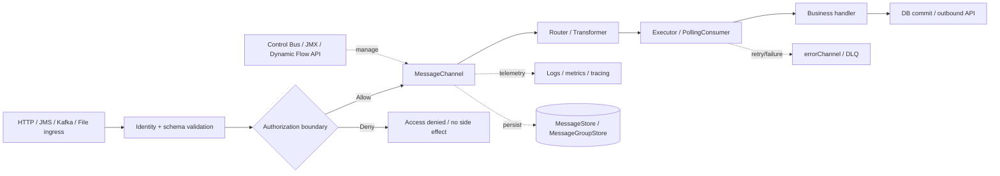
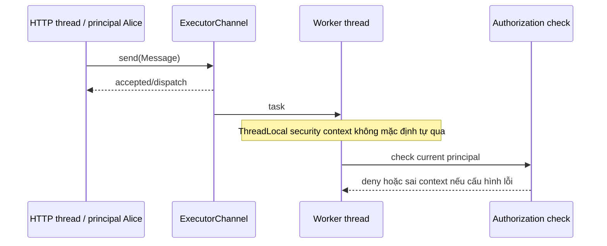
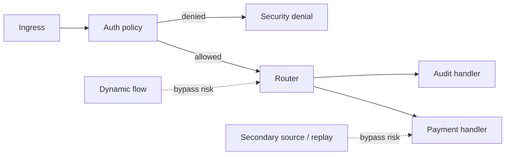
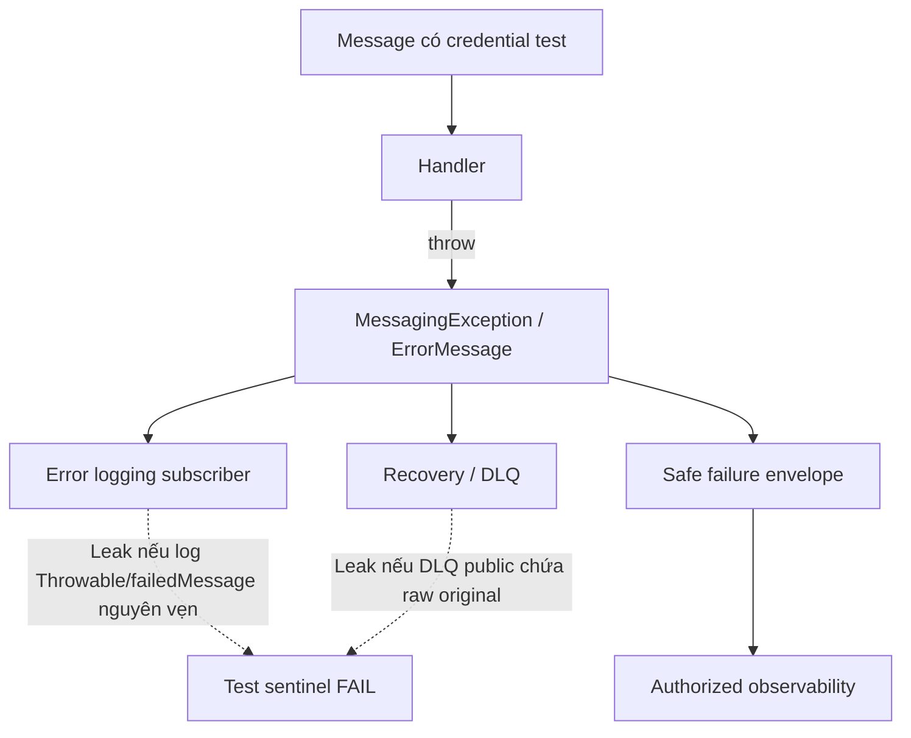

# Kiểm thử quyền và dữ liệu nhạy cảm trong flow Spring Integration

## 1. Mục tiêu: một message bị từ chối phải thực sự không gây side effect

Trong hệ thống dùng **Spring Integration**, message đi qua `MessageChannel`, gateway, transformer, router, service activator, poller, executor, retry advice và có thể được lưu trong `MessageStore` hoặc gửi sang `errorChannel`. Kiểm thử bảo mật không thể chỉ dừng ở việc kiểm tra HTTP endpoint trả mã `401` hay `403`.

Xét một hệ thống đơn hàng đa tenant:

- Người dùng `alice` có quyền `ORDER_WRITE` trên tenant A.
- Người dùng `bob` chỉ có quyền đọc tenant A.
- Một message tới flow với header `tenantId=B` và payload yêu cầu hoàn tiền.
- Handler có thể chạy ở một thread khác qua `ExecutorChannel`, hoặc sau vài giờ qua `QueueChannel` và poller.
- Một message thất bại có thể đi qua retry rồi được lưu vào dead-letter queue (DLQ).

Một bộ kiểm thử tốt phải chứng minh **đúng ba điều**:

1. **Quyền:** người gửi/consumer có thực sự được phép thực hiện hành động tại đúng ranh giới không?
2. **Cách ly:** message không được phép không đi tiếp tới side effect, không được “lách” bằng kênh phụ, giả mạo header hoặc replay.
3. **Dữ liệu:** credentials, thông tin cá nhân và payload nhạy cảm không bị lộ ra log, tracing, metric tags, error flow, DLQ, store hoặc management interface.

Bài **“Kiểm thử quyền và dữ liệu nhạy cảm trong flow”** thuộc chương **Bảo mật runtime** của module **SPRING_INTEGRATION_RUNTIME**. Phạm vi bao gồm **runtime message flow**, đặc biệt khi chuyển thread, thực thi qua poller, retry, transaction, persistence, correlation và quản trị flow động.

> **Tiêu chí thành công:** Một test “DENY” chỉ PASS khi quyền bị từ chối **và không có side effect**, không có message được lưu/phát sang một nhánh không mong muốn, không có dữ liệu nhạy cảm bị xuất ra telemetry.

## 2. Bốn loại kiểm thử không nên gộp làm một

| Lớp | Câu hỏi bảo mật | Kiểm thử tiêu biểu |
| --- | --- | --- |
| **Authentication** | Ai gửi message? Danh tính có được xác thực? | Anonymous, token sai/hết hạn, service identity không hợp lệ |
| **Authorization** | Danh tính đó có quyền hành động, trên tài nguyên/tenant ấy, tại thời điểm này? | Role, permission, tenant isolation, record ownership |
| **Data confidentiality** | Dữ liệu nhạy cảm có được giữ đúng ranh giới tin cậy? | Redaction, header mapping, DLQ, log, trace, store, backup |
| **Integrity và replay protection** | Một message có bị giả mạo, xử lý lặp hoặc bị chuyển tới nhánh vượt quyền? | Tamper headers, business key, retry, restart, idempotency |

**Authentication thành công không đồng nghĩa authorization thành công.** Một tài khoản `ROLE_USER` đã đăng nhập hợp lệ vẫn có thể bị cấm hoàn tiền. Một tài khoản `ROLE_ADMIN` của tenant A không tự có quyền đọc dữ liệu tenant B.

**Dữ liệu đã mã hóa không đồng nghĩa log an toàn.** Message có thể được mã hóa trên broker nhưng ứng dụng giải mã rồi ghi `Message.toString()` ra log. Ngược lại, log không chứa token chưa chứng minh payload stored trong DB được bảo vệ.

## 3. Threat model của một IntegrationFlow



Mỗi đường chấm là **một điểm cần kiểm thử riêng**. Một AuthorizationChannelInterceptor ở `securedOrders` không tự bảo vệ:

- Một service method có thể bị gọi trực tiếp từ bean khác.
- Một alternate channel không nằm trong pattern bảo vệ.
- Một poller khởi phát nội bộ sau khi không còn HTTP request.
- Một recovery consumer đọc dữ liệu từ DLQ.
- Một endpoint do `IntegrationFlowContext` đăng ký động với tên khác.
- Một quản trị viên gửi lệnh qua Control Bus.

Thiết kế defense-in-depth có thể cần **kiểm tra quyền ở ingress**, **kiểm tra hành động/tài nguyên tại service**, **bảo vệ channel quan trọng**, và **kiểm soát đặc biệt cho replay/management**.

## 4. Ma trận quyền: bắt đầu từ chính sách kiểm chứng được

Trước khi viết test, chốt một ma trận policy:

| Danh tính | Gửi đơn tenant A | Hoàn tiền tenant A | Gửi đơn tenant B | Quản trị flow |
| --- | --- | --- | --- | --- |
| Anonymous | Deny | Deny | Deny | Deny |
| `VIEWER` của A | Deny | Deny | Deny | Deny |
| `ORDER_WRITER` của A | Allow | Deny | Deny | Deny |
| `REFUND_OPERATOR` của A | Theo policy | Allow, trong giới hạn | Deny | Deny |
| `PLATFORM_OPERATOR` | Theo permission cụ thể | Không tự được phép refund | Theo permission | Allow trên flow được duyệt |
| Service account của job | Chỉ hành động máy-máy được cấp | Theo workflow đã cấp | Theo tenant scope | Deny nếu không có đặc quyền riêng |

Ma trận phải được biến thành test dữ liệu:

- **Positive cases**: một role đủ và đúng tenant.
- **Negative cases**: anonymous, authenticated nhưng thiếu role, role đúng nhưng sai tenant, resource thuộc chủ khác.
- **Boundary cases**: quyền bị revoke sau enqueue; token hết hạn khi poll; permission thay đổi giữa retry.
- **Bypass cases**: gọi qua alternate channel, direct bean invocation, DLQ replay, dynamic flow.
- **Side-effect checks**: không có DB row/outbound call khi deny.

Không dùng một role `ADMIN` quá rộng làm mẫu cho tất cả test; test “admin làm được mọi thứ” không bảo đảm tenant isolation, least privilege hoặc separation of duties.

## 5. Ranh giới tin cậy: header không phải bằng chứng danh tính

Một message có thể mang:

```text
headers:
  tenantId: tenant-B
  requestedRole: PLATFORM_ADMIN
  userId: alice
  Authorization: Bearer <UNTRUSTED_INPUT>
payload:
  operation: REFUND
  orderId: ORDER-42
```

**Các giá trị này là dữ liệu từ producer**, không tự chứng minh người gửi là Alice hoặc có quyền admin. Một HTTP gateway/broker adapter có thể chuyển nguyên header do client điều khiển. Nếu handler đọc `headers["requestedRole"]` rồi cấp quyền, attacker chỉ cần sửa message.

Quy tắc:

1. **Danh tính** lấy từ security boundary đã xác thực (Spring Security HTTP/JWT, mTLS/service authentication, broker auth + mapping được tin cậy).
2. **Tenant scope** được xác minh từ claims đã ký hoặc nguồn phân quyền nội bộ; một `tenantId` do client nhập chỉ là mục tiêu yêu cầu.
3. **Authorization** so sánh principal, action và resource ở service có quyền truy cập dữ liệu.
4. **Metadata nghiệp vụ** có thể nằm trong message; không coi nó là authority bằng cách đặt tên `role` hoặc `authenticated`.
5. **Đường async/durable** phải có mô hình identity riêng: không mặc định HTTP `SecurityContext` sống mãi qua restart.

### Hai test bắt buộc

- Gửi role header `PLATFORM_ADMIN` dưới một principal `VIEWER` → vẫn bị deny.
- Gửi đúng `ROLE_ORDER_WRITER` nhưng thay `tenantId` từ A sang B → vẫn bị deny.

Test chỉ kiểm tra `headers["role"] == "ADMIN"` là một anti-pattern: nó chứng minh **đã tin header do attacker kiểm soát**, không chứng minh bảo mật.

## 6. API bảo mật theo phiên bản Spring Integration

**Thay đổi quan trọng:** Từ Spring Integration **6.3**, module `spring-integration-security` đã bị loại bỏ; tài liệu hiện hành khuyến nghị dùng các API của **`spring-security-messaging`**.

| Phiên bản | Cách tiếp cận | Lưu ý khi viết test |
| --- | --- | --- |
| Legacy trước 6.3 | Có các API và XML namespace security cũ thuộc Spring Integration | Không copy nguyên ví dụ `ChannelSecurityInterceptor` cũ vào project mới |
| Spring Integration 6.3+ | `AuthorizationChannelInterceptor` từ `spring-security-messaging` | Đảm bảo dependency Spring Security tương thích và interceptor được gắn đúng channel |
| Nhiều phiên bản hiện đại | `SecurityContextPropagationChannelInterceptor` từ `spring-security-messaging` | Kiểm tra ngữ nghĩa chuyển thread và cleanup |
| Method security hiện đại | `@EnableMethodSecurity` + `@PreAuthorize` | Đảm bảo gọi qua Spring AOP proxy, không self-invocation bỏ qua |

Một bộ dependency thử nghiệm thường có:

```text
spring-integration-core
spring-security-messaging
spring-security-config / spring-security-core (theo cấu hình)
spring-security-test (test scope)
spring-integration-jdbc (nếu test persistent queue/group)
spring-boot-starter-test hoặc JUnit 5 + Spring Test
```

**Không pin một version trong ví dụ** nếu chưa biết Spring Boot/BOM của ứng dụng. Đối với migration từ 6.2 trở xuống, cần kiểm tra API security và behavior theo bản thực tế thay vì giả định mọi class/package giữ nguyên.

## 7. Ví dụ: AuthorizationChannelInterceptor cho secured channel

Theo tài liệu Spring Integration hiện hành, có thể gắn một `AuthorizationChannelInterceptor` làm global channel interceptor cho những channel khớp pattern. Ví dụ dùng `ROLE_ORDER_WRITER`.

```java
import org.springframework.context.annotation.Bean;
import org.springframework.context.annotation.Configuration;
import org.springframework.integration.config.EnableIntegration;
import org.springframework.integration.config.GlobalChannelInterceptor;
import org.springframework.integration.channel.DirectChannel;
import org.springframework.messaging.MessageChannel;
import org.springframework.security.authorization.AuthorityAuthorizationManager;
import org.springframework.security.messaging.access.intercept.AuthorizationChannelInterceptor;

@Configuration
@EnableIntegration
public class ChannelSecurityConfiguration {

    @Bean("securedOrders")
    public MessageChannel securedOrders() {
        return new DirectChannel();
    }

    @Bean
    @GlobalChannelInterceptor(patterns = "securedOrders")
    public AuthorizationChannelInterceptor orderAuthorization() {
        return new AuthorizationChannelInterceptor(
                AuthorityAuthorizationManager.hasRole("ORDER_WRITER"));
    }
}
```

Điều kiện: Spring Integration đang quản lý channel và bean interceptor; project sử dụng API tương thích **6.3+**. `hasRole("ORDER_WRITER")` kiểm tra authority `ROLE_ORDER_WRITER`; không truyền `ROLE_` hai lần.

**Quan trọng:**

- `@GlobalChannelInterceptor(patterns=...)` chỉ áp dụng với **các channel có tên khớp pattern**. Các channel trong dynamic flow cần được kiểm tra tên bean thực tế.
- Một channel mang tên `ordersIn` hoặc `securedOrdersV2` có thể **không** được bảo vệ bởi pattern `securedOrders`.
- Channel interceptor là **một** chốt kiểm tra. Không thay thế quyền trên business resource/tenant hoặc outbound API.
- Với channel nhận từ poller/worker, cần thiết kế chính sách quyền **trên cả thread nhận**; nếu không có principal, consumer có thể bị deny hoặc ai đó sẽ đề xuất tắt kiểm tra, tạo lỗ hổng.

### Tránh vòng lặp “sửa bằng cách tắt bảo mật”

Nếu message từ `QueueChannel` không poll được sau khi bật interceptor, hãy phân biệt **lỗi propagation identity** với **lỗi quyền thực sự**. Không giải quyết bằng cách đổi toàn bộ pattern thành `permitAll`. Hãy xác định trusted producer, source authorization và mô hình xử lý job bền vững ở các phần sau.

## 8. Test JUnit 5: allow và deny ngay trên DirectChannel

Ví dụ sau là **integration test tối giản** cho `@GlobalChannelInterceptor`. Nó không cần HTTP server; điểm kiểm thử là `MessageChannel.send()`.

```java
import static org.junit.jupiter.api.Assertions.*;

import java.util.List;
import java.util.concurrent.CopyOnWriteArrayList;

import org.junit.jupiter.api.BeforeEach;
import org.junit.jupiter.api.Test;
import org.springframework.beans.factory.annotation.Autowired;
import org.springframework.beans.factory.annotation.Qualifier;
import org.springframework.context.annotation.Bean;
import org.springframework.context.annotation.Configuration;
import org.springframework.integration.channel.DirectChannel;
import org.springframework.integration.config.EnableIntegration;
import org.springframework.integration.config.GlobalChannelInterceptor;
import org.springframework.integration.dsl.IntegrationFlow;
import org.springframework.messaging.MessageChannel;
import org.springframework.messaging.support.MessageBuilder;
import org.springframework.security.access.AccessDeniedException;
import org.springframework.security.authorization.AuthorityAuthorizationManager;
import org.springframework.security.messaging.access.intercept.AuthorizationChannelInterceptor;
import org.springframework.security.test.context.support.WithMockUser;
import org.springframework.test.context.junit.jupiter.SpringJUnitConfig;

@SpringJUnitConfig(classes = ChannelPermissionTest.Config.class)
class ChannelPermissionTest {

    @Autowired
    @Qualifier("securedOrders")
    MessageChannel channel;

    @Autowired
    Recorder recorder;

    @BeforeEach
    void reset() {
        recorder.values.clear();
    }

    @Test
    @WithMockUser(roles = "ORDER_WRITER")
    void writerCanSend() {
        assertTrue(channel.send(
                MessageBuilder.withPayload("ORDER-42").build()));
        assertEquals(List.of("ORDER-42"), recorder.values);
    }

    @Test
    @WithMockUser(roles = "VIEWER")
    void viewerCannotSendOrExecuteHandler() {
        assertThrows(AccessDeniedException.class, () ->
                channel.send(
                        MessageBuilder.withPayload("ORDER-42").build()));
        assertTrue(recorder.values.isEmpty());
    }

    static class Recorder {
        final List<String> values = new CopyOnWriteArrayList<>();
        void record(String value) { values.add(value); }
    }

    @Configuration
    @EnableIntegration
    static class Config {
        @Bean("securedOrders")
        MessageChannel input() {
            return new DirectChannel();
        }

        @Bean
        @GlobalChannelInterceptor(patterns = "securedOrders")
        AuthorizationChannelInterceptor authz() {
            return new AuthorizationChannelInterceptor(
                    AuthorityAuthorizationManager.hasRole("ORDER_WRITER"));
        }

        @Bean
        Recorder recorder() {
            return new Recorder();
        }

        @Bean
        IntegrationFlow securedFlow(Recorder recorder) {
            return IntegrationFlow.from("securedOrders")
                    .handle(message -> recorder.record(
                            (String) message.getPayload()))
                    .get();
        }
    }
}
```

Các điều kiện để chạy: thêm `spring-security-messaging`, `spring-security-test`, Spring Test/JUnit 5 và Spring Integration tương thích. `@WithMockUser` tạo mock `SecurityContext` **trong thread thực thi test**; `DirectChannel` dispatch đồng bộ nên ví dụ có thể kiểm tra kết quả ngay.

### Assertions mạnh hơn

Đối với test thực tế, không chỉ đo `recorder.values.isEmpty()`. Nếu handler có DB hoặc gọi remote API, dùng spy/mocks hoặc DB assertion để chứng minh:

- Không có ghi DB.
- Không có outbound call.
- Không có outbox record hoặc event publish.
- Không có message nào lọt sang fallback/error business channel khi bị deny.

Một số cấu hình có thể ném một loại exception authentication khác khi hoàn toàn **không có principal**. Với test anonymous, xác định expected status/exception của **boundary thực tế**, nhưng luôn giữ invariant **deny và zero side effects**.

## 9. Test quyền trên method/service: chặn bypass channel

Channel interceptor không đủ nếu code khác có thể gọi `OrderService` trực tiếp.

Ví dụ:

```java
import org.springframework.security.access.prepost.PreAuthorize;
import org.springframework.stereotype.Service;

@Service
public class OrderActionService {

    private final TenantPolicy tenantPolicy;
    private final OrderRepository repository;

    public OrderActionService(
            TenantPolicy tenantPolicy,
            OrderRepository repository) {
        this.tenantPolicy = tenantPolicy;
        this.repository = repository;
    }

    @PreAuthorize(
        "hasAuthority('ORDER_WRITE') and " +
        "@tenantPolicy.canWrite(authentication, #command.tenantId())")
    public void submit(OrderCommand command) {
        repository.saveCommand(command);
    }
}
```

`TenantPolicy`, `OrderRepository` và `OrderCommand` là thành phần do ứng dụng định nghĩa. Biểu thức `@tenantPolicy.canWrite(...)` giả định bean có tên `tenantPolicy` và method kiểm tra quyền ở nguồn tin cậy. Phương thức `@PreAuthorize` cần `@EnableMethodSecurity` và invocation **đi qua Spring proxy**. Nếu code gọi `this.submit(...)` trong cùng bean, method-security proxy thường không được áp dụng.

Đối với SpEL parameter name `#command`, cần cấu hình phát hiện tên parameter phù hợp (thường compiler `-parameters`) hoặc đặt metadata tên tường minh theo Spring Security. Đừng xem một biểu thức có vẻ đúng là bảo đảm đã có interception: **test cả lời gọi từ flow lẫn direct service call qua injected bean**.

### Ma trận kiểm thử tenant isolation

```text
Principal A, ORDER_WRITE, command.tenantId=A  => ALLOW
Principal A, ORDER_WRITE, command.tenantId=B  => DENY
Principal A, VIEWER,      command.tenantId=A  => DENY
Anonymous,               command.tenantId=A  => DENY
Principal B, ORDER_WRITE, resource.tenant=A   => DENY
```

Khi action thao tác một record đã tồn tại, cần load `resource.tenantId` từ DB và so với quyền, không chỉ tin `tenantId` trong payload. Nếu attacker đổi tenant của request nhưng `orderId` vẫn trỏ tới record tenant khác, kiểm tra payload tenant đơn thuần có thể bỏ qua lỗ hổng **IDOR/BOLA**.

## 10. Async: DirectChannel giữ thread, ExecutorChannel không

Mặc định `SecurityContextHolder` dùng `ThreadLocal`. Với `DirectChannel` đồng bộ, handler thường chạy trong thread đã xác thực. Với `ExecutorChannel`, `QueueChannel` + poller, `PublishSubscribeChannel` có executor, hoặc asynchronous gateway, consumer có thể chạy ở **thread khác**.



Có hai mục tiêu kiểm thử riêng:

1. **Propagation correctness:** khi flow thực sự yêu cầu quyền người dùng qua thread, principal đúng được thiết lập ở worker.
2. **Context isolation:** sau khi message hoàn tất hoặc throw, worker **không giữ security context của người dùng trước** rồi gán nhầm cho message kế tiếp.

Theo tài liệu Spring Integration 6.3+, `SecurityContextPropagationChannelInterceptor` đến từ `org.springframework.security.messaging.context`. Nó hỗ trợ chuyển context qua các điểm giao message channel, dùng lifecycle callbacks để cleanup.

### Cấu hình propagation có chọn lọc

```java
import org.springframework.context.annotation.Bean;
import org.springframework.integration.config.GlobalChannelInterceptor;
import org.springframework.security.messaging.context.SecurityContextPropagationChannelInterceptor;

@Bean
@GlobalChannelInterceptor(patterns = "userAsync*")
SecurityContextPropagationChannelInterceptor userContextPropagation() {
    return new SecurityContextPropagationChannelInterceptor();
}
```

Ví dụ này chỉ phù hợp khi các channel khớp pattern **thực sự cần xử lý dưới identity của user**. Khi có nhiều interceptors sửa/clone message, cần kiểm tra thứ tự: propagation interceptor có thể dùng wrapper message mang context, nên một interceptor khác tạo message mới sai thời điểm có thể làm mất context. Không giả định mọi `@GlobalChannelInterceptor` được sắp thứ tự đúng chỉ nhờ tên bean.

### Test hai principal trên một worker

Một bài test quan trọng hơn “principal không null”:

1. Đặt executor pool size = 1 để tái sử dụng **cùng worker thread**.
2. Gửi message M1 dưới identity Alice; handler ghi `principalName=alice` trong **test recorder**, không log secrets.
3. Gửi M2 dưới identity Bob; handler phải thấy `bob`.
4. Cho M2 ném exception; đợi error handling hoàn tất.
5. Gửi M3 không có identity nếu policy yêu cầu anonymous → phải bị deny, không thấy Alice hoặc Bob.
6. Kiểm tra `SecurityContextHolder` trên worker sau cleanup, không có principal tồn dư.

Dùng `CountDownLatch` hoặc `CompletableFuture` có timeout để đợi handler; **đừng assert kết quả ngay sau `send()` trên `ExecutorChannel`**, vì producer có thể về trước khi worker chạy.

### Gateway async có đường riêng

Với `@MessagingGateway(asyncExecutor=...)`, Spring Security cung cấp `DelegatingSecurityContextAsyncTaskExecutor` để bọc executor và propagate context cho các tác vụ bất đồng bộ. Kiểm thử cả gateway và channel thực tế, tránh tin rằng một interceptor bất kỳ sẽ bao quát tất cả thread boundaries trong flow.

## 11. Durable QueueChannel/poller: có nên serialize principal?

Một message có thể chờ trong `JdbcChannelMessageStore` hàng giờ hoặc sống qua restart. Việc nhét `Authentication`/`SecurityContext` của HTTP request vào header bền vững là **một quyết định nhạy cảm**:

- Principal/credentials có thể có secret hoặc thông tin cá nhân.
- Role có thể bị revoke trong lúc message đang chờ.
- Object có thể không serialize/deserialize an toàn hoặc bị mất tương thích phiên bản.
- Message có thể bị replay trong một tiến trình khác, khi request gốc đã kết thúc.
- Nếu tin một header `authentication=...` do producer không tin cậy gắn vào, có thể tạo privilege escalation.

### Mẫu thiết kế thích hợp hơn cho job lâu dài

Lưu **job intent** tối thiểu và reference đã xác minh:

```json
{
  "commandId": "CMD-42",
  "operation": "SUBMIT_ORDER",
  "tenantRef": "tenant-A",
  "actorRef": "internal-user-123",
  "requestAuthorizationVersion": 7,
  "schemaVersion": 1
}
```

Một trusted ingress kiểm tra quyền trước khi commit command, ghi lại actor reference/audit cần thiết. Poller sau restart chạy dưới **service identity** có phạm vi cụ thể, revalidate **operation/resource/tenant policy** theo quy tắc business được công bố.

Có hai policy hợp lệ tùy nghiệp vụ, phải **chọn rõ và test**:

- **Authorization-at-submission:** nếu request được cho phép lúc enqueue, job được tiếp tục theo quyết định đã commit, dù user thay role sau đó. Cần audit version/expiry/scope, quy định revoke.
- **Authorization-at-execution:** poller phải xác minh user/tenant vẫn có quyền khi hành động thực sự diễn ra; nếu revoke thì deny/quarantine hoặc workflow xử lý phù hợp.

Không trộn hai policy tùy ý. Với hoàn tiền/rút tiền, thông thường cần các chốt nghiệp vụ tại thời điểm side effect; với một báo cáo đã được chấp nhận hợp lệ, có thể cho tiếp tục sau khi request kết thúc tùy yêu cầu pháp lý.

## 12. Replay, retry và TOCTOU: kiểm tra quyền ở thời điểm nào?

**Time-of-check to time-of-use (TOCTOU):** quyền được kiểm tra tại thời điểm T1 nhưng side effect xảy ra tại T2.

```text
T1: Alice được phép tạo payout
T2: command được enqueue vào persistent queue
T3: quyền payout của Alice bị revoke
T4: poller nhận command sau restart
T5: outbound payment API bị gọi
```

Một test bảo mật phải xác định expected outcome sau T3, không chỉ test request ban đầu. Ví dụ:

- Với `authorization-at-execution`, T5 bị chặn và ghi security decision an toàn.
- Với `authorization-at-submission`, job có thể tiếp tục nếu nội dung command không bị thay đổi, vẫn trong policy đã cấp; cần audit và tamper protection.
- Nếu command được sửa từ `amount=100` thành `amount=100000` khi nằm trong queue, quyết định ở T1 **không còn áp dụng nguyên vẹn**.

### Chống replay gây side effect trùng

- `commandId`/`idempotencyKey` ổn định qua retry, redelivery và DLQ replay.
- Unique constraints/trạng thái business ở DB và idempotency của hệ thống đích.
- Replay phải có quyền quản trị riêng, không sử dụng lại token HTTP cũ đã hết hạn.
- Replay flow phải chạy lại validation/authorization ở boundary phù hợp.
- Không coi `MessageHeaders.ID` mới là một business command mới nếu cùng `commandId`.
- Mọi exception và rollback phải bảo toàn work theo chính sách, không biến `AccessDeniedException` thành “retry vô hạn”.

**Security denial thường không phải lỗi transient.** Đừng retry một message bị deny mỗi 100 ms tới khi hết attempts như một timeout mạng; cần phân loại terminal/quarantine và alert hợp lý.

## 13. Không được có đường đi vượt qua authorization

Một flow có thể có nhiều đường:



Những bypass path cần test:

- Đưa message vào channel downstream **không nằm trong pattern** của authorization interceptor.
- Đăng ký một dynamic flow qua `IntegrationFlowContext` đưa message thẳng vào handler.
- Một test/admin gọi service method không đi qua AOP proxy.
- Error/recovery handler gọi lại nghiệp vụ với quyền nâng cao không đúng.
- Poller/source adapter đọc file hoặc broker mà không xác minh nguồn và resource scope.
- Internal gateway dùng “trusted” route nhưng thực tế nhận message từ tenant chưa được xác minh.

### Channel security không phải định nghĩa business authority

Chỉ vì một actor có quyền **gửi vào `securedOrders`** không có nghĩa actor được phép **sửa mọi order**. Service phải kiểm tra ownership/tenant/resource. Nếu có nhiều entry paths, policy cần đặt ở **chốt nghiệp vụ không thể bypass** ngoài các interceptors ở edge.

Trong test, thử **gọi trực tiếp injected service bean** dưới role sai. Nếu call thành công dù flow test deny, đó là dấu hiệu bảo vệ chỉ nằm ở channel, chưa đủ cho hệ thống.

## 14. Header và payload tampering: test không chỉ thử role giả

Tạo một tập message giả mạo để tìm lỗi validation/authorization:

| Dữ liệu bị sửa | Rủi ro | Assertion |
| --- | --- | --- |
| `tenantId` header khác tenant của principal | Cross-tenant access | Deny; zero side effects |
| `role=ADMIN` header từ client | Privilege escalation | Bỏ qua giá trị client; deny |
| `actorRef` không tồn tại | Unauthorized internal identity | Reject/quarantine |
| `orderId` trỏ tới tenant B, `tenantId=A` | IDOR/BOLA | So sánh tenant của record từ DB |
| `correlationId` trùng batch tenant khác | Trộn message groups | Không ghép fragment cross-tenant |
| `replyChannel` hoặc routing key do client đặt | Gửi dữ liệu ra kênh trái phép | Chỉ route theo allowlist nội bộ |
| Payload đổi operation từ READ sang REFUND | Policy mismatch | Authorization theo operation thực tế |
| `schemaVersion` giả/không hỗ trợ | Deserialization/validation bypass | Reject an toàn, không thực thi |
| Nội dung có field thừa như `isAdmin=true` | Mass assignment | DTO schema allowlist; field không có quyền bị bỏ/reject |
| Signed webhook bị sửa body | Integrity failure | Verify signature trên raw canonical bytes theo protocol |

Đừng chỉ kiểm tra exception được ném. Một `filter` trong Spring Integration có thể **discard message** và trả bình thường; nếu đó là chính sách deny, test còn phải xác nhận discard/recovery event được xử lý an toàn và không có đường output nghiệp vụ.

## 15. Dữ liệu nhạy cảm trong payload, header và SecurityContext

Phân loại dữ liệu cần test:

| Dữ liệu | Ví dụ | Đường dễ rò |
| --- | --- | --- |
| Credential | Bearer token, API key, password, private key | `MessageHeaders`, outbound headers, DEBUG/log-full-message |
| Session | Cookie, refresh token, CSRF token | Header mapper, exception, DLQ |
| Personal data | Email, điện thoại, địa chỉ, mã định danh | JSON payload, structured logs, trace attributes |
| Financial | Payment token, thông tin tài khoản | MessageStore, retry snapshot, audit |
| Tenant/authorization metadata | Owner IDs, role, tenant scope | Routing, dynamic flow IDs, metrics labels |
| Infrastructure details | Internal URL, JDBC DSN, file path | Exception message, management graph |
| Business command | Order/refund event | Persistent queue, replay store, correlation group |

Không có quy tắc “mọi header đều được phép log”. Header `Authorization`, `Cookie` và custom token thường phải bị loại khỏi telemetry, trong khi một header `safeCorrelationRef` đã được kiểm duyệt có thể dùng để nối sự kiện.

### Đường an toàn cho một message

```text
Inbound verified identity
    ├── auth decision → audit được kiểm soát
    └── minimal business command
          ├── business processing (protected)
          ├── safe summary logs
          ├── low-cardinality metrics
          ├── traces với attribute allowlist
          └── durable store/DLQ có ACL + encryption + retention
```

**Redaction và authorization phục vụ hai mục tiêu khác nhau.** Một handler có quyền đọc secret để gọi API nhưng không được ghi secret ra log. Một operator có quyền xem dashboard chưa chắc có quyền replay protected original từ DLQ.

## 16. Kế hoạch test sentinel để phát hiện data leakage

Dùng **secret giả dành riêng cho test**, có chuỗi dễ tìm trong logs/exporters:

```text
TEST_BEARER_TOKEN_X7A29
TEST_API_KEY_Q6P13
TEST_PRIVATE_DATA_M2K84
test.user@example.invalid
```

Đặt những giá trị này ở nhiều vị trí:

1. Header `Authorization` (có chữ hoa/thường khác nhau).
2. Custom header `X-Partner-Secret` và nested `Map`.
3. Field payload JSON `accessToken`, `email`, `paymentToken`.
4. Exception message mô phỏng URL có query token.
5. `MessagingException.failedMessage` và `ErrorMessage`.
6. Dead-letter record và replay envelope.
7. Message được persist trong queue/group store.
8. Micrometer tag, tracing attribute, baggage và MDC.
9. Management response chứa component metadata.

**PASS nếu** các sink **không được phép nhận original** không có bất kỳ sentinel nào. Với store bảo vệ original để replay, test **không** yêu cầu xóa business command; thay vào đó xác minh encryption, ACL và không xuất raw dữ liệu qua dashboard/log.

### Đừng thử với credential thật

Không đưa production token/password vào unit test, fixture, commit, screenshot, test report hoặc CI artifact. Nếu cần kiểm thử credential rotation, dùng một secret trong test vault với TTL ngắn và audit riêng.

## 17. Java: chỉ xuất safe summary vào logs

Một function tạo summary dựa trên **allowlist** tránh vô tình gọi `message.toString()` hoặc duyệt toàn bộ headers:

```java
import java.util.LinkedHashMap;
import java.util.Map;
import org.springframework.messaging.Message;

public final class SafeFlowSummary {

    private SafeFlowSummary() {}

    public static Map<String, Object> of(
            String flowId,
            String endpointId,
            Message<?> message) {

        Map<String, Object> safe = new LinkedHashMap<>();
        safe.put("event", "integration.message.observed");

        // flowId/endpointId lấy từ registry được kiểm soát,
        // không lấy raw input do client gửi.
        safe.put("flow", flowId);
        safe.put("endpoint", endpointId);
        safe.put("messageId", String.valueOf(
                message.getHeaders().getId()));

        // Không gọi message.toString(), payload.toString()
        // hoặc message.getHeaders().entrySet().
        return Map.copyOf(safe);
    }
}
```

Sử dụng:

```java
import org.springframework.integration.handler.LoggingHandler;
import org.springframework.integration.dsl.IntegrationFlow;

IntegrationFlow flow = f -> f
        .log(LoggingHandler.Level.DEBUG,
                "app.orders.safe",
                message -> SafeFlowSummary
                        .of("orders", "orderWorker", message).toString())
        .handle(orderService, "process");
```

Đoạn này là **DSL minh họa**, giả sử `orderService` đã tồn tại. `.log(...)` chỉ bảo vệ **nhánh log đó**, không tự sửa message hoặc sanitize các loggers khác. Tránh in full `Throwable`/stack trace vào sink public khi exception chain có thể chứa payload, URL hoặc header.

### Unit test sentinel cho summary

```java
import static org.junit.jupiter.api.Assertions.*;
import java.util.Map;
import org.junit.jupiter.api.Test;
import org.springframework.messaging.Message;
import org.springframework.messaging.support.MessageBuilder;

class SafeFlowSummaryTest {

    @Test
    void noSecretInSummary() {
        String sentinel = "TEST_BEARER_TOKEN_X7A29";

        Message<?> source = MessageBuilder
                .withPayload(Map.of(
                        "accessToken", sentinel,
                        "orderId", "ORDER-42"))
                .setHeader("Authorization", "Bearer " + sentinel)
                .setHeader("X-Partner-Secret", sentinel)
                .build();

        String text = SafeFlowSummary
                .of("orders", "orderWorker", source)
                .toString();

        assertFalse(text.contains(sentinel));
        assertFalse(text.contains("Authorization"));
        assertFalse(text.contains("accessToken"));
        assertTrue(text.contains("orderWorker"));
    }
}
```

Đây là test helper, **chưa chứng minh cả logging pipeline an toàn**. Cần thêm test appender/log exporter trong integration test để phát hiện việc exception handler, `WireTap`, HTTP client hoặc adapter khác vẫn ghi dữ liệu gốc.

## 18. ErrorMessage và retry: test nhánh thất bại nguy hiểm hơn nhánh success

Khi handler ném exception, framework có thể phát `ErrorMessage` với payload là `Throwable`. Nếu đó là `MessagingException`, `getFailedMessage()` có thể chứa **message gốc** với credentials/PII.



### Test phải bao phủ các đường lỗi

- Handler ném lỗi **trước** khi tạo business result.
- Retry 2–3 attempt, bao gồm callback `RecoveryCallback`.
- Recovery sink thất bại rồi throw lại; đảm bảo không ack nhầm nguồn.
- Exception tạo bởi converter/deserializer **trước** khi method handler được gọi.
- Poller task hoặc `ExecutorChannel` ném exception ở thread khác.
- Reactive publisher phát `onError` mà không chuyển qua global Spring Integration `errorChannel`.
- DLQ consumer/“Replay” API in command gốc ra log.

**Không đồng nhất “error log không có secret” với “error không cần xử lý”.** Bản ghi lỗi an toàn có thể chứa `errorCategory`, `flowId`, `attempt`, `failureId`, `safeCorrelationRef` và trạng thái recovery; dữ liệu để replay được giữ ở protected store riêng.

### Test expected outcome khi authorization bị deny

`AccessDeniedException` thường là lỗi **terminal theo policy**, không tự retry vô hạn. Nếu poller transaction rollback message deny về đầu queue mãi mãi, cả flow có thể bị kẹt. Test policy cách ly:

1. Access denied được phân loại riêng với timeout/connection error.
2. Không có side effect.
3. Message được lưu vào **quarantine/rejection record bảo vệ** nếu nghiệp vụ cần điều tra.
4. Source ack/dequeue chỉ diễn ra theo điều kiện đã được quyết định và durable sink đã commit phù hợp.
5. Không log credential hoặc full failed message.

## 19. DLQ và MessageStore: kiểm thử confidentiality lẫn recovery

Từ góc độ runtime, một queue/store có thể chứa message đã qua xác thực nhưng **chưa xử lý xong**, bao gồm:

- `JdbcChannelMessageStore` cho `QueueChannel`.
- `JdbcMessageStore`/`MessageGroupStore` cho aggregator/resequencer.
- `JdbcMetadataStore` hoặc Redis metadata chứa checkpoint/idempotency key.
- Broker DLQ, retry topic, outbox và object storage phục vụ replay.

Những chỗ này **không phải logging backend**; đôi khi phải giữ nội dung gốc để khôi phục. Chọn kiểm thử theo đúng hợp đồng:

| Đối tượng | Điều được phép | Điều phải chặn |
| --- | --- | --- |
| Ops dashboard | Failure ID, category, timestamps, attempt count | Full payload/token, private headers |
| Retry worker | Protected command tối thiểu và business key | Gửi qua kênh không xác thực, vượt tenant |
| Authorized replay API | Truy xuất original theo RBAC/audit | Replay tùy ý hoặc dùng credential cũ của user |
| Database admin hạn chế | Phục vụ bảo trì có kiểm soát | Export raw records vào môi trường public |
| Shared monitoring service | Metrics và safe summary | Secret/PII ở tags, spans, log bodies |
| Tenant A user | Chỉ kết quả/record tenant A theo scope | Đọc DLQ/metadata/group của tenant B |

### Test crash và restart

1. Enqueue một command đã được phép vào persistent store.
2. Stop poller, restart application với cùng datasource/schema/region.
3. Khởi tạo lại flow/endpoint và phân quyền theo mô hình service identity.
4. Kiểm tra command chỉ được xử lý nếu policy hiện hành cho phép.
5. Nếu có partial external side effect rồi rollback, kiểm tra idempotency.
6. Truy vấn test dashboard/log/DLQ để bảo đảm sentinel không xuất hiện ở sinks không được phép.

**Không bắt SQL query hiển thị decrypted original như một bằng chứng redaction.** Một encrypted persistent store có thể lưu ciphertext vẫn chứa đủ dữ liệu replay khi decrypt qua con đường được phép.

## 20. Multi-tenant correlation và group state

Message có thể được gom vào `MessageGroupStore` theo `correlationId`. Nếu tenant A và B cùng dùng `correlationId=order-42` hoặc client tự đặt ID, một aggregator cấu hình yếu có thể **trộn fragments của hai tenant**.

```text
Tenant A → correlationId=IMPORT-7 → [part 1]
Tenant B → correlationId=IMPORT-7 → [part 2]
                      |
               Insecure group key
                      |
             Output trộn dữ liệu A+B
```

Giải pháp:

- Correlation key nội bộ gồm **trusted tenant identity + business group ID + run/version**.
- Không tin raw `correlationId` từ client là đủ để tách tenant.
- Test hai tenants gửi cùng ID đồng thời, verify không có cross-tenant group/release.
- Với `MessageGroupStore` shared multi-instance, kiểm tra concurrency lock và quyền truy cập store.
- Completion markers và late arrivals không được cho phép tạo output sang tenant khác.
- Group timeout/expiry/reaper cần log và failure record **đã sanitize**, không dump toàn bộ fragments.

**Bảo mật không kết thúc ở authorization của ingress.** Một lỗi correlation/group state có thể làm dữ liệu lộ giữa tenants dù mọi người dùng đều đã đăng nhập hợp lệ.

## 21. Dynamic IntegrationFlow và Control Bus: kiểm thử quyền quản trị riêng

Spring Integration hỗ trợ `IntegrationFlowContext` đăng ký/dừng/gỡ flow tại runtime và Control Bus cho managed operations. Đây là **control plane**, có quyền ảnh hưởng nhiều message flows.

Một yêu cầu từ người dùng thường không được phép:

- Gọi `registration.stop()` với flow tenant khác.
- Đăng ký flow đưa message tới external URL tùy ý.
- Chỉnh `errorChannel`/WireTap để ghi raw payload sang channel không bảo vệ.
- Bật DEBUG hoặc thay logging level để đọc secret.
- Gọi `POST /control-bus/{beanName.methodName}` hay JMX operations trực tiếp.
- Đọc `/actuator/env`, `/actuator/configprops`, Integration Graph với metadata nhạy cảm.

**Spring Integration 6.4+** dùng cú pháp Control Bus dạng `beanName.methodName` thay cho cú pháp SpEL cũ. Đó là ngữ pháp lệnh, **không phải cơ chế RBAC**: management endpoint vẫn phải được bảo vệ bởi HTTP/JMX/network authorization.

### Test management API

| Actor | Action | Expected |
| --- | --- | --- |
| Anonymous | Stop flow | 401/403 theo API contract, không đổi lifecycle |
| Tenant admin A | Stop flow B | Deny, không ảnh hưởng B |
| Tenant admin A | Stop flow A | Allow nếu policy cho phép, có audit |
| Platform operator | Tạo connector outbound | Chỉ khi URL/secret reference allowlisted |
| Read-only monitoring | GET graph/metrics | Chỉ metadata an toàn |
| Read-only monitoring | POST control command/loggers | Deny, zero mutations |

Đối với dynamic flow, test thêm việc **global channel interceptor có gắn được với các channel mới đăng ký** hay không. Tên flow/bean do user nhập có thể không khớp pattern bảo mật; quản lý ID và namespace để không tạo bypass.

## 22. Security test qua HTTP: @WithMockUser khác request thực tế

`@WithMockUser` hữu ích cho Spring method/channel test chạy trong một test thread. Nhưng với **test gửi HTTP thật tới embedded server**, security context của JUnit thread **không tự đi sang server thread**.

Các mức test:

- **Unit/flow test:** `@WithMockUser` + send vào `DirectChannel`/service bean.
- **MockMvc test:** cấu hình security filter chain và request post-processor hoặc mock JWT phù hợp.
- **Full HTTP integration test:** gửi credential hợp lệ/không hợp lệ **trong HTTP request** tới embedded server, verify status và downstream side effects.
- **Broker/JMS/Kafka test:** gửi message qua adapter thật hoặc test broker, verify identity mapping/tenant isolation và DLQ.
- **Async/poller test:** dùng latch/await + test executor, không chỉ assert ngay sau send.

### Ma trận full request

```text
POST /orders
  no Authorization            → 401 theo security policy
  expired bearer              → 401
  valid VIEWER token          → 403
  valid ORDER_WRITER tenant A → accepted/processed (A)
  valid ORDER_WRITER tenant A + payload tenant B → 403
  valid user + malformed body → 400, no business side effect
```

Các mã chỉ mang tính **contract minh họa**: với một inbound gateway asynchronous, API có thể trả `202 Accepted` sau durable handoff; authorization tại ingress phải xảy ra **trước** khi trả chấp nhận theo policy. Nếu handler xử lý thất bại sau `202`, đó là kết quả async riêng, không phải cùng một HTTP response.

## 23. Test structured logs, traces và metrics bằng exporters thử nghiệm

Một test “chuỗi sentinel không xuất hiện trong console” có thể bỏ sót các nơi khác:

- `WireTap` và `LoggingHandler` dùng logger category khác.
- `ErrorMessage` được handler khác log full exception.
- Outbound HTTP client debug wire log.
- Micrometer tag/Observation span attribute chứa `tenantId`/email/token.
- MDC trên pooled executor giữ principal hoặc business ID của request trước.
- Management graph chứa tên bean/endpoint do client đưa vào.

**Cách kiểm thử tốt** là cắm telemetry sinks giả:

1. Test appender của SLF4J/Logback/Log4j tùy framework.
2. In-memory `MeterRegistry` hoặc registry test và kiểm tra **tag keys/values**.
3. In-memory test span exporter/ObservationHandler.
4. Fake DLQ writer/failure repository có bản ghi quan sát.
5. Test HTTP client/interceptor ghi metadata đã được sanitize, không ghi request body.
6. Inspect response management API theo role.

Kiểm tra **toàn bộ output** của các sink không được phép, không chỉ `SafeFlowSummary`. Nếu dùng sampling, chạy test với đường telemetry được kích hoạt để có bằng chứng **khi span được xuất cũng không lộ**.

### Kiểm soát cardinality

Không đưa `email`, `authorization`, `accessToken`, `businessId`, `correlationId` hoặc raw URL query vào metric tags. Một test nên sinh nhiều business IDs khác nhau và xác nhận **số lượng meter/tag combinations được giới hạn theo những giá trị ít biến thiên**, không tăng theo số message.

## 24. Kiểm thử negative path và cleanup ThreadLocal

Một security bug có thể chỉ xuất hiện sau khi exception được ném:

```text
Worker thread #1:
  Message Alice → handler throws
  context not cleared
  Message Bob / anonymous → handler inherits Alice
```

Để bắt lỗi:

- Dùng executor chỉ một worker để buộc reuse thread.
- Gửi một message thành công, một message thất bại, sau đó message anonymous.
- Kiểm tra principal ở mỗi handler call và `SecurityContextHolder` sau cleanup.
- Kiểm tra `MDC` được xóa trong `finally`.
- Nếu callback/reactive pipeline chuyển scheduler, test context propagation và restoration.
- Kiểm tra cancellation/timeouts: cleanup vẫn thực hiện khi pipeline bị hủy.
- Không dùng `SecurityContextHolder.MODE_INHERITABLETHREADLOCAL` như một biện pháp chung cho thread pool lâu dài; nó có thể khiến security context bị giữ hoặc lan truyền không mong muốn.

Đừng lấy test đầu tiên “chạy được ở DirectChannel” làm bằng chứng cho `ExecutorChannel` hoặc `QueueChannel`. Threading là **một phần của security boundary**, không chỉ vấn đề hiệu năng.

## 25. Bộ test matrix có thể đưa vào CI

| ID | Kịch bản | Expected result |
| --- | --- | --- |
| AUTH-01 | Anonymous gửi vào secured channel | Deny, không gọi handler |
| AUTH-02 | Role được phép, tenant đúng | Allow và đúng business result |
| AUTH-03 | Role không đủ | Deny, zero DB/API side effects |
| AUTH-04 | Role đúng, resource tenant khác | Deny, zero side effects |
| AUTH-05 | Header giả role/tenant | Không override trusted identity |
| AUTH-06 | Gọi service trực tiếp bỏ qua channel | Vẫn được kiểm tra method/business policy |
| ASYNC-01 | Executor worker nhận principal đúng | Không mất security context |
| ASYNC-02 | Hai principal dùng chung pooled worker | Không rò identity |
| ASYNC-03 | Handler throw, task sau anonymous | Không kế thừa context cũ |
| QUEUE-01 | Durable queue và restart | Policy revalidation theo contract |
| QUEUE-02 | Role bị revoke khi pending | Outcome đúng policy submission/execution |
| QUEUE-03 | DLQ replay không còn token cũ | Reauthorize, idempotent |
| GROUP-01 | Hai tenants cùng correlation ID | Không trộn message groups |
| FLOW-01 | Dynamic flow mới | Interceptor và authorization coverage đúng |
| FLOW-02 | Tenant admin thao tác flow khác | Deny, không đổi lifecycle |
| DATA-01 | Credential trong payload/header | Không có trong log/traces/metrics |
| DATA-02 | Exception chứa token giả | Không có trong error logs/DLQ visible envelope |
| DATA-03 | Protected original lưu để replay | ACL/encryption/retention đúng |
| DATA-04 | High-cardinality business IDs | Không thành meter tags |
| DATA-05 | Header mapper outbound | Chỉ forward headers được duyệt |
| RECOVERY-01 | Denied message vào retry path | Không retry vô hạn |
| RECOVERY-02 | DLQ sink thất bại | Không ack/commit sai |
| MGMT-01 | Monitoring user gọi control command | Deny |
| MGMT-02 | Management read-only | Không trả secret/config nhạy cảm |

**Đừng chỉ dùng test mock ở tầng controller.** Các dòng ASYNC, QUEUE, GROUP và RECOVERY cần có integration test thật với scheduler, channel, advice, store hoặc broker phù hợp.

## 26. Lab A — Bảo vệ channel theo role

1. Tạo `DirectChannel securedOrders` và `@GlobalChannelInterceptor` như phần 7.
2. Chạy JUnit test ở phần 8 với `ROLE_ORDER_WRITER` và `ROLE_VIEWER`.
3. Thêm trường hợp anonymous; xác định loại lỗi theo policy nhưng bảo đảm zero side effects.
4. Tạo một channel khác ngoài pattern và thử direct send.
5. Không “sửa” bằng cách để mọi channel `permitAll`; chốt danh sách boundary phải bảo vệ.
6. Ghi kết quả **allow, deny, auth failure và side-effect count**.

**PASS:** Chỉ authorized principal gửi được vào channel được bảo vệ, và những đường lách đã được xác định/bảo vệ.

## 27. Lab B — Tenant isolation và IDOR/BOLA

1. Tạo tenant A/B, order của từng tenant, users có role tương ứng.
2. Thử `ORDER_WRITER` A thao tác order A → được phép.
3. Thử cùng principal thao tác order B dù payload khai `tenantId=A` → bị từ chối dựa trên **tenant của record trong DB**.
4. Thử thay `requestedRole=ADMIN` header → không thay đổi quyền.
5. Gọi thẳng service bean từ test, xác minh method/business policy vẫn chạy.
6. Kiểm tra DB/outbound mock không có side effect ở tất cả test deny.

**PASS:** Không có trường hợp sửa payload/header để vượt tenant policy.

## 28. Lab C — ExecutorChannel và context leak

1. Tạo flow `DirectChannel → ExecutorChannel → secured handler`.
2. Cấu hình `SecurityContextPropagationChannelInterceptor` hoặc executor wrapper tương thích.
3. Dùng executor pool size 1 và `CountDownLatch`; gửi M1 dưới Alice, M2 dưới Bob.
4. Cho M2 ném exception, rồi gửi M3 anonymous.
5. Kiểm tra principal ở worker và cleanup sau mỗi message.
6. Test khi interceptor không được gắn để thấy failure, rồi sửa đúng scope/order.

**PASS:** Context đúng khi cần và không tồn dư ở pooled worker, kể cả error path.

## 29. Lab D — Quyền qua poller, restart và revocation

1. Tạo persistent `QueueChannel` dùng `JdbcChannelMessageStore` trên database test.
2. Enqueue command đã được xác thực, **không serialize raw bearer token**.
3. Stop poller; thay quyền của actor hoặc disable tenant.
4. Restart ứng dụng, tái đăng ký endpoint và khôi phục source.
5. Kiểm tra policy `authorization-at-submission` hoặc `authorization-at-execution` mà dự án chọn.
6. Kiểm tra unauthorized job được quarantine/denied an toàn, không bị retry vô hạn hoặc gây side effect.

**PASS:** Restart không tự làm mất quyền kiểm soát hoặc làm “hồi sinh” principal/credential cũ.

## 30. Lab E — Secret sentinel xuyên success, error, DLQ và logs

1. Dùng các sentinel giả ở phần 16.
2. Đưa chúng vào payload JSON, nested header và exception message.
3. Chạy happy path, retryable failure và terminal failure.
4. Thu test appender, test spans, meter tags, DLQ visible records và management responses.
5. Tìm nguyên văn mọi sentinel; kết quả ở những sinks không được phép phải bằng 0.
6. Với original command được giữ để replay, kiểm tra role/ACL/encryption thay vì yêu cầu xóa hết nội dung.

**PASS:** Telemetry sạch, protected original vẫn replay được qua một đường được phân quyền.

## 31. Lab F — Correlation, routing và replay của nhiều tenant

1. Gửi fragment tenant A và tenant B có cùng client-provided `correlationId`.
2. Cấu hình group key dựa trên trusted tenant + run ID, verify không trộn.
3. Thử raw `replyChannel`/routing header bất hợp lệ từ client; route phải theo allowlist.
4. Cho một fragment lỗi, retry và re-deliver, kiểm tra stable business idempotency key.
5. Replay từ DLQ dưới actor không có quyền → deny.
6. Replay dưới operator có quyền → chỉ tenant/resource được cấp quyền, audit và không double-commit.

**PASS:** Không có cross-tenant output hoặc unauthorized replay.

## 32. Lab G — Management và dynamic flow

1. Tạo một `IntegrationFlow` động có channel ID được quản lý.
2. Kiểm tra interceptor gắn vào channel mới đúng pattern.
3. Đăng ký flow với tên do user đề xuất không phù hợp; policy phải reject hoặc chuẩn hóa ID để tránh bypass.
4. Test monitoring role chỉ đọc graph/metrics, không stop/start flow.
5. Test tenant admin A không được stop/remove flow B.
6. Kiểm tra error/management responses không lộ secret trong connection config.

**PASS:** Control plane có authorization riêng và dynamic registration không tạo kênh không bảo vệ.

## 33. Lab H — Failure sink và transaction

1. Tạo transactional poller trên persistent queue.
2. Cho handler gặp `AccessDeniedException` và kiểm tra classification là terminal/quarantine.
3. Cố ý làm quarantine/DLQ persistence fail, xác minh nguồn không được ack/commit sai policy.
4. Cho external side effect thành công rồi rollback nguồn; idempotency chặn duplicate khi redelivery.
5. Kiểm tra không có payload/credential trong exception logs và failure envelope.
6. Sau restart, xác minh business state, retry state và audit đúng.

**PASS:** Quyền bị từ chối không dẫn tới side effect hay bỏ mất công việc vì recovery sink lỗi.

## 34. Runbook khi phát hiện lỗ hổng quyền hoặc rò dữ liệu

### Nếu một message không có quyền đã được xử lý

1. Xác định `flowId`, channel, endpoint, principal, tenant/resource, thời điểm và loại side effect.
2. Giới hạn quyền tiếp tục bị lạm dụng (disable route/revoke credentials hoặc isolate ingress) theo quy trình vận hành.
3. Kiểm tra interceptor có gắn đúng channel/pattern, method security có chạy qua proxy và context ở async worker.
4. Đối chiếu business audit/DB/outbox/broker để xác định **điều gì đã commit**.
5. Nếu có cross-tenant impact, cách ly tenant và thông báo theo chính sách.
6. Thêm negative test tái hiện bypass trước khi sửa; xác minh không side effect sau fix.
7. Kiểm tra DLQ/replay/dynamic flow có cùng đường vượt quyền không.
8. Roll out và giám sát denied-rate, abnormal routes, transaction outcomes; ghi audit incident.

### Nếu token/PII xuất hiện trong logs hoặc traces

1. Xác định các sinks nhận dữ liệu, độ dài thời gian và nhóm người có quyền đọc.
2. Dừng việc xuất dữ liệu tiếp (safe summary, tắt scoped DEBUG, sửa header mapping).
3. Rotate/revoke token và cô lập bằng chứng theo policy.
4. Kiểm kê DLQ, JDBC stores, broker replicas, tracing backend, log backup và management responses.
5. Không xóa tay queue rows khi còn pending business work; lên phương án migration/retention an toàn.
6. Kiểm thử sentinel trên toàn error/retry/restart path.
7. Ghi hậu kiểm về nguyên nhân, security test còn thiếu và quy trình kiểm soát thay đổi.

**Lưu ý:** Một sự cố quyền/rò dữ liệu không được giải quyết chỉ bằng cách bật thêm metric hay ẩn giá trị trên giao diện UI. Cần chặn tại boundary thật và xử lý dữ liệu đã tồn tại trong các kho lưu trữ.

## 35. Checklist trước khi triển khai production

- **Trusted identity:** không tin role, tenant và authentication được ghi trong raw message header.
- **Channel authorization:** `AuthorizationChannelInterceptor` trên đúng channel; không dựa vào pattern đoán tên khi có dynamic flows.
- **Business authorization:** role, tenant, record ownership, operation, amount/limits, method security qua proxy.
- **Async correctness:** `ExecutorChannel`, `QueueChannel`, poller và async gateway có chính sách security context/identity rõ.
- **Context cleanup:** pooled threads không giữ principal/MDC của message trước; error/cancel path được test.
- **Retry/replay:** quyết định policy submission vs execution, stable idempotency key và quyền riêng cho DLQ replay.
- **Persistent state:** command schema tối thiểu, không persist raw bearer token; MessageStore/DLQ có ACL, encryption, retention.
- **Tenant correlation:** group/sequence/routing keys dựa trên trusted metadata, tránh trộn dữ liệu cross-tenant.
- **Sensitive data:** payload/header/Throwable/MessageHistory không xuất raw vào log, trace, metrics hoặc management.
- **Management:** Actuator, Control Bus, JMX và `IntegrationFlowContext` có RBAC/allowlist/audit.
- **Observability:** denied vs auth failures vs business failures được phân loại; không có high-cardinality IDs/secrets trong meter tags.
- **Tests:** allow/deny matrix, alternate path, service bypass, multi-thread, revocation, restart, error/DLQ, sentinel và multi-tenant.
- **Runbook:** có biện pháp containment, revoke/rotate, safe replay, audit và hậu kiểm.

## 36. Kết luận

Kiểm thử bảo mật của Spring Integration phải nhìn vào **toàn bộ vòng đời một message**. Một request HTTP bị chặn đúng chưa chứng minh message từ broker hoặc DLQ replay cũng bị chặn. Một `AuthorizationChannelInterceptor` hoạt động ở `DirectChannel` chưa chứng minh đúng khi chuyển sang `ExecutorChannel`, poller hoặc sau restart. Một log sanitizer đúng ở happy path chưa chứng minh `ErrorMessage`, DLQ và persistent stores không chứa dữ liệu vượt quyền.

Một bộ test đáng tin cậy cần đồng thời xác nhận: **identity được xác minh, role/tenant/resource được phân quyền, không có đường bypass, không rò security context giữa threads, không có side effect khi deny, không có credential/PII trong telemetry, và recovery/replay vẫn tuân thủ security policy**. Kết hợp kiểm thử channel, service, adapter, transaction, persistence, correlation và management plane sẽ bảo đảm bảo mật là một **thuộc tính runtime có thể chứng minh**, không chỉ là cấu hình đặt ở lối vào.

## Tài liệu tham khảo

- [Spring Integration Reference — Security in Spring Integration](https://docs.spring.io/spring-integration/reference/security.html)
- [Spring Integration Reference — Configuring Message Channels và Global Interceptors](https://docs.spring.io/spring-integration/reference/channel/configuration.html)
- [Spring Security Reference — Method Security](https://docs.spring.io/spring-security/reference/servlet/authorization/method-security.html)
- [Spring Security Reference — Testing Method Security](https://docs.spring.io/spring-security/reference/servlet/test/method.html)
- [Spring Security Reference — Concurrency Support](https://docs.spring.io/spring-security/reference/servlet/integrations/concurrency.html)
- [Spring Security Reference — Authorization Architecture](https://docs.spring.io/spring-security/reference/servlet/authorization/architecture.html)
- [Spring Integration Reference — Error Handling](https://docs.spring.io/spring-integration/reference/error-handling.html)
- [Spring Integration Reference — Message Store](https://docs.spring.io/spring-integration/reference/message-store.html)
- [Spring Integration Reference — Dynamic Runtime Flows](https://docs.spring.io/spring-integration/reference/dsl/java-runtime-flows.html)
- [Spring Integration Reference — Metrics and Management](https://docs.spring.io/spring-integration/reference/metrics.html)
- [Spring Boot Reference — Actuator Endpoints](https://docs.spring.io/spring-boot/reference/actuator/endpoints.html)
- [OWASP Cheat Sheet — Authorization](https://cheatsheetseries.owasp.org/cheatsheets/Authorization_Cheat_Sheet.html)
- [OWASP Cheat Sheet — Logging](https://cheatsheetseries.owasp.org/cheatsheets/Logging_Cheat_Sheet.html)

