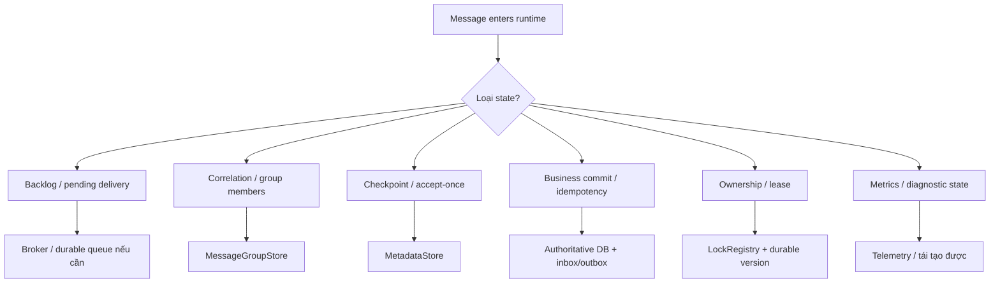
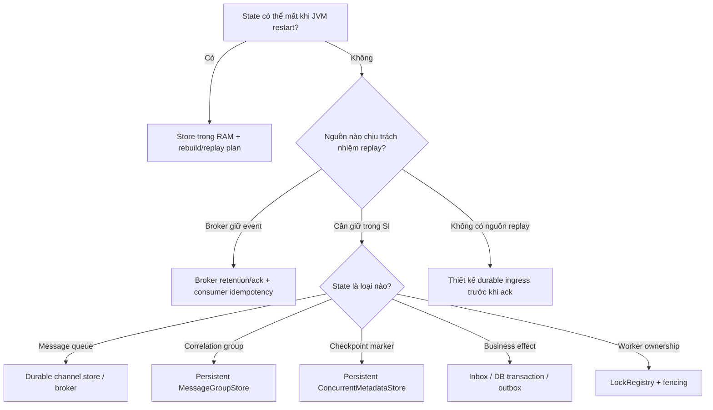
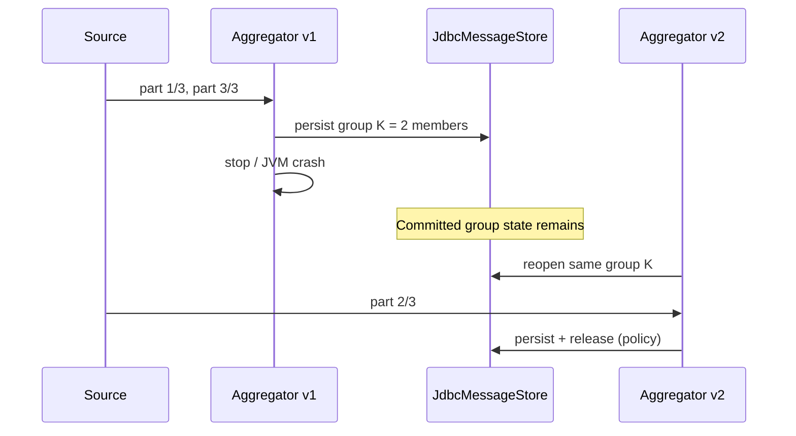
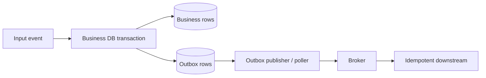
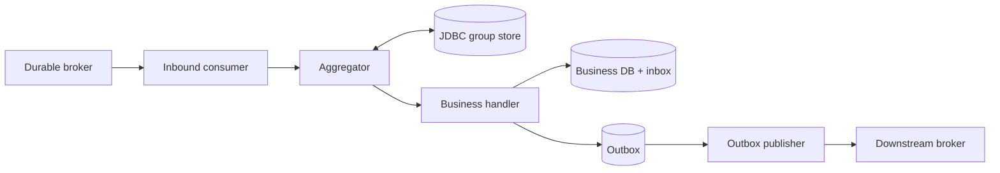
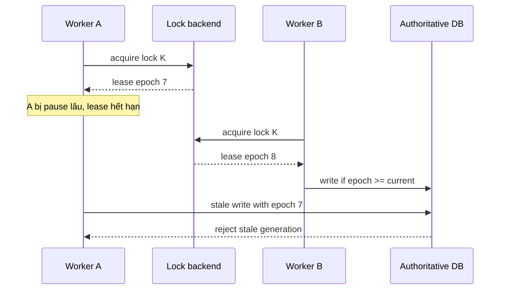
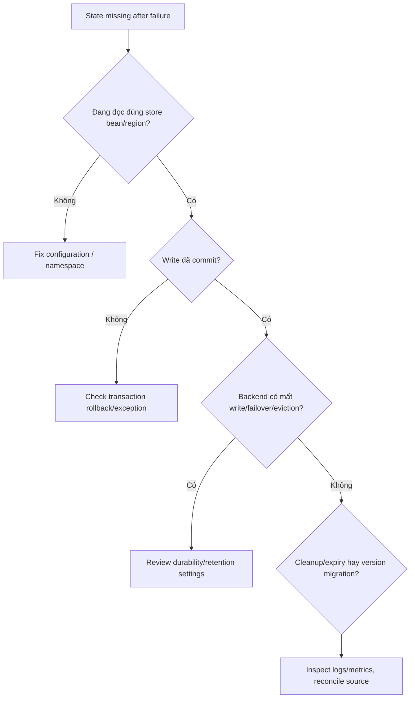

# Chọn state store theo failure mode

Trong **Spring Integration runtime**, state không chỉ là dữ liệu trong database. Một `QueueChannel` có thể giữ message chờ poller; aggregator/resequencer lưu các phần thuộc cùng correlation group; file adapter cần ghi dấu file đã nhận; retry và redelivery cần biết một business event đã xử lý hay chưa; một flow động cần giữ trạng thái công việc đang chạy khi được thay thế. Mỗi loại state có **thời gian sống, chủ sở hữu, ranh giới transaction và cách phục hồi** khác nhau.

Vì vậy, câu hỏi thiết kế không nên là “dùng Redis hay JDBC cho nhanh?”, mà là **“sau từng kiểu lỗi, những gì được phép mất, những gì bắt buộc giữ, và thành phần nào chịu trách nhiệm phục hồi?”**. Chọn state store theo failure mode giúp tránh hai cực đoan: giữ mọi thứ trong RAM rồi mất dữ liệu khi restart, hoặc đẩy tất cả vào database nhưng vẫn không giải quyết được atomicity, duplicate, locking và timeout.

Bài thuộc chương **Thiết kế runtime** của module `SPRING_INTEGRATION_RUNTIME`. Nội dung kết nối việc lựa chọn state store với channel, endpoint, consumer, poller, executor, vòng đời `IntegrationFlow`, transaction, retry, correlation, error handling, hiệu năng và quan sát trạng thái runtime.

> **Nguyên tắc trung tâm:** một state store chỉ bảo vệ những dữ liệu và thao tác nằm **trong hợp đồng nhất quán và độ bền của nó**. Store bền vững không tự làm toàn bộ message flow exactly-once; lock không thay cho transaction; cache không tự thay thế broker; và một marker `ACCEPTED` không chứng minh công việc đã `COMMITTED`.

## 1. Bắt đầu bằng failure mode, không bắt đầu bằng công nghệ

**Failure mode** là cách một hệ thống có thể thất bại hoặc suy giảm: process crash, node mất mạng, database rollback, broker redelivery, task bị cancel, file bị đọc lại, một nhóm correlation thiếu thành viên hoặc một instance cũ tiếp tục chạy khi lease đã hết hạn.

Mỗi mode đặt ra câu hỏi riêng:

| Failure mode | Điều có thể bị ảnh hưởng | Câu hỏi thiết kế |
| --- | --- | --- |
| JVM/pod crash | Heap, queue RAM, group state RAM, futures | Có nguồn bền vững để replay không? |
| Host mất đĩa/volume | State trên ổ cục bộ | Có replication/backup và recovery plan không? |
| Database outage | Ghi/đọc store, commit, dequeue | Flow chặn, reject hay tích backlog ở đâu? |
| Transaction rollback | State mới ghi trong transaction | Marker và business update có rollback cùng nhau không? |
| Crash sau commit trước ack | Broker redeliver một message đã xử lý | Idempotency key có ngăn side effect lặp không? |
| Network partition | Node/cluster nhìn state khác nhau | Ai có quyền xử lý, dữ liệu có nhất quán không? |
| Lease hết hạn | Old worker vẫn thực thi sau khi new worker nhận quyền | Có fencing/conditional update không? |
| Correlation group thiếu phần | Group không đạt release condition | Có TTL, partial policy hoặc recovery không? |
| Duplicate/late arrival | Group hoặc business state bị xử lý lại | Completed marker/inbox giữ bao lâu? |
| Schema/serializer upgrade | State cũ không deserialize được | Có backward compatibility hoặc migration không? |
| Cleanup/expiry sai | State bị xóa khi còn dùng hoặc tăng mãi | Retention theo nghĩa vụ nghiệp vụ chưa? |
| Overload/burst | Queue, DB, broker và executor bị đầy | Có bounded admission/backpressure và overflow policy không? |

Đọc bảng từ trên xuống rồi chọn công nghệ; làm ngược lại sẽ dễ tạo ra một giải pháp “persistent” nhưng sai recovery semantics.

## 2. Phân loại state trước khi chọn nơi lưu

Một flow điển hình có nhiều loại state, và **không nên dùng chung một tiêu chí cho tất cả**.



| Loại state | Ví dụ | Mục đích | Tổn thất khi mất |
| --- | --- | --- | --- |
| **Backlog** | Message đang chờ consumer | Giao việc sau khi producer đã gửi | Có thể mất sự kiện nếu nguồn đã ack |
| **Correlation state** | Parts 1/3, 3/3 của `batch-42` | Giữ message đến khi release | Group không hoàn tất, phải replay hoặc migrate |
| **Checkpoint/metadata** | File đã được thấy, offset quét, marker accept-once | Giảm đọc lại, theo dõi tiến độ | Replay/skip sai tùy thiết kế |
| **Business inbox** | Event `E-42` đã commit | Ngăn duplicate business effect | Thanh toán/đơn hàng bị thực hiện lại |
| **Outbox** | Event phải phát sau DB commit | Phục hồi publish qua crash | Business DB đã đổi nhưng downstream không biết |
| **Ownership/lease** | Worker A sở hữu partition `P-7` | Tránh nhiều worker cùng xử lý | Tranh quyền hoặc stale writer |
| **Diagnostic** | Counter, histogram, log sampling | Quan sát trạng thái | Có thể tái tạo hoặc chấp nhận mất một phần |

**Lưu ý:** `MessageStore`, `MessageGroupStore`, `MetadataStore` và `LockRegistry` là các abstraction giải quyết **những bài toán khác nhau**. Chúng không thể thay thế nhau chỉ vì đều “lưu trạng thái”.

## 3. Chọn recovery point: RPO, RTO và ranh giới xác nhận

Trước khi lập bảng chọn store, hãy xác định hai mục tiêu:

- **RPO (Recovery Point Objective):** mức dữ liệu có thể mất khi xảy ra sự cố. Với lệnh thanh toán thường yêu cầu **không mất sự kiện đã nhận hợp lệ**; với một mẫu telemetry có thể chấp nhận mất vài bản ghi.
- **RTO (Recovery Time Objective):** thời gian có thể chấp nhận để hệ thống hoạt động lại hoặc bắt kịp backlog.

Nhưng với message flow cần thêm **acknowledgement boundary**:

```text
T0  Source tạo event E42
T1  Ingress nhận E42
T2  Channel/store chấp nhận E42
T3  Handler bắt đầu
T4  Business transaction commit
T5  Source ack/offset commit
T6  Downstream event được publish/confirm
```

Nếu báo “đã nhận” tại T2 trong khi T2 chỉ ghi vào queue RAM, crash giữa T2–T4 có thể mất E42. Nếu source ack tại T5 sau business commit, crash giữa T4–T5 có thể **giao lại một event đã xử lý**. Một store phù hợp phải được đánh giá theo **mốc nào source cam kết không gửi lại** và **mốc nào business effect đã bền vững**.

### 3.1. Bảng cửa sổ lỗi

| Cửa sổ lỗi | Rủi ro | Điều kiện bảo vệ |
| --- | --- | --- |
| Nhận nhưng chưa lưu bền vững | Message mất khi node crash | Source giữ delivery hoặc durable enqueue trước ack |
| Đã lưu vào queue nhưng consumer chưa xử lý | Backlog còn khi restart? | Broker/queue store durable và recovery |
| Đã ghi marker nhưng chưa commit business | Lần sau bị skip sai | Marker và business update cùng transaction hoặc state machine claim |
| Business commit nhưng ack chưa tới source | Redelivery gây duplicate | Inbox/idempotent business operation |
| Business commit nhưng publish outbound fail | Downstream không nhận event | Transactional outbox hoặc protocol tương đương |
| Group đủ phần nhưng output downstream fail | Group completed nhưng business output thiếu | Transaction/recovery và idempotent downstream |
| Worker cũ chạy sau lease expiry | Ghi đè state của owner mới | Fencing/conditional update tại authoritative store |

**Đây là chỗ store selection gắn với độ đúng nghiệp vụ**, không chỉ tốc độ `put/get`.

## 4. Cây quyết định ban đầu



Cây này chỉ là **điểm khởi đầu**. Với nghiệp vụ quan trọng thường cần **phối hợp hai hoặc nhiều cơ chế**, ví dụ broker bền vững + inbox DB + outbox, hoặc JDBC message group store + group-lock + idempotent output.

## 5. So sánh các lựa chọn lưu state phổ biến

| Lựa chọn | Dữ liệu phù hợp | Bảo vệ được | Không tự bảo vệ được |
| --- | --- | --- | --- |
| `SimpleMessageStore` | Group/message tạm trong một JVM | Trạng thái khi process còn sống | Crash/restart, shared state giữa nhiều JVM |
| `JdbcMessageStore` | Message/group bền vững | State commit trong JDBC backend, đọc lại sau restart | Exactly-once output ngoài DB, serialization upgrade, lock protocol tự động đúng mọi cấu hình |
| `JdbcChannelMessageStore` | Backing store cho channel queue JDBC | Backlog trên DB, transactional dequeue theo cấu hình | Business commit/ack xuyên resource, group release |
| `SimpleMetadataStore` | Marker/checkpoint tạm | Tra cứu trong process, thao tác atomic cục bộ khi API hỗ trợ | Restart hoặc nhiều replica độc lập |
| `JdbcMetadataStore` | Key-value marker/checkpoint bền vững | Durable key-value với DB transaction và atomic operation theo implementation | Business side effect atomic nếu khác transaction/resource |
| `RedisMetadataStore` | Distributed marker/counter tùy API | Shared atomic primitive phù hợp và latency thấp | Durability nếu Redis persistence/HA/eviction không phù hợp |
| Redis message/group store (nếu module hỗ trợ) | Pending message/group chia sẻ | Lưu ngoài process và truy cập từ nhiều node | Transaction consistency với business DB, durability bất chấp chính sách Redis |
| Broker JMS/AMQP/Kafka | Backlog/event delivery | Retention/redelivery theo broker và ack/offset config | Resource-level authorization, business idempotency, group assembly tự động |
| Business DB inbox/outbox | Event đã xử lý và event phải phát | Unique constraint, local transaction, audit | Distributed exactly-once với API ngoài khi không có protocol idempotent |
| `LockRegistry` | Đồng bộ quyền xử lý theo key | Giảm concurrent execution | Lưu payload, state sau crash, chống stale writer nếu không có fencing |

Bảng trên là **phân loại theo đặc tính thiết kế**, không thay thế kiểm tra API và các mode durability/consistency thực tế của từng version Spring Integration, broker, Redis hoặc database.

## 6. Khi nào state trong RAM là lựa chọn đúng?

RAM không phải lúc nào cũng “sai”. Chọn store trong RAM khi **mất state được chấp nhận và có đường phục hồi rõ**.

Ví dụ thích hợp:
- Cache tính toán có thể xây lại từ authoritative source.
- Group ngắn hạn trong một worker **được pin partition**, nếu message source có thể replay đầy đủ các phần chưa ack và tạo lại group đúng.
- Test unit/integration logic correlation trong một JVM.
- Diagnostic counters hoặc trạng thái phục vụ hiển thị tạm.

### 6.1. Điều kiện không được bỏ qua

Nếu dùng `SimpleMessageStore` cho aggregator:
1. Message đầu vào phải có thể **được giao lại** khi node crash, hoặc ứng dụng chấp nhận mất nhóm.
2. Không có hai replica cùng xử lý **các phần của một group** vào hai store RAM độc lập trừ khi có partitioning phù hợp.
3. Kiểm tra source acknowledgement: một message đã ack khi được add vào group RAM **không còn ở broker để tái tạo** nếu JVM crash.
4. TTL/recovery nếu group thiếu phần phải có hợp đồng.
5. Không gọi nó là persistent chỉ vì Spring context vẫn sống qua nhiều test.

```text
Unsafe:
  Broker delivery -> add to in-memory group -> ACK broker
  JVM crashes before group release -> group lost, no replay

Potentially recoverable:
  Broker retains uncommitted messages -> JVM crash
  New consumer replays all needed members -> group rebuilt
```

Kịch bản thứ hai chỉ an toàn khi **ack/offset semantics thật sự giữ được toàn bộ các phần cần replay**, không phải chỉ message cuối.

## 7. Khi nào nên dùng JdbcMessageStore cho correlation?

Một aggregator có thể cần giữ các part trong nhiều phút/giờ, hoặc trải qua restart và rolling deployment. Khi **correlation group state phải sống qua crash**, `JdbcMessageStore` thường là lựa chọn tự nhiên nếu hệ thống đã có SQL database tin cậy.



### 7.1. Cấu hình Java DSL minh họa

```java
import javax.sql.DataSource;

import org.springframework.context.annotation.Bean;
import org.springframework.context.annotation.Configuration;
import org.springframework.integration.annotation.EnableIntegration;
import org.springframework.integration.dsl.IntegrationFlow;
import org.springframework.integration.jdbc.store.JdbcMessageStore;

@Configuration
@EnableIntegration
class PersistentGroupFlow {

    @Bean
    JdbcMessageStore orderGroupStore(DataSource dataSource) {
        return new JdbcMessageStore(dataSource);
    }

    @Bean
    IntegrationFlow orderPartsFlow(JdbcMessageStore orderGroupStore) {
        return IntegrationFlow.from("orderPartsInput")
                .aggregate(spec -> spec
                        .messageStore(orderGroupStore)
                        .correlationStrategy(
                                m -> m.getHeaders().get("batchKey"))
                        .releaseStrategy(group -> group.size() >= 3))
                .channel("orderBatchesCompleted")
                .get();
    }
}
```

Đây là **fragment minh họa** yêu cầu các channel `orderPartsInput`/`orderBatchesCompleted` được khai báo, dependency `spring-integration-jdbc` và schema DB message-store đúng phiên bản. Logic `group.size() >= 3` chỉ giúp nhìn rõ điểm release; **không đủ chống duplicate hoặc bảo đảm ba business members khác nhau**. Trong production cần release strategy gắn với sequence/member identity và nghiệp vụ thật.

### 7.2. Câu hỏi cần trả lời trước khi chọn JDBC

- Group có thể kéo dài lâu hơn một lần chạy ứng dụng không?
- Có cần **chia sẻ cùng store/region** giữa các replica không?
- Payload/header có serializable và tương thích với phiên bản mới không?
- Khi transaction rollback, group state có rollback cùng business operation không?
- Correlation groups có hot keys gây lock contention không?
- Completion marker được giữ bao lâu để chặn late arrival?
- Backend có đủ capacity cho group count, row growth, cleanup và p99 không?

**JDBC lưu state bền vững không đồng nghĩa quá trình release và outbound call cũng atomic.** Nếu group đã completed trong DB nhưng downstream API call lỗi sau đó, cần phục hồi output/idempotency riêng.

## 8. MessageStore cho group khác channel queue store

Tên gần nhau nhưng mục tiêu khác:

| Hợp đồng | Ví dụ | Mục tiêu |
| --- | --- | --- |
| `MessageGroupStore` / `JdbcMessageStore` | Aggregator cần group K có 2/3 parts | **Correlation và completion state** |
| `ChannelMessageStore` / `JdbcChannelMessageStore` | Poller nhận message từ hàng đợi JDBC | **Enqueue/dequeue và backlog** |
| Broker queue/topic | JMS/AMQP/Kafka | **Phân phối và retention của nguồn** |
| `MetadataStore` | File `F` đã được accept | **Checkpoint/key-value** |

Đừng nhìn thấy một database có bảng `INT_MESSAGE` rồi cho rằng mọi trạng thái đều đã an toàn. **Thành phần nào đang dùng đúng store instance nào** phải được xác minh từ cấu hình runtime.

### 8.1. Bẫy `QueueChannel` trong RAM

```text
Producer -> QueueChannel (RAM) -> poller -> handler

T1: send() returns success
T2: JVM crashes before poller receives
T3: QueueChannel contents lost
```

Nếu producer/source đã ack tại T1, message có thể mất. Nếu cần backlog chịu restart, phải dùng durable channel store **hoặc giữ backlog tại durable broker** và điều phối acknowledgement đúng.

### 8.2. Không có free lunch khi dùng JDBC-backed queue

Một queue JDBC có chi phí:
- SQL round trips, transaction commit và disk I/O.
- Connection pool, index và lock contention.
- Serialization/deserialization message.
- Cleanup của message đã dequeue.
- Retry/deadlock dưới nhiều poller.

Benchmark phải đo **unique goodput, p95/p99 end-to-end, rollback/redelivery và queue depth**, không chỉ `send()` rate. Tính đúng khi crash có thể đáng giá hơn một kết quả microbenchmark nhanh.

## 9. Chọn MetadataStore cho marker: accept-once khác completed

`MetadataStore` thường giữ những key-value nhỏ như file đã thấy, checkpoint hoặc processing token. Một số implementation hỗ trợ `ConcurrentMetadataStore` để thực hiện thao tác atomic như `putIfAbsent`/`replace`.

```text
Source accepted marker:
  file:/incoming/a.csv = "seen"

Business completion record:
  import-job:123 = "COMMITTED"
```

Hai marker này **khác nghĩa**. Nếu file accept-once đánh dấu `seen` trước khi business import hoàn tất, crash có thể khiến file không được quét lại dù import chưa commit.

### 9.1. Atomic claim bằng putIfAbsent

```java
import org.springframework.integration.metadata.ConcurrentMetadataStore;

public final class SourceClaim {
    private final ConcurrentMetadataStore metadata;

    public SourceClaim(ConcurrentMetadataStore metadata) {
        this.metadata = metadata;
    }

    public boolean tryClaim(String namespace, String sourceId) {
        String key = namespace + ":" + sourceId;
        // Giá trị null nghĩa là key chưa tồn tại trước thao tác.
        return metadata.putIfAbsent(key, "CLAIMED") == null;
    }
}
```

Ví dụ thể hiện **atomic claim trên một backend hỗ trợ**, không phải cách tạo exactly-once. Sau `CLAIMED` cần giải quyết crash trước commit, stale claim, expiry, ownership và recovery. `SimpleMetadataStore` trong một JVM không thay cho shared durable store ở nhiều replica.

### 9.2. Vì sao không dùng get rồi put?

```java
// Không an toàn với hai worker cùng tranh một key:
if (metadata.get(key) == null) {
    metadata.put(key, "CLAIMED");
    processJob();
}
```

Hai worker có thể cùng thấy null và cùng xử lý. Atomic `putIfAbsent` giải quyết **race claim ban đầu**, nhưng không chặn worker cũ tiếp tục ghi sau khi lease hết hạn, cũng không tự rollback business side effect.

### 9.3. JDBC/Redis cho metadata

`JdbcMetadataStore` có thể là lựa chọn khi checkpoint/marker cần bền vững, có database sẵn và cần atomic operation giữa các instance. `RedisMetadataStore` có thể phù hợp cho shared metadata latency thấp, nhưng phải kiểm tra **AOF/RDB, replication/failover, key eviction và TTL policy**. Nếu Redis có thể đánh mất những marker “đã xử lý” sau failover, việc replay sẽ tăng; business inbox phải chịu trách nhiệm idempotency.

## 10. Business inbox là nơi ghi nhận đã commit

Khi yêu cầu là **không áp dụng một business event hai lần**, `MessageStore` hoặc `MetadataStore` không mặc nhiên là authoritative source. Cần marker được commit **atomic với thay đổi nghiệp vụ**, thường thông qua **inbox table và unique constraint** trong cùng database transaction.

```sql
-- PostgreSQL minh họa. Event ID là business ID ổn định qua retry.
CREATE TABLE processed_event (
    tenant_id     text NOT NULL,
    producer_id   text NOT NULL,
    event_id      text NOT NULL,
    processed_at  timestamptz NOT NULL DEFAULT now(),
    PRIMARY KEY (tenant_id, producer_id, event_id)
);
```

Một transaction logic:

```sql
BEGIN;

INSERT INTO processed_event (tenant_id, producer_id, event_id)
VALUES (:tenantId, :producerId, :eventId)
ON CONFLICT (tenant_id, producer_id, event_id) DO NOTHING
RETURNING event_id;

-- Nếu INSERT trả về một row:
--   1. Kiểm tra business invariant và tenant ownership.
--   2. UPDATE/INSERT business record trong cùng transaction.
-- Nếu không trả về row:
--   Event đã được ghi nhận theo business key; không áp dụng lại side effect.

COMMIT;
```

**Điều kiện quyết định:** marker và business update **phải thuộc cùng transaction**. Nếu update thất bại, toàn transaction rollback, marker mới cũng phải biến mất; nếu đã commit, broker redelivery có thể được xử lý idempotently.

Đừng chỉ dùng `MessageHeaders.ID` làm key: message có thể được dựng lại với ID mới khi redelivery. Key phải là `eventId`/business operation ID ổn định có **verified producer/tenant scope**; nếu là đầu vào từ đối tượng không tin cậy, cần validation/authentication phù hợp.

## 11. Vì sao dual write phá giả định “store bền vững là đủ”?

Giả sử handler ghi trạng thái vào DB rồi phát một event tới broker:

```text
BEGIN TX
  update order in database
COMMIT

publish "OrderCreated" to broker
```

Nếu JVM crash **sau commit nhưng trước publish**, database đã thay đổi nhưng broker chưa có event. Đây là **dual-write gap**. Đổi sang `JdbcMessageStore` không tự làm hai thao tác thành một transaction.

Một cách thiết kế phổ biến:



**Transactional outbox** ghi record cần publish **cùng transaction DB với business update**. Publisher gửi sau commit, có retry. Nếu crash sau publish nhưng trước khi đánh dấu outbox sent, event có thể được publish lần nữa: downstream vẫn cần idempotency.

**Outbox giải quyết mất publish qua crash, không mặc nhiên bảo đảm một lần gửi tuyệt đối** đến broker hoặc một lần business effect ở consumer khác.

## 12. Một flow thường cần nhiều state stores

Ví dụ xử lý đơn hàng gồm message source, aggregator, business DB và outbound event:



| State | Nơi đề nghị | Failure mode được xử lý |
| --- | --- | --- |
| Chưa giao cho consumer | Durable broker | Consumer/JVM crash trước ack |
| Các thành viên chưa đủ để aggregate | Persistent group store | Restart khi group vẫn pending |
| Event đã tạo business effect | Inbox cùng business transaction | Broker redelivery/duplicate |
| Event phải phát sau commit | Outbox cùng business transaction | Crash giữa DB commit và publish |
| Group processing ownership | Lock/coordination phù hợp | Hai consumers tranh same group |
| Diagnostic counters | Metrics system | Quan sát overload/recovery |

Đây là **kiến trúc ví dụ**, không bắt buộc mọi ứng dụng nhỏ dùng đủ tất cả thành phần. Cái cần giữ là sự khác biệt giữa **delivery state, correlation state và committed business state**.

## 13. Thời điểm ack quyết định state store có đủ hay không

Với broker/JMS/AMQP/Kafka, semantics khác nhau theo adapter, transaction và ack mode. Không coi `onNext`, `send()` hoặc `handler started` là source acknowledgement.

| Ack timing | Nếu JVM crash | Rủi ro |
| --- | --- | --- |
| Ack ngay sau nhận vào RAM | Message có thể mất trước commit | At-most-once ngoài ý muốn |
| Ack sau khi enqueue vào durable store | Có thể khôi phục từ durable queue | Cần bảo đảm enqueue đã commit |
| Ack sau business DB commit | Broker có thể redeliver sau commit | Cần inbox/idempotency |
| Ack sau outbound API call | Call có thể đã thành công dù ack fail | Destination idempotency/reconciliation |
| Manual ack không có deadline/policy | Unacked tăng, redelivery khó đoán | Backlog và retry storm |

Một broker durable không cứu được message **đã được ack rồi** nếu bản sao cuối cùng của nó chỉ còn trong một `QueueChannel` RAM. Đây là lỗi thiết kế ranh giới giữa source và store.

## 14. Network partition và cluster: shared store không tự cho single ownership

Hai replica có thể nhìn cùng một `JdbcMessageStore` hoặc Redis, nhưng vẫn xảy ra:
- Hai worker cùng nhận message trùng từ broker.
- Hai transaction tranh một group.
- Một node timeout DB nhưng đã gửi external request.
- Một lock lease hết hạn, worker cũ vẫn thực thi.
- Một replica dùng schema/correlation version cũ.



**Lock cấp quyền xử lý trong một khoảng thời gian; không nhất thiết xóa quyền thực thi về mặt vật lý của stale worker.** Khi invariant quan trọng, authoritative state cần dùng **fencing token/generation hoặc conditional update** để từ chối kết quả của worker cũ, theo protocol hỗ trợ bởi store.

### 14.1. Trường hợp không cần distributed lock

Nếu một broker partition được giao độc quyền cho một consumer tại một thời điểm và business DB có unique constraint/idempotency, có thể **không cần thêm distributed lock per message**. Tuy nhiên phải kiểm tra rebalance, redelivery và nghiệp vụ cần ordering. Thêm một lock không có failure analysis thường làm tăng latency mà chưa tăng tính đúng.

## 15. Atomic claim, lease và fencing giải quyết ba việc khác nhau

| Cơ chế | Trả lời câu hỏi | Không trả lời |
| --- | --- | --- |
| `putIfAbsent` claim | Ai nhận được job đầu tiên? | Job đã commit chưa? Worker đã crash chưa? |
| Lease với timeout | Owner nào còn quyền theo thời gian? | Old worker có ngừng side effect đúng hạn không? |
| Fencing token/owner generation | Write nào mới được authoritative DB chấp nhận? | Outbound API có hiểu token không? |
| Unique constraint + transaction | Event này đã commit business effect chưa? | Network request ngoài DB đã thực thi đúng một lần chưa? |
| Durable store | Dữ liệu còn sau restart không? | Có được phát/commit đúng cách không? |

Nếu một external API không hỗ trợ idempotency key hoặc fencing, sau timeout có thể **không biết** call cũ thành công hay thất bại. Giải pháp có thể cần reconcile trạng thái đích trước khi retry, không chỉ tăng số lần thử.

## 16. Correlation group: state đúng khi thiếu, trùng và đến muộn

Aggregator thường cần ba yếu tố:
1. **CorrelationStrategy** tạo group key.
2. **MessageGroupStore** giữ thành viên/metadata.
3. **ReleaseStrategy** cho biết đã được phép phát chưa.

Giả sử group `INV-42` cần ba thành viên:

```text
Received: part 1/3, part 3/3
Store:    group INV-42 -> [1,3]
Release:  false
```

Các lỗi và store policy:

| Trường hợp | Rủi ro | Chính sách cần test |
| --- | --- | --- |
| Part 2 không đến | Group chờ vô hạn | TTL/expiry/recovery cho missing member |
| Part 2 đến sau timeout | Late arrival | Discard, reopen hay versioned group key |
| Duplicate part 2 với Message ID mới | Count tăng sai | Business-member dedup |
| Hai tenant cùng batch `42` | Cross-tenant group mix | Verified namespace trong group key |
| Rolling upgrade đổi group processor | State cũ không tương thích | Pin version/migrate/replay |
| Completed marker bị xóa quá sớm | Redelivery tạo output thứ hai | Retention/idempotency |
| Store bị reset khi restart | Mất pending groups | Durable group state hoặc replay policy |

**Chỉ lưu group bền vững không đủ chống duplicate.** Message ID có thể thay đổi qua redelivery; một release strategy đếm `group.size()` không chứng minh đủ các business members duy nhất.

## 17. Expiry và retention là một phần của correctness

Chọn một store có TTL mà không hiểu semantics có thể làm mất dữ liệu.

```text
Key state:
  ACCEPTED -> PROCESSING -> COMMITTED

Retention goal:
  - pending job: không expire trước khi recovery được bảo đảm
  - completed idempotency record: giữ đủ cửa sổ redelivery/replay
  - diagnostic cache: có thể expire sớm hơn
```

| State | Khi nào được dọn? | Sai lầm nguy hiểm |
| --- | --- | --- |
| Pending group | Sau khi release hoặc expiry/recovery có kiểm soát | TTL cứng xóa trước khi part cuối tới |
| Completed group marker | Sau retention bảo vệ late arrivals theo policy | Xóa ngay làm duplicate tái tạo group |
| Inbox processed_event | Sau khi chắc chắn không còn replay hợp lệ hoặc có lưu trữ bù | TTL ngắn hơn broker retention |
| Metadata accept-once | Khi source checkpoint/replay plan cho phép | Xóa marker khiến xử lý lặp mà không idempotency |
| Outbox pending | Sau publish confirmation và retention thích hợp | Xóa do quá tuổi dù chưa gửi thành công |
| Lock lease | Khi owner hết quyền hoặc heartbeat mất | Nhầm “lease expired” với “old worker chắc chắn đã ngừng” |

Có thể **tách store dùng cho correctness** và **store dùng cho cache/metrics** để có TTL policy khác nhau.

## 18. Store durability và độ bền thực tế của hạ tầng

“JDBC bền vững” hoặc “Redis có replication” không phải một bảo đảm tuyệt đối. Cần xác định:

- Database synchronous commit/replication và backup/restore.
- Redis AOF/RDB/failover, eviction policy và khả năng mất một số write gần nhất.
- Broker quorum/replication/retention và acknowledgement mode.
- Disk/volume cục bộ, container restart hay node loss.
- Network partition giữa producer, broker, consumer và store.
- Cross-region replication (nếu có) và mức RPO thực tế.
- Transaction isolation và write visibility.
- Retention/capacity/quota của store.
- Encryption, secrets, ACL và tenant separation.

Nếu một persistent backend chấp nhận mất vài giây write khi failover, nó có thể phù hợp với **cache**, nhưng không nên là nơi duy nhất ghi nhận **payment committed marker** nếu nghiệp vụ không cho mất marker đó. Ngược lại, yêu cầu fsync/quorum rất mạnh cho mọi diagnostic counter có thể tốn tài nguyên không cần thiết.

## 19. Outage policy: khi store không ghi được thì chọn gì?

Đôi khi quyết định quan trọng nhất không phải store nào, mà là **flow phải làm gì khi store không sẵn sàng**.

| Tình huống | Phản ứng có thể đúng | Điều kiện |
| --- | --- | --- |
| Không ghi được durable inbox | Fail/rollback/nack hoặc không ack nguồn | Source có redelivery, tránh xử lý không idempotent |
| Không ghi được group store | Dừng/pause nhận, retry có backoff | Không ack message chỉ đang ở RAM |
| Redis metadata không sẵn sàng | Tạm dừng accept-once hoặc chuyển sang durable job queue | Không lặng lẽ bỏ qua checkpoint |
| Diagnostic metrics exporter lỗi | Không làm fail business flow nếu telemetry không bắt buộc | Có bounded buffer/drop policy và báo tình trạng |
| DB outage kéo dài | Backpressure/admission control, giữ backlog ở broker | Broker retention/capacity đủ, có DLQ/recovery |
| Audit bắt buộc không ghi được | Fail-closed hoặc durable pending audit theo quy định | Được quyết định ở nghiệp vụ/compliance |
| Lock backend timeout | Không tiếp tục như owner duy nhất | Có protocol để xác minh/reclaim quyền |

**Fail-open** có thể giữ throughput tạm thời nhưng phá correctness. **Fail-closed** có thể giảm availability nhưng bảo vệ state. Quyết định phải theo mức hậu quả của message và RPO, không áp dụng một rule cho tất cả endpoints.

## 20. Error handling và retry làm thay đổi tải lên store

Một message có thể đi qua nhiều attempts và deliveries:

```text
Delivery #1
  attempt #1 -> DB timeout
  attempt #2 -> DB timeout
  attempt #3 -> rollback / errorChannel / nack
Delivery #2
  attempt #1 -> success + commit
```

Nếu handler ghi group/metadata ở mỗi attempt, store có thể bị write amplification. Nếu recovery callback trả kết quả bình thường nhưng không lưu durable failure outcome, nguồn có thể ack một message chưa xử lý thành công.

### 20.1. Những số đếm phải phân biệt

- `sourceDeliveryCount`: số lần source giao lại.
- `handlerAttemptCount`: số lần retry logic gọi handler.
- `storeWriteCount`: số thao tác ghi store.
- `businessCommittedCount`: số event duy nhất có business effect.
- `deadLetterCount`: số event đi vào DLQ/quarantine.
- `pendingRecoveryCount`: còn bao nhiêu nghĩa vụ chưa giải quyết.

Một test thấy **3 attempts** không có nghĩa **3 unique business events**. Chọn store và capacity phải tính đến retry amplification, nhưng correctness nên đo theo **unique outcomes**.

## 21. Khi nào broker tốt hơn một queue store nội bộ?

Durable broker thường phù hợp khi:
- Producer và consumer chạy trên nhiều process.
- Cần backlog/retention độc lập với JVM consumer.
- Có competing consumers, partitioning, rebalance, flow control.
- Cần source-driven retry/redelivery, DLQ và observability ở mức transport.
- Không muốn tăng tải ghi queue trực tiếp lên business DB.

JDBC-backed queue có thể phù hợp khi:
- Workload vừa phải và database đã là hạ tầng chính.
- Cần local transaction/claim và query trạng thái job cùng DB.
- Muốn đơn giản hạ tầng và quy trình vận hành.
- Có retention/cleanup và lock contention được đo rõ.

**Không mặc định broker luôn đúng hoặc JDBC luôn chậm.** Cần benchmark trên workload/topology đại diện, và quyết định theo failure mode, throughput, latency, consistency và kỹ năng vận hành.

### 21.1. Broker vẫn cần inbox khi có business side effect

Ngay cả broker có tính năng “exactly-once processing” trong một phạm vi nhất định, tính đúng **end-to-end tới SQL DB hoặc HTTP API bên ngoài** không tự được bảo đảm. Hãy ghi rõ ranh giới transaction/sink mà cơ chế broker thật sự bảo vệ; khi cần, dùng inbox/idempotency ở hệ thống đích.

## 22. Khi nào chọn Redis cho state?

Redis hữu ích với truy cập key-value nhanh, coordination hoặc state phân tán nếu module Spring Integration/adapter có implementation phù hợp.

**Đừng quyết định chỉ vì Redis nhanh.** Xác minh các đặc tính sau:

| Câu hỏi | Tác động lên thiết kế |
| --- | --- |
| Có bật persistence nào? | Crash/failover có thể mất các write gần nhất không? |
| Replication/failover consistency ra sao? | Hai node có thể thấy state khác nhau trong chuyển vai không? |
| Có eviction vì memory pressure không? | Key correctness có bị xóa trái ý muốn không? |
| TTL nằm ở key hay group member? | Pending group có thể biến mất trước release không? |
| Atomic operations đủ cho claim/CAS không? | Có race get/put hoặc check-then-act không? |
| Có transaction chung với business DB không? | Dual-write gap khi marker và business update ở hai hệ |
| Payload serialization/versioning thế nào? | Có đọc lại state sau deploy version mới không? |

Với **cache/checkpoint tái tạo được**, một mức RPO nhỏ có thể chấp nhận. Với **business committed marker**, thường nên ưu tiên authoritative DB transaction thay vì một Redis key không atomic với business update.

## 23. Message ordering và partition ownership

Nếu cần xử lý đúng thứ tự theo `orderId` hoặc `correlationId`, store không tự đảm bảo ordering.

```text
Input:  ORDER-42 event#1, event#2, event#3
Threads: executor-1, executor-2, executor-3
Commit: event#2, event#3, event#1  (có thể xảy ra)
```

Các cơ chế cần cân nhắc:
- Partition/route message theo verified business key.
- Serial processing trong từng key khi bắt buộc.
- Sequence number và resequencer nếu cần phục hồi thứ tự.
- Version/expected-state conditional update ở business DB.
- Durable message group store nếu cần chờ các phần đến sai thứ tự.
- Xử lý group ownership khi rebalance/rolling deployment.

Một `JdbcMessageStore` có thể giữ được mọi thành viên nhưng **không mặc nhiên bảo đảm business commits đúng sequence** sau khi output đi qua executor song song.

## 24. Schema và serializer: failure mode thường chỉ xuất hiện khi nâng cấp

Một group có thể nằm trong store hàng giờ. Trong lúc đó ứng dụng deploy phiên bản mới:

```text
Version A writes:
  com.example.orders.v1.OrderPart

Version B reads after restart:
  com.example.orders.v2.OrderPart
```

Nếu serializer hoặc class schema không tương thích, group vẫn nằm trong DB nhưng **không thể xử lý tiếp**. Vì vậy hãy coi deploy/schema evolution là một failure mode của store.

Checklist:
1. Payload/header có định dạng được versioning không?
2. Consumer mới đọc được state do version cũ ghi không?
3. Có thử write ở A, stop A, read ở B bằng cùng store không?
4. Group/region có bị đổi không chủ đích trong configuration?
5. Nếu cần migration, source đang ghi có được quiesce trước không?
6. Nếu migration lỗi giữa chừng, có rollback/recovery plan không?
7. Có dọn các group không thể deserialize bằng **quarantine có audit** thay vì delete mù không?

Không lưu object như live `MessageChannel` hoặc non-serializable lambda/future vào persistent payload rồi mong restart khôi phục được. Cần các business references bền vững thay cho JVM object identity.

## 25. Multi-tenant isolation và data security

Store dùng chung giữa tenants phải có ranh giới rõ:
- Group key và namespace có **verified tenant**.
- Inbox unique key bao gồm scope đúng (`tenantId`, `producerId`, `eventId`).
- DB queries ràng buộc tenant từ identity đã xác minh.
- Message payload/header trong store được mã hóa/bảo vệ khi nhạy cảm.
- ACL của message store, Redis, broker và DLQ tối thiểu.
- TTL/retention theo quy định và yêu cầu recovery.
- Error logs không dump `Message<?>`, exception/failedMessage hoặc group members.

Một producer tự đặt `tenantId=tenant-B` trong header **không** chứng minh có quyền ghi group `tenant-B:batch-42`. State namespace giúp tránh va chạm, nhưng **không thay thế authentication và authorization**.

## 26. Observability: đo đúng state ở đúng store

Một dashboard có thể cho thấy handler thành công 1.000 lần nhưng vẫn tồn tại 800 pending groups hoặc 500 DLQ messages. Cần quan sát theo từng lớp.

| Signal | Đọc từ đâu | Dùng để chẩn đoán |
| --- | --- | --- |
| Broker lag/unacked | Broker/source | Backlog trước consumer |
| Queue depth | Channel/backing store | Backlog trong flow |
| Pending/expired/completed groups | `MessageGroupStore` hoặc instrumentation | Correlation bị kẹt/expiry |
| Metadata claim age | `MetadataStore`/claim table | Stale claims |
| Business inbox collisions | Business DB | Duplicate deliveries/events |
| Outbox pending age | Outbox table | Publish bị nghẽn sau commit |
| Lock wait/lease expiry | Lock backend | Contention/stale owner |
| DB pool wait, transaction rollback | JDBC/DB metrics | Store hoặc business DB bottleneck |
| Retry attempt/redelivery | Advice/source | Failure amplification |
| Unique business goodput | Authoritative outcome | Năng lực xử lý thật |
| Recovery duration | Application control plane | RTO thực tế |

Những metric này **không phải toàn bộ có sẵn mặc định** trong Spring Integration. Cần kiểm tra khả năng instrumentation của phiên bản ứng dụng hoặc bổ sung observer.

### 26.1. Tránh log payload và correlation key raw

Một record chẩn đoán an toàn:

```json
{
  "event": "state_store_decision",
  "flow": "orders-v42",
  "state_kind": "correlation_group",
  "store_kind": "jdbc",
  "group_key_ref": "hmac:example-token",
  "pending_members": 2,
  "expected_members": 3,
  "group_age_ms": 13000,
  "outcome": "WAIT"
}
```

Sử dụng enum/allowlist cho tags metrics; không lấy raw `messageId`, `orderId` hoặc correlation key làm metric label có cardinality cao.

## 27. Benchmark: chọn store dựa trên goodput và tính đúng

Một lựa chọn store đúng về lý thuyết nhưng không đáp ứng SLO cũng cần được cải thiện. Tuy nhiên **chỉ so sánh throughput của `put/get` là chưa đủ**.

Các bài đo quan trọng:
- End-to-end latency từ source arrival tới business commit/ack.
- Unique business goodput, không đếm retry là event mới.
- Queue wait, handler service time và transaction commit latency.
- p95/p99 khi payload/group size thực tế.
- Hot-key group lock contention.
- JDBC pool wait, index/SQL cost, Redis failover latency.
- Burst backlog, bounded capacity và recovery drain time.
- Soak test retention/cleanup để phát hiện store tăng mãi.
- Crash/restart với pending group, rồi đo RTO/RPO thực tế.

**Không sử dụng benchmark RAM in-memory để kết luận cho JDBC/Redis/broker durable.** Chạy cấu hình backend và transaction gần với production, có failure injection và dữ liệu synthetic an toàn.

## 28. Case study A: file import với accept-once

Bối cảnh: file adapter quét thư mục mỗi phút, một file có thể cần 10 phút để import.

### 28.1. Thiết kế chưa đủ

```text
File poller
  -> FileSystemPersistentAcceptOnceFileListFilter
  -> handler imports DB
```

Filter có thể đánh dấu file đã được nhận trước khi business transaction hoàn thành. Nếu process crash sau đánh dấu nhưng trước import commit, file có thể **không được nhận lại** theo marker/độ sửa file tùy filter. Persistent accept-once chỉ lưu **source selection state**, không phải business completion.

### 28.2. Thiết kế có recovery

```text
File poller
  -> validate file identity
  -> create durable import-job record / enqueue job
  -> worker reads job
  -> business import + inbox/outcome transaction
  -> COMPLETE or RETRYABLE_FAILURE
```

Chọn:
- `JdbcMetadataStore` hoặc metadata backend phù hợp cho accept-once khi cần chia sẻ checkpoint.
- Durable job queue/table/broker cho work chưa xong.
- Business DB record có status `PENDING/PROCESSING/COMMITTED/FAILED` với retry/lease.
- Inbox/idempotency trên file fingerprint hoặc business import ID nếu cần chống duplicate.
- Expiry/recovery cho stale jobs.

**Quan trọng:** nếu chấp nhận file mà chưa đảm bảo đã ghi durable job, vẫn có gap. Cần kiểm tra thứ tự và khả năng rollback/retry tại boundary **source accepted → job durably recorded**.

## 29. Case study B: aggregator có group pending qua rolling deployment

Bối cảnh: mỗi batch gồm 5 parts, thường đến trong 20 phút; ứng dụng có 3 replicas và deploy nhiều lần mỗi ngày.

Yêu cầu:
- Không mất group khi một pod restart.
- Không trộn parts của hai tenants.
- Retry không làm tăng số phần hợp lệ.
- State version A có thể được version B đọc hoặc được pin/migrate.
- Group thiếu part phải có expiry/recovery rõ.

Phương án có thể chọn:
1. `JdbcMessageStore` chung với schema/region được quản lý.
2. Correlation key gồm **verified tenant + batch/run ID**.
3. Release strategy kiểm tra **5 business members duy nhất**, không chỉ `group.size()`.
4. Lock/transaction phù hợp cho concurrent updates.
5. Completed marker retention đủ late-arrival window.
6. Test restart A→B và serializer compatibility.
7. Outbound result có idempotency/outbox nếu downstream là resource khác.

Không cần dùng **Redis chỉ vì nhiều node** nếu JDBC đáp ứng SLO, transaction và vận hành dễ hơn. Ngược lại, nếu lượng group lớn và JDBC lock bottleneck đã được đo, có thể cân nhắc store khác với failure semantics tương đương.

## 30. Case study C: broker event xử lý tiền

Bối cảnh: broker có thể redeliver event sau consumer crash; DB phải không ghi tiền hai lần.

Thiết kế đề nghị:
1. Ingress xác thực nguồn, validate `eventId`/tenant.
2. Consumer nhận event; broker giữ message cho đến ack theo mode được cấu hình.
3. Business transaction ghi inbox marker bằng unique key và update ledger/order state.
4. Chỉ xác nhận source theo protocol sau commit.
5. Nếu cần phát sự kiện mới, ghi outbox trong cùng business transaction.
6. Publisher retry outbox, downstream có idempotency.
7. Khi timeout external payment API, reconcile bằng idempotency key/trạng thái đích.

```mermaid
sequenceDiagram
    participant BR as Broker
    participant C as Consumer
    participant DB as Business DB
    BR->>C: deliver E42
    C->>DB: BEGIN; inbox insert + business update
    DB-->>C: COMMIT
    C-->>BR: ack attempt
    Note over C,BR: Nếu ack mất, broker có thể redeliver
    BR->>C: redeliver E42
    C->>DB: inbox conflict -> no repeated business update
    C-->>BR: ack
```

**Nhận xét quan trọng:** unique constraint và local transaction giúp ngăn **lặp side effect trong DB đó**. Nếu có HTTP API ngoài DB, cần destination idempotency/reconciliation riêng. Không gọi toàn bộ flow là “exactly-once” nếu những phần bên ngoài transaction chưa được giải quyết.

## 31. Case study D: telemetry có thể drop khi quá tải

Bối cảnh: ứng dụng thu mẫu nhiệt độ 1.000 lần/giây. Người dùng chỉ cần thống kê gần đúng trong một khoảng thời gian ngắn; mất một phần mẫu khi outage được chấp nhận.

Chọn state store nhẹ hơn có thể là đúng:
- Bounded in-memory queue để giảm overhead.
- Drop/last-value policy được phép theo product contract.
- Metrics dạng aggregate; không lưu mọi raw sample.
- Khôi phục dựa trên nguồn đo mới, không cần replay từng event.
- Theo dõi dropped sample count để biết mức mất dữ liệu thực.

Đây là ví dụ **RPO cho phép khác 0**. Không dùng cấu hình này làm mẫu cho thanh toán, đơn hàng hoặc audit bắt buộc.

## 32. Kiểm thử failure injection theo store

Không chỉ test `put()` rồi `get()`. Chạy các tình huống làm rõ **dữ liệu còn gì sau sự cố**.

| Test | Điểm dừng/lỗi cố ý | Assertion |
| --- | --- | --- |
| JVM crash | Sau enqueue trước handler | Backlog còn ở durable source/store nếu yêu cầu |
| Restart group | Lưu 2/3 parts rồi đóng context | Context mới đọc đúng group pending |
| Rollback metadata | Sau ghi marker trước business commit | Không có “COMMITTED” marker mồ côi |
| Ack lost | Sau business commit trước broker ack | Redelivery không tạo duplicate effect |
| Outbox publish lost | Broker đã nhận nhưng publisher chưa mark sent | Có thể gửi lại; downstream idempotent |
| Two workers claim | Cả hai chạy cùng lúc | Chỉ một atomic claim thành công ở một thời điểm |
| Lease expiry | Worker A bị pause, B nhận quyền | A không thể overwrite authoritative state |
| Redis failover | Ngắt primary theo test environment | So sánh RPO thực với giả định |
| DB outage | Backend không ghi được | Flow fail/queue/retry theo policy, không ack sai |
| Group expiry | Thiếu part cuối quá deadline | Partial/discard/recovery đúng contract |
| Late arrival | Part tới sau group completed | Không double output trái policy |
| Schema upgrade | A ghi, B đọc | Payload/header tương thích hoặc migration |
| Multi-node | Parts chia giữa replicas | Shared group consistent, không mất release |
| Retention | Cleanup chạy gần idempotency horizon | Không cho replay gây duplicate |
| High load | Buffer/store gần capacity | Có reject/backpressure/retention rõ |

Với một test crash thực, **không dùng `@Transactional` ở test thread rồi nghĩ state đã commit**: test transaction thường rollback lúc kết thúc. Cần xác nhận commit và mở context/process mới trên cùng backend.

### 32.1. Testcontainers cho backend thật

Một chiến lược:
1. PostgreSQL Testcontainers với schema Spring Integration chính xác.
2. Context A ghi pending group/metadata/inbox rồi commit.
3. Đóng context A, giữ database.
4. Context B đọc lại và hoàn tất processing.
5. Thêm testcase lỗi commit/ack và multi-consumer.
6. So sánh output/business DB state, không chỉ sự tồn tại một row.

**SimpleMessageStore unit test không chứng minh JDBC restart**; một Redis mock cũng không chứng minh replication hoặc eviction trong production.

## 33. Kiểm tra lỗi gì khi state “biến mất”?



Runbook điều tra:
1. Ghi `eventId`/group key pseudonym và timestamp.
2. Xác định đúng bean store, DB/Redis cluster, region, tenant và schema.
3. Xác định state đang tìm thuộc loại **pending**, **accepted**, **committed** hay **completed**.
4. Kiểm tra transaction boundary và log rollback.
5. Kiểm tra source ack/offset, broker lag, DLQ và khả năng replay.
6. Kiểm tra expiry/reaper/cleanup jobs.
7. Kiểm tra version/serializer vừa deploy.
8. So sánh nhiều replica có cùng state view không.
9. Chỉ thay đổi/khôi phục state sau khi đã có plan idempotency và audit.

**Không xóa group hoặc force reset metadata chỉ vì muốn “làm flow chạy lại”.** Có thể mất chứng cứ phục hồi hoặc tạo duplicate business effect.

## 34. Chẩn đoán khi store trở thành bottleneck

| Dấu hiệu | Giả thuyết | Bằng chứng cần đo |
| --- | --- | --- |
| CPU app thấp, throughput thấp | DB/Redis network wait, lock contention | Store latency, pool wait, lock duration |
| Group hot key chậm | Serialization per group, transaction dài | p99 theo key cohort, lock queue |
| Queue depth tăng | Arrival > completed goodput | Accepted vs committed rate |
| Retry storm | Store outage hoặc business dependency lỗi | Attempts/delivery, error code |
| DB table tăng mãi | Completed markers/outbox cleanup thiếu | Row age/count và retention |
| Redis memory tăng | TTL hoặc eviction policy không phù hợp | Key count, memory/eviction |
| Restart rất lâu | Pending backlog lớn, deserialization chậm | Recovery throughput/time |
| Node A thấy state, B không | In-memory store hoặc region mismatch | Bean config, namespace |
| Ack đầy đủ nhưng business outcome thiếu | Ack sai trước durable commit | Source/transaction event timeline |
| Một event tạo nhiều ledger rows | Idempotency marker không atomic | Unique constraint, transaction boundary |

Tuning nên bắt đầu bằng **giả thuyết có đo lường**, ví dụ giảm lock hold time hoặc tăng database pool trong giới hạn DB thực, không chỉ tăng thread count vô hạn.

## 35. Checklist quyết định trước khi triển khai

- [ ] Đã xác định loại state: backlog, group, checkpoint, inbox, outbox, lease, cache.
- [ ] Đã mô tả failure modes: crash, rollback, redelivery, network partition, upgrade, expiry.
- [ ] Có RPO/RTO và định nghĩa “message đã hoàn tất” rõ.
- [ ] Source ack/offset diễn ra sau đúng durable milestone.
- [ ] Store có durability/replication/eviction phù hợp với RPO.
- [ ] Có authoritative business store và idempotency key ổn định khi cần.
- [ ] Có transaction boundary rõ cho marker và business update.
- [ ] Nếu dùng hai stores khác resource, đã phân tích dual-write gap.
- [ ] Có inbox/outbox/recovery khi cần.
- [ ] Multi-replica dùng đúng shared state, partition ownership và coordination.
- [ ] Lock/lease không được coi là fencing khi chưa có protocol.
- [ ] Correlation key và namespace không bị trộn tenant/version.
- [ ] Sequence/duplicate/late arrival và group expiry có policy.
- [ ] Schema/serializer đọc được state sau deploy/restart.
- [ ] Retention của completed marker đủ dài cho replay horizon.
- [ ] Có backup/restore và test recovery thực tế.
- [ ] Có bounded capacity, overload policy và observability.
- [ ] Performance benchmark tính p95/p99, goodput, retries và group skew.
- [ ] Có test failure injection và kiểm tra business outcome, không chỉ row count.
- [ ] Logging và quyền truy cập store không làm lộ payload/credentials.

## 36. Bài thực hành

### Bài 1 — Vẽ failure timeline

Vẽ flow `JMS → QueueChannel → ExecutorChannel → handler → DB`. Ghi các mốc receive, enqueue, handler start, DB commit và ack. Dừng JVM giả lập tại từng mốc; xác định message có thể mất hoặc lặp và store nào giải quyết.

### Bài 2 — RAM group vs persistent group

Tạo aggregator với `SimpleMessageStore`, gửi 2/3 parts rồi restart context. Quan sát state mất. Thay bằng `JdbcMessageStore` với database giữ nguyên, commit trước restart và xác nhận context mới đọc được nhóm đang chờ.

### Bài 3 — Accept-once không phải completion

Tạo file inbound adapter có persistent accept-once filter, đánh dấu file được nhận rồi cố tình ném exception trước business DB commit. Xác minh khả năng replay, đề xuất durable import-job + inbox/recovery mà không tạo duplicate.

### Bài 4 — Atomic metadata claim

Cho hai worker cùng gọi `putIfAbsent` trên shared metadata backend. Test chỉ một claim thành công; sau đó mô phỏng worker giữ claim nhưng crash trước commit. Thiết kế stale claim recovery và không nhầm claim với completion.

### Bài 5 — Inbox trong cùng transaction

Tạo bảng `processed_event` với unique key và bảng business. Inject lỗi sau insert marker trước business update, rollback transaction. Gửi lại event, kiểm tra vẫn có thể commit đúng một business effect.

### Bài 6 — Dual-write và outbox

Tạo handler commit order DB rồi cố publish event, inject crash trước publish. Sau đó chuyển sang transactional outbox. Test crash sau publish trước mark-sent và xác nhận downstream không áp dụng side effect trùng.

### Bài 7 — Correlation hot key và duplicate

Tạo group có 5 parts, gửi thêm duplicate với Message ID mới, thay đổi phân phối hot keys. Test release strategy đếm unique business members, lock contention và retention của completed marker.

### Bài 8 — Redis failover policy

Trong môi trường test riêng, cấu hình Redis metadata với cơ chế persistence/eviction đã chọn. Thực hiện failover hoặc restart có kiểm soát, đo số marker mất và tác động replay; ghi rõ RPO thực tế, không mặc định “Redis shared = durable”.

### Bài 9 — DB outage và backpressure

Cho `JdbcMessageStore` hoặc inbox DB tạm không sẵn sàng. Theo dõi source ack/nack, broker lag, QueueChannel capacity và error path. Chứng minh hệ thống không ack message đã mất state chỉ để giữ throughput.

### Bài 10 — Group qua rolling deployment

Phiên bản A ghi pending group bằng DTO/schema cũ; dừng A, khởi động B dùng cùng DB. Xác minh serializer compatibility và quyết định pin, migrate hoặc replay khi không tương thích.

### Bài 11 — Lease và stale owner

Worker A giữ lease K, bị pause lâu, B giành lease mới rồi commit generation 8. Cho A tiếp tục với generation 7; dùng conditional update để chứng minh stale write bị từ chối.

### Bài 12 — Chọn store theo bốn nghiệp vụ

Lập decision record riêng cho (a) telemetry có thể drop, (b) file import cần replay, (c) aggregator sống qua restart, (d) payment command không double charge. Với mỗi case, ghi RPO, RTO, state owner, ack timing, store, lock/idempotency, expiry và failure test.

## 37. Những sai lầm thường gặp

| Sai lầm | Hậu quả | Hướng sửa |
| --- | --- | --- |
| Chọn Redis/JDBC chỉ theo latency | Chưa biết dữ liệu nào bắt buộc bền vững | Phân tích failure mode và RPO trước |
| Dùng `SimpleMessageStore` nhưng source đã ack | Mất pending group khi crash | Durable group/replay boundary |
| Nhầm `JdbcMessageStore` với `JdbcChannelMessageStore` | Test sai durability/rollback | Phân biệt group store và queue store |
| Xem `accept-once` là xử lý xong | Crash sau marker làm skip công việc | Separate source claim và business commit |
| `get` rồi `put` để claim | Hai worker cùng xử lý | Atomic putIfAbsent/CAS |
| Coi atomic claim là exactly-once | Crash hoặc stale worker vẫn tạo duplicate | Inbox/transaction/fencing |
| Đặt inbox ở Redis, business DB ở SQL mà không có protocol | Marker và business update lệch | Same-DB transaction hoặc recovery rõ |
| Gửi broker sau DB commit mà không có outbox | Mất publish khi crash | Transactional outbox |
| Tưởng broker redelivery tự chống duplicate | Side effect lặp | Business idempotency |
| Giữ group completed marker quá ngắn | Replay làm group mới/output trùng | Retention theo replay horizon |
| Chỉ nhìn `group.size()` | Duplicate có thể làm release sớm | Business-member validation |
| Dùng local lock cho nhiều replicas | Không serialize giữa JVMs | Shared coordination/partition ownership |
| Lock lease hết hạn là worker cũ chắc chắn dừng | Stale writer ghi đè | Fencing/conditional update |
| Shared store nhưng sai region/namespace | Node nhìn nhóm khác nhau | Config và tenant/version scope |
| Không test schema upgrade | Pending state không deserialize | A-write/B-read restart test |
| Không có outage policy | Store lỗi dẫn tới ack sai hoặc OOM | Fail/retry/backpressure rõ |
| Dùng queue vô hạn để hấp thụ mọi burst | Heap/disk tăng đến quá tải | Bounded queue và admission control |
| Tự xóa store để “chữa kẹt” | Mất recovery state/nhân đôi side effect | Read-only diagnosis, có runbook |
| Chỉ benchmark `put/get` | Không đo business goodput và commit | E2E benchmark/failure injection |
| Log toàn bộ message group | Lộ payload/header và credentials | Log projection/pseudonymization |

## 38. Tự kiểm tra kiến thức

1. **Vì sao chọn store theo failure mode thay vì tốc độ?** Vì store phải bảo vệ đúng dữ liệu/nghĩa vụ khi crash, rollback, replay và outage.
2. **`SimpleMessageStore` có giữ group qua JVM restart không?** Không; state trong RAM mất khi process chết.
3. **`JdbcMessageStore` và `JdbcChannelMessageStore` khác gì?** Một bên thường giữ message/correlation group, bên kia phục vụ channel queue backed by JDBC.
4. **Broker durable có tự bảo vệ message đã ack nhưng chỉ còn trong RAM queue không?** Không.
5. **`ACCEPTED` marker có nghĩa business commit không?** Không.
6. **`putIfAbsent` có ngăn crash sau claim trước commit không?** Không; cần recovery/lease và business transaction.
7. **Tại sao get–put không an toàn để claim?** Hai worker có thể cùng thấy key chưa tồn tại.
8. **Business inbox nên đặt ở đâu khi cập nhật business SQL?** Thường trong cùng authoritative DB transaction để marker và update atomic.
9. **Vì sao broker redelivery sau DB commit dễ gây duplicate?** Ack có thể bị mất dù commit đã hoàn tất.
10. **Transactional outbox giải quyết lỗi gì?** Gap giữa business DB commit và outbound publish.
11. **Outbox có nghĩa broker chỉ nhận event đúng một lần tuyệt đối không?** Không; publisher có thể gửi lại, downstream cần idempotency.
12. **Một group store bền vững có tự chống duplicate sequence không?** Không nếu không có member validation/release policy.
13. **Tại sao TTL của inbox phải liên hệ replay horizon?** Xóa sớm cho phép event cũ gây side effect lặp.
14. **Redis replication có đủ bảo đảm mọi write không mất khi failover?** Không mặc nhiên; phải kiểm tra persistence/ack/HA config và RPO.
15. **LockRegistry có phải authoritative business state không?** Không; nó điều phối quyền xử lý theo key.
16. **Fencing giúp ích gì khi lease hết hạn?** Authoritative store từ chối stale worker generation.
17. **Tại sao dùng chung MessageGroupStore nhiều node vẫn cần concurrency analysis?** Vì các thao tác add/release/complete có thể tranh chấp và transaction khác nhau.
18. **State mất sau deploy có thể do gì ngoài crash?** Sai region, serializer/schema incompatibility, cleanup hoặc transaction rollback.
19. **RPO và RTO khác nhau thế nào?** RPO là lượng dữ liệu có thể mất; RTO là thời gian phục hồi cho phép.
20. **Khi database store unavailable, có nên luôn chuyển sang RAM và ack nguồn không?** Không nếu dữ liệu phải bền vững; cần fail/rollback/retain backlog đúng policy.
21. **Vì sao cần đo unique goodput?** Retry và duplicate tăng số attempts nhưng không tạo thêm business outcomes hợp lệ.
22. **Khi nào in-memory queue có thể đúng?** Khi có thể mất hoặc dựng lại/replay đầy đủ theo contract.
23. **Correlation key đa tenant cần gì?** Scope được xác minh, namespace rõ và access controls.
24. **Tiêu chí cuối khi chọn store là gì?** Tính đúng nghiệp vụ sau failure, durability/recovery, consistency, latency, capacity và vận hành phù hợp.

## 39. Tài liệu tham khảo theo phiên bản

- [Spring Integration Reference Documentation](https://docs.spring.io/spring-integration/reference/): message store, message channels, aggregator, metadata, transactions, retries và lifecycle.
- [Spring Integration — Message Store](https://docs.spring.io/spring-integration/reference/message-store.html): các hợp đồng lưu message/group (đối chiếu URL/API theo phiên bản).
- [Spring Integration — JDBC Support](https://docs.spring.io/spring-integration/reference/jdbc.html): JDBC message stores, SQL schema và transaction.
- [Spring Integration — Aggregator](https://docs.spring.io/spring-integration/reference/aggregator.html): correlation/release/expiry và group state.
- [Spring Integration — Transactions](https://docs.spring.io/spring-integration/reference/transactions.html): ranh giới transaction của poller/source và xử lý message.
- [PostgreSQL Documentation](https://www.postgresql.org/docs/): unique constraints, transactions và conditional updates.
- [Redis Documentation](https://redis.io/docs/latest/): persistence, replication, eviction và atomic operations.

Các class/constructor, semantics transaction, timeout và khả năng persistence có thể khác theo **phiên bản Spring Integration và backend thực tế**. Những ví dụ Java/SQL minh họa cần được tích hợp với schema, transaction manager, adapter và failure policy của ứng dụng; đây không phải một hệ thống đã compile/test hoặc bảo đảm exactly-once ngoài mọi resource.

## 40. Tổng kết

**Chọn state store theo failure mode nghĩa là xác định trước: state nào được phép mất, state nào phải sống qua crash, ai sở hữu việc replay, khi nào source được ack và business effect được coi là đã commit.** Từ đó mới chọn RAM, broker, JDBC/Redis message store, metadata store, inbox/outbox hay lock registry ở đúng vị trí.

Với Spring Integration, hãy tách **backlog delivery state**, **correlation group state**, **accept-once/checkpoint state**, **business committed state** và **ownership state**. Đối chiếu từng loại với cửa sổ lỗi và transaction boundary. Một hệ thống có thể cần broker durable để giữ message, `JdbcMessageStore` để giữ nhóm chờ, inbox để chống duplicate và outbox để phục hồi outbound publish. **Không thành phần nào một mình làm toàn flow an toàn sau mọi crash và redelivery.**

Giá trị thực sự của thiết kế không nằm ở việc chọn được một store “mạnh nhất”, mà ở khả năng **chứng minh bằng failure-injection tests** rằng sau rollback, restart, lease expiry, outage, duplicate và schema upgrade, hệ thống vẫn đạt RPO/RTO, không bỏ sót nghĩa vụ chưa hoàn thành và không nhân đôi tác dụng nghiệp vụ ngoài hợp đồng.
