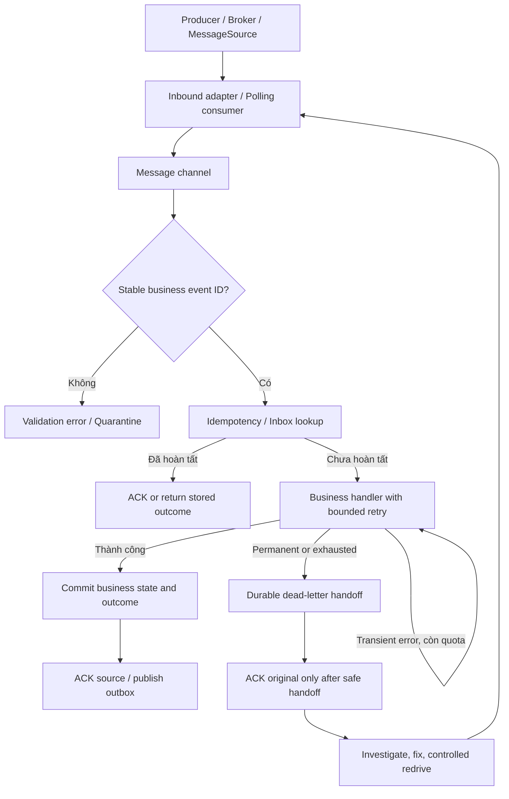
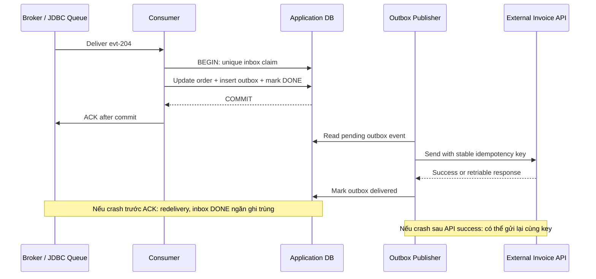
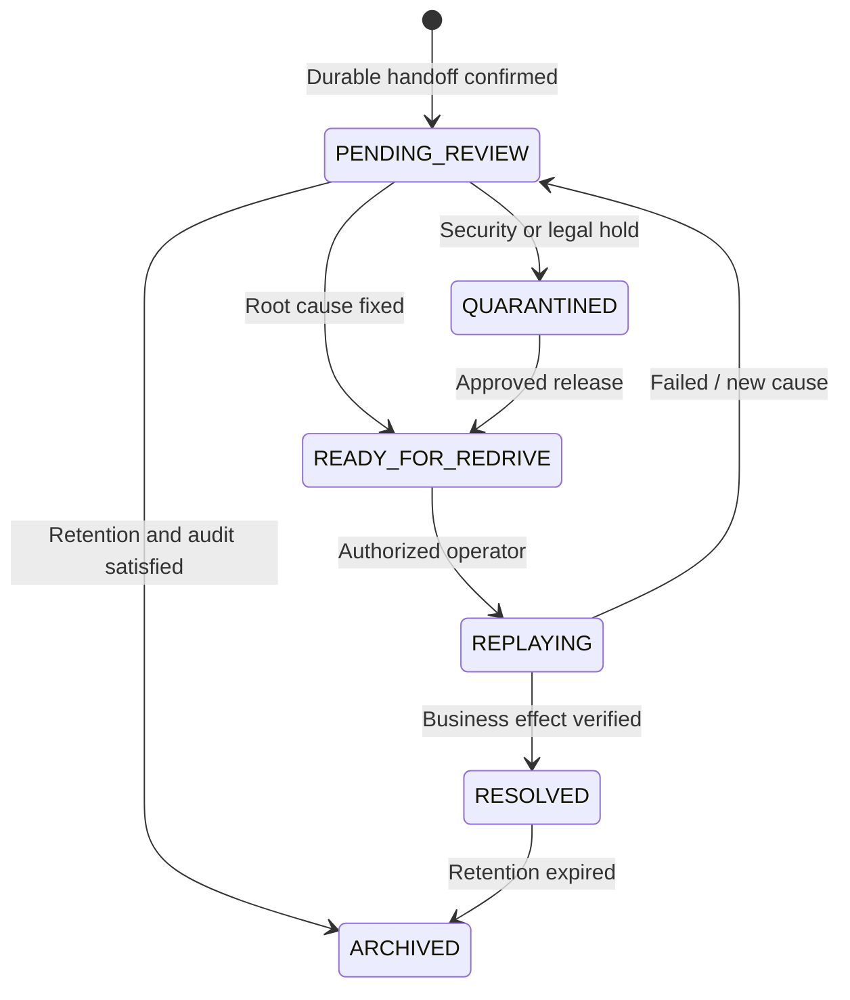
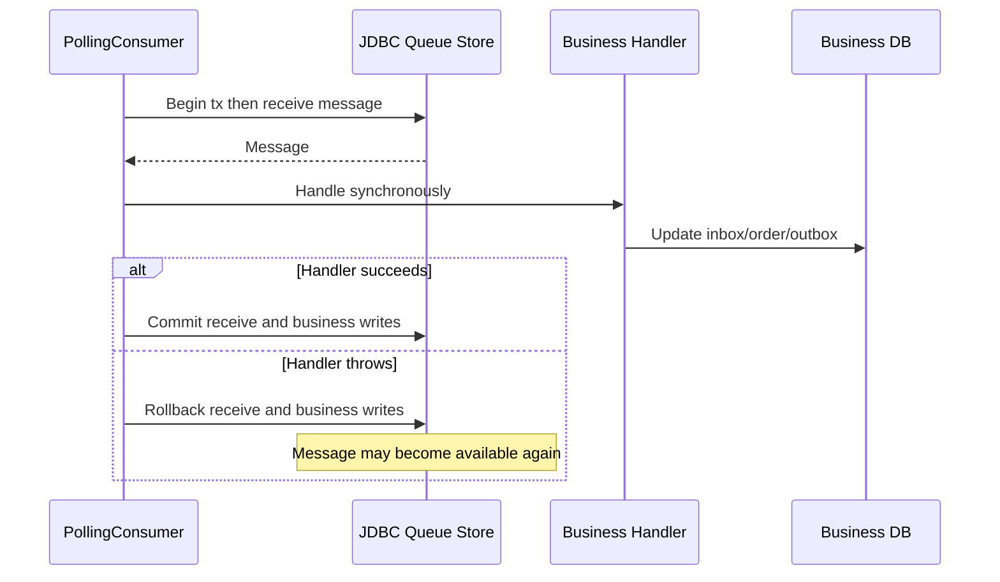
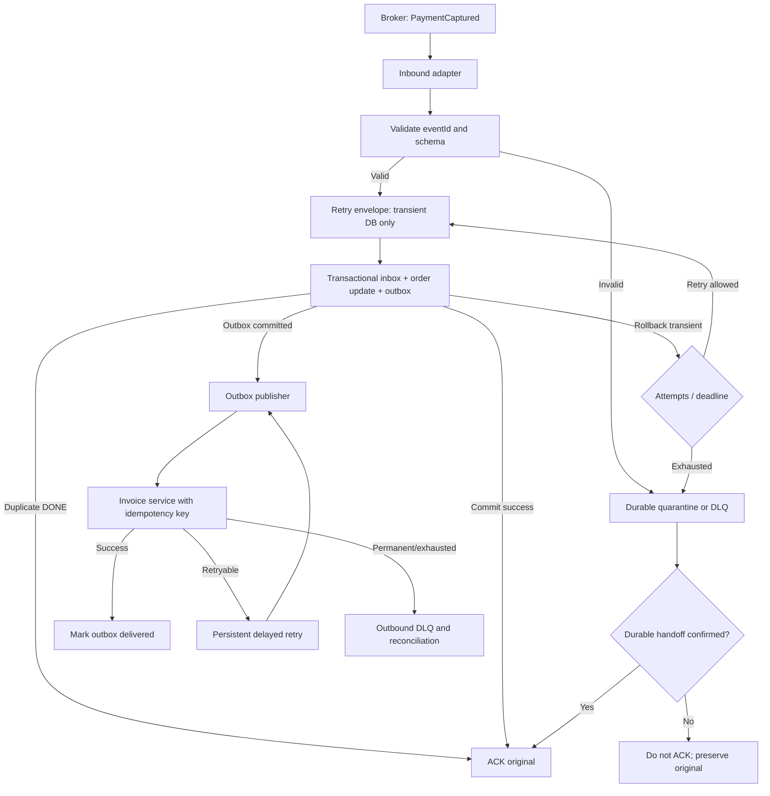

# Thiết kế retry cùng idempotency và dead-letter trong Spring Integration runtime

## 1. Bài toán: thử lại nhưng không gây tác dụng phụ trùng hoặc mất message

Một hệ thống nhận message `OrderPaid` từ broker, ghi trạng thái đơn hàng vào database rồi gọi dịch vụ phát hành hóa đơn. Khi dịch vụ hóa đơn timeout, có ít nhất ba khả năng: yêu cầu chưa tới đích, đã tới nhưng thất bại, hoặc **đã phát hành thành công nhưng response bị mất**. Nếu thử lại vô điều kiện, hệ thống có thể phát hành hai hóa đơn. Nếu đánh dấu message “đã xử lý” ngay lúc nhận, một lần crash trước khi ghi nghiệp vụ có thể làm message bị bỏ qua vĩnh viễn. Nếu retry mãi, poison message giữ consumer bận và làm backlog tăng.

Một thiết kế runtime tin cậy phải phối hợp **retry** (thử lại có giới hạn), **idempotency** (cùng một business event không tạo tác dụng phụ không mong muốn nhiều lần) và **dead-letter** (chuyển message không thể xử lý sang nơi bền vững, có thể chẩn đoán và phát lại). Không có thành phần nào trong ba thành phần tự giải quyết hoàn toàn hai thành phần còn lại.

Bài này thuộc chương **Thiết kế runtime** của module **SPRING_INTEGRATION_RUNTIME**. Nội dung gắn với Spring Integration điều phối message qua channel, endpoint, consumer, poller và executor; vòng đời `IntegrationFlow`, transaction, retry, message store, lỗi, correlation, threading, hiệu năng và trạng thái vận hành.

Sau bài, bạn có thể:

1. Phân biệt retry trong handler, retry của poller/source/broker và việc redrive từ dead-letter.
2. Thiết kế idempotency key ổn định theo nghiệp vụ, không dựa vào message ID tạm thời.
3. Chọn ranh giới transaction giữa nhận message, business write, inbox/outbox và xác nhận nguồn.
4. Cấu hình `RequestHandlerRetryAdvice`, recovery channel và route tới dead-letter bằng Java DSL.
5. Biết giới hạn của `IdempotentReceiverInterceptor`/`MetadataStoreSelector` khi marker được ghi trước handler.
6. Kiểm thử crash windows, retry amplification, duplicate delivery, poison message và replay.
7. Đo kết quả theo **business effects đã commit**, không chỉ số attempt hoặc số `send()`.

> **Phạm vi ví dụ:** Spring Integration **6.5.x**, Spring Framework 6.x, Spring Retry 2.x, Java 17+ và JUnit Jupiter. Ví dụ dùng queue trong RAM để minh họa wiring sẽ được ghi rõ **không bền vững qua crash**; yêu cầu production cần backing store/broker và quy trình xác nhận riêng.

## 2. Đặt ba cơ chế ở đúng vị trí trong message flow



Sơ đồ là **logical design**, không phải pipeline framework tự động có sẵn. Các bước `ACK`, `commit` và `DLQ handoff` có thể nằm trong transaction khác nhau tùy JDBC queue, JMS/AMQP/Kafka hoặc HTTP ingress. Chúng không trở thành một distributed transaction chỉ vì có chung `IntegrationFlow`.

### 2.1. Trách nhiệm từng lớp

| Lớp | Bảo đảm mục tiêu | Không tự bảo đảm |
| --- | --- | --- |
| `RequestHandlerRetryAdvice` / retry template | Lặp invocation của handler khi exception phù hợp, theo max attempts và backoff. | Không bảo đảm transaction rollback, idempotency, bền vững sau crash hoặc DLQ. |
| `IdempotentReceiverInterceptor` + metadata store | Nhận diện các key đã xuất hiện, có thể đánh dấu/discard duplicate. | Marker được ghi không chứng minh business effect đã commit; không phải exactly-once side effect. |
| Business inbox/unique key | Ngăn áp dụng cùng business event lặp vào trạng thái nghiệp vụ có transaction thích hợp. | Không tự đảo một HTTP side effect đã xảy ra ngoài transaction. |
| Outbox | Ghi ý định phát thông điệp cùng business transaction, xử lý publish sau. | Consumer ở phía nhận vẫn phải chịu duplicate deliveries. |
| Durable dead-letter store/queue | Giữ message không xử lý được cùng metadata lỗi để điều tra/replay. | Không tự sửa poison payload, bảo đảm redrive chính xác hoặc tránh DLQ duplicate. |
| Broker acknowledgment / JDBC receive transaction | Điều khiển khi message được coi là đã nhận/xóa khỏi nguồn. | Không đồng nhất mọi state ở downstream và external service. |

Một hệ thống có thể đạt **at-least-once delivery** nhưng chỉ đạt **effectively-once business effect** khi phối hợp key ổn định, transaction và idempotency ở đúng downstream boundary. Tránh tuyên bố “exactly once end-to-end” nếu có external HTTP API không tham gia cùng transaction.

### 2.2. Bốn mốc trạng thái không được trộn lẫn

```text
RECEIVED      : Message tới consumer.
ATTEMPTED     : Business handler được gọi (có thể nhiều lần).
COMMITTED     : Trạng thái nghiệp vụ / outbox đã commit bền vững.
ACKNOWLEDGED  : Nguồn hoặc broker chấp nhận xác nhận xử lý.
```

Nếu tiến trình crash **sau COMMITTED nhưng trước ACKNOWLEDGED**, message có thể đến lại; idempotency phải nhận ra business event đã commit. Nếu ACKNOWLEDGED trước COMMITTED, crash có thể khiến dữ liệu nghiệp vụ chưa được ghi mà nguồn không phát lại.

## 3. Phân loại lỗi trước khi chọn retry policy

Retry có lợi khi lỗi có xác suất biến mất theo thời gian hoặc theo lần thử. Đưa mọi exception vào retry sẽ làm tăng latency, tiêu tốn worker threads và khiến dữ liệu sai luẩn quẩn.

| Nhóm lỗi | Ví dụ | Hành vi đề xuất |
| --- | --- | --- |
| **Transient** | Connection reset, DB deadlock, HTTP 503/429 có `Retry-After`. | Retry có giới hạn với backoff/jitter, budget chung và timeout. |
| **Permanent / non-retryable** | Thiếu trường bắt buộc, enum không hỗ trợ, schema version chưa được ứng dụng nhận biết, chữ ký sai. | Không lặp một invocation vô ích; reject/quarantine/DLQ có lý do. |
| **Thành công không rõ kết quả** | Client timeout sau khi phía nhận đã thực hiện side effect. | Kiểm tra trạng thái theo business/idempotency key trước khi thử lại; dùng API nhận hỗ trợ idempotency. |
| **Dependency đang outage dài** | Database không truy cập được nhiều phút, external service ngừng hoạt động. | Circuit breaker, delayed retry hoặc ngừng ingress, không chiếm thread bằng retry dày đặc. |
| **Contention / concurrency** | Optimistic lock, deadlock, hot partition. | Retry sau backoff nếu an toàn, đồng thời giảm tranh chấp; không chỉ tăng attempts. |
| **Poison message** | Payload hỏng/không thể deserialize hoặc liên tục vi phạm invariant. | Đưa vào nơi cách ly bền vững và cảnh báo, không để giữ poller vô hạn. |
| **Lỗi trong recovery/DLQ** | Dead-letter broker không sẵn sàng. | Không ACK original khi chưa handoff an toàn; alert và policy fallback rõ. |

**Phân loại theo root cause, không chỉ outer exception.** Spring Integration có thể bọc lỗi trong `MessagingException`, và Spring Retry có tùy chọn duyệt cause chain. Tuy nhiên, chỉ duyệt cause chain khi bạn hiểu exception nào tương ứng transient; không retry rộng `Exception.class` hay `Throwable.class` cho mọi message.

### 3.1. Các ngưỡng phải thiết kế cùng nhau

- **Timeout cho một attempt:** tổng thời gian I/O của một invocation.
- **Max local attempts:** số lần handler được advice gọi trong *một delivery*, kể cả lần đầu.
- **Backoff/jitter:** thời gian chờ và phân tán retry, tránh các pod đồng loạt thử lại.
- **Global delivery budget:** số lần broker/poller có thể redeliver một business event.
- **Max age / deadline:** một event hết giá trị nghiệp vụ cần được xử lý thế nào?
- **Error budget:** tỷ lệ lỗi chấp nhận được trước khi pause nguồn hoặc chuyển delayed retry.

Không đặt local max attempts riêng mà quên broker redelivery. Ví dụ 3 attempts mỗi delivery và tối đa 5 deliveries có thể dẫn tới **15 handler attempts cho một event**, chưa tính replay thủ công:

\[
\text{Max handler attempts} \leq
N_{\text{local}} \times N_{\text{deliveries}}
\]

Đây là trần lý thuyết khi mỗi delivery chạy hết local attempts; recovery thành công hoặc lỗi không retryable có thể làm số thực tế thấp hơn.

## 4. Ba tầng retry và nơi lưu trạng thái retry

| Tầng retry | Ai điều khiển? | Trạng thái sống ở đâu? | Khi nào phù hợp? |
| --- | --- | --- | --- |
| **Handler retry đồng bộ** | `RequestHandlerRetryAdvice` + `RetryTemplate`. | Thread/JVM đang gọi handler; thường mất khi process crash. | Lỗi rất ngắn, số attempt thấp, không cần giải phóng worker giữa các lần thử. |
| **Source/poller/broker redelivery** | Transaction rollback, NACK/requeue, listener retry hoặc source-specific adapter. | Broker/JDBC queue và delivery state tùy backend. | Lỗi cần nhận lại message sau lỗi/restart; at-least-once. |
| **Scheduled delayed retry** | Broker delayed queue, retry topic, job scheduler hoặc persistent workflow. | Kho bền vững với `nextAttemptAt` và attempts. | Outage kéo dài, cần giải phóng consumer, backoff phút/giờ. |

### 4.1. Retry đồng bộ không thay thế redelivery bền vững

Nếu retry advice gọi handler ba lần rồi JVM crash, retry template không tự lưu ba attempts xuống persistent database. Nguồn/broker quyết định có giao message lại hay không. Một khi message được ACK mà business chưa commit, retry trong memory không giúp lấy message về.

**Backoff đồng bộ giữ tài nguyên:** worker có thể chờ trong lúc backoff; khi nhiều message cùng lỗi, hàng trăm workers dễ bị chiếm bởi các task không tiến triển. Với lỗi outage kéo dài, nên phát sang durable retry queue có thời điểm xử lý sau, hoặc pause ingress theo policy.

### 4.2. Phân biệt retry advice ở handler với retry của poller

`RequestHandlerRetryAdvice` chỉ bao quanh **handler được gắn advice**. Nó không tự bao:

- Lỗi `MessageSource.receive()` xảy ra trước handler;
- Lỗi deserialize/conversion xảy ra trước endpoint có advice;
- Exception ở endpoint downstream sau khi message đã được chuyển qua asynchronous channel;
- Broker acknowledgment hoặc nguồn dữ liệu tự retry bên ngoài handler;
- External side effect đã thành công nhưng phản hồi timeout.

Với `DirectChannel`, exception từ handler đồng bộ có thể truyền ngược lên caller. Với `ExecutorChannel` hoặc `QueueChannel` + poller, exception có thể được chuyển đến error channel và không xuất hiện ở thread producer. Test phải quan sát **đúng boundary**, không assert `send()` ném lỗi cho mọi flow.

### 4.3. Tính tổng thời gian retry trước khi triển khai

Giả sử một attempt có timeout 2 giây, tối đa 3 attempts, backoff 100 ms rồi 300 ms. Thời gian tệ nhất cho một delivery có thể xấp xỉ:

\[
T_{\text{delivery}} \approx 3 \times 2\text{ s}
+ 0.1\text{ s} + 0.3\text{ s} = 6.4\text{ s}
\]

Nếu listener/broker visibility timeout, gateway reply timeout hoặc HTTP request deadline **ngắn hơn 6,4 giây**, caller có thể timeout trước khi handler kết thúc. Thiết kế phải nhất quán giữa deadline nguồn, transaction timeout và retry budget. Công thức này chưa cộng queue wait, serialization, GC, transaction commit hoặc network jitter.

## 5. Idempotency: khóa theo nghiệp vụ và trạng thái hoàn tất

Idempotency không có nghĩa handler luôn chạy đúng một lần. Trong hệ thống at-least-once, handler **có thể được gọi nhiều lần**, nhưng kết quả nghiệp vụ phải tương đương với việc xử lý một lần theo hợp đồng.

### 5.1. Khóa nào đại diện cho “cùng một công việc”?

| Khóa | Có phù hợp không? | Lý do |
| --- | --- | --- |
| `MessageHeaders.ID` | Thường **không**. | Message ID có thể mới sau transform/rebuild hoặc upstream redelivery. |
| `correlationId` | Chỉ khi hợp đồng xác nhận đó là business event ID duy nhất cho operation. | Có thể đại diện cả nhóm aggregator hoặc chuỗi request, không phải mỗi event. |
| `orderId` | Có thể chưa đủ. | Cùng đơn hàng có nhiều operation hợp lệ: `CREATED`, `PAID`, `REFUNDED`. |
| `eventId` do producer cấp ổn định | Thường phù hợp. | Cần unique theo source/tenant và giữ nguyên khi retry, dead-letter, replay. |
| `tenant + consumerName + eventId` | Phù hợp khi event ID chỉ unique trong tenant/source. | Tránh xung đột giữa tenants hoặc flow xử lý hai side effects khác nhau. |
| `requestId` của một HTTP attempt | Thường không. | Client retry có thể tạo request ID mới dù cùng nghiệp vụ. |

Một key rõ namespace:

```text
orders.payment-captured:v1:tenant-7:evt-204
```

Định nghĩa **business effect** trước khi chọn key. Nếu cùng event cần cập nhật DB và gửi invoice, bạn có thể cần một inbox key cho bước nhận event, cùng một idempotency key ổn định **ở dịch vụ hóa đơn**, chứ không dùng chung một cờ “đã từng thấy” để chứng minh cả hai side effects đã thành công.

**Vòng đời key:** giữ marker ít nhất bằng cửa sổ redelivery + replay mà hệ thống chấp nhận. Xóa quá sớm có thể khiến event cũ được xử lý như mới; giữ vô hạn gây tăng storage. Khi đổi format key/region/tenant mapping, cần migration/dual-read và đối soát, không chỉ đổi prefix trong một release.

### 5.2. IdempotentReceiverInterceptor: phát hiện duplicate ở endpoint

Spring Integration cung cấp `IdempotentReceiverInterceptor` dùng `MetadataStoreSelector` và `ConcurrentMetadataStore`. Selector thường dùng `putIfAbsent(key, value)` để cạnh tranh claim; implementation phù hợp giúp **một instance/cluster chia sẻ store** không cùng claim key khi thao tác atomic.

Tuy nhiên, default behavior của interceptor **không tự chặn handler**: với message bị từ chối, nó có thể gắn header `duplicateMessage=true` rồi vẫn chuyển vào handler. Muốn discard thì cấu hình `discardChannel`/`setDiscardChannelName("nullChannel")` hoặc tự kiểm tra header; có thể chọn ném exception khi rejection, tùy contract.

```java
import org.springframework.integration.handler.advice.IdempotentReceiverInterceptor;
import org.springframework.integration.metadata.ConcurrentMetadataStore;
import org.springframework.integration.selector.MetadataStoreSelector;

IdempotentReceiverInterceptor duplicateGuard(
        ConcurrentMetadataStore metadataStore) {

    MetadataStoreSelector selector = new MetadataStoreSelector(
            message -> {
                String eventId = (String) message.getHeaders().get("eventId");
                String tenant = (String) message.getHeaders().get("tenantId");
                if (eventId == null || eventId.isBlank()
                        || tenant == null || tenant.isBlank()) {
                    throw new IllegalArgumentException(
                            "Missing eventId or tenantId");
                }
                return "orders.rx.v1:" + tenant + ":" + eventId;
            },
            metadataStore);

    IdempotentReceiverInterceptor advice =
            new IdempotentReceiverInterceptor(selector);
    advice.setDiscardChannelName("nullChannel");
    return advice;
}
```

**Đây chỉ là một bộ lọc duplicate đầu vào.** Nếu marker được ghi bền vững **trước khi** business handler chạy và không rollback cùng business write, một exception/crash có thể làm event bị từ chối mãi về sau dù chưa xử lý xong. `SimpleMetadataStore` còn chỉ nằm trong RAM nên mất marker sau restart; nó không chứng minh idempotency nhiều pod. Với production, cân nhắc `JdbcMetadataStore` cùng transaction hoặc **business inbox** có unique constraint và trạng thái rõ ràng như mục tiếp theo.

### 5.3. Cần phân biệt SEEN, IN_PROGRESS và DONE

| Trạng thái | Ý nghĩa | Có được ACK và discard duplicate không? |
| --- | --- | --- |
| Chưa có key | Chưa có bằng chứng event đã xử lý. | Có thể claim rồi xử lý theo transaction. |
| `SEEN` / claimed | Selector đã thấy hoặc đã giữ key. | **Chưa đủ** chứng minh business success. |
| `IN_PROGRESS` | Có worker đang xử lý, có thể đã crash. | Cần lock/lease/timeout/recovery; không mặc nhiên ACK. |
| `DONE` | Business effect cần thiết đã commit và có bằng chứng. | Có thể trả kết quả đã lưu hoặc ACK duplicate. |
| `FAILED_RETRYABLE` | Chưa hoàn tất, có thể thử lại. | Không đánh dấu hoàn tất; retry có điều kiện. |
| `FAILED_PERMANENT` / `DEAD_LETTERED` | Không xử lý tiếp tự động, có durable handoff. | ACK original chỉ sau khi dead-letter bền vững theo contract. |

`MetadataStoreSelector` không tự triển khai toàn bộ state machine này. Nếu cần leases, version fencing, xử lý recovery sau crash và nhiều worker, hãy xây dựng **inbox/workflow state machine** ở tầng ứng dụng; metadata marker chỉ là một tối ưu/điểm phối hợp.

## 6. Transactional inbox và outbox: chống “đã đánh dấu nhưng chưa xử lý”

Một thiết kế có hiệu lực khi business DB là nguồn sự thật có thể đặt inbox, business rows và outbox **trong cùng database transaction**. Khi đó:

1. Worker claim `(consumer_name, event_id)` bằng unique constraint.
2. Nếu record đã ở `DONE`, nhận là duplicate và không chạy side effect thêm.
3. Nếu claim mới, thực hiện DB write, thêm outbox event, cập nhật inbox `DONE` rồi commit cùng transaction.
4. Nếu lỗi, rollback **cả** claim, business write và outbox. Nguồn có thể redeliver.
5. Một worker outbox phát message ra ngoài sau commit, dùng idempotency key; phía nhận cũng phải chịu duplicate.



### 6.1. Schema minh họa cho PostgreSQL

Các bảng `app_order_inbox` và `app_order_outbox` bên dưới **do ứng dụng sở hữu**, không phải bảng `INT_MESSAGE` hoặc `INT_METADATA_STORE` của Spring Integration. DDL là ví dụ học tập; production cần migration, indexes, data retention, security và constraint phù hợp.

```sql
CREATE TABLE app_order_inbox (
    consumer_name VARCHAR(80) NOT NULL,
    event_id VARCHAR(160) NOT NULL,
    status VARCHAR(20) NOT NULL
        CHECK (status IN ('IN_PROGRESS', 'DONE')),
    processed_at TIMESTAMPTZ,
    PRIMARY KEY (consumer_name, event_id)
);

CREATE TABLE app_order_outbox (
    outbox_id UUID PRIMARY KEY,
    event_id VARCHAR(160) NOT NULL,
    destination VARCHAR(120) NOT NULL,
    payload_json JSONB NOT NULL,
    created_at TIMESTAMPTZ NOT NULL DEFAULT CURRENT_TIMESTAMP,
    sent_at TIMESTAMPTZ,
    UNIQUE (event_id, destination)
);
```

Nếu một event tạo nhiều outbound commands cùng destination, unique constraint `(event_id, destination)` không đủ; cần một `effect_type`/`business_operation_id` riêng. Ngược lại, nếu có nhiều consumers độc lập trên cùng event ID, `consumer_name` trong inbox là bắt buộc để tránh một consumer ngăn consumer khác làm việc hợp lệ.

### 6.2. Java 17: một transaction cho claim và business write

Ví dụ sau giả định bảng nghiệp vụ `orders(order_id, payment_status)` đã tồn tại, `JdbcTemplate` và transaction manager cấu hình cho cùng DataSource. Phần này minh họa **transactional DB effect + outbox**; broker ACK do inbound adapter/container quản lý riêng.

```java
import java.util.Map;
import java.util.UUID;

import com.fasterxml.jackson.core.JsonProcessingException;
import com.fasterxml.jackson.databind.ObjectMapper;

import org.springframework.jdbc.core.JdbcTemplate;
import org.springframework.stereotype.Service;
import org.springframework.transaction.annotation.Transactional;

record PaymentCaptured(String eventId, String orderId, String tenantId) {}

@Service
class PaymentCapturedService {
    private static final String CONSUMER = "orders.payment-captured.v1";
    private static final ObjectMapper JSON = new ObjectMapper();
    private final JdbcTemplate jdbc;

    PaymentCapturedService(JdbcTemplate jdbc) {
        this.jdbc = jdbc;
    }

    @Transactional
    public void process(PaymentCaptured event) {
        if (event.eventId() == null || event.eventId().isBlank()
                || event.orderId() == null || event.orderId().isBlank()
                || event.tenantId() == null || event.tenantId().isBlank()) {
            throw new IllegalArgumentException("Invalid payment event");
        }

        // Key trong ví dụ là tenant:producerEventId; producer phải ổn định.
        String eventKey = event.tenantId() + ":" + event.eventId();
        int inserted = jdbc.update("""
                INSERT INTO app_order_inbox(consumer_name, event_id, status)
                VALUES (?, ?, 'IN_PROGRESS')
                ON CONFLICT DO NOTHING
                """, CONSUMER, eventKey);

        if (inserted == 0) {
            String state = jdbc.queryForObject("""
                    SELECT status
                    FROM app_order_inbox
                    WHERE consumer_name = ? AND event_id = ?
                    """, String.class, CONSUMER, eventKey);

            if ("DONE".equals(state)) {
                return; // Duplicate của business effect đã commit.
            }
            // Không ACK mù một record còn IN_PROGRESS.
            throw new IllegalStateException("Inbox state needs reconciliation");
        }

        int updated = jdbc.update("""
                UPDATE orders
                SET payment_status = 'PAID'
                WHERE order_id = ? AND tenant_id = ?
                """, event.orderId(), event.tenantId());
        if (updated != 1) {
            throw new IllegalArgumentException(
                    "Unknown or ambiguous order");
        }

        String invoiceJson;
        try {
            invoiceJson = JSON.writeValueAsString(Map.of(
                    "eventId", event.eventId(),
                    "orderId", event.orderId()));
        }
        catch (JsonProcessingException ex) {
            // Runtime exception để transaction rollback mặc định.
            throw new IllegalStateException("Cannot encode outbox", ex);
        }
        jdbc.update("""
                INSERT INTO app_order_outbox(
                    outbox_id, event_id, destination, payload_json)
                VALUES (?, ?, 'invoice-service', CAST(? AS jsonb))
                """, UUID.randomUUID(), eventKey, invoiceJson);

        jdbc.update("""
                UPDATE app_order_inbox
                SET status = 'DONE', processed_at = CURRENT_TIMESTAMP
                WHERE consumer_name = ? AND event_id = ?
                """, CONSUMER, eventKey);
    }
}
```

**Chỉnh sửa cần thiết trước production:** schema demo của bảng `orders` cần cột `tenant_id` và unique/primary key phù hợp. Đoạn codec dùng Jackson `ObjectMapper` nên cần dependency Jackson và cấu hình serializer phù hợp hợp đồng dữ liệu của ứng dụng. Đảm bảo `@Transactional` có hiệu lực khi Spring gọi bean qua proxy, và transaction manager là manager của **cùng DataSource** với `JdbcTemplate`. Lưu kết quả/reply nếu duplicate phải trả kết quả cũ, thay vì chỉ return void.

**Tính nguyên tử:** khi `process()` được gọi trong một transaction JDBC mới, INSERT inbox, UPDATE orders, INSERT outbox và UPDATE DONE cùng commit hoặc cùng rollback. Nếu hai worker claim cùng key trong hai transaction, unique constraint là lớp bảo vệ quan trọng; transaction thứ hai thường đợi kết quả thứ nhất rồi thấy xung đột hoặc có thể retry. Nếu process khác commit `IN_PROGRESS` độc lập mà không chuyển DONE, cần lease/reaper/reconciliation; **không** dùng nhánh `inserted == 0` để trả success cho trạng thái chưa hoàn thành.

### 6.3. Kết hợp với ACK của source

- **JDBC QueueChannel backed by store:** nếu receive/handler đều dùng cùng DataSource và transaction bao từ poller, có thể rollback thao tác lấy message cùng business writes. Phải xác minh cấu hình transaction ở **poller**, không chỉ `@Transactional` handler.
- **JMS/AMQP:** listener container có ack/transaction semantics riêng; transaction JDBC và broker ACK không mặc định là một atomic transaction. Nếu crash sau DB commit trước ACK, broker redeliver và inbox DONE giúp bỏ qua side effect.
- **Kafka:** offset commit và DB commit là hai mốc khác nhau; at-least-once redelivery vẫn cần dedupe theo business key. Kafka transaction không tự bao HTTP/database ngoài hệ sinh thái liên quan.
- **HTTP source:** caller retry có thể gửi payload mới với request ID khác; cần client-supplied stable idempotency key hoặc mapping từ business operation.

### 6.4. Side effect ngoài database: vì sao cần outbox

Không gọi một HTTP API tạo side effect bên trong transaction JDBC rồi cho rằng rollback DB sẽ hoàn tác HTTP. Một flow an toàn hơn:

1. Trong transaction nghiệp vụ: cập nhật DB + outbox event.
2. Commit.
3. Outbox publisher lấy event đã commit; gửi external request với idempotency key ổn định.
4. Sau thành công hoặc xác minh kết quả, đánh dấu outbox delivered.
5. Nếu crash sau external success trước `sent_at`, publisher có thể gọi lại **cùng key**. Phía nhận phải xử lý idempotent hoặc có API tra cứu để reconcile.

Outbox bản thân có thể publish duplicate. Vì thế không được coi outbox + retry là cơ chế exactly-once ở mọi downstream; nó giúp tránh lost publish và biến duplicate thành vấn đề có thể kiểm soát.

## 7. Dead-letter: nơi cách ly bền vững, không phải thùng rác

Một dead-letter queue/topic/table (DLQ/DLT) lưu **message không thể tiếp tục xử lý theo policy hiện tại**. Mục tiêu là giải phóng luồng xử lý message hợp lệ, bảo tồn đủ dữ liệu để điều tra và cho phép replay được kiểm soát sau khi sửa nguyên nhân.

### 7.1. Khi nào chuyển dead-letter?

- **Permanent ngay từ đầu:** schema không được hỗ trợ, dữ liệu trái hợp đồng, header key bắt buộc bị thiếu hoặc không thể deserialize mà không có chiến lược tương thích.
- **Transient đã hết ngân sách:** đã thử hết local attempts và/hoặc maximum deliveries hoặc hết business deadline.
- **Poison message:** cùng message liên tục làm consumer lỗi, khiến backlog/partition không tiến triển.
- **Manual quarantine:** operator tạm cách ly message để điều tra dữ liệu nhạy cảm hoặc sai quy tắc nghiệp vụ.

Không chuyển DLQ chỉ vì một lần HTTP 503 nếu delayed retry còn hợp lý. Ngược lại, không nên retry hàng nghìn lần cho `IllegalArgumentException` do payload thiếu field bắt buộc.

### 7.2. Dead-letter envelope cần mang những trường nào?

Ví dụ bản ghi **do ứng dụng định nghĩa**, không phải định dạng tự động của `ErrorMessageSendingRecoverer`:

```json
{
  "deadLetterId": "b687c7e7-15c9-4fbc-9876-7c1d8607477b",
  "source": "orders-paid-subscription",
  "businessEventId": "evt-204",
  "tenantId": "tenant-7",
  "originalMessageId": "broker-message-8812",
  "payloadSchemaVersion": 2,
  "payloadRef": "secured-object-store://dlq/2026/11/evt-204",
  "failedStage": "invoiceDispatch",
  "failureCategory": "TRANSIENT_EXHAUSTED",
  "exceptionType": "RemoteServiceUnavailable",
  "localAttempts": 3,
  "deliveryCount": 5,
  "firstReceivedAt": "2026-11-22T01:50:00Z",
  "deadLetteredAt": "2026-11-22T02:01:00Z",
  "retryPolicyVersion": "invoice-v3",
  "traceId": "4b0d9d85f02e4d7b",
  "state": "PENDING_REVIEW"
}
```

Các trường cần cân nhắc:

| Nhóm | Dữ liệu cần giữ | Mục đích |
| --- | --- | --- |
| Identity | Stable business event ID, tenant/source, original transport ID | Dedupe và truy nguồn phát. |
| Payload | Raw payload **hoặc** tham chiếu tới bytes gốc, schema/codec version | Có thể đọc/replay dù model Java hiện tại đã đổi. |
| Headers | Các header cần route/correlation/partition, được chọn lọc | Giữ ngữ nghĩa xử lý, không sao chép credentials. |
| Failure | Stage/endpoint, classification, root cause, stack trace reference | Phân biệt poison với transient outage. |
| Attempts | Local attempts, broker delivery count, previous retry periods | Ngăn vòng lặp vô hạn sau redrive. |
| Timing | First received, last attempted, dead-lettered time | SLO, retention và business deadline. |
| Governance | Policy version, redrive count, reviewer, state, change ID | Phê duyệt và audit replay. |

Không ghi raw OAuth token/password/PII vào logs. Dead-letter payload có thể chứa dữ liệu nhạy cảm: cần mã hóa khi lưu, giới hạn quyền truy cập, chính sách retention/xóa và audit download. Nếu muốn giữ payload bytes, nên tránh tự động chuyển mọi binary object thành JSON thiếu class/version; một số message Java-serialized không còn deserialize được sau upgrade.

### 7.3. Trạng thái của một dead-letter



**Dead-letter bền vững khác error channel trong RAM.** Một `QueueChannel` mặc định chỉ giữ message trong JVM. `ErrorMessageSendingRecoverer` gửi `ErrorMessage` tới recovery channel; nếu channel chỉ là in-memory queue, message có thể mất khi crash. Muốn DLQ đáng tin, cần một adapter/handler gửi vào JMS/AMQP/Kafka topic, JDBC dead-letter table hoặc object store có transaction/ack và quan sát kết quả publish.

### 7.4. Ranh giới ACK với DLQ handoff

| Thời điểm ACK original | Rủi ro |
| --- | --- |
| **Trước** khi DLQ publish/commit | Nếu DLQ publish thất bại hoặc process crash, message bị mất khỏi cả original lẫn DLQ. |
| **Sau** DLQ publish confirmed | An toàn hơn đối với mất message; crash giữa publish và ACK vẫn có thể tạo **duplicate DLQ item**. |
| Atomic transaction chung giữa original JDBC receive và DLQ table cùng DB | Có thể commit/rollback cả receive và dead-letter row nếu cùng DataSource/transaction. |
| Broker và DB/HTTP khác transaction | Không có tính nguyên tử tự phát; dùng outbox/inbox, reconciliation hoặc broker-native DLX có kiểm chứng. |

Nếu broker hỗ trợ native dead-letter exchange/topic khi reject, cần kiểm tra độ bền/routing và giới hạn delivery count của broker/container. Không khẳng định mọi NACK tự động đảm bảo DLQ publish bền vững; mỗi transport có đặc điểm ack/transaction riêng.

### 7.5. Thiết kế redrive không nhân duplicate

Redrive phải là một **quy trình vận hành** chứ không phải nút “gửi lại tất cả”:

1. Điều tra và phân loại lỗi gốc; sửa consumer/schema/credentials/dependency trước khi phát lại.
2. Chọn tập message theo source, tenant, thời gian và failure category; kiểm tra payload và retention.
3. Kiểm tra business state/inbox: đã ở `DONE` hay mới `SEEN/IN_PROGRESS`?
4. Giữ **businessEventId/idempotency key gốc**, thêm `redriveId`, `redriveCount` và `changeId` riêng; không thay event ID để “đi qua dedupe”.
5. Dry-run hoặc canary một tập nhỏ; theo dõi business effects, error rate và downstream rate limit.
6. Mark `RESOLVED` chỉ sau khi xác minh kết quả; nếu vẫn lỗi, đưa lại nơi cách ly theo policy thay vì vòng lặp DLQ → main → DLQ vô hạn.

Nếu marker idempotency đang ở trạng thái đã claim nhưng chưa hoàn tất, một replay có thể bị từ chối sai. Khi đó cần khôi phục **state machine của inbox** (hoặc marker transactional), không xóa tất cả keys rồi cho replay tùy ý.

## 8. Java DSL: handler retry ba lần và chuyển lỗi vào recovery channel

Ví dụ dưới đây là **lõi flow kiểm thử trong một JVM**. `DirectChannel` gửi đồng bộ vào handler để dễ quan sát attempts; `QueueChannel` nhận `ErrorMessage` sau khi retry không còn tiếp tục được. Nó chứng minh advice wiring, **không phải durable dead-letter guarantee**.

### 8.1. Spring configuration

```java
import java.util.concurrent.ConcurrentHashMap;
import java.util.concurrent.ConcurrentMap;
import java.util.concurrent.atomic.AtomicInteger;

import org.springframework.beans.factory.annotation.Qualifier;
import org.springframework.context.annotation.Bean;
import org.springframework.context.annotation.Configuration;
import org.springframework.integration.annotation.EnableIntegration;
import org.springframework.integration.channel.DirectChannel;
import org.springframework.integration.channel.QueueChannel;
import org.springframework.integration.dsl.IntegrationFlow;
import org.springframework.integration.handler.advice.ErrorMessageSendingRecoverer;
import org.springframework.integration.handler.advice.RequestHandlerRetryAdvice;
import org.springframework.messaging.Message;
import org.springframework.messaging.MessageChannel;
import org.springframework.messaging.PollableChannel;
import org.springframework.retry.support.RetryTemplate;

@Configuration
@EnableIntegration
class RetryRecoveryDemoConfiguration {
    static class FakeInvoiceHandler {
        private final ConcurrentMap<String, AtomicInteger> calls =
                new ConcurrentHashMap<>();

        public void handle(Message<String> message) {
            String eventId = (String) message.getHeaders().get("eventId");
            if (eventId == null) {
                throw new IllegalArgumentException("Missing eventId");
            }
            int attempt = calls.computeIfAbsent(
                    eventId, ignored -> new AtomicInteger())
                    .incrementAndGet();

            if (eventId.startsWith("transient-") && attempt <= 2) {
                throw new IllegalStateException("Temporary API outage");
            }
            if (eventId.startsWith("poison-")) {
                throw new IllegalStateException("Always failing in demo");
            }
            // Fake: thành công. Production phải dùng idempotency ở DB/API.
        }

        int attemptsFor(String eventId) {
            AtomicInteger value = calls.get(eventId);
            return value == null ? 0 : value.get();
        }
    }

    @Bean
    FakeInvoiceHandler invoiceHandler() {
        return new FakeInvoiceHandler();
    }

    @Bean
    MessageChannel invoiceInput() {
        return new DirectChannel();
    }

    @Bean
    PollableChannel invoiceRecoveryErrors() {
        return new QueueChannel();
    }

    @Bean
    RequestHandlerRetryAdvice invoiceRetryAdvice(
            @Qualifier("invoiceRecoveryErrors")
            MessageChannel recoveryChannel) {
        RetryTemplate template = RetryTemplate.builder()
                .maxAttempts(3)
                .retryOn(IllegalStateException.class)
                .noBackoff() // Test-only: production dùng backoff/jitter.
                .build();

        RequestHandlerRetryAdvice advice = new RequestHandlerRetryAdvice();
        advice.setRetryTemplate(template);
        advice.setRecoveryCallback(
                new ErrorMessageSendingRecoverer(recoveryChannel));
        return advice;
    }

    @Bean
    IntegrationFlow invoiceFlow(
            FakeInvoiceHandler handler,
            RequestHandlerRetryAdvice invoiceRetryAdvice) {
        return IntegrationFlow.from("invoiceInput")
                .handle(handler, "handle",
                        endpoint -> endpoint.advice(invoiceRetryAdvice))
                .get();
    }
}
```

Giải thích:

- `RetryTemplate.maxAttempts(3)` gồm **lần đầu và tối đa hai lần thử lại**, không phải ba lần retry cộng thêm lần đầu.
- `retryOn(IllegalStateException.class)` chỉ minh họa lỗi tạm thời giả lập. Trong production, hãy dùng exception riêng của adapter hoặc classifier đã phân biệt HTTP 429/503, validation và unknown outcome.
- `noBackoff()` giúp test nhanh; **không dùng mặc định này** khi downstream có rate limit/outage.
- `ErrorMessageSendingRecoverer` gửi một `ErrorMessage` tới `invoiceRecoveryErrors`. Recovery có thể khiến lệnh gửi vào `DirectChannel` kết thúc **bình thường** dù business handler thất bại ba lần. Bởi vậy, xác nhận `send() == true` **không phải** xác nhận invoice đã phát hành.
- Channel lỗi ở đây **trong RAM**, không bảo đảm bền vững qua restart. Production cần flow chuyển sang durable DLQ và xác định ACK theo loại nguồn.

### 8.2. JUnit 5: thành công sau retry và exhausted retry

```java
import org.junit.jupiter.api.Test;
import org.springframework.beans.factory.annotation.Autowired;
import org.springframework.beans.factory.annotation.Qualifier;
import org.springframework.integration.test.context.SpringIntegrationTest;
import org.springframework.messaging.Message;
import org.springframework.messaging.MessageChannel;
import org.springframework.messaging.PollableChannel;
import org.springframework.messaging.support.ErrorMessage;
import org.springframework.messaging.support.MessageBuilder;
import org.springframework.test.annotation.DirtiesContext;
import org.springframework.test.context.junit.jupiter.SpringJUnitConfig;

import static org.junit.jupiter.api.Assertions.*;

@SpringJUnitConfig(RetryRecoveryDemoConfiguration.class)
@DirtiesContext(classMode = DirtiesContext.ClassMode.AFTER_EACH_TEST_METHOD)
class RetryRecoveryDemoTest {

    @Autowired @Qualifier("invoiceInput")
    MessageChannel input;

    @Autowired @Qualifier("invoiceRecoveryErrors")
    PollableChannel recovery;

    @Autowired
    RetryRecoveryDemoConfiguration.FakeInvoiceHandler handler;

    @Test
    void transientFailureSucceedsOnThirdInvocation() {
        assertTrue(input.send(MessageBuilder
                .withPayload("invoice-request")
                .setHeader("eventId", "transient-42")
                .build()));

        assertEquals(3, handler.attemptsFor("transient-42"));
        assertNull(recovery.receive(0));
    }

    @Test
    void exhaustionProducesRecoveryEventNotBusinessSuccess() {
        assertTrue(input.send(MessageBuilder
                .withPayload("invoice-request")
                .setHeader("eventId", "poison-99")
                .build()));

        assertEquals(3, handler.attemptsFor("poison-99"));
        Message<?> error = recovery.receive(1_000);
        assertNotNull(error);
        assertInstanceOf(ErrorMessage.class, error);
        assertNotNull(((ErrorMessage) error).getPayload());
    }
}
```

**Ý nghĩa của test:** test thứ nhất chứng minh ba invocations có recovery channel rỗng. Test thứ hai chứng minh **ba attempts đã lỗi** và lỗi được chuyển tới recovery channel; nó không tuyên bố message đã commit, đã ACK ở broker hay đã nằm trong DLQ durable.

Để kiểm chứng production, thay in-memory recovery queue bằng adapter/topic/table test có persistence, inject failure ở lúc DLQ publish, kiểm tra ACK/rollback, sau đó restart context và xác nhận dead-letter còn đọc được.

## 9. Advice order: idempotency, retry và transaction phải bao đúng tầng

Spring Integration cho phép gắn advice vào endpoint/handler. Khi kết hợp nhiều advice, **thứ tự lồng nhau quyết định hành vi**. Hai cấu hình trông tương tự có thể tạo kết quả khác hẳn khi handler lỗi.

### 9.1. Ba cách lồng và những rủi ro

| Thứ tự logic (ngoài → trong) | Điều gì xảy ra khi handler lỗi? | Rủi ro chính |
| --- | --- | --- |
| `Idempotent → Retry → Handler` | Idempotent guard chạy một lần cho delivery; Retry có thể gọi Handler nhiều lần bên trong. | Nếu marker đã commit trước business success, crash/exhaustion có thể tạo false duplicate sau redelivery. |
| `Retry → Idempotent → Handler` | Mỗi retry attempt lại chạy selector; attempt đầu có thể claim key, attempt sau thấy duplicate. | Retry bị chặn bởi chính marker của attempt trước dù handler chưa thành công. |
| `Retry → Transaction → Idempotent → Business DB` | Mỗi retry attempt bắt đầu transaction mới; claim và DB write cùng rollback khi handler ném lỗi. | Cần manager đúng DataSource, đúng proxy/advice order, không có external side effect ngoài transaction. |

Trong bảng, mũi tên biểu diễn **logic nesting**, không cam kết thứ tự annotation/proxy của mọi configuration. Spring AOP, `RequestHandlerRetryAdvice`, `TransactionInterceptor` và DSL endpoint advice phải được kiểm chứng bằng test với chính flow của bạn. Nếu transaction được mở **ngoài toàn bộ vòng retry**, một exception SQL ở attempt đầu có thể khiến transaction bị đánh dấu rollback-only; attempt sau không nhất thiết có transaction lành mạnh để commit.

### 9.2. Một nguyên tắc thiết kế khả thi

**Nếu nghiệp vụ được bảo vệ bằng cùng JDBC database**, một lựa chọn dễ giải thích là:

```text
Inbound delivery
  -> Bounded retry
       -> New business transaction for each attempt
            -> Claim inbox with unique constraint
            -> Update business state + append outbox
            -> Mark inbox DONE
          COMMIT or ROLLBACK
  -> On exhaustion, durable dead-letter handoff
  -> ACK only after business commit or safe handoff
```

Với lỗi xử lý nghiệp vụ, mỗi attempt rollback cả claim lẫn DB write. Với lỗi publish outbox, outbox worker có retry riêng và không buộc phải xử lý lại business handler. Với nhiều app instances, database unique constraint bảo vệ claim đồng thời.

Nếu muốn dùng `IdempotentReceiverInterceptor` ở ngoài cho tối ưu, phải biết rõ marker có được rollback cùng DB effect **không** và duplicate được xử lý ra sao khi một event ở `IN_PROGRESS`. Trong nhiều workload, **business inbox là lớp bảo vệ chính**, còn interceptor chỉ giảm công việc thừa và giúp observability.

### 9.3. Transaction poller khác transaction handler

Giả sử `QueueChannel` dùng `JdbcChannelMessageStore` và consumer poll message:



Sơ đồ chỉ đúng nếu:

1. Poller thực sự mở transaction **trước `receive()`**, dùng transaction manager thích hợp.
2. `JdbcChannelMessageStore` và business JDBC writes dùng đúng transactional resources/DataSource.
3. Handler downstream chạy **đồng bộ** trong ranh giới transaction đó.
4. Exception **propagate ra ngoài** để transaction rollback; recovery không vô tình nuốt lỗi rồi commit receive.

Đặt `@Transactional` chỉ trên handler có thể không bao thao tác dequeue xảy ra **trước khi handler bắt đầu**. Đưa `ExecutorChannel` vào giữa poller và handler có thể cắt transaction tại thread boundary. Vì thế, dùng test JDBC rollback thực thay vì suy ra từ việc thấy annotation trong code.

### 9.4. Recovery callback thay đổi nghĩa “thành công”

Nếu `RequestHandlerRetryAdvice` recovery callback gửi lỗi vào `ErrorMessageSendingRecoverer` rồi **trả về bình thường**, endpoint phía ngoài có thể hiểu handler invocation đã hoàn tất, và source có thể ACK/commit. Điều này chỉ hợp lệ khi recovery channel đã chuyển message vào nơi bền vững **trước khi** ACK.

Đối với yêu cầu at-least-once không mất message, hãy thiết kế:

- Nếu business commit thành công: ACK hoặc commit offset theo nguồn.
- Nếu lỗi tạm thời, chưa hết budget: rollback/NACK hoặc delayed retry được xác nhận.
- Nếu lỗi vĩnh viễn/hết budget: **persist DLQ + confirm handoff**, rồi ACK original.
- Nếu persist DLQ thất bại: propagate failure/rollback original, cảnh báo và áp backpressure.

Không mặc định coi một `ErrorMessage` nằm trong in-memory channel là đã handoff bền vững.

## 10. Tích hợp với transport: JDBC, JMS, AMQP, Kafka và HTTP

Retry/idempotency/dead-letter ở tầng Spring Integration không thay thế **semantics của adapter và broker**. Một error handler Java có thể quyết định recovery, nhưng ACK/offset/delivery count thuộc vào transport.

| Nguồn | ACK/transaction cần hiểu | Cách dead-letter thường dùng | Giới hạn quan trọng |
| --- | --- | --- | --- |
| **JDBC-backed polling queue** | Transaction poller có thể bao nhận message và business JDBC write nếu cùng DataSource. | Một dead-letter table cùng DB hoặc outbox publish tới broker. | Schema/region/group, lock/rollback và serializer phải khớp; `QueueChannel` RAM không có cùng đảm bảo. |
| **JMS** | Session transacted / broker redelivery theo provider và listener container. | Provider DLQ hoặc application recovery destination. | Redelivery policy/poison count khác theo broker; không tự atomic với business DB. |
| **RabbitMQ / AMQP** | ACK/NACK/requeue, listener retry và broker DLX/TTL theo cấu hình. | Dead-letter exchange/queue, delayed retry queue hoặc parking lot. | Cần kiểm tra broker confirms, routing/binding và dead-letter cycles; nack không mặc nhiên thay thế durable handoff guarantee. |
| **Kafka** | Offset commit/rebalance, partition ordering và consumer error handling. | Retry topics / dead-letter topic với recoverer tương ứng. | Offset không là business DB commit; retry phải giữ partition/key semantics khi cần ordering. |
| **HTTP / Gateway** | Response code/deadline, client tự retry. | Application quarantine hoặc durable job inbox/outbox. | Request timeout không biết chắc external side effect đã thành công hay chưa. |
| **File/SFTP/FTP polling** | File filters, metadata store, rename/move, checkpoint. | Quarantine directory và audit hoặc durable error event. | Đánh dấu file đã thấy trước xử lý có thể làm không quét lại sau crash; cần chính sách idempotent ingestion. |

**Phân biệt framework:** ví dụ `DefaultErrorHandler` hoặc `DeadLetterPublishingRecoverer` của Spring Kafka nằm trong Spring Kafka; listener container RabbitMQ/JMS có cơ chế riêng. Không đưa nguyên các API đó vào `RequestHandlerRetryAdvice` rồi cho rằng Spring Integration core tự điều khiển mọi broker.

### 10.1. Bẫy ordering theo key

Trong một Kafka partition hoặc một hàng đợi xử lý tuần tự theo account, message A có thể bị lỗi trước message B. Nếu chuyển A sang delayed retry topic rồi cho B đi tiếp, **ordering nghiệp vụ bị thay đổi**. Ngược lại, giữ A chặn đầu partition đến khi hết retry có thể làm lag cả partition.

Cần chọn rõ:

- **Strict ordering:** pause partition/key hoặc serial hóa theo key, chấp nhận ảnh hưởng throughput.
- **Eventual ordering:** cho B đi tiếp nhưng downstream dùng version/sequence, conditional updates, reconciliation và idempotency.
- **Business quarantine:** dừng riêng account/tenant hoặc lưu trạng thái pending, không chặn mọi tenant khác.

`correlationId` và sequence headers giúp liên kết message nhưng không tự thực thi ordering. Với aggregator, group state và late-arrival semantics phải được giữ khi DLQ/redrive một phần message.

### 10.2. Restart và version hóa payload

Message nằm trong persistent queue hoặc DLQ có thể được xử lý **sau một hoặc nhiều lần deploy**. Khi replay, code mới có thể không deserialize được payload do class Java đổi package/serialVersionUID hoặc schema JSON mới; vì vậy cần lưu raw payload + schema version và có backward reader/upcaster.

Không dùng một mã `status=DONE` của metadata store cũ để kết luận mọi side effect của code mới đã hoàn thành nếu semantics event/handler đã thay đổi. Version idempotency namespace, route và retry policy khi cần, nhưng đừng thay key của cùng event một cách tùy tiện để tránh duplicate.

## 11. Kiểm soát hiệu năng và tránh retry storm

### 11.1. Retry amplification tác động throughput hữu ích

Giả sử nguồn mới 200 events/s, 20% event cần ba attempts để thành công, 80% thành công ngay:

\[
E[\text{attempts per event}] =
0.8 \times 1 + 0.2 \times 3 = 1.4
\]

Để xử lý 200 business events/s, handler cần khoảng **280 invocations/s** khi bỏ qua overhead. Nếu downstream chỉ chịu 220 requests/s, retry có thể làm backlog **tăng nhanh hơn** chứ không làm phục hồi.

Khi nhiều pods đều retry sau cùng fixed backoff, chúng có thể đồng loạt gọi API tại cùng một thời điểm. Dùng jitter/randomized backoff khi cần, phối hợp rate limiter/circuit breaker và retry budget toàn hệ thống. Không cho mỗi tầng (HTTP client, handler advice, broker redelivery, DLQ redrive) đặt retry vô hạn độc lập.

### 11.2. Backpressure cần đi trước sự cố nặng

| Triệu chứng | Tín hiệu runtime | Hành động thiết kế |
| --- | --- | --- |
| Executor worker bị giữ bởi backoff | Active threads cao, committed/s thấp. | Giảm local attempts, chuyển delayed retry bền vững. |
| In-memory queue phình to | Queue depth/oldest age tăng. | Bounded capacity, throttle ingress, durable buffer nếu cần. |
| DB deadlock tăng khi tăng consumers | Rollback/lock wait tăng, p99 cao. | Giảm concurrency, transaction ngắn, partition theo business key. |
| Broker redelivery liên tục | Delivery count cao, cùng message ID lặp. | Max deliveries, poison isolation, error classification. |
| DLQ throughput tăng mạnh | Số permanent/exhausted errors tăng. | Alert, giữ payload, phân tích dependency và schema drift. |
| External API timeout với kết quả không rõ | Errors tăng nhưng phía nhận có side effects. | Stable idempotency key, query/reconcile, không retry mù. |

**Throughput phải được đếm theo business commits/s**, không phải tổng handler attempts/s hay số ErrorMessages. Khi retry nhiều, số invocations tăng trong khi throughput hữu ích có thể giảm.

## 12. Một thiết kế tổng thể cho service xử lý hóa đơn

Để liên kết ba cơ chế thành một hệ thống có thể vận hành, xét flow nhận `PaymentCaptured` và cần cập nhật đơn hàng, rồi yêu cầu dịch vụ hóa đơn phát hành:



**Hai nhóm retry độc lập:** (a) nhận `PaymentCaptured` để ghi inbox/business DB/outbox; (b) outbox publisher gọi invoice service. Nếu invoice API outage, không cần rollback đơn hàng đã được đánh dấu PAID rồi bắt broker redeliver toàn bộ PaymentCaptured. Outbox worker có deadline và DLQ riêng.

### 12.1. Hợp đồng trạng thái rõ ràng

| Thành phần | Tạo nguồn sự thật nào? | Điều kiện coi thành công |
| --- | --- | --- |
| Inbound adapter | Delivery state của broker/JDBC queue. | ACK khi business transaction commit hoặc durable quarantine handoff xác nhận. |
| Business inbox | `(consumer,eventKey,status)` duy nhất. | `DONE` đã commit, không chỉ có key `SEEN`. |
| Business table | Trạng thái order/tenant theo invariant. | Commit đạt điều kiện; xử lý duplicate là no-op có kiểm soát. |
| Outbox | Ý định gửi invoice command. | Row outbox được commit cùng business state. |
| Outbox publisher | Attempt, next retry time, delivered state. | Phía nhận xác nhận theo idempotency key hoặc được reconcile. |
| Dead-letter | Payload gốc và nguyên nhân, trạng thái review/redrive. | Bản ghi bền vững; audit và quyền truy cập phù hợp. |

Không gộp “business event processed” với “invoice delivered” thành một Boolean chung. Việc tách state cho phép khôi phục chính xác ở từng stage khi outage kéo dài.

### 12.2. Ví dụ dead-letter table do ứng dụng sở hữu

Nếu muốn dead-letter trong cùng PostgreSQL, một schema tối thiểu có thể là:

```sql
CREATE TABLE app_dead_letter (
    dead_letter_id UUID PRIMARY KEY,
    source_name VARCHAR(120) NOT NULL,
    source_message_id VARCHAR(160) NOT NULL,
    failed_stage VARCHAR(120) NOT NULL,
    business_event_id VARCHAR(160),
    schema_version INTEGER,
    original_payload BYTEA NOT NULL,
    failure_category VARCHAR(80) NOT NULL,
    attempts INTEGER NOT NULL CHECK (attempts >= 1),
    dead_lettered_at TIMESTAMPTZ NOT NULL DEFAULT CURRENT_TIMESTAMP,
    state VARCHAR(30) NOT NULL DEFAULT 'PENDING_REVIEW',
    replay_count INTEGER NOT NULL DEFAULT 0,
    UNIQUE (source_name, source_message_id, failed_stage)
);
```

Ở đây unique constraint làm idempotent handoff cho **một message transport ID tại một stage**. Nếu broker cấp ID mới cho redelivery hoặc event đi qua nhiều message envelopes khác nhau, cần một key bền khác, ví dụ `(source, businessEventId, failedStage, processingVersion)` tùy hợp đồng. Tránh thiết kế unique key làm mất thông tin về hai lỗi thật sự khác nhau khi một event có nhiều side effects.

**Nguyên tắc transaction của DLQ:**

- Nếu original JDBC queue và dead-letter table cùng database, có thể thiết kế chuyển bản ghi/ack trong một transaction **do ứng dụng kiểm soát**; kiểm chứng rõ cách dequeue của `JdbcChannelMessageStore` tương tác transaction.
- Nếu business transaction đã rollback, việc ghi dead-letter cần một **transaction độc lập được quản lý**, không dựa vào transaction đã bị đánh dấu rollback-only.
- Nếu nguồn là broker ngoài database, dead-letter INSERT thành công và broker ACK là hai hệ thống khác nhau. Crash có thể tạo duplicate ở DLQ hoặc nguồn; dùng idempotent insert, reconciliation và chỉ ACK sau handoff confirmed.
- Không lưu exception stack trace chứa credentials/payload raw trong cột không bảo vệ. Nên lưu failure category và một secured error detail reference.

### 12.3. Giao diện application cho recovery

Ví dụ interface nêu rõ recovery **phải xác nhận bền vững** hoặc ném lỗi:

```java
import org.springframework.messaging.Message;

interface DurableDeadLetterPublisher {
    /**
     * Chỉ return sau khi original payload + metadata đã được
     * ghi bền vững và backend xác nhận.
     *
     * Ném exception khi handoff chưa được xác nhận.
     * Caller không được ACK nguồn nếu chưa có durable handoff.
     */
    void publishAndConfirm(
            Message<?> original,
            Throwable rootFailure,
            String failedStage,
            int totalAttempts);
}
```

Đây là **contract của ứng dụng**, không phải interface Spring Integration. Implementation cần quyết định transaction/ack theo JDBC, JMS, AMQP hoặc Kafka. Khi recovery code chỉ `channel.send(errorMessage)` tới queue RAM rồi return, contract trên **chưa được thực hiện**.

## 13. Ma trận kiểm thử bắt buộc: đúng cả khi lỗi và crash

### 13.1. Test happy path không đủ

Để kiểm thử một kiến trúc retry + inbox + DLQ, cần ít nhất:

| Kịch bản | Cách tiêm lỗi | Assertion có giá trị |
| --- | --- | --- |
| **T1: Success lần đầu** | Không lỗi. | Một business commit, một inbox DONE, một outbox row, ACK đúng. |
| **T2: Transient rồi thành công** | Handler ném lỗi hai lần rồi thành công. | Đúng số attempts/backoff, một business effect, không DLQ. |
| **T3: Non-retryable** | Payload thiếu field/schema không hỗ trợ. | Không retry dày; durable quarantine/DLQ, original chỉ ACK sau handoff. |
| **T4: Exhausted local retries** | Handler luôn lỗi transient. | Số attempts có giới hạn, recovery được gọi; không business success giả. |
| **T5: Broker redelivery** | Crash sau DB commit nhưng trước ACK. | Event được giao lại, inbox DONE làm no-op; không thêm outbox/side effect. |
| **T6: Crash trước business commit** | Dừng process giữa inbox claim và commit. | Transaction rollback, message có thể nhận lại, không có marker DONE mồ côi. |
| **T7: DLQ unavailable** | Dead-letter store/broker publish thất bại. | Original **không** ACK như xử lý thành công; cảnh báo rõ. |
| **T8: Crash sau DLQ publish trước ACK** | Giả lập failure window. | DLQ idempotent, có thể reconcile duplicate delivery. |
| **T9: External API unknown outcome** | API đã nhận request nhưng client timeout. | Retry cùng idempotency key hoặc query status, không nhân tác dụng phụ. |
| **T10: Retry advice ordering** | Đổi logic nesting Retry/Idempotent. | Handler được gọi đúng attempts; marker không chặn retry hợp lệ. |
| **T11: Async error channel** | Đưa `ExecutorChannel` giữa source và handler. | Exception/recovery được quan sát ở worker/error channel, không mong producer `send()` ném. |
| **T12: Concurrent same event** | 16 workers nhận cùng business key. | Chỉ một unique business effect commit; những caller khác nhận duplicate/pending có kiểm soát. |
| **T13: DLQ redrive success** | Sửa handler/schema rồi phát lại. | Giữ event ID gốc, xử lý một lần, mark DLQ RESOLVED sau verify. |
| **T14: DLQ redrive still failing** | Phát lại payload chưa sửa. | Không vòng lặp vô hạn; replay count tăng, trạng thái quay PENDING_REVIEW. |
| **T15: Restart/schema migration** | V1 ghi queue/DLQ, V2 đọc. | Payload/header/correlation đọc được, không mất/dedupe sai khi đổi version. |
| **T16: Two pods, shared store** | Hai instances claim cùng id trên DB thật. | Unique constraint, transaction và region hoạt động xuyên JVM. |

Không viết tất cả test trên bằng `SimpleMetadataStore` hay `QueueChannel` RAM rồi kết luận production safe. Các test T5–T8, T12, T15–T16 cần **database/broker persistent thật hoặc Testcontainers**, khởi tạo nhiều application contexts và chủ động mô phỏng crash/commit windows.

### 13.2. Kiểm thử concurrency của idempotency key

Một test unit cho key claim có thể dùng `ConcurrentMetadataStore.putIfAbsent`:

```java
import java.util.ArrayList;
import java.util.List;
import java.util.concurrent.CountDownLatch;
import java.util.concurrent.ExecutorService;
import java.util.concurrent.Executors;
import java.util.concurrent.Future;
import java.util.concurrent.TimeUnit;

import org.junit.jupiter.api.Test;
import org.springframework.integration.metadata.ConcurrentMetadataStore;
import org.springframework.integration.metadata.SimpleMetadataStore;

import static org.junit.jupiter.api.Assertions.*;

class AtomicClaimTest {
    @Test
    void onlyOneThreadClaimsSameKeyInOneJvm() throws Exception {
        ConcurrentMetadataStore store = new SimpleMetadataStore();
        int workers = 12;
        CountDownLatch start = new CountDownLatch(1);
        ExecutorService executor = Executors.newFixedThreadPool(workers);

        try {
            List<Future<Boolean>> futures = new ArrayList<>();
            for (int i = 0; i < workers; i++) {
                futures.add(executor.submit(() -> {
                    start.await();
                    return store.putIfAbsent("orders:t7:evt-204", "SEEN")
                            == null;
                }));
            }
            start.countDown();

            int claimed = 0;
            for (Future<Boolean> future : futures) {
                if (future.get(3, TimeUnit.SECONDS)) {
                    claimed++;
                }
            }
            assertEquals(1, claimed);
        }
        finally {
            start.countDown();
            executor.shutdownNow();
        }
    }
}
```

Test trên chỉ chứng minh atomic claim **trong một JVM** với `SimpleMetadataStore`. Nó không chứng minh tính bền vững sau restart, transaction rollback marker hoặc exactly-once business effect. Với `JdbcMetadataStore`, phải kiểm thử hai JVM/contexts cùng DataSource và assertion trên bảng nghiệp vụ. Mỗi `Future.get(timeout)` ở test có thời hạn để tránh treo vô hạn nếu worker bị lỗi.

### 13.3. Cách kiểm tra transaction bằng dữ liệu thực

Với PostgreSQL test và `PaymentCapturedService`:

1. Tạo các bảng inbox/outbox/orders bằng migration test và insert order mẫu.
2. Gọi `process(evt-204)`, rồi đọc committed rows: inbox DONE, order PAID, một outbox row.
3. Gọi lại **cùng event key**, đọc lại row counts — không thêm outbox hoặc business effect.
4. Tiêm exception sau `UPDATE orders` nhưng trước `UPDATE inbox DONE`, đảm bảo transaction thật rollback **cả inbox marker và order write**.
5. Gọi lại sau rollback: phải có thể claim và hoàn tất.
6. Chạy song song hai calls cùng event; chỉ một commit business effect, không có deadlock vĩnh viễn.
7. Dùng một test riêng mô phỏng external API đã thành công nhưng publisher crash trước `sent_at`; chạy lại publisher phải dùng **cùng idempotency key**.

Không chỉ assert `@Transactional` xuất hiện trong source code: kiểm tra bean proxy, transaction manager, DataSource, isolation, SQL constraints và rollback results trên DB.

### 13.4. Kiểm thử deadline, số attempts và duplicate ACK

Một test recovery tốt phải phân biệt ba kết quả:

```text
BUSINESS_COMPLETED  -> ACK allowed, DLQ must not receive event.
RECOVERY_CONFIRMED  -> ACK allowed by policy, DLQ contains durable record.
NO_SAFE_OUTCOME     -> ACK forbidden; message must remain retryable/alarmed.
```

Trường hợp handler ném lỗi nhưng `ErrorMessageSendingRecoverer` trả về bình thường **không được tự xếp vào BUSINESS_COMPLETED**. Một error queue đầy hoặc unavailable phải được quan sát như failure của recovery handoff.

## 14. Quan sát runtime: phân biệt delivery, attempts, commits và dead-letter

Không thể điều hành retry đáng tin chỉ từ error log. Cần số liệu phân tầng, có cùng business key/trace để liên kết các mốc xử lý:

| Chỉ số | Định nghĩa gợi ý | Cần cảnh báo khi |
| --- | --- | --- |
| `events_received_total` | Số business events/deliveries nhận từ nguồn (phân biệt new và redelivery). | Delivery spikes hoặc nguồn dừng không còn dữ liệu. |
| `handler_attempts_total` | Số invocation handler; một event có thể đóng góp nhiều attempts. | Attempts/event tăng quá baseline. |
| `business_effects_committed_total` | Số business events **duy nhất** được commit. | Committed/s thấp trong khi received/s cao. |
| `idempotency_duplicates_total` | Số event có inbox DONE/metadata duplicate. | Tăng bất thường do producer retry, stale ACK hoặc key drift. |
| `inbox_in_progress_age` | Tuổi những claims chưa DONE (nếu có state bền). | Quá lease/deadline, nguy cơ stuck/abandoned work. |
| `retry_scheduled_total` / `retry_attempt_total` | Lần đặt lịch retry và lần thực thi retry, theo cause category. | Retry storm, timeout của downstream, ngân sách sắp hết. |
| `dead_letter_enqueued_total` | Số handoffs **đã xác nhận bền vững**. | DLQ tăng nhanh, đặc biệt do schema/validation. |
| `dead_letter_publish_failure_total` | Số lần recovery handoff lỗi. | **Bất kỳ** lỗi kéo dài, nguy cơ không thể ACK an toàn. |
| `dead_letter_oldest_age` | Tuổi DLQ item chưa giải quyết lâu nhất. | Vượt SLA review/redrive. |
| `redrive_success_total` / `redrive_failure_total` | Số lần replay có kết quả nghiệp vụ xác nhận. | Replay lặp, fix chưa hiệu quả. |
| `queue_depth` / `oldest_message_age` | Backlog và lag của nguồn/retry queue. | Tăng đều hoặc vượt ngưỡng vận hành. |
| `transaction_rollback_total` | Số business/receive transactions rollback. | Retry đi kèm contention hoặc lỗi schema. |

Các tên trên là **metric ứng dụng gợi ý**, không phải tên meter mặc định của Spring Integration. Spring Integration 6.5 và Micrometer có thể cung cấp thêm channel send/receive timers, handler metrics và queue gauges; chúng giúp quan sát đường đi nhưng không biết chính xác business effect nào đã commit nếu ứng dụng không instrument tại điểm đó.

### 14.1. Nguyên tắc đo

- **Phân biệt event mới và redelivery:** cùng event ID được giao năm lần phải thể hiện năm deliveries nhưng tối đa một business effect cuối cùng.
- **Không đếm success trước commit:** nếu counter được tăng ngay trong handler rồi transaction rollback, metric có thể báo success sai. Dùng committed outcome event hoặc reconciliation từ bảng DB/outbox.
- **Không đưa businessEventId vào metric labels:** số giá trị quá lớn gây cardinality explosion. Dùng tenant tier, flow, result category, error class được whitelist; event ID nằm trong trace/log bảo mật.
- **Theo dõi DLQ tuổi, không chỉ độ dài:** queue có 1 message quan trọng nằm 30 ngày cũng là vấn đề.
- **Theo dõi phần trăm hoàn tất cuối cùng:** nhận nhiều message và có nhiều retry không phải bằng chứng phục vụ tốt.

### 14.2. Một trace có thể nối ba hệ thống

```text
traceId=tr-982, businessEventId=evt-204
  ├─ inbound delivery #1: start
  │    ├─ inbox claim + business tx: committed
  │    └─ broker ACK: timeout, result unknown
  ├─ inbound delivery #2: duplicate, inbox DONE -> ACK
  ├─ outbox delivery #1: invoice API timeout
  ├─ outbox delivery #2: same idempotency key -> existing result
  └─ outbox state: DELIVERED, DLQ: none
```

Message headers như `correlationId`, `traceId` và `businessEventId` có vai trò khác nhau. Trace giúp tìm đường đi; business ID quyết định duplicate; correlation ID có thể gom nhiều message của cùng một quy trình. Trước khi ghi headers vào dead-letter hoặc logs, loại bỏ credentials, authorization tokens và dữ liệu nhạy cảm.

## 15. Runbook: khi retry/DLQ bất thường trong production

### 15.1. Tình huống A — Dead-letter tăng đột ngột

1. **Đo phạm vi:** theo source, endpoint, failure category, schema version, tenant tier, application release; tránh công bố payload.
2. **Xác nhận nguyên nhân:** validation/schema incompatibility, downstream outage, DB deadlock, permissions, timeout hay lỗi recovery handoff.
3. **Bảo vệ dữ liệu:** xác nhận DLQ publish được confirm và original ACK không xảy ra trước handoff; nếu DLQ cũng lỗi, tạm ngừng ingress/poller hoặc tăng durable buffering phù hợp.
4. **Ngăn retry storm:** giảm concurrency, bật circuit breaker/longer backoff hoặc chuyển sang delayed retry với ngân sách rõ.
5. **Sửa gốc:** rollback/roll-forward code hoặc sửa dependency/schema; giữ khả năng đọc payload cũ.
6. **Redrive canary:** chọn một nhóm nhỏ, kiểm tra inbox state và external side effect trước, giữ nguyên business ID.
7. **Mở rộng replay có giới hạn:** rate limit, theo dõi committed outcomes, DLQ return rate, oldest age, backlog và p99.
8. **Đóng incident:** audit người thực hiện, change ID, nguyên nhân, data reconciliation và test chống tái diễn.

### 15.2. Tình huống B — Một event bị coi là duplicate nhưng chưa hoàn tất

1. Tìm **đúng idempotency key**: consumer name, tenant, event ID, namespace/version, store region.
2. Đọc trạng thái marker/inbox; phân biệt `SEEN`, `IN_PROGRESS` và `DONE`.
3. Đối chiếu transaction logs và business rows/outbox, không dựa vào một marker `putIfAbsent`.
4. Kiểm tra lời gọi external API có thể đã thành công nhưng response timeout không.
5. Nếu có stale claim, làm theo quy trình lease/reconciliation đã được thiết kế; **không xóa tất cả metadata markers** để “cho chạy lại”.
6. Replay bằng cùng business event ID; ghi audit và xác nhận chỉ một business effect sau cùng.

### 15.3. Tình huống C — Handler bị gọi nhiều lần dù đã có idempotency

Có thể do:

- Idempotent interceptor mặc định **chỉ đánh dấu duplicate** nhưng vẫn cho qua handler.
- Key chứa message ID sinh mới ở mỗi redelivery, hoặc không bao gồm tenant/source đúng.
- Mỗi pod dùng `SimpleMetadataStore` riêng, thay vì shared persistent `ConcurrentMetadataStore`.
- Marker bị rollback hoặc expire; điều đó **có thể là đúng** nếu business transaction cũng rollback.
- Advice order `Retry → Idempotent → Handler` khiến mỗi attempt vào selector; hoặc `Idempotent → Retry` chạy nhiều attempts bên trong một delivery.
- Downstream external side effect không có idempotency key/unique constraint dù ingress đã lọc.

Phân biệt **handler attempts** với **committed business effect**. Một thiết kế tốt không nhất thiết bắt buộc số attempts bằng một khi có transient failures; nó cần đảm bảo **cùng một business operation không tạo duplicate effects ngoài ý muốn**.

### 15.4. Chính sách quyền hạn cho redrive và control operations

Dead-letter có thể chứa thông tin thanh toán và message bên ngoài được xử lý bằng quyền hệ thống cao. Vì thế:

- Chỉ người/automation được xác thực và phân quyền đúng tenant/source mới được xem payload hoặc redrive.
- Các lệnh purge/delete, bulk redrive và thay retry policy cần audit/change ticket; hành động rủi ro có thể yêu cầu phê duyệt kép.
- Không mở nguyên `Control Bus` hoặc management endpoint cho bên gửi business events; chỉ expose API điều hành có allowlist.
- Đặt max items/rate/time window cho một lần replay, không chạy vô hạn theo nút bấm.
- Lưu trạng thái từng replay; timeout không tự chứng minh replay chưa thực hiện.

### 15.5. Khi nào nên stop, drain, đổi flow và restart?

Nếu đổi serializer, inbox key strategy, DLQ schema hoặc transaction boundary, chỉ hot swap một handler chưa chắc an toàn. Cần:

1. Inventory backlog gốc, delayed retry, DLQ, outbox và aggregator partial groups.
2. Quiesce producer/ingress theo khả năng; không làm mất message từ nguồn ngoài.
3. Kiểm tra transaction/ack và in-flight tasks trước khi stop/destroy `IntegrationFlow`.
4. Nâng code/schema với backward reader cho dữ liệu persisted cũ.
5. Mở canary, xác minh retry/dedupe/DLQ handoff, rồi chuyển traffic.
6. Rollback code chỉ khi code cũ vẫn đọc được payload/store state đã ghi; nếu không, roll-forward có kiểm soát.

**Stop endpoint không có nghĩa queue trống.** `QueueChannel` hoặc persistent store có thể còn dữ liệu; aggregator giữ partial groups; outbox còn pending; delayed retry có lịch trong tương lai. Mỗi loại state cần cleanup/migration riêng.

## 16. Bài tập thực hành và câu hỏi tự kiểm tra

**Bài tập 1 — Phân loại lỗi:** thiết kế bảng lỗi cho HTTP 429, 503, validation 400, request timeout chưa rõ kết quả và SQL deadlock. Chọn retryable, max attempts, backoff, deadline và khi nào chuyển dead-letter; giải thích tránh lặp side effect.

**Bài tập 2 — RetryAdvice:** chạy ví dụ `RetryRecoveryDemoConfiguration`, gửi event `transient-42` và `poison-99`. Đếm số handler calls, recovery events; thêm `IllegalArgumentException` để xem chính sách nonretryable trên exception khác.

**Bài tập 3 — Advice ordering:** ghép `IdempotentReceiverInterceptor` và `RequestHandlerRetryAdvice` theo hai thứ tự. Cho handler ném exception hai lần rồi thành công, quan sát marker, attempts, duplicate header và recovery. Giải thích tại sao retry có thể bị chặn.

**Bài tập 4 — Inbox transaction:** triển khai `PaymentCapturedService` trên PostgreSQL test; gửi cùng event hai lần, xác minh một inbox DONE, một business effect, một outbox row. Tiêm crash/rollback giữa business update và DONE.

**Bài tập 5 — Outbox unknown outcome:** fake API phát hành hóa đơn thành công nhưng client nhận timeout. Publisher retry cùng idempotency key và phải nhận lại outcome cũ, không phát hành thêm hóa đơn.

**Bài tập 6 — Concurrent deliveries:** 12 workers cùng xử lý một `businessEventId`. So test `SimpleMetadataStore` một JVM với test JDBC inbox nhiều contexts; mô tả giới hạn của từng loại.

**Bài tập 7 — DLQ handoff failure:** tạo durable DLQ adapter giả lập luôn ném exception sau khi retry exhausted. Chứng minh original message không bị ACK thành công; thử lại khi DLQ hoạt động.

**Bài tập 8 — Redrive:** đưa ba events vào DLQ, một event đã DONE ở inbox, một event còn pending, một event schema không còn đọc được. Thiết kế canary redrive có phân loại và không tạo event ID mới.

**Bài tập 9 — Tổng ngân sách:** local max attempts = 3, broker deliveries = 5, mỗi attempt timeout 1 giây và backoff 100/300 ms. Ước tính tối đa invocations/thời gian, kể cả chi phí redelivery delay; kiểm tra SLA gateway.

**Bài tập 10 — Transport migration:** đổi nguồn từ JDBC-backed QueueChannel sang Kafka. Liệt kê những giả định về transaction/ACK/DLQ/order không còn đúng, và cách test lại.

**Bài tập 11 — Schema evolution:** lưu một dead-letter ở payload V1, nâng ứng dụng lên V2 rồi redrive. Viết backward reader hoặc upcaster, giữ original event ID, đảm bảo state business còn phù hợp.

**Bài tập 12 — Incident drill:** giả lập DB outage làm retry và DLQ tăng mạnh. Thiết kế runbook: bảo toàn message, giảm retry storm, đối soát outbox, replay giới hạn và xác nhận committed business effects.

### Câu hỏi tự kiểm tra

1. Vì sao retry thành công ở handler không đồng nghĩa business effect đã commit?
2. `maxAttempts=3` là ba lần tổng cộng hay ba lần thử lại sau lần đầu?
3. Vì sao `MessageHeaders.ID` thường không phù hợp làm idempotency key?
4. `SEEN`, `IN_PROGRESS` và `DONE` khác nhau ở ý nghĩa và điều kiện ACK nào?
5. Khi marker được lưu trước business handler mà không cùng transaction, crash gây rủi ro gì?
6. Tại sao cùng một event có thể tạo nhiều handler attempts nhưng chỉ một commit hợp lệ?
7. Vì sao có `ErrorMessageSendingRecoverer` chưa đủ để tuyên bố có DLQ bền vững?
8. Khi DLQ đã publish thành công nhưng ACK original chưa hoàn tất, điều gì có thể xảy ra?
9. Tại sao outbox vẫn có thể publish duplicate sau crash?
10. Vì sao transaction JDBC không rollback được HTTP side effect?
11. `Retry → Idempotent → Handler` có thể làm gì với attempt thứ hai?
12. Vì sao tăng số consumer lúc downstream outage có thể khiến throughput hữu ích giảm?
13. Khi replay từ DLQ, khi nào nên giữ nguyên business event ID?
14. Cần những metrics nào để phân biệt message delivered, handler attempted và business committed?
15. Điều gì phải kiểm chứng trước khi rollback code sau khi đã có dữ liệu V2 trong persistent queue hoặc DLQ?

## 17. Tài liệu chính thức để đối chiếu

- Spring Integration **6.5** — [Retry and More](https://docs.spring.io/spring-integration/reference/6.5/handler-advice/retry.html): `RequestHandlerRetryAdvice`, `RetryTemplate`, recovery callback và phạm vi handler advice.
- Spring Integration **6.5** — [Idempotent Receiver](https://docs.spring.io/spring-integration/reference/6.5/handler-advice/idempotent-receiver.html): `IdempotentReceiverInterceptor`, `MetadataStoreSelector`, duplicate header và discard.
- Spring Integration **6.5** — [Metadata Store](https://docs.spring.io/spring-integration/reference/6.5/meta-data-store.html) và [JDBC Metadata Store](https://docs.spring.io/spring-integration/reference/6.5/jdbc/metadata-store.html): `ConcurrentMetadataStore`, persistence và transaction.
- Spring Integration **6.5** — [Error Handling](https://docs.spring.io/spring-integration/reference/6.5/error-handling.html): `ErrorMessage`, error channels và async boundaries.
- Spring Integration **6.5** — [Transaction Support](https://docs.spring.io/spring-integration/reference/6.5/transactions.html): poller/endpoint transactions và thread boundaries.
- Spring Integration **6.5** — [Message Store](https://docs.spring.io/spring-integration/reference/6.5/message-store.html) và [JDBC Message Store](https://docs.spring.io/spring-integration/reference/6.5/jdbc/message-store.html): persistent queues, message groups và nhận lại sau rollback.
- Spring Integration **6.5** — [Message Endpoints](https://docs.spring.io/spring-integration/reference/6.5/endpoint.html): `PollingConsumer`, `maxMessagesPerPoll`, execution threading.
- Spring Retry **2.x** — [Reference Guide](https://docs.spring.io/spring-retry/reference/): retry policies, backoff, recovery và cách tạo `RetryTemplate`.
- Spring Integration **6.5** — [Metrics and Management](https://docs.spring.io/spring-integration/reference/6.5/metrics.html): Micrometer, message-channel/handler metrics và observability.

**Kết luận:** một runtime design đáng tin không chỉ đặt `maxAttempts=3` rồi nối `errorChannel`. Phải định nghĩa **business effect**, giữ idempotency key ổn định, bảo vệ commit bằng inbox/transaction, phát outbound side effect qua outbox khi phù hợp, xác nhận durable dead-letter trước ACK, và kiểm thử những cửa sổ crash giữa các mốc. Retry được giới hạn để hệ thống hồi phục; idempotency giữ tính đúng đắn; dead-letter giữ bằng chứng và con đường phục hồi khi automatic processing không còn an toàn.
