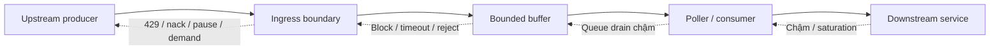
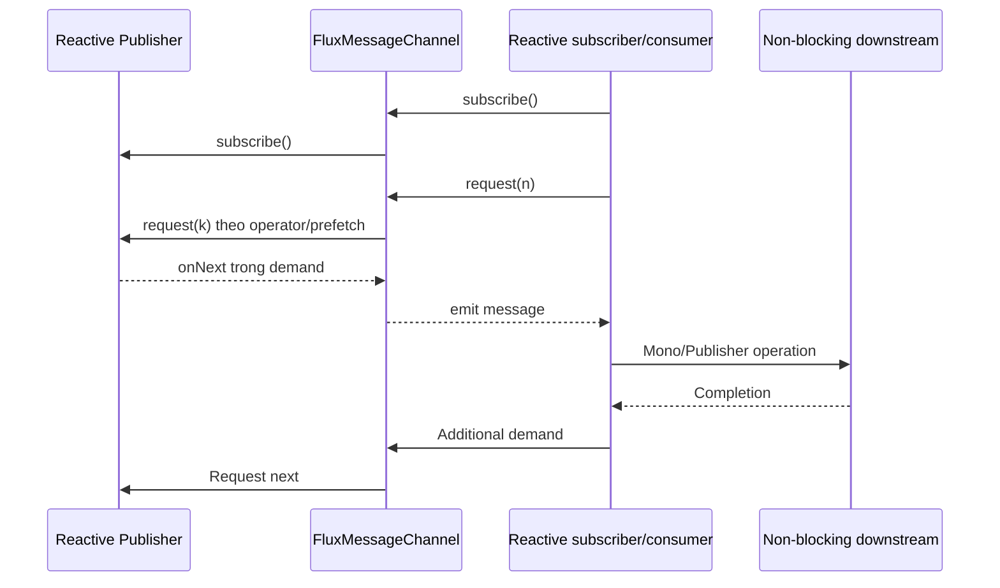
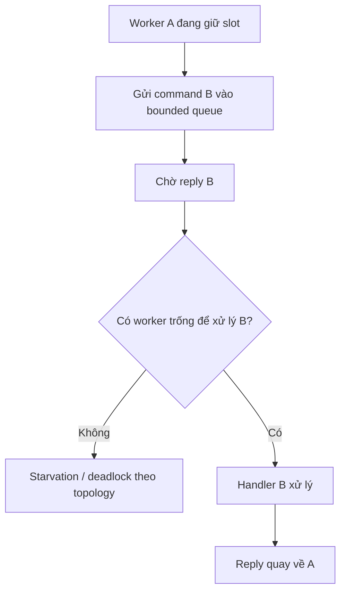

# Giới hạn queue và backpressure trong Spring Integration

## 1. Vì sao queue không giới hạn là một lỗi thiết kế runtime?

Trong chương **Thiết kế runtime** của mô-đun `SPRING_INTEGRATION_RUNTIME`, ứng dụng Spring Integration điều phối message qua **channel, endpoint, consumer, poller và executor**. Những thành phần này có thể được kết hợp với vòng đời `IntegrationFlow`, transaction, retry, message store, error channel và correlation. Khi nguồn phát nhanh hơn đích xử lý, một số chặng trong flow bắt đầu giữ lại message. Nếu không xác định trước giới hạn, nơi lưu backlog có thể chuyển từ queue rõ ràng sang **executor work queue, buffer của client, broker, Reactor prefetch hoặc heap**, làm hệ thống chậm dần và cuối cùng hết bộ nhớ.

Xét một hệ thống nhận sự kiện đặt hàng:

```text
HTTP / Broker
  -> inbound adapter
  -> ordersQueue
  -> poller
  -> reserveStock handler
  -> downstream database / HTTP
```

Nếu nguồn đưa vào 1.000 message/giây nhưng downstream chỉ hoàn tất 700 message/giây, chênh lệch **300 message/giây** sẽ tích tụ ở đâu đó, trừ khi nguồn bị điều tiết hoặc công việc được từ chối/đưa sang một nguồn lưu bền có kiểm soát. Thêm một `QueueChannel` không làm chênh lệch biến mất. Nó chỉ quyết định **nơi** áp lực xuất hiện và **khi nào** hệ thống phản ứng.

**Mục tiêu thiết kế:** không tạo một hệ thống “không bao giờ block”, mà tạo hệ thống có **giới hạn hữu hạn, cách phản hồi overload minh bạch, khả năng khôi phục sau restart và SLO có thể đo**.

Sau bài học, bạn có thể:

1. Phân biệt **buffering**, **backpressure**, **flow control**, **rate limiting**, **load shedding** và **durable buffering**.
2. Cấu hình `QueueChannel` có capacity, `send(message, timeout)` và kiểm thử chính xác hành vi khi đầy.
3. Cấu hình `ExecutorChannel` với `ThreadPoolTaskExecutor` hữu hạn, phân tích rejection và `CallerRunsPolicy`.
4. Chọn tham số `maxMessagesPerPoll`, `receiveTimeout`, scheduler/concurrency mà không khiến poller tạo thêm áp lực ngoài dự kiến.
5. Phân biệt backpressure đồng bộ của `DirectChannel` với Reactive Streams demand qua `FluxMessageChannel`.
6. Tính backlog theo tốc độ vào/ra, burst, message size, in-flight và thời gian drain.
7. Phối hợp giới hạn queue với broker ack, persistent message store, transaction, retry, idempotency và shutdown.
8. Viết JUnit/failure tests cho queue đầy, task reject, consumer tắc, crash và nguồn không hỗ trợ giảm tốc.

## 2. Một từ “backpressure” nhưng nhiều cơ chế khác nhau

| Cơ chế | Nơi tạo áp lực | Hành vi | Giới hạn cần biết |
|---|---|---|---|
| **Blocking synchronous handoff** | Thread producer bị chặn trong lời gọi xử lý/gửi | Producer tự chậm theo consumer khi cùng call stack | Chặn thread không phải `Subscription.request(n)` |
| **Bounded queue** | Queue có số slot hữu hạn | Khi đầy, `send` chờ/timeout/trả false theo contract | Giới hạn thường theo **số message**, không theo byte |
| **Executor admission control** | Thread pool + executor task queue | Khi đầy, reject, caller-runs hoặc policy khác | Một task có thể giữ message rất lớn |
| **Reactive Streams backpressure** | Subscriber yêu cầu số phần tử qua `request(n)` | Publisher hợp tác chỉ phát trong demand | Chỉ hiệu quả xuyên các thành phần **tuân thủ** contract |
| **Rate limiting** | Producer/gateway giới hạn event/giây | Giảm burst/tốc độ theo quota/token bucket | Không tự bảo đảm memory queue hữu hạn |
| **Broker flow control** | Broker và consumer protocol | Prefetch, pause/resume, credit, offset/ack | Phụ thuộc adapter và broker thực tế |
| **Load shedding** | API/ingress từ chối công việc khi quá tải | 429/503, nack, retry-after hoặc từ chối có chủ đích | Chỉ an toàn nếu source biết retry hoặc công việc có thể bỏ |
| **Durable buffering** | JDBC store/broker/disk | Giữ công việc qua restart để xử lý sau | Vẫn cần quota, retention, lag budget và chính sách khi disk đầy |

**Backpressure không đồng nghĩa “message không bao giờ mất”.** Một queue hữu hạn có thể trả `false` khi gửi không thành công; producer vẫn cần xử lý kết quả. Một reactive source có thể tuân theo demand nhưng nếu pod chết mà không có broker/persistence thì những item đã phát có thể không tự phục hồi.

**Rate limiting cũng không thay cho backpressure.** Rate limiter có thể giữ tải trung bình dưới 1.000 event/giây, nhưng một downstream chỉ xử lý được 200 event/giây vẫn sẽ tích backlog. Ngược lại, demand chỉ thể hiện số phần tử downstream sẵn sàng nhận, không nhất thiết là quota API 200 request/giây.

### 2.1. Đường truyền áp lực từ đích về nguồn



Mũi tên ngược là **chính sách điều tiết cần được thiết kế**, không phải tất cả đều có sẵn. Nếu source cứ phát mà không xử lý tín hiệu reject, áp lực bị đẩy sang bộ nhớ bên trong adapter hoặc mất message.

## 3. Bốn câu hỏi phải trả lời trước khi chọn queue

Trước khi quyết định `QueueChannel(500)` hay 5.000, cần biết:

1. **Nguồn có giảm tốc được không?** HTTP synchronous có thể nhận 429/503; Kafka có pause/resume, offset/commit; callback legacy có thể không hỗ trợ flow control.
2. **Message có cần bền qua restart?** Đặt hàng/thanh toán thường không chấp nhận mất; telemetry tạm thời đôi khi cho phép lấy mẫu hoặc bỏ event.
3. **SLO tối đa cho thời gian đợi là bao nhiêu?** Queue rất lớn có thể tránh reject nhưng tạo hàng giờ chờ, vẫn vi phạm nghiệp vụ.
4. **Lỗi cuối đi đâu?** Retry hữu hạn, DLQ/quarantine, error channel và khả năng phát lại theo business ID phải được xác định.

Dựa vào đó chọn **acceptance contract** cho producer:

| Kết quả của lần nhận | Điều ứng dụng được phép hứa | Điều chưa được hứa |
|---|---|---|
| Message được nhận vào bounded in-memory queue | Đã được buffer trong **JVM hiện tại** | Đã persist; sẽ hoàn tất sau crash |
| Message được ghi bền trong transaction/store | Store chấp nhận theo transaction/ack contract | Business side effect đã thực hiện |
| `send(message, timeout)` trả `false` | Message không được channel chấp nhận trong thời gian cho phép | Không có nơi khác trong pipeline đã giữ/ack message |
| Executor chấp nhận task | Task được xếp lịch/chuyển cho worker | Worker đã hoàn tất/DB đã commit |
| Downstream hoàn tất có xác nhận | Một bước trong flow đã hoàn tất | Broker đã ack, external HTTP side effect có exactly-once |

Nếu source ack trước khi message được lưu bền, một lần crash có thể làm mất công việc. Nếu handler commit business trước khi ack broker, redelivery có thể gây duplicate. **Queue capacity không giải quyết hai khoảng hở này**; cần transaction và idempotency phù hợp.

## 4. Bounded QueueChannel: giới hạn số message ngay tại channel

`QueueChannel` là `PollableChannel` point-to-point: producer gửi message vào queue, polling consumer lấy ra bằng `receive()`. Với constructor mặc định, queue có thể tăng tới giới hạn rất lớn về số phần tử; trong thực tế nó gần như **unbounded theo ngân sách heap**. Spring Integration khuyến nghị đặt capacity rõ ràng để tránh hết bộ nhớ.

### 4.1. Java configuration

```java
import org.springframework.context.annotation.Bean;
import org.springframework.context.annotation.Configuration;
import org.springframework.integration.channel.QueueChannel;

@Configuration
public class BoundedChannelConfig {

    @Bean("ordersQueue")
    public QueueChannel ordersQueue() {
        return new QueueChannel(256);
    }
}
```

`256` là **số message** tối đa trong queue tại thời điểm đó, không phải 256 KiB hoặc 256 concurrent HTTP requests. Nếu mỗi payload có kích thước hàng MiB, 256 slot vẫn có thể giữ nhiều trăm MiB và tạo áp lực heap/GC.

### 4.2. XML configuration

```xml
<int:channel id="ordersQueue">
    <int:queue capacity="256"/>
</int:channel>
```

Fragment cần khai báo namespace `int` đúng Spring Integration. Cấu hình `<int:queue/>` không đặt `capacity` tạo queue không giới hạn hữu ích chỉ trong một số trường hợp đặc biệt đã có giới hạn bên ngoài. Không dùng nó làm mặc định cho production.

### 4.3. Khi queue đầy, send làm gì?

Với queue đầy, `send(message, timeout)` có thể **chờ tối đa timeout mili-giây để có slot**, hoặc trả `false` nếu hết thời hạn mà không nhận được. Timeout bằng `0` là thử không chờ. Gọi `send(message)` không truyền timeout có thể **chờ vô hạn** ở bounded `QueueChannel` khi không có receiver lấy message; vì vậy không sử dụng dạng không timeout trong các đường request có deadline nghiêm ngặt.

```java
import org.springframework.integration.channel.QueueChannel;
import org.springframework.messaging.support.MessageBuilder;

QueueChannel queue = new QueueChannel(2);

boolean first = queue.send(MessageBuilder.withPayload("A").build(), 0);
boolean second = queue.send(MessageBuilder.withPayload("B").build(), 0);
boolean third = queue.send(MessageBuilder.withPayload("C").build(), 0);

// first == true, second == true, third == false khi chưa có consumer.
var received = queue.receive(0); // Lấy A ngay, không chờ.
boolean retried = queue.send(
        MessageBuilder.withPayload("C").build(), 0); // Slot đã trống.
```

Cần phân biệt:

- `send(..., 0)==false` nghĩa là channel chưa nhận message đó **tại lần thử này**; producer phải có policy cho công việc chưa được nhận.
- `receive(0)` lấy message ngay nếu có, nếu không trả `null`; nó không có nghĩa “không có message nào sẽ đến sau”.
- `send(message, timeout)` thành công không chứng minh **consumer** đã chạy hoặc database đã commit.
- `send(message)` từ servlet thread có thể làm cạn request threads nếu queue đầy lâu; dùng timeout và response phù hợp.

**Không tự viết vòng `while (!queue.send(message, 0)) {}`**: busy loop tiêu thụ CPU và ngăn các component khác có cơ hội hồi phục. Nếu retry ở ingress, dùng delay/backoff hữu hạn và deadline theo business SLO.

## 5. Ví dụ end-to-end: bounded queue và polling consumer

Ví dụ dùng Java 17+, `spring-integration-core` và Spring Context. Tất cả các class công khai đặt thành file Java riêng trong package `example.integration`. Nó minh họa **admission control trong một JVM**, không phải queue bền qua restart.

### 5.1. Message business có ID ổn định

```java
package example.integration;

public record OrderCommand(String eventId, String sku, int quantity) {}
```

`eventId` là khóa nghiệp vụ ổn định qua retry/redelivery. Không dùng `MessageHeaders.ID` do framework sinh làm idempotency key nếu mỗi lần replay có thể tạo một message instance mới.

### 5.2. Cấu hình QueueChannel và poller

```java
package example.integration;

import java.util.concurrent.atomic.AtomicInteger;

import org.springframework.context.annotation.Bean;
import org.springframework.context.annotation.Configuration;
import org.springframework.integration.annotation.Poller;
import org.springframework.integration.annotation.ServiceActivator;
import org.springframework.integration.channel.QueueChannel;
import org.springframework.integration.config.EnableIntegration;

@Configuration
@EnableIntegration
public class OrderFlowConfig {

    @Bean("ordersQueue")
    public QueueChannel ordersQueue() {
        return new QueueChannel(256);
    }

    @Bean
    public OrderWorker orderWorker() {
        return new OrderWorker();
    }

    public static class OrderWorker {
        private final AtomicInteger handled = new AtomicInteger();

        @ServiceActivator(
                inputChannel = "ordersQueue",
                poller = @Poller(
                        fixedDelay = "100",
                        maxMessagesPerPoll = "8",
                        receiveTimeout = "0"))
        public void process(OrderCommand command) {
            // Demo: không chặn thread bằng sleep, không gọi network.
            // Production: gọi service có transaction + idempotency.
            handled.incrementAndGet();
        }

        public int handledCount() {
            return handled.get();
        }
    }
}
```

`@Poller(fixedDelay="100", maxMessagesPerPoll="8")` giới hạn số lần receive trong một chu kỳ poll. Nó **không bảo đảm throughput 80 message/giây**: chu kỳ có thời gian thực thi handler, độ trễ scheduler, trigger fixed-delay, số consumer và khả năng downstream. Giá trị `receiveTimeout="0"` tránh để một lần poll đợi lâu trên queue rỗng trong ví dụ; với trường hợp cần long polling, điều chỉnh có chủ đích.

### 5.3. Admission service gửi với timeout hữu hạn

```java
package example.integration;

import org.springframework.beans.factory.annotation.Qualifier;
import org.springframework.integration.channel.QueueChannel;
import org.springframework.messaging.support.MessageBuilder;
import org.springframework.stereotype.Service;

@Service
public class OrderIngress {

    public enum Result { ACCEPTED, OVERLOADED }

    private final QueueChannel ordersQueue;

    public OrderIngress(
            @Qualifier("ordersQueue") QueueChannel ordersQueue) {
        this.ordersQueue = ordersQueue;
    }

    public Result tryAccept(OrderCommand command) {
        if (command.eventId() == null
                || command.eventId().isBlank()
                || command.quantity() <= 0) {
            throw new IllegalArgumentException("Invalid command");
        }

        boolean accepted = ordersQueue.send(
                MessageBuilder.withPayload(command)
                        .setHeader("businessEventId", command.eventId())
                        .build(),
                20); // Tối đa 20 ms chờ slot ở ingress.

        return accepted ? Result.ACCEPTED : Result.OVERLOADED;
    }
}
```

**Hợp đồng này là in-memory.** Dịch vụ HTTP có thể chuyển `OVERLOADED` thành HTTP 429 hoặc 503 cùng retry policy theo contract của client. Nếu source là Kafka/JMS, không dùng `ACCEPTED` như một lời hứa đã lưu bền; ack/commit offset phải theo khả năng phục hồi của ứng dụng. `20 ms` là ví dụ, phải chọn theo deadline request, latency SLO và cách xử lý nếu không có capacity.

**Từ chối trước khi nhận** là khác với nhận rồi bỏ message. Nếu producer nhận `OVERLOADED`, message chưa được chấp nhận tại boundary này. Nhưng nếu upstream đã ack nó ở bước trước, việc từ chối lúc này có thể biến thành **mất dữ liệu**. Hãy đặt điểm nhận/ack sao cho upstream có thể retry/redeliver khi chưa lưu bền.

### 5.4. Chính sách khi ứng dụng stop

Stop polling consumer không tự làm queue trống. Sau stop, `ordersQueue` vẫn có thể nhận tới 256 item; nếu JVM exit, backlog RAM mất. Muốn phục hồi cần broker/source có thể phát lại hoặc persistent message store. `ReadinessState.REFUSING_TRAFFIC` có thể giảm HTTP traffic đến pod, nhưng không tự pause broker listener hay file poller.

## 6. JUnit 5: chứng minh giới hạn và timeout, không cần sleep

Test trực tiếp `QueueChannel` để xác minh contract **không phụ thuộc lịch của poller**:

```java
package example.integration;

import org.junit.jupiter.api.Test;
import org.springframework.integration.channel.QueueChannel;
import org.springframework.messaging.support.MessageBuilder;

import static org.junit.jupiter.api.Assertions.*;

class QueueCapacityTest {

    @Test
    void rejectsWhenFullAndAcceptsAfterReceive() {
        QueueChannel queue = new QueueChannel(2);

        assertTrue(queue.send(
                MessageBuilder.withPayload("A").build(), 0));
        assertTrue(queue.send(
                MessageBuilder.withPayload("B").build(), 0));

        // Không có consumer: slot thứ 3 bị từ chối ngay.
        assertFalse(queue.send(
                MessageBuilder.withPayload("C").build(), 0));

        assertEquals("A", queue.receive(0).getPayload());
        assertTrue(queue.send(
                MessageBuilder.withPayload("C").build(), 0));

        assertEquals("B", queue.receive(0).getPayload());
        assertEquals("C", queue.receive(0).getPayload());
        assertNull(queue.receive(0));
    }

    @Test
    void finiteTimeoutDoesNotBlockIndefinitely() {
        QueueChannel queue = new QueueChannel(1);

        assertTrue(queue.send(
                MessageBuilder.withPayload("A").build(), 0));

        // Không có consumer để giải phóng slot, timeout hữu hạn.
        assertFalse(queue.send(
                MessageBuilder.withPayload("B").build(), 30));

        // Cùng message chưa được tự enqueue sau khi timeout.
        assertEquals("A", queue.receive(0).getPayload());
        assertNull(queue.receive(0));
    }
}
```

Đừng assert thời gian chạy chính xác `30 ms`: CI scheduler và thread scheduling có jitter. Điều có giá trị là hàm **trả về hữu hạn** với điều kiện queue vẫn đầy, không phải đồng hồ đo từng mili-giây.

### 6.1. Test việc producer đang chờ được giải phóng

Nếu muốn kiểm tra `send(message, timeout)` **chờ** khi đầy nhưng **thành công** khi consumer lấy ra một slot, dùng `CountDownLatch` và `Future` với deadline; không dùng `Thread.sleep()` để “canh” thời điểm receiver.

```java
import java.util.concurrent.*;
import org.springframework.integration.channel.QueueChannel;
import org.springframework.messaging.support.MessageBuilder;

QueueChannel queue = new QueueChannel(1);
queue.send(MessageBuilder.withPayload("A").build(), 0);

ExecutorService executor = Executors.newSingleThreadExecutor();
CountDownLatch attemptStarted = new CountDownLatch(1);

try {
    Future<Boolean> pending = executor.submit(() -> {
        attemptStarted.countDown();
        return queue.send(
                MessageBuilder.withPayload("B").build(),
                2_000);
    });

    if (!attemptStarted.await(1, TimeUnit.SECONDS)) {
        throw new AssertionError("Producer task did not start");
    }

    // Giải phóng slot; producer đang chờ có thể tiến tiếp.
    queue.receive(0);

    boolean accepted = pending.get(2, TimeUnit.SECONDS);
    if (!accepted) {
        throw new AssertionError("Expected B to be accepted");
    }
} finally {
    executor.shutdownNow();
}
```

Đây là đoạn minh họa độc lập; trong test thực tế, wrap trong method `@Test` và kiểm tra final queue contents. `attemptStarted` chỉ chứng minh task bắt đầu, không chứng minh đã vào chính điểm wait. Vì vậy không assert thứ tự nanosecond; chỉ kiểm tra kết quả sau khi slot được giải phóng.

## 7. ExecutorChannel: giới hạn cả worker lẫn task queue

`ExecutorChannel` giao dispatch sang `TaskExecutor`. Nó thường trả về nhanh khi task đã được chấp nhận, nhưng producer **không có guarantee handler đã xử lý xong**. Khi task executor tạo work queue không giới hạn, việc chuyển từ `QueueChannel` sang `ExecutorChannel` không làm mất vấn đề backlog; chỉ khiến backlog ít được chú ý hơn trong executor.

### 7.1. ThreadPoolTaskExecutor hữu hạn

```java
package example.integration;

import org.springframework.beans.factory.annotation.Qualifier;
import org.springframework.context.annotation.Bean;
import org.springframework.context.annotation.Configuration;
import org.springframework.integration.channel.ExecutorChannel;
import org.springframework.messaging.MessageChannel;
import org.springframework.scheduling.concurrent.ThreadPoolTaskExecutor;

@Configuration
public class BoundedExecutorConfig {

    @Bean("ordersExecutor")
    public ThreadPoolTaskExecutor ordersExecutor() {
        ThreadPoolTaskExecutor executor = new ThreadPoolTaskExecutor();
        executor.setThreadNamePrefix("orders-");
        executor.setCorePoolSize(2);
        executor.setMaxPoolSize(4);
        executor.setQueueCapacity(64);
        return executor;
    }

    @Bean("asyncOrdersIn")
    public MessageChannel asyncOrdersIn(
            @Qualifier("ordersExecutor") ThreadPoolTaskExecutor executor) {
        return new ExecutorChannel(executor);
    }
}
```

Các tham số có ý nghĩa:

- `corePoolSize=2`: pool giữ quy mô core theo lifecycle, không phải tổng số message có thể tồn tại.
- `maxPoolSize=4`: tối đa 4 worker theo cấu hình pool khi tăng tải.
- `queueCapacity=64`: tối đa 64 **task đang chờ trong executor**, khác với capacity của một `QueueChannel` khác trong flow.
- Tổng message đang giữ bởi executor có thể bao gồm **task đang chạy và đang queue**, chưa tính client futures, retry và broker prefetched messages.
- Cấu hình `ThreadPoolTaskExecutor` thường dùng queue để đệm sau khi core threads đã bận, rồi mới tăng worker tới max khi queue đầy. Vì vậy không giả định có 4 worker ngay khi xuất hiện 4 message.

Trong một flow có cả `QueueChannel(256)` và `ExecutorChannel` dùng executor queue 64, **bộ đệm tổng không chỉ là 256**. Cần cộng tất cả lớp buffer và số in-flight ở downstream.

### 7.2. Rejection policy: chọn hành vi nghiệp vụ

| Policy | Khi pool + queue đầy | Khi nào có thể phù hợp |
|---|---|---|
| `AbortPolicy` (mặc định ở JDK executor) | Ném rejection exception; Spring wrapper có thể ném `TaskRejectedException` | Muốn ingress biết không nhận thêm; source phải retry/nack đúng |
| `CallerRunsPolicy` | Producer thread thực thi task khi executor còn chạy | Điều tiết bằng cách làm chậm producer; có thể gây latency lớn hoặc làm nghẽn callback thread |
| `DiscardPolicy` | Bỏ task mà không phát lỗi rõ | Chỉ cho tín hiệu **không quan trọng**, với loss metric và hợp đồng cho phép |
| `DiscardOldestPolicy` | Bỏ task cũ nhất trong queue, thử nhận task mới | Dễ mất nghiệp vụ và phá ordering; hiếm khi an toàn |
| Custom policy | Block hữu hạn, return overload hoặc đưa vào durable fallback | Cần chống deadlock, timeout, metric và test có kiểm soát |

**Không tuyên bố `CallerRunsPolicy` là backpressure luôn an toàn.** Nó chạy handler trên **thread gửi** khi queue đầy, làm thay đổi thread boundary, latency và có thể khiến một broker callback thread/HTTP request thread bị giữ lâu. Spring Integration cũng lưu ý không dùng hiện tượng này để dựa vào transaction propagation: hành vi chạy ở caller thread là **phụ thuộc tải**, không phải contract ổn định.

Nếu muốn rõ chính sách reject, có thể cấu hình:

```java
import java.util.concurrent.ThreadPoolExecutor;

executor.setRejectedExecutionHandler(
        new ThreadPoolExecutor.AbortPolicy());
```

Fragment này nằm trong method cấu hình `ordersExecutor()` trước khi bean khởi tạo. Dù `ExecutorChannel.send` đã trả `true`, handler ở worker thread vẫn có thể ném exception về sau; cần error channel/error handler riêng cho async path.

### 7.3. Test executor rejection một cách xác định

```java
import java.util.concurrent.CountDownLatch;
import java.util.concurrent.TimeUnit;
import org.junit.jupiter.api.Test;
import org.springframework.core.task.TaskRejectedException;
import org.springframework.scheduling.concurrent.ThreadPoolTaskExecutor;

import static org.junit.jupiter.api.Assertions.*;

class ExecutorCapacityTest {

    @Test
    void rejectsWhenOneWorkerAndOneQueueSlotAreOccupied()
            throws InterruptedException {

        ThreadPoolTaskExecutor executor = new ThreadPoolTaskExecutor();
        executor.setCorePoolSize(1);
        executor.setMaxPoolSize(1);
        executor.setQueueCapacity(1);
        executor.initialize();

        CountDownLatch started = new CountDownLatch(1);
        CountDownLatch release = new CountDownLatch(1);

        try {
            executor.execute(() -> {
                started.countDown();
                try {
                    release.await();
                } catch (InterruptedException interrupted) {
                    Thread.currentThread().interrupt();
                }
            });

            assertTrue(started.await(1, TimeUnit.SECONDS));
            executor.execute(() -> {}); // Chiếm slot queue duy nhất.

            assertThrows(TaskRejectedException.class,
                    () -> executor.execute(() -> {}));
        } finally {
            release.countDown();
            executor.shutdown();
        }
    }
}
```

Test này cô lập contract của `ThreadPoolTaskExecutor`. Nếu test qua `ExecutorChannel`, exception có thể bị bọc bởi tầng messaging/dispatcher; dùng assert cause hoặc exception family phù hợp với version. Test đầy đủ còn phải kiểm chứng producer **không ack message nguồn** khi task đã bị reject.

## 8. Poller: giới hạn lượng công việc lấy ra mỗi chu kỳ

`PollingConsumer` lấy message từ `PollableChannel`. `SourcePollingChannelAdapter` gọi `MessageSource.receive()` để tạo message từ nguồn. Hai endpoint có những **default khác nhau**, cần cấu hình có chủ đích.

Theo Spring Integration Reference:

- `maxMessagesPerPoll` là tối đa số lần lấy message trong **mỗi chu kỳ poll**.
- Default của `PollingConsumer` trong nhiều phiên bản là `-1` (tiếp tục đến khi `receive()` trả `null`).
- Default của `SourcePollingChannelAdapter` là `1`.
- Giá trị `0` từ Spring Integration 5.5 có thể dùng để **bỏ qua receive tạm thời** như một dạng pause.
- `receiveTimeout` là thời gian poller đợi khi chưa có message; không phải thời gian handler được phép xử lý.

Ví dụ XML:

```xml
<int:service-activator
        input-channel="ordersQueue"
        ref="orderWorker"
        method="process">
    <int:poller fixed-delay="100"
                max-messages-per-poll="8"
                receive-timeout="0"/>
</int:service-activator>
```

Fragment yêu cầu `ordersQueue`, bean `orderWorker` và namespace `int`. Không tạo endpoint này đồng thời với `@ServiceActivator` trong mục 5 khi dùng chung queue, trừ khi cố ý có nhiều consumer cạnh tranh.

### 8.1. Điều mà maxMessagesPerPoll không làm

- **Không** giới hạn số message đang chờ trên `QueueChannel`; chỉ giới hạn số lần poller nhận mỗi chu kỳ.
- **Không** tạo giới hạn throughput chính xác theo giây; handler có thể chạy nhanh/chậm.
- **Không** giới hạn tổng số message đang xử lý nếu poller dùng `task-executor`, có nhiều consumer hoặc endpoint khác.
- **Không** điều tiết trực tiếp broker producer nếu broker không được cấu hình pause/prefetch/ack phù hợp.
- **Không** bảo đảm FIFO hoàn tất khi worker song song hoặc có retry bất đồng bộ.

Nếu poller lấy `8` message mỗi 100 ms rồi gửi sang executor có queue 1.000, áp lực có thể chuyển từ channel queue sang executor. Xác định capacity và concurrency **xuyên cả chuỗi**.

### 8.2. Fixed-delay, receive-timeout và thread starvation

Một poller có `fixedDelay=100 ms` và `receiveTimeout=5.000 ms` có thể giữ scheduler thread đợi queue rỗng lâu. Dùng long polling khi muốn giảm độ trễ nhận và đã cấp đủ scheduler threads; không đặt receive timeout lớn hàng loạt trên scheduler dùng chung mà không đo.

Đặc biệt không chạy handler blocking nhiều giây trên cùng scheduler thread chịu trách nhiệm hàng trăm poller khác. Tách scheduler/executor theo workload, nhưng nhớ mỗi lần tách thread là thêm **ranh giới transaction và khả năng buffer**.

## 9. Reactive Streams: demand thực khác push không kiểm soát

`FluxMessageChannel` là channel có hợp đồng `Publisher<Message<?>>` và `ReactiveStreamsSubscribableChannel`. Khi nguồn là `Publisher` tuân thủ `Subscription.request(n)`, channel có thể kết nối bằng `subscribeTo(Publisher)`, và `ReactiveStreamsConsumer` cho downstream xử lý theo mô hình reactive.



Ở đây số request `k` có thể khác `n` do `flatMap`, prefetch, `limitRate` và bridge implementation. **Điểm cốt lõi:** upstream phải thật sự nhận và tôn trọng demand.

### Hai cách đẩy vào FluxMessageChannel không giống nhau

- `fluxChannel.subscribeTo(publisher)`: nguồn là Reactive Streams Publisher. Downstream demand **có cơ hội** điều tiết upstream qua contract.
- `fluxChannel.send(message)` trong callback/loop imperative: caller **không trở thành Publisher tuân theo `request(n)`** chỉ nhờ gửi vào channel reactive. Nếu callback không thể giảm tốc, vẫn cần bounded overflow/broker/pause policy.

Các reactive handler nên dùng client **thực sự non-blocking**. Một method trả `Mono.just(jdbcTemplate.queryForObject(...))` vẫn chạy JDBC blocking khi tạo Mono; nó không tự có backpressure end-to-end. Khi cần bridge blocking, dùng bounded scheduler/concurrency nhưng đo queue của scheduler và connection pool.

### 9.1. Giới hạn concurrency khác giới hạn buffer

Ví dụ Reactor độc lập:

```java
import java.time.Duration;
import reactor.core.publisher.Flux;
import reactor.core.publisher.Mono;

Flux<Integer> source = Flux.range(1, 20);

Flux<Integer> results = source.flatMap(
        item -> Mono.delay(Duration.ofMillis(80))
                .thenReturn(item),
        8); // Tối đa 8 inner Publisher active ở operator này.
```

Đoạn là **pipeline Reactor minh họa**, với `Mono.delay(...)` mô phỏng một tác vụ không blocking; nó chưa xử lý dữ liệu cho tới khi có subscriber. Trong hệ thống thật, thay bằng Publisher từ adapter và reactive client hỗ trợ demand, sau đó kiểm chứng cancellation/error/ack theo nguồn. Giới hạn `flatMap(..., 8)` không giới hạn mọi buffer/upstream prefetch bên ngoài operator này. `onBackpressureBuffer(capacity)` tạo buffer hữu hạn khi có đoạn không tôn trọng demand nhưng **không làm producer callback bên ngoài tự dừng**; overflow cần một policy tường minh.

## 10. Sizing queue: từ burst, throughput, latency đến heap

**Không chọn capacity bằng cảm giác.** Dùng một mô hình định lượng rồi thử tải để hiệu chỉnh.

Ký hiệu:

- `λ`: tốc độ message vào (message/giây).
- `μ`: tốc độ downstream hoàn tất (message/giây).
- `T`: thời lượng burst (giây).
- `S`: serialized payload trung bình (byte); phải đo p95/p99.
- `H`: overhead heap/headers/object references/queue/task và serializer.
- `Q`: số message đang chờ tại một queue cụ thể.
- `C`: số operation đang chạy đồng thời.
- `L`: độ trễ trung bình của một operation downstream.

### 10.1. Backlog tăng khi producer nhanh hơn consumer

Trong một khoảng burst tương đối ổn định, ước lượng:

\[
B_{\text{burst}} \approx \max(0,\lambda-\mu)\times T
\]

Ví dụ nguồn phát 240 message/giây trong 60 giây, downstream hoàn tất 200 message/giây:

\[
B \approx (240-200)\times60=2.400\ \text{messages}
\]

Nếu mỗi message serialized trung bình 12 KiB, riêng payload thô khoảng:

\[
2.400 \times 12\ \text{KiB}=28{,}125\ \text{MiB}
\]

Nếu dùng một hệ số overhead minh họa `2,5×`, heap bị giữ có thể khoảng **70 MiB**, chưa cộng các lớp queue/buffer khác, retry records và tình huống p99 payload lớn. **Đây chỉ là ước lượng sơ bộ**, không phải kích thước heap do Spring Integration cam kết.

Nếu `λ > μ` **kéo dài mãi**, **không có capacity hữu hạn nào đủ**. Giải pháp phải giảm intake, tăng năng lực xử lý, tách durable buffer có retention/quota hoặc thay contract SLA.

### 10.2. Dự kiến thời gian drain

Nếu backlog `B`, downstream xử lý `μ` message/giây, sau burst nguồn còn tiếp tục đến với tốc độ `λ_{\text{after}}` nhỏ hơn `μ`:

\[
T_{\text{drain}}\approx\frac{B}{\mu-\lambda_{\text{after}}}
\]

Với `B=2.400`, `μ=200` và `λ_{\text{after}}=100`, drain ước khoảng **24 giây** nếu hệ thống tiếp tục ổn định, không thêm retry và không đổi concurrency.

Nếu backlog 2.400 nhưng SLO yêu cầu mọi message có queue wait dưới 3 giây, tăng capacity lên 10.000 **không cứu SLA**. Cần đánh giá latency p99, quota đích, concurrency và cơ chế admission.

### 10.3. Little's Law để chọn in-flight

Với lưu lượng **ổn định** và operation latency trung bình `L`, in-flight mục tiêu sơ bộ:

\[
C \gtrsim \mu\times L
\]

Nếu muốn 200 operation/giây và mỗi downstream call mất trung bình `0,25 giây`, cần khoảng **50** operation concurrent trong điều kiện client/server hỗ trợ. Nhưng nếu DB pool chỉ có 20 connections và mỗi operation giữ một connection 250 ms, tăng reactive concurrency lên 50 có thể chỉ tạo thêm **queue trong connection pool**. Cần đo giới hạn thực và p95/p99 latency.

### 10.4. Giới hạn theo byte, không chỉ theo count

Một bounded `QueueChannel(256)` chặn **số message**, nhưng message có thể chứa blob 1–10 MiB. Để bảo vệ heap:

- Đặt **giới hạn payload size ngay tại ingress**.
- Kiểm tra serialized size và header count/size, nhất là khi nhận từ JSON/broker.
- Với payload lớn, chuyển dữ liệu sang object/blob store có retention và gửi **reference message** nhỏ (claim-check pattern).
- Đo total process heap + direct buffers + executor queue + retry/metrics objects, không chỉ `getQueueSize()`.
- Thử tải với payload **p95/p99 và burst**, không chỉ message “hello” vài byte.
- Nếu phải chọn byte-aware queue, thực hiện admission budget theo bytes + count trong một thành phần riêng, có concurrency control và policy giải phóng quota khi remove; đừng giả định `QueueChannel` đã hỗ trợ byte capacity.

## 11. Bounded không đồng nghĩa durable: lưu qua restart

Mặc định `QueueChannel` giữ message trong RAM. Khi process dừng đột ngột, queue có thể mất backlog. Với công việc quan trọng, cân nhắc broker hoặc channel message store bền vững.

### 11.1. Persistent QueueChannel

Spring Integration cho phép cấu hình queue với `message-store`, ví dụ `JdbcChannelMessageStore`:

```xml
<int:channel id="ordersDurableQueue">
    <int:queue message-store="jdbcChannelStore"/>
</int:channel>
```

`jdbcChannelStore` là bean đã được cấu hình đúng `DataSource`, query provider/schema, serializer, transaction manager và version. **Quan trọng:** theo Spring Integration Reference, **không được đặt đồng thời `capacity` trên phần tử `<int:queue>` khi sử dụng `message-store`**. Vì vậy XML sau **không hợp lệ**:

```xml
<!-- PHẢN MẪU: không cấu hình capacity cùng message-store -->
<int:channel id="invalidQueue">
    <int:queue message-store="jdbcChannelStore" capacity="256"/>
</int:channel>
```

Để giữ dung lượng bền trong giới hạn, phải dùng các chính sách **ngoài queue capacity attribute**: admission control ở ingress, quota database theo bytes/rows, giới hạn số message inflight, TTL/retention, alert về DB size và khả năng phục hồi khi database đầy.

Một persistent queue **không phải** “unbounded an toàn”. Nếu database chiếm hết disk/quota, lỗi có thể lan tới nhiều phần của ứng dụng. Quota và retry/overload response cần được định nghĩa trước.

### 11.2. Poller transaction và dequeue

Với `JdbcChannelMessageStore`, khi một polling consumer dùng transaction phù hợp, thao tác receive/remove khỏi store có thể tham gia transaction, cho phép rollback để message không bị mất khi handler thất bại **trước commit**. Ví dụ XML mang tính minh họa:

```xml
<int:service-activator
        input-channel="ordersDurableQueue"
        ref="orderService"
        method="process">
    <int:poller fixed-delay="200"
                max-messages-per-poll="5">
        <int:transactional transaction-manager="transactionManager"/>
    </int:poller>
</int:service-activator>
```

Cấu hình thực tế còn cần bean `transactionManager` đúng datasource/store, adapter và serializer phù hợp.

**Không nhầm với `ExecutorChannel`**: khi message được handoff sang executor thread, transaction của poller **không tự đi theo**; việc receive khỏi store và business effect có thể ở hai transaction khác nhau. Muốn kết quả bền vững, kiểm chứng boundary bằng DB và test kill-process, không chỉ kiểm tra `@Transactional` xuất hiện trong code.

### 11.3. At-least-once và idempotency

Một flow dùng broker/JDBC queue vẫn có thể xử lý lại message sau crash (ví dụ business DB đã commit nhưng nguồn chưa ack). Thiết kế nên có:

1. `businessEventId` ổn định và unique constraint/inbox ledger.
2. Retry hữu hạn cho lỗi transient; phân loại poison message.
3. DLQ/quarantine có metadata đủ điều tra, không chứa secret.
4. Source ack/offset commit sau khi đạt mức durability mà hệ thống hứa.
5. Replay sau restart với idempotent handler và đối soát external side effect.

**Bounded queue điều tiết memory; durable store giữ work; idempotency bảo vệ replay.** Ba cơ chế bổ sung cho nhau chứ không thay thế nhau.

## 12. Phản ứng khi overload: không có chính sách chung cho mọi nguồn

### 12.1. HTTP synchronous ingress

Nếu hàng chờ đã đầy:

- Dừng nhận thêm hoặc trả `429 Too Many Requests` khi theo rate/quota; `503 Service Unavailable` khi instance/capacity không đáp ứng.
- Nếu protocol cho phép, trả `Retry-After` hoặc một response tương đương, không hứa đã nhận job khi `send(...,0)==false`.
- Đặt timeout request phù hợp và tránh servlet thread chờ vô hạn.
- Với command phải có kết quả **durable accepted**, chỉ phản hồi accepted sau khi store đã xác nhận persistence.

### 12.2. Kafka/JMS/AMQP inbound

- Dùng các cơ chế **pause/resume, consumer concurrency, prefetch/credit, commit/ack** của adapter/broker để giảm intake.
- Khi không chấp nhận downstream work, **không ack thành công rồi bỏ message**; lựa chọn nack/requeue/seek/retry phụ thuộc adapter.
- Ack với Kafka phụ thuộc offset/partition và mode; với JMS/AMQP có channel/session/transaction riêng. Không áp dụng một API chung cho mọi nguồn.
- Nếu consumer vừa nhận một batch trước khi queue đầy, cần giải quyết message đã in-flight theo đúng contract, không chỉ giảm poll rate.
- Monitor broker lag/rebalance và tránh pause không có deadline/alert.

### 12.3. File/polling source

- Giới hạn `maxMessagesPerPoll` và tốc độ quét/claim file; không lấy trước hàng nghìn file nếu downstream không có capacity.
- Nếu `MessageSource.receive()` có side effect (đánh dấu file đã xử lý, move/delete file), việc downstream send thất bại có thể để lại checkpoint sai.
- Dùng `MetadataStore`/persistent filter phù hợp và chiến lược rollback/replay ở ranh giới source.
- Không xem `receive()==null` khi nguồn idle là lỗi hệ thống.

### 12.4. Push callback không hỗ trợ pause

Nếu driver chỉ liên tục gọi callback và không thể nhận tín hiệu giảm tốc, không có cách nào tạo **backpressure end-to-end** bằng việc thay channel đơn thuần. Cần chọn một trong những phương án: **durable staging**, reject theo protocol, bounded queue với drop được cho phép, hoặc giới hạn tại upstream network/proxy. Ghi rõ chính sách mất dữ liệu nếu buộc phải drop.

### 12.5. Từ chối/loại bỏ message không bao giờ nên là “thầm lặng”

Chỉ dùng `nullChannel`, `onBackpressureDrop`, `DiscardPolicy` hoặc drop filter khi loại dữ liệu đó thực sự là lựa chọn nghiệp vụ đã xác nhận (ví dụ telemetry sampling). Với payment/order command, cần **reject có thông báo** hoặc lưu vào nguồn durable, không bỏ im lặng khi overload.

## 13. Retry làm tăng áp lực thế nào?

Một lần lỗi downstream không chỉ giảm `μ` mà còn có thể tạo thêm attempts:

- Retry tại handler giữ công việc in-flight và đôi khi giữ worker trong backoff.
- Error channel có thể nhận số lượng lỗi lớn; chính error logger/DLQ có queue riêng.
- Broker redelivery sau nack/restart có thể làm nhiều message cũ đổ vào cùng lúc.
- Retry tại client HTTP và retry tại Integration advice cùng broker redelivery có thể nhân tổng số lần gọi.
- Khi nhiều message cùng đợi một downstream vừa hồi phục, **retry storm** xuất hiện.

Ví dụ 1.000 logical events, mỗi event retry 3 lần, có thể tạo tới **3.000 handler attempts** chỉ từ một lớp retry, chưa tính replay của broker. Vì vậy:

| Thành phần | Hàng rào cần có |
|---|---|
| Retry template/advice | `maxAttempts` hữu hạn, exponential backoff/jitter khi phù hợp, deadline |
| DLQ/recovery | Quota và giám sát; error path không được gây lặp vô hạn |
| Worker concurrency | Giới hạn tổng in-flight, có circuit breaker cho downstream lỗi |
| Business effect | Idempotency key ổn định; không nhân side effect khi retry |
| Producer ingress | Admission theo capacity thực và SLA, không retry busy loop |
| Post-restart recovery | Drain rate, priority giữa work cũ/mới, quota tài nguyên DB |

Không đặt backoff dài vào worker thread cực kỳ ít ỏi mà không cân nhắc tác động throughput. Trong một số hệ thống, thay vì giữ thread ngủ, message cần được **reschedule trong store/broker** để worker giải phóng slot; điều này phải có hỗ trợ của source và tránh duplicate.

## 14. Deadlock, starvation và các rủi ro ít hiển thị

### 14.1. Producer và consumer dùng cùng executor đã đầy

Nếu một task đang chạy trên executor gửi thêm message vào chính queue/executor rồi **chờ reply đồng bộ**, nhưng mọi worker đều bận đợi nhau, có thể xảy ra deadlock/starvation.



Phòng tránh:

- Không block đợi reply trong cùng pool có khả năng đã hết worker và chỉ pool đó mới xử lý reply.
- Tách ingress, business worker và diagnostic executor; đặt quy tắc concurrency phù hợp.
- Có timeout end-to-end ở gateway/reply channel, nhưng timeout không tự rollback external side effect.
- Vẽ call graph để tìm vòng đồng bộ qua `DirectChannel`/`QueueChannel`/`ExecutorChannel`.
- Không dùng `CallerRunsPolicy` một cách mù quáng khi handler có recursive send hoặc giữ lock.

### 14.2. Ordering và cùng correlation ID

Tăng poller concurrency có thể phá thứ tự xử lý/hoàn tất. Nếu business yêu cầu các event cùng `aggregateId` được xử lý tuần tự, dùng partition theo key, sequence/correlation strategy, hoặc xử lý tuần tự có kiểm soát. Không chỉ dựa vào thứ tự FIFO của queue khi chuyển sang nhiều worker.

Spring Integration có `PartitionedChannel` hỗ trợ dispatch theo partition key và duy trì thứ tự trên thread partition trong những điều kiện phù hợp. Tuy nhiên **partitioning không tự cung cấp persistence hoặc byte budget**, vẫn cần chính sách overload, stop/restart và replay.

### 14.3. Nút nghẽn “ẩn” trong client

Ngay cả khi queue chính chưa đầy, downstream có thể chờ trong:

- JDBC connection pool pending-acquire queue.
- HTTP client connection pool, reactor prefetch, pending requests.
- Broker client local buffer/prefetch.
- Serializer/GC queue hoặc callback event loop.
- Logging/wire tap executor hoặc tracing exporter.

Vì thế tổng backlog là **một hệ thống các queue**, không chỉ `QueueChannel.getQueueSize()`.

## 15. Observability: đo áp lực, không chỉ nhìn heap

Bộ chỉ số tối thiểu nên theo từng **flow/instance/tenant** có cardinality được kiểm soát:

| Metric đề xuất | Ý nghĩa |
|---|---|
| `input_messages_total` | Số logical messages được ingress quan sát |
| `admission_accepted_total` / `admission_rejected_total` | Nguồn vào được nhận hay từ chối theo capacity |
| `queue_depth` / `queue_capacity` | Số message đang chờ và số slot cấu hình |
| `oldest_message_age_seconds` | Công việc lâu nhất đã chờ bao lâu |
| `handler_inflight` / `handler_completed_total` | Năng lực thực và số đang xử lý |
| `handler_p95/p99_latency` | Tác động của downstream tới queue wait |
| `executor_active_threads` / `executor_queued_tasks` | Saturation ở worker pool |
| `executor_rejected_total` | Có dispatch không được nhận không |
| `poller_last_success_timestamp` / `poller_receive_total` | Poller còn tiến triển, không chỉ running |
| `source_lag` / `unacked_count` | Backlog ở broker/source ngoài JVM |
| `db_store_rows` / `db_store_bytes` | Hạ tầng durable còn quota không |
| `retry_attempts_total` / `dlq_total` | Áp lực do lỗi, poison messages |
| `gc_pause_p99` / `heap_used` | Áp lực heap, dừng JVM |
| `drain_duration_seconds` | Khả năng hết backlog khi shutdown/recovery |

Tên ở bảng là **đề xuất instrument** của ứng dụng, không phải tất cả đều là tên meter Spring Integration/Micrometer có sẵn. Có thể kết hợp Micrometer Spring Integration metrics, tracing, broker admin metrics và JDBC monitoring.

**Cảnh báo false positive:** queue depth thấp không có nghĩa flow khỏe — có thể vì poller nhận message nhanh rồi xếp chúng vào executor queue lớn. Ngược lại, queue depth cao chưa chắc phải báo NOT READY nếu công việc được lưu bền và vẫn nằm trong lag/SLA budget.

### 15.1. Hysteresis và alert

Một chính sách mẫu (không dùng trực tiếp nếu chưa benchmark):

- Bắt đầu hạn chế nhận mới khi queue > 85% capacity trong vài cửa sổ đo.
- Chỉ phục hồi full intake khi queue < 60% capacity và handler error/rejection đã trở lại ngưỡng chấp nhận.
- Cảnh báo sớm theo **oldest message age**, không chỉ đợi queue đầy.
- Nếu backlog liên tục tăng với `λ > μ`, báo sự cố năng lực xử lý dù queue hiện chưa đầy.
- Dựa thêm vào downstream pool saturation, broker lag, p99 response latency và timeout budget.

Hysteresis giúp tránh readiness/ingress bật-tắt liên tục quanh một ngưỡng. Nhưng khi hệ thống vi phạm tính an toàn (ví dụ cannot persist accepted order), nên **fail-fast** theo contract chứ không tiếp tục nhận vì chưa đủ số cửa sổ cảnh báo.

## 16. Kiểm thử overload có thể lặp lại

Một bộ kiểm thử thiết kế runtime cần bao gồm cả đơn vị nhỏ và sự cố thực tế.

### 16.1. Ma trận kiểm thử

| Kịch bản | Cách tạo điều kiện | Oracle cần kiểm tra |
|---|---|---|
| Queue chưa đầy | Gửi `capacity` message, chưa có receiver | Mọi send nhận `true`, depth đúng |
| Queue đầy | Gửi thêm với timeout `0` | `false` ngay, không enqueue |
| Producer chờ | Gửi thêm với timeout hữu hạn, receiver giải phóng slot | Được nhận hoặc hết hạn đúng contract, không treo vô hạn |
| Consumer bị stop | Dừng endpoint, tiếp tục ingress trong giới hạn | Backlog tăng đến capacity, sau đó từ chối |
| Executor bận | Giữ mọi worker bằng latch, lấp queue | Rejection chính xác, không mất silent |
| CallerRunsPolicy | Test riêng khi executor đầy | Handler chạy trên producer thread; đo p99 và transaction impact |
| Downstream chậm | Dùng stub delay có điều khiển | Queue growth/oldest age tăng như dự kiến |
| Retry storm | Lỗi transient liên tục, retry budget hữu hạn | Attempt count, DLQ, saturation, không infinite retry |
| Persistent store đầy | Giới hạn disk/quota ở test | Ghi lỗi rõ, không ack/accepted sai |
| Crash sau enqueue RAM | Kill process | Nhận thức rõ data loss, không giả vờ durable |
| Crash khi JDBC polling | Kill trước commit | Message được replay theo transaction/store contract |
| Crash sau business commit | Kill trước source ack | Idempotency ngăn duplicate |
| Multi-instance | Hai consumer dùng shared broker/store | Tổng throughput/replay, ordering và error path đúng |
| Reactive upstream | `StepVerifier` yêu cầu số phần tử hữu hạn | Không phát vượt demand ở Publisher tuân thủ |
| Callback push overload | Producer không giảm tốc | Overflow policy rõ, metrics về reject/drop/lag |
| Graceful shutdown | Stop ingress, đợi in-flight với deadline | Không nhận thêm, pending có đường replay |

### 16.2. Không dùng sleep để “tạo chắc chắn lỗi”

Để test concurrency, dùng `CountDownLatch`, `QueueChannel.receive(timeout)`, `Future.get(timeout)` và failure injection theo attempt index. `Thread.sleep(200)` có thể thất bại trên CI khi scheduler chậm, và khiến test không rõ thread đang ở trạng thái nào.

Đặt timeout hữu hạn cho mỗi test để pipeline deadlock không làm treo cả build. Với broker/database, dùng test resource có readiness và cleanup rõ; các kết quả phải dựa trên **business effect cuối cùng**, không chỉ log “sent message”.

### 16.3. Payload lớn và kiểm soát bytes

Trong test load, tạo ít nhất ba kích thước payload:

1. Nhỏ: event metadata vài trăm byte.
2. Điển hình: kích thước trung bình/p95 đã đo từ production.
3. Lớn: p99 hoặc max-size hợp lệ.

Đo retained heap, GC, latency, CPU serialization, queue depth và tổng inflight. Nếu một message 10 MiB được tạo thành nhiều bản `byte[]` hoặc `String` trong transformer, memory thực tế có thể lớn hơn số slot × payload serialized size. Có thể dùng object reference vào blob store thay vì giữ nguyên file trong message.

## 17. Runbook khi queue đầy hoặc throughput giảm

**Bước 1 — Nhận diện điểm tích backlog.** Xem broker lag, queue channel depth, executor queue, DB pool pending, HTTP client pending và Reactor buffers. Đừng tăng capacity của queue đầu tiên nhìn thấy nếu nút nghẽn ở nơi khác.

**Bước 2 — So tốc độ vào và ra.** Ước lượng `λ`, `μ`, time-to-full và time-to-drain theo dữ liệu p95/p99, xác định lỗi tạm thời hay mất cân bằng kéo dài.

**Bước 3 — Xác minh policy khi đầy.** Có producer bị block vô hạn? `send(..., timeout)` trả false nhưng source đã ack? Executor reject bị nuốt? Diagnostic WireTap có làm đầy queue không?

**Bước 4 — Kiểm tra downstream và retry.** Database deadlock/connection pool, API 429/503, backoff, retry multiplier, poison message và DLQ saturation.

**Bước 5 — Giảm intake ở đúng nguồn.** HTTP shed/rate-limit, broker pause/credit, poller giảm `maxMessagesPerPoll`, nhưng không làm mất pending/ack; điều chỉnh theo role và SLO.

**Bước 6 — Bảo vệ độ bền.** Nếu cần giữ message quan trọng, đưa vào durable store với transaction/ack đúng; không thay vấn đề heap bằng database disk-full không có quota.

**Bước 7 — Drain có kế hoạch.** Khi nguồn giảm tốc, để consumer tiếp tục xử lý nếu an toàn; theo dõi oldest age, remaining backlog, inflight, rollback/ack. Khi shutdown, không stop tất cả consumers trước khi có cơ hội drain nếu business yêu cầu.

**Bước 8 — Khôi phục intake có hysteresis.** Chỉ mở lại khi error rate, backlog và downstream capacity dưới ngưỡng phục hồi; tránh dồn toàn bộ traffic lập tức sau outage.

**Bước 9 — Hậu kiểm.** Kiểm tra số accepted/rejected/redelivered, business effects, DLQ/poison message, idempotency, data loss budget và cập nhật capacity test.

### Các lỗi thiết kế cần tránh

| Phản mẫu | Vì sao sai | Giải pháp |
|---|---|---|
| `new QueueChannel()` mặc định cho toàn bộ work | Dễ tăng heap vô hạn | Dùng capacity hữu hạn và overflow policy |
| Queue RAM to nhưng gọi là reliable queue | Restart vẫn có thể mất message | Persistent store/broker và ack đúng |
| Chỉ đo `QueueChannel` mà bỏ executor queue | Backlog dịch sang executor không được thấy | Tổng hợp mọi vùng buffer/inflight |
| Dùng `send(message)` ở HTTP request thread | Có thể block không thời hạn khi queue đầy | `send(message, timeout)` và 429/503/retry policy |
| Thêm `capacity` cho XML queue có `message-store` | Cấu hình không hỗ trợ | Admission quota/size policy ngoài persistent store |
| Cho `DiscardPolicy` để hết OOM | Mất business work âm thầm | Reject/nack/durable fallback cho command |
| `CallerRunsPolicy` để “giữ transaction” | Thread thực thi phụ thuộc saturation | Đặt transaction boundary đúng thread, không dựa rejection |
| Tăng `maxMessagesPerPoll` khi handler chậm | Có thể dồn thêm task vào executor/store | Đo và giới hạn toàn pipeline |
| Retry vô hạn khi DB outage | Retry storm, giữ worker lâu, backlog tăng | Bounded retry/backoff, circuit breaker, DLQ |
| Cho rằng `FluxMessageChannel.send()` là request-based | Imperative producer không nhận demand | `subscribeTo(Publisher)` và nguồn reactive/flow control thật |
| Ack broker trước durable acceptance | Mất message nếu downstream full/crash | Chỉ ack khi contract cho phép, dùng replay/transaction |
| Mặc định queue depth cao nghĩa là unhealthy | Durable buffering có thể được chấp nhận theo SLA | Kết hợp oldest age, drain time và business SLO |

## 18. Checklist thiết kế trước khi deploy

- [ ] Đã đo `λ`, `μ` theo tải bình thường, burst và khi downstream chậm.
- [ ] Đã xác định **source nào giảm tốc được**, tín hiệu reject/ack/nack/credit hoạt động ra sao.
- [ ] Mỗi buffer quan trọng có capacity/quota rõ ràng: QueueChannel, executor, broker, DB, prefetch, client.
- [ ] Đã tính message size p95/p99, heap overhead và max payload; có byte budget phù hợp.
- [ ] `send` ở ingress có timeout và outcome xử lý rõ; không block vô hạn request thread.
- [ ] Executor pool có thread/queue/rejection policy hữu hạn, metric và test saturation.
- [ ] Poller có `maxMessagesPerPoll`, `receiveTimeout`, scheduler và transaction boundary đã kiểm tra.
- [ ] Reactive flow thật sự có Publisher/Subscriber hỗ trợ demand; không chỉ bọc blocking code vào Mono.
- [ ] Persistent store/broker có quota, retention, serializer, schema và replay/restore policy.
- [ ] Source ack/offset commit phù hợp với mức durability đã hứa.
- [ ] Business handler idempotent theo business event ID, retry và DLQ có budget hữu hạn.
- [ ] Có SLO cho **oldest queue age, p95/p99 completion latency, drain time**.
- [ ] Có metric accepted/rejected/dropped, queue/inflight/retry/DB-size và alert overload.
- [ ] Có test queue full, executor reject, broker outage, callback push, restart và multi-instance.
- [ ] Readiness/drain điều khiển đúng adapter/source; không chỉ thay HTTP health status.

## 19. Ghi nhớ

- **Giới hạn queue là hợp đồng nhận việc.** Queue đầy phải dẫn tới block hữu hạn, reject có thông báo, điều tiết nguồn hoặc ghi bền; không có queue nào tự làm chênh lệch `λ>μ` biến mất.
- `QueueChannel` có capacity theo **số message**, không theo byte. `send(message,0)` thử ngay; `send(message,timeout)` chờ hữu hạn; dạng `send(message)` có thể block vô hạn trên bounded queue đầy.
- `ExecutorChannel` tách thread và transaction context, cần giới hạn `ThreadPoolTaskExecutor` cùng rejection policy rõ. `CallerRunsPolicy` không phải bảo đảm transaction hoặc latency.
- `maxMessagesPerPoll` điều tiết số lần receive mỗi chu kỳ, không đặt capacity cho queue hay bảo đảm tốc độ chính xác theo giây.
- `FluxMessageChannel` có thể truyền reactive demand khi upstream là Publisher hợp tác; gửi imperative `send()` liên tục không tự biến thành backpressure end-to-end.
- Persistent `QueueChannel` bảo vệ backlog qua restart với store phù hợp, nhưng XML `message-store` không cho đặt `capacity` cùng phần tử; phải có quota/admission ở ranh giới khác.
- **Safety và liveness cùng quan trọng:** không mất message đã ack, không nhân business side effect khi replay, không để backlog kẹt mãi.
- Đánh giá bằng **tổng buffer/inflight**, queue age, throughput, p99 latency, error/retry, rollback/ack và khả năng drain sau sự cố.

### Tài liệu tham khảo chính thức

- [Spring Integration Reference — Message Channel Implementations](https://docs.spring.io/spring-integration/reference/channel/implementations.html): `QueueChannel`, `ExecutorChannel`, `DirectChannel`, `FluxMessageChannel` và giới hạn thread/queue.
- [Spring Integration Reference — Configuring Message Channels](https://docs.spring.io/spring-integration/reference/channel/configuration.html): `QueueChannel(capacity)`, XML `<queue capacity>`, persistent `<queue message-store>` và restriction của capacity.
- [Spring Integration Reference — Message Endpoints](https://docs.spring.io/spring-integration/reference/endpoint.html): `maxMessagesPerPoll`, `receiveTimeout`, poller scheduling và transaction.
- [Spring Integration Reference — Channel Adapter](https://docs.spring.io/spring-integration/reference/channel-adapter.html): khác biệt `SourcePollingChannelAdapter` và `PollingConsumer`.
- [Spring Integration Reference — Reactive Streams Support](https://docs.spring.io/spring-integration/reference/reactive-streams.html): `FluxMessageChannel.subscribeTo`, `ReactiveStreamsConsumer` và ReactiveMessageHandler.
- [Spring Framework Reference — Task Execution and Scheduling](https://docs.spring.io/spring-framework/reference/integration/scheduling.html): `ThreadPoolTaskExecutor`, core/max/queue capacity, thread lifecycle.
- [Spring Integration Reference — Message Store](https://docs.spring.io/spring-integration/reference/message-store.html): persistent message/group/channel stores.
- [Spring Integration Reference — Transaction Support](https://docs.spring.io/spring-integration/reference/transactions.html): poller transactions và ranh giới thread.
- [Spring Integration Reference — Error Handling](https://docs.spring.io/spring-integration/reference/error-handling.html): `errorChannel`, async errors và recovery.
- [Project Reactor Reference — Backpressure](https://projectreactor.io/docs/core/release/reference/subscribe-backpressure.html): `Subscription.request(n)`, prefetch, `limitRate` và buffer policies.
