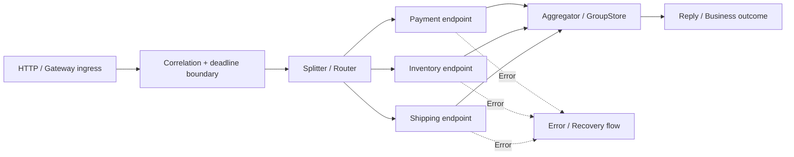
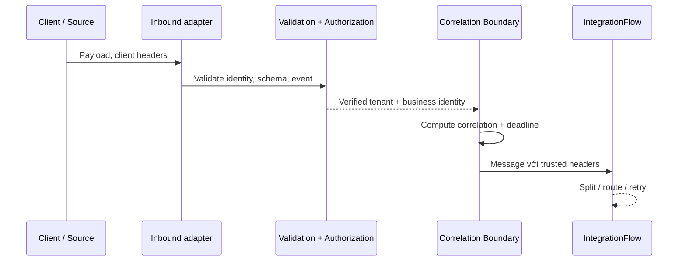
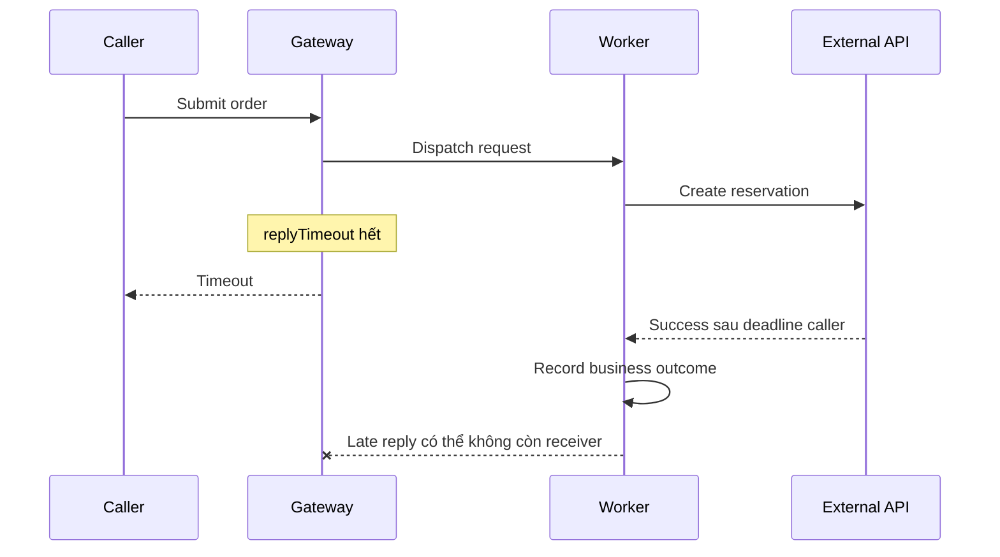
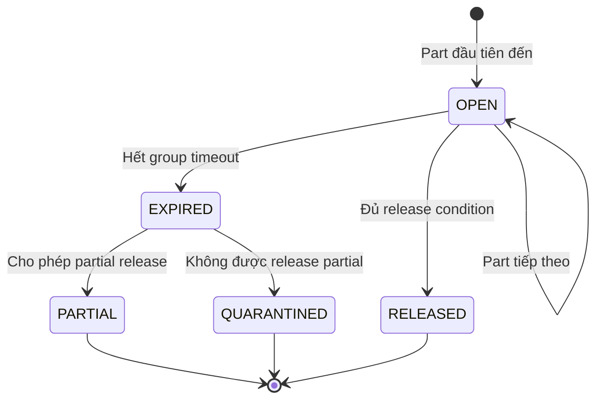

# Đặt correlation boundary và timeout trong Spring Integration

## Mục tiêu học tập

Một yêu cầu đặt hàng đi vào ứng dụng Spring Integration, được tách thành ba nhánh kiểm tra thanh toán, tồn kho và vận chuyển rồi hợp nhất kết quả. Nếu một nhánh mất 12 giây, trong khi HTTP caller chỉ chờ 5 giây, điều gì sẽ xảy ra với kết quả đến muộn? Nếu gateway đã timeout nhưng handler vẫn gọi API ngoài thành công, message có được retry không? Nếu hai tenant có cùng `orderId`, aggregator có vô tình ghép chung nhóm không?

Để trả lời, hệ thống phải thiết kế song song **correlation boundary** (ranh giới nơi xác lập và duy trì danh tính của một đơn vị công việc) và **timeout boundary** (ranh giới thời gian, quyền chờ và chính sách kết thúc khi quá hạn). Hai ranh giới này không tự xuất hiện đúng chỉ vì flow có `correlationId` và một tham số `replyTimeout`.

Bài **Đặt correlation boundary và timeout** thuộc chương **Thiết kế runtime**, trong module **SPRING_INTEGRATION_RUNTIME**. Bài tập trung vào cách message chạy và được điều phối qua channel, endpoint, consumer, poller và executor; đồng thời gắn hai loại boundary với lifecycle của `IntegrationFlow`, transaction, retry, message store, lỗi, threading, hiệu năng và trạng thái runtime.

Sau bài này, bạn có thể:

- Phân biệt `MessageHeaders.ID`, `correlationId`, business key, event ID, trace ID, sequence metadata và message group ID.
- Chọn **điểm sinh correlation**, phạm vi sở hữu danh tính và quy tắc truyền qua HTTP ingress, adapter, splitter, aggregator, gateway, broker và worker async.
- Thiết kế **deadline chung** cho một workflow, đồng thời cấu hình timeout riêng ở từng tầng mà không nhầm poll interval, send timeout, reply timeout, I/O timeout và message-group expiration.
- Giải thích tại sao gateway timeout không tự hủy handler, rollback giao dịch hoặc bảo đảm message chưa tạo side effect.
- Cấu hình correlation strategy/release strategy có bảo vệ tenant, duplicate, late arrival và persistent message groups.
- Thiết kế recovery/timeout policy rõ ràng: từ chối, partial result, retry với budget, DLQ/quarantine, compensation hoặc trả kết quả đã biết.
- Kiểm thử clock/deadline, correlation qua executor/poller, late reply, restart, timeout và idempotency; quan sát bằng metrics, logs và runbook.

> **Nguyên tắc:** Correlation trả lời **“những message nào thuộc cùng một công việc?”**; timeout trả lời **“mỗi thành phần được chờ đến khi nào và hết thời gian thì phải làm gì?”**. Cả hai phải được xác lập từ ranh giới nghiệp vụ và có hợp đồng end-to-end.

## 1. Hai ranh giới trong cùng một runtime

Xem một flow nhập đơn hàng:



Ở ingress, ứng dụng biết ai gửi request, tenant nào được xác thực, business operation nào đang bắt đầu và caller sẵn sàng chờ trong bao lâu. Khi tách nhánh, message UUID có thể thay đổi và các handler có thể chạy ở những thread khác nhau; **correlation cần đủ ổn định** để nối ba nhánh. Đồng thời, một deadline 5 giây không thể bị mỗi nhánh biến thành “được thêm 5 giây” ở từng bước.

Nếu caller đã timeout, phần việc còn chạy có thể:

- Hoàn tất và cần lưu outcome bền vững để caller tra cứu sau;
- Bị cancel nhưng một API ngoài **đã nhận lệnh** nên có thể đã commit;
- Chuyển sang durable retry/recovery và tiếp tục sau deadline HTTP;
- Trả partial result theo hợp đồng, hoặc fail và compensation.

Không thể quyết định phương án chỉ từ exception type `MessageTimeoutException` hay việc một `MessageChannel.send()` trả `true`.

### 1.1. Bản đồ boundary nên vẽ trước khi code

| Ranh giới | Câu hỏi chủ đạo | Dữ liệu/thiết kế cần chốt |
| --- | --- | --- |
| **Ingress identity** | Ai tạo công việc, tenant nào, event nào? | Verified tenant, event ID, business key, authz |
| **Correlation scope** | Những message nào phải được coi là cùng workflow? | `correlationId` ổn định, workflow run ID |
| **Split/group** | Những phần nào cần hợp nhất và nhóm kết thúc khi nào? | Group key, part identity, expected parts, release policy |
| **Async handoff** | Thành phần nào sở hữu công việc sau khi gửi? | Durable queue, ack/transaction, worker identity |
| **Request/reply** | Caller đợi kết quả bao lâu? | Request send timeout, reply timeout, late reply policy |
| **External I/O** | Kết nối/API được phép chờ bao lâu? | Connect/read/response timeout, retries |
| **Recovery** | Hết hạn mà chưa hoàn tất thì message đi đâu? | Error archive/DLQ, retry schedule, idempotency |
| **Persistence/restart** | Process chết, có thể tái dựng outcome không? | Message/group store, schema/version, checkpoints |

Cần xác định **owner** của từng timeout. Khi mỗi team thêm một `timeout=5000` tùy tiện, một workflow đi qua 5 service có thể chờ 25 giây hoặc hơn, dù caller chỉ có SLA 5 giây.

## 2. Năm định danh dễ bị nhầm

| Định danh | Ví dụ | Phạm vi sử dụng | Điều không nên làm |
| --- | --- | --- | --- |
| `MessageHeaders.ID` | UUID của message instance | Trace chính xác một message tại một bước | Dùng làm business dedupe xuyên redelivery |
| **Business key** | `tenant-a:ORD-42` | Nhận diện đối tượng nghiệp vụ; idempotency tùy operation | Dùng một mình khi cùng order có nhiều workflow run |
| **Event ID** | `evt-13d...` | Dedupe một sự kiện nguồn | Giả định event ID luôn bằng request ID |
| **Correlation ID** | `tenant-a:order-42:run-3` | Nối các phần cùng workflow/request | Đổi ID ở từng transform/attempt |
| **Trace ID** | `trace-...` | Distributed tracing quan sát request | Dùng làm authorization hoặc group key mặc định |
| **Group ID** | `tenant-a:v2:order-42:run-3` | Khóa nội bộ của `MessageGroupStore` | Trộn tenant/version khác hợp đồng |
| **Sequence metadata** | `sequenceNumber=2`, `sequenceSize=3` | Biết vị trí/số phần trong một splitter/group | Giả định mọi external event đều có sequence hợp lệ |

Trong Spring Integration, header correlation thường được truy qua hằng `IntegrationMessageHeaderAccessor.CORRELATION_ID`, với tên header `correlationId`. `MessageHeaders.ID` là UUID của message instance; một transform, retry/replay hoặc adapter có thể tạo message mới với UUID khác.

**Ví dụ:** sự kiện `PaymentConfirmed`, `InventoryReserved` và `ShippingQuoted` có ba message IDs khác nhau nhưng cùng workflow correlation ID. Nếu tất cả được đưa vào một aggregator, group key phải được chọn bởi `CorrelationStrategy` theo hợp đồng, không phải tự động suy từ tên `orderId`.

### 2.1. Business key và workflow run phải tách khi nghiệp vụ lặp lại

Một order có thể yêu cầu đổi vận chuyển nhiều lần:

```text
orderId      = ORD-42
businessKey  = tenant-a:ORD-42

workflow 1:
  operation  = initial-fulfillment
  runId      = run-1
  correlationId = tenant-a:ORD-42:run-1

workflow 2:
  operation  = re-fulfillment
  runId      = run-2
  correlationId = tenant-a:ORD-42:run-2
```

Nếu chỉ dùng `orderId` làm correlation cho mọi lần xử lý, phần event từ run-1 đến muộn có thể bị ghép nhầm với run-2. Business key vẫn giữ để truy order; **workflow run ID** quyết định scope correlation.

### 2.2. Tenant, version và tính duy nhất

Với multi-tenant, hai tenant có thể đều có `ORD-42`. Nhóm aggregator phải phân vùng theo **verified tenant**, không lấy một header do client tự khai là bằng chứng ownership. Nếu v1 và v2 có schema/release contract không tương thích, group key hoặc store region cần tách thêm version.

```text
Khóa rủi ro:
  groupId = ORD-42

Khóa có scope rõ:
  groupId = tenant-a:orders-v2:run-3

Business identity:
  businessKey = tenant-a:ORD-42
```

Các chuỗi này chỉ minh họa schema khóa của ứng dụng. Trong production, dùng chuẩn encode không mơ hồ và giới hạn độ dài; đừng nối chuỗi tùy ý nếu các thành phần ID có thể chứa dấu phân cách.

## 3. Đặt correlation boundary tại ingress: validate trước, sinh sau

**Correlation boundary** là điểm mà flow tin cậy quyết định: “message này là sự kiện mới của workflow nào”, “ID này đến từ đâu” và “nó được bảo vệ xuyên các hop nào”. Một nơi hợp lý là **ngay sau xác thực, authorization và kiểm tra schema tại ingress**, trước khi message được split/enrich/route.



### 3.1. Không tin raw correlation header của client một cách mù quáng

Header từ HTTP/JMS/AMQP có thể hữu ích cho tracing, nhưng **không phải quyền truy cập**. Nếu partner gửi `correlationId=tenant-b:ORD-42` trong khi đã xác thực là tenant A, dùng trực tiếp header đó để ghi vào `MessageGroupStore` chung có thể gây cross-tenant grouping.

Cách tiếp cận hợp lý:

1. Xác thực principal/service identity qua adapter.
2. Xác minh tenant và quyền trên order.
3. Chuẩn hóa event ID và workflow run ID từ dữ liệu tin cậy hoặc registry nghiệp vụ.
4. Xác lập correlation ID server-side; nếu cần giữ ID upstream, lưu riêng `upstreamCorrelationId` sau validation.
5. Sinh hoặc chấp nhận deadline theo policy server, có giới hạn tối đa.
6. Đưa message sang flow với những header có nguồn gốc tin cậy và có schema rõ.

### 3.2. Ví dụ Java: gắn correlation và deadline một lần

```java
import java.time.Clock;
import java.time.Duration;
import java.time.Instant;
import java.util.Objects;

import org.springframework.integration.IntegrationMessageHeaderAccessor;
import org.springframework.messaging.Message;
import org.springframework.messaging.support.MessageBuilder;

record OrderCommand(
        String tenantId,
        String orderId,
        String workflowRunId,
        int quantity) {
}

final class OrderIngressBoundary {
    private static final Duration WORKFLOW_BUDGET =
            Duration.ofSeconds(15);

    private final Clock clock;

    OrderIngressBoundary(Clock clock) {
        this.clock = Objects.requireNonNull(clock);
    }

    Message<OrderCommand> establish(
            Message<OrderCommand> inbound,
            String verifiedTenant) {

        OrderCommand payload = inbound.getPayload();

        if (verifiedTenant == null || verifiedTenant.isBlank()
                || !verifiedTenant.equals(payload.tenantId())
                || payload.orderId() == null
                || payload.orderId().isBlank()
                || payload.workflowRunId() == null
                || payload.workflowRunId().isBlank()) {
            throw new IllegalArgumentException(
                    "Invalid order identity / tenant");
        }

        String businessKey =
                verifiedTenant + ":" + payload.orderId();
        String correlationId =
                businessKey + ":" + payload.workflowRunId();
        Instant deadline =
                clock.instant().plus(WORKFLOW_BUDGET);

        return MessageBuilder.fromMessage(inbound)
                .setHeader("verifiedTenant", verifiedTenant)
                .setHeader("businessKey", businessKey)
                .setHeader(
                        IntegrationMessageHeaderAccessor.CORRELATION_ID,
                        correlationId)
                .setHeader("deadlineEpochMillis",
                        deadline.toEpochMilli())
                .build();
    }
}
```

**Các giả định:** `verifiedTenant` được tạo từ một bước xác thực và authorization đáng tin cậy, **không** lấy nguyên từ header client; `OrderCommand` là DTO nghiệp vụ demo. `WORKFLOW_BUDGET` 15 giây chỉ là ví dụ, không phải khuyến nghị cố định. Bài toán có nhiều workflow run cần bảo đảm ID không xung đột, có quota kích thước và canonical encoding.

Nếu request đã mang deadline hợp lệ từ một upstream được tin cậy, boundary nên tính **deadline hiệu lực nhỏ hơn** giữa policy local và deadline upstream thay vì tự cộng thêm 15 giây, tránh kéo dài SLA qua mỗi hop.

### 3.3. Khi nào được tạo correlation mới?

- **Workflow nghiệp vụ mới:** tạo correlation mới.
- **Một message mới là phần của workflow đang tồn tại:** kế thừa correlation.
- **Một retry/redelivery của cùng event:** giữ correlation và event ID; attempt count thay đổi.
- **Một compensation saga riêng:** có thể có correlation mới cho compensation nhưng giữ `parentCorrelationId` tới workflow gốc.
- **Một công việc hoàn toàn độc lập:** không ghép chỉ vì cùng order ID.

Sơ đồ cha/con giúp trace nhiều workflow:

```text
parentCorrelationId = tenant-a:ORD-42:run-3
correlationId       = tenant-a:ORD-42:refund-run-1
operation           = refund-compensation
```

Đừng đánh tráo “mỗi message có UUID” thành “mỗi message mở một workflow”.

## 4. Truyền correlation qua transformer, splitter và channel

Một `Message<?>` có payload và immutable headers. Nhiều component của Spring Integration giữ/copy headers theo contract, nhưng khi code tự tạo message mới, viết adapter/header mapper hoặc serialize qua broker, header có thể bị mất hoặc đổi kiểu.

### 4.1. Một cách copy headers có chủ đích

```java
import org.springframework.messaging.Message;
import org.springframework.messaging.support.MessageBuilder;

Message<?> transformed = MessageBuilder
        .withPayload(newPayload)
        .copyHeaders(originalMessage.getHeaders())
        .build();
```

`originalMessage` và `newPayload` trong ví dụ là giá trị do flow đang có. `MessageBuilder.withPayload(...).copyHeaders(...)` cho phép tạo payload mới và copy những headers tương ứng; khi dùng code hoặc adapter khác, cần kiểm tra header mapper thực tế. Nếu chỉ cần sửa header mà giữ nguyên payload, có thể dùng `MessageBuilder.fromMessage(originalMessage)`.

**Không** dựa vào việc `MessageHeaders.ID` giữ nguyên sau biến đổi. Điều cần giữ theo hợp đồng là `businessKey`, `correlationId`, `verifiedTenant`, `eventId`, deadline và schema/version nếu cần.

### 4.2. Splitter có sequence metadata nhưng không thay thế business correlation

Khi splitter chia một order thành ba parts, Spring Integration có thể gắn `sequenceNumber`, `sequenceSize` và correlation header theo cơ chế sequencing/configuration. Những metadata này hữu ích cho aggregator, nhưng phải xác nhận **cấu hình splitter đang dùng** và điều gì xảy ra nếu nested split.

```text
OrderCommand (1 message)
     |
     v
Splitter
  +-- part PAYMENT   (sequenceNumber=1)
  +-- part INVENTORY (sequenceNumber=2)
  +-- part SHIPPING  (sequenceNumber=3)

Cả ba phải gắn chung workflow correlation.
Mỗi part có một message ID riêng.
```

Một splitter mặc định có thể gán correlation riêng cho split sequence; nếu doanh nghiệp yêu cầu correlation ID cha giữ nguyên xuyên nhiều tầng split, cần thiết kế header lineage/strategy rõ ràng. **Không** suy ra giá trị của header correlation sau split chỉ từ giá trị trước split mà chưa test framework behavior của topology thực tế.

### 4.3. DirectChannel, ExecutorChannel và QueueChannel

| Channel | Delivery | Correlation có tự mất không? | Boundary cần lưu ý |
| --- | --- | --- | --- |
| `DirectChannel` | Đồng bộ trong thread sender, theo dispatch | Headers vẫn là message data khi được chuyển tiếp | Exception và transaction thread-bound |
| `ExecutorChannel` | Worker xử lý sau; `send()` có thể trả trước | Message headers vẫn có thể được giữ | `ThreadLocal`/MDC/SecurityContext không tự truyền |
| `QueueChannel` | Lưu chờ consumer `receive()` hoặc poll | Tùy channel/store/serialization | Capacity, persistence và message age |
| Broker adapter | Qua serialization/header mapping | Có thể bị loại/sửa kiểu header | Version mapping, shared deadline, redelivery |
| Reactor/`FluxMessageChannel` | Publisher/subscription theo demand | Không nên suy từ Reactor Context ra headers | Scheduler, cancellation, terminal error |

**Correlation không đồng nhất với MDC.** Một executor thread có thể không có `MDC` hoặc `SecurityContextHolder` của caller, nhưng message vẫn mang `correlationId` nếu header được truyền đúng. Log/tracing cần thiết lập context propagation riêng và dọn context khi worker được tái sử dụng.

## 5. Phân biệt correlation ID và MessageGroupStore group ID

Trong aggregator, `CorrelationStrategy` tính group key từ message; `MessageGroupStore` dùng key ấy để lưu các phần. Group ID có thể lấy từ `headers['correlationId']`, từ payload hoặc một biểu thức tổng hợp.

```text
Business workflow:
  correlationId = tenant-a:ORD-42:run-3

Aggregator instance của orders-v2:
  groupId = tenant-a:orders-v2:ORD-42:run-3
```

Lý do có thể tách: cùng một workflow correlation được dùng cho observability/compensation, nhưng aggregator v2 không được trộn persistent group với v1 khi release strategy/schema khác nhau. Không bắt buộc đổi correlation header chỉ để đổi group namespace: **strategy có thể tạo group ID nội bộ**.

### 5.1. CorrelationStrategy minh họa

```java
import org.springframework.integration.IntegrationMessageHeaderAccessor;
import org.springframework.messaging.Message;

final class GroupKeyPolicy {

    Object groupId(Message<?> message) {
        Object tenant =
                message.getHeaders().get("verifiedTenant");
        Object version =
                message.getHeaders().get("flowVersion");
        Object correlation = message.getHeaders().get(
                IntegrationMessageHeaderAccessor.CORRELATION_ID);

        if (!(tenant instanceof String t) || t.isBlank()
                || !(version instanceof String v) || v.isBlank()
                || !(correlation instanceof String c) || c.isBlank()) {
            throw new IllegalArgumentException(
                    "Missing trusted correlation scope");
        }

        return t + ":" + v + ":" + c;
    }
}
```

Đoạn code là **hàm policy** dùng làm basis cho một `CorrelationStrategy` của aggregator, không phải một Spring bean tự được đăng ký. Trong cấu hình thực tế, cần gắn nó vào aggregator và bảo đảm `flowVersion` là header server-side được kiểm soát, không tùy tiện tin client. Nếu correlation ID đã chứa tenant, việc thêm tenant nữa chỉ là một dạng namespace; ứng dụng có thể thiết kế một cấu trúc key chuẩn để tránh lặp.

### 5.2. ReleaseStrategy phải kiểm tra “đủ các phần đúng”, không chỉ group size

Nếu aggregator chờ PAYMENT, INVENTORY và SHIPPING, một điều kiện `group.size() >= 3` có thể sai khi cùng một part được redeliver ba lần.

```java
import java.util.Set;
import java.util.stream.Collectors;

import org.springframework.integration.store.MessageGroup;
import org.springframework.messaging.Message;

final class ExpectedPartsPolicy {
    private static final Set<String> EXPECTED =
            Set.of("PAYMENT", "INVENTORY", "SHIPPING");

    boolean canRelease(MessageGroup group) {
        if (group.size() != EXPECTED.size()) {
            return false;
        }

        Set<String> present = group.getMessages().stream()
                .map(this::partType)
                .collect(Collectors.toSet());

        return present.equals(EXPECTED);
    }

    private String partType(Message<?> message) {
        Object value = message.getHeaders().get("partType");
        return value instanceof String text ? text : "";
    }
}
```

Điều kiện này kiểm tra ba loại part khác nhau **khi group có đúng ba message**. Nó không tự loại duplicate: nếu group đã chứa 4 message vì redelivery, điều kiện sẽ không release; cần thêm idempotent receiver/duplicate policy và timeout/recovery cho group bị kẹt. Trong production, nhiều event độc lập có thể được phép cùng loại, khi ấy contract phải có `partId`, expected count hay manifest riêng.

### 5.3. Đặt release condition theo business contract

Có ba cách kết thúc hợp lệ tùy nghiệp vụ:

- **All required parts:** chỉ release khi đủ phần, đúng khóa và schema.
- **Partial result on deadline:** cho phép xuất một kết quả “DEGRADED/PENDING” nếu business chấp nhận, kèm phần còn thiếu.
- **Quarantine + compensation:** nếu thiếu phần quan trọng, không phát kết quả thành công; giữ group/error record để xử lý tiếp.

Chọn cách nào trước khi cấu hình group timeout. Không đổi sang partial release chỉ để giảm cảnh báo “aggregator không có output”.

## 6. Timeout boundary: các loại timeout không cùng nghĩa

Một application có thể có nhiều bộ đếm thời gian độc lập:

| Timeout / thời gian | Tầng điều khiển | Khi hết hạn | **Không tự bảo đảm** |
| --- | --- | --- | --- |
| **HTTP request deadline** | Client/edge/gateway | Caller ngừng chờ / thấy timeout | Handler hoặc API ngoài đã bị hủy |
| **Gateway request timeout** | Gửi request vào channel | Không gửi được trong ngân sách chờ tương ứng | Bounded execution của handler đồng bộ |
| **Gateway reply timeout** | Đợi reply | Caller không nhận reply kịp | Đã rollback side effect |
| **Channel send timeout** | Channel có thể blocking khi full | Send thất bại/trả false/exception theo contract | Business operation thất bại hay thành công |
| **Poller receive timeout** | Poller chờ nhận một message | Poll có thể kết thúc không nhận dữ liệu | Business SLA bị vi phạm |
| **Poll interval/trigger** | Scheduler | Lần poll kế tiếp được kích hoạt | Mỗi handler xong đúng giờ |
| **Connect timeout** | TCP/HTTP client | Không thiết lập kết nối kịp | Remote chưa xử lý request nếu đã gửi |
| **Read/response timeout** | HTTP/DB client | Client không nhận kết quả kịp | Remote không commit |
| **Reactor `Mono.timeout`** | Reactive operator | Publisher báo timeout/cancel subscription theo semantics | Blocking code hoặc side effect bị dừng chắc chắn |
| **Retry backoff/max duration** | Retry advice/operator | Hết budget retry | Source đã ack hoặc error archive đã commit |
| **Aggregator group timeout** | Group expiration policy | Release/expire/quarantine theo config | Gateway caller được trả lời đúng deadline |
| **Transaction timeout** | Transaction manager/DB | Có thể rollback/timeout theo resource | API ngoài cùng rollback |
| **Message retention/TTL** | Store/broker | Message có thể bị expire theo policy | Cùng nghĩa với request reply timeout |

**Một số giá trị mặc định, hành vi lỗi và tên API phụ thuộc Spring Integration/Spring Boot/broker version.** Không suy ra các timeout ở bảng đều sử dụng millisecond hoặc một timeout “toàn flow” sẵn có.

### 6.1. Timeout không phải cancellation đáng tin của side effect



Caller thấy timeout **không thể suy ra order đã thất bại**. Nếu client retry ngay với event ID mới, có nguy cơ tạo reservation hai lần. API nên trả trạng thái không chắc chắn/cho tra cứu theo idempotency key nếu business contract cần.

## 7. Thiết kế deadline end-to-end thay vì cộng timeout cục bộ

Một deadline là **mốc thời gian cuối**, ví dụ epoch milliseconds, được gắn tại một boundary tin cậy và truyền theo message. Ở mỗi hop, handler tính lại **remaining budget**. Nhờ vậy, một chuỗi ba nhánh/hop không vô tình tạo ra tổng thời gian chờ vượt xa SLA ban đầu.

### 7.1. Budget minh họa

```text
Client request SLA:                15.0 s
Ingress validation + routing:       0.5 s
Queue/Executor wait expected:       1.0 s
External API critical path:         8.0 s
Aggregation + reply:                1.5 s
Safety margin:                      4.0 s

Total planned:                     15.0 s
```

Số trên là **ví dụ thiết kế ngân sách**, không phải mặc định Spring Integration. Với ba nhánh chạy song song, **critical path** không phải tổng ba thời gian nếu thực sự xử lý đồng thời; nhưng contention, retries và queue wait có thể làm thời gian thực tăng. Thiết kế phải đo p95/p99 và giới hạn tail latency.

### 7.2. Java helper tính thời gian còn lại

```java
import java.time.Clock;
import java.time.Duration;
import org.springframework.messaging.Message;

final class DeadlinePolicy {
    private static final String DEADLINE_HEADER =
            "deadlineEpochMillis";

    static Duration remaining(
            Message<?> message, Clock clock) {

        Object raw = message.getHeaders().get(DEADLINE_HEADER);
        if (!(raw instanceof Long deadlineMillis)) {
            throw new IllegalArgumentException(
                    "Missing or invalid trusted deadline");
        }

        long remainingMillis =
                deadlineMillis - clock.millis();

        return Duration.ofMillis(
                Math.max(0L, remainingMillis));
    }

    static void requireTimeLeft(
            Message<?> message, Clock clock) {

        if (remaining(message, clock).isZero()) {
            throw new WorkflowDeadlineExceededException(
                    "Workflow deadline expired");
        }
    }

    static final class WorkflowDeadlineExceededException
            extends RuntimeException {
        WorkflowDeadlineExceededException(String message) {
            super(message);
        }
    }
}
```

Header này do ingress boundary gắn, **không lấy nguyên deadline do client tự khai** nếu không có validation. `Clock` giúp test dễ dàng; giữa các node, đồng hồ hệ thống phải được đồng bộ ở mức chấp nhận được. Trong một process, đo latency thực bằng monotonic time source thay vì chỉ dựa trên wall-clock có thể bị NTP chỉnh giờ; khi persist deadline qua restart/node, cần mốc thời gian có thể serialize như UTC epoch millis.

### 7.3. Không phải cứ còn 1 ms là nên bắt đầu thao tác

Nếu `remaining=100ms` mà API ngoài có p99 2 giây, gửi request có thể gây side effect rồi timeout gần như chắc chắn. Một policy thực tế cần **reserve time** cho commit/reply và quyết định không bắt đầu thao tác mới khi budget quá thấp.

```java
import java.time.Duration;

static boolean enoughBudgetForRemoteCall(
        Duration remaining,
        Duration expectedWorstCase,
        Duration replyReserve) {

    return remaining.compareTo(
            expectedWorstCase.plus(replyReserve)) > 0;
}
```

`expectedWorstCase` là **ngưỡng thiết kế** từ SLO/timeout client, không phải một giá trị đoán tùy ý. Nếu không đủ budget, chọn fail-fast, durable async handoff, trả `202 Accepted` theo hợp đồng HTTP hoặc error/recovery phù hợp; không tự tăng deadline.

### 7.4. Hạn chế clock skew và deadline giả mạo

Nếu broker adapter trên node A gắn deadline bằng system clock bị lệch 20 giây so với node B, node B có thể coi message đã hết hạn hoặc còn quá nhiều thời gian. Cần NTP/clock monitoring, timestamp source đáng tin và policy tolerance rõ. Với endpoint nhận deadline external, áp dụng max-age/max-budget, kiểm tra bất thường trước khi dùng.

## 8. Gateway requestTimeout, replyTimeout và send/receive timeout

Spring Integration Gateway đưa mô hình request/reply lên trên messaging. Thường có hai loại chờ khác nhau: thời gian **gửi request** và thời gian **đợi reply**.

### 8.1. Annotation minh họa

```java
import org.springframework.integration.annotation.Gateway;
import org.springframework.integration.annotation.MessagingGateway;

@MessagingGateway(
        name = "orderGateway",
        defaultRequestChannel = "orders.request",
        defaultRequestTimeout = "1000",
        defaultReplyTimeout = "5000")
interface OrderGateway {

    @Gateway
    OrderReply submit(OrderCommand command);
}

record OrderReply(
        String orderId,
        String outcome) {
}
```

Tham số timeout annotation trong ví dụ được trình bày bằng **chuỗi millisecond** theo Spring Integration Java annotation contract tương ứng; cần đối chiếu phiên bản và các tùy chọn expression/configuration khi đưa vào code thật. `orders.request` phải được nối tới một flow tạo reply phù hợp. Đây là **interface Gateway**, không tự cài đặt business handler.

**Giới hạn quan trọng:** nếu gateway gửi vào `DirectChannel` và handler đồng bộ bị block 30 giây, gửi request có thể giữ thread rất lâu; `defaultReplyTimeout=5000` không chắc giới hạn được **thời gian handler chạy đồng bộ bên trong send()**. Muốn quản lý thời gian xử lý độc lập với caller, phải có ranh giới bất đồng bộ phù hợp và timeout I/O thật ở handler.

### 8.2. Request timeout không phải network timeout của tất cả downstream

`requestTimeout` liên quan khả năng gửi request tới request channel. Với `QueueChannel` bị đầy, producer có thể phải đợi capacity; với `DirectChannel`, delivery đồng bộ có thể chặn ngay trong handler. Timeout ở gateway **không tự thay thế** connect/read timeout của HTTP client hoặc JDBC query timeout.

### 8.3. Reply timeout và late reply

Gateway có thể ngừng chờ sau reply timeout trong khi worker còn tiếp tục. Late reply cần chính sách:

- Bỏ reply muộn nhưng **ghi outcome bền vững** theo business key;
- Gửi result vào callback/durable reply queue nếu protocol hỗ trợ;
- Cho client query trạng thái công việc;
- Nếu request thực sự bị cancel theo contract, worker phải kiểm tra cancellation/deadline trước side effect và vẫn xử lý race.

`replyChannel` là header hỗ trợ reply routing. **Không mặc định persist một temporary reply channel object** của gateway qua broker/restart: channel tạm có thể không serialize được, hoặc caller đã biến mất. Với công việc kéo dài, nên lưu correlation ID, callback destination đã được allowlist hoặc durable request/status record.

### 8.4. Gateway lỗi và errorChannel

Một gateway có thể thấy exception đồng bộ, reply timeout hoặc một reply là error theo cấu hình. Header `errorChannel` không tự buộc mọi exception của handler sync phải đi vào một error flow. Cần kiểm tra ranh giới thread, publisher/error handler và policy gateway. Test phải phân biệt **request accepted**, **reply received**, **reply timed out** và **business succeeded**.

## 9. Poller, ExecutorChannel và broker: timeout nằm ở ai?

### 9.1. Poller và QueueChannel

```text
QueueChannel:
  producer.send(message, sendTimeout)
  consumer.receive(receiveTimeout)

Poller:
  trigger / fixedDelay / cron
  maxMessagesPerPoll
  receiveTimeout
  transaction/advice chain
```

`receiveTimeout` chỉ là thời gian đợi lấy một message từ channel/source, không phải deadline xử lý nghiệp vụ. Một poller chạy mỗi 5 giây có thể chỉ lấy 1 message mỗi lượt và làm backlog tăng mạnh nếu handler mất 3 giây. Không sửa bằng cách đặt `receiveTimeout` lớn hơn rồi kỳ vọng throughput tăng.

### 9.2. ExecutorChannel

Với `ExecutorChannel`, `send()` thường giao task cho executor; thời gian chờ **trong executor queue** có thể vượt hết workflow deadline trước khi handler bắt đầu. Vì vậy worker cần kiểm tra `deadlineEpochMillis` **lúc bắt đầu xử lý**, không chỉ tại ingress.

Một kiểm tra thích hợp:

```text
At ingress:
  message accepted at T0, deadline = T0 + 15 s

At worker start:
  queued for 12 s
  remaining = 3 s

Decision:
  Nếu thao tác remote cần 5 s + reserve,
  không bắt đầu operation gây side effect.
  Route expired work theo policy.
```

Nếu queue trong RAM mất khi pod restart, deadline header đúng vẫn không giúp khôi phục dữ liệu. Để đảm bảo durability, cần broker/persistent channel hoặc outbox và source ack tương ứng.

### 9.3. Broker và delivery timeout

Broker có cơ chế visibility timeout, heartbeat/session timeout, prefetch, consumer ack và redelivery khác nhau theo sản phẩm. **Không** coi chúng bằng HTTP reply timeout hoặc SLA nghiệp vụ.

Một message bị broker giao lại vì consumer chết có thể được worker mới xử lý sau deadline HTTP, nhưng nghiệp vụ có thể yêu cầu **tiếp tục hoàn tất** vì đó là công việc durable đã chấp nhận. Phân biệt:

- `callerDeadline`: caller ngừng chờ kết quả synchronous.
- `workflowDeadline`: thời điểm nghiệp vụ chấp nhận kết quả bình thường.
- `retentionUntil`: thời điểm dữ liệu recovery được phép xóa.
- `retryUntil`: mốc cuối cho các lượt retry tự động.

Chúng có thể khác nhau. Ví dụ caller chỉ chờ 5 giây, đơn hàng có thể hoàn tất bất đồng bộ trong 2 phút và error archive giữ 7 ngày.

## 10. Aggregator group timeout: deadline của nhóm không phải reply timeout

`AggregatingMessageHandler` và các cấu hình tương quan của Spring Integration có thể quản lý message group trong `MessageGroupStore`. Khi group không release được, hệ thống cần chiến lược expiration/timeout rõ ràng: **giữ chờ**, **release partial**, **discard/quarantine** hoặc **compensate**.

### 10.1. Thời điểm expire là một chính sách riêng



Các trạng thái trong sơ đồ là **mô hình nghiệp vụ**, không phải enum mặc định của Spring Integration. Nếu cấu hình group timeout/expiry chạy bằng scheduler hoặc reaper, expiration có thể xảy ra theo **lịch kiểm tra**, không nhất thiết chính xác tại một millisecond tuyệt đối. Các lựa chọn như `groupTimeout`, `sendPartialResultOnExpiry`, `expireGroupsUponCompletion` và discard handling có điều kiện theo phiên bản/cấu hình.

### 10.2. Hai policy rõ ràng

**Policy A — Đơn hàng cần đủ ba phần**

```text
Expected: PAYMENT, INVENTORY, SHIPPING
Deadline nhóm: 10 s
Có 2/3 parts khi hết hạn:
  - Không emit aggregate SUCCESS
  - Ghi missing-part record cùng correlation
  - Route error/quarantine hoặc chờ compensation
  - Giữ dữ liệu cần replay theo retention
```

**Policy B — Dashboard cho phép partial**

```text
Expected: 3 independent status parts
Deadline nhóm: 10 s
Có 2/3 parts khi hết hạn:
  - Emit PARTIAL, missingParts=[SHIPPING]
  - Không giả định trạng thái SHIPPING = SUCCESS
  - Late arrival có policy update/ignore/quarantine
```

Không đặt `sendPartialResultOnExpiry=true` cho luồng đặt hàng quan trọng chỉ để tránh group pending. Cần định nghĩa downstream hiểu trạng thái partial và những phép ghi dữ liệu nào được phép sau đó.

### 10.3. Late arrival và closed group

Một part đến **sau khi group đã release/expire** cần chính sách nhất quán:

- Bị loại có audit;
- Ghi error/quarantine;
- Được áp dụng như một update event mới nếu nghiệp vụ cho phép;
- Được xử lý trong một workflow run khác với correlation mới.

Nếu store vẫn giữ “empty group”/completed group metadata hoặc tombstone, hành vi tạo lại group có thể khác với việc xóa hết state ngay. Phải test **late arrival, duplicate và group re-creation** theo đúng cấu hình. Không phụ thuộc duy nhất vào `MessageGroupStore.group.size()` để quyết định tính hoàn tất nghiệp vụ.

### 10.4. Persistence và group key qua restart

Một persistent `MessageGroupStore` có thể giữ các parts đã commit qua restart, nhưng **không tự phục hồi Java strategy/handler** nếu app không đăng ký lại flow. Sau deploy, serializer, correlation strategy và release strategy mới phải tương thích với group cũ hoặc có migration. Không reset group/metadata để chữa timeout khi chưa xác định side effect.

## 11. Retry budget phải nằm bên trong deadline

Giả sử remaining budget chỉ 4 giây, nhưng retry advice được cấu hình 5 attempts, mỗi lần HTTP read timeout 3 giây cộng backoff 1 giây. Một execution có thể kéo dài quá 15 giây hoặc hơn; nó không tuân SLA chỉ vì gateway reply timeout là 5 giây.

### 11.1. Tính budget minh họa

```text
Workflow remaining at worker:       4,000 ms
Required reply/commit reserve:        500 ms
Available processing budget:        3,500 ms

Attempt 1 timeout:                  1,500 ms
Backoff before attempt 2:             300 ms
Attempt 2 timeout:                  1,500 ms
                                   --------
Total:                              3,300 ms

Remaining reserve:                    700 ms
```

Đây là **tính toán mẫu**. Trên thực tế, cần tính cả scheduling, queue wait, connection acquisition và database commit, không chỉ HTTP response. Nếu không đủ ngân sách, không thêm attempt dù retry policy còn lượt.

### 11.2. Retry đúng đơn vị

- Retry một **operation có thể lặp an toàn** với idempotency key.
- Không retry toàn bộ flow một cách mù quáng sau khi các nhánh khác đã commit side effect.
- Không tự reset deadline khi retry hoặc broker redelivery.
- Phân biệt transient lỗi mạng với validation/schema/authorization lỗi vĩnh viễn.
- Với timeout sau remote commit, query outcome theo business key trước khi tạo request mới.

Một `RetryTemplate` hoặc Reactor `retryWhen` có thể áp dụng trong từng invocation; redelivery của broker là **một lớp retry khác**. Cần ghi `attempt`, `deliveryCount`, `replayCount` và business outcome, không coi chúng là một số đếm.

### 11.3. Tín hiệu timeout có thể dẫn tới error flow hoặc return status

Một timeout có thể được model hóa là:

```text
Exception -> rollback/nack/retry
Exception -> durable error archive + ack (nếu policy cho phép)
Reply     -> TIMEOUT/PENDING cho caller
Event     -> WORKFLOW_EXPIRED để saga compensation
Quarantine -> xử lý thủ công
```

Không mặc định phải ném exception cho mọi timeout. Trong hệ thống async, caller có thể được trả `202 Accepted` và truy trạng thái sau. Nếu nghiệp vụ yêu cầu cancellation, cần định nghĩa **cancellation semantics và race với side effect** rõ.

## 12. Transaction boundary và vấn đề “đã timeout nhưng đã commit”

### 12.1. Cùng thread và qua executor

```text
Caller/Poller thread:
  begin transaction
  DirectChannel.send(message)
  handler writes DB
  commit / rollback

Qua ExecutorChannel:
  caller dispatches task
  caller transaction có thể hoàn tất
  worker later invokes handler
  worker transaction thường riêng
```

Transaction JDBC imperative thường gắn với thread. Qua executor/poller khác, nó không tự chuyển theo header correlation; một `correlationId` chỉ là dữ liệu, không tạo transaction phân tán.

### 12.2. Crash windows

| Cửa sổ lỗi | Điều có thể đã xảy ra | Cách xử lý an toàn |
| --- | --- | --- |
| Trước durable enqueue | Message chỉ trong RAM, caller đã được ack | Cần sửa handoff/ack contract |
| Sau durable enqueue, trước source ack | Source có thể redeliver | Dedupe theo event/business key |
| Sau API ngoài commit, trước DB DONE | Gateway thấy timeout, side effect đã có | Query theo idempotency key, compensation nếu cần |
| Sau DB DONE, trước broker ack | Source gửi lại message | Unique constraint/ledger để tránh trùng |
| Sau group partial release, part cuối đến | Output có thể đã được sử dụng | Late-arrival state machine |
| Sau reply timeout, worker vẫn xử lý | Caller đã rời đi | Ghi outcome bền vững, không assume cancel |
| Sau restart, persisted deadline đã qua | Message cũ còn trong store | Explicit expiry/retry/quarantine policy |

Không có một `replyTimeout` hoặc `groupTimeout` đơn lẻ nào bảo đảm “exactly once”. Hợp đồng gần thực tế thường là **at-least-once delivery + idempotent business effect** hoặc một durable handoff xác định.

### 12.3. Các trạng thái nghiệp vụ nên tách

```text
RECEIVED
PERSISTED
PROCESSING
COMPLETED
FAILED_RETRYABLE
FAILED_FINAL
TIMED_OUT_FOR_CALLER
EXPIRED_FOR_WORKFLOW
COMPENSATING
COMPENSATED
```

Đây là **state machine do ứng dụng thiết kế**, không phải enum Spring Integration mặc định. `TIMED_OUT_FOR_CALLER` không nhất thiết đồng nghĩa `EXPIRED_FOR_WORKFLOW`; một order đã được nhận bất đồng bộ có thể tiếp tục sau thời gian HTTP caller chờ.

## 13. Error flow, replyChannel và correlation trong recovery

### 13.1. ErrorMessage có thể chứa message nguồn ở nhiều vị trí

`ErrorMessage.getPayload()` là `Throwable`. Khi một handler lỗi, message gốc có thể xuất hiện ở `ErrorMessage.getOriginalMessage()` hoặc `MessagingException.getFailedMessage()` tùy error publisher. Vì vậy cần giữ correlation tại nơi gần lỗi nhất và có error archive theo business key.

```java
import org.springframework.messaging.Message;
import org.springframework.messaging.MessagingException;
import org.springframework.messaging.support.ErrorMessage;

final class RecoveryCorrelation {
    static Message<?> findFailedMessage(ErrorMessage error) {
        if (error.getOriginalMessage() != null) {
            return error.getOriginalMessage();
        }

        Throwable cause = error.getPayload();
        while (cause != null) {
            if (cause instanceof MessagingException messaging
                    && messaging.getFailedMessage() != null) {
                return messaging.getFailedMessage();
            }
            cause = cause.getCause();
        }
        return null;
    }
}
```

Trong trường hợp không có original/failed message, **đừng tự đoán correlation từ ID ErrorMessage**; cần tra source record/log/trace. Khi persist error record, nên lưu event ID, business key, correlation ID, workflow version và deadline cùng exception class/sanitized message.

### 13.2. Error channel không tự bắt mọi exception đồng bộ

Trong `DirectChannel`, exception của handler có thể đi về caller; trong executor/poller, error handler có thể publish `ErrorMessage` theo cấu hình. Không giả định header `errorChannel` tự làm mọi exception thành một error message. Với gateway, lỗi/timeout có thể xuất hiện ở caller khác với error archive.

### 13.3. Retry/replay khi deadline đã qua

Một message nằm trong DLQ rồi được replay sau 1 giờ vẫn giữ correlation ID của workflow gốc. Nhưng deadline 15 giây đã hết: có thể cần một **recovery workflow** mới (có `parentCorrelationId`) hoặc xử lý theo chính sách quá hạn, không chỉ xóa header deadline và giả vờ request gốc đang còn sống.

Nếu một business outcome còn cần hoàn tất dù caller đã hết thời gian chờ, hãy tách `callerDeadline` và `businessDeadline` từ đầu, thay vì âm thầm làm mới cùng một header.

### 13.4. Durability của reply

Một temporary `replyChannel` của gateway thường gắn với một request/reply call; nó không phải phương tiện lưu reply nhiều ngày. Với workflow kéo dài, lưu:

- `requestId` hoặc correlation ID;
- `status` và `resultReference` trong DB/broker;
- `callbackDestinationAlias` được allowlist (nếu có callback);
- `lastUpdatedAt` và retention;
- idempotency key và owner tenant.

Không serialize tùy tiện channel object hoặc security principal vào message store. Header mapping có thể biến đổi kiểu, và sau restart đối tượng channel tạm không còn hợp lệ.

## 14. Quy tắc chọn nơi đặt timeout

### 14.1. Đặt timeout theo ranh giới sở hữu

Một heuristic thực tế:

1. **Ingress/gateway:** request deadline và lựa chọn sync/async.
2. **Channel/queue:** send capacity timeout, queue age/backlog policy.
3. **Executor/poller:** maximum wait before start, schedule and receive timeout.
4. **Remote I/O:** connect/read/call timeout với retry budget.
5. **Aggregator:** group expiration/late-arrival policy theo business SLA.
6. **Transaction:** deadline commit/lock wait, không coi là HTTP timeout.
7. **Error recovery:** retryUntil, DLQ retention, quarantine deadline.
8. **Client:** thời gian người dùng chờ, status lookup/callback contract.

Không để một timeout “ở ngoài cùng” làm phương án bảo vệ duy nhất. Nếu handler tạo HTTP call blocking không có read timeout, một gateway reply timeout ở đường khác có thể không giải phóng thread đang chờ.

### 14.2. Đồng bộ hay bất đồng bộ?

| Tình huống | Thiết kế phù hợp | Điều phải bảo vệ |
| --- | --- | --- |
| Handler nhanh, đáp ứng deadline đáng tin | Gateway sync + timeout I/O rõ | Caller thread, transaction, error mapping |
| Handler có p99 dài, cần durable completion | Async handoff + status/callback | Persist trước ack, idempotency, deadline phân tầng |
| Fan-out 3 nhánh cần kết quả trước reply | Split/route + aggregator + group timeout | Distinct parts, correlation, missing-part policy |
| Fan-out cho analytics/best-effort | Publish/subscribe hoặc event stream | Không chặn critical path, quotas |
| Delayed batch qua poller | Queue/broker + poller SLA | Source lag, receive timeout, checkpoint |
| External API dễ timeout sau commit | Idempotent API + query outcome | Duplicate/retry/compensation |
| Workflow có các bước dài hàng giờ | Saga/process state, không giữ gateway thread | Durable state, state transitions, cancellation |

## 15. Quan sát: biết message mất ở đâu khi boundary bị lệch

Một flow có `correlationId` nhưng không có log/metric ở các mốc quan trọng vẫn khó debug. Nên instrument:

| Metric/log signal (tên gợi ý) | Ý nghĩa |
| --- | --- |
| `flow.ingress.count` | Message mới được xác thực/accepted |
| `flow.correlation.missing` | Message thiếu key sau boundary |
| `flow.deadline.remaining_ms` | Budget còn ở một stage, ghi dạng histogram |
| `flow.queue.oldest_age` | Thời gian chờ trước handler |
| `flow.handler.inflight` | Số operation đang chạy |
| `flow.handler.completed` | Handler hoàn tất thành công |
| `flow.business.committed` | Outcome đã ghi vào system of record |
| `flow.gateway.reply_timeout` | Caller đã hết thời gian đợi reply |
| `flow.remote.timeout` | Lỗi timeout ở API/DB |
| `flow.group.pending_age` | Group có parts thiếu/chậm |
| `flow.group.expired` | Số group hết hạn theo policy |
| `flow.late_reply` | Reply đến khi caller không còn đợi |
| `flow.retry.attempts` | Retry trong một invocation |
| `flow.source.redelivery` | Message nguồn được giao lại |
| `flow.recovery.pending_age` | Error/DLQ đang chờ lâu nhất |

Đây là **tên metric do ứng dụng tự thiết kế**, không phải tất cả mặc định có trong Spring Integration. Tránh gắn `messageId`, `correlationId`, `orderId` làm metric labels cho từng message vì cardinality cao; dùng structured logs/tracing có quyền truy cập/retention phù hợp.

### 15.1. Log có ranh giới và thời điểm

```text
time=... stage=INGRESS
  businessKey=tenant-a:ORD-42
  correlationId=tenant-a:ORD-42:run-3
  deadlineEpochMillis=...
  flowVersion=orders-v2

time=... stage=WORKER_START
  correlationId=tenant-a:ORD-42:run-3
  queueAgeMs=1050
  remainingBudgetMs=12800

time=... stage=GROUP_PENDING
  groupId=tenant-a:orders-v2:ORD-42:run-3
  parts=2 required=3
  oldestGroupAgeMs=9000

time=... stage=GATEWAY_TIMEOUT
  correlationId=tenant-a:ORD-42:run-3
  callerWaiting=false

time=... stage=BUSINESS_COMMITTED
  correlationId=tenant-a:ORD-42:run-3
  outcome=COMPLETED
```

Không log token, raw payload chứa dữ liệu nhạy cảm hoặc toàn bộ headers. Nếu deadline expired, log stage và policy quyết định thay vì chỉ exception “Timeout”.

### 15.2. Alert theo điều kiện phối hợp

Không nên alert khi “reply timeout count >0” nếu chỉ một request hỏng do client mất kết nối; hãy đặt SLO/error budget. Mặt khác, một queue ngày càng tăng và các worker còn nhận task có thể báo **backpressure** trước khi gateway timeout rate tăng.

Ví dụ điều kiện:

```text
IF queueDepth > 0
AND oldestQueueAge > queueSLO
AND businessCommitRate thấp
THEN investigate executor/handler progress

IF groupPendingAge > groupDeadline + schedulerTolerance
THEN inspect missing part, correlation, group expiration policy
```

Các ngưỡng cần căn cứ workload thực, poll interval, scheduler tolerance, retry backoff và maintenance window.

## 16. Runbook khi request timeout và aggregator không release

### Bước 1 — Thu danh tính đáng tin

Lấy `businessKey`, `correlationId`, `eventId`, `flowVersion` và deadline từ log/record đã xác thực. Không dùng client-provided tenant header làm bằng chứng quyền.

### Bước 2 — Xác định timeout nào thực sự xảy ra

Là gateway request send, reply receive, HTTP read, DB lock, broker visibility, poll receive, retry exhaustion hay group expiration? Đọc cause, timestamp và component ownership.

### Bước 3 — Xem message đã đến boundary nào

Đối chiếu ingress, channel accepted, worker started, handler completed, business committed và error archived. Với executor, `send(true)` không chứng minh worker đã chạy.

### Bước 4 — Kiểm tra group key và parts

Lấy group ID **thực từ CorrelationStrategy**, số distinct part IDs, duplicate count, sequence, release condition và pending group age. Một group size đủ nhưng thiếu đúng loại part vẫn chưa được release.

### Bước 5 — Đối chiếu deadline đã truyền

Xác minh header deadline có được giữ qua transform/adapter và đã bị reset ở hop nào không. Kiểm tra clock skew và budget còn lúc worker bắt đầu. Nếu đã hết, xác định policy xử lý expired work.

### Bước 6 — Kiểm tra source ack và transaction

Broker còn redeliver không? Có message trong persistent `MessageStore` hay `MessageGroupStore`? DB/API ngoài đã commit một phần chưa? Tránh replay trước khi tra idempotency ledger.

### Bước 7 — Kiểm tra error flow và late reply

`ErrorMessage` có original/failed message không? Error archive đã commit chưa? Reply đến sau gateway timeout có đang bị bỏ qua, log hoặc ghi outcome bền vững?

### Bước 8 — Remediation nhỏ nhất

Sửa correlation strategy/key mapping, timeout client, executor capacity hoặc deadline policy theo root cause. Không tăng toàn bộ timeout hoặc force-release group trước khi xác định trạng thái nghiệp vụ.

### Bước 9 — Test canary và quan sát

Chạy một request mới có correlation duy nhất; kiểm tra các nhánh, group release, reply và business outcome. Nếu có message cũ cần replay, dùng ID ổn định và compensation policy.

### Bước 10 — Chốt incident

Ghi ranh giới gây lỗi, version/config, các message đã xử lý, pending records, duplicate risk và metric trước/sau. Đóng incident khi pipeline đạt SLO và recovery/backlog có owner rõ ràng, không chỉ khi HTTP replyTimeout được tăng.

## 17. Ma trận kiểm thử correlation và timeout

| Case | Điều kiện | Assertion bắt buộc |
| --- | --- | --- |
| Ingress hợp lệ | Tenant xác thực, orderId/runId đúng | Correlation và deadline được tạo đúng một lần |
| Client giả tenant | Client header khác tenant verified | Boundary từ chối/không tin header |
| Transformer | Tạo payload mới | Business/correlation/deadline còn, message UUID theo contract |
| Split 3 parts | Một order tạo ba nhánh | Three distinct parts, cùng group key hợp lệ |
| Duplicate part | PAYMENT được gửi lại | Không release sai do group.size() |
| Hai tenant trùng order ID | A và B cùng ORD-42 | Không trộn message groups |
| Hai workflow run cùng order | run-1 và run-2 | Group/correlation phân biệt |
| Nested split | Splitter thứ hai sinh sequence mới | Preserve business lineage, group đúng |
| DirectChannel blocking | Handler chậm hơn gateway reply budget | Test timing không assume handler bị cancel |
| Executor queue delay | Worker bắt đầu muộn | Re-check remaining deadline trước side effect |
| Queue full | Send timeout/rejection | Producer và recovery thấy lỗi theo contract |
| Poller idle | Source rỗng | Không coi receive timeout là business failure |
| Gateway reply late | Worker trả sau deadline | Caller đã timeout; outcome vẫn được xử lý theo policy |
| Remote API commit rồi timeout | Lần retry đầu không nhận response | Idempotency không tạo side effect trùng |
| Retry budget hết | Lượt retry còn nhưng deadline expired | Không bắt đầu attempt không đủ budget |
| Group deadline | Thiếu SHIPPING | Partial/quarantine theo contract, không fake SUCCESS |
| Late part sau release | SHIPPING đến muộn | Ignore/update/quarantine có audit |
| ErrorMessage thiếu original | Only Throwable | Recovery không đoán correlation |
| Restart sau enqueue | Durable store/source | State và deadline không bị reset |
| Restart sau reply timeout | Worker còn kết quả | Business outcome tra cứu bằng correlation |
| Flow v1/v2 | Persistent groups của hai schema | Group/version scope không xung đột |
| Clock skew | Worker clock lệch | Behavior được kiểm soát và monitor |
| Health metric stale | Collector không cập nhật | Không kết luận queue rỗng từ dữ liệu cũ |
| Cancellation race | Cancel khi API gần commit | Outcome/idempotency ledger vẫn nhất quán |

### 17.1. Test deadline không dùng Thread.sleep

Ta có thể kiểm tra `DeadlinePolicy.remaining()` bằng `Clock.fixed` ở hai thời điểm.

```java
import java.time.Clock;
import java.time.Instant;
import java.time.ZoneOffset;

import org.junit.jupiter.api.Test;
import org.springframework.messaging.Message;
import org.springframework.messaging.support.MessageBuilder;

import static org.junit.jupiter.api.Assertions.*;

class DeadlinePolicyTest {

    @Test
    void remainingBudgetDecreasesWithoutSleeping() {
        Instant start =
                Instant.parse("2026-11-22T00:00:00Z");
        long deadline = start.plusSeconds(15).toEpochMilli();

        Message<String> message = MessageBuilder
                .withPayload("ORD-42")
                .setHeader("deadlineEpochMillis", deadline)
                .build();

        Clock atStart = Clock.fixed(
                start, ZoneOffset.UTC);
        Clock afterTenSeconds = Clock.fixed(
                start.plusSeconds(10), ZoneOffset.UTC);
        Clock afterDeadline = Clock.fixed(
                start.plusSeconds(20), ZoneOffset.UTC);

        assertEquals(15_000L,
                DeadlinePolicy.remaining(message, atStart).toMillis());
        assertEquals(5_000L,
                DeadlinePolicy.remaining(
                        message, afterTenSeconds).toMillis());
        assertTrue(DeadlinePolicy.remaining(
                message, afterDeadline).isZero());
    }
}
```

Ví dụ chỉ kiểm tra phép tính deadline trong một message. Nó **không** chứng minh gateway request/reply, HTTP client hoặc aggregator của ứng dụng đã dùng cùng budget. Để test integration, cần chạy Spring context/adapter và kiểm tra đúng boundary.

### 17.2. Test release strategy bằng fake message group

Tạo `MessageGroup` chứa các part có header `partType`; thử ba message PAYMENT, PAYMENT, INVENTORY và ba message PAYMENT, INVENTORY, SHIPPING. Case đầu không được release dù size 3; case sau được release.

Đừng chỉ test `group.size() == 3`. Nên test thêm duplicate redelivery, late arrival và group quá hạn. Khi dùng store persistent, kiểm thử qua restart thật và tương thích serializer/schema.

### 17.3. Test late reply phải kiểm tra business outcome

Dùng handler giả chờ latch thay vì sleep; gateway/caller có reply timeout hữu hạn. Cho caller timeout trước, sau đó giải phóng handler. Assert response của caller đã timeout **và** outcome nghiệp vụ được lưu bền vững theo policy, không bị tạo trùng nếu request retry.

Đây là test **race có chủ đích**, không chỉ test một exception timeout. Với synchronous `DirectChannel`, tách việc thực thi bằng async channel/worker khi cần tái tạo late-reply semantics một cách đáng tin.

## 18. Bài thực hành

### Bài A — Thiết kế correlation boundary ở ingress

Tạo `OrderIngressBoundary` như mục 3, cấp `verifiedTenant` từ một fake authorization service. Gửi một order hợp lệ và một order giả tenant; kiểm tra business key, correlation, deadline và hành vi reject.

**Kết quả mong đợi:** correlation do nguồn tin cậy quyết định; header phía client không có quyền đổi tenant/group scope.

### Bài B — Giữ header qua ba loại channel

Tạo flow đi qua `DirectChannel`, `ExecutorChannel` và `QueueChannel` với poller thử nghiệm. Ghi message ID, correlation ID, business key, deadline và thread. Kiểm tra header mapper khi đi qua broker adapter nếu có.

**Kết quả mong đợi:** message headers là dữ liệu xuyên thread nhưng MDC/ThreadLocal không tự truyền; test async phải dùng latch/timeouts.

### Bài C — Distinct parts thay vì group size

Tạo aggregator cần PAYMENT, INVENTORY và SHIPPING. Gửi PAYMENT hai lần rồi INVENTORY, sau đó sửa policy để dedupe theo `partId` và xử lý missing part.

**Kết quả mong đợi:** không release nhầm do duplicate; group không treo vô hạn mà có timeout/recovery policy.

### Bài D — Gateway reply timeout và late reply

Tạo gateway với reply timeout nhỏ và một handler async chờ tín hiệu. Cho caller timeout rồi để handler hoàn tất thành công; ghi business ledger trước/sau, sau đó retry với cùng idempotency key.

**Kết quả mong đợi:** timeout của caller không chứng minh side effect chưa xảy ra; retry không tạo order trùng.

### Bài E — Deadline budget và retry

Tạo message có deadline 15 giây; giả lập queue delay 11 giây bằng test clock. Cho remote call cần budget 5 giây cộng reserve 1 giây, rồi dùng helper `remaining()` để từ chối bắt đầu operation quá hạn.

**Kết quả mong đợi:** không reset deadline ở worker; retry budget là một phần của remaining budget.

### Bài F — Aggregator group timeout và late part

Cho group timeout 3 giây trong fixture, thiếu một part. Chạy hai policy: không partial release, và partial result hợp lệ cho dashboard. Sau expiration, gửi part còn thiếu và kiểm tra late-arrival outcome.

**Kết quả mong đợi:** phân biệt group timeout, release policy, error archive và reply timeout; không phát business SUCCESS sai.

### Bài G — Restart với persistent store

Lưu message/group trong backend bền vững, ghi correlation, schemaVersion và deadline; kill worker giữa chừng rồi start flow lại. Kiểm tra group tồn tại, deadline không bị sinh lại và retry/replay có idempotency.

**Kết quả mong đợi:** persistence và version compatibility quyết định recovery; correlation ID chỉ giúp nhận diện chứ không tự bảo đảm durable execution.

### Bài H — Incident có cả timeout và correlation lỗi

Mô phỏng request hết reply timeout, aggregator còn group chờ và DLQ có một nhánh lỗi. On-call lần theo business key, workflow run, group ID, late reply, source ack và API outcome.

**Kết quả mong đợi:** khoanh đúng ranh giới chậm/sai key, phục hồi an toàn không reset toàn bộ store hoặc tăng timeout mù quáng.

## 19. Câu hỏi tự kiểm tra

1. Correlation boundary nên đặt ở đâu nếu HTTP ingress nhận tenant và order ID từ client?
2. `MessageHeaders.ID` khác `correlationId` và business key ở điểm nào?
3. Khi nào cùng một order cần hai workflow correlation IDs khác nhau?
4. Vì sao trace ID không nên mặc định là aggregator group ID?
5. Hai tenant cùng dùng `ORD-42` có thể bị ghép sai như thế nào?
6. `IntegrationMessageHeaderAccessor.CORRELATION_ID` có ý nghĩa gì?
7. Khi message được transform, header nào cần giữ dù message UUID đổi?
8. Splitter sequencing có bảo đảm mọi nested split giữ correlation cha không?
9. `CorrelationStrategy` và `ReleaseStrategy` đảm nhận hai nhiệm vụ gì khác nhau?
10. Vì sao chỉ kiểm tra `group.size() >= 3` là không đủ khi có redelivery?
11. Group ID của persistent store có nên chứa flow version trong mọi tình huống không?
12. Gateway `requestTimeout` và `replyTimeout` khác nhau ra sao?
13. Vì sao `replyTimeout=5000` không tự cắt một handler blocking trên `DirectChannel`?
14. Một late reply đến sau gateway timeout phải được xử lý thế nào?
15. `replyChannel` tạm thời có nên được lưu qua broker/restart mà không có mapping không?
16. `receiveTimeout` của poller có phải business workflow deadline không?
17. Nếu executor queue giữ message 12 giây, khi worker bắt đầu cần kiểm tra gì?
18. Tại sao mỗi hop tự cộng timeout 5 giây làm sai SLA end-to-end?
19. Vì sao deadline trong message nên có dạng có thể persist qua node/restart?
20. Khi đồng hồ hai pod lệch nhau, điều gì có thể xảy ra với deadline?
21. Retry advice có tối đa 5 attempts, nhưng còn 1 giây deadline: nên làm gì?
22. Timeout sau HTTP API commit có chứng minh operation thất bại không?
23. `groupTimeout` có nhất thiết hết hạn chính xác ở millisecond deadline không?
24. Khi nào `sendPartialResultOnExpiry` được phép dùng?
25. Một part đến sau group expiration có thể dẫn tới những policy nào?
26. Persistent `MessageGroupStore` có tự phục hồi release strategy sau deploy không?
27. `ErrorMessage.getPayload()` chứa gì và lấy failed message ở đâu?
28. Vì sao `errorChannel` không mặc định bắt mọi exception đồng bộ?
29. Một `correlationId` có tự kéo transaction qua `ExecutorChannel` không?
30. Tại sao nguồn ack sớm có thể làm mất work dù header deadline đúng?
31. Caller deadline và business deadline có nên luôn bằng nhau không?
32. Làm sao replay một message đã hết workflow deadline mà vẫn giữ audit/correlation đúng?
33. Những metric nào giúp phân biệt queue wait, handler delay và group pending?
34. Khi aggregator thiếu SHIPPING, runbook cần kiểm tra những nơi nào trước khi force release?
35. Test nào nên dùng fake clock thay vì `Thread.sleep()`?
36. Test nào phải dùng broker/store bền vững để chứng minh restart recovery và idempotency?

**Ghi nhớ:** **Correlation boundary** tạo ra danh tính ổn định cho **một workflow có phạm vi tenant, run và version rõ ràng**; **timeout boundary** xác định thời hạn chờ, ownership và recovery ở từng ranh giới thread/channel/gateway/API/aggregator. Đừng nhầm message UUID với business key, group size với đủ distinct parts, gateway reply timeout với cancellation, hoặc một retry với một business operation hoàn toàn mới. Thiết kế đúng cần **deadline truyền xuyên hop, budget cho queue và I/O, group expiry policy, durable handoff, error/late reply và idempotency**, được chứng minh bằng test và quan sát tiến triển nghiệp vụ.

