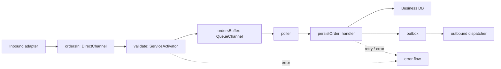
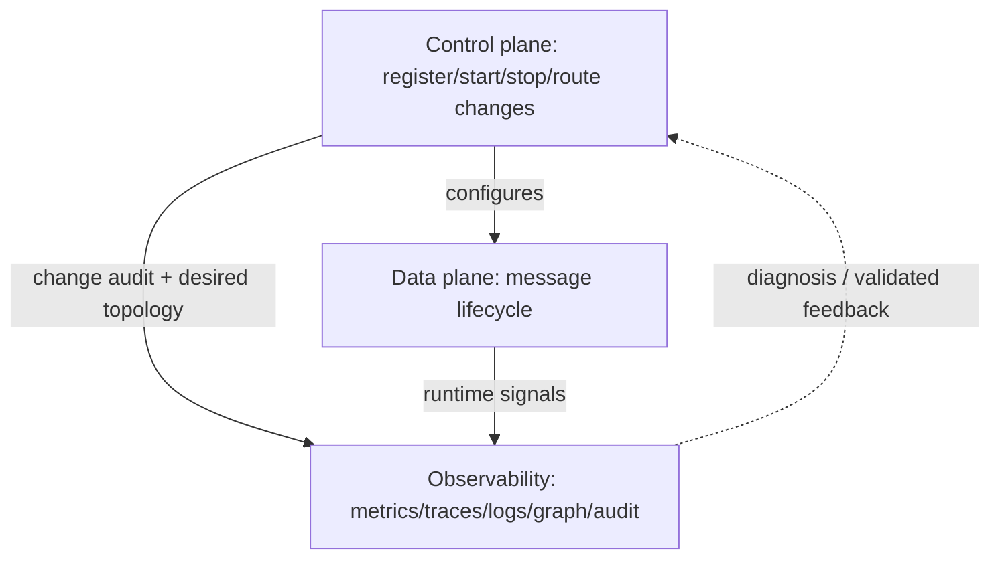
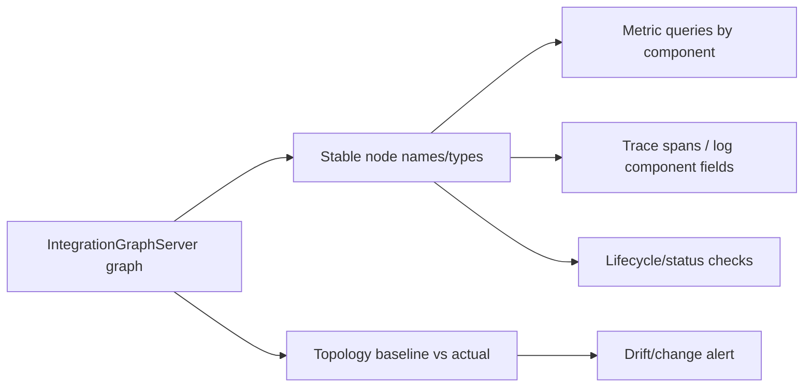
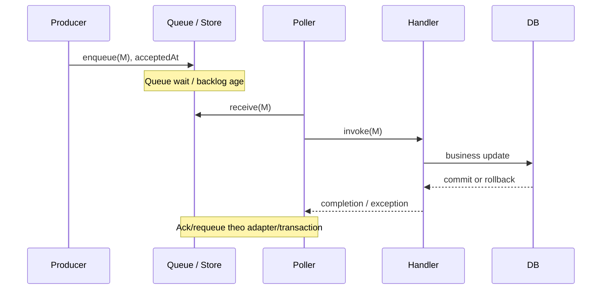
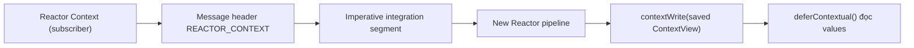
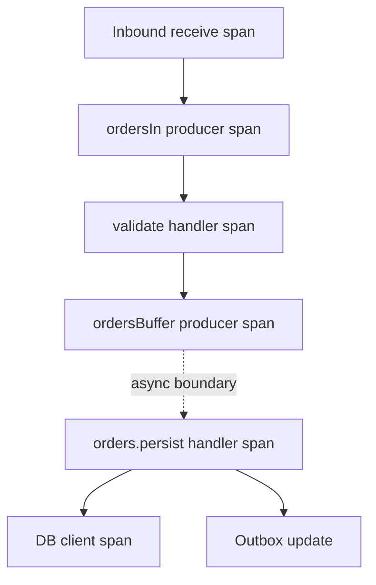
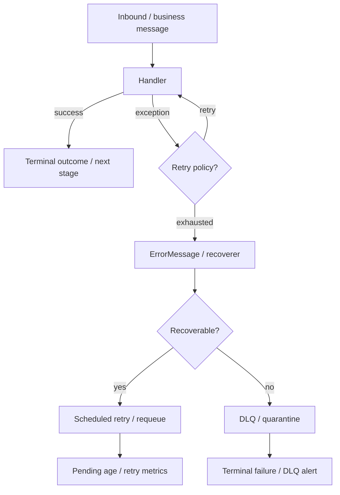
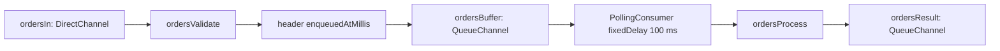
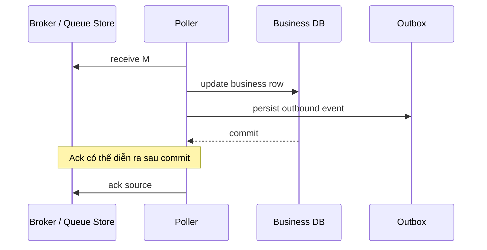
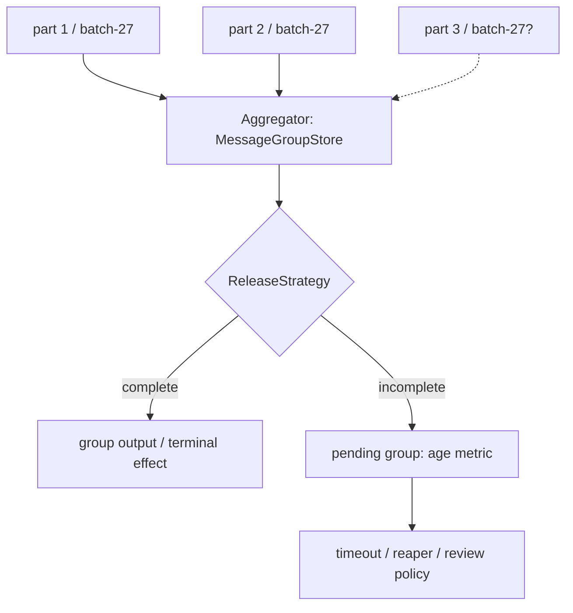

# Thiết kế observability ngay từ topology trong Spring Integration runtime

## 1. Mục tiêu: quan sát được luồng ngay từ lúc thiết kế

Trong module **SPRING_INTEGRATION_RUNTIME**, hệ thống xử lý message qua `MessageChannel`, endpoint, consumer, poller và executor; đồng thời phải quản lý lifecycle của `IntegrationFlow`, transaction, retry, message store, lỗi và correlation. Khi ứng dụng vận hành, sự cố có thể xảy ra ở bất kỳ ranh giới nào:

- Producer gửi message thành công nhưng consumer không chạy.
- `DirectChannel.send()` chậm do một handler đồng bộ, trong khi tên metric lại gợi ý lỗi ở channel.
- `ExecutorChannel.send()` rất nhanh nhưng worker pool đang nghẽn.
- Message nằm lâu trong `QueueChannel`, `JdbcChannelMessageStore` hoặc broker; không có exception nào được ném.
- Retry và redelivery làm số attempts tăng, còn số business events hoàn thành không tăng.
- Aggregator có incomplete group hoặc sai correlation nên không phát output.
- Một flow vừa được đăng ký động, nhưng graph/dashboard vẫn mô tả topology cũ.
- Thread, subscription hay process thay đổi làm mất tracing/MDC hoặc security context.
- Business DB commit rồi nhưng broker chưa ack, dẫn đến duplicate khi restart.

**Thiết kế observability ngay từ topology** nghĩa là: khi vẽ graph và chọn channel/endpoint, đồng thời xác định **cần nhìn thấy trạng thái nào, đo tại ranh giới nào, định danh component ra sao, context truyền thế nào, lỗi sẽ xuất hiện ở đâu và cách kiểm thử tín hiệu đó**.

Đây không phải bước “thêm log sau khi có sự cố”. Observability là **một yêu cầu thiết kế runtime** cùng với throughput, reliability, durability và security.

Sau bài này, bạn có thể:

1. Vẽ topology có các điểm quan sát gắn vào **nodes, edges và async boundaries**.
2. Chọn **SLI** (service-level indicator) gắn với business event và các metrics kỹ thuật phù hợp.
3. Đặt tên bean/channel/endpoint ổn định để liên kết `IntegrationGraphServer`, Micrometer, logs và tracing.
4. Phân biệt `spring.integration.send`/`receive` direct metrics với `spring.integration.producer`/`handler` của Micrometer Observation.
5. Thiết kế propagation của `trace context` và business `correlationId` qua executor, poller, reactive pipeline và network.
6. Đo queue wait, handler duration, terminal outcome, retry, message age và consumer liveness đúng ranh giới.
7. Thiết kế đường lỗi, recovery, DLQ và audit cùng lúc với flow thành công.
8. Cài một flow Java DSL có instrumentation tối thiểu và viết integration tests xác nhận **topology + behavior + telemetry**.
9. Vận hành dynamic flows mà không làm trôi tên metrics, mất context hoặc gây cardinality bùng nổ.
10. Tạo một **observability design contract** để review trước khi đưa flow vào production.

Phần minh họa dùng Java 17+, Spring Integration **6.5.x**, Spring Framework 6.x, Micrometer và Spring Boot 3.5.x khi có Actuator. Các API/tên metric cần được kiểm tra theo BOM thực tế của dự án.

## 2. Topology cần được đọc như một chuỗi lời hứa có thể kiểm chứng

Xét flow xử lý đơn hàng:



Mỗi thành phần không chỉ có chức năng, mà còn có **điều kiện thành công riêng**:

| Vị trí | Điều kiện thành công cục bộ | Điều chưa được bảo đảm | Tín hiệu cần bổ sung |
|---|---|---|---|
| Inbound adapter | Nhận được request/record | Event có được xử lý đúng hạn? | Ingress, accepted event ID, source lag |
| `ordersIn.send` | Message được channel accept/dispatch | Downstream async hoàn tất? | Channel timer/counter, exception |
| Validate handler | Validation hoàn thành theo contract | Business DB đã commit? | Handler duration, rejection outcome |
| `ordersBuffer.send` | Enqueue thành công | Consumer đã dequeue chưa? | Queue depth, enqueue timestamp |
| Poller `receive` | Có message được lấy | Transaction/ack có commit? | Receive count, poller liveness, retry |
| Persist handler | Invocation kết thúc | DB/outbox có cùng transaction? | Business commit, rollback/lock metrics |
| Outbox dispatcher | Attempt gửi được thực hiện | Consumer cuối đã áp dụng event? | Pending outbox age, delivery/ack |
| Error flow | ErrorMessage được nhận | Recovery/DLQ hoàn thành? | Terminal failure, DLQ size/age |
| Integration graph | Component/link tồn tại | Endpoint đang running hay có traffic? | `SmartLifecycle`, metrics, trace |

**Nguyên tắc thiết kế:** đừng lấy **thành công của một node** thay cho **thành công của cả quy trình**. Một lệnh `send()` trả `true` có thể chỉ nói queue đã nhận message.

### Data plane và control plane

- **Data plane:** message send/receive, handler invocation, correlation, retry, DB/outbound side effect.
- **Control plane:** register/start/stop/destroy flow, thay router mapping, chỉnh poller, rebuild topology, thay version.
- **Observability plane:** metrics, traces, structured logs, message history, graph snapshots, audit events và alerting.



Không để metrics hoặc tracing có quyền tự ý xóa queue/replay message chỉ vì một ngưỡng lỗi; đó là hành động control plane cần policy riêng.

## 3. Bốn câu hỏi trước khi chọn instrumentation

Khi review một flow mới, viết ra các câu trả lời:

1. **Message được coi là accepted khi nào?** Ở ingress? Khi đặt vào persistent queue? Khi business transaction commit?
2. **Message được coi là terminal khi nào?** Handler return? Business row committed? Outbox published? Remote ack?
3. **Chỗ nào mất tính đồng bộ?** Executor, poller, `QueueChannel`, Reactor subscription, broker/network, scheduler hoặc gateway reply timeout?
4. **Tình trạng nào có thể im lặng không ném exception?** Poller stopped, backlog, incomplete group, lost source, route không có subscriber, async job bị stuck.

Nếu không trả lời được, hãy thiết kế thêm một tín hiệu ở boundary hoặc đổi contract trước khi xây dashboard.

### Một “observability contract” cho một edge

```yaml
edgeId: orders.validate-to-buffer
source: orders.validate
target: ordersBuffer
channelType: QueueChannel
acceptanceSemantics: enqueue
executionBoundary: synchronous-producer-to-polled-consumer
persistent: false
correlationHeader: orderEventId
tracePropagation: in-process-message-headers
primarySignal: queue-depth-and-oldest-age
failureSignal: send-failure-and-error-flow
terminalEffect: none-at-this-edge
owner: orders-runtime
```

Đây là **mẫu mô tả kiến trúc**, không phải YAML tự sinh bởi Spring Integration. Tại cùng edge, hãy bổ sung `QueueChannel` có bounded capacity và quyết định khi full thì block, throw, drop có kiểm soát hay backpressure.

## 4. Đặt tên topology trước khi viết dashboard

Spring Integration có thể tự sinh bean/endpoint names; điều này thuận tiện khi viết DSL nhanh nhưng kém ổn định khi theo dõi trong production.

### Naming convention đề xuất

```text
Application:      orders-runtime
Flow ID:          orders.ingest.v1
Input channel:    orders.in
Validator:        orders.validate
Buffered channel: orders.pending
Poller endpoint:  orders.persist.poller
Handler endpoint: orders.persist
Error channel:    orders.errors
Output channel:   orders.completed
```

Có thể chọn chữ/số thay dấu chấm nếu naming policy của dự án yêu cầu. Quan trọng là tên **có nghĩa, ổn định và được kiểm soát**, không dựa vào index của endpoint auto-generated.

| Tên/định danh | Dùng cho | Có nên làm tag metric? |
|---|---|---|
| `application/service` | Nhóm dashboards, alerts | Có, bounded |
| `flowName` hoặc logical flow ID | Liên kết topology, owner | Có nếu số lượng hữu hạn |
| `componentName`/endpoint ID | Graph nodes, tracing/metrics | Có nếu ổn định |
| `componentType` | Channel/handler/poller | Có |
| `instance/pod` | Chẩn đoán replica | Có ở infrastructure labels |
| `correlationId` | Một business process cụ thể | **Không** làm tag metric |
| `messageId`/`orderId` | Điều tra một event | **Không** làm tag metric |
| `traceId`/`spanId` | Kết nối traces/logs | Không làm tag meter |
| `dynamicRegistrationId` | Quản trị flow động | Chỉ nếu số giá trị hữu hạn, TTL/cleanup |
| `tenantId` | Authorization, ownership | Không nếu cardinality cao/nhạy cảm |

### Vì sao tên ổn định quan trọng?

`IntegrationGraphServer` trả node names/types; Micrometer cũng tag component names. Nếu endpoint đổi từ `orders.persist` sang một bean name auto-generated mỗi lần refactor, bạn có thể thấy:

- Graph diff trông như xóa một component và tạo component mới.
- Time series cũ ngừng, dashboard mới trống.
- Alert rule không nhận dữ liệu dù flow vẫn chạy.
- Traces/logs không dễ so sánh qua deployments.

**Đặt ID tường minh là một dạng observability design**, không chỉ là code style.

## 5. Graph là bản đồ nơi đặt cảm biến, không phải cảm biến

`org.springframework.integration.graph.IntegrationGraphServer` tạo `Graph` gồm:

- `contentDescriptor`: provider/version/application metadata.
- `nodes`: các `IntegrationNode` với `nodeId`, `name`, `componentType`, properties, ...
- `links`: `LinkNode` với `from`, `to`, `type`, ví dụ `input`, `output`, `route`, `error`, `discard`.

```java
IntegrationGraphServer server = ...;

Graph graph = server.getGraph();      // cached topology
Graph refreshed = server.rebuild();  // rescan after changes
```

`getGraph()` có thể trả cached topology. Khi `IntegrationFlowContext` đăng ký/hủy flow, `rebuild()` giúp mô hình phản ánh components mới. **Không gọi rebuild để cập nhật mỗi message đã đi qua**, vì graph không phải trace stream.

### Thiết kế việc dùng graph



Một dashboard giàu thông tin có thể click từ node `orders.persist` sang handler latency, error rate, worker pool, DB pool, logs và traces. Nhưng việc liên kết đó cần **cùng naming convention và metadata có kiểm soát**, không tự xuất hiện từ graph.

### Node ID không được dùng làm khóa lưu lâu dài

`nodeId` chỉ có ý nghĩa để nối `links.from/to` **trong một snapshot**. Sau rebuild/restart, node IDs có thể đổi. Muốn diff graph qua phiên bản:

1. Join links bằng `nodeId` trong snapshot hiện tại.
2. Chuẩn hóa mỗi node thành `application + flowNamespace + componentName + componentType`.
3. Chuẩn hóa link thành `sourceName + linkType + targetName`.
4. So sánh sets và ghi deployment revision/instance.
5. Kiểm tra thêm dynamic router mappings và lifecycle state nếu có; chúng không hoàn toàn được đại diện bởi graph link.

### Thêm metadata có chọn lọc

`IntegrationGraphServer.setAdditionalPropertiesCallback(...)` có thể bổ sung properties cho `NamedComponent`:

```java
@Bean
public IntegrationGraphServer integrationGraphServer() {
    IntegrationGraphServer server = new IntegrationGraphServer();
    server.setApplicationName("orders-runtime");

    server.setAdditionalPropertiesCallback(component -> {
        if (component instanceof SmartLifecycle lifecycle) {
            return Map.of(
                    "runningAtSnapshot", lifecycle.isRunning(),
                    "autoStartup", lifecycle.isAutoStartup(),
                    "phase", lifecycle.getPhase());
        }
        return null;
    });
    return server;
}
```

Imports cần có `IntegrationGraphServer`, `SmartLifecycle`, `Map` và `@Bean`. Đây là code method-level trong `@Configuration` Spring; dữ liệu callback có thể được chụp khi graph được dựng, không phải health probe thời gian thực. Muốn biết endpoint **đang** chạy, hãy đọc `SmartLifecycle.isRunning()` trực tiếp.

**Không đưa** credentials, raw SpEL, full Message, tokens hoặc tenant ID vào graph properties. Graph/Actuator là bề mặt quản trị cần bảo vệ.

## 6. Chọn lớp telemetry nào cho từng câu hỏi

### Metrics: “Bao nhiêu và nhanh/chậm đến mức nào?”

Metrics phù hợp với lưu lượng, latency, tỷ lệ lỗi, backlog, queue age, saturation và SLO. Tags phải có cardinality thấp.

### Tracing: “Một request/event cụ thể mất thời gian ở đâu?”

Traces mô tả spans và quan hệ cha/con ở những ranh giới được instrument. Hữu ích khi qua HTTP/broker, executor, handler và DB; nhưng sampling có thể làm thiếu traces, và trace không phải sổ sách outcome có độ chính xác tuyệt đối.

### Structured logs: “Sự kiện/căn nguyên cụ thể là gì?”

Logs nên có `timestamp`, `level`, `application`, `instance`, `flow`, `component`, `traceId`, `correlationId` đã kiểm soát, `eventType` và `errorCode`. Không log full payload/PII/secret mặc định.

### Message history: “Message đã qua những components nào?”

Spring Integration có `@EnableMessageHistory`, ghi lịch sử các named components vào message header khi message đi qua các component được theo dõi. Nó không đồng nghĩa distributed tracing và không tự ghi durable audit.

### Runtime graph và audit: “Topology thực tế và cấu hình đã thay đổi ra sao?”

Graph cho nodes/links hiện tại; audit ghi **ai** đổi flow/router, desired/effective revision và outcome. Một runtime graph snapshot không tự biết actor hoặc message journey.

| Câu hỏi | Nguồn chính | Nguồn đối chiếu |
|---|---|---|
| Throughput giảm ở handler nào? | Metrics by component | Graph, logs |
| Message M42 đi qua đâu? | Trace/message history | Structured logs |
| Có message nào đang chờ lâu? | Durable oldest-age/queue gauge | Store/broker |
| Poller stopped hay empty source? | `SmartLifecycle` + progress metric | Input backlog, error channel |
| Group đang orphan? | `MessageGroupStore` metrics/state | Correlation logs, reaper |
| Ai chuyển route urgent sang review? | Control-plane audit | Graph + router mapping snapshot |
| Một payment có bị charge đôi không? | Durable business event ledger | Traces/attempt counters |

## 7. Thiết kế Observation và Micrometer theo phiên bản

### 7.1. Micrometer meters trực tiếp

Trong Spring Integration 6.5, khi cấu hình `MeterRegistry` phù hợp và components được instrument, bộ direct meters thường có:

| Tên meter | Type | Tag phân biệt | Đo điều gì? |
|---|---|---|---|
| `spring.integration.send` | Timer | `type=channel` | `MessageChannel.send` |
| `spring.integration.send` | Timer | `type=handler` | `AbstractMessageHandler` invocation |
| `spring.integration.receive` | Counter | `type=channel` | `PollableChannel.receive` |
| `spring.integration.receive` | Counter | `type=source` | `MessageSource.receive` |
| `spring.integration.channel.queue.size` | Gauge | `name`, `type=channel` | `QueueChannel` depth |
| `spring.integration.channel.queue.remaining.capacity` | Gauge | `name`, `type=channel` | Còn chỗ trong bounded queue |
| `spring.integration.channels/handlers/sources` | Gauge | Registry metadata | Số components |

Các timer trực tiếp có thể có tags `name`, `result=success|failure` và `exception`. Một `send` thành công không đồng nghĩa business commit.

### 7.2. Micrometer Observation

Từ Spring Integration 6.0, Observation tích hợp metrics và tracing theo `ObservationRegistry` + `ObservationHandler`. Theo reference 6.5, `@EnableIntegrationManagement(observationPatterns=...)` quyết định thành phần được instrument; **mặc định không bật tất cả các components bằng Observation chỉ vì có registry**.

Các convention names chính:

| Nơi đo | Observation timer | Active long-task timer | Tags low-cardinality |
|---|---|---|---|
| Channel/producer | `spring.integration.producer` | `spring.integration.producer.active` | `spring.integration.name`, `spring.integration.type=producer` |
| Message handler | `spring.integration.handler` | `spring.integration.handler.active` | `spring.integration.name`, `spring.integration.type=handler` |
| Gateway | `spring.integration.gateway` | `spring.integration.gateway.active` | `spring.integration.name`, `spring.integration.type=gateway`, `spring.integration.outcome` |

Từ Spring Integration 6.5, `SourcePollingChannelAdapter` còn được instrument theo `IntegrationObservation.HANDLER` API trong luồng inbound. Không tự suy mọi pollable receive có một Observation timer tên `spring.integration.receive`: bộ convention chính được công bố gồm producer, handler và gateway.

### 7.3. Tránh trộn hai chế độ

Với direct meter, handler dùng **`spring.integration.send{type=handler}`**; với Observation, handler dùng **`spring.integration.handler`**. Đây là những signal có cách tạo, tags và scope khác nhau.

Không viết alert vừa cộng hai names vừa coi đó là số unique message handlers đã xử lý, và không giả định `result=failure` luôn có trong Observation handler convention.

**Quy trình:** chọn mode → bật instrumentation → chạy một test message → liệt kê meters/tags thực tế → viết dashboard. Không viết PromQL dựa trên một tên suy đoán.

## 8. Từ graph tới instrumentation matrix

Một architecture review nên có bảng **node/edge → operation → metric → trace → error → owner**:

| Thành phần | Operation đo | Metrics | Trace/log | Lưu ý |
|---|---|---|---|---|
| HTTP/JMS/Kafka inbound | Accepted event | Ingress count, source lag | Extract trace carrier | Broker ack chưa chắc xong |
| `ordersIn: DirectChannel` | `send` | Send timer | Producer span | Duration có thể bao handler đồng bộ |
| `orders.validate` | Handler invocation | Handler timer, validation rejection | Handler span, errorCode | Business reject ≠ system failure |
| `ordersBuffer: QueueChannel` | Enqueue/dequeue | Send, receive, depth, capacity | Timestamp/correlation | Receive không đo toàn queue wait |
| `orders.persist.poller` | Poll & handoff | Poll progress/empty polls (custom nếu thiếu) | Poller logs, lifecycle | Phân biệt không có data và stopped |
| `orders.persist` | DB business action | Handler timer + DB spans | Correlation, transaction outcome | Handler return chưa chắc commit |
| `outbox` | Pending/delivered | Oldest outbox age, retry, DLQ | Event ID và transaction ref | Crash window giữa commit và publish |
| Error handler | Recovery | Error terminal outcome, DLQ | Exception type/cause | ErrorChannel send ≠ recovery success |
| Aggregator | Group release | Incomplete/oldest group, release count | Business correlation ID | Orphan không nhất thiết ném lỗi |
| Executor thread pool | Task execution | Active threads, queue depth, rejection | Thread boundary | Channel send latency không là worker latency |

Các điểm đo custom chỉ nên được thêm khi built-in metrics **không có semantics cần thiết**. Nếu thêm tràn lan timers ở mọi operator, nguy cơ overlap, duplicate counts và overhead tăng mà vẫn không có SLI đầu-cuối.

## 9. Execution boundary là chỗ observability thường bị đứt

### 9.1. DirectChannel

`DirectChannel` thường gọi consumer đồng bộ trên thread gửi; exception có thể quay về caller. Timer của `channel.send()` có thể bao cả downstream handler nên không thể suy queue wait từ nó.

```text
send start ───── handler sync ───── send return
                <handler timer>
<------------- channel timer ----------->
```

Không cộng hai timers này để tính end-to-end latency vì các khoảng thời gian **lồng nhau**.

### 9.2. ExecutorChannel

`ExecutorChannel` dispatch sang worker. `send()` có thể trả về sau khi accept task; handler chạy sau:

```text
producer thread:  send → accepted
worker thread:               scheduled → handler → outcome
                     [wait]            [duration]
```

Muốn quan sát thật, cần thêm **executor queue wait**, active/pool threads, rejected tasks, handler completion và error channel. `send timer=1ms` không chứng minh business latency=1ms.

### 9.3. QueueChannel và poller

`QueueChannel` nhận message khi consumer chưa chạy. Poller `receive()` sau đó. Topology nên vẽ rõ **mốc enqueue, mốc receive, mốc commit/ack**.



Poller có thể ngừng chạy không ném exception; do đó cần **progress heartbeat** và backlog/oldest age. Counter nhận message không phải bằng chứng DB đã commit.

### 9.4. Reactive boundary

`FluxMessageChannel`, `ReactiveMessageHandler`, `Mono`/`Flux` có subscriber-level context và lifecycle. Một `Mono` được dựng nhưng **chưa subscribe** thì chưa có xử lý. Một inner `subscribe()` tách rời có thể làm mất context, cancellation và error propagation.

Với reactive flows, hãy đo **subscription→terminal signal** và phân biệt onComplete/onError/cancel khi contract quan trọng; không dùng synchronous `send()` duration để suy toàn bộ reactive completion.

### 9.5. Network/persistence boundary

Khi qua HTTP/broker hoặc persistent message store:

- Dữ liệu đã enqueue không có nghĩa remote consumer đã áp dụng.
- Trace context cần được inject/extract qua **chuẩn transport headers**, không serialize nguyên Java `ContextView`.
- Message ID, event ID và deduplication key có lifecycle khác trace ID.
- Runtime restart có thể reset in-memory counters; durable backlog/terminal records cần tồn tại độc lập.

## 10. Thiết kế correlation ngay từ lúc tạo message

Một hệ thống có thể cần đồng thời:

| Loại ID | Mục đích | Thời hạn sử dụng | Bắt buộc bảo mật? |
|---|---|---|---|
| `messageId` Spring | Nhận diện một `Message<?>` instance | Có thể thay khi message được biến đổi | Không dùng làm event dedup ID |
| `businessEventId` | Dedupe/idempotency/reconciliation | Xuyên retry, redelivery, restart | Kiểm tra nguồn/format và quyền |
| `correlationId` | Nhóm message chung workflow | Xuyên các parts/gateway replies | Không tin key từ untrusted producer tùy ý |
| `traceId` | Distributed tracing | Một trace/span context | Không thay event ID nghiệp vụ |
| `spanId` | Định danh một span | Một operation | Không dùng làm queue key |
| `flowRevision` | Snapshot topology/version khi xử lý | Qua deployment/cutover khi cần forensic | Do trusted component gắn |
| `tenantId` | Business partition/authorization | Theo request/process | Nhạy cảm; cần xác thực |

### Đặt correlation ID ở đâu?

- Ở trusted ingress, bảo đảm business event ID hợp lệ và có thể chống duplicate.
- Khi tạo splitter parts, giữ key ổn định và sequence metadata đúng nếu aggregator dùng default correlation.
- Khi đưa vào message store, lưu **ID cần thiết** và metadata serializable, không đưa raw thread context.
- Khi publish ra broker, chuyển IDs qua header mapping/schema contract.
- Khi log, ghi `eventId`/`correlationId` có policy redaction; **không** đặt chúng vào Micrometer labels.

### Example event header design

```text
Message Headers nội bộ:
  eventId        = "EV-1001"
  correlationId  = "batch-27"
  acceptedAt     = 2026-11-22T00:00:00Z
  flowRevision   = 42
  trace carrier  = propagated by observation/instrumentation

Broker headers:
  event-id       = EV-1001
  correlation-id = batch-27
  traceparent    = standard W3C carrier
```

Các headers thực tế cần giới hạn kích thước và validate. Dùng tracing propagator đã cấu hình thay vì tự ghép chuỗi `traceparent` từ một UUID bất kỳ.

## 11. Reactor Context, ThreadLocal và MessageHeaders: không phải cùng một thứ

Spring Integration có thể kết hợp imperative và reactive execution. Để tracing/scope không bị mất khi thread đổi, cần hiểu:

| Carrier | Phạm vi | Điểm mạnh | Giới hạn |
|---|---|---|---|
| Reactor `ContextView` | Subscriber/subscription | Qua scheduler changes trong cùng reactive composition | Không tự truyền qua inner subscription độc lập |
| Java `ThreadLocal` / MDC | Một Java thread | Dễ tích hợp thư viện blocking | Không tự qua ExecutorChannel/poller |
| Spring `MessageHeaders` | Cùng message khi được propagate | Qua send/receive và adapters có mapping | Không tự trở thành MDC/Span |
| Micrometer `ContextSnapshot` | Capture/restore registered accessors | Bridge imperative/async | Accessors cần đăng ký, có overhead |
| HTTP/broker trace carrier | Qua network/process | Distributed tracing chuẩn | Phải inject/extract rõ ở boundary |
| `businessEventId` | Logical event | Idempotency/correlation | Không tự tạo tracing context |

Từ Spring Integration 6.0.5, `IntegrationMessageHeaderAccessor.REACTOR_CONTEXT` có thể mang `ContextView` qua đoạn imperative trong những components hỗ trợ. `StaticMessageHeaderAccessor.getReactorContext(message)` hỗ trợ đọc giá trị ấy. Nó **không** tự khôi phục MDC, security context hay reactive transaction ở bất kỳ thread nào.



**Security caveat:** Đừng copy nguyên `SecurityContext`, bearer token hoặc principal tùy ý vào message store/broker để “giữ tracing”. Authentication/authorization phải được kiểm tra ở boundary tin cậy.

### Khi bật Micrometer automatic propagation

Reactor 3.5+ tích hợp với Micrometer Context Propagation khi có dependency phù hợp. `Hooks.enableAutomaticContextPropagation()` có thể restore `ThreadLocal` từ Reactor Context cho subscriptions mới nếu accessors đã được đăng ký. Đây là một thay đổi global; bật ở bootstrap, không bật/tắt theo request.

Với custom executor Spring, `ContextPropagatingTaskDecorator` là một lựa chọn nếu cần capture/restore `ThreadLocal`. Nó **không** biến transaction JDBC thread-bound thành distributed transaction và không tự khôi phục object qua restart.

## 12. Observation spans: thiết kế parent-child theo thực tế runtime

Một trace có thể thể hiện:



Nhưng hình trên là **mục tiêu telemetry**, không phải đảm bảo tất cả spans tự nối đúng chỉ vì bật Observation. Muốn trace continuity:

1. Có `ObservationRegistry` và tracing bridge/ObservationHandlers phù hợp.
2. Instrument đúng các components qua `observationPatterns`.
3. Propagate trace carrier qua message headers, executor và network adapters.
4. Tránh tạo inner subscription/fire-and-forget side effect ngoài context.
5. Kiểm tra parent-child relationship trong integration test có exporter/test handler.
6. Chấp nhận rằng sampling có thể không xuất toàn bộ trace; SLO metrics phải độc lập với sampling.

### Không đo trùng

Nếu handler gọi HTTP client đã instrument, tracing có thể có cả handler span và HTTP client span. Chúng **lồng nhau**. Thời lượng của handler bao HTTP call trong nhiều trường hợp; không cộng span durations để tính total latency request.

### Span cardinality

Span names nên là operation names hữu hạn như `orders.persist`, không phải `orders.persist.EV-1001`. Event ID, trace ID và correlation ID có thể là attributes/log fields được bảo vệ với quy tắc retention/sampling, không biến thành metrics labels.

## 13. Message history và WireTap: dùng đúng lúc, đúng chỗ

`@EnableMessageHistory` giúp Spring Integration thêm history header vào message khi đi qua các named components được track.

```java
@Configuration
@EnableIntegration
@EnableMessageHistory({
        "ordersIn",
        "ordersBuffer",
        "orders*"
})
class MessageHistoryConfig {
}
```

Tài liệu Spring Integration nói history header chứa các entries với component `name`/`type` và có thể cấu hình patterns để giới hạn theo dõi. Từ 6.3, cách lưu history được cải tiến append-only và framework clone history thích hợp ở các nhánh multi-producer do framework quản lý.

### Khi dùng message history

- Debug route/splitter/aggregator ở trong JVM.
- Xác minh component nào đã xử lý một message cụ thể.
- Điều tra khác biệt giữa expected graph path và actual message path.
- Test wiring trong môi trường controlled traffic.

### Khi không nên bật tràn lan

- Message payload/headers đã lớn hoặc cần serialize ra broker.
- Fan-out tạo nhiều nhánh, history có thể tăng kích thước message.
- Production throughput rất cao mà chưa đánh giá overhead.
- Đã có distributed tracing với đủ coverage cho mục tiêu, history không bổ sung giá trị đáng kể.

`WireTap` có thể sao chép message sang kênh quan sát, nhưng chính nó tạo thêm một nhánh execution, có thể có async dispatch, backpressure, delivery errors và rủi ro lộ PII. Không gắn WireTap vào mọi channel rồi mặc định không ảnh hưởng data plane.

**Không dùng MessageHistory làm durable audit log:** message có thể mất headers sau transform/serialization hoặc bị loại bỏ, và history không chứa actor đã sửa route.

## 14. Thiết kế error flow là thiết kế observability

Một flow chỉ định nghĩa “happy path” thường thiếu dữ liệu điều tra khi xảy ra lỗi. Hãy vẽ đường lỗi song song với đường thành công:



### Lỗi đồng bộ và bất đồng bộ khác nhau

- `DirectChannel`: exception từ handler có thể đi ngược caller của `send()`.
- `ExecutorChannel`: producer `send()` có thể thành công; exception xảy ra trong worker và đi theo error handler/`errorChannel`.
- Poller/MessageSource: error handler, transaction rollback và retry của poller quyết định outcome.
- Reactive publisher: `onError` là signal trong subscription; không tự suy nó được gửi global `errorChannel`.
- Gateway: reply timeout khác với handler exception; cần đo cả hai.

Một `ErrorMessage` được gửi vào `errorChannel` **không đồng nghĩa recovery đã hoàn thành**. Nếu recovery handler cũng lỗi, cần biết error routing và DLQ policy.

### Bảo toàn failedMessage/correlation

Khi lỗi xảy ra, tối thiểu cần có:

- Stable `eventId`/`correlationId` nếu đã được xác thực.
- Endpoint/flow ID và instance.
- Exception type/code có cardinality thấp.
- Technical attempt number và retry policy.
- Original/failed message **đã được lọc dữ liệu nhạy cảm**.
- Terminal status: retry scheduled, DLQ, manual review hoặc final failure.

Đừng dump toàn bộ `Throwable`/Message payload vào metrics labels. Logs có thể ghi cause stack theo policy, audit/business state cần lưu outcome đủ bền vững.

## 15. Đo queue wait và end-to-end latency đúng cách

Built-in channel send Timer và receive Counter **không trực tiếp trả queue waiting time của từng message**. Nếu flow có SLA thời gian, cần thiết kế một timestamp tại **mốc được tin cậy**.

### Các mốc timestamp

```text
sourceEventAt        thời điểm event thực sự được tạo (nếu đáng tin)
ingressAcceptedAt    thời điểm ingress kiểm tra và chấp nhận
enqueuedAt           thời điểm chuẩn bị đưa vào channel/queue
dequeuedAt           thời điểm poller lấy message
processingStartedAt  handler bắt đầu
businessCommittedAt  business effect đã commit
acknowledgedAt       broker/source ack xong (nếu có)
```

Công thức:

```text
Queue waiting time ≈ dequeuedAt − enqueuedAt
End-to-end timeliness ≈ terminalOutcomeAt − ingressAcceptedAt
Source-to-terminal latency ≈ terminalOutcomeAt − sourceEventAt
```

Các timestamp phải có nguồn và ý nghĩa nhất quán. Nếu message trải qua nhiều JVM với clock skew, epoch timestamps có thể bị âm hoặc lệch. Khi đo một operation trong cùng JVM, `System.nanoTime()` hữu ích vì monotonic nhưng **không** persist để trừ sau restart/process khác.

### Code đo queue wait tại handler entry

```java
package example.runtime.observability;

import io.micrometer.core.instrument.MeterRegistry;
import io.micrometer.core.instrument.Timer;

import java.time.Clock;
import java.util.concurrent.TimeUnit;

import org.springframework.messaging.Message;

public final class ObservedOrderProcessor {

    private final MeterRegistry registry;
    private final Clock clock;

    public ObservedOrderProcessor(MeterRegistry registry, Clock clock) {
        this.registry = registry;
        this.clock = clock;
    }

    public String process(Message<String> message) {
        Object value = message.getHeaders().get("enqueuedAtMillis");

        if (!(value instanceof Number number)) {
            throw new IllegalArgumentException(
                    "Missing trusted queue timestamp");
        }

        long queueWaitMillis =
                Math.max(0L, clock.millis() - number.longValue());

        Timer.builder("orders.queue.wait")
                .description("Approximate queue wait before handler")
                .tag("flow", "orders.ingest")
                .register(registry)
                .record(queueWaitMillis, TimeUnit.MILLISECONDS);

        // Demo: business DB/transaction chưa được thực hiện ở đây.
        return "processed:" + message.getPayload();
    }
}
```

Đây là **một measurement gần đúng tại handler start**. Nó gồm queue wait và overhead nhỏ từ poller/dispatch; nó **không** đo transaction outcome hay total end-to-end latency. Code đặt `Math.max(0)` để tránh record duration âm nếu clock skew hoặc message header sai, nhưng production nên **đếm lỗi timestamp/clock skew riêng**, không âm thầm bỏ qua sai lệch nghiêm trọng.

### Tin cậy timestamp

- Trusted adapter/ingress tạo timestamp sau khi validate input.
- Producer không được tự đặt `enqueuedAtMillis` tùy ý để làm sai SLI.
- Persist header chỉ khi message converter/store hỗ trợ kiểu serializable.
- Giới hạn retention và kích thước headers.
- Nếu business deadline không thay đổi khi retry, **không overwrite `ingressAcceptedAt`** ở mỗi attempt.

## 16. Ví dụ Spring Integration Java DSL: topology được thiết kế để quan sát

Mẫu dưới đây có channel names, endpoint IDs, timestamp trước enqueue, poller boundary, output đo được và `IntegrationGraphServer`. Nó dùng **Micrometer direct meters** với `SimpleMeterRegistry` để tự chạy trong test/plain Spring context; phần Observation được cấu hình riêng ở mục 17.

```java
package example.runtime.observability;

import java.time.Clock;
import java.time.Duration;

import io.micrometer.core.instrument.MeterRegistry;
import io.micrometer.core.instrument.simple.SimpleMeterRegistry;

import org.springframework.context.annotation.Bean;
import org.springframework.context.annotation.Configuration;
import org.springframework.integration.channel.DirectChannel;
import org.springframework.integration.channel.QueueChannel;
import org.springframework.integration.config.EnableIntegration;
import org.springframework.integration.config.EnableIntegrationManagement;
import org.springframework.integration.config.EnableMessageHistory;
import org.springframework.integration.dsl.IntegrationFlow;
import org.springframework.integration.dsl.Pollers;
import org.springframework.integration.graph.IntegrationGraphServer;
import org.springframework.messaging.MessageChannel;

@Configuration
@EnableIntegration
@EnableIntegrationManagement
@EnableMessageHistory({"ordersIn", "ordersBuffer", "orders*"})
public class ObservableOrdersConfig {

    @Bean
    public MeterRegistry meterRegistry() {
        return new SimpleMeterRegistry();
    }

    @Bean
    public Clock clock() {
        return Clock.systemUTC();
    }

    @Bean
    public MessageChannel ordersIn() {
        return new DirectChannel();
    }

    @Bean
    public QueueChannel ordersBuffer() {
        return new QueueChannel(128);
    }

    @Bean
    public QueueChannel ordersResult() {
        return new QueueChannel(128);
    }

    @Bean
    public ObservedOrderProcessor orderProcessor(
            MeterRegistry registry, Clock clock) {
        return new ObservedOrderProcessor(registry, clock);
    }

    @Bean
    public IntegrationFlow ordersIntake(Clock clock) {
        return IntegrationFlow.from("ordersIn")
                .handle(
                        (payload, headers) -> {
                            String value = payload.toString().trim();
                            if (value.isEmpty()) {
                                throw new IllegalArgumentException(
                                        "Empty order event");
                            }
                            return value;
                        },
                        endpoint -> endpoint.id("ordersValidate"))
                .enrichHeaders(headers ->
                        headers.headerFunction(
                                "enqueuedAtMillis",
                                message -> clock.millis()))
                .channel("ordersBuffer")
                .get();
    }

    @Bean
    public IntegrationFlow ordersWorker(
            ObservedOrderProcessor processor) {
        return IntegrationFlow
                .from("ordersBuffer",
                        endpoint -> endpoint.poller(
                                Pollers.fixedDelay(
                                        Duration.ofMillis(100))
                                        .maxMessagesPerPoll(5)))
                .handle(processor, "process",
                        endpoint -> endpoint.id("ordersProcess"))
                .channel("ordersResult")
                .get();
    }

    @Bean
    public IntegrationGraphServer integrationGraphServer() {
        IntegrationGraphServer server = new IntegrationGraphServer();
        server.setApplicationName("orders-runtime");
        return server;
    }
}
```

### Diễn giải topology



**Phạm vi demo:**

- Không có broker/JDBC/HTTP thật; `ordersBuffer` in-memory có thể mất message khi process crash.
- Không có error flow custom, retry advice, business transaction hoặc durable audit — đó là các bước mở rộng theo yêu cầu nghiệp vụ.
- `SimpleMeterRegistry` chỉ lưu measurements tại tiến trình; không xuất Prometheus mặc định.
- `@EnableMessageHistory` phục vụ học/debug; production cần đánh giá overhead và chọn patterns.
- Tên `ordersValidate`/`ordersProcess` là endpoint IDs giúp tìm metrics, graph và log.
- `enqueuedAtMillis` là timestamp vào queue ở gần ranh giới enqueue, không phải terminal event deadline.
- Một handler trả output **không** chứng minh business DB commit vì demo không có DB.

### Vì sao chọn QueueChannel ở output?

`ordersResult` cho phép integration test gọi `receive(timeout)` để chờ completion theo semantics của demo, thay vì dựa vào `Thread.sleep()`. Với flow thật, output có thể là outbound adapter, reply channel, outbox hoặc business state.

### Những thành phần cần bổ sung trong production

1. Durable `MessageStore`/broker nếu có yêu cầu restart recovery.
2. Business event ID + idempotent inbox/outbox.
3. `errorChannel` hoặc recovery policy có outcomes rõ.
4. Poller transaction advice nếu cần atomic dequeue + business update.
5. Executor metrics/queue age, DB pool/lock metrics.
6. Proper Observation/tracing bridge và propagation qua network.
7. Controller/gateway authorization và security headers policy.
8. `SmartLifecycle`/readiness của poller, alerts và runbook.

## 17. Bật Observation theo topology, không bật tất cả theo quán tính

Nếu chạy Spring Boot có Actuator và Observation Registry/handlers, dùng cấu hình phù hợp để instrument có chọn lọc.

```java
import org.springframework.boot.SpringApplication;
import org.springframework.boot.autoconfigure.SpringBootApplication;
import org.springframework.integration.config.EnableIntegrationManagement;

@SpringBootApplication
@EnableIntegrationManagement(
        observationPatterns = {"ordersIn", "ordersBuffer", "orders*"})
public class ObservedBootApplication {

    public static void main(String[] args) {
        SpringApplication.run(ObservedBootApplication.class, args);
    }
}
```

Trong **ứng dụng thực**, phải có một `ObservationRegistry` và Micrometer Observation handlers đúng mục tiêu (metrics, tracing); Spring Boot Actuator/Tracing auto-configuration phụ thuộc starter và BOM. Đừng copy cả `ObservableOrdersConfig` vào ứng dụng này khi nó đã tự tạo `SimpleMeterRegistry` và một cấu hình management khác, rồi cho rằng đây là một setup tracing production hoàn chỉnh. Chọn **một** cấu hình management/registry phù hợp.

### Chọn observationPatterns ra sao?

Có thể bắt đầu với:

- Critical ingress channels.
- Những handlers có external I/O, transaction, retry.
- Gateway request/reply cần theo dõi deadline.
- Những poller/source adapters quan trọng.
- Error/recovery endpoints.

Sau đó mở rộng khi có nhu cầu. Nếu instrument tất cả channels trong flow nhiều hops, số spans và metric series có thể lớn, đặc biệt khi dynamic flow registration liên tục.

### Tracing sampling phải không làm mất SLI

Chọn sampling theo khối lượng, độ nhạy và incident needs. Một hệ thống có thể sampling traces 1–10% nhưng cần counters/timers đủ chính xác để đánh giá SLO. Không tính tổng số business events từ sampled spans trừ khi có estimator được thiết kế và kiểm chứng.

## 18. Bắt đầu từ SLI: thời gian hoàn tất thật của một event

Một đơn hàng có thể được xử lý qua nhiều queues/retries/instances. SLI phù hợp là:

```text
Timeliness SLI =
    số unique eligible events hoàn tất trước deadline
    -------------------------------------------------
    số unique eligible events đến hạn trong cửa sổ

Availability/outcome SLI =
    số unique eligible terminal events có outcome đúng
    --------------------------------------------------
    số unique eligible terminal events
```

Cần quyết định chính sách cho canceled/rejected events, duplicates, missing events và late arrivals trước khi triển khai.

### Không dùng Timer.count() làm unique event count

Với một event E1:

```text
Inbound: 1 event
ordersIn.send: 1
ordersBuffer.send: 1
poller.receive: 1
ordersProcess handler: 3 attempts vì retry
DB business terminal: 1 success
```

Nếu cộng `spring.integration.send` theo channels/handlers, bạn có thể đếm E1 nhiều lần. Technical metrics trả lời **flow hoạt động thế nào**, business SLI trả lời **event hoàn tất đúng không**.

### SLI dựa vào terminal state bền vững

Với hệ thống cần accounting/reconciliation, ghi `eventId` và terminal state vào durable store, hoặc tính lại từ event/inbox/outbox ledger. In-memory `Counter.increment()` sau commit có thể bị bỏ sót nếu JVM crash trước khi tăng; tăng trước commit lại có thể báo success khi transaction rollback.

`@TransactionalEventListener(phase=AFTER_COMMIT)` giúp đặt thời điểm notification sau commit nhưng **không** bảo đảm notification tồn tại qua crash. Với yêu cầu chính xác cao, dùng durable outbox/audit records để đối chiếu.

## 19. Thiết kế observability cho transaction và crash windows

Một flow có thể commit business database nhưng chưa ack broker, hoặc dequeue message trước khi transaction business thất bại.



### Chỗ nào cần signal?

| Failure window | Điều có thể xảy ra | Observability |
|---|---|---|
| Trước receive | Message chưa được lấy | Source/broker backlog, oldest age |
| Sau receive, trước business update | In-flight message có thể rollback/requeue | Receive/handler start + transaction status |
| Sau DB write, trước commit | Rollback, không có terminal business effect | DB rollback/lock metrics |
| Sau commit, trước broker ack | Redelivery, duplicate attempt | Business event ID + inbox dedup metric |
| Sau outbox commit, trước dispatch | Outbox pending tồn | Oldest outbox age, dispatcher progress |
| Sau remote success, trước local checkpoint | Có thể retry side effect | Remote idempotency/reconciliation |

**Không suy ra atomicity từ cùng một tracing span.** Một trace là quan sát, không phải transaction manager. `DataSourceTransactionManager` dùng thread-bound JDBC resource; `ReactiveTransactionManager` dùng Reactor Context. Chuyển context hoặc đổi scheduler không tự kết nối hai transaction managers.

### Định nghĩa “processed” cho dashboard

Nên có các trạng thái tách biệt:

```text
RECEIVED
  -> ACCEPTED
  -> PENDING
  -> IN_PROGRESS
  -> TERMINAL_SUCCESS | TERMINAL_FAILURE | MANUAL_REVIEW
```

Dữ liệu này có thể được lưu trong inbox/ledger hoặc từ event log bảo đảm bền vững. Timer handler chỉ là tín hiệu kỹ thuật đặt cạnh.

## 20. Aggregator: correlation và group state cần được quan sát

`Aggregator` có trạng thái không nằm trong một message đơn lẻ: `MessageGroupStore`, correlation keys, release/expiry strategy, late-arrival policy và lock ownership.

Khi vẽ topology aggregator, định nghĩa:

- `partsAccepted` và số unique groups.
- `incompleteGroupCount`/`oldestIncompleteGroupAge`.
- `releasedGroupCount` và output effect.
- `groupTimeoutCount`, expired/discarded count.
- `lateArrivalCount` hoặc policy trên completed groups.
- Database/persistent group store health và distributed lock behavior.
- Correlation key được tạo/validate ở trusted boundary, không log PII.



Một aggregator không release có thể **không phát exception**: nếu chỉ alert trên `handler failure` thì bỏ sót orphan group. Đây là ví dụ rõ cho lý do observability phải được thiết kế ngay từ stateful topology.

### Cardinality caution

`correlationId` dùng để tra group trong message store, **không** dùng làm Prometheus label. Đo số groups và tuổi cực đại theo flow/tenant tier bounded hoặc theo application; muốn tìm group cụ thể dùng query store/logs có kiểm soát.

## 21. Poller, scheduler và liveness: đừng nhầm không có traffic với lỗi

Một poller có thể `isRunning=true` mà không nhận được message vì source rỗng. Ngược lại, producer vẫn gửi vào queue nhưng poller đã `stop()`.

Các tín hiệu nên có:

| Signal | Mục đích |
|---|---|
| `isRunning` | Endpoint lifecycle state |
| `lastPollAt` | Poller còn được schedule không |
| `lastNonEmptyPollAt` | Lần cuối source có message |
| `lastSuccessfulProcessingAt` | Lần cuối terminal processing đạt contract |
| `emptyPollRate` | Tốc độ poll rỗng, thường cần custom metric |
| `receiveRate` | Messages được lấy |
| `oldestPendingAge` | Có message nào bị kẹt |
| `pollErrors` | Exceptions/recovery path |
| Scheduler active tasks/executor metrics | Worker starvation |

**Không page vì không có receive trong 30 phút** nếu service là batch xử lý dữ liệu một lần/ngày và không có backlog. Nhưng nếu `oldestPendingAge > deadline` **và** không có completion thì đó là no-progress đáng điều tra.

### Thiết kế alert theo quan hệ

```text
No-progress alert:
   (pending backlog > 0 OR expected source traffic is late)
AND (business completion không tiến triển > threshold)
AND (maintenance window không chủ động tắt flow)
```

Cần phân biệt missing metrics và genuine zero traffic; nếu scrape target down, một query rỗng có thể che lỗi.

## 22. Dynamic IntegrationFlow: thiết kế telemetry và lifecycle cùng nhau

Spring Integration `IntegrationFlowContext` cho phép đăng ký và hủy flow runtime:

```java
var registration = flowContext.registration(flow)
        .id("orders.canary.v2")
        .autoStartup(false)
        .register();

try {
    registration.start();

    // Smoke test: flow nhận/gửi message hợp lệ theo contract.
    // Graph sẽ có nodes/links mới sau rebuild.
    graphServer.rebuild();

    // Khi cutover có kiểm soát:
    registration.stop();
}
finally {
    registration.destroy();
    graphServer.rebuild();
}
```

Đây là **snippet method-level**, giả định các bean `flowContext` và `graphServer` đã inject, `flow` được xây dựng và đúng namespace.

**Telemetry design cho dynamic flow:**

1. Stable logical flow ID và version (không tạo label mới cho mỗi message).
2. Control-plane audit cho register/start/stop/destroy.
3. Graph rebuild sau component add/remove; snapshot diff ổn định.
4. Meter names được xác minh sau flow register và traffic smoke test.
5. Cleanup metrics/registrations khi flow destroy; không giữ high-cardinality dead meters vô thời hạn.
6. Lifecycle state và readiness tách biệt: `isRunning=true` không chắc downstream sẵn sàng.
7. Có quiesce/drain policy trước stop/destroy; in-flight messages cần kết thúc an toàn.
8. Với nhiều pods, mỗi instance có graph riêng; một pod đổi không làm pod khác tự đổi.

### Thêm metadata mà không làm nổ series

Nếu bạn tạo 10.000 dynamic flows theo từng user và cho mỗi flow một metric label `flowId`, time series có thể tăng rất nhanh. Thiết kế khác:

- Dùng vài logical flow classes/tier metrics có số lượng hữu hạn.
- Theo dõi số registrations active và lifecycle events ở control plane.
- Ghi detailed registration IDs trong audit/logs.
- Xóa unused flow registrations theo TTL/policy.
- Chỉ bật tracing chi tiết ở các flow quan trọng.

## 23. Security: observability có thể tạo đường rò dữ liệu

Một message flow có thể chứa payment IDs, customer data, authentication tokens và internal routing. Instrumentation không được biến chúng thành telemetry công khai.

### Quy tắc cho logs/traces

- Chỉ ghi các trường có chủ đích: timestamp, component, bounded error code, trace ID, event ID đã xử lý theo policy.
- Không log full `Message.getPayload()`, SQL parameters, Authorization headers hoặc `SecurityContext` mặc định.
- Kiểm soát quyền truy cập traces/logs theo team và dữ liệu.
- Áp dụng retention và redaction; debug logging có TTL, audit ai bật.
- Nếu cần message history/wiretap trên production, giới hạn tracked components và nội dung.
- Không truyền thông tin bí mật qua baggage/tracing headers.

### Quy tắc cho metrics

- Low cardinality: application, environment, stage, component, result, error class bounded.
- Không tag order ID, correlation ID, JWT, user ID hoặc unbounded tenant ID.
- Với router dynamic, tránh dùng raw route key nếu route key đến từ untrusted user.
- Review `MeterFilter`, histogram buckets và metrics cardinality trước rollout.

### Graph/Actuator security

`GET /actuator/integrationgraph` có thể tiết lộ topology, channel names và endpoint metadata. Management endpoints phải được bảo vệ bằng network boundary/authn/authz. `POST /actuator/integrationgraph` (nếu enabled) là yêu cầu rebuild graph; không phải lệnh tự đổi topology.

Control Bus/JMX/custom management routes có thể thực hiện lifecycle/router mutations. Audit những thao tác đó riêng; không đưa management channel vào business ingress.

## 24. Ví dụ dashboard gắn với topology

Một dashboard dành cho `orders.ingest` nên có các hàng theo **vị trí trong graph**:

| Panel | Nguồn | Điều muốn kết luận |
|---|---|---|
| Ingress accepted rate | Custom/broker ingress | Load vào hệ thống |
| `ordersIn` send count/error/latency | Micrometer channel metric | Producer send/dispatch |
| `ordersValidate` duration/error | Handler metric/Observation | Validation bottleneck |
| `ordersBuffer` queue depth & oldest age | Queue gauge/custom store metric | Backlog và timeliness |
| Poller last progress | Lifecycle/custom heartbeat | Consumer có tiến triển? |
| `ordersProcess` handler p95 | Handler timer/histogram | Handler chậm |
| DB pool/lock latency | DB/Actuator client metrics | External resource saturation |
| Business terminal success/timeliness | Durable ledger/custom SLI | Người dùng nhận đúng outcome? |
| Retry/DLQ/outbox oldest age | Broker/store metrics | Hệ thống cần manual action? |
| Graph revision/lifecycle | Graph/control-plane audit | Topology có thay đổi/dừng endpoint? |

### Một topology-anchored incident workflow

1. Từ alert `oldestPendingAge` quá ngưỡng, mở node `ordersBuffer` trong graph.
2. Kiểm tra producer send rate so với consumer receive/completion rate.
3. Xem `orders.persist.poller` có chạy không.
4. Nếu chạy nhưng không progress: xem worker threads, retry backoff, DB locks, transaction timeout.
5. Nếu receive rate cao nhưng business completion thấp: điều tra rollback/recovery/idempotency.
6. Nếu dynamic flow mới deploy: đối chiếu graph snapshot, component IDs và change audit.
7. Dùng trace/correlation ID để khoanh vùng event cụ thể.
8. Sau recovery, xác nhận oldest age giảm và terminal business outcomes tăng, không sinh duplicate.

## 25. Prometheus: queries phải bám đúng metric mode và ý nghĩa

Đối với **direct Micrometer** với Prometheus naming thông thường:

```promql
# Số lần send thành công trên channel, chia theo component:
sum by (job, name) (
  rate(
    spring_integration_send_seconds_count{
      type="channel",
      result="success"
    }[5m]
  )
)

# Handler invocation rate:
sum by (job, name) (
  rate(
    spring_integration_send_seconds_count{
      type="handler"
    }[5m]
  )
)

# Pollable receive rate:
sum by (job, name) (
  rate(
    spring_integration_receive_total{
      type="channel"
    }[5m]
  )
)
```

Trong **Observation mode**, handler latency trung bình:

```promql
sum by (job, spring_integration_name) (
  rate(spring_integration_handler_seconds_sum[5m])
)
/
clamp_min(
  sum by (job, spring_integration_name) (
    rate(spring_integration_handler_seconds_count[5m])
  ),
  1e-9
)
```

Những PromQL trên là **mẫu theo naming convention**, không bảo đảm exporter nào cũng dùng đúng suffix/labels. Luôn kiểm tra raw `/actuator/prometheus`.

### Alert queue age và no-progress

Giả sử ứng dụng export custom gauge `orders_oldest_pending_age_seconds` và `orders_last_terminal_success_timestamp_seconds`:

```promql
(
  orders_oldest_pending_age_seconds{service="orders"} > 120
)
and on(service)
(
  time()
    - orders_last_terminal_success_timestamp_seconds{
        service="orders"
      } > 600
)
```

Mẫu này chỉ có ý nghĩa nếu gauges được cập nhật đúng từ durable store, có labels phù hợp và xử lý trường hợp chưa có một success nào. **Không** coi missing series bằng 0; thêm monitoring-health và source freshness alerts cho missing telemetry.

### Alert design checklist

- Ngưỡng dựa trên business SLO/capacity, không dùng một số mặc định cho mọi channel.
- Có `for`/multi-window khi cần tránh alert burst ngắn.
- Có volume gate cho tỷ lệ lỗi khi traffic thấp.
- Nhận diện missing/absent metrics, target down và restarts.
- Gắn owner/runbook tới node/flow cụ thể.
- Không page vì một triệu chứng phụ nếu root-cause alert đang được điều phối, trừ khi business impact nghiêm trọng độc lập.

## 26. Kiểm thử observability phải nằm trong test flow

Một flow được coi là production-ready khi test chứng minh:

- **Topology:** đúng channel/endpoint/links.
- **Behavior:** message đi đúng đường, error/retry đúng policy.
- **Telemetry:** tên meter/tags/span/error fields xuất hiện ở các ranh giới dự kiến.
- **Control:** start/stop/dynamic register không tạo graph/metric drift bất ngờ.
- **Safety:** không lộ payload, không dùng high-cardinality labels.

### 26.1. Integration test cho ví dụ Java DSL

```java
package example.runtime.observability;

import static org.assertj.core.api.Assertions.assertThat;

import io.micrometer.core.instrument.MeterRegistry;
import org.junit.jupiter.api.Test;
import org.springframework.beans.factory.annotation.Autowired;
import org.springframework.beans.factory.annotation.Qualifier;
import org.springframework.integration.channel.QueueChannel;
import org.springframework.integration.graph.IntegrationGraphServer;
import org.springframework.messaging.Message;
import org.springframework.messaging.MessageChannel;
import org.springframework.messaging.support.GenericMessage;
import org.springframework.test.context.junit.jupiter.SpringJUnitConfig;

@SpringJUnitConfig(ObservableOrdersConfig.class)
class ObservableOrdersTest {

    @Autowired
    @Qualifier("ordersIn")
    MessageChannel input;

    @Autowired
    @Qualifier("ordersResult")
    QueueChannel output;

    @Autowired
    MeterRegistry registry;

    @Autowired
    IntegrationGraphServer graphServer;

    @Test
    void flowHasBehaviorAndTelemetry() {
        assertThat(input.send(new GenericMessage<>(" ORD-7 ")))
                .isTrue();

        Message<?> result = output.receive(3_000);
        assertThat(result).isNotNull();
        assertThat(result.getPayload())
                .isEqualTo("processed:ORD-7");

        var nodes = graphServer.getGraph().getNodes().stream()
                .map(node -> node.getName())
                .toList();

        assertThat(nodes).contains("ordersIn", "ordersBuffer");

        var channelTimers = registry.find("spring.integration.send")
                .tags("type", "channel", "name", "ordersIn")
                .timers();

        assertThat(channelTimers)
                .anyMatch(timer -> timer.count() >= 1);

        var waitTimer = registry.find("orders.queue.wait")
                .tag("flow", "orders.ingest")
                .timer();

        assertThat(waitTimer).isNotNull();
        assertThat(waitTimer.count()).isGreaterThanOrEqualTo(1);
    }
}
```

Ví dụ dùng JUnit 5, AssertJ, `spring-test` và các config/classes ở mục 15–16. Nó minh họa **direct Micrometer mode**; nếu dự án bật Observation mode, điều chỉnh assertions theo `spring.integration.producer`/`handler` và low-cardinality keys. Không assert số node hoặc timer max/latency chính xác tuyệt đối vì tên tự sinh/scheduler/CI khác nhau.

### 26.2. Test không có output không phải proof của lỗi

Với poller/ExecutorChannel, `send()` có thể hoàn thành trước handler. Dùng `receive(timeout)` hoặc `CountDownLatch` gắn vào completion. Đừng assert `output.receive(0)==null` rồi gọi đó là bằng chứng handler đã drop message: worker có thể chưa được schedule.

### 26.3. Test error flow và metrics

1. Handler ném một exception có kiểm soát.
2. Xác minh sync `DirectChannel` error trả caller, hoặc async `ErrorMessage` tới error channel phù hợp.
3. Kiểm tra technical attempt metrics và business terminal outcome **khác nhau**.
4. Thử retry rồi recover; một input có thể tạo nhiều handler attempts.
5. Không dùng full payload/correlationId làm meter label.
6. Với transaction, assert DB state/rollback chứ không chỉ handler timer.

### 26.4. Test tracing/context

- Tạo business event ID và trace context tại trusted ingress.
- Qua `ExecutorChannel`/poller, xác nhận tracing parent/span hoặc context carrier theo configuration.
- Với `FluxMessageChannel`, test `contextWrite`/`deferContextual` và subscription semantics.
- Qua broker/test HTTP server, xác nhận inject/extract headers được hỗ trợ.
- Gửi hai events đồng thời; không được lẫn tenant/correlation data.
- Test MDC/ThreadLocal cleanup sau request để không leak context sang worker khác.

### 26.5. Test dynamic topology

1. Chụp graph baseline.
2. Register một flow có ID xác định qua `IntegrationFlowContext`.
3. `rebuild()` và verify nodes/links.
4. Send một synthetic message có output đo được.
5. Stop/start registration, verify lifecycle và telemetry.
6. Destroy và rebuild, kiểm tra registration cleanup.
7. Xác minh audit change events và không còn high-cardinality meter leak.

## 27. Khi nào metrics không đủ: kết hợp diagnostic layers

Một case: **service được báo healthy, channel send đều, nhưng 30% orders trễ deadline**.

```text
ordersIn.send       success = 1000/s
ordersBuffer depth  tăng nhanh
poller receive      300/s
ordersProcess       p95 tăng
DB pool             exhausted
terminal success    280/s
oldest age          4 phút
```

Đường điều tra theo topology:

- Source/ingress vẫn hoạt động.
- Queue là bottleneck buffer, không phải destination cuối.
- Poller dequeue rate thấp hơn input, worker có thể kẹt DB pool.
- `ordersProcess` p95 tăng, cần xem DB/client spans và thread dumps.
- Terminal success nhỏ hơn receive vì rollback/retry/error recovery.
- Quyết định tăng poller concurrency chỉ sau khi hiểu DB capacity; scale quá tay có thể làm DB tệ hơn.

### Một case khác: graph thiếu flow sau deploy

- Query `IntegrationGraphServer.getGraph()` có thể là cache cũ.
- `rebuild()` sau register/destroy để làm mới.
- Kiểm tra per-instance/pod, `SmartLifecycle.isRunning()` và registration IDs.
- Nếu flow đúng trong graph nhưng không có traffic, kiểm tra source/poller, gateway routing, broker lag hoặc control-plane changes.
- Audit ai stop/route lại flow thay vì mặc định framework “mất component”.

## 28. Chi phí của observability: sampling, overhead, storage và privacy

Observability cũng là một workload: timers/spans/logs, message history, graph snapshots, Prometheus time series và exporters tiêu tốn CPU, heap, network, disk.

### Ngân sách telemetry

| Thành phần | Rủi ro | Cách giảm |
|---|---|---|
| Micrometer meters | High-cardinality tags, histogram buckets | Bounded labels, selective histograms |
| Observation spans | Quá nhiều spans/message | Chọn observationPatterns, sampling hợp lý |
| Structured logs | I/O cost, secret/PII leak | Sampling debug, bounded fields/redaction |
| Message history | Header growth, serialization overhead | Chọn tracked-components patterns |
| WireTap | Extra async messages, backpressure/errors | Dùng giới hạn và tách kênh an toàn |
| Graph rebuild/snapshot | Quét toàn context, response lớn | Rebuild theo topology change; cache |
| Audit events | Durable storage/retention | Append-only schema, partition/retention |
| Correlation IDs | Tăng cardinality nếu tag meter | Chỉ dùng trong logs/traces/audit |
| Exporters | Scrape latency/network | Scrape interval, timeout, capacity |

**Không “giải quyết” overload bằng cách tắt toàn bộ metrics/traces ở production mà không có thay thế**. Cần biết signal nào là bắt buộc cho SLO/security, signal nào có thể sample hoặc bật theo incident.

### Alert fatigue là một lỗi kiến trúc

Nếu mọi handler error đều page, một DB outage có thể tạo hàng trăm alert. Thiết kế alert theo **user impact** và triệu chứng cấp service, rồi group/inhibit các cause alerts. Link từ high-level alert tới graph/handler panels giúp điều tra thay vì đánh thức người trực vì từng low-level timer.

## 29. Template observability contract cho một IntegrationFlow

Đây là mẫu để đính kèm vào architecture review/ADR của mỗi flow:

```markdown
# Observability Contract — <logical-flow-id>

## Business contract
- Eligible event:
- Unique event ID / idempotency key:
- Success terminal state:
- Failure terminal state:
- Deadline and SLO window:
- Owner and escalation:

## Topology
- Inbound source:
- Channels: type, capacity, persistence:
- Handlers: stable IDs and external dependencies:
- Poller/executor: scheduling/concurrency/queue:
- Router/aggregator: correlation/release/timeout:
- Error channel, retry, DLQ and recovery:
- Dynamic registration/config revision:

## Boundaries and propagation
- Ingress accepted timestamp:
- Queue enqueued/dequeued timestamps:
- Trace inject/extract boundary:
- Correlation headers and privacy:
- Transaction/ack boundary:
- Restart/crash and idempotency policy:

## Signals
- Built-in metrics mode and names:
- Custom business counters/gauges:
- Latency and age histograms:
- Trace spans and sampling:
- Structured log fields:
- Message history/WireTap scope:
- Graph/lifecycle/audit metadata:

## Alerts and validation
- User-impact SLI/SLO alert:
- Backlog/no-progress alert:
- DLQ/retry/transaction alert:
- Missing telemetry/target-down alert:
- Runbook link:
- Integration tests: success/error/retry/restart:
- Cardinality, retention and access review:
```

Một contract không cần hàng trăm dashboards; nó phải đủ để người trực trả lời **tải đang vào ở đâu, message đang ở trạng thái nào, nơi nào đang chờ, gì được coi là thành công và cách khôi phục an toàn**.

## 30. Những sai lầm thiết kế thường gặp

### 30.1. Chỉ gắn metrics ở ingress

Khi nguồn gửi đều nhưng consumer/poller dừng, ingress vẫn “xanh”. Phải có completion SLI và backlog/oldest-age.

### 30.2. Không đặt endpoint IDs ổn định

Generated names thay đổi khiến graph/traces/metrics không thể nối chắc chắn sau refactor. Đặt tên ở code review, không chờ dashboard vỡ.

### 30.3. Gắn timer ở mọi hop rồi cộng chúng

Timers trên `DirectChannel` và handler có thể lồng nhau; cộng sẽ overcount. Đo business end-to-end duration tại terminal boundary.

### 30.4. Tin `send(true)` là xử lý xong

Với `QueueChannel`/`ExecutorChannel`, send thường chỉ nghĩa accepted. Đo completion và transaction outcome riêng.

### 30.5. Dùng ThreadLocal như context toàn flow

Thread pool reuse, poller, Reactor subscriber và broker phá giả định “một request = một thread”. Dùng phù hợp `MessageHeaders`, Reactor Context, Micrometer context propagation và transport propagators.

### 30.6. Dùng trace ID làm business idempotency key

Trace có thể thay qua retries/operations, còn business event cần stable identity. Không dựa vào sampling để đếm outcomes.

### 30.7. Ghi mọi ID vào metric tags

`correlationId`/`orderId` tạo unbounded time series. Đưa vào logs/traces theo policy, giữ metric labels bounded.

### 30.8. Không vẽ error route

`ErrorMessage`, retries, recovery và DLQ là nhánh có traffic/latency riêng. Không để terminal failures vô hình sau một recoverer nuốt exception.

### 30.9. Không đo stateful components

Aggregator chờ group không sinh exception; phải đo pending group age/timeout và store health.

### 30.10. Coi graph cached là trạng thái live toàn diện

`getGraph()` trả cached topology; `rebuild()` cập nhật cấu trúc. Graph không phải live health, history hoặc per-message trace.

### 30.11. Không kiểm thử telemetry

Flow test chỉ assert payload, nhưng metrics exporter sai tên/tags và alert trống. Bổ sung tests để xác minh meter mode, graph links và span propagation.

### 30.12. Bỏ qua restart/cluster

Một pod có flow mới không đồng nghĩa mọi pods; counter reset sau restart không chứng minh mất dữ liệu. Dùng per-instance graph snapshots và durable message/terminal state.

## 31. Bài tập thực hành

### Bài tập A — Vẽ topology kèm observability boundaries

1. Chọn flow `inbound → DirectChannel → ServiceActivator → QueueChannel → PollingConsumer → DB`.
2. Đánh dấu mốc `accepted`, `enqueued`, `dequeued`, `handlerStart`, `transactionCommit`, `ack`.
3. Chọn built-in meters có sẵn ở mỗi node/edge.
4. Chỉ ra queue wait/business success không thể suy từ meter nào.
5. Viết một bảng 6–10 signals và owner.

**Tiêu chí đạt:** không nhầm channel send với terminal business event.

### Bài tập B — Stable names và IntegrationGraphServer

1. Chạy `ObservableOrdersConfig`.
2. Lấy `getGraph()`, tìm channels/handler endpoints theo stable names.
3. Join links trong snapshot theo `nodeId`.
4. Thử đổi một endpoint ID, so sánh graph/metric names.
5. Rút ra naming policy cho production.

### Bài tập C — Metrics direct và Observation

1. Chạy demo với `SimpleMeterRegistry`, gửi 3 messages.
2. Xem `spring.integration.send{type=channel}`, `type=handler` và `spring.integration.receive`.
3. Chuyển sang Spring Boot/Observation setup đúng dependency.
4. Xác minh `spring.integration.producer` và `spring.integration.handler`.
5. Sửa dashboard query khi đổi mode; không cộng hai metrics.

### Bài tập D — Queue wait và poller liveness

1. Gắn timestamp trước enqueue, đo queue wait tại handler.
2. Stop poller, gửi 5 messages, xem queue depth và oldest age.
3. Start lại poller, xác nhận queue drain và completion.
4. Tạo tình huống source rỗng; kiểm tra no-progress alert không firing sai.
5. Thử pending message lâu hơn SLO; alert đúng khi service stopped.

### Bài tập E — Correlation và tracing qua executor

1. Gửi hai events có `businessEventId` khác nhau qua `ExecutorChannel`.
2. Gắn trace context bằng instrumentation phù hợp.
3. Kiểm tra logs/spans thuộc đúng event, không lẫn ThreadLocal/MDC.
4. Thử không có TaskDecorator/accessor; giải thích điểm context mất.
5. Bổ sung propagation, chạy regression test vẫn giữ executor boundary.

### Bài tập F — Crash/retry/outbox

1. Sử dụng DB/broker test resource thật khi cần.
2. Inject failure sau DB commit trước broker ack.
3. Chứng minh redelivery tạo thêm technical attempt.
4. Kiểm tra unique business outcome chỉ một lần nhờ inbox/idempotency.
5. So sánh counters gần thời gian thực với durable ledger.
6. Thiết kế alert oldest outbox age và duplicate-effect.

### Bài tập G — Dynamic topology và bảo mật

1. Register flow động có ID/version được kiểm soát.
2. `rebuild()` và xác nhận graph cập nhật.
3. Kiểm tra metrics của components mới có xuất hiện sau traffic.
4. Stop/destroy flow, quan sát metric lifecycle và graph diff.
5. Audit actor/revision/operation; không cho caller lạ đổi route.
6. Kiểm tra không lưu payload hoặc raw credential vào graph/logs.

## 32. Checklist production-ready

- [ ] Mỗi critical flow có observability contract từ architecture review.
- [ ] Business success/timeliness SLI độc lập với technical send/handler metrics.
- [ ] Có stable names/IDs cho channels, endpoints, pollers, gateways, routers.
- [ ] Có source acceptance timestamp, event ID và correlation policy rõ.
- [ ] Đã đánh dấu mọi async boundary: executor, poller, queue, reactive, broker.
- [ ] Đã định nghĩa error flow, retry/recovery/DLQ và trạng thái terminal.
- [ ] Queue depth, oldest pending age và poller progress được đo khi cần.
- [ ] Aggregator/resequencer có pending group/timeout/late-arrival signals.
- [ ] Transaction/ack boundaries và failure windows được lập bản đồ.
- [ ] Micrometer direct vs Observation mode được chọn rõ và kiểm tra tên/tags.
- [ ] Có tracing propagation qua các boundary cần thiết; sampling không làm mất SLI.
- [ ] Message history/WireTap bật có chọn lọc và đã đánh giá overhead.
- [ ] Metrics tags bounded; không gắn message ID/order ID/PII/secret.
- [ ] Graph/Actuator được bảo vệ; không xem graph như per-message trace.
- [ ] Dynamic flow registration/rebuild/audit có lifecycle và cleanup policy.
- [ ] Chỉ ghi business success sau commit theo contract; có durable reconciliation.
- [ ] Dashboard theo topology: ingress → buffer → poller → handler → terminal.
- [ ] Alerts có SLO/capacity justification và runbook, không chỉ một ngưỡng tùy ý.
- [ ] Test success/error/retry/stop/restart/trace/metric names và missing telemetry.
- [ ] Có telemetry cost budget, retention, redaction và access control.

## Tài liệu tham khảo

- [Spring Integration 6.5 — Metrics and Management](https://docs.spring.io/spring-integration/reference/6.5/metrics.html): direct Micrometer meters, Observation conventions, `@EnableIntegrationManagement`.
- [Spring Integration Reference — Integration Graph](https://docs.spring.io/spring-integration/reference/graph.html): topology `nodes/links` và callback metadata.
- [Spring Integration 6.5 Javadoc — IntegrationGraphServer](https://docs.spring.io/spring-integration/docs/6.5.0/api/org/springframework/integration/graph/IntegrationGraphServer.html): `getGraph()`, `rebuild()`.
- [Spring Integration Reference — Message History](https://docs.spring.io/spring-integration/reference/message-history.html): `@EnableMessageHistory`, header history, tracking patterns.
- [Spring Integration Reference — Message Channels](https://docs.spring.io/spring-integration/reference/channel.html): Direct/Executor/QueueChannel và threading.
- [Spring Integration Reference — Polling Consumers](https://docs.spring.io/spring-integration/reference/endpoint.html): poller, scheduler, consumer endpoint lifecycle.
- [Spring Integration Reference — Error Handling](https://docs.spring.io/spring-integration/reference/error-handling.html): `ErrorMessage`, `errorChannel`, synchronous/async exception.
- [Spring Integration Reference — Message Store](https://docs.spring.io/spring-integration/reference/message-store.html): durable queue/group state và persistence.
- [Spring Integration Reference — Reactive Streams Support](https://docs.spring.io/spring-integration/reference/reactive-streams.html): reactive channels, context/async boundaries.
- [Project Reactor — Context Propagation](https://projectreactor.io/docs/core/release/reference/advanced-contextPropagation.html): Micrometer context propagation và automatic mode.
- [Micrometer — Observations](https://docs.micrometer.io/micrometer/reference/observation/introduction.html): ObservationRegistry, observations, tags và handlers.
- [Micrometer — Timers](https://docs.micrometer.io/micrometer/reference/concepts/timers.html): latency distributions và timer semantics.
- [Spring Boot 3.5 — Actuator Metrics](https://docs.spring.io/spring-boot/3.5/reference/actuator/metrics.html): MeterRegistry, exporters và management endpoints.
- [Prometheus — Querying Functions](https://prometheus.io/docs/prometheus/latest/querying/functions/): `rate`, `histogram_quantile`, `absent`.
- [Google SRE Workbook — Alerting on SLOs](https://sre.google/workbook/alerting-on-slos/): business SLI/SLO, error budgets và alerting principles.

**Ghi nhớ:** Một topology Spring Integration chỉ thực sự **vận hành được** khi mỗi node/edge quan trọng có **định danh ổn định, semantics thành công rõ ràng, điểm quan sát đúng thời điểm, context propagation đúng ranh giới, đường lỗi rõ và phép thử tương ứng**. Graph giúp biết **có những component nào**; metrics/traces/logs giúp biết **chúng đang làm gì**; durable business state cho biết **event đã hoàn tất đúng hay chưa**. Thiết kế cả ba từ đầu để khi xảy ra sự cố bạn không phải đoán nguyên nhân từ một lệnh `send(true)`.

