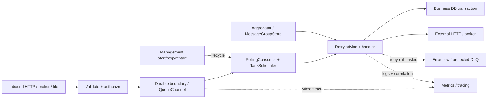
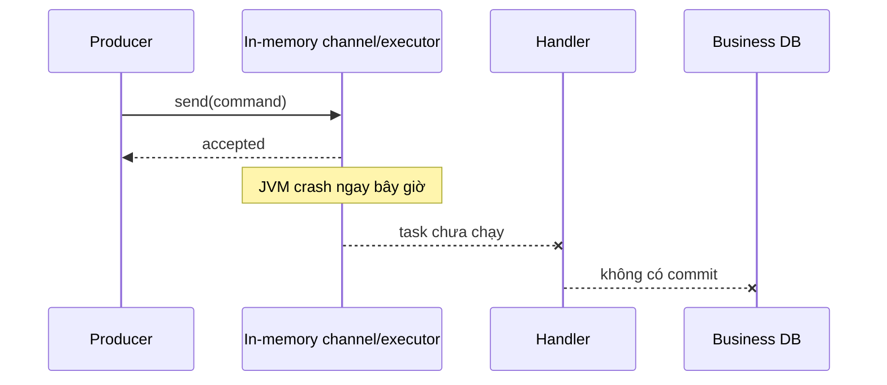
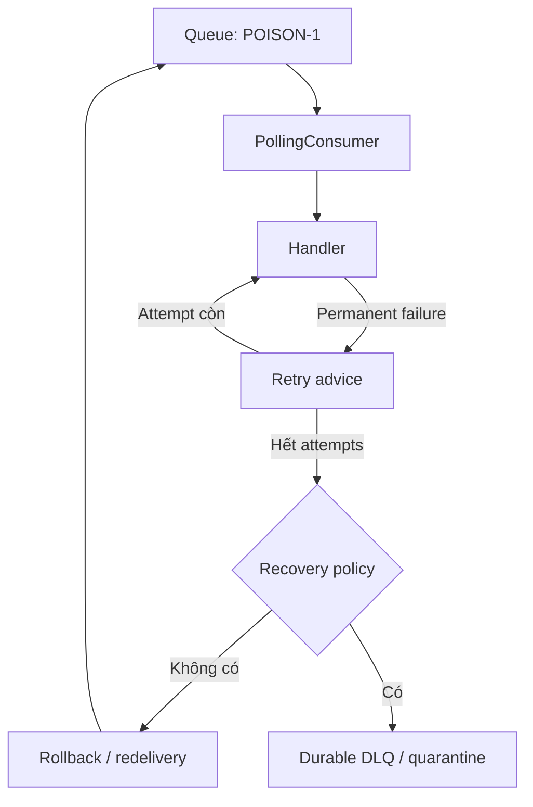
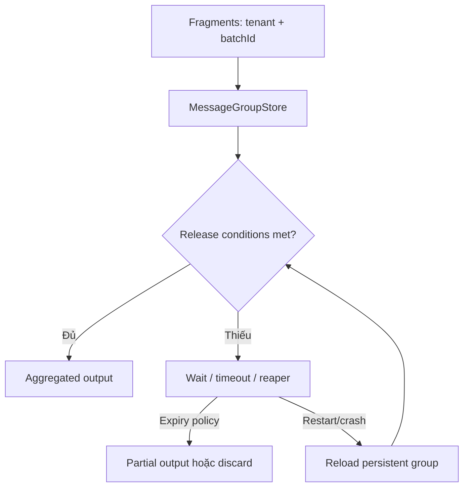
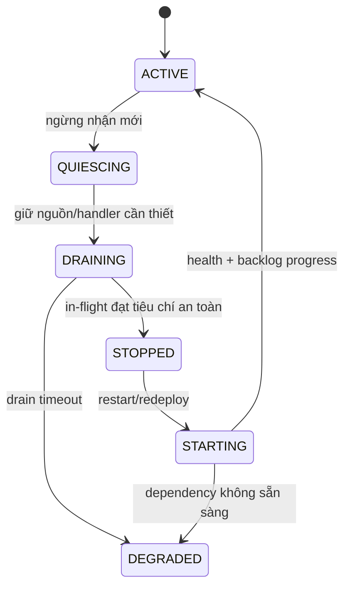
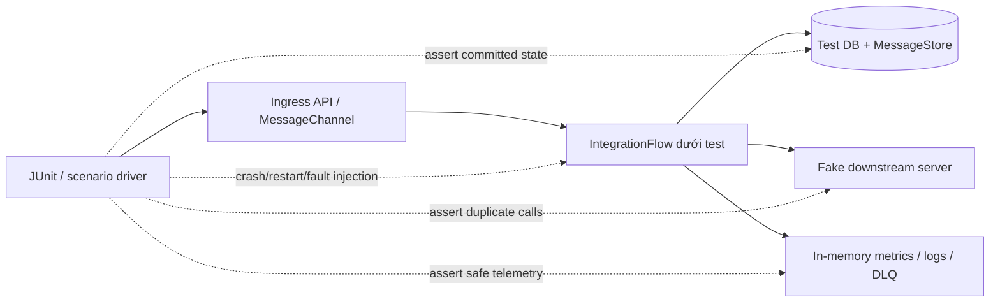

# Rà soát runtime failure mode trước production trong Spring Integration

## 1. Đưa một IntegrationFlow chạy được lên production vẫn chưa đủ

Một `IntegrationFlow` có thể chạy tốt trong môi trường phát triển: gửi message vào `DirectChannel`, handler xử lý, database trả lời thành công. Nhưng khi chạy production, hệ thống sẽ gặp những tình huống không nằm trong happy path:

- Producer gửi nhanh hơn consumer; queue hoặc executor backlog tăng tới mức hết bộ nhớ.
- Poller đã được start nhưng không được `TaskScheduler` cấp thread.
- HTTP downstream hoàn thành side effect rồi timeout trước khi gửi response; retry tạo giao dịch trùng.
- Worker chết giữa lúc đã lấy message khỏi persistent store và chưa commit.
- Một message lỗi vĩnh viễn bị rollback rồi chiếm đầu hàng đợi.
- Aggregator không nhận đủ fragment, group chờ mãi hoặc phát partial result sai.
- Flow được đăng ký động trong JVM cũ nhưng không được tái tạo sau restart.
- Một thay đổi cấu hình làm sai `region` của JDBC message store, khiến message cũ bị “mất tích”.
- `ErrorMessage` xuất hiện ở dedicated error channel, còn dashboard chỉ theo dõi global `errorChannel`.
- Log DEBUG hoặc DLQ vô tình lưu token, payload và header nhạy cảm.

Bài **“Rà soát runtime failure mode trước production”** thuộc chương **Thiết kế runtime**, module **SPRING_INTEGRATION_RUNTIME**, hướng dẫn thiết kế và thực hiện một đợt **pre-production runtime failure mode review**. Phạm vi bao gồm channel, endpoint, consumer, poller, executor, IntegrationFlow lifecycle, transaction, retry, message store, lỗi, correlation, threading, hiệu năng và trạng thái runtime.

Mục tiêu không phải viết danh sách rủi ro cho đẹp. Mỗi failure mode phải có **điều kiện gây lỗi → hậu quả → tín hiệu phát hiện → giới hạn thiệt hại → cách phục hồi → phép thử xác minh**.

> **Nguyên tắc phát hành:** Không được kết luận “message xử lý exactly once” chỉ vì có retry, persistent `QueueChannel` hoặc `JdbcMessageStore`. Phải định nghĩa cụ thể điều gì được xác nhận ở từng boundary và cách ngăn duplicate business side effects.

## 2. Đơn vị review: từ message ingress tới business outcome

Trước tiên, vẽ **runtime graph** thực tế, không chỉ dựa vào source code.



Đây là mô hình tham chiếu; ứng dụng có thể dùng `DirectChannel`, `ExecutorChannel`, `FluxMessageChannel`, JMS/Kafka adapter hoặc không cần aggregator. **Review phải ghi lại graph của ứng dụng cụ thể**: component IDs, channel types, input/output/error channels, transaction managers, store, executor, poller và các call ra ngoài.

Với mỗi mũi tên, hỏi:

1. **Ai sở hữu message tại thời điểm này?** Producer, channel, broker, DB queue, executor hay handler?
2. **Nó đã được lưu bền vững chưa?** Trong RAM, trên disk local, đã commit DB hay đã được broker xác nhận?
3. **Khi nào caller được báo thành công?** `send()` return, ack, commit hay business result?
4. **Khi JVM chết, message có quay lại không?** Ai chịu trách nhiệm redelivery?
5. **Nếu redelivery xảy ra, side effect có idempotent không?**
6. **Nếu có lỗi, lỗi đi đâu?** Caller, `ErrorMessage`, retry, recovery channel, DLQ hay log?
7. **Có dấu vết nào chứng minh quyết định?** Metrics, tracing, business audit, message store hoặc recovery record?

Bản review không được bỏ trống những câu hỏi này cho các bước xử lý có tác động nghiệp vụ.

## 3. Đặt SLO, RPO, RTO và hợp đồng delivery trước khi phân tích

Failure mode chỉ có ý nghĩa khi biết **hậu quả chấp nhận được tới đâu**.

| Thuộc tính | Câu hỏi bắt buộc | Ví dụ mục tiêu *minh họa* |
| --- | --- | --- |
| Business correctness | Đơn hàng có được xử lý trùng hay bỏ sót không? | Một `commandId` chỉ tạo một side effect đã commit |
| Availability | Bao lâu được phép ngừng nhận hoặc xử lý? | 99,9% cửa sổ dịch vụ theo SLO |
| End-to-end latency | Từ enqueue tới commit mất bao lâu? | p95 dưới 2 s, p99 dưới 10 s |
| Backlog tolerance | Queue được phép dồn bao nhiêu và bao lâu? | Oldest message age dưới 5 phút |
| RPO | Có được mất message đã xác nhận với client? | Không mất message đã durable-ack |
| RTO | Sau crash, mất bao lâu để flow phục hồi? | Phục hồi xử lý trong 10 phút |
| Failure isolation | Một tenant/downstream hỏng có làm các flow khác dừng không? | Không gây shared-pool starvation toàn hệ |
| Recovery | Message lỗi terminal có truy lại được không? | Có failure record và replay policy rõ |
| Security | Có được lộ payload/token qua telemetry không? | Không có credential ở logs/traces/tags |
| Cost/capacity | Hệ thống chịu tải tăng hoặc backlog replay thế nào? | Đạt traffic peak và có headroom được đo |

Những số trên **không phải mặc định của Spring Integration**. Dự án phải chọn SLO thật, dựa trên đặc điểm message, transport, nghiệp vụ và khả năng hạ tầng.

### Phải phân biệt các loại xác nhận

```text
REQUEST ACCEPTED  != MESSAGE PERSISTED
MESSAGE PERSISTED != HANDLER STARTED
HANDLER COMPLETED != BUSINESS COMMITTED
BUSINESS COMMITTED != EXTERNAL SIDE EFFECT CONFIRMED
EXTERNAL SUCCESS  != SOURCE ACK COMMITTED
```

Với một `ExecutorChannel`, `send() == true` có thể chỉ nghĩa task đã được dispatch/chấp nhận vào executor. Với `DirectChannel`, lời gọi đồng bộ có thể đi qua handler và ném exception về producer. Với broker, confirm/ack có phạm vi khác. Không dùng một biến `success` duy nhất cho tất cả các mốc.

## 4. Phương pháp review: FMEA thực dụng và release gate

**Failure Mode and Effects Analysis (FMEA)** có thể dùng làm khung phân tích. Với từng failure mode, ghi:

- **Component/boundary:** nơi sự cố xuất hiện.
- **Trigger:** crash, timeout, lỗi input, thread starvation, deploy, credential revoke, v.v.
- **Failure mode:** hành vi sai hoặc không tiến triển.
- **Effect:** mất message, duplicate, latency, sai tenant, lộ dữ liệu, dừng dịch vụ.
- **Detection:** metric, log an toàn, trace, DB audit, health, alert.
- **Prevention/containment:** bounded queue, timeout, transaction, idempotency, bulkhead.
- **Recovery:** retry, redelivery, replay, rollback, re-register flow, operator runbook.
- **Evidence:** test ID, kết quả fault injection, logs/metrics đã kiểm tra.
- **Owner:** người chịu trách nhiệm khắc phục và xác nhận.

Có thể chấm **Severity (S)**, **Likelihood (L)** và **Detectability (D)** từ 1 tới 5. Ví dụ `riskScore = S × L × D`, với D=5 nghĩa là rất khó phát hiện. Nhưng **không được để công thức che một nguy cơ mất tiền/lộ credential**: bất kỳ sự cố severity cao đều cần mitigation riêng, dù khả năng xảy ra thấp.

### Mẫu FMEA cho một flow thực tế

| Failure mode | Hậu quả | Phát hiện | Biện pháp chính | Fault test |
| --- | --- | --- | --- | --- |
| Producer được ack trước durable enqueue | Message mất khi crash | Ingress-vs-store count | Durable handoff trước ack | F-01 |
| Executor queue không giới hạn | OOM, dừng nhiều flow | Heap, queue depth, rejects | Bounded capacity, backpressure | F-02 |
| Poller bị scheduler starvation | Queue không giảm | Last poll age, thread dump | Tách scheduler/executor, timeout | F-03 |
| DB handler đã commit, nguồn chưa ack | Duplicate redelivery | Business ID audit | Idempotency key và unique constraint | F-04 |
| Poison message rollback mãi | Head-of-line blocking | Repeated attempts, oldest age | Retry budget + DLQ durable | F-05 |
| Aggregator thiếu fragment | Group giữ mãi | Group age, timeout | Expiry/partial policy/reaper | F-06 |
| Dynamic flow không được dựng lại | Backlog tồn nhưng không xử lý | Desired-vs-actual registry | Reconciliation khi startup | F-07 |
| JDBC store đổi region | Message cũ không được poll | Rows theo region vs receive | Migration/compatible identity | F-08 |
| Exception bị recovery nuốt | Transaction commit khi nghiệp vụ lỗi | Attempt-vs-outcome metric | Recovery/ack policy rõ | F-09 |
| Credential trong ErrorMessage | Rò dữ liệu ở logs/DLQ | Sentinel test | Safe envelope và protected original | F-10 |
| Cross-tenant correlation | Trộn fragments giữa khách hàng | Tenant-scoped group assertions | Trusted composite key | F-11 |
| Graceful shutdown không drain | Công việc dở dang/mất progress | In-flight/ack count | Quiesce, drain, redelivery | F-12 |

**Một bảng review chưa đủ để PASS.** Mỗi hàng phải nối được tới test hoặc tài liệu vận hành cụ thể. Failure mode chưa được giải quyết cần risk acceptance có owner, ngày hết hạn, guardrail và phương án rollback.

## 5. Vẽ ranh giới đồng bộ và bất đồng bộ

Điều đầu tiên để tránh suy luận sai về commit, exception và thread là phân loại channel.

| Channel | Ranh giới runtime | Hậu quả thường gặp khi crash/stop |
| --- | --- | --- |
| `DirectChannel` | Dispatch tới subscriber trong thread sender | Exception thường có thể quay về caller; không tự persist |
| `PublishSubscribeChannel` | Broadcast tới các subscribers (có thể đồng bộ hoặc qua executor) | Một subscriber lỗi hoặc chậm có thể ảnh hưởng fan-out theo cấu hình |
| `ExecutorChannel` | Dispatch qua `TaskExecutor`, đổi thread | Send accepted không bằng handler complete; task queue thường chỉ trong RAM |
| `QueueChannel` | `PollableChannel`, cần consumer gọi `receive()` | Queue mặc định trong RAM; muốn qua restart phải cấu hình store bền vững |
| `PriorityChannel` | Pollable theo priority | Starvation của priority thấp, ordering khác FIFO |
| `RendezvousChannel` | Handoff đồng bộ giữa sender/receiver | Sender có thể block khi không có receiver |
| `FluxMessageChannel` | Publisher/Subscriber theo Reactive Streams | Subscription/cancellation/backpressure, không tự durable |
| Broker-bound adapter | Ack/commit/offset riêng transport | Redelivery/ordering/retention phụ thuộc broker và adapter |

Không có channel nào tự động biến external HTTP call + database transaction + broker ack thành **một distributed transaction exactly-once**.

### Đồng bộ không đồng nghĩa an toàn

Một `DirectChannel` làm exception dễ propagate, nhưng nếu handler:

```text
DB commit → HTTP remote payment → throw → producer retry
```

thì producer có thể gửi lại sau một side effect đã xảy ra. Ngay cả trên **một thread**, correctness vẫn phụ thuộc ranh giới transaction và idempotency.

### Bất đồng bộ không đồng nghĩa nhanh hơn

`ExecutorChannel` có thể tăng concurrency, nhưng nếu downstream chỉ xử lý được 20 request/s còn producer tạo 200 request/s, task queue có thể phình to. Review phải đo **ingress, service rate, backlog, oldest age, rejected tasks và peak heap** theo cùng workload.

## 6. Failure mode: message loss giữa hai điểm durable

Xét flow:



Một producer đã thấy `send()` thành công nhưng task còn trong in-memory executor queue; process chết khiến task mất.

### Review đặt câu hỏi

- Client được báo `202 Accepted` ở đâu? Trước hay sau **durable persist**?
- Nếu inbound HTTP gateway chỉ dispatch vào `ExecutorChannel` rồi trả, có ai chịu trách nhiệm redelivery?
- Có inbox/outbox hoặc broker with confirm/ack cho command quan trọng?
- Message đã được serialize thành schema ổn định, có key để dedupe?
- Nếu persist thất bại, response/exception trả về producer có rõ ràng không?

### Một thiết kế bền vững hơn

```text
HTTP/API request
  → authorize + validate
  → transactional inbox insert(commandId unique)
  → COMMIT
  → return Accepted
  → poll/process inbox record
  → business commit
  → mark processed / outbox
```

Đây là **mô hình ứng dụng**, không phải tính năng tự tạo của `MessageChannel.send()`. Nếu dùng broker, cần xác định publisher confirm, durable queue, consumer ack và redelivery. Nếu dùng JDBC-backed `QueueChannel`, phải xác định transaction enqueue và điều kiện ack cho client.

**Fault injection F-01:** crash process ngay sau khi trả Accepted nhưng trước consumer chạy. Sau restart, command đã được xác nhận phải còn trong durable store và được xử lý hoặc có terminal failure record. Nếu không, chặn phát hành cho workflow có RPO không mất message.

## 7. Failure mode: poison message và retry storm

Một payload invalid có thể khiến handler ném exception **mọi lần**. Nếu poller dequeue trong transaction rồi rollback, message lại được nhận; vòng lặp gây CPU/log spike và cản message sau.



Review phải phân loại ít nhất:

- **Transient:** HTTP 503, DB unavailable, network timeout, rate-limit có giới hạn → retry/backoff có ngân sách.
- **Permanent:** schema invalid, unauthorized command, thiếu field bắt buộc, business rule vi phạm → reject/quarantine có audit.
- **Unknown outcome:** payment API timeout sau khi đã nhận request → cần query/reconciliation/idempotency, không retry mù.
- **Systemic outage:** downstream chết trên mọi message → circuit breaker/quiesce/limit retries, không tạo retry storm.

### Nhóm kiểm thử F-05

1. Enqueue một message hỏng đứng trước 20 messages hợp lệ.
2. Giới hạn số attempts và backoff/jitter.
3. Xác nhận POISON-1 không chạy vô hạn và không khóa toàn queue sau khi đã có recovery policy.
4. Cố tình làm DLQ writer thất bại: nếu nghiệp vụ đòi bảo toàn, **không** ack/dequeue message nguồn như thể recovery thành công.
5. Sau khi khôi phục DLQ, kiểm tra recovery record đã durable và message sau tiếp tục được xử lý.
6. Xác minh log không chứa raw payload/credentials.

**Bẫy Spring Integration:** `RequestHandlerRetryAdvice` với `RecoveryCallback` có thể **hấp thụ exception và trả bình thường**. Poller transaction bên ngoài có thể commit, dù business operation thất bại. Phải xác nhận rõ vị trí transaction advice, retry advice, recovery và ack.

## 8. Failure mode: transaction boundary bị cắt ở executor hoặc adapter

Trong Spring Integration, transaction thường gắn với một ranh giới cụ thể:

- Poller có transaction advice cho `receive()` + handler trên thread liên quan.
- `@Transactional` trên service method điều khiển DB operations trong phạm vi proxy.
- Broker listener/consumer có cơ chế ack/transaction riêng.
- Reactive transaction qua Reactor Context có semantics khác JDBC `ThreadLocal`.
- `ExecutorChannel` chuyển sang thread khác, không mặc định truyền JDBC transaction của thread cũ.

```text
Thread A: poller transaction starts
   receive() → send(ExecutorChannel) → returns
   transaction commits
                       |
                       v
Thread B: worker invokes handler
   business operation FAILS
```

Trong mô hình này, nếu dequeue đã commit trước khi handler B hoàn tất, việc rollback ở worker không tự phục hồi message nguồn.

### Quy tắc review

1. Vẽ **transaction begin/end** trên runtime graph, ghi rõ thread và resource.
2. Xác minh enqueue/dequeue, DB business updates, outbox và broker ack có tham gia transaction nào.
3. Nếu có bước không thể rollback (HTTP/email/payment), dùng idempotency/reconciliation/compensation.
4. Nếu advice recovery bắt lỗi, xác minh commit/rollback policy đối với từng outcome.
5. Đừng suy ra một `@Transactional` bao trùm mọi async downstream.
6. Fault injection đúng vị trí **sau external success, trước source ack**, bởi đây là cửa sổ dễ tạo duplicate.

**Không có bằng chứng về transaction boundary thì không được viết “exactly once” trong tài liệu thiết kế.**

## 9. Pattern inbox, outbox và idempotency cho side effect quan trọng

Một mô hình bền hơn cho business command:

```text
Producer → durable inbox(commandId)
                     |
                 worker/poller
                     |
                     v
            local DB transaction:
              - ensure UNIQUE(tenantId, commandId)
              - apply business state
              - create outbox event
              - mark command outcome
                     |
                  COMMIT
                     |
              outbox publisher
                     |
              broker / external API
```

Mục tiêu:

- **Inbox:** command có thể được xử lý lại mà không làm lại local DB side effect nếu ID đã hoàn tất.
- **Outbox:** business DB state và event dự định publish được lưu cùng local transaction, tránh DB commit thành công nhưng event mất.
- **Idempotent consumer/sink:** downstream dựa trên stable idempotency key để không tạo duplicate khi outbox publisher retry.
- **Reconciliation:** xử lý trường hợp external API timeout khi trạng thái remote chưa rõ.

### SQL minh họa

```sql
CREATE TABLE command_inbox (
    tenant_id       VARCHAR(100) NOT NULL,
    command_id      VARCHAR(100) NOT NULL,
    status          VARCHAR(20)  NOT NULL,
    payload_ref     VARCHAR(200) NOT NULL,
    created_at      TIMESTAMP    NOT NULL,
    updated_at      TIMESTAMP    NOT NULL,
    PRIMARY KEY (tenant_id, command_id)
);

CREATE TABLE business_outbox (
    event_id        VARCHAR(100) PRIMARY KEY,
    tenant_id       VARCHAR(100) NOT NULL,
    command_id      VARCHAR(100) NOT NULL,
    event_type      VARCHAR(100) NOT NULL,
    payload_ref     VARCHAR(200) NOT NULL,
    status          VARCHAR(20) NOT NULL,
    created_at      TIMESTAMP   NOT NULL
);
```

Đây là **schema ứng dụng minh họa**, không phải DDL do Spring Integration tự tạo. Một unique key không tự bảo vệ external side effects nếu code gọi API **trước khi claim/commit trạng thái**. Với nhiều workers, cần đảm bảo việc claim và cập nhật command outcome là atomic/transactional, không chỉ `SELECT` rồi `INSERT` rời rạc.

### Java service boundary minh họa

```java
import org.springframework.stereotype.Service;
import org.springframework.transaction.annotation.Transactional;

@Service
public class CommandCommitService {

    private final InboxRepository inbox;
    private final OrderRepository orders;
    private final OutboxRepository outbox;

    public CommandCommitService(
            InboxRepository inbox,
            OrderRepository orders,
            OutboxRepository outbox) {
        this.inbox = inbox;
        this.orders = orders;
        this.outbox = outbox;
    }

    @Transactional
    public void apply(OrderCommand command) {
        // Phải dùng atomic insert/claim dựa trên unique key.
        boolean claimed = inbox.insertIfAbsent(
                command.tenantId(), command.commandId());
        if (!claimed) {
            return; // Sau đó phải kiểm tra status/outcome theo policy.
        }

        orders.applyOrderState(command);
        outbox.insertEventFor(command);
        inbox.markCompleted(command.tenantId(), command.commandId());
    }
}
```

`InboxRepository`/`OrderRepository`/`OutboxRepository` và `OrderCommand` là các kiểu do ứng dụng cung cấp, không phải API Spring Integration. Ví dụ giả định **cùng một DB transaction manager** và rollback đầy đủ nếu lỗi. Với duplicate request đến khi command cũ còn `IN_PROGRESS`, thực tế phải có state machine, timeout/lease/fencing, xử lý duplicate outcome thay vì trả thành công tùy tiện.

## 10. Failure mode: restart làm mất queue hoặc trạng thái correlation

`QueueChannel` mặc định sử dụng store trong bộ nhớ. `ExecutorChannel` và `FluxMessageChannel` cũng không phải durable queue. Khi process chết, một số message chờ xử lý có thể mất.

### State cần kiểm kê

| State | Ví dụ | Nếu mất sau restart | Cơ chế bảo vệ |
| --- | --- | --- | --- |
| Pending message | `QueueChannel` backlog | Không còn việc để poll | `JdbcChannelMessageStore` hoặc broker durable |
| Correlation group | Aggregator đang giữ 3/5 fragments | Không release/khó replay | Persistent `MessageGroupStore` |
| Idempotency marker | Processed command/file | Duplicate sau replay | `ConcurrentMetadataStore` persistent/DB unique |
| Retry delay | Timer/`RetryContext` trong RAM | Retry job bị mất hoặc chạy lại sai lịch | Durable retry queue/scheduler |
| In-flight worker | Task đang chạy ở executor | Unknown outcome | Source redelivery + idempotency |
| Dynamic flow registration | Bean/endpoint mới đăng ký trong JVM | Source còn dữ liệu nhưng flow biến mất | Desired config + startup reconciliation |
| Authentication context | Request principal trong ThreadLocal | Không hợp lệ sau restart | Trusted service identity và policy revalidation |
| Metrics counters | In-memory Micrometer registry | Counter reset khi process thay | Time-series backend + audit/source of truth |

**Persistent `MessageStore` không tự tạo lại một flow.** Cần có endpoint/poller consumer trỏ đúng store sau restart. Nếu flow được đăng ký động, phải dựng lại từ desired configuration.

### Fault injection F-07/F-08

1. Dừng consumer rồi enqueue message đã commit.
2. Restart ứng dụng, giữ đúng datasource, schema, region, channel name, serializer và flow ID.
3. Xác minh đúng consumer start, backlog được đọc và commit theo policy.
4. Đổi `region` **chỉ trong staging** để chứng minh message cũ còn trong DB nhưng consumer không thấy.
5. Khôi phục identity/migration strategy, không xóa record để “dọn backlog”.
6. Kiểm thử rolling deployment hai phiên bản cùng đọc store trước khi cho production coexist.

## 11. JDBC-backed QueueChannel: chốt thiết kế trước production

Với Spring Integration JDBC, `JdbcChannelMessageStore` dùng cho persistent `QueueChannel`. Một ví dụ XML (trích đoạn trong application context có namespaces phù hợp):

```xml
<bean id="ordersChannelStore"
      class="org.springframework.integration.jdbc.store.JdbcChannelMessageStore">
    <constructor-arg ref="dataSource"/>
    <property name="region" value="ORDERS_V1"/>
</bean>

<int:channel id="ordersQueue">
    <int:queue message-store="ordersChannelStore"/>
</int:channel>

<int:service-activator id="ordersWorker"
                       input-channel="ordersQueue"
                       ref="orderHandler"
                       method="handle">
    <int:poller fixed-delay="500"
                max-messages-per-poll="10"
                receive-timeout="100">
        <int:transactional transaction-manager="transactionManager"/>
    </int:poller>
</int:service-activator>
```

Cấu hình này đòi hỏi dependency `spring-integration-jdbc`, schema và datasource tương thích, transaction manager và bean `orderHandler`. Với database khác nhau cần query provider/dialect, indexes và locking phù hợp. Đây là khung triển khai, **không phải bằng chứng một queue bảo đảm exactly-once**.

### Review bắt buộc kiểm tra

- Schema/tables/indexes đã migrate **trước** khi endpoint start.
- Region, channel name, table prefix không đổi ngoài kế hoạch migration.
- Serializer tương thích khi rolling deploy; một record từ phiên bản A có được phiên bản B đọc không?
- Transaction của dequeue và handler đúng phạm vi; không bị cắt khi gửi sang executor.
- Connection pool chịu được số pollers, số workers và reconnect storm.
- Có dashboard backlog age, dequeue errors, DB lock waits, deadlocks và failed deserialization.
- Có test kill -9/force terminate process đúng crash windows.
- Không dùng SQL `DELETE` hoặc gọi `queue.receive()` chỉ để “nhìn” một message ở production.

**Tính bền vững của enqueue chỉ có ý nghĩa sau commit.** Một lời gọi send thành công trước khi transaction producer commit chưa phải durable acknowledgment cuối cùng.

## 12. Failure mode: poller running nhưng không poll được

Một poller không tiến triển có thể do:

1. Endpoint bean chưa được tạo vì `@MessageEndpoint` không được component scan.
2. `autoStartup=false` hoặc Control Bus/JMX đã stop endpoint.
3. `Trigger` bị cấu hình sai: `fixedDelay` quá dài, cron/timezone bất ngờ.
4. `TaskScheduler` không có thread vì các poller khác block ở `receiveTimeout`/JDBC/HTTP.
5. `TaskExecutor` bão hòa hoặc reject.
6. Consumer poll đúng queue nhưng DB region khác hoặc connection bị khóa.
7. `receive()` trả message, handler ném lỗi rồi transaction rollback, khiến backlog không giảm.
8. Competing consumers ở node khác nhận trước.
9. Source adapter không fetch vì accept-once metadata/checkpoint/filter.
10. Dashboard đo nhầm queue, nhầm instance hoặc thiếu fresh scrape.

### Phân loại failure đúng

| Tình huống | Poll triggered? | Receive có message? | Handler started? |
| --- | --- | --- | --- |
| Endpoint stopped | Không | Không | Không |
| Scheduler starvation | Không | Không | Không |
| Wrong region/empty queue | Có | Không | Không |
| Deserialize/DB error | Có | Exception | Không |
| Poison/rollback | Có | Có | Có và thất bại |
| Handler blocked | Có | Có | Có nhưng chưa hoàn tất |
| Consumer khác đã lấy | Có thể có | Có thể null | Có thể ở node khác |

**Stop/start có thể giải phóng sự cố tạm thời nhưng xóa bằng chứng.** Trước khi restart poller, chụp thread dump, metrics, scheduler pool state, last poll timestamp và DB lock stats nếu điều kiện vận hành cho phép.

### Cấu hình scheduler và capacity

Một `PollingConsumer` với `maxMessagesPerPoll=-1` có thể xử lý liên tục cho tới khi `receive()` trả `null`. Nếu queue luôn có message, một lượt poll có thể kéo dài. Chọn giới hạn dương và thread budget theo workload. Nếu tách qua `TaskExecutor`, **đánh giá lại transaction boundary** vì worker thread có thể không cùng transaction của scheduler.

## 13. Failure mode: producer nhanh hơn consumer

Không nên xem backlog tăng là lỗi riêng của channel. Đó có thể là **mất cân bằng tải**.

```text
ingress_rate           = 200 messages/s
business_commit_rate   = 80 messages/s
backlog_growth         ≈ 120 messages/s
```

Sau 10 phút, backlog tăng thêm khoảng 72.000 messages nếu không có shedding, throttling hoặc scale. Nếu average payload 64 KiB, riêng encoded payload tăng khoảng 4,4 GiB, chưa tính headers, object overhead và copies. Một in-memory queue có thể OOM trước khi alert phát ra.

### Năm câu hỏi capacity

1. `QueueChannel` có bounded capacity **theo số message** hay không? Nếu payload lớn, có byte budget?
2. Executor queue có giới hạn, rejection policy và alert không?
3. Có load shedding/backpressure/rate limiting **ở producer** trước khi queue tràn không?
4. Có bulkhead theo tenant/downstream để một flow nghẽn không chiếm toàn bộ scheduler/executor?
5. Nếu backlog tăng 10 lần, hệ thống phải tự hồi phục hay cần operator action?

### Khi chọn tăng concurrency

- Handler có CPU-bound, I/O-bound hay bị DB lock?
- Tăng pollers/threads có làm mất ordering hoặc tạo duplicate khi redelivery?
- Database connection pool, remote API rate limit và message store locks có chịu tải?
- Với aggregation, cùng correlation key có thể tuần tự hóa qua lock; nhiều workers không tăng throughput tuyến tính.
- Thêm reactive `flatMap(concurrency)` có thể làm reorder output; dùng `concatMap`/resequencer khi cần.

**Fault test F-02:** phát burst 5–10 lần peak, giữ downstream chậm, đo peak heap, queue age, rejected requests và khả năng giảm backlog sau khi phục hồi. Điều kiện PASS phải gắn với SLO và **không OOM**, không silently drop work cần durable.

## 14. Failure mode: cancellation, async error và reactive backpressure

`FluxMessageChannel` thực hiện mô hình `Publisher<Message<?>>` cho downstream subscribers. Nhưng một flow có channel reactive **không tự đảm bảo non-blocking, replay hoặc durability**.

Các failure modes:

- Chưa có subscriber hoặc subscriber đã cancel → message từ hot producer có thể không được nhận theo kỳ vọng.
- Imperative `send()` push nhanh mà downstream thiếu demand → buffering/overflow hoặc memory pressure ở các boundary.
- `onError` không được recover → một subscription có thể terminate, dừng cả stream.
- `retryWhen` đặt trên nguồn thay vì per-item → resubscribe và phát lại nhiều item từ cold publisher.
- Blocking JDBC/HTTP trên event-loop → delay/cancellation và thiếu capacity.
- `publishOn`/`subscribeOn` chuyển thread → JDBC transaction ThreadLocal không tự propagate.

### Test thiết yếu

1. Không có subscriber: producer được phép phát không? Có durable handoff ở đâu?
2. Subscriber cancel giữa batch: items chưa commit được xử lý lại theo chính sách nào?
3. Một item lỗi: recovery chỉ dành cho item đó hay terminate toàn stream?
4. Nguồn cold replay khi resubscribe: business idempotency có chặn side effect trùng?
5. Downstream chậm 100 lần: memory/queue limit và demand có hoạt động?
6. Block API: đã cách ly bằng scheduler phù hợp và concurrency budget chưa?

**Đặt `FluxMessageChannel` giữa hai handler blocking không chuyển toàn bộ flow thành reactive.** Cần đo thread names, saturation, queue wait và terminal errors.

## 15. Failure mode: correlation, group release và late arrivals

Aggregator/resequencer chứa các trạng thái quan trọng:

- `correlationId` xác định group; nếu ID do client điều khiển có thể trộn các tenant.
- `sequenceNumber` và `sequenceSize` quyết định group có đủ phần và đúng thứ tự không.
- `ReleaseStrategy` có thể release sớm, muộn hoặc không bao giờ.
- `MessageGroupStore` in-memory có thể mất fragment khi restart.
- `groupTimeout`/reaper/expiry có thể phát partial hoặc discard; behavior tùy cấu hình.
- Nhiều threads/instances cùng sửa group cần locking nhất quán, thường qua `LockRegistry` phù hợp.
- Group completed metadata có thể giữ lại để xử lý late arrivals; dọn quá sớm có thể tạo group mới sai.



### Review bằng ma trận bất biến

| Invariant | Test phá vỡ | PASS khi |
| --- | --- | --- |
| Không trộn tenant | Tenant A/B gửi cùng client correlation ID | Group key có trusted tenant component |
| Không double release | Hai fragment cuối tới đồng thời | Một business output/commit hợp lệ |
| Không chờ vô hạn | Thiếu fragment cuối | Timeout/recovery/alert theo policy |
| Không release sai | Duplicate fragment làm tăng group.size | Dedup hoặc validate unique sequence |
| Không mất group qua restart | Kill process giữa 3/5 fragments | Persistent store khôi phục hoặc durable replay |
| Không mất late arrival | Fragment đến sau expiry | Discard/recovery hoặc group mới theo quy định |
| Không gây deadlock | Group update + send downstream | Lock lifetime/handler threading được kiểm thử |

**Một `group.size() == sequenceSize` chưa chắc chứng minh đủ các fragment duy nhất** nếu message trùng sequence. Review phải xác định uniqueness, ordering, timeout và transaction output theo đúng nghiệp vụ.

## 16. Failure mode: MetadataStore/idempotent receiver bị race hoặc kẹt

`ConcurrentMetadataStore.putIfAbsent(key,value)` có thể dùng để claim một key nguyên tử. Nhưng một claim atomic **không** tự bảo đảm business side effect exactly once.

Ví dụ:

```text
Worker A: putIfAbsent("CMD-42", "IN_PROGRESS") → winner
Worker A: crash trước business commit
Worker B: putIfAbsent("CMD-42", "IN_PROGRESS") → loser mãi
```

Nếu có claim “đã xử lý” được ghi trước khi nghiệp vụ commit, message có thể bị **bỏ sót vĩnh viễn**. Nếu xóa claim không có điều kiện, worker cũ có thể xóa lease của worker mới.

### Review check

- Dedupe key dựa trên **stable business identity**, không phải `MessageHeaders.ID` dễ thay đổi khi replay.
- Claim/complete state có `IN_PROGRESS`, `COMPLETED`, lease/expiry và crash recovery khi phù hợp.
- Cập nhật claim theo compare-and-set/owner-version, tránh stale worker cleanup.
- Với nhiều app instances, store phải chia sẻ và có atomicity đúng phạm vi (JDBC/Redis cấu hình đúng).
- Store key có tenant namespace và không chứa PII/credential thô.
- Idempotency state và business DB commit được phối hợp thế nào? Nếu khác resource, có chiến lược reconciliation?
- Replay có tạo lại cùng command ID và giữ được nguyên outcome đã commit không?

**Lỗi quan trọng:** dùng `get()` rồi `put()` để chống duplicate là check-then-act, không nguyên tử trước hai threads. Dùng atomic operation đúng với store/backend, kết hợp unique DB constraints và test concurrent.

## 17. Failure mode: ordering bị phá vỡ

Một queue FIFO không bảo đảm business processing hoàn tất theo thứ tự nếu:

- Có nhiều concurrent pollers/consumers.
- `ExecutorChannel` dispatch song song.
- Reactive `flatMap` hoàn tất không theo thứ tự.
- Retry một message lâu trong khi message sau đi tiếp.
- Broker có partition/concurrency và rebalance.
- Message bị re-deliver sau transaction rollback.
- Một aggregator/resequencer không nhận đủ sequence headers.

Ví dụ:

```text
Event v1: balance=100
Event v2: balance=200

Worker 1 nhận v1, chậm 3 giây
Worker 2 nhận v2, commit trước
Worker 1 commit sau → state về 100 (sai)
```

### Cách bảo vệ

- Nếu sự kiện là **state versioned**, dùng optimistic locking/compare-and-set theo `version`.
- Nếu cần strict ordering theo key, partition theo business key và chỉ xử lý tuần tự trong từng partition.
- Nếu cần resequencing, bảo đảm correlation/sequence headers, timeout và store đúng.
- Nếu không cần thứ tự, thiết kế handler commutative/idempotent để tăng concurrency an toàn.
- Thử re-delivery out-of-order và duplicate, không chỉ thứ tự lý tưởng.

**Fault test:** cố tình delay event v1 và cho v2 chạy trước. PASS khi DB không bị ghi đè về version cũ hoặc có reconciliation rõ ràng.

## 18. Failure mode: lỗi bị nuốt, gửi sai error channel hoặc mất recovery

Spring Integration dùng `ErrorMessage` và `errorChannel` cho nhiều boundary bất đồng bộ, nhưng **không phải mọi exception đều đến global `errorChannel`**.

| Điểm lỗi | Cách lỗi có thể xuất hiện | Đường kiểm tra |
| --- | --- | --- |
| Handler sau `DirectChannel` | Exception propagate về sender | Caller error/transaction outcome |
| Handler sau `ExecutorChannel` | Error publisher trên worker, `ErrorMessage` | Header `errorChannel`/global/dedicated channel |
| `PollingConsumer` | Poller error handler, transaction rollback | Poller advice, logs, DLQ |
| `RequestHandlerRetryAdvice` | Retry rồi recovery callback | Recovery channel và terminal status |
| Reactive stream | Reactor `onError` terminal/recovery operator | Subscriber `onError`/`onErrorResume` |
| Converter trước handler | Deserialization/type conversion exception | Error handler ở adapter/endpoint |
| Aggregator expiry | Partial/discard/group expiry | Discard/recovery handler, group store |

### Bẫy “log rồi thành công”

```text
try {
  handle(message);
} catch (Exception ex) {
  log.error("Failure ...");
  // return normally
}
```

Khi exception bị catch và không được propagate/recover bền vững, outer poller có thể commit dequeue. Message **biến mất khỏi queue** dù nghiệp vụ không hoàn thành. Chỉ log không phải một retry policy.

Review phải yêu cầu **terminal outcome taxonomy**:

- `BUSINESS_COMMITTED`: side effect nghiệp vụ đã được xác nhận.
- `RETRY_SCHEDULED`: còn nguồn durable để retry.
- `REJECTED_PERMANENT`: từ chối có audit, không được retry vô hạn.
- `FAILED_QUARANTINED`: failure record bền vững và replay policy.
- `UNKNOWN_REMOTE_OUTCOME`: chờ reconciliation.
- `DEAD_LETTER_PERSIST_FAILED`: recovery thất bại, không ack sai.

Đối với mỗi terminal state, xác định ai cập nhật metric/audit, khi nào source ack/commit và cách operator phục hồi.

## 19. Failure mode: graceful shutdown, rolling restart và management race

Khi deploy phiên bản mới, orchestration có thể yêu cầu dừng app trong thời gian ngắn. Nhưng:

- `SmartLifecycle.stop()` không tự đảm bảo mọi task đã submit vào executor hoàn tất.
- `QueueChannel` in-memory có thể giữ pending work mất khi JVM terminate.
- Message đang xử lý ở external API có thể đã commit một phần.
- Dynamic `IntegrationFlowRegistration` có thể bị destroy trước khi worker hoàn tất.
- Listener broker stop có thể trigger redelivery/rebalance.
- Hai management commands `start`/`stop` cùng lúc có thể để endpoint ở trạng thái bất ngờ.

### Quy trình quiesce/drain có kiểm chứng



Đây là **state machine vận hành của ứng dụng**, không phải enum bắt buộc của Spring Integration.

### Câu hỏi review

1. K8s/VM gửi shutdown signal; endpoint nào stop trước?
2. Có readiness probe chuyển về false để chặn traffic mới không?
3. Poller/source ngừng nhận khi nào; executor có được drain tới ngưỡng hợp lý không?
4. Nếu timeout drain hết, phần chưa hoàn thành được redeliver bằng cơ chế nào?
5. Có business idempotency key cho các command đã thực hiện một phần?
6. Khi startup, dynamic flows được dựng lại, persistent queue được nối đúng và schema migration đã hoàn tất?
7. Một instance cũ và mới cùng chạy trong rolling deploy có thể đồng thời đọc store/broker không?
8. Ai bảo đảm không có hai owner cho một external listener hoặc scheduled job cần singleton?

**Không gọi stop–start rồi coi như toàn bộ process được restart.** Đối với lỗi cấu hình bean, thay secret hoặc serializer, có thể cần recreate flow/bean hoặc process mới. Những thay đổi đó phải có migration và rollback.

## 20. Dynamic runtime: ID, ownership và desired-state reconciliation

`IntegrationFlowContext` hỗ trợ đăng ký `IntegrationFlow` trong ứng dụng đang chạy, ví dụ `registration(flow).id(flowId).useFlowIdAsPrefix().register()`. Review cần chú ý:

- Flow ID/endpoint IDs có duy nhất, ổn định và không nhúng secret/PII?
- `autoStartup(false)` có thể khiến flow tồn tại nhưng consumer không chạy.
- Một channel shared có bị destroy khi tenant flow bị xóa không?
- Có hot swap v1/v2 và drain thay vì thay đột ngột cùng ID?
- Hai admin requests đồng thời đăng ký cùng ID có được serialize/versioned?
- Desired flow configuration được persist ở đâu? JVM restart không tự khôi phục registration động.
- Flow mới có áp dụng security channel interceptors/management/metrics đúng scope?
- Sau startup, desired state và actual registry có được reconcile và alert khi lệch?

### Ví dụ kiểm tra registry runtime

```java
import java.util.Set;
import org.springframework.integration.dsl.context.IntegrationFlowContext;

public Set<String> registeredFlowIds(IntegrationFlowContext context) {
    return Set.copyOf(context.getRegistry().keySet());
}
```

Registry này chỉ là **snapshot trong JVM**, không phải source of truth bền vững. Test restart phải kiểm tra **flow được dựng lại từ config** và backlog cũ được tiếp tục xử lý.

Nếu flow dùng support beans `.addBean(...)`, kiểm tra ownership: một shared connection factory hoặc scheduler không được destroy cùng một tenant flow nếu tenant khác còn dùng.

## 21. Security failure mode là một phần của runtime review

Một flow có thể đúng về throughput và persistence nhưng sai về bảo mật:

- Client giả mạo `role`/`tenantId` header và được tin như principal.
- Một `ExecutorChannel` giữ `SecurityContextHolder` của worker task trước.
- Replay job từ DLQ được phép vượt quyền tenant.
- Error handler log `MessagingException.getFailedMessage()` chứa token.
- Dynamic flow tạo channel ngoài security interceptor pattern.
- Control Bus/JMX/Actuator management mở ra Internet.
- Aggregator trộn fragments của hai tenants có cùng raw `correlationId`.
- MessageStore persist raw bearer token không cần thiết.

### Mẫu bất biến kiểm thử

```text
DENIED_COMMAND:
  business DB writes = 0
  external API calls = 0
  outbox events = 0
  unauthorized queue/routing sends = 0

DATA_LEAK_TEST:
  sentinel secrets in logs/traces/tags/visible DLQ = 0

REPLAY_TEST:
  authorized actor + trusted tenant scope
  stable business idempotency key
  no reuse of expired inbound bearer token
```

Dùng synthetic credential/PII **chỉ dành cho test**, không đưa production secrets vào fixture. Khi original command bắt buộc được lưu để replay, kiểm tra ACL/encryption/retention thay vì yêu cầu payload gốc phải biến mất khỏi mọi durable store.

## 22. Observability: một failure mode không có tín hiệu là một rủi ro riêng

Một hệ thống chỉ có DEBUG logs khó phát hiện độ lệch toàn cục; một hệ thống chỉ có metrics lại khó điều tra một command cụ thể.

### Năm nhóm tín hiệu phải có

| Nhóm | Thước đo | Mục đích |
| --- | --- | --- |
| **Ingress** | Accepted/validated/durable-persisted rate | Phân biệt dispatch với durable ack |
| **Processing** | Handler starts, successes, errors, retries, duration p95/p99 | Tìm latency/attempt storms |
| **Backlog** | Queue depth, oldest age, active in-flight, poll last success | Tìm stuck messages và scheduler failure |
| **Terminal outcome** | Business commits, permanent rejects, DLQ commits, unknown outcomes | SLO nghiệp vụ chứ không phải chỉ channel sends |
| **Runtime health** | Scheduler/executor active/rejected, DB pool/locks, flow running, memory/GC | Tìm saturation và lifecycle drift |

Spring Integration có Micrometer meters như `spring.integration.send`/`spring.integration.receive` cho các component phù hợp, và Micrometer Observation có `spring.integration.handler`/`spring.integration.producer`/`spring.integration.gateway` khi bật theo phiên bản/cấu hình. **Không cộng tất cả send/handler counts để ra số business commands**, vì một message đi qua nhiều channel và retry nhiều attempts.

### Log, trace và correlation

- `MessageHeaders.ID`: ID của một Spring Message, có thể thay khi rebuild/replay.
- `correlationId`: group/flow relationship, phải rõ scope.
- `commandId`/business key: ID ổn định cho idempotency.
- `traceId`: truy vấn distributed span khi telemetry được propagate/sampled.
- `attempt`: số lần thử ở đúng retry boundary.

Không đặt `commandId`, email, access token hoặc `correlationId` vào metric tags high-cardinality. Với structured logs, ghi safe metadata và error category; đừng log raw `Message`/`ErrorMessage`/`Throwable` nếu chúng có thể chứa payload hoặc credentials.

### Alert phải gắn với hành động

```text
Alert: queue_oldest_age > SLO for 5m
Runbook:
  1. Which channel/region/node?
  2. Consumer running? Last poll?
  3. Scheduler/executor capacity?
  4. Receive error, rollback, poison, wrong region?
  5. Can we quiesce or restart safely?
  6. Is replay idempotent?
```

Một alert `queue_depth > 1000` không phân biệt traffic surge hợp lệ với stuck consumer; cần kết hợp backlog **age**, ingress/commit rate và error rate.

## 23. FMEA theo từng boundary: câu hỏi không thể bỏ qua

### 23.1. Ingress/adapter

- Token sai/hết hạn, tenant claim giả mạo → deny trước durable acceptance.
- Request vượt kích thước → reject có giới hạn; không OOM.
- Broker message deserialize lỗi → quarantine và không lặp vô hạn.
- Source polling filter/checkpoint ghi marker trước xử lý → có thể skip mãi sau crash.
- File đang được producer ghi dở → file lock/ready signal, checksum và idempotency.
- HTTP `202` trả trước enqueue commit → nguy cơ mất message.

### 23.2. Channel

- `DirectChannel` không subscriber → dispatch failure.
- `ExecutorChannel` queue đầy hoặc worker chết → reject hoặc lost in-memory task.
- `QueueChannel` memory chưa persist → mất backlog khi restart.
- Channel capacity là count không phải bytes → payload lớn gây OOM.
- `PublishSubscribeChannel` một nhánh lỗi → tác động các subscribers theo config.
- `FluxMessageChannel` no subscriber/cancel → hot messages không replay.

### 23.3. Consumer/poller/executor

- `autoStartup=false`/operator stop → backlog đứng.
- Cron/fixedDelay/timezone sai → scheduling thiếu.
- `receiveTimeout` dài và scheduler pool nhỏ → starvation.
- Executor saturation/reject → handler không chạy.
- Handler blocking không timeout → giữ thread/DB connection.
- Transaction bị cắt qua async boundary → ack/dequeue quá sớm.

### 23.4. State, correlation và persistence

- JDBC region/channel name/schema/provider sai → dữ liệu nằm trong DB nhưng worker không thấy.
- Serializer incompatibility → message cũ không đọc được.
- Metadata claim kẹt sau crash → bỏ sót hoặc duplicate.
- Group thiếu sequence/release không bao giờ → backlog nhóm tích lũy.
- Distributed lock thiếu hoặc lease stale → double release.
- TTL/reaper dọn group/metadata quá sớm → mất correlation/dedupe.

### 23.5. Outbound/side effect

- Remote timeout sau commit → unknown outcome.
- Batch partial success → retry cả batch tạo duplicate.
- HTTP 429/retry storm → vượt rate limit.
- Database deadlock/unique conflict → transaction rollback và redelivery.
- Outbox publisher crash sau publish trước mark-sent → publish lại.
- External API không hỗ trợ idempotency → cần reconciliation/compensation hoặc chấp nhận rủi ro có kiểm soát.

### 23.6. Error, control và security

- Error chỉ được log rồi return → message nguồn bị ack sai.
- Recovery sink lỗi nhưng code vẫn nuốt exception → mất failure record.
- ErrorMessage chứa failedMessage và token → lộ dữ liệu.
- Control Bus command không được RBAC → endpoint bị stop trái phép.
- Dynamic flow mới không được gắn security interceptor → bypass policy.
- Principal/MDC không cleanup sau worker exception → cross-tenant data leak.

## 24. Xây test harness: kiểm thử outcome thay vì chỉ nhìn log

Một integration test cho failure modes phải có cách quan sát **business outcome**. Ví dụ dùng fake remote API, real DB test container và một hàng đợi persistent phù hợp:



### Mẫu điều kiện PASS

```text
Given:  1 accepted command with stable commandId
When:   worker crashes after external success, before source ack
Then:
   - durable work is not silently lost
   - business effect occurs no more than once
   - retry/replay outcome is observable
   - a terminal failure is not counted as business success
   - no secret appears in logs/traces/metrics
```

**Test phải có timeout** để phát hiện message kẹt. Không dựa vào `Thread.sleep(100)` rồi assert ngay trong async flow; dùng `Awaitility`, `CountDownLatch`, test-probe hoặc event recorder phù hợp.

## 25. Java: ví dụ test sự kiện async không assert quá sớm

Đây là một **sườn integration test** giả định ứng dụng đã có bean input, một repository và flow đang chạy.

```java
import static org.junit.jupiter.api.Assertions.assertEquals;
import static org.awaitility.Awaitility.await;

import java.time.Duration;

import org.junit.jupiter.api.Test;
import org.springframework.beans.factory.annotation.Autowired;
import org.springframework.beans.factory.annotation.Qualifier;
import org.springframework.messaging.MessageChannel;
import org.springframework.messaging.support.MessageBuilder;

class OrdersRuntimeIntegrationTest {

    @Autowired
    @Qualifier("ordersIn")
    MessageChannel ordersIn;

    @Autowired
    BusinessOutcomeRepository outcomes;

    @Test
    void messageEventuallyCommits() {
        String commandId = "CMD-42";

        ordersIn.send(MessageBuilder.withPayload(
                new OrderCommand("tenant-A", commandId)).build());

        // Async consumer có thể xử lý sau khi send() trở về.
        await().atMost(Duration.ofSeconds(10))
                .untilAsserted(() ->
                        assertEquals(1,
                                outcomes.countCommitted(
                                        "tenant-A", commandId)));
    }
}
```

`OrderCommand`/`BusinessOutcomeRepository` là các kiểu ứng dụng và `Awaitility` là dependency kiểm thử bổ sung. Đây chưa phải test đầy đủ về duplicate: để chứng minh idempotency, phải gửi **cùng command ID nhiều lần**, cố tình crash ở đúng ranh giới, rồi xác minh business effect và outbox event **không được nhân bản**.

### Ví dụ assertion theo outcome

```text
assert committed_by_command(tenant, commandId) == 1
assert duplicate_external_side_effects(commandId) == 0
assert pending_or_terminal_record_exists_for_every_accepted_command()
assert queue_backlog_oldest_age_below_SLO_after_recovery()
```

Đây là pseudocode kiểm định theo nghiệp vụ, không phải hàm có sẵn của Spring Integration.

## 26. Fault injection: vị trí nên chủ động làm hỏng

Một bài test tốt đặt lỗi **đúng cửa sổ state transition**. Chạy lần lượt:

| Test ID | Điểm làm hỏng | Điều kiện PASS |
| --- | --- | --- |
| F-01 | Sau Accepted, trước handler | Accepted command vẫn durable sau restart |
| F-02 | Executor/queue bị burst 10x | Không OOM, có reject/backpressure hoặc durable backlog |
| F-03 | Toàn `TaskScheduler` bận | Alert last-poll/oldest-age; phục hồi có kiểm soát |
| F-04 | External success, trước ack | Không double business side effect khi redelivery |
| F-05 | Poison payload | Bounded attempts; quarantine durable; message khác tiếp tục |
| F-06 | Aggregator thiếu fragment cuối | Timeout/expiry/recovery đúng policy |
| F-07 | Crash khi dynamic flow đang active | Startup reconciles flow, resume backlog |
| F-08 | Đổi region/schema/serializer | Test phát hiện mismatch trước rollout |
| F-09 | RecoveryCallback return sau business error | Outcome không bị báo sai/ack sai |
| F-10 | Exception chứa test token | Không lộ sentinel trong logs/traces/visible DLQ |
| F-11 | Cross-tenant same correlation ID | Không trộn fragments/side effects |
| F-12 | Stop giữa handler in-flight | Drain hoặc redelivery + idempotency |
| F-13 | DB pool exhausted/locks | Timeout, alert, không mất queue state |
| F-14 | Outbox publisher crash sau publish | Downstream dedup và trạng thái cuối nhất quán |
| F-15 | Hai admin start/stop cùng endpoint | Desired/actual state được reconcile |
| F-16 | Principal bị revoke trong queue | Kết quả theo policy authorization đã chọn |

### Cách chọn kỹ thuật injection

- **Fake server** trả 503, timeout, partial success hoặc drop response.
- **DB test container** giữ transaction, khóa row, mất kết nối, fail migration.
- **Kill process/container** để mô phỏng crash; một test chỉ ném exception không tái hiện sự mất memory.
- **Pause clock/scheduler** trong test với virtual time khi phù hợp; với DB/broker thật phải kiểm tra timing thực.
- **Executor nhỏ** để tái hiện rejected tasks/starvation có kiểm soát.
- **Message replay** với cùng command ID hoặc sequence duplicate/out-of-order.
- **Security test principals** cùng header giả mạo và synthetic secret sentinel.

**Không chạy fault injection phá hủy trên production** trừ khi có chương trình chaos engineering được phê duyệt, phạm vi giới hạn và rollback/observability đầy đủ. Pre-production/staging là nơi mặc định.

## 27. Các lab thực hành trước production

### Lab A — Lost message ở ranh giới chưa durable

1. Tạo flow `HTTP ingress → ExecutorChannel → handler`, ban đầu chưa có durable handoff.
2. Cho handler block bằng latch; để producer nhận Accepted.
3. Terminate process trước khi worker commit.
4. Restart và kiểm tra command có còn không; ghi nhận failure mode.
5. Bổ sung durable inbox/broker/JDBC queue, lặp lại.
6. Kiểm tra accepted command có được xử lý hoặc lưu terminal failure.

**PASS:** Không còn cửa sổ mất message sau durable acceptance theo RPO yêu cầu.

### Lab B — Duplicate sau external success

1. Tạo fake payment server trả success nhưng làm mất response ở lần đầu.
2. Cho consumer retry/redeliver command với cùng `commandId`.
3. Kiểm tra fake server nhận request lặp nhưng business side effect không bị nhân bản nhờ idempotency.
4. Thử gửi cùng command ở hai app instances đồng thời.
5. Xác minh DB unique/claim và status outcome.
6. Kiểm tra metric attempt count khác business commit count.

**PASS:** Một command tạo tối đa một committed side effect hoặc có reconciliation cho unknown outcome.

### Lab C — Poller starvation và poison message

1. Tạo queue có persistent store và poller scheduler pool nhỏ trong test.
2. Cho nhiều pollers block lâu ở `receiveTimeout` hoặc downstream JDBC.
3. Enqueue message bình thường và quan sát last poll age tăng.
4. Khôi phục scheduler/executor budget, đo queue drain.
5. Đưa một poison message, bật retry bounded và DLQ.
6. Làm DLQ fail một lần; xác minh không ack sai rồi phục hồi.

**PASS:** Có tín hiệu phát hiện và recovery đáng tin cậy, không mất business work.

### Lab D — Correlation/restart

1. Gửi 3 trong 5 fragments cùng tenant/run ID tới aggregator dùng persistent `MessageGroupStore`.
2. Restart process rồi gửi hai fragments cuối.
3. Xác minh group release đúng một output.
4. Gửi duplicate sequence và fragment tenant khác trùng raw correlation ID.
5. Kiểm tra không trộn tenants, không release sai vì count duplicate.
6. Thử group timeout/late arrival/reaper và ghi outcome rõ.

**PASS:** Group state và business identity an toàn khi concurrent/restart.

### Lab E — Transaction boundary và error recovery

1. Cấu hình poller transaction với persistent queue.
2. Cho handler lỗi trước DB commit → quan sát rollback/redelivery.
3. Di chuyển dispatch qua `ExecutorChannel`, đo boundary transaction mới.
4. Thêm `RequestHandlerRetryAdvice` có recovery callback; quan sát khi nó return bình thường.
5. Đảm bảo DLQ failure record đã durable trước khi coi là recovered.
6. Ghi rõ commit/rollback semantics trong thiết kế.

**PASS:** Không có source ack trước khi work đạt durable terminal state.

### Lab F — Payload burst và backpressure

1. Phát 10 lần peak rate với payload 1 KiB và 1 MiB theo distribution thực tế.
2. Đo producer acceptance, queue count/bytes, executor queue, heap/GC và DB pool.
3. Làm downstream chậm 10 lần.
4. Quan sát queue depth, oldest age và rejection/backpressure policy.
5. Thêm bounded capacity/byte budget và retry-after/durable handoff theo thiết kế.
6. Phục hồi downstream, xác minh backlog drain và không duplicate/mất dữ liệu.

**PASS:** Không OOM, SLO/recovery được đo và mọi message được xác nhận đều có outcome theo policy.

### Lab G — Dynamic flow và rolling deployment

1. Đăng ký hai tenant flows qua `IntegrationFlowContext` với ID/version rõ.
2. Dừng một flow, xác minh tenant còn lại không bị ảnh hưởng.
3. Restart app, đọc desired flow configuration rồi đăng ký lại.
4. Cố tình đổi channel name/store region của một flow trong staging, xác minh preflight phát hiện.
5. Chạy rolling deploy v1/v2, kiểm tra serializer/schema và concurrency ownership.
6. Kiểm tra shared connection factory/scheduler không bị destroy cùng một tenant flow.

**PASS:** Runtime registry, persistent state và desired configuration nhất quán trước/sau rollout.

### Lab H — Security và telemetry trong failure path

1. Gửi message có synthetic token, PII giả và header `tenantId` do client điều khiển.
2. Thử role sai/tenant sai, verify zero business side effects.
3. Cho handler throw để tạo `ErrorMessage`/retry/DLQ.
4. Thu logs, metrics tags, spans và visible failure envelope bằng test sinks.
5. Tìm tất cả test sentinels: phải bằng 0 ở sinks không được phép.
6. Kiểm tra Control Bus/Actuator/JMX mutating operations không mở cho monitoring role.

**PASS:** Error/restart/replay không tạo authorization bypass hoặc leak dữ liệu.

### Lab I — Shutdown/drain

1. Bắt đầu một handler mất vài giây, có side effect idempotent.
2. Yêu cầu stop adapter/flow trong lúc handler chưa hoàn thành.
3. Đo in-flight, queue backlog và trạng thái transaction/ack.
4. Đặt drain timeout rồi terminate process khi quá hạn.
5. Restart và verify redelivery/reconciliation.
6. Lặp với hai instances và một external connector có single-owner requirement.

**PASS:** Hệ thống có quy trình khôi phục được cả khi drain hết hạn.

## 28. Incident runbook: khi failure xảy ra thật

Một runbook không nên bắt đầu bằng “restart mọi thứ”. Nên ưu tiên:

1. **Xác định tác động nghiệp vụ:** SLO nào vi phạm? Bao nhiêu accepted commands chưa có outcome?
2. **Khoanh vùng boundary:** channel, endpoint, poller, executor, store, external system nào bị nghẽn?
3. **Giữ bằng chứng:** metrics, safe logs, traces, thread dump, DB lock/transaction info, current flow registry.
4. **Không làm mất dữ liệu:** không `queue.receive()` để đọc thử, không xóa JDBC rows, group state hoặc DLQ khi chưa hiểu transaction/replay.
5. **Kiểm tra data correctness:** duplicate IDs, last business commit, unknown outcomes, poison messages.
6. **Chọn containment:** quiesce ingress, rate limit, pause một endpoint, cô lập tenant/downstream, không tự động tắt mọi flow.
7. **Khôi phục dependency:** DB/broker, connection pool, scheduler, error/DLQ sink và credential.
8. **Resume có giới hạn:** kiểm tra idempotency, queue age và retry budget trước khi mở full traffic.
9. **Xác nhận outcome:** backlog age giảm, terminal failures được ghi, business commits tăng, không có duplicate.
10. **Ghi lại hậu kiểm:** root cause, test bổ sung, error budget impact, owner và remediation deadline.

### Nguyên tắc thao tác read-only

- Xem `QueueChannel.getQueueSize()`/monitoring metrics thay vì gọi `receive()`.
- Tra cứu persistent store qua query read-only đúng region/schema/transaction.
- Lấy danh sách dynamic registrations qua `IntegrationFlowContext.getRegistry()`; nó không phải desired-state DB.
- Xem `SmartLifecycle.isRunning()` nhưng không suy ra external adapter đã ready.
- Dùng Integration Graph xác định route; `POST /actuator/integrationgraph` chỉ refresh graph, không restart flow.
- Với Control Bus, phải có RBAC/audit và dùng cú pháp quản trị đúng phiên bản.

## 29. Bản ghi quyết định thiết kế (ADR) tối thiểu

Mỗi flow quan trọng nên có một ADR hoặc checklist được lưu cùng thiết kế/release:

```text
FLOW_ID: orders.accept-and-charge
FLOW_VERSION: v3
BUSINESS_OWNER: Orders team
RUNTIME_OWNER: Integration/SRE team

INGRESS:
  source: HTTP gateway
  authorization: tenant + ORDER_WRITE
  acceptance: after durable inbox commit

CHANNELS:
  ingress: DirectChannel for validation
  durable handoff: persistent queue / inbox
  workers: bounded concurrency; poll interval ...

TRANSACTIONS:
  inbox + local order state + outbox: same DB transaction
  external API: outside local transaction
  source ack: after durable terminal outcome

DELIVERY:
  accepted commands: no silent loss
  duplicates: possible on replay
  dedup: UNIQUE(tenantId, commandId) + remote idempotency key

ERROR:
  transient: bounded retry + backoff
  permanent: reject/quarantine
  unknown external outcome: reconciliation
  DLQ failure: propagate; no false acknowledgment

CORRELATION:
  trusted tenant + business run ID
  persistent MessageGroupStore if required

RESTART:
  desired runtime configuration persisted
  serializer/region/schema compatible
  startup reconciliation and backlog drain

OBSERVABILITY:
  ingress, durable accept, handler attempt, business commit, DLQ
  oldest queue age, in-flight, rejection, terminal failure
  safe logs/tracing; no secrets in metrics

RELEASE GATES:
  F-01 ... F-16 test evidence
  p95/p99 SLO under peak load
  fault injection + restart test
  rollback and incident runbook
```

Đây là **mẫu nội dung để điền**, không phải cấu hình YAML/Java Spring Integration có thể chạy. Mục đích là buộc nhóm thiết kế ghi rõ những cam kết và bằng chứng có thể kiểm tra.

## 30. Tiêu chí GO / NO-GO trước production

Có thể dùng checklist này ở buổi review với developer, QA, SRE, DBA và security.

| Nhóm | Điều kiện GO | NO-GO khi |
| --- | --- | --- |
| **Delivery** | Mọi accepted command có durable boundary/outcome rõ | Có cửa sổ accepted-then-lost không được chấp nhận |
| **Idempotency** | Test duplicate/redelivery/external timeout đạt | Side effect trùng chưa có mitigation |
| **Transaction** | Ghi rõ begin/end/commit/ack theo thread/resource | “Exactly once” chỉ là giả định |
| **Error recovery** | Retry bounded, poison quarantined, DLQ failure safe | Lỗi bị log rồi nuốt, nguồn ack sai |
| **Restart** | Persistent state được khôi phục, dynamic flows reconcile | Backlog còn nhưng không có consumer hoặc store mismatch |
| **Correlation** | Missing/late/duplicate fragments có policy | Group treo vô hạn hoặc trộn tenant |
| **Capacity** | Load/soak test đạt SLO, không OOM, có headroom | Unbounded queue/executor không có guardrail |
| **Lifecycle** | Quiesce/drain/start/stop có runbook và test | Stop làm mất in-flight không thể replay |
| **Security** | Negative test zero side effects; telemetry không leak | Tenant bypass, credential trong logs/DLQ |
| **Observability** | Alerts có hành động; business outcome đo được | Chỉ có DEBUG logs hoặc channel send count |
| **Operations** | Có ownership, rollback, dashboards, incident drill | Không biết ai xử lý khi queue stuck |
| **Compatibility** | Schema/serializer/store region/broker topics đã kiểm chứng | Rolling deploy không đọc được pending work |

### Ba điều kiện chặn phát hành tuyệt đối nên cân nhắc

1. **Có thể mất công việc đã được xác nhận cho client** mà không có reconciliation hoặc cơ chế chấp nhận rủi ro chính thức.
2. **Có thể tạo side effect tài chính/không đảo ngược bị trùng** khi retry/replay, không có idempotency hoặc xử lý unknown outcome.
3. **Có thể vượt quyền tenant hoặc lộ credential** qua message flow, error path, management hoặc telemetry.

Các tiêu chí khác có thể chấp nhận có điều kiện với owner, deadline và biện pháp hạn chế rõ, tùy mức độ nghiêm trọng và SLO.

## 31. Cách tiến hành buổi review trong thực tế

Đề xuất một phiên review có cấu trúc thay vì hỏi chung “còn lỗi gì không?”:

1. **10 phút — Xác nhận contract:** command, SLO, RPO/RTO, business invariants, ai quyết định ack/commit.
2. **15 phút — Runtime graph:** channel types, endpoint IDs, poller/executor, external dependencies, transactions, store và error routes.
3. **20 phút — Failure modes:** đi theo graph từ ingress tới business outcome, dùng FMEA; ưu tiên loss/duplicate/security.
4. **15 phút — Evidence:** xem fault-injection/soak/restart results, dashboard, audit invariants và recovery proof.
5. **10 phút — Ops:** runbook, ownership, management RBAC, rollout/rollback/serializer migration.
6. **10 phút — GO/NO-GO:** liệt kê blockers, accepted risks, owners, hạn chót và rollout guardrails.

Thời lượng chỉ là **gợi ý tổ chức**; hệ thống có nhiều endpoints hoặc external transactions cần nhiều lượt review. Điều quan trọng là phải có **bằng chứng và quyết định có người chịu trách nhiệm**, không chỉ biên bản “đã review”.

## 32. Các bẫy diễn giải dễ dẫn tới phán đoán sai

| Phát biểu sai | Phân tích đúng |
| --- | --- |
| “`send()` trả true, vậy đơn đã được xử lý” | Có thể mới dispatch; phải kiểm tra business outcome/commit |
| “Queue persistent nên exactly-once” | Crash sau side effect trước ack vẫn gây redelivery |
| “Poller `isRunning=true` thì chắc chắn có poll” | Scheduler starvation, cron, DB lock hoặc receive error vẫn có thể chặn |
| “Có retry nên không mất message” | Retry state trong RAM, exhausted recovery và ack policy mới quyết định |
| “Đã đưa mọi lỗi vào global `errorChannel`” | Sync exception, dedicated recovery và reactive onError có đường khác |
| “Tăng worker 10 lần là nhanh 10 lần” | DB/API limits, shared lock/correlation key có thể thành bottleneck |
| “MessageStore bền vững sẽ tự tái tạo dynamic flow” | Runtime registration cần desired config và reconciliation |
| “Stop endpoint nghĩa mọi task đã xong” | In-flight work có thể còn ở executor/adapter |
| “Header `role=ADMIN` nghĩa request được phép” | Header do client kiểm soát không phải trusted Authentication |
| “Log không thấy error nên nghiệp vụ thành công” | Logging level, sampling, advice/recovery và async boundaries có thể che error |
| “Backlog giảm là hết vấn đề” | Message có thể bị discard/acked sai mà business chưa commit |
| “Aggregator đủ group.size thì mọi fragment đều hợp lệ” | Cần uniqueness/sequence/tenant isolation |
| “Bật reactive sẽ tự non-blocking” | Handler blocking và imperative send không thành reactive chỉ nhờ channel |
| “Đã chạy staging một lần, không cần chaos test” | Crash windows/races cần injection tại vị trí cụ thể |

## 33. Tổng kết

Một đợt **runtime failure mode review trước production** là hoạt động kiểm chứng tính đúng đắn của hệ thống khi các thành phần **không còn hoạt động đúng như trong happy path**.

Với Spring Integration, cần đi qua mọi ranh giới: producer → channel → endpoint/poller → executor/handler → transaction/side effect → error/recovery → persistence/restart. Phải phân biệt **dispatch với commit**, **message với business command**, **retry với idempotency**, **lifecycle running với readiness**, và **log thành công với business outcome thực tế**.

Định nghĩa failure modes theo **trigger–effect–detection–containment–recovery–test evidence**, dùng fault injection và kiểm thử restart/redelivery/correlation/concurrency/security để chứng minh bất biến. Chỉ GO khi có **delivery guarantees được mô tả trung thực, no silent loss, business side-effect protection, bounded resource usage, recovery runbook và quan sát đủ tốt** theo SLO của sản phẩm.

## Tài liệu tham khảo

- [Spring Integration Reference — Message Channels](https://docs.spring.io/spring-integration/reference/channel.html)
- [Spring Integration Reference — Message Endpoints và Polling Consumer](https://docs.spring.io/spring-integration/reference/endpoint.html)
- [Spring Integration Reference — Transactions](https://docs.spring.io/spring-integration/reference/transactions.html)
- [Spring Integration Reference — Error Handling](https://docs.spring.io/spring-integration/reference/error-handling.html)
- [Spring Integration Reference — Message Store](https://docs.spring.io/spring-integration/reference/message-store.html)
- [Spring Integration Reference — Aggregator and Correlation](https://docs.spring.io/spring-integration/reference/aggregator.html)
- [Spring Integration Reference — Metadata Store](https://docs.spring.io/spring-integration/reference/metadata-store.html)
- [Spring Integration Reference — Retry Advice](https://docs.spring.io/spring-integration/reference/handler-advice.html)
- [Spring Integration Reference — Reactive Streams Support](https://docs.spring.io/spring-integration/reference/reactive-streams.html)
- [Spring Integration Reference — Dynamic Runtime Flows](https://docs.spring.io/spring-integration/reference/dsl/java-runtime-flows.html)
- [Spring Integration Reference — Orderly Shutdown](https://docs.spring.io/spring-integration/reference/shutdown.html)
- [Spring Integration Reference — Metrics and Management](https://docs.spring.io/spring-integration/reference/metrics.html)
- [Spring Integration Reference — Control Bus](https://docs.spring.io/spring-integration/reference/control-bus.html)
- [Spring Integration Reference — Security](https://docs.spring.io/spring-integration/reference/security.html)
- [AWS Builders' Library — Making retries safe with idempotent APIs](https://aws.amazon.com/builders-library/making-retries-safe-with-idempotent-APIs/)
- [OWASP Cheat Sheet — Logging](https://cheatsheetseries.owasp.org/cheatsheets/Logging_Cheat_Sheet.html)

