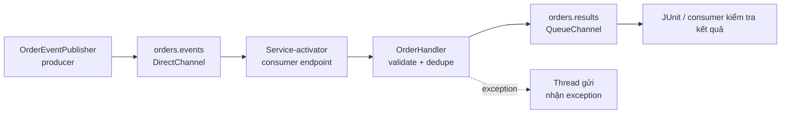
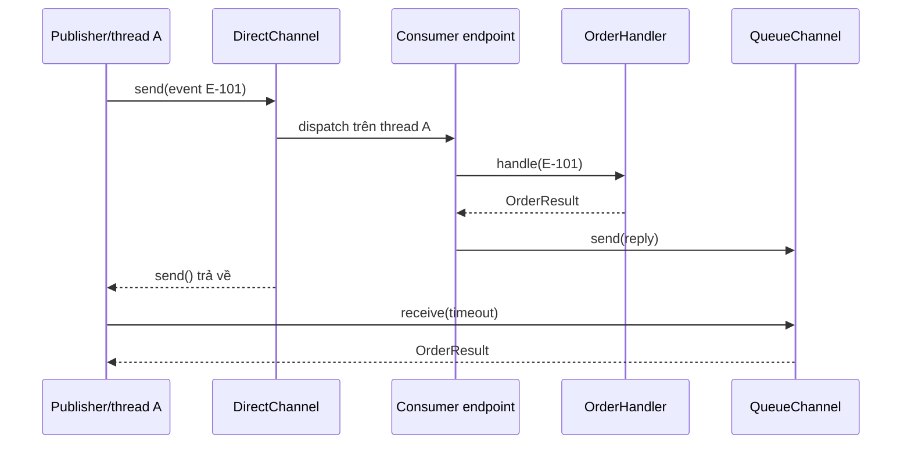
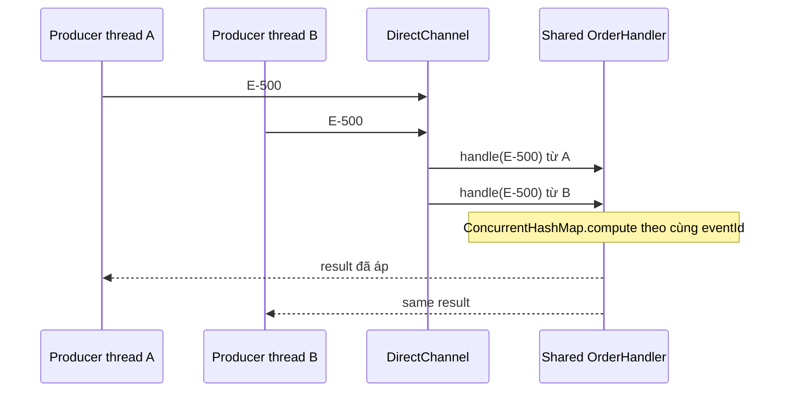
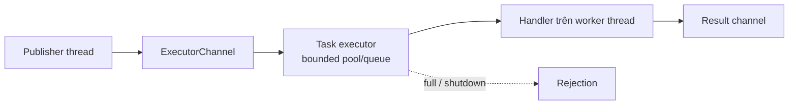
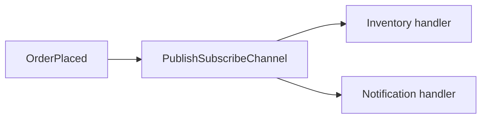
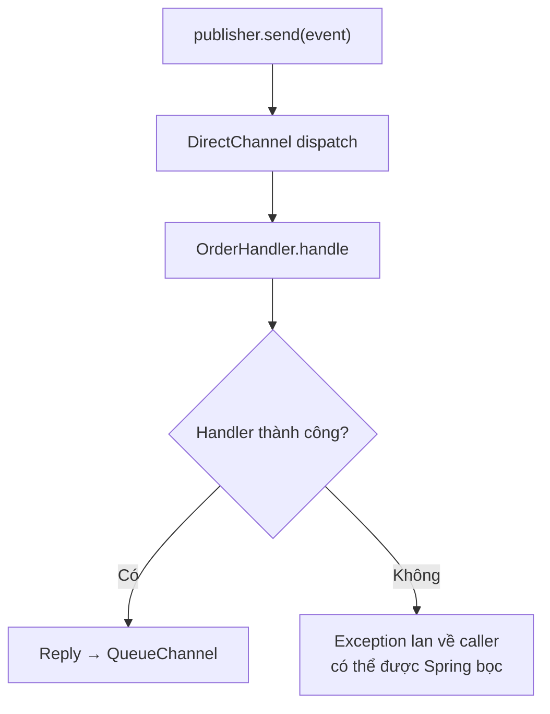
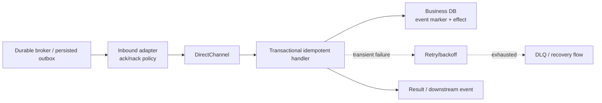
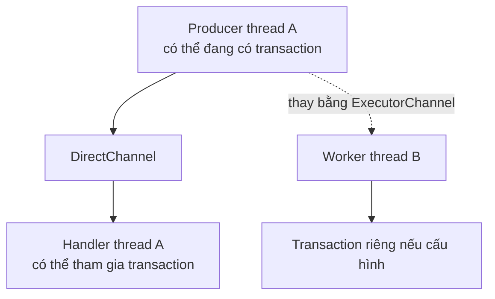
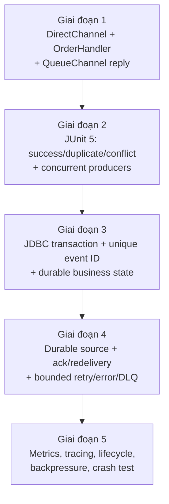

# Xây flow event-driven với DirectChannel và handler

## 1. Mục tiêu project: một event đi qua Spring Integration như thế nào?

Trong chương **Thực hành tổng hợp** của module **SPRING_INTEGRATION_RUNTIME**, chúng ta sẽ xây dựng một ứng dụng nhỏ nhận **sự kiện đơn hàng** (`OrderPlaced`), chuyển qua `DirectChannel` tới handler và phát kết quả vào một channel có thể kiểm thử. Đây là dự án tổng hợp để quan sát cách Spring Integration thực sự điều phối **message, channel, endpoint, consumer và lifecycle**.

Kịch bản:

- Một producer gửi event “đơn hàng O-101 có 3 sản phẩm” với `eventId` nghiệp vụ ổn định.
- `DirectChannel` dispatch message tới service-activator/handler đã đăng ký.
- Handler validate event, ghi nhận hiệu lực nghiệp vụ trong một store in-memory có dedupe cho bài lab, rồi trả về `OrderResult`.
- `QueueChannel` kết quả giữ reply để chương trình thử nghiệm/JUnit nhận và assert.
- Khi cùng `eventId` được gửi lại, handler không áp lại hiệu lực; nếu dùng cùng ID với nội dung khác, nó từ chối.
- Khi event không hợp lệ, lỗi được trả về phía gọi trong flow đồng bộ và không tạo kết quả thành công.

**Yêu cầu học được sau bài:**

1. Phân biệt **event-driven** với **asynchronous**: `DirectChannel` là event-driven nhưng không tự tạo worker thread.
2. Tự viết một flow Java DSL chạy với `@EnableIntegration` và `ApplicationContext` tối thiểu.
3. Biết ranh giới giữa producer, `MessageChannel`, consumer endpoint, handler, reply channel và business service.
4. Kiểm thử message headers, kết quả, duplicate, lỗi đồng bộ, subscriber và lifecycle bằng JUnit 5.
5. Hiểu vì sao demo in-memory chưa đủ để khẳng định **transaction, persistence, retry, exactly-once hoặc recovery**.
6. Biết kế hoạch mở rộng sang JDBC, broker, poller, executor, retry, correlation, error channel và quan sát runtime.

> **Phạm vi cố ý:** phần code chính không cần broker, database hoặc HTTP server. Nó dùng **Spring Integration thật**, không phải gọi handler trực tiếp. Những bảo đảm liên hệ database/broker chỉ được nêu dưới dạng phần mở rộng có điều kiện và phải kiểm thử riêng.

## 2. Topology và đường đi của một message



Đây là một topology **point-to-point với một subscriber**. Khi `publish(event)` gọi `send()`:

1. Producer dựng `Message<OrderPlaced>`, chứa payload và headers.
2. `DirectChannel` tìm handler subscriber, gọi endpoint **trên thread gửi**.
3. `OrderHandler` thực hiện logic và trả về `OrderResult`.
4. Service-activator tạo reply message và gửi tới `orders.results` nhờ cấu hình DSL.
5. `send()` có thể trả về sau khi xử lý đồng bộ và reply đã được gửi vào output channel.
6. Test gọi `receive(timeout)` để lấy và kiểm tra kết quả.

Không có scheduler hay poller trong đường input. `QueueChannel` ở **đầu ra** chỉ giữ reply cho consumer test; nó không biến handler đầu vào thành polling consumer.

### Tên gọi và trách nhiệm

| Thành phần | Vai trò | Không được suy ra |
| --- | --- | --- |
| `OrderPlaced` | Event bất biến có business ID và dữ liệu | Chưa phải message được broker persist. |
| `Message<OrderPlaced>` | Payload cộng headers và metadata transport | Headers không phải danh tính/quyền đã xác thực. |
| `orders.events` | `DirectChannel` đẩy message tới subscriber | Không phải queue có thể tồn đọng hoặc tự retry. |
| Service-activator endpoint | Kết nối channel với handler đã cấu hình | Không đồng nghĩa một thread/executor riêng. |
| `OrderHandler` | Validate + xử lý nghiệp vụ | Không tự có transaction manager hoặc durable store. |
| `orders.results` | `QueueChannel` lưu kết quả cho test | Chỉ nằm trong RAM nếu không gắn persistent store. |
| `OrderEventPublisher` | Đầu vào có kiểu rõ ràng cho producer | Không tự bảo đảm delivery at-least-once. |

## 3. Event-driven không đồng nghĩa asynchronous

Hai thuật ngữ này trả lời **hai câu hỏi khác nhau**:

- **Event-driven:** việc gì kích hoạt xử lý? Ở đây, một message được gửi tới channel làm consumer endpoint thực hiện xử lý.
- **Asynchronous:** xử lý được thực hiện trên thread nào và producer có chờ không? `DirectChannel` thông thường dispatch đồng bộ ngay trên thread gọi `send()`.



Nếu handler gọi JDBC hoặc HTTP chậm, **publisher cũng có thể chậm** vì cùng call stack. Đổi sang `ExecutorChannel` có thể tách thread nhưng sẽ thay đổi exception propagation, transaction context, thời điểm gửi được coi là accepted, và thứ tự hoàn tất. Không thêm executor ngay từ đầu chỉ vì tên project có chữ “event”.

### Khi nào chọn DirectChannel?

- Cần một bước xử lý nhỏ và nhanh, có thể thực hiện trên thread caller.
- Cần lỗi từ handler quay về producer trong cùng lời gọi.
- Muốn giữ thread-local transaction context **khi** producer đã mở transaction phù hợp.
- Muốn topology rõ, ít concurrency để học và kiểm thử.

Không phù hợp khi handler có I/O blocking dài và producer có SLA phản hồi ngắn; khi đó cần thiết kế buffer, async boundary và acknowledgement cẩn thận.

## 4. Kế hoạch project và tiêu chí hoàn thành

Ta triển khai theo các mốc nhỏ:

| Mốc | Nội dung | Điều kiện PASS |
| --- | --- | --- |
| P1 | Tạo domain event/result | Trường `eventId`, `orderId`, `quantity` có ý nghĩa rõ. |
| P2 | Viết `OrderHandler` với validation và idempotency in-memory | Một event logic chỉ tăng bộ đếm hiệu lực một lần. |
| P3 | Cấu hình `DirectChannel` → handler → `QueueChannel` | Spring context refresh thành công, channel có consumer. |
| P4 | Viết `OrderEventPublisher` | Message có header trace/event ID; lỗi channel không bị nuốt. |
| P5 | Chạy end-to-end không cần Spring Boot server | Event hợp lệ tạo reply đúng. |
| P6 | Viết JUnit 5 integration tests | Success, duplicate, conflict và invalid payload đều có assertions. |
| P7 | Quan sát lỗi và lifecycle | Hiểu khi nào subscriber không chạy/được stop. |
| P8 | Lập kế hoạch production hóa | Tách business DB, durable source, retries, monitoring và backpressure. |

**Một điều kiện PASS quan trọng:** kết quả được tạo bởi **message đi qua channel và endpoint thật**. Test trực tiếp `new OrderHandler().handle(event)` hữu ích cho unit test, nhưng không chứng minh wiring của Spring Integration.

## 5. Chuẩn bị project và phụ thuộc

Các snippet giả định **Java 17+** và phiên bản Spring Framework/Spring Integration tương thích với nhau. Dùng Spring Integration Java DSL từ `spring-integration-core`. JUnit Jupiter hỗ trợ test.

Nếu dự án quản lý phiên bản bằng Spring Boot BOM hoặc một dependency management tương đương, các dependency cốt lõi ở mức ý tưởng:

```xml
<dependencies>
    <dependency>
        <groupId>org.springframework.integration</groupId>
        <artifactId>spring-integration-core</artifactId>
    </dependency>
    <dependency>
        <groupId>org.junit.jupiter</groupId>
        <artifactId>junit-jupiter</artifactId>
        <scope>test</scope>
    </dependency>
</dependencies>
```

Nếu không dùng BOM, cần khai báo phiên bản phù hợp cho các dependency. Bài lab không bắt buộc `spring-boot-starter-web`, database hay broker. Cần cấu hình công cụ build dùng JUnit Platform theo cách dự án đang quản lý, nhưng nội dung bài **không chạy build tự động**.

Cấu trúc file Java gợi ý:

```text
src/main/java/example/runtime/project/
    OrderPlaced.java
    OrderResult.java
    OrderHandler.java
    OrderEventPublisher.java
    OrdersFlowConfig.java
    OrdersDemo.java

src/test/java/example/runtime/project/
    OrdersFlowTest.java
    OrderConcurrencyTest.java
```

Mỗi `public` top-level class/record nên ở file `.java` cùng tên. Các code block dưới đây ghi package đầy đủ để có thể tách ra thành file như bố cục trên.

## 6. Thiết kế event và result bất biến

Định danh **business event** phải tồn tại qua retry/redelivery; nó không nên được sinh mới bởi mỗi lần code dựng một Spring `Message`.

```java
package example.runtime.project;

public record OrderPlaced(
        String eventId,
        String orderId,
        int quantity) {}
```

```java
package example.runtime.project;

public record OrderResult(
        String eventId,
        String orderId,
        int quantity,
        String outcome) {}
```

Ví dụ:

```text
OrderPlaced(
    eventId = "EVT-1001",
    orderId = "ORD-77",
    quantity = 3
)

OrderResult(
    eventId = "EVT-1001",
    orderId = "ORD-77",
    quantity = 3,
    outcome = "APPLIED"
)
```

**Vì sao tách `eventId` và `orderId`?** Một đơn hàng có thể phát sinh nhiều sự kiện hợp lệ. Nếu sử dụng `orderId` làm khóa dedupe của mọi event, bạn có thể bỏ nhầm các cập nhật khác của cùng đơn. Trong bài, `eventId` đại diện cho **một hiệu lực sự kiện cụ thể**.

### Điều kiện hợp lệ

- `eventId` không rỗng, ổn định khi gửi lại cùng một event.
- `orderId` không rỗng.
- `quantity > 0` cho sự kiện “đặt hàng”.
- Nếu cùng `eventId` đến lần hai, nội dung business phải giống lần đầu.
- Nếu cùng ID nhưng `orderId`/`quantity` khác, đó là **xung đột**; không tự chọn bản đến sau.

Record giúp dữ liệu immutable ở cấp Java API. Nó **không tự kiểm tra** tính hợp lệ; handler hoặc validation layer phải làm việc đó.

## 7. Viết handler có validation và idempotency in-memory

Ta dùng `ConcurrentHashMap.compute` để demo **một lần áp dụng hiệu lực** ngay cả khi nhiều thread cùng xử lý event trùng. Điều này là minh họa cho một JVM, không phải giải pháp persistence production.

```java
package example.runtime.project;

import java.util.concurrent.ConcurrentHashMap;
import java.util.concurrent.atomic.AtomicInteger;

public final class OrderHandler {

    private final ConcurrentHashMap<String, OrderResult> applied =
        new ConcurrentHashMap<>();

    private final AtomicInteger uniqueEffects = new AtomicInteger();

    public OrderResult handle(OrderPlaced event) {
        validate(event);

        return applied.compute(event.eventId(), (eventId, existing) -> {
            if (existing != null) {
                if (!existing.orderId().equals(event.orderId()) ||
                    existing.quantity() != event.quantity()) {
                    throw new IllegalArgumentException(
                        "Same eventId with conflicting business data");
                }

                // Cùng eventId và nội dung: không áp lại side effect.
                return existing;
            }

            // Mô phỏng hiệu lực nghiệp vụ lần đầu.
            OrderResult result = new OrderResult(
                event.eventId(), event.orderId(), event.quantity(),
                "APPLIED");

            uniqueEffects.incrementAndGet();
            return result;
        });
    }

    public int uniqueEffects() {
        return uniqueEffects.get();
    }

    private static void validate(OrderPlaced event) {
        if (event == null ||
            event.eventId() == null || event.eventId().isBlank() ||
            event.orderId() == null || event.orderId().isBlank() ||
            event.quantity() <= 0) {
            throw new IllegalArgumentException("Invalid OrderPlaced event");
        }
    }
}
```

**Tại sao dùng `compute`?** Với cùng key trong `ConcurrentHashMap`, thao tác cập nhật được điều phối nguyên tử theo hợp đồng của map; hai caller cạnh tranh cùng `eventId` không tự tạo hai bản ghi mới. `AtomicInteger` đo **số event ID duy nhất đã được ghi nhận** trong ví dụ.

**Giới hạn phải hiểu rõ:**

- `applied` và `uniqueEffects` chỉ sống trong JVM. Restart sẽ mất trạng thái, nên không chống replay qua crash.
- Duplicate có thể nhận được **cùng `OrderResult` nhiều lần** ở đầu ra. Đây là **hai lần delivery result**, nhưng chỉ một **business effect** được ghi nhận trong map.
- Không thực hiện HTTP/DB side effect ở trong callback `compute` khi chưa thiết kế transaction và xử lý exception. Demo chỉ tạo record và tăng counter.
- Một map theo `eventId` không thay thế unique constraint của database hoặc một durable idempotency ledger.
- Không dựa vào `MessageHeaders.ID` thay `eventId`, vì Message ID có thể thay đổi khi transport/transform tạo message mới.

### Event bị lặp và xung đột khác nhau thế nào?

| Input | Hành vi handler | `uniqueEffects` |
| --- | --- | --- |
| `EVT-1 / ORD-A / 3` lần đầu | Lưu result | Tăng 1. |
| `EVT-1 / ORD-A / 3` lần hai | Trả result đã có | Không tăng. |
| `EVT-1 / ORD-A / 9` | Ném exception xung đột | Không tăng. |
| `EVT-2 / ORD-A / 9` | Event khác ID hợp lệ | Tăng 1. |

**Idempotency không có nghĩa bỏ mọi message giống nhau**; nó áp dụng cho **cùng thao tác logic theo khóa đã định nghĩa**.

## 8. Cấu hình Java DSL: DirectChannel → handler → reply channel

Đây là trái tim của project. Chỉ cần một `@Configuration` bật `@EnableIntegration` và tạo các bean cần thiết.

```java
package example.runtime.project;

import org.springframework.beans.factory.annotation.Qualifier;
import org.springframework.context.annotation.Bean;
import org.springframework.context.annotation.Configuration;
import org.springframework.integration.channel.DirectChannel;
import org.springframework.integration.channel.QueueChannel;
import org.springframework.integration.config.EnableIntegration;
import org.springframework.integration.dsl.IntegrationFlow;
import org.springframework.messaging.MessageChannel;
import org.springframework.messaging.PollableChannel;

@Configuration
@EnableIntegration
public class OrdersFlowConfig {

    @Bean("orders.events")
    public MessageChannel orderEvents() {
        return new DirectChannel();
    }

    @Bean("orders.results")
    public PollableChannel orderResults() {
        return new QueueChannel(100);
    }

    @Bean
    public OrderHandler orderHandler() {
        return new OrderHandler();
    }

    @Bean
    public IntegrationFlow orderFlow(OrderHandler handler) {
        return IntegrationFlow.from("orders.events")
            .handle(OrderPlaced.class,
                (payload, headers) -> handler.handle(payload))
            .channel("orders.results")
            .get();
    }

    @Bean
    public OrderEventPublisher orderEventPublisher(
            @Qualifier("orders.events") MessageChannel input) {
        return new OrderEventPublisher(input);
    }
}
```

### Phân tích từng dòng quan trọng

**`@EnableIntegration`** kích hoạt infrastructure của Spring Integration trong context. Không nên bỏ nó khi dùng một `AnnotationConfigApplicationContext` tối thiểu và trông chờ auto-configuration của Spring Boot.

**`@Bean("orders.events")`** tạo `DirectChannel` đầu vào. Producer không cần biết bean handler nào nhận message; nó chỉ biết channel.

**`IntegrationFlow.from("orders.events")`** dùng tên channel đã có. Consumer endpoint mà DSL tạo sẽ subscribe vào `DirectChannel`.

**`.handle(OrderPlaced.class, (payload, headers) -> ...)`** là service-activator handler nhận payload kiểu `OrderPlaced`. Nếu business method trả `OrderResult`, flow có reply để chuyển bước tiếp theo.

**`.channel("orders.results")`** route reply đến output `QueueChannel`. Một `Message` reply mới có thể được tạo, nên test phải kiểm tra headers được giữ theo đúng hợp đồng flow nếu chúng quan trọng.

**`QueueChannel(100)`** là buffer output của bài lab, không phải durable queue. Nếu có hơn 100 kết quả chưa được nhận, producer/handler có thể bị block hoặc gặp lỗi theo policy gửi; hãy drain output trong test.

### Vì sao không gắn `@ServiceActivator` thủ công?

Có thể dùng annotation `@ServiceActivator(inputChannel = "...")` thay cho Java DSL. Trong bài, chọn **một cách khai báo** để dễ nhìn topology, tránh vô tình đăng ký hai subscriber rồi làm `DirectChannel` phân phối message cho một trong hai handler ngoài dự kiến.

Nếu muốn học annotation sau, hãy triển khai ở cấu hình/test khác chứ không bật đồng thời hai endpoint cùng nhận một channel trong cùng ví dụ.

## 9. Producer có kiểu rõ ràng và headers phục vụ tracing

Producer chịu trách nhiệm dựng `Message`, gắn định danh và gửi vào channel đã được injection. Không nên cho caller tự nhập tên bean handler hay tên method để gọi.

```java
package example.runtime.project;

import java.util.Objects;
import java.util.UUID;

import org.springframework.messaging.Message;
import org.springframework.messaging.MessageChannel;
import org.springframework.messaging.support.MessageBuilder;

public final class OrderEventPublisher {

    private final MessageChannel input;

    public OrderEventPublisher(MessageChannel input) {
        this.input = Objects.requireNonNull(input);
    }

    public void publish(OrderPlaced event) {
        Objects.requireNonNull(event, "event");

        Message<OrderPlaced> message = MessageBuilder
            .withPayload(event)
            .setHeader("eventType", "OrderPlaced")
            .setHeader("businessEventId", event.eventId())
            .setHeader("traceId", UUID.randomUUID().toString())
            .build();

        boolean accepted = input.send(message, 500);

        if (!accepted) {
            throw new IllegalStateException(
                "Input channel did not accept order event");
        }
    }
}
```

Ở đây `send(message, 500)` đặt timeout gửi **theo khả năng hỗ trợ của channel**. Với `DirectChannel`, dispatch là đồng bộ; nếu handler ném exception, `send` có thể **ném lỗi** ngay thay vì trả `false`. Thời gian timeout của `send` không phải deadline cho toàn bộ business handler trong mọi implementation.

**Chú ý `traceId` và `eventId`:**

- `businessEventId`/`event.eventId()` nhận diện một sự kiện nghiệp vụ để dedupe, cần giữ nguyên khi gửi lại.
- `traceId` có thể thay đổi giữa các lần gọi để truy vết từng attempt hoặc được upstream giữ ổn định tùy tracing policy.
- `MessageHeaders.ID` do Spring tạo là metadata transport, không nên dùng làm khóa idempotency duy nhất.
- Header do producer tự đặt như `userRole=ADMIN` không có giá trị làm **bằng chứng xác thực**.

## 10. Chạy demo với `AnnotationConfigApplicationContext`

Không cần khởi động web server chỉ để xem một message di chuyển.

```java
package example.runtime.project;

import org.springframework.context.annotation.AnnotationConfigApplicationContext;
import org.springframework.messaging.Message;
import org.springframework.messaging.PollableChannel;

public final class OrdersDemo {

    public static void main(String[] args) {
        try (var context =
                new AnnotationConfigApplicationContext(
                    OrdersFlowConfig.class)) {

            OrderEventPublisher publisher =
                context.getBean(OrderEventPublisher.class);

            PollableChannel results =
                context.getBean(
                    "orders.results", PollableChannel.class);

            publisher.publish(
                new OrderPlaced("EVT-1001", "ORD-77", 3));

            Message<?> reply = results.receive(1_000);

            if (reply == null) {
                throw new IllegalStateException(
                    "No result after publishing OrderPlaced");
            }

            System.out.println(reply.getPayload());
        }
    }
}
```

Kết quả mong đợi về mặt payload:

```text
OrderResult[eventId=EVT-1001, orderId=ORD-77, quantity=3, outcome=APPLIED]
```

Đây là biểu diễn `toString()` thông thường của Java record; không nên coi định dạng chuỗi log là API ổn định để tích hợp giữa service.

### Những gì context thực hiện

1. `AnnotationConfigApplicationContext` đăng ký cấu hình và `refresh`.
2. Spring tạo channel, handler và IntegrationFlow.
3. Consumer endpoint được subscribe, nên `DirectChannel` có điểm nhận.
4. `publisher.publish` dispatch ngay sang handler theo thread caller.
5. Khi try-with-resources kết thúc, context được `close` và Spring dừng/hủy những bean lifecycle thuộc context.

Nếu cố tạo `OrderHandler` bằng `new` và gọi trực tiếp, chương trình vẫn có thể xuất kết quả đúng, nhưng **không** chứng minh `IntegrationFlow`, subscriber hay channel hoạt động.

## 11. JUnit 5: kiểm thử event đi qua endpoint thật

Sử dụng Spring context riêng cho mỗi test, tránh state in-memory còn sót qua test khác.

```java
package example.runtime.project;

import org.junit.jupiter.api.Test;
import org.springframework.context.annotation.AnnotationConfigApplicationContext;
import org.springframework.messaging.Message;
import org.springframework.messaging.PollableChannel;

import static org.junit.jupiter.api.Assertions.*;

class OrdersFlowTest {

    @Test
    void validEventProducesResultThroughIntegrationFlow() {
        try (var context =
                new AnnotationConfigApplicationContext(
                    OrdersFlowConfig.class)) {

            OrderEventPublisher publisher =
                context.getBean(OrderEventPublisher.class);
            PollableChannel results =
                context.getBean(
                    "orders.results", PollableChannel.class);
            OrderHandler handler =
                context.getBean(OrderHandler.class);

            publisher.publish(
                new OrderPlaced("EVT-1", "ORD-A", 3));

            Message<?> message = results.receive(1_000);

            assertNotNull(message, "Flow should emit a reply");
            assertInstanceOf(
                OrderResult.class, message.getPayload());

            OrderResult result = (OrderResult) message.getPayload();

            assertEquals("EVT-1", result.eventId());
            assertEquals("ORD-A", result.orderId());
            assertEquals(3, result.quantity());
            assertEquals("APPLIED", result.outcome());
            assertEquals(1, handler.uniqueEffects());
        }
    }
}
```

**Giá trị của test:** event không được gửi trực tiếp cho handler; nó đi qua **producer → DirectChannel → Spring Integration endpoint → handler → output channel**.

**Giới hạn của test:** đây là kiểm thử integration **trong một JVM**. Không có database thật, broker, transaction manager, network failure hay phục hồi sau crash. Đừng suy ra business side effect đúng một lần **trên nhiều instance** từ một bộ đếm `AtomicInteger` cục bộ.

### Vì sao `receive(1_000)` phải có timeout?

Một test sai wiring hoặc handler không tạo reply có thể làm `receive()` chờ vô hạn. Dùng timeout hữu hạn giúp CI kết thúc và tạo failure message. `QueueChannel.receive(1_000)` có thể trả về `null` khi quá thời hạn, nên luôn assert not-null trước khi đọc payload.

## 12. Test duplicate: hai lần delivery, một hiệu lực nghiệp vụ

Trong topology đồng bộ, có thể gửi lại **cùng event** hai lần. Hai lần handler chạy, hai result có thể được phát; nhưng `uniqueEffects` chỉ tăng một lần.

```java
@Test
void duplicateEventDoesNotApplyBusinessEffectTwice() {
    try (var context =
            new AnnotationConfigApplicationContext(
                OrdersFlowConfig.class)) {

        OrderEventPublisher publisher =
            context.getBean(OrderEventPublisher.class);
        OrderHandler handler = context.getBean(OrderHandler.class);
        PollableChannel results =
            context.getBean("orders.results", PollableChannel.class);

        OrderPlaced event =
            new OrderPlaced("EVT-200", "ORD-B", 5);

        publisher.publish(event);
        publisher.publish(event);

        Message<?> first = results.receive(1_000);
        Message<?> second = results.receive(1_000);

        assertNotNull(first);
        assertNotNull(second);
        assertEquals(first.getPayload(), second.getPayload());
        assertEquals(1, handler.uniqueEffects());
    }
}
```

Đoạn trên là **phần mở rộng đặt trong class `OrdersFlowTest`**; sử dụng các import ở test đầu tiên. Không tạo file Java thứ hai cùng tên `OrdersFlowTest`.

**Cần phân biệt:**

- **Delivery count:** 2 lần gọi `publish`.
- **Handler invocation count:** có thể 2 trong demo.
- **Unique business effect:** 1 bản ghi trong map.
- **Reply count:** 2, vì handler trả cùng result khi event đến lặp.

Nếu downstream coi mỗi reply là một **lệnh nghiệp vụ không idempotent** rồi áp tiếp, hệ thống vẫn có thể tạo side effect trùng. Cần idempotency tại mọi ranh giới có thể redeliver hoặc tái thực thi, không chỉ ở một handler đầu tiên.

## 13. Test invalid event và cùng ID nhưng khác payload

Trong flow `DirectChannel` đồng bộ, exception của handler thường lan về lời gọi `publish` dưới dạng exception runtime từ Spring messaging hoặc root cause, thay vì tự xuất hiện trên một error channel bất đồng bộ.

```java
@Test
void conflictingEventIdFailsWithoutNewBusinessEffect() {
    try (var context =
            new AnnotationConfigApplicationContext(
                OrdersFlowConfig.class)) {

        OrderEventPublisher publisher =
            context.getBean(OrderEventPublisher.class);
        OrderHandler handler = context.getBean(OrderHandler.class);
        PollableChannel results =
            context.getBean("orders.results", PollableChannel.class);

        publisher.publish(
            new OrderPlaced("EVT-300", "ORD-C", 2));

        assertNotNull(results.receive(1_000));

        assertThrows(RuntimeException.class, () ->
            publisher.publish(
                new OrderPlaced("EVT-300", "ORD-C", 99)));

        assertEquals(1, handler.uniqueEffects());
        assertNull(results.receive(100));
    }
}

@Test
void invalidQuantityDoesNotProduceSuccessResult() {
    try (var context =
            new AnnotationConfigApplicationContext(
                OrdersFlowConfig.class)) {

        OrderEventPublisher publisher =
            context.getBean(OrderEventPublisher.class);
        PollableChannel results =
            context.getBean("orders.results", PollableChannel.class);

        assertThrows(RuntimeException.class, () ->
            publisher.publish(
                new OrderPlaced("EVT-400", "ORD-D", 0)));

        assertNull(results.receive(100));
    }
}
```

Như phần trước, đây là các **method bổ sung** trong `OrdersFlowTest`, không phải một file độc lập. Dùng `assertThrows(RuntimeException.class)` ở ví dụ để tránh phụ thuộc vào loại exception wrapper của Spring Integration theo phiên bản; trong test production nên **kiểm tra cause chain** để chắc chắn lỗi là validation hoặc conflict chứ không phải no-subscriber hoặc lỗi cấu hình.

### Kiểm tra root cause khi cần

```java
static Throwable rootCause(Throwable error) {
    Throwable current = error;
    while (current.getCause() != null &&
           current.getCause() != current) {
        current = current.getCause();
    }
    return current;
}
```

Hàm trên chỉ là helper chẩn đoán; đôi khi lỗi domain có thể nằm **giữa** cause chain chứ không phải root cause cuối. Nếu muốn kiểm tra một loại exception cụ thể, hãy duyệt cause chain và so với policy của ứng dụng.

Không assert nguyên cả stack trace hoặc message chi tiết của wrapper vì các phiên bản framework có thể thêm lớp ngoại lệ.

## 14. Kiểm thử hai producer cạnh tranh cùng `eventId`

Một ứng dụng event-driven thực tế có thể nhận nhiều request đồng thời. `DirectChannel` không tự tạo worker thread, nhưng **hai producer thread** có thể gửi đồng thời và gọi handler tương ứng trên mỗi thread.



Ví dụ test concurrency bằng Java 17 và JUnit 5:

```java
package example.runtime.project;

import java.util.concurrent.CountDownLatch;
import java.util.concurrent.Executors;
import java.util.concurrent.TimeUnit;

import org.junit.jupiter.api.Test;
import org.springframework.context.annotation.AnnotationConfigApplicationContext;
import org.springframework.messaging.PollableChannel;

import static org.junit.jupiter.api.Assertions.*;

class OrderConcurrencyTest {

    @Test
    void concurrentDuplicateHasOneUniqueEffect() throws Exception {
        try (var context =
                new AnnotationConfigApplicationContext(
                    OrdersFlowConfig.class)) {

            var publisher =
                context.getBean(OrderEventPublisher.class);
            var handler = context.getBean(OrderHandler.class);
            PollableChannel results =
                context.getBean(
                    "orders.results", PollableChannel.class);

            var pool = Executors.newFixedThreadPool(2);
            try {
                CountDownLatch start = new CountDownLatch(1);
                OrderPlaced event =
                    new OrderPlaced("EVT-500", "ORD-E", 7);

                var first = pool.submit(() -> {
                    start.await();
                    publisher.publish(event);
                    return true;
                });
                var second = pool.submit(() -> {
                    start.await();
                    publisher.publish(event);
                    return true;
                });

                start.countDown();

                assertTrue(first.get(5, TimeUnit.SECONDS));
                assertTrue(second.get(5, TimeUnit.SECONDS));

                assertNotNull(results.receive(1_000));
                assertNotNull(results.receive(1_000));
                assertEquals(1, handler.uniqueEffects());
            } finally {
                pool.shutdownNow();
            }
        }
    }
}
```

Điểm test này chứng minh là **hai producer đồng thời vào cùng một handler singleton in-memory** không làm tăng hiệu lực trùng cho cùng ID. Nó **không chứng minh** đúng một lần giữa hai JVM; mỗi instance có map riêng. Production cần unique constraint hoặc idempotency store được chia sẻ.

Lý do dùng `CountDownLatch` là điều phối hai producer bắt đầu gần nhau, thay vì dùng `Thread.sleep` rồi hy vọng chúng đua nhau. Việc thread nào chạy trước vẫn không cần xác định: kết quả cuối mới quan trọng.

## 15. Thread boundary và hiệu năng của DirectChannel

Trong project này, flow đồng bộ giúp ta thấy rõ:

```text
publisher thread:
    input.send(event)
      -> DirectChannel.dispatch
        -> service-activator handler
          -> OrderHandler.handle(event)
          -> send(reply) to orders.results
    return to publisher
```

Hệ quả:

- Nếu handler mất 500 ms, `publish` có thể mất xấp xỉ thời gian đó hoặc lâu hơn.
- Nếu handler ném exception, lời gọi `publish` có thể nhận lỗi ngay trên cùng thread.
- Nếu producer có một transaction thread-bound phù hợp, handler có thể tham gia khi cùng thread và transaction propagation đúng.
- Nếu hai producer gọi đồng thời, có thể có hai handler invocation chạy đồng thời trên **hai producer thread**; “DirectChannel” **không có nghĩa hệ thống chỉ có một thread**.
- Nếu output `QueueChannel` đầy, thread caller có thể bị block hoặc gặp lỗi tại bước gửi reply.

### Khi nào thay bằng `ExecutorChannel`?



Việc chuyển sang `ExecutorChannel` có thể cải thiện khả năng tiếp nhận độc lập với thời gian handler, nhưng đánh đổi:

| Khía cạnh | `DirectChannel` | `ExecutorChannel` |
| --- | --- | --- |
| Thread handler | Thread producer/caller | Worker của executor (trừ policy đặc biệt). |
| Thời điểm `send()` trả về | Sau dispatch đồng bộ | Có thể trước khi handler hoàn tất. |
| Lỗi business | Có thể lan về caller | Thường xử lý ở worker/error path. |
| Transaction ThreadLocal | Có thể giữ trong cùng call stack | Không tự truyền sang worker. |
| Ordering | Dễ quan sát trong một thread gửi tuần tự | Completion có thể đảo thứ tự. |
| Overload | Làm chậm/block producer trực tiếp | Pool/queue đầy hoặc reject, cần backpressure. |
| Crash sau accepted | Không có task executor queue ở ví dụ gốc | Task đang chờ trong RAM có thể mất. |

**Không** đổi `DirectChannel` sang `ExecutorChannel` rồi tiếp tục dùng mọi assertion “ngay sau `send`” từ bài test đồng bộ. Cần timeout/await và xác định error handling mới.

## 16. Khi handler trả `null`: event một chiều và kết quả có điều kiện

Project chính cố ý tạo `OrderResult` để test dễ kiểm tra. Nhưng không phải mọi event đều cần reply. Một handler chỉ ghi audit hoặc gửi ra downstream có thể là **one-way handler**.

```java
@Bean
IntegrationFlow auditOnlyFlow(OrderAuditService audit) {
    return IntegrationFlow.from("audit.events")
        .handle(OrderPlaced.class, (payload, headers) -> {
            audit.record(payload);
            return null; // Không tạo reply ở endpoint này.
        })
        .get();
}
```

Đây là snippet mở rộng, **giả định** đã có bean `audit.events` và `OrderAuditService` được định nghĩa; không thêm vào cùng context demo nếu chưa tạo các bean này. Khi handler trả `null` trong một điểm kết thúc, thường không có reply message được phát tới bước sau.

**Lỗi thường gặp:** thêm `.channel("orders.results")` sau một one-way handler rồi test luôn đợi reply. Nếu handler không trả kết quả và không tự publish message khác, `receive(timeout)` trả `null` là điều phù hợp.

Nếu cần vừa ghi audit vừa tạo kết quả, tách business service trả result và một nhánh audit có policy rõ ràng; tránh “gắn hai subscriber vào DirectChannel để fan-out” vì DirectChannel không phải broadcast channel.

## 17. Một hay nhiều subscriber: point-to-point khác publish–subscribe

`DirectChannel` dùng dispatch **point-to-point**: với nhiều subscriber, framework có thể chọn một handler để xử lý mỗi message theo dispatcher policy, chứ không mặc định giao **một bản sao đến tất cả handler**.

Nếu muốn cả **inventory** và **notification** cùng nhận một event:



Khi đó cần thiết kế `PublishSubscribeChannel` hoặc một flow split/fan-out phù hợp, với các quyết định:

- Gửi tới các subscriber đồng bộ hay dùng executor?
- Nếu inventory thành công nhưng notification lỗi, lỗi nào quay về publisher?
- Mỗi subscriber có idempotency riêng theo `eventId` chưa?
- Có yêu cầu thứ tự hay transaction chung không?
- Nếu một subscriber xuống, có durable retry/outbox cho nhánh đó không?

**Bài chính không dùng pub-sub** để giữ một đường event → handler → result dễ kiểm thử. Bổ sung fan-out là bước mở rộng, không phải tác dụng tự nhiên của `DirectChannel`.

## 18. Error handling của flow đồng bộ

Đường chính trong ví dụ:



**Không giả định** mọi exception ở `DirectChannel` tạo một `ErrorMessage` trên `errorChannel` mặc định. Trong một đường đồng bộ thuần túy, lỗi thường được truyền về caller. Với poller hoặc executor, một error handler phù hợp có thể phát `ErrorMessage` đến error channel.

Trong production, người phát event cần biết chính sách:

- **Validation error:** payload không hợp lệ, từ chối hoặc đưa vào DLQ nếu đến từ broker; không retry mãi một lỗi vĩnh viễn.
- **Temporary failure:** database timeout hoặc HTTP 503, retry có giới hạn, backoff và idempotency.
- **Conflict:** cùng event ID nhưng payload khác, đưa vào cảnh báo/audit; không tự ghi đè dữ liệu.
- **No subscriber:** endpoint chưa chạy hoặc flow wiring sai; đây là lỗi runtime, không phải lỗi payload.
- **Reply/output failure:** handler có thể đã áp business effect trước khi gửi reply thất bại. Không giả định send exception nghĩa là transaction chắc chắn đã rollback.

### Ranh giới exception và side effect

Nếu handler thực hiện một update database rồi output channel đầy khiến reply không gửi được, có thể xảy ra:

```text
DB commit successful
    ↓
reply send fails
    ↓
publisher observes exception
    ↓
producer retries same business event
```

Vì vậy phải tách **kết quả nghiệp vụ đã commit** khỏi **kết quả gửi reply** và bảo đảm idempotency khi retry. Ví dụ in-memory chỉ mô phỏng; với JDBC cần transaction/unique constraint thật.

## 19. Nâng cấp idempotency thành transaction JDBC bền vững

Giả sử đưa project vào môi trường có PostgreSQL. Thay map in-memory bằng một **idempotency marker** và bảng trạng thái nghiệp vụ cùng một local database transaction.

### Schema minh họa

```sql
CREATE TABLE processed_order_event (
    event_id   VARCHAR(120) PRIMARY KEY,
    order_id   VARCHAR(120) NOT NULL,
    quantity   INTEGER NOT NULL,
    applied_at TIMESTAMP NOT NULL DEFAULT CURRENT_TIMESTAMP
);

CREATE TABLE order_quantity_summary (
    order_id   VARCHAR(120) PRIMARY KEY,
    quantity   INTEGER NOT NULL
);
```

### Handler JDBC với unique event ID

```java
package example.runtime.project;

import java.util.Map;

import org.springframework.jdbc.core.JdbcTemplate;
import org.springframework.stereotype.Service;
import org.springframework.transaction.annotation.Transactional;

@Service
public class JdbcOrderProcessor {

    private final JdbcTemplate jdbc;

    public JdbcOrderProcessor(JdbcTemplate jdbc) {
        this.jdbc = jdbc;
    }

    @Transactional
    public OrderResult handle(OrderPlaced event) {
        if (event == null ||
            event.eventId() == null || event.eventId().isBlank() ||
            event.orderId() == null || event.orderId().isBlank() ||
            event.quantity() <= 0) {
            throw new IllegalArgumentException("Invalid event");
        }

        // PostgreSQL: chỉ lần đầu insert được marker.
        int inserted = jdbc.update(
            "INSERT INTO processed_order_event " +
            "(event_id, order_id, quantity) VALUES (?, ?, ?) " +
            "ON CONFLICT (event_id) DO NOTHING",
            event.eventId(), event.orderId(), event.quantity());

        if (inserted == 0) {
            Map<String, Object> stored = jdbc.queryForMap(
                "SELECT order_id, quantity " +
                "FROM processed_order_event WHERE event_id = ?",
                event.eventId());

            String storedOrder = (String) stored.get("order_id");
            int storedQty = ((Number) stored.get("quantity")).intValue();

            if (!storedOrder.equals(event.orderId()) ||
                storedQty != event.quantity()) {
                throw new IllegalArgumentException(
                    "Conflicting payload for eventId");
            }

            return new OrderResult(
                event.eventId(), event.orderId(), event.quantity(),
                "ALREADY_APPLIED");
        }

        jdbc.update(
            "INSERT INTO order_quantity_summary " +
            "(order_id, quantity) VALUES (?, ?) " +
            "ON CONFLICT (order_id) DO UPDATE SET " +
            "quantity = order_quantity_summary.quantity " +
            "           + EXCLUDED.quantity",
            event.orderId(), event.quantity());

        return new OrderResult(
            event.eventId(), event.orderId(), event.quantity(),
            "APPLIED");
    }
}
```

**Đây là phần mở rộng**, không thay thế `OrderHandler` in-memory trong cấu hình lab trừ khi bạn chủ động thêm `DataSource`, schema, Spring JDBC và `PlatformTransactionManager` phù hợp rồi thay wiring handler trong flow.

### Điều kiện để transaction thực sự có hiệu lực

1. `JdbcOrderProcessor` phải là **Spring bean** được gọi qua transaction proxy.
2. Có `PlatformTransactionManager` đúng cho `DataSource` mà `JdbcTemplate` sử dụng.
3. Marker và cập nhật summary phải nằm trong **cùng local transaction**.
4. Exception runtime trước commit phải rollback theo cấu hình transaction.
5. Không gọi `this.handle(...)` từ method cùng bean rồi mặc định `@Transactional` đi qua proxy.
6. Không chuyển sang `ExecutorChannel` rồi cho rằng transaction trên producer thread tự đi theo worker.

Nếu hai request cùng `eventId` đến đồng thời, unique constraint của DB điều phối việc insert; request thứ hai chỉ có thể kiểm tra dữ liệu đã commit theo semantics của database sau khi conflict được phân giải. Test trên backend thực tế.

**Quan trọng:** transaction JDBC không tự gộp broker acknowledgement hoặc HTTP API ngoài vào cùng atomic commit. Nếu DB commit xong nhưng broker chưa ack, redelivery là khả năng bình thường; nhánh duplicate phải an toàn. Nếu API ngoài đã nhận tác vụ rồi JVM chết, vẫn cần idempotency key phía đích hoặc reconciliation.

## 20. Retry, broker và durability: con đường production hóa

Project hiện tại có một **producer trong JVM**. Nếu JVM crash sau khi producer tạo event nhưng trước khi gọi `publish`, không có nguồn bền vững nào phát lại nó. Nếu event đã vào `DirectChannel` mà handler thất bại, caller phải quyết định retry hoặc báo lỗi.

Để nâng cấp:



### Từ đơn giản đến có độ tin cậy

| Cấp triển khai | Có thêm gì? | Điều cần kiểm thử |
| --- | --- | --- |
| Lab in-memory | `DirectChannel` + handler + reply queue | Payload, duplicate trong JVM, lỗi đồng bộ. |
| JDBC idempotency | Unique event ID + business rows cùng transaction | Rollback, duplicate concurrent, payload conflict. |
| Durable inbound source | Kafka/RabbitMQ/JMS hoặc persistent channel store đúng loại | Ack/redelivery khi handler lỗi hoặc JVM crash. |
| Bounded retry | Retry với backoff, giới hạn attempts, error channel/DLQ | Transient vs permanent failure, không retry storm. |
| External output | HTTP/broker/notification side effect | Outbox/idempotency key, crash sau commit trước publish. |
| Multi-instance | Shared ledger/store và coordination | Một event ID không tạo effect trùng ở các replica. |

**Không gọi `DirectChannel` là hàng đợi bền vững.** Nó dispatch tới subscriber đang tồn tại. Nếu muốn buffer trong JVM, có thể dùng `QueueChannel` nhưng còn phải giải quyết persistence, receive transaction, poller và shutdown nếu không được phép mất message.

### Điểm ack quyết định delivery

Giả sử adapter nhận event từ broker và truyền vào handler:

- **Ack trước business commit:** crash có thể làm mất hiệu lực vì nguồn nghĩ message đã xong.
- **Ack sau business commit:** nếu crash giữa commit và ack, broker có thể redeliver; idempotency phải chặn double effect.
- **Bất đồng bộ sau submit:** nếu adapter ack khi task mới vào executor queue RAM, crash trước khi worker thực thi có thể mất message.

Không thể suy ra ack policy chỉ từ Java DSL đoạn demo; cần kiểm tra adapter/broker cụ thể và test crash window.

## 21. Transaction và DirectChannel: liên hệ với thread đang gửi

Một ưu điểm của `DirectChannel` là handler đồng bộ cùng thread gửi; nếu producer đã mở một transaction local phù hợp thì handler có thể **tham gia transaction đó** theo propagation và tài nguyên đang dùng.

Tuy nhiên:

- Chỉ dùng `DirectChannel` **không tự khởi tạo transaction**.
- `@Transactional` trên handler không có tác dụng nếu không có transaction manager/proxy đúng.
- Nếu handler thực hiện HTTP call hoặc gửi sự kiện sang broker ngoài transaction, rollback JDBC không tự undo hành động đó.
- Nếu Spring Integration flow có thêm `ExecutorChannel` hoặc poller task executor, ranh giới thread có thể làm transaction context không còn như trước.
- Dù transaction đúng, hai producer đồng thời vẫn cần unique key/locking phù hợp cho same event ID.



Khi cần kiểm tra transaction, đọc **dữ liệu đã commit/rollback** trong DB test thay vì chỉ nhìn log. Với SQL rollback, marker và business row phải biến mất cùng nhau nếu exception xảy ra trước commit.

## 22. Correlation và headers: truy vết nhiều event

Một message có ít nhất hai loại ID đáng quan tâm:

- **Business identity** (`eventId`, `orderId`) quyết định dedupe và cập nhật trạng thái.
- **Trace/correlation identity** (`traceId`, `correlationId`) giúp nối các bước trong logs hoặc gom nhóm khi flow có aggregator.

Ví dụ bổ sung header:

```java
Message<OrderPlaced> message = MessageBuilder
    .withPayload(new OrderPlaced("EVT-901", "ORD-9", 2))
    .setHeader("businessEventId", "EVT-901")
    .setHeader("traceId", "trace-2026-001")
    .setHeader("tenantId", "tenant-demo")
    .build();
```

**Không dùng `tenantId` do client tự khai để phân quyền.** Với input HTTP/broker, tenant/identity phải được xác minh từ một nguồn tin cậy trước khi áp chính sách resource/action.

### Không giả định mọi header được giữ qua mọi transform

Reply handler thường có khả năng sao chép một số header từ request theo cơ chế reply message của Spring Integration, nhưng custom transformer, message builder hoặc adapter có thể thay đổi metadata. Nếu cần `traceId` ở đầu ra, viết test:

```java
Message<?> reply = results.receive(1_000);
assertNotNull(reply);
assertEquals("trace-2026-001",
             reply.getHeaders().get("traceId"));
```

Đoạn trên là assertion mở rộng khi gửi message có header tương ứng trong flow test đã cấu hình. Nếu không đạt, xem bước nào tạo reply mới và cấu hình propagation/copy headers chủ động; không ghép business ID với transport Message ID.

### Khi cần aggregator

Nếu chuyển sang một dự án xử lý event theo batch:

- `correlationId` xác định group (ví dụ batchId).
- `sequenceNumber` và `sequenceSize` mô tả thứ tự/kích thước kỳ vọng.
- `CorrelationStrategy`/`ReleaseStrategy` quyết định cách gom/release.
- `MessageGroupStore` giữ fragment; persistent store cần nếu muốn sống qua restart.
- Nhiều worker có thể tạo duplicate/late fragment, cần idempotency và release semantics.

Không cần aggregator chỉ để xử lý một event đơn lẻ như `OrderPlaced`.

## 23. Lifecycle, subscriber và sự cố “no subscribers”

Endpoint của flow được tạo khi context refresh. Nếu context chưa được khởi tạo, endpoint chưa được start hoặc bean flow bị bỏ, `DirectChannel` có thể không có subscriber để nhận message.

| Triệu chứng | Nguyên nhân thường gặp | Hướng chẩn đoán |
| --- | --- | --- |
| `Dispatcher has no subscribers` | Flow chưa đăng ký, endpoint stopped hoặc gửi nhầm channel | Kiểm tra `@EnableIntegration`, `IntegrationFlow`, bean name và lifecycle. |
| `NoSuchBeanDefinitionException` | Sai tên `orders.events`/`orders.results` | Dùng tên bean hằng số và lookup theo kiểu. |
| `receive(timeout)` trả null | Handler không trả reply, sai output channel, exception hoặc queue đã được đọc | Kiểm tra handler return và DSL `.channel`. |
| Event xử lý hai lần bất ngờ | Producer retry, nhiều lần send hoặc consumer khác | Log business event ID, unique effects, nguồn redelivery. |
| Reply bị chặn | Output `QueueChannel` đầy hoặc consumer không drain | Đo queue depth, capacity, send timeout. |
| Flow chạy chậm khi handler gọi HTTP | `DirectChannel` chặn producer thread | Đo handler latency, timeout và cân nhắc async/durable buffer. |
| Lỗi chỉ khi nhiều request | Business service không thread-safe | Test concurrent producers và transaction/lock. |
| Dữ liệu mất sau restart | In-memory map/queue | Dùng DB/broker/store bền vững và test crash/recovery. |
| Lỗi sau khi thêm executor | Transaction/exception đã đổi thread | Kiểm tra error channel, ack, task queue và MDC. |
| Message từ nhiều tenant bị trộn | Header/tenant không được xác thực hoặc business key sai | Policy tenant, namespaced idempotency key và correlation. |

### Không stop nhầm channel

`DirectChannel` không có API chung “pause entire flow”. Thao tác lifecycle thường thuộc endpoint/adapter hoặc một `IntegrationFlowRegistration` nếu flow được đăng ký động. Nếu tạm dừng consumer cuối mà producer vẫn gửi vào `DirectChannel`, producer có thể thấy lỗi no-subscribers.

Nếu cần pause mà vẫn nhận event mới, nên thiết kế **nguồn bền vững/`QueueChannel` + poller** phù hợp, không mong `DirectChannel` tự buffer message.

## 24. Vận hành và quan sát một flow nhỏ

Ngay cả với project lab, đặt tên và thu metric sớm giúp việc nâng cấp ít rủi ro.

### Log đề xuất

```text
eventId=EVT-1001 orderId=ORD-77 phase=PUBLISHED traceId=tr-001
eventId=EVT-1001 phase=HANDLER_START thread=main
eventId=EVT-1001 phase=BUSINESS_APPLIED outcome=APPLIED
eventId=EVT-1001 phase=RESULT_SENT channel=orders.results
eventId=EVT-1001 phase=DUPLICATE outcome=ALREADY_APPLIED
```

Đây là **mẫu log**, không phải output tự động từ code. Cần bổ sung instrumentation nếu muốn ghi đủ các phase. Không log nội dung payload bí mật hoặc token; dùng ID an toàn để truy vết.

### Metric tối thiểu

| Metric | Điều nó trả lời |
| --- | --- |
| `published.count` | Có bao nhiêu lần producer gọi gửi event? |
| `accepted.count` | Có bao nhiêu message được channel chấp nhận? |
| `handler.invocation.count` | Handler đã được gọi bao nhiêu lần? |
| `business.unique_effects.count` | Có bao nhiêu business event ID được áp lần đầu? |
| `duplicate.count` | Bao nhiêu lần event đến lặp? |
| `invalid.count` / `conflict.count` | Lỗi payload và trùng ID khác dữ liệu? |
| `handler.duration` | p50/p95/p99 xử lý trong handler? |
| `reply.queue.depth` | Output queue có đang đầy? |
| `error.count` | Có bao nhiêu lỗi từ endpoint/handler? |
| `source.unacked`/`broker.lag` | Khi dùng nguồn durable, còn bao nhiêu event chưa hoàn tất? |

Đừng chỉ đo `send()` latency và kết luận throughput nghiệp vụ. Trong demo `DirectChannel` đồng bộ, hai đại lượng gần nhau hơn so với executor async, nhưng vẫn có thể khác vì output channel và các yếu tố khác.

### Tracing và thread

Với `DirectChannel`, MDC/tracing context gắn thread có thể còn trong handler khi cùng thread. Khi thay bằng `ExecutorChannel`, ThreadLocal không tự đi theo worker; cần observation/context propagation theo framework và cấu hình đang dùng. Đừng tự truyền một `SecurityContext` từ header không tin cậy.

## 25. Checklist trước khi công bố project hoàn thành

- **Domain rõ:** event có `eventId` độc lập với `orderId`; các field được validate.
- **Flow đúng:** `orders.events` là `DirectChannel`, handler được subscribe, reply tới `orders.results`.
- **Thread hiểu đúng:** handler chạy đồng bộ trên thread caller trong cấu hình này.
- **Test success:** event hợp lệ tạo đúng `OrderResult`.
- **Test duplicate:** cùng ID và nội dung không tạo business effect thứ hai.
- **Test conflict:** cùng ID nhưng payload khác bị từ chối, không sửa result cũ.
- **Test invalid:** event sai không tạo reply thành công.
- **Test concurrency:** hai producer đồng thời không tạo duplicate effect trong một JVM.
- **Lifecycle:** context được refresh/start và close; lỗi no subscriber có hướng xử lý.
- **Quan sát:** có business ID, trace ID, timeout receive và tiêu chí đo success.
- **Ranh giới đáng tin:** không dùng header role/tenant tự khai để cấp quyền.
- **Phạm vi bảo đảm ghi rõ:** map/queue RAM không bền vững, transaction/broker/ack chưa được chứng minh.
- **Đường nâng cấp:** biết thay map bằng DB unique marker và thêm durable source khi yêu cầu.
- **Không thay nghĩa của event:** idempotency key ổn định, timestamp/headers không thay business ID.
- **Kết quả dựa trên trạng thái nghiệp vụ:** hai lần delivery có thể tạo hai reply, nhưng hiệu lực phải đúng một lần theo policy.

## 26. Bài thực hành nâng cao theo từng mức

**Bài 1 — Dựng project từ đầu.** Tạo sáu file Java chính, khởi động `OrdersDemo` rồi gửi event `EVT-1`. Ghi lại thứ tự gọi producer → channel → handler → reply và tên thread trong từng điểm.

**Bài 2 — Thêm filter.** Chặn event có `quantity > 1000` trước handler bằng `filter` hoặc validation endpoint. So sánh lỗi do filter drop, filter throw và lỗi từ handler; thiết kế cách phản hồi rõ cho producer.

**Bài 3 — Header tracing.** Gắn `traceId` ổn định trong một message, kiểm tra reply có giữ header phù hợp. Giải thích vì sao event ID không nên dựa trên Message ID.

**Bài 4 — Gửi ba event độc lập.** Gửi `EVT-A / ORD-1 / 3`, `EVT-B / ORD-1 / 2` và `EVT-C / ORD-2 / 1`. Kiểm tra `uniqueEffects=3`; chứng minh nhiều event hợp lệ có thể cùng một `orderId`.

**Bài 5 — Duplicate có chủ đích.** Gửi lại `EVT-A` năm lần; đo số delivery/result và số hiệu lực duy nhất. Sửa handler để trả outcome `ALREADY_APPLIED` mà không làm biến đổi business effect.

**Bài 6 — Conflict.** Gửi lại `EVT-A` với quantity khác. Assert lỗi, root cause và state bất biến. Viết policy xử lý conflict ở DLQ/alert khi nguồn là broker.

**Bài 7 — Nhiều producer thread.** Dùng `CountDownLatch` khởi chạy 10 producer cùng event ID. Kiểm tra handler thread name và `uniqueEffects=1`. Vì sao DirectChannel vẫn có concurrency khi nhiều thread gửi?

**Bài 8 — Thay reply bằng one-way.** Chuyển handler sang trả `null` và bỏ kết quả. Cập nhật tests theo contract mới, không chờ reply không bao giờ được tạo.

**Bài 9 — Đổi thành `ExecutorChannel`.** Thêm pool bounded, queue capacity và rejection policy; đo thời điểm `publish` trả về, thread name, thứ tự hoàn tất và exception path. Đừng dùng policy discard cho business event quan trọng.

**Bài 10 — Thêm JDBC transaction.** Dùng `JdbcOrderProcessor` với PostgreSQL thử nghiệm, validate unique marker/summary cùng transaction, test exception trước commit và duplicate concurrent. Khi DB commit rồi result channel lỗi, verify retry cùng event ID an toàn.

**Bài 11 — Tích hợp durable source.** Đưa event từ broker/test container hoặc persistent channel store tương thích; xác định chính sách ack và kiểm thử JVM crash sau DB commit trước ack. Không coi `QueueChannel` RAM là durable source.

**Bài 12 — Error handling và retry.** Tạo handler đôi khi ném temporary exception, áp retry có giới hạn ở endpoint phù hợp; xác minh attempts, backoff và error/DLQ khi exhausted. Test riêng validation error không retry vô hạn.

**Bài 13 — Fan-out.** Dùng `PublishSubscribeChannel` trong config test riêng để notification và inventory cùng thấy event; thiết kế idempotency và failure policy cho từng subscriber.

**Bài 14 — Correlation.** Xây aggregator cho các fragment cùng `batchId`, xác định `correlationId`, `sequenceNumber`, release strategy và message group store. Kiểm tra group còn 2/3 fragment khi restart với persistent store.

**Bài 15 — Quan sát.** Tạo dashboard thống kê publishes, handler invocations, unique effects, duplicate, errors và p95/p99. Tạo một tình huống reply queue đầy để chứng minh business completion khác với transport reply success.

**Bài 16 — Vòng đời.** Dừng consumer endpoint đúng cách trong môi trường test, cho producer gửi vào `DirectChannel` và quan sát lỗi. Thiết kế một ranh giới pause an toàn nếu muốn tiếp tục nhận message khi worker dừng.

### Câu hỏi tự kiểm tra

1. `DirectChannel` event-driven có bắt buộc asynchronous không?
2. Vì sao handler có thể chạy trên thread HTTP producer?
3. `QueueChannel` ở đầu ra trong bài đóng vai trò gì?
4. Khi `send()` trả `true`, đã chắc chắn database commit hoặc broker ack chưa?
5. Tại sao `eventId` nên độc lập `orderId` và `MessageHeaders.ID`?
6. Gửi lại event cùng ID và nội dung có thể tạo bao nhiêu reply, bao nhiêu hiệu lực nghiệp vụ?
7. Cùng ID nhưng khác quantity là duplicate hợp lệ hay conflict?
8. Vì sao `ConcurrentHashMap` không đủ chống duplicate giữa nhiều JVM?
9. Khi nào `@Transactional` trong handler thực sự hoạt động?
10. Vì sao commit DB trước broker ack có thể dẫn tới redelivery?
11. Khi chuyển sang `ExecutorChannel`, lỗi và transaction context thay đổi thế nào?
12. Vì sao hai subscriber trên `DirectChannel` không tạo fan-out tự động?
13. Lỗi “no subscribers” nói gì về endpoint lifecycle?
14. Tại sao một handler one-way trả `null` có thể khiến `receive(timeout)` trả null?
15. Cần làm gì khi output queue đầy nhưng handler đã tạo side effect?
16. Những kiểm thử nào chỉ thực hiện được khi có broker hoặc database thật?
17. `correlationId` có phải khóa idempotency của business event không?
18. Nếu nhiều producer gửi đồng thời, DirectChannel có bảo đảm chỉ một handler invocation chạy tại một thời điểm không?
19. Sự khác nhau giữa retry message và cố ý gửi một business event mới là gì?
20. Khi nào nên chọn durable broker/`QueueChannel` thay cho DirectChannel thuần túy?

## 27. Tổng kết kiến trúc và bước tiếp theo



**Điểm quan trọng nhất của dự án:** một event-driven flow có thể rất nhỏ nhưng vẫn đi qua **message channel và consumer endpoint thực sự**. `DirectChannel` là cách đơn giản để thấy cơ chế dispatch, xử lý đồng bộ và exception quay về caller. Handler tạo hiệu lực nghiệp vụ, còn result channel chỉ phản ánh reply; hai phần này phải có hợp đồng riêng.

Khi bước lên môi trường nhiều thread, nhiều instance, executor, poller và broker, trách nhiệm không biến mất: phải bổ sung **idempotency bền vững, transaction đúng phạm vi, error handling, ack/redelivery, correlation, giới hạn tài nguyên và quan sát trạng thái runtime**. Không coi việc một test in-memory PASS là bằng chứng recovery hoặc exactly-once end-to-end.

**Nguyên tắc thực hành:** bắt đầu bằng `OrderPlaced → DirectChannel → handler → OrderResult` có thể chạy và kiểm thử được; xác minh **business event ID**, số lần hiệu lực thực tế, lỗi và lifecycle; sau đó mở rộng từng ranh giới với test tương ứng.
